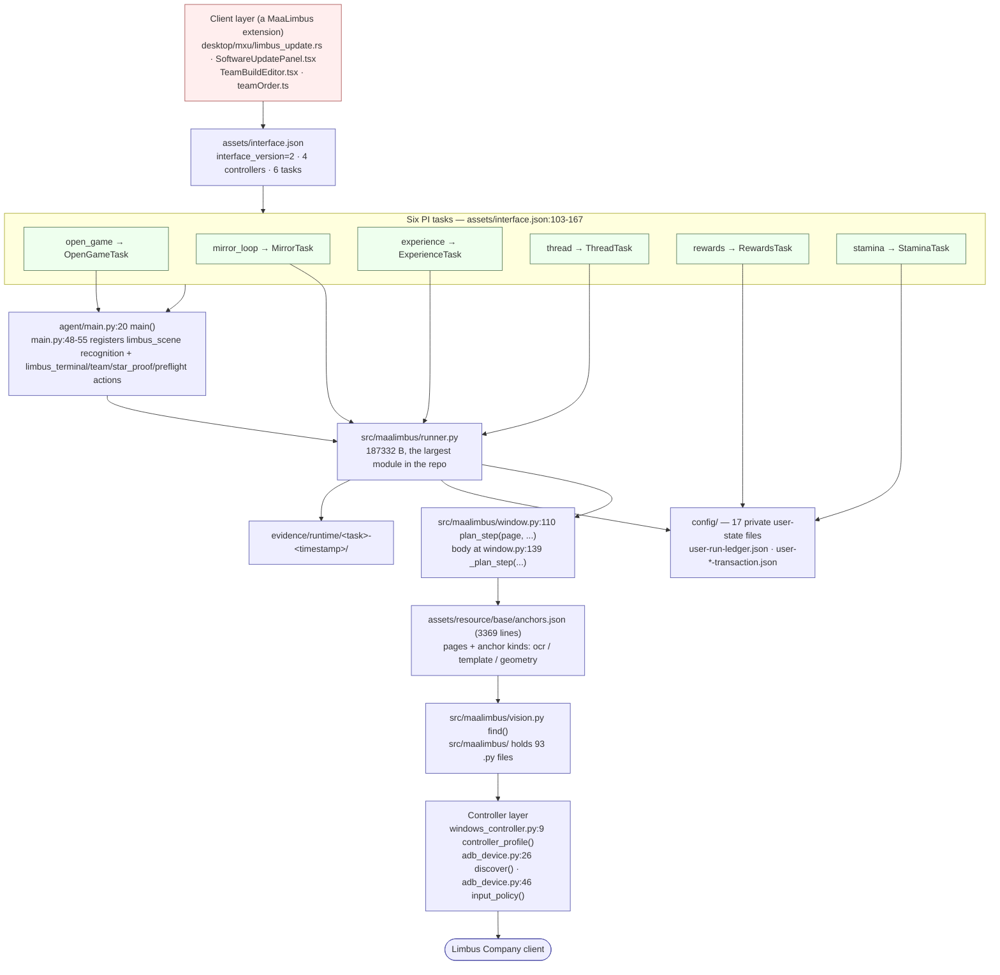
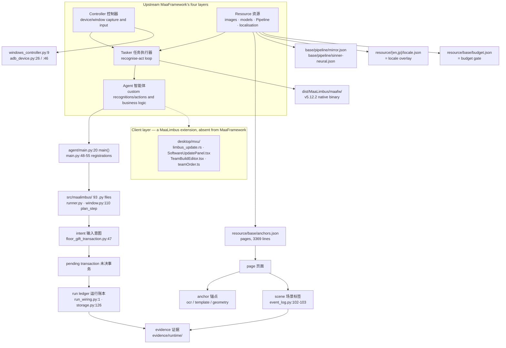

# 1 Overview and Glossary

[中文](../zh_cn/1-overview.md) · [← Index](index.md)

**Current storage policy / 当前容量约定（用户最新调整）**: User revised the whole-project ceiling to3,000,000,000decimal bytes (3GB). This includes source/git/build/dist/caches/models/evidence and temporary output in the folder. Older2GB runs and measurements remain historical. Capture pair/stop/journal bounds, external updater session1GB, all proof/pending guards and game resource budgets are unchanged. Source Agent/launcher both require clean rebuild before installed3GB acceptance; no game spending is granted.

This chapter answers four questions: what MaaLimbus is, what each of the six main tasks does, how far completion actually goes, and how to read the terms and the dependency/license boundaries. Every technical claim is bound to a verifiable anchor (`relative/path:line`, a test name, or an `evidence/runtime/...` path); anything unverifiable is explicitly marked "not accepted".

## 1.1 What this is & how complete it is

### The goal chain

- In one sentence: **five Hard Mirror Dungeon floors → verified rewards → saved-team rotation → repeat**; after that, budgeted Enkephalin conversion/refill, mail and daily missions (`PROJECT.md:9-10`, `README.md:25`).
- Technical positioning: MaaFramework Win32 controller + ProjectInterface V2 + MXU + Python Agent (`AGENTS.md:3`), targeting the Limbus Company native Windows client, shipping English and Japanese resource packs (`README.md:8`, `README.md:23`).
- The upstream version is pinned: `pyproject.toml:10` → `dependencies = ["maafw==5.12.2", "numpy>=2", "opencv-python>=4.10"]`; the runtime package on this machine bundles the same release, v5.12.2 (`docs/maaframework-conformance.md:24-27`).
- There are only two Pipeline files: `assets/resource/base/pipeline/mirror.json` and `assets/resource/base/pipeline/sinner-neural.json`.

### The six main tasks

The tasks are declared in `assets/interface.json:103-167`; labels and descriptions come from the shipped i18n (`assets/i18n/zh_cn.json:75-86`, `assets/i18n/en_us.json:75-86`, `assets/i18n/ja_jp.json`).

| task name | entry | English label | What the repository says it does |
| --- | --- | --- | --- |
| `open_game` | `OpenGameTask` (`assets/interface.json:105-107`) | Open game (`assets/i18n/en_us.json:75`) | Launch Android through Maa and verify the foreground; leave an already-open game running. On Windows, connect the game window first (`assets/i18n/en_us.json:76`) |
| `mirror_loop` | `MirrorTask` (`assets/interface.json:112-114`) | Mirror Dungeon (`assets/i18n/en_us.json:77`) | Use the global saved builds and deployment order; choose one team or a rotation here. Hard by default; spending requires a configured budget (`assets/i18n/en_us.json:78`) |
| `experience` | `ExperienceTask` (`assets/interface.json:131-133`) | Experience Luxcavation (`assets/i18n/en_us.json:79`) | Uses a saved team and navigates through Drive to Luxcavation; an unfinished Mirror run blocks navigation (`assets/i18n/en_us.json:80`) |
| `thread` | `ThreadTask` (`assets/interface.json:141-143`) | Thread Luxcavation (`assets/i18n/en_us.json:81`) | Uses a saved team and navigates through Drive to Luxcavation; an unfinished Mirror run blocks navigation (`assets/i18n/en_us.json:82`) |
| `rewards` | `RewardsTask` (`assets/interface.json:151-153`) | Collect rewards (`assets/i18n/en_us.json:83`) | Claim rewards for the current cleared Mirror run with its module budget (`assets/i18n/en_us.json:84`) |
| `stamina` | `StaminaTask` (`assets/interface.json:161-163`) | Convert Enkephalin (`assets/i18n/en_us.json:85`) | Budgeted conversion recognition is under development; currently captures evidence and stops without spending (`assets/i18n/en_us.json:86`) |

The four controllers are declared in the same file: `windows-window`, `windows-background`, `windows`, `mumu-adb` (`assets/interface.json:14-68`); resources are declared as `en`/`jp` (`:69-86`).

### Completion, stated honestly

The table at `README.md:45-54` is the most concentrated statement of the current standard:

| Feature | Verified range | Not finished |
| --- | --- | --- |
| Windows / ADB control | MuMu-native Maa input, randomised in-box landing, process and single-controller gates | Windows game input and Japanese live operation |
| Global settings and tasks | Six MXU main task entries, global team, Mirror single/rotation selection | Full global-settings edit-and-restart, and GUI Start dispatch acceptance |
| Hard Mirror Dungeon | Actual English five floors (the CLI / `window_step` path, see below), complete collectible receipts, real paid reward claim, Team2→Team7 reentry | Arbitrary layouts, shop/fusion, long unattended farming |
| Battle and gift picking | Native touch WinRate/START, independent Hard/title gates, bounded drags | Smart card assignment, full strategy, Japanese |
| Experience / Thread Luxcavation | Independent task entries referencing saved teams | Actual stages, cost and battle flow; currently stops on the captured page |
| Enkephalin conversion / daily rewards | Independent entries and budget foundation | Actual pages and credit; currently stops on the captured page |
| GitHub updates | Desktop launcher wired to cache, persistent rate limiting, verification, config-preserving install / failure rollback | Public new-version download and a visibly restarted version |
| Black-box learning | Actual Maa nativeONNX inference/proposal boxes and teacher/human-review ownership;5current delayed purchase labels in1episode | Models remain shadow/input_authorized=False; original purchase corpus missing; production policy quality/retraining unaccepted. October no-model/two-sample figures are historical |

**Source/installed boundary (2026-11-17)**: the October8 entry-only packaged limitation is historical. Current frozenMirrorTask has native evidence throughTeam2floors1/2 and floor3navigation/deployment/combat;1280node entry, full inherited order andSTART→turn2 are bound to original pairs. A new complete five-floor payout/rotation chain and actual greenGUIStart E2E remain unaccepted. The old CLIchain does not fill those gaps. Route through the [current checkpoint](9-execution-plan.md#current-checkpoint), then inspect actual process/native page.

Three further standards you must know:

- **There is no accepted release package**, and "the process started, the task returned success, the offline tests passed" does not mean a Mirror Dungeon clear (`README.md:31-32`). One English Hard five-floor chain (including reward claim and saved-team rotation reentry) has real MuMu evidence (`README.md:23`, `README.md:25`), but arbitrary layouts, versions and long unattended farming are not promised.
- **Remaining acceptance**: complete identity/E.G.O verification, current five-floor payout/rotation, nativeGUIStart to terminal and production model policy quality. Partial pre_battle_identity_report and actual purchase/GET chains exist; these features are not wholly untested. See9.4/current checkpoint.
- **Shop/learning**:5current-scope native quote/purchase/reconciliation chains exist. TrainedONNX and purchase-score candidates exist but stay shadow. Five delayed objective labels share one episode; they do not establish independent policy benefit, human approval or a new spending grant. See9.4.1/9.4.2.

**Where the evidence lives**: run evidence under `evidence/runtime/<task>-<yyyymmdd-hhmmss>/`, launch records in `build/native-launch*.json`, logs in `build/native-live.*.log` (`README.md:64`). This repository currently holds 918 run directories of that shape (local directory count, 2026-10-12; the number grows with every run).

### Figure 1: the project at a glance

## 1.2 Glossary

### MaaFramework's four layers, plus one MaaLimbus extension

Upstream splits the system into Controller / Resource / Tasker / Agent. MaaLimbus keeps that vocabulary and gives each layer its own landing points. **Note that the last layer, Client, is a MaaLimbus extension — MaaFramework has no such layer** — and this wiki always marks it as such.

| Layer | English | 中文 | Responsibility | Landing point in MaaLimbus |
| --- | --- | --- | --- | --- |
| 1 | Controller | 控制器 | Device/window capture and input | `src/maalimbus/windows_controller.py:9 def controller_profile(interface_path: Path, name: str)`; `src/maalimbus/adb_device.py:26 def discover(serial, adb_path=None)`, `adb_device.py:46 def input_policy(record, allow_fallback=True)` |
| 2 | Resource | 资源 | Images/models/Pipeline/localisation | Declared in `assets/interface.json:69-86` (en/jp); `assets/resource/base/anchors.json:6`; `assets/resource/base/pipeline/mirror.json`, `assets/resource/base/pipeline/sinner-neural.json`; `assets/i18n/{zh_cn,en_us,ja_jp}.json` |
| 3 | Tasker | 任务执行器 | Runs the Pipeline's recognise-act loop | The upstream MaaFramework binary (in the runtime package, `dist/MaaLimbus/maafw/`); version and provenance verified in `docs/maaframework-conformance.md:8-27` |
| 4 | Agent | 智能体 | Custom recognitions/actions and business logic | `agent/main.py:20 def main()`; `agent/main.py:48-55` registers the custom recognition and actions (`limbus_scene`, `limbus_terminal`, `limbus_team`, `limbus_star_proof`, `limbus_initial_gift_proof`, `limbus_initial_receipt_proof`, `limbus_difficulty_proof`, `limbus_preflight`); the implementations live in `src/maalimbus/` |
| 5 | **Client (a MaaLimbus extension, absent from MaaFramework)** | 客户端 GUI | The ProjectInterface V2 client UI | `desktop/mxu/limbus_update.rs`, `desktop/mxu/SoftwareUpdatePanel.tsx`, `desktop/mxu/TeamBuildEditor.tsx`, `desktop/mxu/teamOrder.ts` |

### Canonical dictionary: one semantic entry

This section owns normative definitions. Context documents and later chapters reference them rather than redefining them. Adapt legacy producer fields explicitly; renaming alone is not migration. See the [architecture contract](2-architecture.md#feature-2-6) and [migration status](9-execution-plan.md#runtime-migration).

| Canonical term | 中文 | Definition and forbidden conflation |
| --- | --- | --- |
| `Frame / FrameRef` | Capture and its reference | Shared immutable FrameRef binds original location, frame_id, original time or explicit unknown, JSON/PNG hashes and actual dimensions after native byte verification. Capture time differs from later read-event time; equal pixels do not imply one capture or business success. |
| `EvidenceCensus / RequiredProof` | 诊断清单 / 必须保留的证明 | A one-time exhaustive diagnostic hash census is distinct from mandatory business endpoints. Its role declaration must match the original report SHA and narrow schema; only images already eligible under their capture owner can retire, while independent ledger/model/review references override. |
| `EvidenceReportRef` | 封存报告引用 | Original report path, bytes, SHA256 and optional archive/member locator; neither current run state nor a transaction receipt. Existing frame-protection references survive compression. |
| `Observation` | 观察记录 | Immutable observed facts, page hypotheses, foreground controls, geometry and provenance; no hidden target selection. A common type is a migration target; current native records need adapters. |
| `identity_only` / `battle_hint` | Read scope / scheduling hint | Existing MaaObserver parameters: identity-only requests a fresh page identity; battle hint chooses new native read order. Neither is business completion, cached controls or input authority. |
| `CAPTURE_PROFILE` | Native capture producer format | bgr8-json1mb-v1 binds actual Journal output and future evidence reservation: uint8 BGR three channels, complete JSON at most1,000,000bytes. It is not recognition confidence or game success. |
| `NativeFrameBinding` | Native frame byte binding | Logical evidence value returned by native_evidence.bound_frame as original JSON/PNG hashes plus record. It verifies pixels/dimensions; it is not a business-state class or a page/action/victory verdict. |
| `scene / page / Overlay` | 场景标签 / 裁决页面 / 遮罩 | scene is a producer label; page is the foreground identity used for this decision; Overlay may own foreground input. An identically named legacy field does not prove foreground resolution. |
| `anchor` | 锚点 | A recheckable recognition assertion; existing anchor kinds are ocr/template/geometry. Recognition does not authorize an input. |
| `BoundingBox / viewport_revision / map_pitch` | 检测框 / 视口版本 / 地图间距 | A box is a rectangle in a named coordinate space; a viewport revision invalidates coordinates after pan/zoom; pitch is centre spacing, not box width or screen resolution. |
| `CalibrationPixels / CapturePixels / DevicePixels` | Calibration / capture / device pixels | Historical controls/gestures use1920×1080 calibration. `frame_coordinates` converts only to the current capture. Map/theme analysis may use a1920 grid but returns boxes in original capture size. Maa alone converts capture coordinates to device input; Python must not convert twice. These measured pixels differ from the registry1280 normalized reference. |
| `CaptureProfile` | Capture sizing policy | Native Maa screenshot sizing: qualified HUD may use1280, other/insufficient reads need fresh1920. Not page identity, input authority or model quality. Original PNG dimensions remain authoritative; analysis interpolation never changes the witness size. |
| `startup_previews / required` | 启动诊断副本 / 执行前必需图 | Same input-free capture prefix; common native identity/time checks, domain-owned semantic equality. The actor before-image and actual input/review references remain required. These storage roles never authorize an action, credit a reward or approve policy quality. |
| `inflight_reads` | 未决普通回合的中间读取 | Unreferenced UNKNOWN/LOADING sampling after an anchored ordinary START reservation; keep before/first/latest and every review pin. Pending stays pending; this is neither a page-class prediction nor outcome/learning approval. |
| `OwnedRoster (account Box)` | 账户已拥有人格集合 | Owned identities exposed by opening each sinner, reconciled against the catalogue index; account Box must not mean a detection rectangle. |
| `Sinner / Identity / E.G.O` | 罪人 / 人格 / E.G.O | A sinner is one of twelve characters, an identity is an equipable character variant, and E.G.O is separate equipment. Sinner recognition does not prove identity or E.G.O equipment. |
| `TeamSlot / SavedTeamProfile / PresetSlot` | 游戏队伍槽 / 保存方案 / 预设槽 | The game left-bar team slots 1–40, script-saved build/order profiles and game preset slots have separate namespaces; equal integers do not establish identity. |
| `DeploymentOrder / GridCell / rotation_cursor` | 出战顺序 / 网格位置 / 轮换游标 | Order is proved by selection badges; a grid cell is a card location; the cursor indexes the rotation queue and is not a team number. |
| `LaunchSpec / RunState` | 启动规格 / 运行事实 | LaunchSpec fixes resolved task, team, count, policy and budget references; RunState carries current scope, phase, binding and business events. New settings cannot silently rewrite an unresolved action. |
| `ActionProposal / ActionAttempt` | 动作提议 / 输入尝试 | A proposal includes candidates, scores, constraints and successor criteria; action_id identifies a logical action and attempt_id one physical attempt. Proposed is not sent. |
| `TargetRole` | 目标角色 | Map nodes use lattice reach/navigation transactions; page controls use their own bindings. Page name or bare coordinates do not establish role; legacy MAP clicks retain node guards.  Current-room inspection binds canonical frame hashes and complete train geometry; it is not a destination or an arbitrary MAP-role reach exemption. |
| `SelectionCommit` | 选择计数提交 | Domain-settled one-step participant-count increment, bound to original JSON/PNG hashes and the planned prefix. It does not verify identity, E.G.O, order, battle or payout. Its only consumer currently bounds diagnostic storage. |
| `RecorderSession` | 捕获会话 | One process-owned capture directory/log; restarting it does not create a new game RunScope. Verified selection diagnostics may be superseded across recorders in the same progressing domain scope. |
| `intent / pending transaction` | 持久意图 / 未决事务 | Intent is persisted before a possible input and proves reservation, not dispatch. Pending means unsettled and may include uncertain dispatch. Recovery reconciles evidence before considering another attempt. |
| `TransitionEvidence / TransitionVerdict` | 后继证据 / 后继裁决 | Evidence binds before/after FrameRefs and the native action trace. Verdicts are accepted/rejected/unjudged only. Unjudged is neither success nor a negative label; historical undetermined prose means unjudged. |
| `dispatch_status / input_sent` | Native dispatch status / legacy attempt flag | `uncertain` means an attempted request without confirmed completion; `input_sent=True` here is not game effect, a ledger event or training truth. No cross-route replay; distinct from pre-dispatch refusal. |
| `borrowed controller` | Callback-scoped native proxy | Maa5.12.2 RemoteTasker replaces its proxy on each controller lookup. Resolve once and share within that callback; never cache across callbacks. Device, capture policy and startup checks obey this lifetime. |
| `node_preview.enter` | Current-frame derived control | Capture-coordinate[x,y,w,h], not Text or persistent state. Derive from the current named preview OCR/size, never a preceding cached field. It proposes Enter without proving room entry. |
| `passed (legacy field)` | 旧通过标志 | Interpret per producer: it may mean continuation allowed, node return or harness step pass. It must not directly become transition acceptance, a clear, payout or a training label. |
| `Receipt / Acknowledgement / run ledger` | 收据 / 确认输入 / 运行账本 | A receipt is result evidence bound to the business object/amount/successor; acknowledgement is a closing or confirmation action; the ledger admits proved business events. Clicking Confirm/GET is not credit. |
| `floor_clear / final_victory / reward_received / HOME / reentry` | 楼层完成 / 最终胜利 / 到账 / 主页 / 再入场 | Five separately evidenced facts. Reaching the next floor is not final payout; HOME is not proof of this run's credit; seeing entry is not proof of a new run. |
| `ExecutionBudget / ResourceBudget` | 执行预算 / 资源预算 | Execution budgets bound attempts, time and steps; resource budgets require scope, currency/unit, cap and a fresh quote. Run coins, starlight, modules and lunacy cannot be interchanged as bare integers. |
| `CompletionFact` | 业务完成事实 | A business completion fact verified against original native bytes and current run scope; observation can establish it independently of the next click. It is not an ActionOutcome, resource grant or policy quality. Incoming map checkpoints currently use run_wiring.observe_map_checkpoint. |
| `EvidenceCapacity / reserved credit` | 证据容量预留 | Storage credit counted in the project byte total, not a module/starlight grant or evidence of dispatch, transaction completion or label approval. |
| `refresh credit / input successor credit` | 观察预留 / 输入后继预留 | Source purpose refresh funds one full read plus stop, no physical input; only an independent fresh record can separately fund two full input successors. Same producer bounds and3GB; not game resource authority. |
| `storage credit handoff` | 未使用容量交接 | Before a new input, this synchronous Journal may release its own unused placeholder under pressure; the same full two-pair target and stop/journal margins must be readmitted before dispatch. Actual images, pending and spending authority do not change. |
| `journal_scope` | 录制scope绑定 | Only explicit typed start.run_scope / proposal.episode facts participate. Missing fields may be supplemented by a consistent explicit fact; null, malformed, conflicting or absent-all facts cannot bind a recording. Diagnostic ownership only. |
| `drive_menu_probe` | 模式字幕读取探针 | A mode-only anchor permits at most two native OCR crops on the same pixels and vetoes HOME. It is neither a DRIVE verdict, a click target nor a game result. |
| `service_notice` | Server foreground notice | An exact maintenance title vetoes background input and idle-entry retirement; raw resume text has no date or retry deadline. A complete unique Close permits one bounded navigation attempt; only an independent successor labels dismissal, without server/run authority. |
| `client_update_required` | Required game-client update foreground | Exact game message vetoes background TITLE; Close/Store boxes are metadata, no input grant. Package update is separate from login or dungeon success. |
| `login_response_wait` | Acknowledged Start awaiting server/UI response | One original absolute180s window, tightened by task deadline; fresh reads do not renew it or repeat Start; no business receipt credit. |
| `discarded capacity plan` | 容量维护后丢弃的只读计划 | Never submitted; exact typed admission and an earlier native representative are required before duplicate retirement. Reobserve/replan before dispatch; not an actual-input boundary or outcome. |
| `cold diagnostic retirement` | 冷诊断退役 | The ordinary domain deletion group may retire an unreferenced archived intermediate. Exact surviving PNG bytes and all JSON/journals remain; an archive commit is a storage receipt, never game completion or label approval. |
| `lossless archive / diagnostic reclamation` | 无损归档 / 诊断回收 | Cold-store eligibility follows closed ownership, independent pins and original-byte binding; it retains full PNG/JSON without judging pages or approving business outcomes. Permanent diagnostic reclamation separately needs domain-answered roles. Strong referenced originals stay raw until all their readers have separately verified migration. |
| `verified_reads` | 原图读取会话 | Bounded RAM reuse within one plan/reserve; actual index/container bytes are read and SHA-checked on every request, existing raw wins, cache releases on exit. No FrameRef identity,3GB disk cap, eligibility or action-grant change. |
| `NavigationCheckpoint` | 导航检查点 | Fresh stable page/hash/original caption ROI already meets a later wait; skip navigation without claiming input or business success. |
| `capture_reclaim_intent` | 存储回收意图 | A durable storage obligation prepared for every member before unlinking a diagnostic group. It can finish only the same original JSON/PNG hashes; fresh business/model/review references or changed bytes preserve files. It is not a game input intent or approval of an action outcome/learning label. |
| `CaptureSessionSeal` | 采集封存 | Storage event for an ended input producer; no verdict on game pending, receipts or learning labels. |
| `RuleScore / NeuralScore / DecisionLog` | 规则分 / 神经分 / 决策记录 | Record components, weights, ranking direction, constraints, final score and selection reason; one policy owner performs final ranking. A high score is not a quality pass. |
| `InferenceExecuted / PolicyParticipated / DecisionChanged` | 执行推理 / 参与策略 / 改变决策 | Distinct facts: inference ran, scores entered production ranking, and selection changed against a model-free baseline. Adapt legacy model_applied/learned_applied by producer semantics; neither implies production authority. |
| `Prediction / TeacherLabel / HumanReviewed` | 预测 / 教师标签 / 人工复核 | Prediction is not an independent teacher. A verified successor can approve an objective action outcome, not policy optimality. Automatic approved is not human review; human corrections take precedence with provenance. |
| `TrainingEligible / QualityPassed / ProductionEnabled` | 可训练 / 质量通过 / 生产启用 | Prove each separately; ModelTrained only establishes a trained artifact. Interpret existing off/shadow/ranked modes per model implementation; shadow does not control input. |
| `Episode / CaptureSession` | 独立游戏局 / 采集会话 | An episode follows a real run scope and can span restarted capture sessions. Split training/validation by episode, not adjacent frames from different recorder processes. |
| `Designed / Implemented / Installed / LiveVerified / E2EAccepted` | 规范确定 / 源码实现 / 已安装 / 实机验证 / 整链验收 | Architecture acceptance is a normative decision; other states need their own commit, install and scoped behavior evidence. Local live proof cannot be shortened to whole-project completion. |

### Figure 2: how the terms relate

## 1.3 Dependency and license boundaries

### The vendored upstream relationship

- `sources/upstream/MaaFramework/` is an in-repo source checkout of MaaFramework; its current HEAD is `cc5fef675f42ca899e12bc4932ff37ac1278853c` (local `git rev-parse HEAD`, 2026-10-12). The provenance manifest records exactly that commit as the documentation/API reading anchor (`THIRD_PARTY_NOTICES/README.md:9-16`). `git describe --tags` yields no tag in that checkout, so **cite the commit, not a tag**.
- The runtime package bundles the same release, v5.12.2: `docs/maaframework-conformance.md:24-27` records that this machine's `build/portable check .../build-info.json` has `inputs.maa = MAA-win-x86_64-v5.12.2.zip`, matching `maafw==5.12.2` in `pyproject.toml:10`.
- This machine also has `build/maafw-v5.12.2/` (the local copy used when reading the spec) and `build/maafw-src/` (the reading list in `docs/maaframework-conformance.md:17-22`).

### MXU

- MXU 2.7.1, commit `9fa8cc51e8ff8cd89d99f3ea55fe3a7a82e6ede3`, is the base for the project-modified Windows desktop executable; the original AGPL notice is `THIRD_PARTY_NOTICES/MXU-AGPL-3.0.txt` (`THIRD_PARTY_NOTICES/README.md:19-20`), with packaged sources in `sources/MXU-v2.7.1-source.zip` (`THIRD_PARTY_NOTICES/README.md:22`). Modified candidates additionally carry `MXU-MaaLimbus-source.zip` (`THIRD_PARTY_NOTICES/README.md:23`).
- **Boundary**: MXU carries its AGPL-3.0 notice (`THIRD_PARTY_NOTICES/README.md:26`); the root license does not relicense third-party material (`README.md:70-74`).

### License texts and boundaries

- MaaLimbus's own code: AGPL-3.0-or-later, in the root `LICENSE` (`THIRD_PARTY_NOTICES/README.md:3`, `README.md:70`). That was this project's own choice — **MaaFramework does not require an application to be AGPL** (`README.md:70`).
- The MaaFramework native runtime 5.12.2 is **LGPL-3.0** (not AGPL): text at `THIRD_PARTY_NOTICES/MaaFramework-LGPL-3.0.md` and the referenced `THIRD_PARTY_NOTICES/GPL-3.0.txt` (`THIRD_PARTY_NOTICES/README.md:9-10`, `README.md:72`); the actual release commit and source archive for v5.12.2 are at `THIRD_PARTY_NOTICES/README.md:14-16`.
- LALC-derived assets are AGPL-3.0 (`THIRD_PARTY_NOTICES/README.md:26`); MaaCommonAssets (`dabcd4681ac990dc4361de26416d986abd80e4aa`) is MIT (`THIRD_PARTY_NOTICES/README.md:39-40`); PaddleOCR is Apache-2.0 (`THIRD_PARTY_NOTICES/README.md:41-42`).
- Frozen Python/MaaDeps runtime notices: new Windows builds require the retained MaaDeps v2.12.2 Windows runtime (`THIRD_PARTY_NOTICES/README.md:49-57`).
- Distribution boundary: a new Windows package must ship the license texts, source versions, build instructions and any applicable corresponding source, and **that package has not been published yet** (`README.md:76-78`); Lix-derived assets cannot be turned into LGPL by swapping the root license (`README.md:74`).

## Not covered by this chapter

- Module responsibilities and design trade-offs → chapter 2.
- The control flow and timing inside one run → chapter 3.
- A step-by-step account of the end-to-end business chain → chapter 4 (reserved, not delivered this round).
- The field meanings of the 17 `config/` user-state files and the full run-ledger data model → chapter 5.
