# 3 Runtime

[中文](../zh_cn/3-runtime.md) · [← Index](index.md)

<a id="page-journey"></a>

### Page components and resumable route records

The native Agent assigns one `step_attempt` to each iteration. Recognition, action intent and successor reads from that attempt share the identifier. A replan gets a new identifier. The `step_observation` event records the read phase, source frame, hash and elapsed time. These diagnostic identifiers join records and confer no authority to settle a transaction.

For the read and input nodes owned by Mirror, `native_pipeline_task` records MaaFramework's pipeline, recognition and action callbacks, their IDs and monotonic elapsed times. The subtask ID returned by `Context.run_task` joins the callback row to the independently captured `step_observation` frame. The callback context can refer to the parent task, so its job ID is unsuitable for this join. The Agent filters to the six Mirror nodes and records no callback focus or OCR payload. An unsuccessful native action prints the node name, task ID and elapsed time in the MXU task log. Recognition alternatives do not print an action failure. MXU registers the client-side sinks before task execution.

`PAGES` defines page names and owners. `anchors.json` declares components, and `describe_page` binds component observations to their original capture. The view distinguishes observed, unresolved, ambiguous, historical geometry and unchecked components. Historical geometry and unchecked templates carry no current control evidence. The entry's `entry.enter_button` and `entry.status` reuse the classifier's own OCR reads. The actual Team2 Floor 3 entrance shows Enter and Exploring together, so the Enter label alone cannot distinguish resuming from starting over.

The runtime appends `page_checkpoint` records to `events.jsonl` when the page, floor or component state changes. Each record names its original capture and remaining ledger milestones. The plan adds its control, action and allowed successors before storage admission and dispatch. Proposals, physical dispatch, independent successors and ledger settlement each have their own evidence. `python tools/run_ledger.py status --journal <events.jsonl>` shows the observed path, last recorded screen, matching same-frame proposal and verified floors for the same run. The game determines branch rooms. A restarted task observes a new frame and reconciles pending work before choosing where to resume. A later screen removes the previous frame's proposal from the current view.

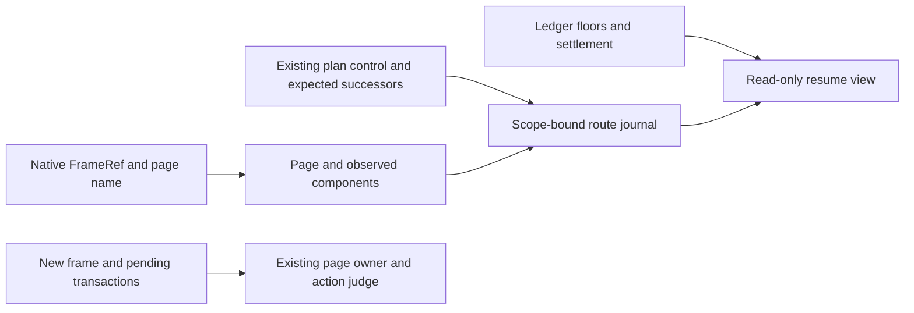

The current registry has 63 page names and 43 matching component catalogs. The catalog count measures declared coverage. This slice connects Mirror entry, storage admission and the journal reader. Extend the same component projection using existing dynamic readers and verify missing and ambiguous components for each page. Interruption, manual navigation and same-page state changes still require their own successor evidence.

<a id="battle-progress-lifetime"></a>

### One battle-progress writer across storage rereads

#### Dial position and turn readiness

The original Team2 replay separates the two. In run `packaged-mirror-20261119-160101`, the strict disc reader refused the unassigned dial at both capture sizes. With no `START` caption, the caption-relative fallback still supplied a target, and the early tap left the turn unchanged. Win Rate then produced assigned skills and a visible `START`. The independent storage reread preserved that state before the old stall guard stopped the task.

Ten original frames were replayed with their PNG hashes checked. Removing `START` from the recognition input exposed how much the warm pixel share depends on the fallback box. The two unassigned boxes measured 0%, and the assigned boxes from this encounter measured about 79%. A historical frame whose submit advanced turn 4 measured only 16% once its caption was removed. A separate captionless witness passed the existing strict shape reader. The current encounter's 0% and 79% split does not establish a general brightness threshold, and mandatory OCR would discard the captionless witness. The private build report is `build/battle-start-readiness-review.json`.

`start_button` feeds both `BattleObservation` → `MaaObserver` → `MirrorRunner` → `plan_step`, and `begin_turn_plan` → the native `BattleStartTurn` node. If the unnecessary early tap recurs in installed continuation, carry the evidence type with the same frame: an explicit START or the strict lit control can support a direct submit. For a position-only fallback, the continuous task should first use the configured assignment control, then read fresh evidence for that turn. The single native submit node needs its own activation evidence because it has no assignment history. Replay dim, assigned, captionless, and interrupted-turn variants through both consumers before changing either. A later turn, attack phase, or result remains the separate progress check. The installed battle-counter repair is the current candidate for the next full live continuation.

Actual installed de63542 run160101 sent MAX, a non-ready gold dial and WinRate; original frame8 shows assigned skills/START. Refresh-only admission discarded the pending submit and frame9 was freshly recorded, then battle_progress_stalled ended before input readmission. Thus refresh capture is physically observed, but its full post-refresh input chain is not accepted.19original files,106private/33canonical preserved in build/battle-refresh-live-outcome.json; folder2,983,506,218bytes. Mechanism review found the same HUD counter incremented by battle_progress and an obsolete inline block. Plan: one writer; storage-only refresh does not spend another unchanged-turn stall round. Normal frozen HUD still spends its original budget, changed turn still resets it, refresh count3/deadline/physical two-pair funding remain. Gold ring geometry alone is not assignment readiness; no unsupported visual threshold change. Source test/correction→full per-case XML→clean freeze→normal currentTeam2 continuous task. Whole run, paid receipt, model promotion and lost0048 remain open.

Source implemented: obsolete duplicate progress block removed; capacity_reobservations marks only unsent storage-refresh reads, so unchanged turn does not spend another stall round.274related pass/93historical skips/36.04s/ownexit0. Five new cases include original assigned-frame/native-event envelope→whole Runner→simulated START send, ordinary one-count/frozen stop, three-refresh bound, real turn reset and blind counter preservation. All five fail against the original04557e8 source. Initial replay harness missed native event fields and then the raw-frame reader strips frame names; both mistakes were corrected without changing original records or game guards. Final full XML/freeze/physical continuation remain next.

Adjacent lifecycle correction implemented before installation: independently named nonbattle/nonloading pages clear the prior fight progress/blind counters. UNKNOWN, LOADING, BATTLE_TIP and BATTLE_PLANNING preserve fight ownership; a normal planning observation still counts once and may stall.314related pass/93historical skips/61.31s/ownexit0. Eleven added cases: first five original-event/storage cases, plus six page-lifetime variants; original HOME/MAP boundary counterexample2failed/3passed before correction. Loading was initially reset because it is named, not UNKNOWN; one negative caught this and the existing is_loading predicate now excludes it. Planning fixture was corrected to carry readable wave/turn and expect one normal count. Earlier full run was explicitly terminated incomplete at35percent/exit-1 for this necessary neighbouring fix, not counted green. Complete attempt4027passed/701skipped/1NAV-only Wiki failure/843.31s/ownexit1. Bilingual chapter3 navigation was restored to line3;73Wiki/privacy checks then passed82.51s/ownexit0. Runtime SHA remains identical to the complete attempt, XML11added runtime passes/0further runtime status losses; no second complete suite or all-green complete-attempt claim. Navigation checks should precede the long regression when inserting local views; route structure alone does not check chapter layout. Actual cleanf94661d Agent installed/terminalexit0;549source snapshot,13complete compiled identities/self-test and actual frozen Runner count/six synthetic boundaries passed. Frozen native cache/capacity retained-pixel replay and memory-staging/readback retained.106private/33canonical/19current originals unchanged. Source/frozen7210references/143archived reports match; launcher unchanged. build/battle-refresh-installed-verification.json. Closed exact-ZIP duplicate retirement12copies/3,487,105bytes retained all unique bytes, every packet and current originals, folder2,985,782,070bytes. Fresh page and continuous sameTeam2 next; not GUIStart/whole-run/payout/rotation/model promotion/lost0048 recovery. Full attempt NAV-only failure and subsequent73passing Wiki checks remain separately recorded.

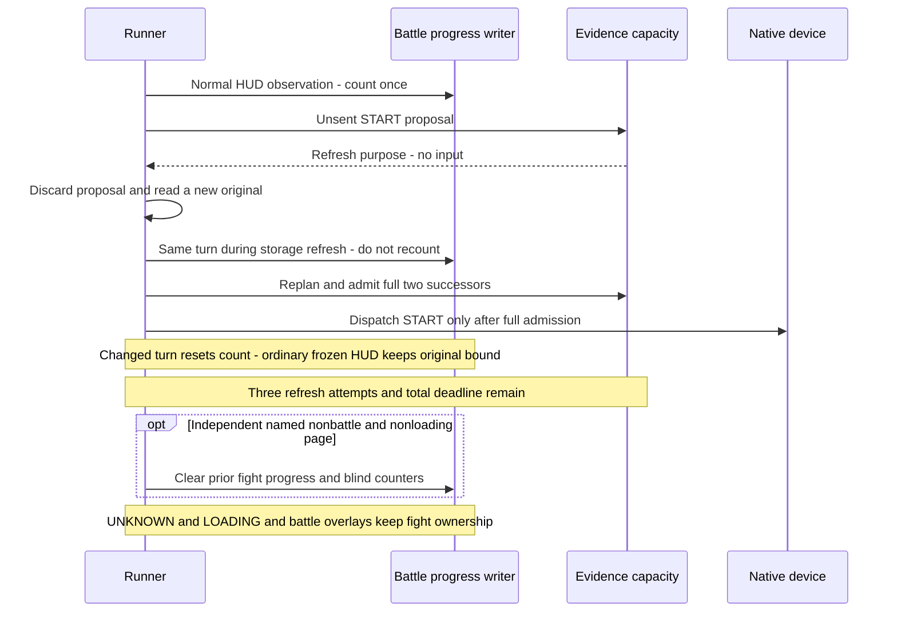

This chapter explains what happens inside one run: how a frame becomes an action, how that action is issued, and when the loop stops.
<a id="dead-producer-handoff"></a>

### Dead producer, result ownership and diagnosis

`jobs.wait_task` and `stop_tasker` now bound posting the native stop itself, not only polling a job which might never be returned. The installed verifier also bounds native disconnect, reaps only its owned child and writes its failure report before bypassing an unconfirmed native destructor. This cleanup never retries a game action or turns an unconfirmed stop into success.

After a successful OpenGameTask and independent foreground check, the verifier checks its separately retained original launch-result bytes before retiring the shared result filename. MirrorTask must produce its own new result; a watchdog exit cannot inherit `game_already_foreground` as a Mirror result. Original launch proof remains available.

Both watchdog endings retain at most24Python stack locations from the actual execution thread: basename, line and function only, never source text, local values or arguments. This diagnoses a future native/geometry/storage stall; it does not retroactively prove the uncaptured cause of the previous stall. Native reads/input and storage retain their own finite contracts.

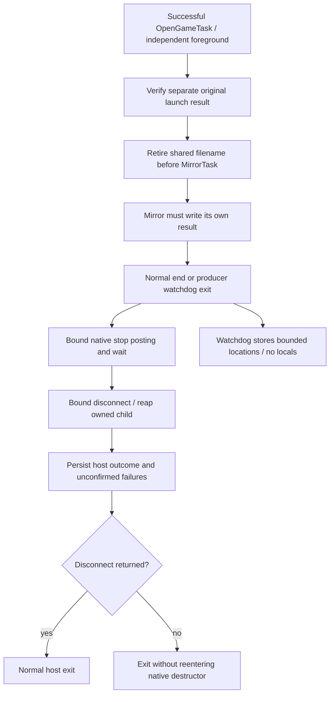


- Upstream vocabulary: Controller (screen capture / input), Resource (images, models, Pipeline, localization), Tasker (the recognition-action loop that runs a Pipeline), Agent (custom recognitions / actions).
- Project-owned extension (MaaFramework has no such layer): Client = ProjectInterface V2 desktop GUI (`desktop/mxu/`).

Reading convention: `relative/path:line` is a verifiable anchor. Anything this chapter did not open and confirm is explicitly marked "not yet verified".

---

## 3.1 Recognition and the page model

### 3.1.1 Two namespaces: `scene` and `page`

At runtime there are **two** page identifiers, and they must not be confused.

| Identifier | Defined by | Entry point | Criterion |
|---|---|---|---|
| `scene` | OCR text + normalized position | `src/maalimbus/vision.py:63 def classify(records, locale, size)` | which strings were read this frame, inside which ROI |
| `page` | `pages[].id` in the anchor table | `src/maalimbus/runner.py:839 def resolve_scene(registry, directory, record)` | scene + anchor hits + overlay precedence |

- Text-reading primitive: `src/maalimbus/vision.py:19 def find(records, pattern, roi, size, threshold=.65)`; the record type is `src/maalimbus/vision.py:13 class Text` (`text / box / score`).
- The overlay outranks the label underneath: `src/maalimbus/window.py:79 def resolve_overlay(page, *, overlay_hit)`, which returns `'TUTORIAL'` when it hits (`src/maalimbus/window.py:88`). The reason is written at `src/maalimbus/window.py:82-86`: the overlay's own continue control does not change from card to card, so "a visible continue" outranks the label below it.
- Self-clearing pages, `WAIT_PAGES`: `src/maalimbus/window.py:76`, value `('UNKNOWN', 'BATTLE_RESULT', 'DEFEAT')`. The planner sends no input on these pages; the driver only waits for them to change.

### 3.1.2 The anchor table

File: `assets/resource/base/anchors.json` (3369 lines). Runtime constant: `src/maalimbus/runner.py:225 REGISTRY = ROOT / 'assets/resource/base/anchors.json'`.

Top level (`assets/resource/base/anchors.json:1-6`):

```json
{
  "version": 1,
  "reference_width": 1280,
  "reference_height": 720,
  "note": "...",
  "pages": []
}
```

Per-page fields (using the `map` page as the example, `assets/resource/base/anchors.json:7-45`):

| Field | Meaning | Example |
|---|---|---|
| `id` | page id — this *is* the runtime `page` | `"map"` (:8) |
| `title` | human-readable title | `"楼层地图（Exploring Floor N）"` (:9) |
| `evidence` | archived observations backing the assumption | `"evidence/runtime/map-advance-20261006-014737/frame-0001.json"` (:11) |
| `identity[]` | the recognition anchors | `map.floor` (:16), `map.pack_name` (:29) |
| `controls[]` | proven control boxes | empty on `map` (:42) |
| `live_derived[]` | quantities computed live, never hard-coded | `map_vision.node_markers(image)` (:44) |

An `identity` anchor has the shape `{id, kind, pattern, roi, threshold, note}` (`assets/resource/base/anchors.json:15-27`). Legal `kind` values: `src/maalimbus/anchors.py:19 KINDS = ('ocr', 'template', 'geometry')`.

Loading and offline re-checking all live in `src/maalimbus/anchors.py`:

- `src/maalimbus/anchors.py:24 def load(path)`, `src/maalimbus/anchors.py:31 def validate(registry)`, `src/maalimbus/anchors.py:53 def validate_anchor(anchor, page_id)`
- `src/maalimbus/anchors.py:92 def resolve_evidence(registry, root)`
- per-kind criteria: `check_ocr` (`:122`), `check_template` (`:132`), `check_geometry` (`:159`)
- aggregation: `src/maalimbus/anchors.py:169 def evaluate_anchor(...)`, `src/maalimbus/anchors.py:192 def evaluate(...)`, `src/maalimbus/anchors.py:212 def failures(report, *, require_geometry=False)`

At runtime the table is flattened into `{anchor name: pixel box}` by `src/maalimbus/runner.py:693 def controls_by_id(registry: dict) -> dict`. That mapping is exactly the `controls` the planner receives (`src/maalimbus/window.py:146-147` states it: `controls` maps anchor names such as `node_panel.enter_button` to pixel boxes).

### 3.1.3 Vision modules

All map-page geometry is computed live, and it is concentrated in `src/maalimbus/map_vision.py`:

- Threshold constants sit at the top of the file: `REFERENCE_WIDTH = 1280` (`:48`), `BADGE_THRESHOLD = 0.90` (`:49`), `LATTICE_PITCH = (384, 320)` (`:537`), `CLICK_SIDE = 40` (`:538`).
- Nodes and player: `class NodeMarker` (`:132`), `badge_nodes` (`:146`), `node_markers` (`:186`), `player_marker` (`:238`), `flame_player` (`:275`), `yellow_flame_player` (`:293`), `player_of` (`:396`), `train_player` (`:418`).
- Paths and candidates: `lit_nodes` (`:715`), `lit_rings` (`:720`), `path_end` (`:734`), `marker_boxes` (`:791`), `chevron_target` (`:816`), `advance_candidates` (`:490`), `advance_plan` (`:511`).
- Clicks and whole pages: `map_clicks` (`:853`), `map_header` (`:1147`), `map_page` (`:1196`), `read_map_asset` (`:1224`), `route_decision` (`:1239`).
- Non-map pages: `node_panel` (`:94`), `enter_target` (`:124`), `pre_battle_team_page` (`:1129`), `battle_target` (`:1140`).

Sibling vision modules in the same directory (taken from the import list at `agent/recognition.py:20-43`; their bodies were not opened this round): `battle_vision`, `team_vision`, `gift_vision`, `theme_vision`, `grace_vision`, `star_vision`, `overlay_vision`, `overlay_dismissal`, `shop_vision`, `event_vision`, `deployment`, `deployment_*`.

### 3.1.4 Localization overlays

**Conflict with the shared fact contract (code wins)**: the contract says `assets/resource/base/locale.json` is layered on top of `base`, but that file **does not exist**. The real layout is:

| File | Lines | Role |
|---|---|---|
| `assets/resource/en/locale.json` | 89 | English regex table used by the Agent's recognitions |
| `assets/resource/jp/locale.json` | 26 | the same table in Japanese |
| `assets/resource/en/pipeline/locale.json` | 1 (content `{}`) | MaaFramework pipeline text localization (en) |
| `assets/resource/jp/pipeline/locale.json` | not verified | the same (jp) |

There is exactly one load site, and it loads **only the selected language's file** — there is no base overlay:

- `agent/recognition.py:103 self.locale = json.loads((ROOT / f'assets/resource/{locale}/locale.json').read_text(encoding='utf-8'))`
- The language name comes from ProjectInterface's `resource.name`, defaulting to `'en'`: `agent/main.py:42-45` (`resource = json.loads(os.environ.get('PI_RESOURCE','{}'))`; `locale = resource.get('name','en')`; `recognition = LimbusRecognition(locale)`).

Usage is "take the regex by key, hand it to `vision.find`", for example:

- `agent/recognition.py:421` — `find(records, self.locale['gift_confirm'], (.53,.65,.68,.73), size, .85)`
- `agent/recognition.py:159` — `find(records, self.locale['inferno'], (.70,.07,.99,.3), size)`
- `src/maalimbus/vision.py:57` — `locale.get('cancel', r'(?!x)x')`

Every key in the `jp` table is written as a `japanese-pattern|english-pattern` alternation, e.g. `assets/resource/jp/locale.json:2 "home_drive": "^ドライブ$|^Drive$"`.

---


<a id="feature-3-1-5"></a>

### 3.1.5 Recognition, overlays and fresh observation

Scene, resolved page, overlay ownership and freshness are separate checks. No new analysis event is not an unknown page: the last journal entry cannot stand in for a post-input observation. An observed but unclassified frame enters 3.7. Overlay dismissal uses its own observed control.

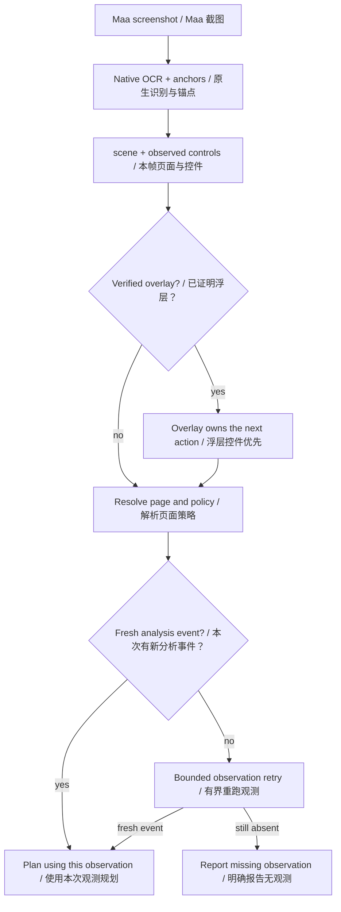

Source boundaries: `src/maalimbus/runner.py:1` (`MaaObserver.observe`, `resolve_scene`); `src/maalimbus/overlay_dismissal.py:1`; `agent/recognition.py:1`.

## 3.2 Decision and execution

### 3.2.1 The single-input contract of `plan_step`

The entry signature (`src/maalimbus/window.py:110-114`, verbatim):

```python
def plan_step(page, *, controls=None, start_box=None, auto_assign=None,
              candidates=None, candidate_index=0, nodes=None, arrows=None, team=None,
              reward=None, gift=None, cards=None, graces=None, initial=None,
              search=None, check=None, defeat=None, bonus=None, difficulty=None,
              shop=None, battle_assignment='win_rate'):
```

- **What it takes**: one `page` string (an anchor id) plus keyword observation payloads. Every payload is a number or box already read from this frame (candidate node boxes, team-card badges, reward counters, the skill check's slot, and so on); the docstring lists them at `src/maalimbus/window.py:146-158`. The contract carries no history, no device, no network — it is a pure function.
- **What it returns**: a plan dict built by `src/maalimbus/window.py:91 def _plan(page, action, *, target=None, node=None, expect=(), reason, detail=None, advance=False, to=None, duration=None)`, with keys `page / action / target / node / expect / reason / advance` and the optional `to / duration_ms / detail` (`src/maalimbus/window.py:93-103`).
- **Refusal**: `src/maalimbus/window.py:106 def _refuse(page, reason)` returns `_plan(page, RECORD, reason=...)`.
- **The second verdict**: `plan_step`'s own body does exactly one thing — a target that lands on a `FORBIDDEN_CONTROLS` control (`src/maalimbus/window.py:50-63`) is re-issued as `control_is_forbidden` (`src/maalimbus/window.py:128-135`). Two whitelisted exceptions: `STAR_CONFIRM`'s `star_confirm.cancel_button` and `GIFT_PICK`'s `gift_pick.refuse_button` (`src/maalimbus/window.py:129-133`).
- **Split of work**: `src/maalimbus/window.py:139 def _plan_step(...)` shares the signature and carries the whole "page -> input" dispatch; `plan_step` is only the forbidden-control verdict plus delegation (`src/maalimbus/window.py:120-127`).
- **Caller**: `src/maalimbus/runner.py:2415-2425`, inside `MirrorRunner.step` (`src/maalimbus/runner.py:1490`): `plan = plan_step(page, controls=plan_controls, arrows=arrows, difficulty=difficulty, start_box=record.get('start_box'), auto_assign=record.get('auto_assign_buttons'), battle_assignment=settings.battle_assignment, candidates=candidates, candidate_index=choice_index, team=team, reward=reward, gift=gift, cards=cards, graces=graces, initial=initial, check=check, defeat=defeat, search={'mode': settings.gift_search}, shop=shop, bonus={'spend': state['run_settled_itself']})`.
- The import sits at `src/maalimbus/runner.py:67` (the `from maalimbus.window import ...` line). The module docstring at `src/maalimbus/runner.py:1-31` also names `tools/window_step.py` as the second frontend; that file was opened this round and its usability checked (419 lines; `tools/window_step.py:62-209` is its `build_parser()`, and `C:\Python313\python.exe tools\window_step.py --help` prints usage normally). Details in 3.5.

### 3.2.2 A real data-shape example

The object below is assembled from the real field definition of `_plan` (`src/maalimbus/window.py:93-96`) and the real `confirm_proven_owned_gift_refusal` branch on `UNKNOWN_DIALOG` (`src/maalimbus/runner.py:2434`); every field name comes from the code:

```python
plan = {
    'page': 'UNKNOWN_DIALOG',
    'action': 'click',
    'target': [x, y, w, h],              # progress/control box, in pixels
    'node': None,                        # non-None means: go through a pipeline node instead
    'expect': ['MAP', 'REWARD_CARD', 'UNKNOWN'],
    'advance': False,                    # True = this page's label should stay; a changed frame proves the click
    'reason': 'confirm_proven_owned_gift_refusal',
}
```

Field semantics (all anchored):

| Key | Semantics | Anchor |
|---|---|---|
| `page` | the page id the plan was made for | `window.py:93` |
| `action` | `'click'` / `SWIPE` / `NODE` / `RECORD` | `window.py:93`; constants imported at `src/maalimbus/runner.py:67` |
| `target` | the box to click/drag (`None` = no input) | `window.py:94` |
| `node` | set when running a pipeline node instead of a target | `window.py:95` |
| `expect` | the set of acceptable successor pages; `ANY` means "just change" | `window.py:95`, `window.py:1046-1048` |
| `reason` | decision-reason string, also the journal key | `window.py:95` |
| `advance` | the page is expected to stay; a frame change is the proof | `window.py:96`, `window.py:1064` |
| `to` / `duration_ms` / `detail` | only on the drag and attached-detail branches | `window.py:97-102` |

The verdict record is assembled by `src/maalimbus/window.py:1052 def step_result(plan, *, sent, before, after, page, frame_changed=False)`, which returns `{action, reason, passed, page_before, page_after, expect, clicks_sent}` (`window.py:1050-1056`).

### 3.2.3 The loop guard (against repeating an action)

It lives at the tail of `MirrorRunner.step`: `src/maalimbus/runner.py:2985-2995`.

```python
if page not in LOOP_GUARD_EXEMPT and plan.get('reason') not in LOOP_GUARD_EXEMPT_REASONS:
    key = (page, plan['action'], plan.get('node'),
           None if plan.get('target') is None else tuple(plan['target']))
    state['repeated_plans'][key] = state['repeated_plans'].get(key, 0) + 1
    if state['repeated_plans'][key] >= max(2, settings.loop_guard):
        entry['passed'] = False
        entry['stopped'] = 'the_same_plan_repeated'
        self.note('window_loop_guard', plan=list(key), repeats=state['repeated_plans'][key])
        return self._result(page, plan.get('target'), True, entry['stopped'], done=True)
```

- The counter is keyed by `(page, action, node, target box)`; it resets when the page changes (`src/maalimbus/runner.py:2968`).
- The default threshold is `loop_guard = 3` (`src/maalimbus/runner.py:160`), with CLI `--loop-guard` (`src/maalimbus/runner.py:3271`). The test is `>= max(2, loop_guard)`, so the smallest effective value is 2.
- Exemptions: page-level `LOOP_GUARD_EXEMPT = ('TUTORIAL','BATTLE_HUD','BATTLE_PLANNING')` (`src/maalimbus/runner.py:77`); reason-level `LOOP_GUARD_EXEMPT_REASONS` (`src/maalimbus/runner.py:88-117`, covering tutorial card turns, alternating battle steps, story clicking, and so on — each one carries its own live evidence).
- There is a second, cross-page counter for the "claim family": `CLAIM_FAMILY = ('RUN_CLAIM','RUN_REWARD_DIALOG','RUN_REWARD_CONFIRM')` (`src/maalimbus/runner.py:83`); when `claim_steps > max(1, settings.claim_tries)` it stops with `'claim_family_made_no_progress'` (`src/maalimbus/runner.py:2974-2978`).

### 3.2.4 Budgets (steps / time / spend)

Three unrelated budgets:

1. **Step budget**: `src/maalimbus/runner.py:2999 def run(self, *, steps=300, interval=6.0, round_limit=5, deadline=None)`; the main loop condition is `while self.state['step'] < goal and walked < max(0, int(round_limit))` (`src/maalimbus/runner.py:3014`). The CLI defaults are `steps = 1` and `rounds = 3` (`src/maalimbus/runner.py:154`).
2. **Time budget**: `deadline` (`src/maalimbus/runner.py:2999`). The Agent side derives it from the action parameters: `budget = loop_budget(params)`, `deadline = time.monotonic() + budget` (`agent/recognition.py:1503-1504`); `loop_budget` reads `params['budget']`, then an environment variable, then the default `LOOP_BUDGET_SECONDS` (`agent/recognition.py:1318-1323`). Expiry is a `TimeoutError`, collapsed into `result['reason'] = 'loop_deadline_exceeded'` (`agent/recognition.py:1540`).
3. **Spend budget** (Enkephalin / Modules): `src/maalimbus/budget.py`. `src/maalimbus/budget.py:66 def plan_spend(amount, *, budget, spent=None, purpose='module_conversion') -> dict` answers "may we spend this"; `src/maalimbus/budget.py:101 def apply_spend(...)` then adds what gets written to the ledger. The refusal reasons, in order, are `budget_not_configured` / `budget_amount_must_be_positive` / `purpose_not_allowed` / `budget_zero` / `budget_exhausted` / `request_exceeds_remaining` / `amount_not_multiple_of_step` (`src/maalimbus/budget.py:11-15`). The default `status='pending'` means the answer is always "no" (`src/maalimbus/budget.py:70-93` and the note at `budget.py:11`). The static table is `assets/resource/base/budget.json`.

### 3.2.5 Issuing the action

Three exits, by `plan['action']` (`src/maalimbus/runner.py:2498-2524`):

- `NODE` → `run_node(self.tasker, plan['node'], self.deadline)` (`runner.py:2503`; `run_node` at `runner.py:1136` is `tasker.post_task(name)` plus `wait_task`).
- `SWIPE` → jitter the start inside the target box, jitter the end within ±8px of `plan['to']`, then `self.device.swipe(point[0], point[1], drop[0], drop[1], duration)` (`runner.py:2504-2517`).
- anything else → `box = inset_box(tuple(plan['target']), .3)`, jitter a point inside it, `self.device.click(*point)` (`runner.py:2518-2524`).

The intent lands on disk before the input is sent: `self.note('window_intent', page=..., target=..., reason=..., point=..., delay_ms=...)` (`runner.py:2564` / `:2579` / `:2587`), and `note` hands off to `Journal.record` (`src/maalimbus/runner.py:1413`).

---

## 3.3 The runner loop

### 3.3.1 One round trip

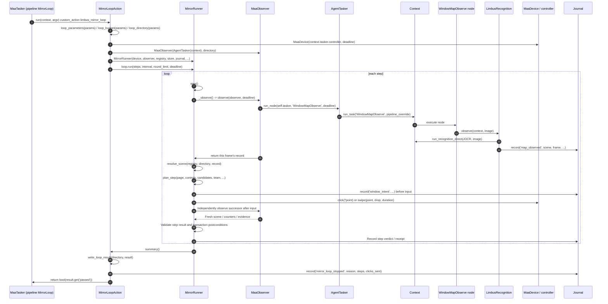

Code behind it: `agent/recognition.py:1499-1561` (the action body), `src/maalimbus/runner.py:1490 def step`, `src/maalimbus/runner.py:604 class MaaObserver`, `agent/recognition.py:1410 class AgentTasker`, `src/maalimbus/runner.py:628 def observe`, `agent/recognition.py:1119 class MapObservation`, `agent/recognition.py:143 LimbusRecognition.observe`.

**Why observation must go through `AgentTasker` instead of `context.tasker.post_task`**: `context.tasker`'s executor is a single worker, so posting a node from inside a custom action queues it behind the very task that is waiting for it, and the wait eventually ends in a stop that kills the run; `Context.run_task` is the framework's own door for "run a node synchronously from a callback". That rationale is implemented by `AgentTasker.post_task`. `post_task` also does one extra thing: before reading the one-shot nodes `WindowMapObserve` / `WindowBattleObserve` it must call `context.clear_hit_count(entry)`, otherwise `max_hit=1` would make every later observation a permanent skip (`agent/recognition.py:1440-1446`).
Current one-action exception: `Context.run_task` also shares input hit counts. A Runner-owned MirrorDrive dispatch is identified by the exact override `{MirrorDrive: {next: [], on_error: []}}`. AgentTasker clears only that node's hit count before this invocation; standalone/unowned graphs, every other input node and all business transactions retain their state. Failed reset dispatches nothing. The node keeps max_hit1 inside the child task; clearing a native counter is not permission to repeat a business transaction. Actual same-Context production memory replay first failed at the second dispatch, then passed both after repair (build/drive-reentry-before-fix-native.json; build/drive-map-after-fix-native.json), zero device inputs.


A second trap is documented in `MaaObserver.observe`'s docstring (`src/maalimbus/runner.py:622-633`): trusting "the latest event of this kind" would mistake the **previous** frame's page for this one's, so when the node records no event it re-runs `read_tries` times; the docstring names the live incident `evidence/runtime/packaged-mirror-20261012-032032`.

### 3.3.2 Exit conditions of the main loop

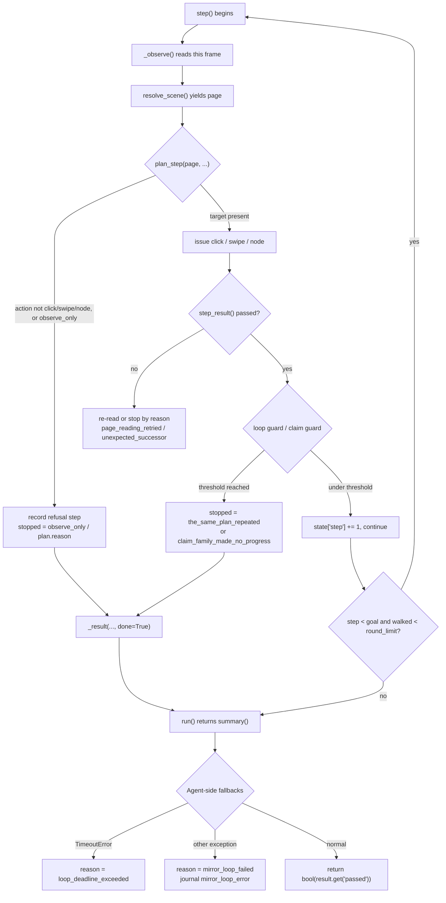

The four exit families, all anchored:

| Family | Trigger | `stopped` / `reason` value | Anchor |
|---|---|---|---|
| Success / natural finish | budget ran out or this page has nothing left to do; the loop returns | `run()` returns `summary()` | `src/maalimbus/runner.py:3014-3021`, `:3187` |
| Budget exhausted (steps) | `state['step'] >= goal` or `walked >= round_limit` | no stop string, `done=False` | `src/maalimbus/runner.py:3014` |
| Budget exhausted (time) | `deadline` expires, raising `TimeoutError` | `'loop_deadline_exceeded'` | `agent/recognition.py:1540` |
| Refusal (planner declines) | `plan['action']` is not an executable action | `'observe_only'` or `plan['reason']` | `src/maalimbus/runner.py:2445-2446` |
| Refusal (screen did not move / re-reads spent) | `step_result` says `passed=False` and no re-read is left | that step's own `reason` (e.g. `unexpected_successor`) | `src/maalimbus/runner.py:2876`, `:2914` |
| Refusal (protocol guard) | loop guard / claim family | `'the_same_plan_repeated'` / `'claim_family_made_no_progress'` | `src/maalimbus/runner.py:2991` / `:2978` |
| Refusal (caller-named page) | `stop_page` reached | `'stop_page_reached'` | `src/maalimbus/runner.py:1538`, `:2898` |
| Error | any uncaught exception | `'mirror_loop_failed'` + `journal mirror_loop_error` (with traceback) | `agent/recognition.py:1538-1546` |

`_result`'s `done` semantics: `'done': bool(done or stopped is not None)` (`src/maalimbus/runner.py:3183`) — the moment a step produces a stop string, the loop ends.

**Not yet verified**: `MirrorLoopAction.run`'s return value is `bool(result.get('passed'))` (`agent/recognition.py:1553`), but the full assignment path of `passed` (including the positive criterion for a whole successful run) was not traced line by line this round. The related fact we do have is that `record_ledger_event` sets `state['run_settled_itself'] = True` on the `final_victory` / `reward_received` events (`src/maalimbus/runner.py:2821`).

---

## 3.4 Agent integration

### 3.4.1 What gets registered

Lines 48-69 of `agent/main.py` are the whole registration surface:

**Custom recognitions (1)**

| Name | Implementation | Anchor |
|---|---|---|
| `limbus_scene` | `LimbusRecognition(locale)` | `agent/main.py:48` |

`LimbusRecognition` is a `CustomRecognition` subclass (`agent/recognition.py:103`); MaaFramework calls its `analyze(self, context, argv)` (`agent/recognition.py:397`), which reads the frame, compares it against the `scene` named in `custom_recognition_param`, and returns `None` when it does not match.

**Custom actions (15 in total)**

| Name | Implementation class | Anchor |
|---|---|---|
| `limbus_terminal` | `LimbusTerminal` | `agent/main.py:49` |
| `limbus_team` | `TeamAction` | `:50` |
| `limbus_star_proof` | `StarProof` | `:51` |
| `limbus_initial_gift_proof` | `InitialGiftProof` | `:52` |
| `limbus_initial_receipt_proof` | `InitialReceiptProof` | `:53` |
| `limbus_difficulty_proof` | `DifficultyProof` | `:54` |
| `limbus_preflight` | `InputPreflight` | `:55` |
| `limbus_theme_observe` | `ThemeObservation` | `:56` |
| `limbus_deployment_proof` | `DeploymentProof` | `:57` |
| `limbus_battle_plan_observe` | `BattlePlanObservation` | `:58` |
| `limbus_map_observe` | `MapObservation` | `:63` |
| `limbus_battle_observe` | `BattleObservation` | `:64` |
| `limbus_mirror_loop` | `MirrorLoopAction` | `:67` |
| `limbus_global_settings` | `GlobalSettingsAction` | `:68` |
| `limbus_main_task` | `MainTaskAction` | `:69` |

`main.py:59-62` keeps a comment explaining why the two read-only observation nodes must be registered too: a node whose `custom_action` is not registered cannot run at all.

The matching pipeline nodes (`assets/resource/base/pipeline/mirror.json`): `WindowMapObserve` (`:1455-1462`, `custom_action: limbus_map_observe`), `WindowBattleObserve` (`:1463-1470`), `MirrorLoop` (`:1526-1552`, `custom_action: limbus_mirror_loop`, parameters including `steps: 400` / `interval: 4.0` / `rounds: 3` / `run_store: config/user-run-ledger.json`), `MirrorLoopDone` (`:1553-1558`, `DoNothing`). `GlobalSettingsApply` (`:1559-1568`) → `MirrorLoop` is a second entry path. The `PIPELINE` constant at `runner.py:121-141` is the Python copy of the same node set (`prepare()` writes it out).

### 3.4.2 Agent-side registration and callbacks

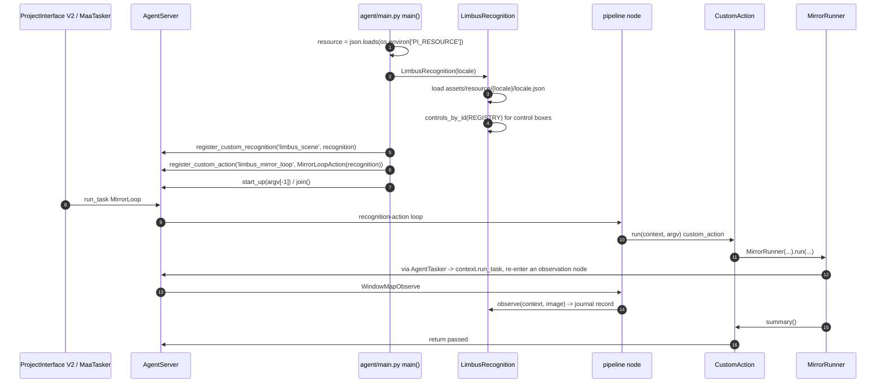

Code behind it: `agent/main.py:20-72`, `agent/recognition.py:103-141`, `agent/recognition.py:1478-1561`.

### 3.4.3 How `MirrorLoopAction` / `MaaObserver` / `Context.run_task` relate

The three are three roles of one chain:

1. **`MirrorLoopAction`** (`agent/recognition.py:1478`) is the shell around a whole run. It hands the `runner` the three things the PI already gave the Agent: the controller as the device (`runner.MaaDevice(context.tasker.controller, deadline=deadline)`, `agent/recognition.py:1502-1510`), `context.run_task` as the tasker (`runner.MaaObserver(AgentTasker(context), directory)`, `:1510`), and the evidence directory as the journal (`journal = Journal(directory)`, `:1502`). Its docstring (`:1479-1492`) states the reason: input goes out through the controller's own `post_click`/`post_swipe`, because that controller is the side that owns the device.
2. **`MaaObserver`** (`src/maalimbus/runner.py:598`) is "read one page out of an Maa pipeline node". It depends on exactly three things on the context: `tasker`, `run`, `journal` (`:598-613`). It reads through the two node names `WindowMapObserve` / `WindowBattleObserve` (`:622-633`), and on a battle page it reads `battle_observed` once more (`:646`).
3. **`AgentTasker`** (`agent/recognition.py:1410`) is the adapter. It gives `MaaObserver` the familiar `post_task` interface while actually forwarding to `context.run_task(entry, pipeline_override)` (`agent/recognition.py:1428-1437`), wrapping the synchronous result as an `AgentJob` that is always `done=True` (`agent/recognition.py:1397-1407`).

**The boundary**: `agent/` does exactly two things — implement callbacks using the `maa` SDK types (`CustomAction` / `CustomRecognition` / `JOCR`, `agent/recognition.py:15-18`), and adapt the context the PI handed over into the interface `src/maalimbus` expects. All decision-making, recognition, ledgers, and vision live in `src/maalimbus/`; `agent/main.py` itself judges no page. `src/maalimbus/runner.py:70-72` explains why the adaptation layer is needed: the repository root must resolve relative to `runtime_paths.ROOT`, because the Maa agent's cwd is not the repository (`src/maalimbus/runtime_paths.py:8-20`).

### 3.4.4 Where evidence and results land

- One directory per whole run; the Agent-side default is `evidence/runtime/pi-<yyyymmdd-hhmmss>` (`agent/recognition.py:1337`). The project-wide shape for evidence directories is `evidence/runtime/<task-name>-<yyyymmdd-hhmmss>/`.
- The whole-run summary goes to `agent-result.json`: `agent/recognition.py:1361 def write_loop_result(directory, result)`.
- The human-readable log goes to `run.log`: `agent/recognition.py:1377 def write_run_log(directory, result)`.
- Per-step `observation` / `plan` / `frame` / `passed` / `clicks_sent` accumulate in `artifacts['steps']` and come back with `summary()` (`src/maalimbus/runner.py:2894`).
- The crash path also lands on disk: after the `mirror_loop_error` event (with traceback) it still calls `write_loop_result` + `write_run_log` (`agent/recognition.py:1538-1546`).
- The module-level `_load_registry()` reads that same anchor table (`src/maalimbus/runner.py:3292`).

## 3.5 Driving one run locally

This section gives the real commands and where their artifacts land. The scripts themselves were only verified down to command-line parsing this round (see the open-items list at the end of this chapter).

**Entry point one: the UAC launcher** (`README.md:56-64`):

```powershell
./tools/start_native.ps1 -Binary <Maa native library dir> -Locale en -Seconds 180
```

- `-Binary` is required and that directory must contain `MaaFramework.dll`, otherwise the script throws immediately (`tools/start_native.ps1:4`, `:11`).
- `-Locale` accepts only `en` / `jp` (default `en`); `-Seconds` ranges over 1..3600 (default 180) (`tools/start_native.ps1:5-6`).
- It elevates through `-Verb RunAs` (standard Windows UAC) and never approves on behalf of the user (`tools/start_native.ps1:32-33`); if a controller is already running (`MaaLimbusAgent.exe` / `MaaLimbus.exe`, or a python process whose command line points at this repository `run_native.py`), the script throws `MaaLimbus already has a running controller; inspect its session first` before starting anything (`tools/start_native.ps1:12-16`).
- The real process is started by `tools/native_session.ps1`: `python -u tools/run_native.py --binary <dir> --locale <en|jp> --seconds <n> --live` (`tools/native_session.ps1:18-19`); it force-kills the child after `Seconds + 45` seconds and fixes the timeout exit code at `124` (`tools/native_session.ps1:22-28`).

**Where the artifacts land** (each one is readable in the scripts):

| Artifact | Path | Source |
| --- | --- | --- |
| Launch request and its status | `build/native-launch-request.json` | `tools/start_native.ps1:27-44`; the statuses are `uac_requested` / `launch_failed_or_cancelled` / `wrapper_started` |
| Wrapper process record | `build/native-launch.json` | `tools/start_native.ps1:45-47` |
| Exit code and whether it timed out | `build/native-launch-result.json` | `tools/native_session.ps1:29-31` |
| Live stdout / stderr | `build/native-live.stdout.log` / `build/native-live.stderr.log` | `tools/native_session.ps1:11-12` |
| Current session description | `build/live-session.json` | `tools/run_native.py:153` |
| Run evidence directory | `evidence/runtime/` (the agent side names its own `pi-<yyyymmdd-hhmmss>`) | `README.md:64`; `agent/recognition.py:1337-1347` |

**Entry point two: `tools/window_step.py`** (419 lines; a one-shot window tool that builds its own device, evidence directory and ledger):

- Required: `--binary` (`tools/window_step.py:65`), `--address` (`:74`) and `--authorize` (`:75`, the nonce).
- Common flags: `--steps` default 1 (`:76`), `--rounds` default 3 (`:78`), `--interval` default 4.0 (`:95`), `--loop-guard` default 3 (`:145`), `--claim-tries` default 6 (`:153`), `--observe-page` (`:160`), `--observe-only` (`:164`); the full list is `build_parser()` at `tools/window_step.py:62-209`.
- Before any input is sent, `build/map-probe-authorization.json` must grant `live_input_authorized` for the nonce passed on the command line (`tools/window_step.py:16-17`).
- The loop is not in this file: it keeps only the flags, the device, the evidence directory and the printing, while the loop lives in `src/maalimbus/runner.py` (`tools/window_step.py:19-22`).

## 3.6 Where to look when it stops

Start with the evidence directory of this run, then read the **stop reason string** in the log, then consult this table.

| Symptom | Where to look | Source |
| --- | --- | --- |
| One human-readable line per step | `run.log` | `agent/recognition.py:1377 def write_run_log` |
| The machine-readable event stream | `events.jsonl` (`window_intent` / `map_observed` / `battle_observed`) | `src/maalimbus/runner.py:1409 def note` |
| Result summary | `agent-result.json` | `agent/recognition.py:1361 def write_loop_result` |
| One sentence explaining a stop reason | the `GLOSSARY` table at `src/maalimbus/event_log.py:20-73` (`explain()` at `:79-89`) | it maps every reason to what it means and what to look at next |
| The same page kept offering the same plan | reason `the_same_plan_repeated` | `src/maalimbus/runner.py:2991` |
| The claim family made no progress | reason `claim_family_made_no_progress` | `src/maalimbus/runner.py:2978` |
| The input was sent but the page did not move | reason `unexpected_successor` | `src/maalimbus/window.py:1065`, `src/maalimbus/runner.py:2914` |
| The time budget ran out | reason `loop_deadline_exceeded` | `agent/recognition.py:1528-1533` |
| The loop raised instead of stopping | event `mirror_loop_error` (with a traceback), reason `mirror_loop_failed` | `agent/recognition.py:1534-1546` |
| It stopped because the caller named this page | reason `stop_page_reached` | `src/maalimbus/runner.py:1538` |
| The page has no proven control, so it is recorded only | reason `page_is_observe_only` | `src/maalimbus/event_log.py:47-50` |
| Packaging / console logs | `build/*.log` (for example `build/mirror-console-*.log`) | run logs under the repository `build/` |
| A test fails with `PermissionError [Errno 13]` on `%LOCALAPPDATA%\MaaLimbus\controller.lock` | first check whether a real app or agent instance is running on this machine; the lock is held, which is not a code defect | the lock path comes from `src/maalimbus/controller_lease.py:12-14`; the suite-versus-live-instance row in `docs/wiki/en_us/7-quality.md` records the symptom |

---

## Not verified / open items (this chapter)

- The content and line count of `assets/resource/jp/pipeline/locale.json` were not opened.
- `tools/window_step.py` (the second frontend) has been opened: `--help` runs and its flags plus authorization gate were checked (see 3.5), but **it was never actually driven**, so its usability reaches only as far as command-line parsing, not end-to-end acceptance.
- The full assignment path of `passed` in `MirrorLoopAction`'s return value was not traced line by line (see 3.3.2).
- Vision modules other than `src/maalimbus/map_vision.py` are listed only from the import list at `agent/recognition.py:20-43`; their bodies were not opened one by one.
<a id="feature-3-7"></a>

## 3.7 Unknown-page exploration and proposed labels

Unknown does not always mean stop. Current exploration permits independently recognized navigation and bounded map viewport pans, up to three candidates per unresolved episode. Pixel movement alone does not prove node arrival. Spending, payout, run exit and existing pending intents are excluded. Before/after JSON/PNG, trace.log, proposal and review.json share a private bundle. Continuing the task neither approves labels nor promotes a production model.

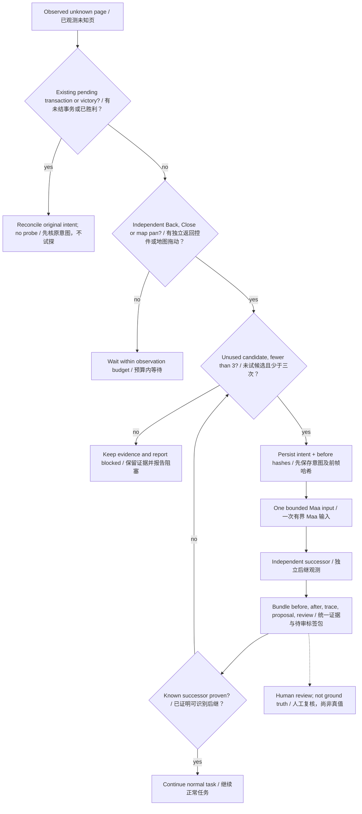

Source boundaries: `src/maalimbus/unknown_exploration.py:1` (`candidates`, `Exploration.choose/reserve/finish`); `src/maalimbus/runner.py:3024` (`_explore_unknown`).


<a id="feature-3-8"></a>

## 3.8 Sinner model, independent teacher and promotion boundary

A real trained ONNX is wired into native MaaFramework shadow inference; describing it as absent is obsolete. Current quality gates have not passed and production_enabled/input_authorized remain false. The twelve-slot teacher independently reads cards and printed order badges; grid position is not deployment order. Predictions, teacher proposals and approved labels remain distinct to avoid self-validation.

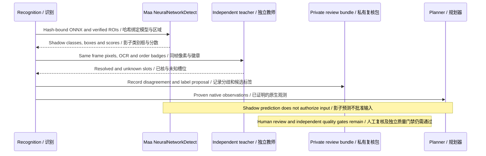

Source boundaries: `src/maalimbus/neural_shadow.py:98` (`verified_model`, `observe`); `src/maalimbus/pre_battle_identity.py:1`; `src/maalimbus/learning_dataset.py:1`.


**Independent teacher field boundaries (actual 2026-11-17 frame)**: `pre_battle_identity_evidence` independently measures card borders, reads captions and resolves the catalogue from the same PRE_BATTLE_TEAM image,`detector_read=False`. `verified_against_saved_order` requires all12resolved identities plus their printed-badge correspondence to the saved order; with6resolved identities it remainsFalse. All12deployment slot badges separately passed the independent slot-order check. Actual native inference produced11proposal boxes,withquality/input_authorizedFalse. Original frame and summary: `build/team2-floor3-inherited-deployment-real-verification.json`.

| Field | Evidence owner | Current proof |
| --- | --- | --- |
| `order_badges` | Native badge OCR | All12badges; deployment slot order matches |
| `verified_against_saved_order` | Independent caption identity teacher | All12identities and badge correspondence required;False with6resolved |
| `native_inference_executed` | Maa NeuralNetworkDetect | True,11prediction boxes with model hash/ROI provenance |
| `native_quality_passed / input_authorized` | Independent quality/policy gates | False; predictions stay shadow records |

<a id="feature-3-9"></a>

## 3.9 Purchase-value learning versus rule execution

Offline training and shadow previews are connected, but real reviewed data is insufficient for a claim of neural shopping control. Unbought offers are not negative examples and payment success is not a benefit label; delayed outcomes must belong to the same scope. Missing/invalid candidates fall back to rules. Manual economy priorities and budgets still control execution; shadow preserves rule order.

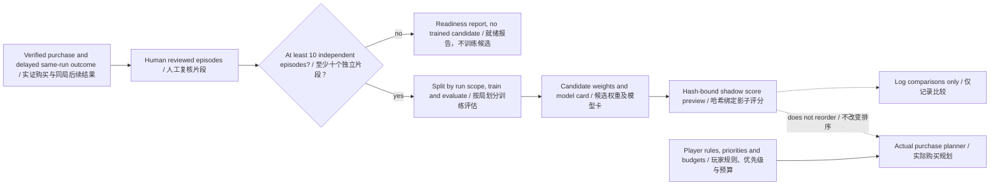

Source boundaries: `src/maalimbus/shop_value_training.py:422` (`verify_episode_evidence`, `load_reviewed_episodes`, `split_by_scope`); `src/maalimbus/shop_value_shadow.py:7` (`rank_preview`).

<a id="feature-3-10"></a>

## 3.10 Common action protocol and bounded unknown recovery


The executor performs the action selected by policy; the judge evaluates that action's successor. Only accepted/rejected/unjudged are verdicts. Missing fresh frames, loading, overlays or unrelated pages cannot become success. This is the target protocol; the general executor is not complete. Map page judging is its first implemented slice.

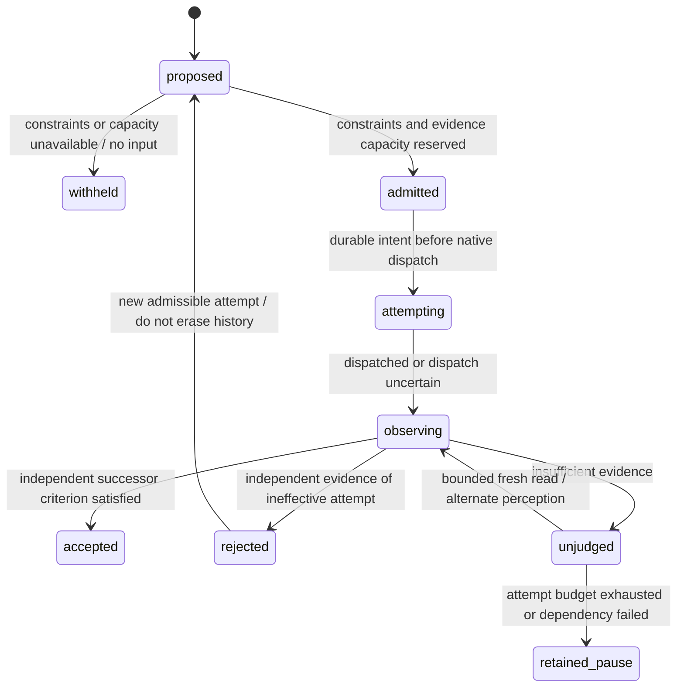

An input exception can occur after the device received it. Record dispatch uncertainty and observe before another attempt. Durable intent is not sent. Ordinary cost-free navigation can reread an ROI, close an independently recognized overlay, pan within bounds or try a candidate not already rejected. Erasing pending, repeating a coordinate or weakening spending constraints is not learning. Maa still owns bounded Swipes and randomized in-target 350–750ms touches.

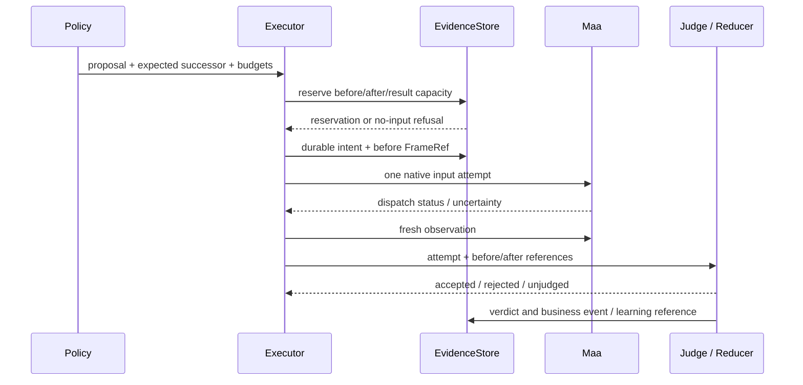

No input before admission. Unsettled paid/payout results allow evidence reconciliation, not another payment. Legacy transaction adapters preserve original bytes and scope; clearing pending is not migration. Adapt legacy booleans such as passed per producer; they cannot become universal success criteria.


Native callback gesture migration: `MaaDevice.pinch` now carries one `MultiSwipe` through the same `AgentTasker` / `Context.run_task` route as callback clicks. Two simultaneous bounded contact trajectories belong to Maa; reverse `post_touch_down` with an empty proxy ID is never called. Local controllers without a task retain the direct route only with a nonempty binding. A refused composite action is not retried as individual fingers. `jobs.wait_task(producer_alive=...)` stops waiting after actual Agent exit and requests termination of the existing task, without creating a controller or interpreting death as game success. [Maa5.12.2 protocol](https://github.com/MaaXYZ/MaaFramework/blob/v5.12.2/docs/zh_cn/3.1-%E4%BB%BB%E5%8A%A1%E6%B5%81%E6%B0%B4%E7%BA%BF%E5%8D%8F%E8%AE%AE.md#multiswipe).


Viewport caller audit: the first native-pinch patch covered MaaDevice, but `_normalise_view_once.zoom` still bypassed it with raw `pinch_out`. The next real MAP-only start happened to have a usable raw binding and zoomed, so that does not verify the repaired callback route. This caller now invokes `device.pinch` with the original calibrated endpoints/duration; whole-step retained tests forbid the raw route and require fresh successor measurements.59related checks passed/9historical skips. Source-only until the following installation; keep the previous active Agent unchanged.


Callback transport convergence: `AgentTasker.input_route=context` now explicitly owns callback click/swipe/pinch dispatch. `MaaDevice._send` uses the native Context carrier before consulting a reverse post, even when an ID appears valid; an empty binding also routes through its existing task. Healthy local controller calls remain direct. Native2df97b4 recovered the existing Team2 panel→confirmation→HOME→Drive→same-floor MAP (21original JSON/PNG pairs independently hash-verified, no background-map probes), then its old reverse swipe hung on an empty native controller ID. The watchdog ended the Agent; only its orphan verifier host was subsequently closed.85related checks pass, including forbidden reverse calls for empty/None/apparently-valid callback IDs; this is source routing proof, not the next installed live dispatch. Key/start-app/general child-node coverage remains separate.


<a id="feature-3-11"></a>

## 3.11 Page-identity preflight and combat control reads

A resumed BATTLE_HUD previously ran map+combat observation twice, once for entry preflight and once for the loop, writing four large pictures before the first dispatch. MainTask active-run preflight now requests identity_only: a fresh page identity for old-run reconciliation, without combat control enrichment. Normal loop observation may use the latest native scene in the same recorder solely as a battle-first scheduling hint. It still runs a new native node and requires a new event; the hint supplies no cached page/controls, pending settlement or input authority. A newer nonbattle read overrides the hint. Missing frames retain existing retry/failure behavior and every input still needs independent successor observation. This narrows read responsibilities; the unified Observation type remains a migration target.

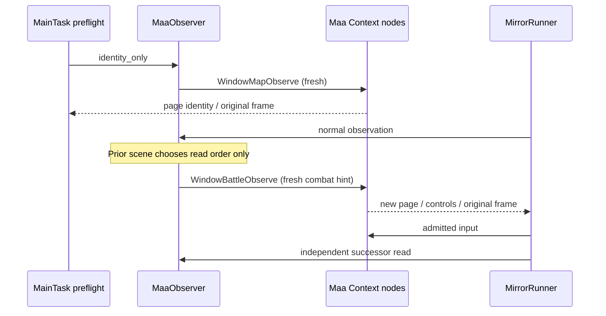

Source: MaaObserver.observe and MainTaskAction.run;119related checks passed. Installation/native combat input remain to verify; fewer captures are not a victory claim.


3.11 native follow-up: installed2fad8a9 and laterceb4457 each wrote only two fresh observations before the first combat input; ceb4457 actually reached turn2. Original frame hashes/turn readings are verified in build/native-capture-profile-battle-real-verification.json. This accepts the four-read reduction, not a full floor/run or GUI Start.

Capture-layer follow-up (2026-11-18, source/native offline): `BattleCaptureObserver` selects only native sizing. Both actual reads reuse the bounded `runner.observe` door; no competing direct observer entry. Domain planning still receives its own fresh observation: qualified HUD may use1280, cross-page/insufficient reads require independent1920 under the same deadline. Pre-input credit includes full successors. Ordinary MirrorLoop shop observe-only has no transaction/label effects. See the [sizing and capacity sequence](6-deployment.md#battle-capture-profile); not live completion or model-quality acceptance.

<a id="feature-3-12"></a>

## 3.12 Same-frame completion of native observations

Retained original-frame protocol replay reproduces old completion attaching newer shopframe0055 OCR/hash to battleframe0011. `MaaObserver.requires_frame_ref` now routes through the single `runner.observe` door into `native_evidence.observation_frame`; capture sizing reuses that binding. Shared immutable `FrameRef` identifies original JSON/PNG, actual dimensions and original capture time only. It implies neither a fresh business result nor input authority.

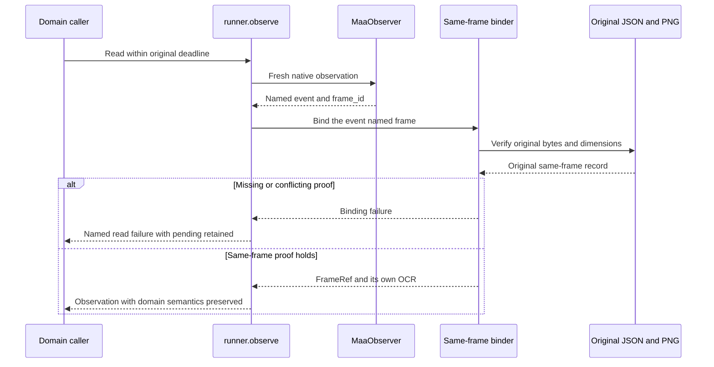

Conflicting JSON/PNG hashes, explicit dimensions/OCR/local_ocr or an existing FrameRef cannot be repaired from newest files. Read-event utc differs from FrameRef capture time: repeated pixels may reuse the original capture; historical missing time stays None, never the current clock. Named native UNKNOWN still uses existing domain exploration, without turning it into success or stopping every unknown page. Unnamed old replay remains a legacy adapter without verified FrameRef; named old replay may complete only its own JSON. This slice migrates native metadata binding, not the complete immutable Observation, pixel-access/other latest-file callers or general executor.

Source/original-frame checks: `tests/test_observation_frame.py`, `tools/verify_observation_binding_retained.py`. Native/frozen entry reuses `tools/verify_capture_profiles_native.py` and compares callback FrameRef fields against original bytes. Installation/live status follows chapter9 current checkpoint.


<a id="deployment-counter-provenance"></a>
### Deployment counter producer and consumer

`LimbusRecognition.observe` keeps fallback results as `Text` records for recognition and separate plain JSON `local_ocr` proof records. The proof names `deployment_participants_fallback`, native ROI, enlargement scale4, `only_rec=False`, source threshold and native result boxes/confidences. It is counter evidence, not unavailable-card, death, ownership or model authority. Existing OCR/adoption thresholds and Maa coordinate ownership stay unchanged. The primary counter uses detector OCR too; its metadata now states `only_rec=False` accurately.

`Journal.frame` rejects non-list/non-dict, non-JSON and nonfinite new provenance before file writes or frame credit. It does not rewrite historical bytes. `runner.team_state` ignores incompatible legacy entries and recognizes availability only from a dict with `purpose=deployment_availability` and `accepted is True`. It still reads the original frame's counter; ignoring a string does not synthesize unavailable slots or change saved order.

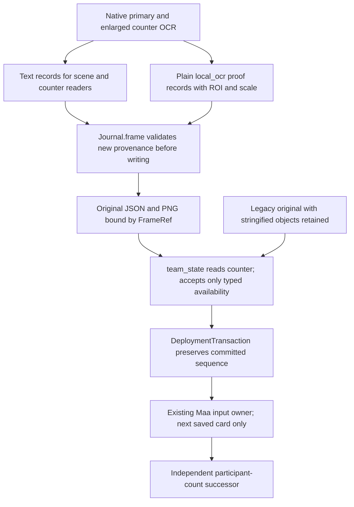

Actual installed70f71fc reached PRE_BATTLE_TEAM and committed eight selections, then crashed because fallback provider objects had been silently stringified and the consumer called `.get` on them. The retained frame0026 stays unchanged. `tests/test_deployment_provenance.py` checks both sides and isolated resume of8/12 without Clear; `tools/verify_deployment_counter_native.py` replays actual Maa OCR through production observe, Journal, FrameRef and team_state, with normal and injected-missing primary cases. Both read8/12, with0device inputs and unchanged106private/32canonical hashes. Diagnostic learning writes are quarantined. This is source/native replay, not frozen continuation or whole-run acceptance; see chapter9.

Repair review after installed passage:8/12→12/12→independent battle HUD→three battle results; later two encounters inherited saved badges and used submit only. The game keeps deployment order across encounters; grid position, identity caption and printed deployment badge remain separate facts. The failure was our producer/consumer type mismatch, not a game refusal. Fixing that shared boundary and adapting the legacy reader preserved evidence and avoided UI-coordinate or confidence changes. The first focused set omitted tool-bootstrap and mutable-cohort diagnostic checks and caused an avoidable second full regression. Those impact checks must be selected before the final full run; passing it does not certify the next UI handoff. Exact run/proof and next map/recovery gap: build/deployment-provenance-live-outcome.json, chapter9.

<a id="startup-recovery-dispatch"></a>
### Startup and recovery dispatch / 启动与恢复分流

Canonical `kind_of(reason, stopped_reason, plan_reason)` now owns both recorded and dispatched recovery kind. Viewport gestures require a positively identified MAP; non-MAP rereads remain bounded and domain-owned unknown-control exploration remains enabled. One successful native StartApp may grant a serial-bound 180-second absolute startup window for empty/loading reads, capped by the original task deadline. Already-foreground calls, foreign controllers and new Agent instances cannot renew it. A TITLE page is recognized from the existing full finish_launch caption/ROI/threshold. Its STEP_ROWS plan enters through the normal Maa device door before dungeon reconciliation, with durable input evidence, at most two attempts and unchanged business pending. Its first own login input grants a bounded180s successor-loading window; rereads cannot renew it. The old finish_launch table alone was not wired into production MirrorLoop. Ordinary frozen-frame and wait limits resume when this one window expires.

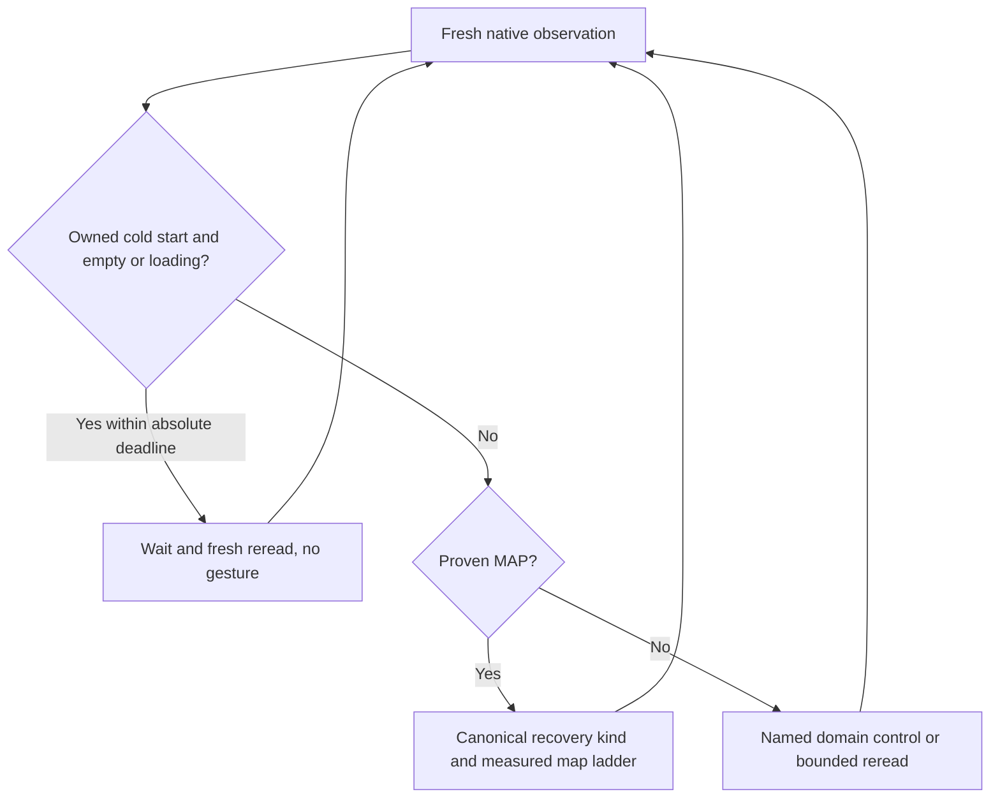

The retained native failure logged reread_text but requested pinch_out on UNKNOWN; the mismatch is reproduced by tests. Current source fixes that mismatch. A requested gesture or capacity reservation is not proof that the physical device accepted it. Root capacity errors retain their numeric cause in the task result. Installed behavior and a complete Mirror run require separate native/live evidence.

<a id="native-input-owner"></a>
### Native input ownership and uncertain submission

`MaaDevice` chooses one click/swipe transport before posting. A supplied Tasker always carries one native node; AgentTasker retains its existing Context. A healthy local Tasker no longer tries a direct Controller request first. Explicit standalone calls retain their direct Controller route. Maa5.12.2 still converts screenshot coordinates once. Pinch keeps the existing Tasker/Context MultiSwipe path; no new driver is introduced.

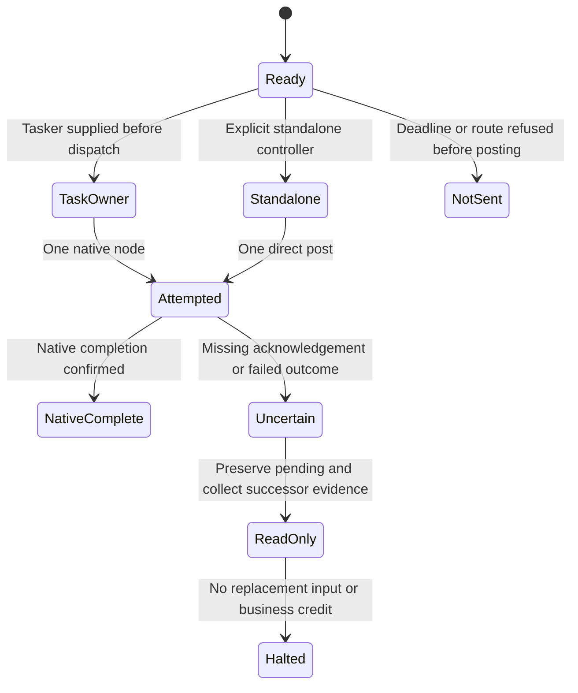

The previous local-post timeout immediately replayed the same payload through a task, while the first thread could still execute late. Missing acknowledgement cannot establish zero input. That competing path is removed. `InputDispatchUncertain` differs from pre-dispatch `RouteLost`: it latches this device against subsequent input, takes one independent read within the existing deadline, records `input_sent=True`, `dispatch_status=uncertain`, the native request count and `transition_verdict=unjudged`, preserves domain pending and ends the unconfirmed input session. Entry latching and summary retain uncertainty even if a lower layer catches the exception. This is not the UNKNOWN-page policy; bounded semantic exploration remains available.

Native completion proves neither game transition nor payout. Legacy `rebinds` no longer counts ordinary task inputs as reconnections. `pipeline_inputs` counts completed task carriers; `input_attempts` counts this device's calls, not every physical contact inside composite Pipelines. Keys, other direct child nodes and the complete general ActionProposal/Executor migration remain open.

Related input/cold-start regression:85passed/18historical-fixture skips. Actual Maa5.12.2 in-memory controller checks verify one1920→1280 conversion through both declared standalone and Tasker routes, zero device input. `build/input-owner-coordinates-native.json` binds implementation and DLL hashes. This source is not installed; physical-device and whole-run acceptance remain separate.

`floor_gift_selected_without_scoped_evidence` comes from `floor_gift_transaction.prepare` when a nonzero selected count lacks matching scoped picks and an Owned baseline. It is `bad_saved_state`: classification routes recovery to its owner without granting another pick or inventing a receipt. Three retained-corpus audits still disagree with fixed October measurements. Historical counts and ladder weights must not change merely to make them green. Current full-suite and live status belong to the latest checkpoints in `PROJECT.md` and `docs/acceptance.md`.


<a id="fresh-startup-owner"></a>
### Fresh startup observation handoff / 新鲜启动观察的所有权交接

Installeddb1c8d2, `packaged-mirror-20261118-180151`, actualTITLE→UNKNOWN→rereadTITLE,0inputs, normal `page_unreadable_after_waiting` ending. The reread recovered the full known caption but bypassed the earlier title-owner check, so the generic planner lacked `title.start`. This is an integrated runtime defect, not missing permission, an unknown gift value, or a successful login.

`MirrorRunner._startup_handoff` is now reused for both the first native read and an independently recovered known reread, before dungeon reconciliation. TITLE still requires the complete finish_launch caption within its existing ROI/threshold; only its own control can enter `_resume_login`. HOME can settle the existing actual login input after a different native image, without resolving dungeon pending or changing reward state. No synthetic map gesture acts on a title page.

`_capacity_reobserve` is shared by ordinary plans and login: maintenance discards an unsent plan before window_intent, login_input_entry, attempt increment or startup deadline; the next call rereads and rebuilds its target. It does not renew attempts or the original deadline. One acknowledged Start remains unresolved until an independent successor or the original180s deadline. TITLE/UNKNOWN/LOADING/CONNECTING observations wait without another Start; the run deadline may shorten this window. A client-update foreground preempts the wait. No business pending is settled by waiting. The complete two-pair capacity and all input/business guards remain. New source is not installed until fingerprint/private/storage parity and native continuation are reverified.

Actual installed55c4872 invocation packaged-mirror-20261119-022827 sent two correctly scaled title inputs, then stopped before a delayed client-update response was observed readonly. Native log records source points920,825 and928,837 mapping to raw613,550 and619,558; SDK acknowledgements are not server success. Source now consumes the existing absolute180s wait after one acknowledged Start, names deadline exhaustion as missing response, and prioritizes exact client-update text over background TITLE. User updated the game to1.119.1/code494; this does not itself prove login or Mirror progress.112focused passed; actual native OCR on the preserved delayed notice yields UNKNOWN_DIALOG/complete client_update_required with0memory input (build/login-client-update-native.json). Full regression/new freeze/updated-client continuous task remain next.

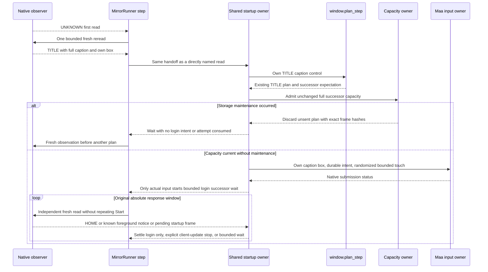


Final serial source regression:3689passed/709historical skips/1duplicate-LICENSE fixture warning,523.01s,pytest exit0 (build/login-three-gb-full-tests-final.log). Login direct/recovered fresh observations share one startup owner and maintenance reobserve before intent/attempt/deadline;55focused and79combined/30updater checks passed with overlap. Whole-project source budget is3,000,000,000bytes under the latest user instruction; external updater session1GB and capture/resource/approval bounds unchanged.274Mermaid blocks parse/two local startup views render. Prior installeddb1c8d2 actualTITLE run ended normally0inputs; both Agent and launcher embedded budgets were2GB. Clean dual rebuild and currentTITLE→sameTeam2 continuous task follow; no new live completion/payout/rotation/model promotion.


<a id="drive-mode-caption-owner"></a>
### Mode content versus shared navigation / 模式内容与共用导航栏

Current failure and scope: installed5e2ba53 run `packaged-mirror-20261119-033031` started on actualHOME after game update1.119.1, sent two Drive navigation inputs and stopped `page_unreadable_after_waiting`. It did not enter Mirror or prove script login. Its bound frame0010 shows the event-layout Mirror Dungeons row above the old fixed crop, which now reads Under Construction. Earlier3eb6a81 split-Inferno and8ca1b3a one-action repairs are historical evidence; current Team2 ledger remains retained history, not server-session proof.

Producer/consumer contract: `vision.drive_menu_probe` accepts an existing Inferno caption or high-confidence Luxcavation in the old/new measured band, solely for bounded same-image reads and a HOME veto. `drive_menu_native.repair` uses native detector OCR at.9 over `DRIVE_MIRROR_BAND`, the existing normalized menu band shared with `classify` and MirrorDrive's target lookup. It retains each detector's actual in-bounds native-image box, never the large search region as a click target. Missing Inferno still gets its exact only_rec crop at.9, whose box denotes that crop. Missing/weak/wrong/off-band/invalid-box results grant nothing. Locale patterns, domain/modal priority and Maa's sole input scaling remain unchanged.

`LimbusRecognition.observe` records repaired native rows and local_ocr provenance before canonical JSON/Journal.frame. `classify` still needs full mode captions; `analyze`/MirrorDrive need DRIVE and their own fresh mirror token. Runner plans from that observation and executes one owned node (`next` and `on_error` empty), then independently observes the successor. Dataset/review consumers receive teacher evidence, not approval, model promotion or new spending authority. No old JSON, pending transaction or budget is rewritten.

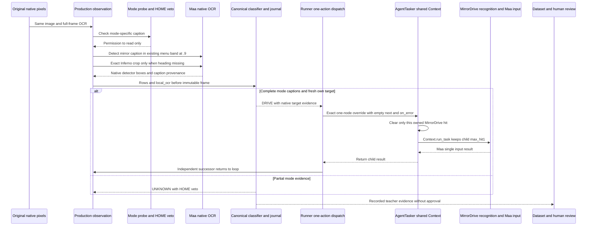

Exit evidence: mandatory old/new-layout scale and negative contracts plus historical retained checks36passed/43historical skips. Actual Maa5.12.2 production helper passed9cases (5retained positives/4masked negatives); old and new layouts each traverse the production recognition/Click node exactly once on memory controllers. New row Dungeons.997610 box[648,316,110,22], bounded target[670,320,66,14].106private/31canonical/original bytes unchanged, zero device inputs (`build/drive-event-native-verification.json`). Serial complete regression3772passed/699historical skips/1duplicate-LICENSE fixture warning,446.18s,pytest ownexit0 (build/drive-event-full-tests.log). This remains source/native-memory proof; clean frozen install and continuous actual task are next. Launcher3GB unchanged. Fullrun, payout, rotation, model promotion and JP-game acceptance remain separate.


<a id="service-notice-owner"></a>
### Server notice foreground ownership

A real source8ca1b3a installed invocation (`packaged-mirror-20261118-200244`) reached the Mirror entry, then the inherited `MirrorDrive.next` graph clicked entry/confirmation before Runner's next plan. Scheduled Maintenance was classified from its background as MIRROR_ENTRY. The child job failed, and the existing torn-controller guard refused the later loop click.98private/31canonical hashes stayed unchanged; no clear, reward or old-scope expiry was inferred. The native server message says login after12:00(KST), without a date.

`known_service_notice` first recognizes the exact central client-update title, before maintenance/background TITLE. It records native Close/Go to Store metadata but grants neither action; incomplete ancillary controls still veto the background. Runner returns game_client_update_required without creating a navigation reservation or changing business state. The same reader protects MainTask idle-entry reconciliation and the canonical classifier. Existing scheduled-maintenance Close remains its separate bounded action; close_candidates explicitly rejects the client-update kind.

`service_notice.scheduled_maintenance` owns the exact high-confidence central title. Its complete unique time/Close permits one `close_candidates` navigation action per native invocation; partial evidence still vetoes the background and permits no Close. `vision.classify` emits UNKNOWN_DIALOG; MainTask's `run_wiring.reconcile_idle_entry` independently applies the foreground veto even to old incorrectly classified records. Runner's `_startup_handoff` calls `_service_handoff` before dungeon reconciliation, both on direct and recovered reads. It keeps original deadlines and the capacity/fresh-replan boundary. Neither the undated12:00(KST) sentence nor dismissal establishes current server availability.

Runner obtains the existing UNKNOWN_DIALOG Close plan from window.plan_step; it creates no second hand-built plan vocabulary. The named service successor predicate is stricter than that generic plan’s ANY dismissal expectation.

Both ordinary unknown navigation and the named service lane use `unknown_exploration.Exploration`. The fixed private `user-service-navigation.json` belongs to the configured account data directory, independently of the business run. Its `pending` is None or an integer attempt index; zero is pending. `reserve` saves original JSON/PNG hashes before Maa dispatch; `acknowledge` persists SDK success afterwards. Unacknowledged/unchanged/ambiguous outcomes keep exact pending bytes and forbid replay across invocations; only an independent positive successor may recover without ACK. Acknowledged attempts receive two rereads max; one Close remains the invocation limit even if the screen later repeats. Weak remaining title/time/Close evidence vetoes a positive label. `finish` writes provisional proposal/trace and separate human review state, never approval, training eligibility, spending or ledger credit. Raw and cold PNG consumers use the existing original-byte archive reader; corrupt proof stops without clearing pending.

Actual GUI Start `pi-20261119-012451` reached installed5793bc6 MainTask/Team2, then stopped on the cached modal with0inputs. This is GUI dispatch proof, not present server-outage proof.125focused checks now execute the synthetic pending/ACK guards, with only one missing historical-map fixture skipped; the old module-wide historical skip was isolated. Actual Maa5.12.2 replay runs the source Runner startup step, production native observer and MaaDevice/AgentTasker input carrier: one Close on the bound GUI pixels, then an independent MIRROR_ENTRY observation and provisional navigation label; business ledger/private/canonical/originals unchanged (`build/service-dismiss-plan-native-final.json`). Existing6caption cases and one-action Drive replay still pass. This remains source/native memory replay, not installed repair or whole-run acceptance; complete3742passed/699historical skips/522.76s/ownexit0; clean freeze and continuous live run follow. Japanese game notice wording remains unvalidated.

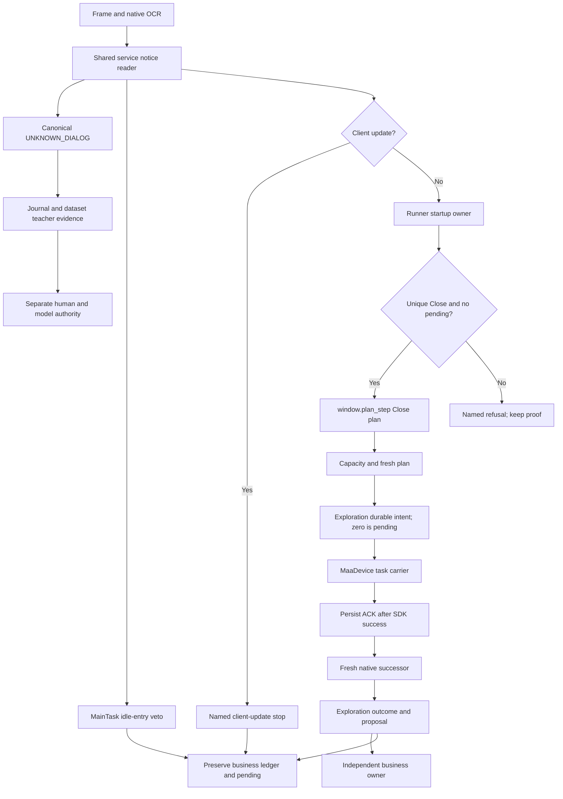

```mermaid
stateDiagram-v2
 [*] --> Ready
 Ready --> PendingUnacknowledged: reserve intent
 PendingUnacknowledged --> PendingAcknowledged: persist SDK ACK
 PendingUnacknowledged --> PendingUnacknowledged: no replay
 PendingUnacknowledged --> ProvisionalProposal: proven positive successor
 PendingAcknowledged --> PendingAcknowledged: two rereads max
 PendingAcknowledged --> ProvisionalProposal: observed outcome
 ProvisionalProposal --> DomainOwner: UI transition only
 ProvisionalProposal --> Stopped: repeated notice after Close
 DomainOwner --> [*]
 Stopped --> [*]
```
