# 4 Business Flows

[中文](../zh_cn/4-business-flows.md) · [← Index](index.md)

<a id="map-shape-generalization"></a>

### Cross-floor node recognition and event transitions

The pattern inside the hexagon identifies node type. Frame brightness, links and the locomotive establish whether a destination is one reachable step away. Record each observation separately and verify the actual successor after input. Type recognition is independent of the floor, pack and hue. Events use the same visible controls for options, checks, results, continuation and rewards. Visible costs and consequences guide choice policy. The existing City and Garden text exceptions remain. Migration needs to verify the exits and effects of both.

`tools/audit_map_glyph_shapes.py` compares Floor 3 warm-map interiors with an independent cyan Floor 4 map. Without hue it scored 0.803 for the shop, 0.949 for the question mark and 0.783 for battle in manually located neighborhoods. The battle reference also scored 0.700 at the boss, so it needs more negative cases. The production detector offers one original Floor 4 candidate and zero after color removal. `build/map-glyph-shape-cross-floor.json` verifies local comparison. Automatic localization and whole-floor acceptance are still open. Hold out entire floors and packs and include reachable, visited, occluded, chevron and visually similar controls.

In the viewport scan, the strongest shop and question matches landed on their respective icons. The battle template peaked at 0.795 on background and path pixels between nodes, above 0.783 at the battle neighborhood. Locate the node boundary before assigning a type. A gray question mark can still have a recognizable type. Reachability needs its own measurement.

On the same Floor 4 capture, three edge-threshold pairs all localized the same 47×44 shop frame. Within it, the shop scored 0.803, the question mark 0.559 and battle 0.391. The battle-shaped rail peak fell outside every detected outline. The dark question mark, battle and boss also lacked a detected closed outline. A complete outline is one source of location evidence. Partial edges and independently measured node spacing still need validation for dark or occluded nodes. The report records every box, known-node coverage and type score. Swapping color channels produced identical results. Installed navigation does not use the experiment.

The same Team2 Floor 4 shop settled six purchases and two refreshes on the device. Three continuations used frozen Agent `c6ef7ea` and the same run ledger. The last continuation, `013256`, verified the purchase and returned through the leave confirmation to MAP. It proposed one next room and admission withheld that click. The purchase question, GET, return to shelf and exit have independent successor captures. Shop decisions came from the active rules.

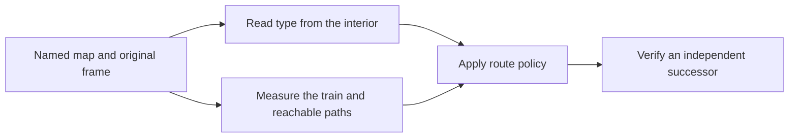

<a id="compact-colour-handoff"></a>

### Compact coloured destinations and shared consumers

`map_node_geometry.connected_compact_nodes` reuses `map_vision.lit_components` at compact body dimensions, retaining the existing110value/70chroma measurement. It requires a unique independently measured train, one forward neighbourhood in lamp-spacing units, and at least70percent support in one separate saturated/neutral-bright path plane. Body dimensions bound corridor uncertainty; a body is not a room identity. `saturated_share` is distinct from historical `warm_share`. There is no fixed blue-room coordinate or recoloured template.

`connected_nodes` retains the existing red-before-ring precedence, then exposes compact alternatives. Both `runner.candidates_of` and `MirrorRunner._normalise_view_once` use this producer: a visible supported destination prevents needless gestures; selection stays in the runner using existing kind rank then measured distance. Compact bodies are `lit_icon`, not rings. Every alternative and final rank/distance/support is journaled. A proposal cannot settle a node click; the independent successor still must do that. The singular compatibility reader returns no unique measurement for multiple alternatives.

Original `packaged-mirror-20261119-074547/frame-0121` has a27x24blue question body and two genuinely lit forward branches. The old global ring/large-icon thresholds omitted the question. Derived colour/scale/pan cases and synthetic carrier successors are source evidence; that repair has now passed physically in installedb62fe4e, while the larger internal-zoom repair remains unverified live. The second branch does not become a typed battle merely because it is blue. Paid receipts and learned-policy authority are unchanged.

The installed b62fe4e continuation now physically passed the compact blue question through one input and a late independent NODE_PANEL, then an event and battle (`build/compact-colour-live-blue-node-verification.json`). Protected reclamation actually retired15PNGs/20,850,771intent bytes, discarded two unsent plans, reread and continued to MAP without restarting (`build/compact-colour-live-storage-verification.json`). This proves those handoffs, not the whole run or optimal storage throughput.

The next original MAP frame0124 exposes a separate internal-zoom coupling: lamp spacing70.09px, next body95x59px and383px away. The previous body cap70px came from screen resolution, while the map had zoomed independently. `connected_compact_nodes` now measures the maximum as two lamp spacings, retaining original chroma/fill/ratio/forward-neighbour/path predicates. Small captures reuse the existing ring reader's1920px analysis normalization before the fixed morphology, returning every pixel proof in native coordinates. This prevents a720p closing kernel from joining body, glow and path. No clickable box becomes a pitch ruler.

The theme/resolution matrix also exposed two lamp pairs around one clock and a skewed reward-badge pseudo-pair. `train_body` groups measurements only when their central clocks agree within one tenth of the smaller lamp gap, chooses the more restrictive inner spacing, and still rejects two distinct clocks. Horizontal lamp alignment now respects both the original7px screen bound and one tenth of the lamp spacing. In the derived recolour/resolution variant, the false pair measured22.26px with6.81px vertical skew; nested69/90px measurements refer to the same original clock. These are explicit measured shape constraints, not selecting the biggest flame or accepting any warm blob. Initial7failed/87passed and follow-up1failed/204passed are retained; no test was weakened. Final related205passed/9skipped/81.77s/ownexit0 (`build/lamp-scale-alignment-focused.log/exit`); cleanAgent4d92677 installation/nine compiled identities are now verified; larger-body physical passage remains next. Last full/inspection-only correction limits are recorded in Wiki9.

Review before the final regression found a further shared-path omission: the red family still admitted only warm/white edges. The extended red/lit/neutral × warm/blue/white matrix exposed recoloured chevrons being treated as nodes. A complete-loop hypothesis was then refuted by the real reward badge interrupting the outline; six coarse angular bins also admitted an open chevron. Actual measurements before choosing the final rule: original red/white node maximum angular gap13.84degrees, retained warm node5.88degrees, synthetic open chevron86.66degrees. The red reader now measures continuous surrounding coverage with at most one missing hexagonal sector(60degrees), for every path plane; legacy warm measurement priority remains. This accepts interrupted outlines without treating an arrow as a room. It is a scoped geometric criterion, not a claim of universal optimality.114related checks pass43.16s/ownexit0. The earlier incomplete full-suite run was explicitly superseded, not accepted.

Process correction: measure the retained positive and negative cases before inventing a guard. Writing the closed-loop and coarse-bin rules before that measurement caused two avoidable failed regressions. Retain those failures as counterexamples; do not relax a test or wait for another live failure to learn the same mechanism. Final serial source regression3920passed/699skipped/516.60s,pytest ownexit0 (build/compact-colour-full-tests-final.log/exit). That source was installed asb62fe4e and physically passed the smaller blue question; the subsequent larger internal-zoom body is the current gap.

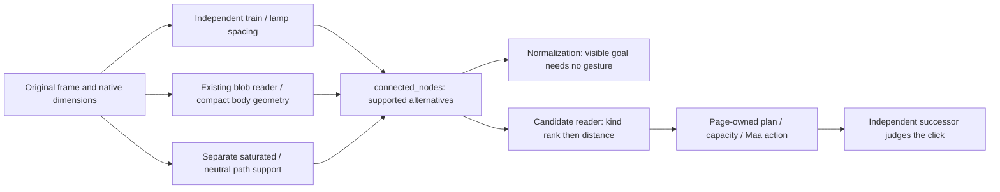

The expanded full regression first ended3952passed/699skipped/one failure541.71s: three retained Resume→LOADING→MAP observations crossed the unchanged audit floor, exposing the resume plan’s missing transient name. The finite RESUME_DIALOG contract now permits LOADING waiting, still rejecting HOME/SHOP/BATTLE; map transition judgment keeps loaders unjudged, with no recovery renewal, floor/receipt or model credit. The loader’s existing clock and zero-input strategy are unchanged. This is a producer/consumer contract correction, not adding an observed-count exception to make an audit green.

<a id="map-recovery-episode"></a>

### A failure episode ends at accepted node progress

Actual frame0124 refused an out-of-step proposal before input; the fallback was then denied because `recovery_since` still belonged to a MAP failure648.5seconds earlier, despite intervening independently accepted rooms/events/battle. Page-name equality is not episode identity. `MirrorRunner._map_verdict` is the accepted/rejected owner; only its accepted verdict calls `map_dispatch.retire_recovery_after_progress`. It retires just MAP recovery_for/rung/episode/since and journals the accepted reason/after-frame. The next failure starts its own original bounded recovery window. A non-MAP recovery, unresolved click, financial pending, run scope and global deadline are untouched. UNKNOWN, rejected/superseded inputs and auxiliary HOME/resume changes cannot renew a failure budget. Both late expected page and existing independently measured party-movement acceptance share this owner.

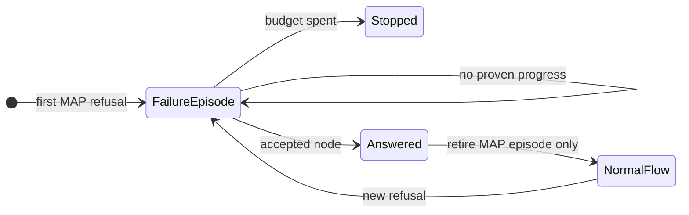

This fixes episode lifetime without an endless retry grant or a stop/start workaround. Source checks exercise late node acceptance, the next recovery clock and negative auxiliary/pending cases; installed continuous acceptance is still separate.


This chapter answers "after the user clicks a main task in MXU, what actually happens in the game, and in what order". Vocabulary follows chapter 3: Controller (screenshots/input), Resource (images/models/Pipeline/localization), Tasker (the recognition-action loop that runs a Pipeline), Agent (custom recognition/actions), plus this project's own Client layer (`desktop/mxu/`, which MaaFramework does not have).

Reading convention: `path:line` is a verifiable anchor; anything this chapter did not open and confirm itself is collected in the final section "Unverified / To Be Confirmed".

Short forms used inside diagrams only (the body always writes full paths): `mirror.json` = `assets/resource/base/pipeline/mirror.json`; `recognition.py` = `agent/recognition.py`; `runner.py` = `src/maalimbus/runner.py`.

---

## 4.1 Six Entries and the Single Dispatch Function

### 4.1.1 The Entries Are Delivery Stubs, Not Flowcharts

ProjectInterface declares six main tasks (`assets/interface.json:103-167`), and each task's `entry` points at one Pipeline node:

| Task name | entry node | option | Declaration lines |
|---|---|---|---|
| `open_game` | `OpenGameTask` | none | `assets/interface.json` |
| `mirror_loop` | `MirrorTask` | 12 | `assets/interface.json` |
| `experience` | `ExperienceTask` | `experience_team` | `assets/interface.json` |
| `thread` | `ThreadTask` | `thread_team` | `assets/interface.json` |
| `rewards` | `RewardsTask` | `reward_module_budget` | `assets/interface.json` |
| `stamina` | `StaminaTask` | none | Removed from the interface on 2026-11-23: it took one screenshot and returned "not implemented". The pipeline node `StaminaTask` and the Agent branch remain; it returns to the task list when it works |

The six nodes live in the same Pipeline file and **look identical**: `recognition: DirectHit`, `action: Custom`, `custom_action: limbus_main_task`, `custom_action_param.task` hard-coded to one of the six values above, and finally **`next: []`, `on_error: []`**.

- Node start lines: `assets/resource/base/pipeline/mirror.json:2353` (OpenGameTask), `:5284` (MirrorTask), `:5295` (ExperienceTask), `:5306` (ThreadTask), `:5317` (RewardsTask), `:5328` (StaminaTask).
- In other words: **the Pipeline graph performs no flow orchestration on these six paths.** It only delivers "which task the user clicked" to the Agent; the real branching, preflight checks, loops and shutdown all live in Python.
- The design is pinned by a test: `tests/test_main_task_dispatch.py:24 test_six_main_tasks_reference_saved_builds_and_no_diagnostic_entry` asserts all six `entry` nodes have `custom_action` equal to `limbus_main_task`, and that none of the six tasks is checked by default.
- Conversely, grepping under `src/maalimbus/` finds none of `ExperienceTask`/`ThreadTask`/`StaminaTask`/`RewardsTask`: the entries of these six paths exist only in the Pipeline and `assets/interface.json`.

### 4.1.2 The Unified Dispatch Skeleton

<a id="cold-launch-verification"></a>

Packaged cold-start verification follow-up (2026-11-18, source): explicit `verify_packaged_mirror_loop.py --open-game` chains installed OpenGameTask→MirrorTask with one Controller/Agent and each MainTask acquiring its existing lease. Only independently verified Android launcher/Limbus is allowed; other foreground apps refuse before input-controller creation. Observe-only cannot request cold launch. Require a named successful result and normal task end, then an independent Limbus foreground check. Preserve the launch result separately; failure never enters Mirror or retries pending launch. Default without this flag still requires existing foreground Limbus. This verifies task entry, not a GUI button; production policy remains existing MainTask/game_launch.

The Agent side registers exactly one custom action: `agent/main.py:69 AgentServer.register_custom_action('limbus_main_task',MainTaskAction(recognition))`. All business logic sits in `run()` of `agent/recognition.py:1564 class MainTaskAction` (`agent/recognition.py:1571`).

**Business-process view (Mirror):** This diagram shows business decisions and outcomes; function calls are not business steps.

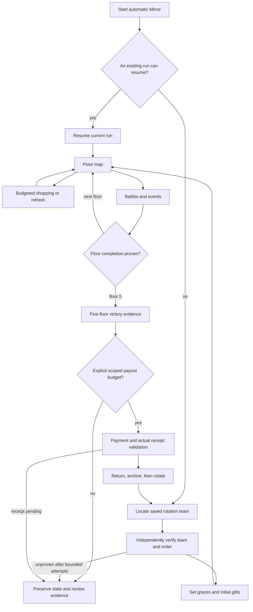

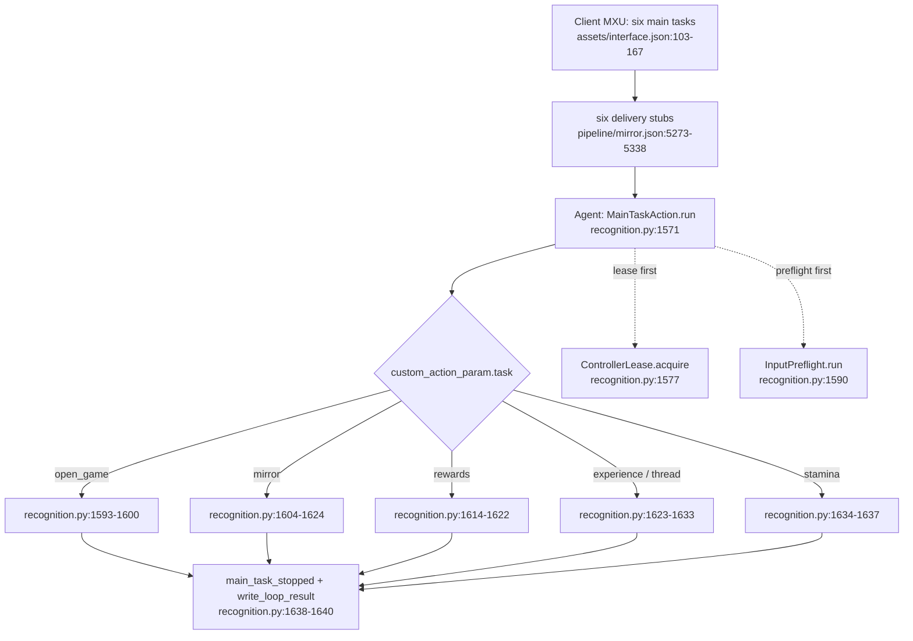

(For diagram short forms, see the top of this chapter.)

Three common steps happen before dispatch:

- Task-name validation: `from maalimbus.task_preferences import TASKS`, with `TASKS` defined at `src/maalimbus/task_preferences.py:5`; anything outside it raises `ValueError('Unknown main task')` (`agent/recognition.py:1575`).
- Evidence directory: `agent/recognition.py:1326 def loop_directory(params)` first takes `params['directory']`, then the environment variable `MAALIMBUS_RUN_DIR` (constant at `agent/recognition.py:1254`); when neither exists it uses `ROOT/'evidence/runtime'/('pi-'+timestamp)` (`agent/recognition.py:1334-1335`). The six delivery stubs carry only `task` in `custom_action_param`, so the default evidence directory for a main task launched straight from the GUI is `evidence/runtime/pi-<yyyymmdd-hhmmss>/`; the `window-<...>` prefix used by the command-line tool does not go through this path.
- Single-controller gate: `ControllerLease.acquire(ROOT/'build/controller.lock')` (`agent/recognition.py:1589`). The lock's actual location is rewritten by `src/maalimbus/controller_lease.py:8 def lease_path` to `%LOCALAPPDATA%/MaaLimbus/controller.lock` (`src/maalimbus/controller_lease.py:12-14`), class defined at `src/maalimbus/controller_lease.py:18`. Failing to win the lock gives `reject('another_controller_owns_game')` (`agent/recognition.py:1590-1591`), with **zero input**.

### 4.1.3 Three Kinds of Termination and One Shared Exit

`run()` expresses "reject" through an inner function `reject(reason)` (`agent/recognition.py:1579`), which always writes `passed=False, reason=<cause>, input_sent=False, verified_clear=False`. Every branch ends at the same exit: `journal.record('main_task_stopped', **result)`, `write_loop_result(directory, result)`, `return bool(result.get('passed'))` (`agent/recognition.py:1673-1675`).

| Termination kind | Meaning | Typical reason | Input already sent |
|---|---|---|---|
| success | the path's own declared requirement was verified | `existing_windows_game_verified` / `game_foreground_after_native_launch` / `game_already_foreground` | branch-dependent |
| reject | a precondition failed; stops before any action | `another_controller_owns_game` / `Actual Windows game identity failed` / `Actual controller identity failed` | no |
| stop | reached a boundary or an unimplemented point, saves the scene, then stops | `task_page_policy_not_implemented` / `lux_navigation_successor_requires_verification` | branch-dependent |

Evidence output is always of two kinds: `Journal` (`agent/recognition.py:76`) appends `events.jsonl` into the directory (`agent/recognition.py:82-85`); `Journal.frame()` writes one `frame-NNNN.png` + `frame-NNNN.json` pair per frame (`agent/recognition.py:87-97`); finally `write_loop_result()` writes one `agent-result.json` (`agent/recognition.py:1372-1375`). Real instances: `dist/MaaLimbus/evidence/runtime/pi-20261012-112240/events.jsonl` (`docs/acceptance.md:10`), and `dist/MaaLimbus/evidence/runtime/pi-20261012-123906/` (66 frames, 179 events, `docs/acceptance.md:1367`).

---

## 4.2 `open_game`: Launch the Game

- **Trigger entry**: `OpenGameTask` (`assets/resource/base/pipeline/mirror.json:2353`), with `custom_action_param.task='open_game'` and no option. UI text at `assets/i18n/zh_cn.json:75-76`: on Android, launch with Maa and confirm foreground, and do not relaunch when the game is already open; on Windows, connect the game window first.
- **Step-by-step business actions** (`agent/recognition.py:1581-1588`):
  1. Read `context.tasker.controller.info.get('type')`.
  2. If it is already `win32`: run `InputPreflight` (`agent/recognition.py:1196`); failure gives `reject('Actual Windows game identity failed')`; passing returns directly with `passed=True, reason='existing_windows_game_verified', input_sent=False`, **without relaunching the game**.
  3. Otherwise call `maalimbus.game_launch.open_game(controller, data_directory(ROOT), journal)` (`src/maalimbus/game_launch.py:8`).
- **Cold launch internals** (`src/maalimbus/game_launch.py`): an ADB controller is required, otherwise it raises (`:11-12`); first it checks whether the game is already foreground, and a hit on `PACKAGE+'/'` returns `game_already_foreground` directly (`:19-24`); if the persistent intent file `user-open-game-transaction.json` (`:14`) already holds an unfinished transaction, a second launch is refused (`:25-26`); it writes the intent, `journal.record('game_launch_intent')`, then `controller.post_start_app(LAUNCH_INTENT)` (`:27-31`); up to 5 rounds independently confirm the foreground (`:32-39`), success being `game_foreground_after_native_launch`, otherwise `launch_foreground_not_proven` with `pending=True` (`:40`).
- **Termination conditions**: success = the foreground is independently confirmed (one of the three reasons above); reject = the controller is not ADB, another unfinished launch transaction exists, or the identity preflight fails; stop = 5 rounds still do not prove the foreground (`pending=True`).
- **Evidence produced**: `game_launch_intent` / `game_open_observed` events + `user-open-game-transaction.json` + `agent-result.json`.


<a id="feature-4-2-1"></a>

### 4.2.1 Launch intent and foreground confirmation

This covers the implemented open-game task, not relogin or closing another game. It is not invoked during the current pause. Complete live cold-launch acceptance remains open.

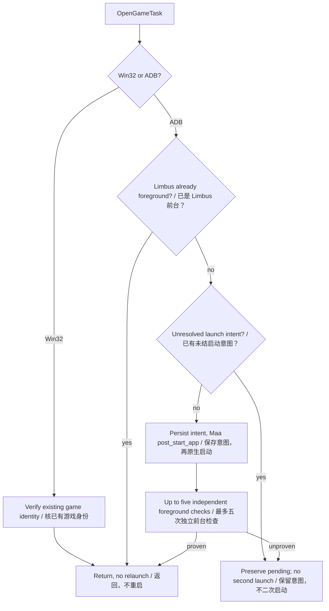

Source boundaries: `src/maalimbus/game_launch.py:8` (`open_game`); `agent/recognition.py:1571` (`MainTaskAction.run`).

## 4.3 `mirror`: Automatic Mirror Dungeon

- **Trigger entry**: `MirrorTask` (`assets/resource/base/pipeline/mirror.json:2364`), with 10 options (`assets/interface.json:117-128`); UI text at `assets/i18n/zh_cn.json:77-78`.
- **Step-by-step business actions** (`agent/recognition.py:1604-1624`):
  1. `GlobalSettingsAction.run` (`agent/recognition.py:1455`, `:1462`) first persists the globally edited teams and mirror queues from the overall settings, recording `global_build_settings_applied` with `device_input=False`.
  2. `mirror_preferences.collect` (`src/maalimbus/mirror_preferences.py:6`) → `apply` (`:21`): writes this run's per-item collector allow/deny and theme-pack preferences into the saved teams.
  3. `mirror_starlight.collect` (`src/maalimbus/mirror_starlight.py:74`) → `apply` (`:17`): source and budget of the Starlight rules.
  4. Read the `MirrorLoop` node's `custom_action_param`, then layer on the initial keywords, gift search, step cap and deployment assignment from `mirror_task_options.collect` (`src/maalimbus/mirror_task_options.py:5`).
  5. Use `shop_settings.FIELDS` (`src/maalimbus/shop_settings.py:289`) to overlay the three nodes `MirrorShopPolicy` / `MirrorShopRefreshLimit` / `MirrorShopCoinReserve` item by item into the parameters (`agent/recognition.py:1641-1644`); the resolution logic is `src/maalimbus/shop_settings.py:134 resolve_shop_settings` and `:282 collect`.
  6. Hand over to `MirrorLoopAction.run` (`agent/recognition.py:1478`, `:1499`): create the directory, read parameters and budget (`:1501-1504`, default 5400 seconds, `agent/recognition.py:1259`), assemble `runner.MaaDevice` (`:1517`) and `runner.MaaObserver` (`:1518`), then build `runner.MirrorRunner` (`:1257`, `:1526`) and call `run(steps, interval, round_limit, deadline)` (`src/maalimbus/runner.py:2907`).
  7. Inside the loop, each step's decision reads a set of independent policy pieces: `src/maalimbus/mirror_learning_policy.py:1304 strategy_score`, `:587 plan_route`, `:779 shop_plan`, `:931 skill_replacement`, `:432 gift_utility`; `src/maalimbus/route_plan.py:108 plan_route`, `src/maalimbus/gift_plan.py:15 load`, `src/maalimbus/shop_priority.py:5 load`, `src/maalimbus/auto_formation.py:17 choose_identity`, `src/maalimbus/budget.py:66 plan_spend`.
- **Step-by-step sequence**:

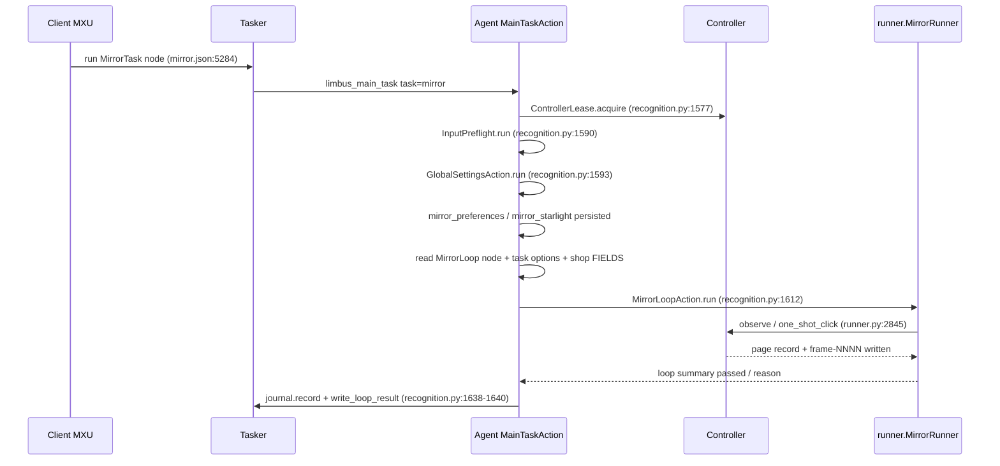

- **Termination conditions** (`agent/recognition.py:1528-1553`): success = loop summary `passed=true`; stop = this round's budget exhausted or a device job timed out, recorded as `loop_deadline_exceeded`; failure = the loop raised, recorded as `mirror_loop_error` (with traceback) returning `passed=False, reason='mirror_loop_failed'`.
- **Evidence produced**: `mirror_loop_start` / `mirror_loop_stopped` / `mirror_loop_error` events, `agent-result.json` and a human-readable run log.

### 4.3.1 The inputs of one shop visit (including the dead-slot revive)

The shop page (`SHOP`) is not a page you glance at and leave: `src/maalimbus/window.py:594-652` allows exactly one input per shop frame, in a fixed order.

1. **Before buying anything, look for a dead slot.** `saved_order` / `unavailable` in `config/user-deployment-transaction.json` plus `shop_revive.key_losses(..., positions=KEY_POSITIONS=7)` (`src/maalimbus/shop_revive.py:269`) yield "the dead cards whose saved slot is among the first seven"; when that is not empty and the shop prints `Heal Sinner` (`shop_revive.py:85`, the service box inside `SERVICE_X=(180,660)` × `SERVICE_Y=(540,800)`, `:33-34`), that service is clicked first — `window.py:623`, `expect=(ANY,)`, `advance=True`, because the dialog it opens states what happens next on its own.
2. **Each of the dialog's three steps is proven by its own words.** `HEAL_SINNERS` (`vision.py:266-269`: the title **and** three numbered rows) → its own third row (`window.py:999`) → `REVIVE_PICK` (`vision.py:286-288`: `Select the Sinner to revive.` plus the title) → the dead portrait first (`shop_revive.slot_box(card)`, `BAR_FIRST_CENTER=112` + `BAR_PITCH=115`, `:180-187`), then the state button the dialog changes to (`window.py:583`) → `REVIVE_DONE` (`vision.py:283-285`: `… revived, returns to battle.` plus `Leave`) → its own `Leave` (`window.py:566`) back to the shop. Any step without its own words is refused right there (`_refuse`), never guessed.
3. **A revive spends money, so what is recorded is a receipt, not a click.** Planning writes `state['revive_receipt']=dict(card, cost, coins_before)`; back on the shop page, `deployment_transaction.book_revive` (`src/maalimbus/deployment_transaction.py:73`) is called — and `revives` written — only when `coins_before - current coins == cost`, otherwise `shop_revive_receipt_not_proven` is recorded. Live evidence `window-20261012-214803`: 3093 → 2993, `cost=100`, `card=6` (Hong Lu).
4. **The remaining inputs follow a fixed priority.** A card the gift plan wants, or one the visit must buy because it would otherwise carry out more than the cap (a `window.py:633` click, with the reason string `buying_the_gift_the_gift_plan_asked_for` / `spending_the_coins_this_visit_would_carry_out_on_the_shelf`) → a refresh (`window.py:643`, bounded by the refresh limit and the coin reserve) → leaving (`window.py:651`). A completed purchase is written at `shop_transaction.py:458` and a refresh receipt at `:478`; the confusable title matching is D14 in chapter 2.3.

The shape of those four steps — every hop gated by the words its own page prints, with no words meaning stop:

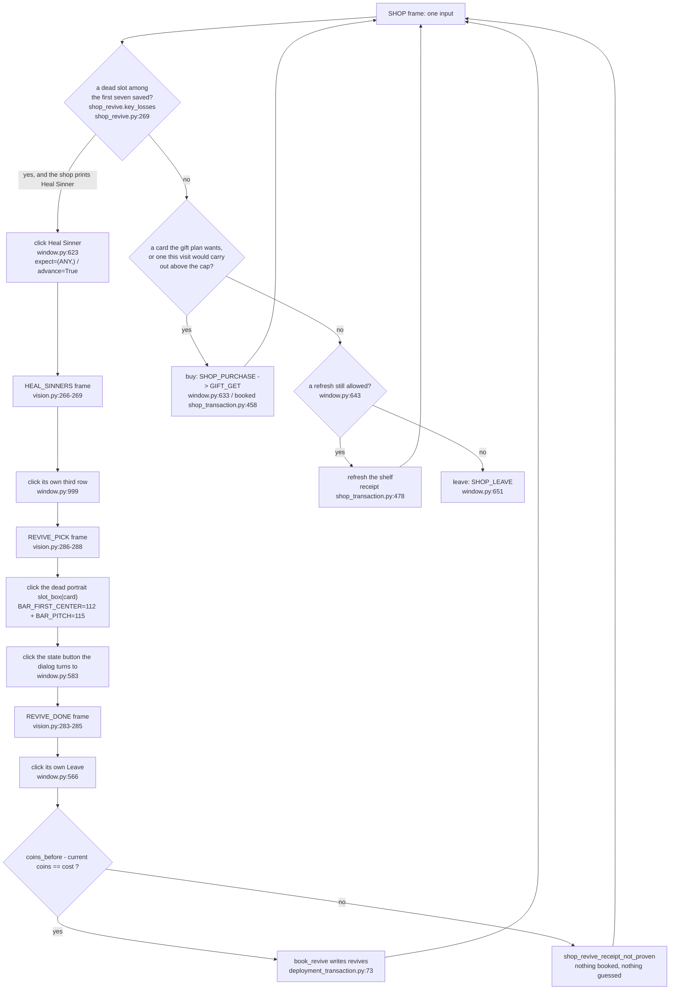

(Only the `window-20261012-214803` step has been walked live: the 3093 -> 2993 revive receipt. The whole route driven by one planner run is still on the unverified list, see 7.3.)


<a id="feature-4-3-2"></a>

### 4.3.2 Entry and bidirectional team-list search

RunStore supplies the queue target; the currently selected game team does not override settings. A target above the viewport causes a downward finger swipe to return toward Team1/Team2. Two unchanged semantic lists reverse once, then block with evidence. The search spans loop steps and exits when found; twelve is a ceiling. Numbered slots 1–40 are supported; renamed slots require mapping. Live offscreen Team1/Team2 testing awaits resume.

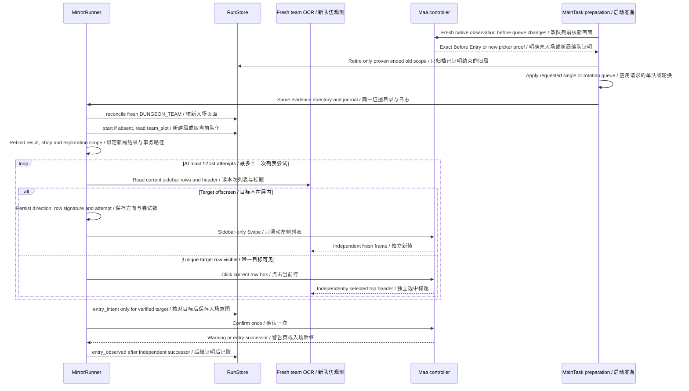

Startup does not clear old state from the broad MIRROR_ENTRY label: Before Entry and Enter require independent high-confidence readings with matching JSON/PNG hashes and dimensions. Active gameplay, pending entry and same-scope payout remain protected. Existing clear facts survive; no active dungeon does not imply payout. Queue changes follow this reconciliation. Expected settings refusal writes explicit result/human logs rather than an unexplained red task.

Source boundaries: `src/maalimbus/run_wiring.py:156` (`reconcile`); `src/maalimbus/team_navigation.py:1` (`browse`, `prepare`); `src/maalimbus/runner.py:1` (`MirrorRunner.step`).


<a id="feature-4-3-3"></a>

### 4.3.3 Encounter deployment: reuse, correction and submission

Reuse requires printed deployment badges matching the saved sequence, not grid positions or a full participant count. Clear only a proven conflicting order. Capacity changes require independent unavailable-card evidence. Same-run revive receipts survive transaction preparation so a later encounter does not repay them.

The printed badge is not decided by one reading either: each card's band is read through three differently framed crops and a number is adopted only when two of them read the same one. A card no two framings can read keeps `None`, so the page continues collecting order evidence instead of being misread as a proven conflict that clears and re-picks. Live evidence: `evidence/runtime/packaged-mirror-20261014-063205/frame-0103.json` lost card 11's '4' to the original nested pair and the run stopped on `deployment_order_digits_incomplete_after_retries`; with a framing that keeps a margin all twelve read and the page clears and re-picks as a proven conflict. `evidence/runtime/packaged-mirror-20261012-101555/frame-0027.json` needs the original framing instead, so both are kept. `tools/verify_deployment_numbers_native.py` replays both pages without a controller and `tests/test_deployment_numbers.py` pins the framing rule.

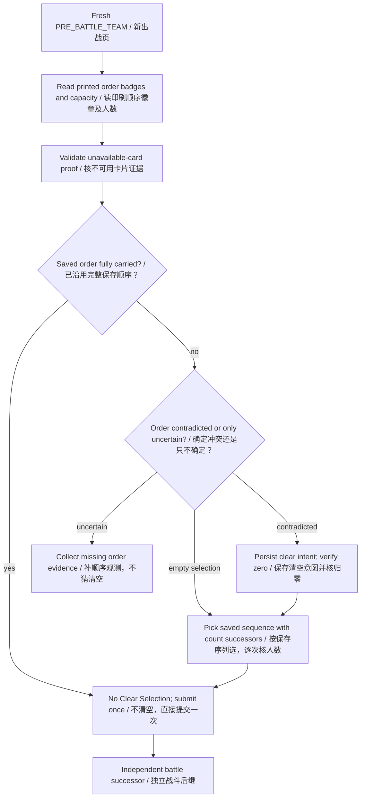

Source boundaries: `src/maalimbus/deployment_transaction.py:5` (`prepare`, `intent`, `observe`); `src/maalimbus/team_vision.py:1` (`assignment_numbers`, `carries_saved_order`); `src/maalimbus/deployment_numbers_native.py:1` (`read_assignments`).


The counter producer/consumer contract is documented in [3.12](3-runtime.md#deployment-counter-provenance). A committed partial sequence is not a conflicting full order: the retained8/12 resumes with saved card9 (sinner8), without Clear or reselecting the first eight. Only each independent count successor commits the next selection. Raw counter provenance never grants unavailable-card evidence. New native replay preserves the old crash pair and real transaction bytes; actual installed continuation is still pending.

<a id="feature-4-3-4"></a>

### 4.3.4 Floor gifts: selection, receipts and recovery

The fourth-floor Team2 boss led to an encounter reward and two successive gift rounds in installed run `022456`. The first GET acknowledgement reached a three-card free offer at 1280×720. The visible names and controls were readable, but the reward reader applied the 1920-wide plate offset and shifted all three click boxes 32 pixels left. `reward_vision.gift_cards` scales the common producer's offset and dimensions to the capture width. The retained successor independently reads Melted Eyeball, Downpour and Lightning Rod at 0/1. Installed run `023252` recovered the Grand Welcome receipt without a repeat GET, selected Downpour, settled its new notice and entered the Hard Floor 5 pack The Heartbreaking. The ledger persisted cleared floors `[1,2,3,4]`.

Each edge is a guarded transaction transition, not an assumption that a click succeeded. GIFT_GET, GIFT_PICK, REWARD_CARD, THEME_PACKS and MAP are successor families; exact names, next offers or final completion conditions are still required. Recovery and immediate settling share the reader and never replay GET acknowledgement. Owned-gift substitutions retain expected/printed names.

```mermaid
stateDiagram-v2
  [*] --> Picking
  Picking --> PickPending: persist pick intent before input
  PickPending --> Picking: exact same offer and counter plus one
  Picking --> CommitPending: required selections; Select once
  CommitPending --> ReceiptPending: full named GET; persist ack intent
  ReceiptPending --> CommitPending: next named notice independently proven
  ReceiptPending --> Completed: final successor independently proven
  ReceiptPending --> ReceiptPending: missing successor; observe only, no replay
  PickPending --> PickPending: unknown counter; preserve pending
  Completed --> [*]
```

Source boundaries: `src/maalimbus/floor_gift_transaction.py:10` (`RECEIPT_SUCCESSOR_PAGES`, `observe_receipt`); `src/maalimbus/runner.py:3070` (`_receipt_successor_offers`, `_resolve_floor_receipt`).


**2026-11-17 owned replacement and old attribution recovery (source; actual zero-input bookkeeping verified)**: Selection order was Skeletal Crumbs then Employee Card, while the client printed the owned Employee Card replacement Faint Vestige first, then Skeletal Crumbs. Notice order is not selection order. New unknown replacements prefer the unique owned outstanding pick. An independent next notice plus that unique owned pick may revise an old premature attribution, retaining the prior attribution. Recovery verifies printed instead of demanding that a replacement equal expected.

`floor_receipt_recovery.recover_closed_receipts` checks the same-scope closed recorder, original native JSON/PNG hashes, both notices' own Confirm touches/350–750ms, original/successor timing and complete SELECT FLOOR 3 title. The same transaction owner replays on an isolated state; only a complete chain publishes atomically. Missing images, short/out-of-control/duplicate touches, stale successors, foreign scope or unclosed logs preserve pending bytes. Actual2receipts recovered solely from originals,30other configs unchanged,zero input/payout/rotation; `build/team2-floor2-retained-receipt-recovery-real-verification.json`. Runtime recovery is wired but not installed yet.35related checks passed/48historical-material skips. Independent floor3Devoured Gluttony MAP exists; normal runtime ledger synchronization remains pending, not a manually invented floor event.


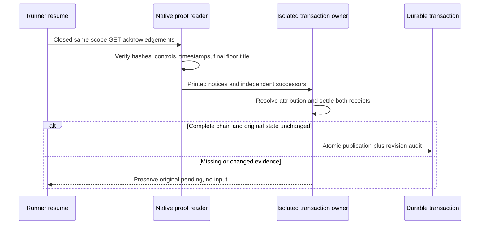

**2026-11-17 independent observation checkpoint**: Floor completion is a CompletionFact, independent of the next successful click. Before candidate/view/handoff handling, Runner calls `run_wiring.observe_map_checkpoint`: same run scope/entered phase, original JSON/PNG binding and independent MAP floor+complete pack title are required; observe-only writes nothing. The same component has actually settled floor2 from MAP3: ledger[1,2],all5shop purchases now have same-run delayed labels; no payment/rotation/model promotion.53related tests passed; `build/team2-floor2-observation-checkpoint-real-verification.json`. The new automatic entry still needs installation/live-observation acceptance; zero-input component bookkeeping is not complete Mirror acceptance.

<a id="feature-4-3-5"></a>

### 4.3.5 Initial gifts, search and floor themes

Starlight has a separate same-run visible-cost and budget gate; this diagram grants no spending. When a purchase spends the starlight exactly, the page shows a lone 0 beside the starlight icon: detection finds nothing there and the full-frame OCR returns only a low-confidence reading. Such a reading stands only where the books themselves compute a balance of zero, with no other number in the counter's place, and booking the purchase also needs two separate observations that agree (`available_starlight` and `zero_successor` in `src/maalimbus/grace_vision.py`, `is_zero_expected` in `src/maalimbus/grace_transaction.py`). A balance that reads properly is unaffected. Initial named GET receipts, search-refusal confirmation and theme swipes are separate transactions and cannot replay merely because the next page is slow. This summarizes stages, not live acceptance of every search branch.

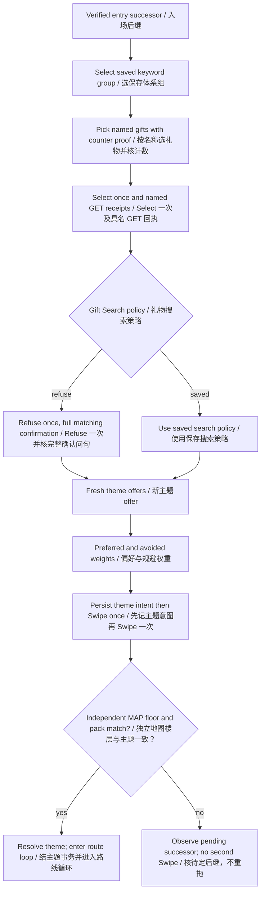

Source boundaries: `src/maalimbus/initial_gifts.py:1`; `src/maalimbus/initial_transaction.py:1`; `src/maalimbus/theme_transaction.py:5` (`intent`, `observe`).


### 4.3.5.1 Recovery of a sent star-card intent

`src/maalimbus/grace_balance_native.py:1` keeps two detected numeric reads under
an independent Available label. `src/maalimbus/grace_transaction.py:120`
reconciles only matching scope/configuration, retained frame hash/current visible
cost and an exact current delta. Missing evidence triggers observation retries,
never another purchase. Native retained tests pass; the current live recovery and
full-pipeline acceptance remain open. See the concrete plan in
[recovery and diagnostics](../../plan-20261014-recovery-diagnostics.md).

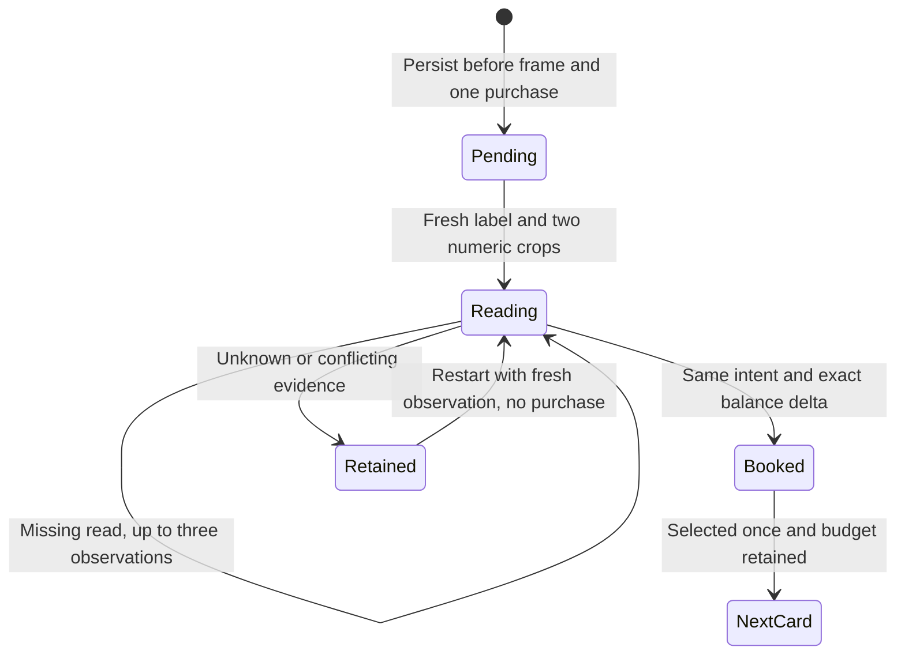

<a id="feature-4-3-6"></a>

### 4.3.6 Battle assignment and actual progress

The saved option resolves to a concrete mode before this diagram. Individual skill-order editing and model-controlled assignment remain incomplete. Alternating HUD/UNKNOWN is not proof of battle progress; stalls retain the observed boundary. START commits a turn only.

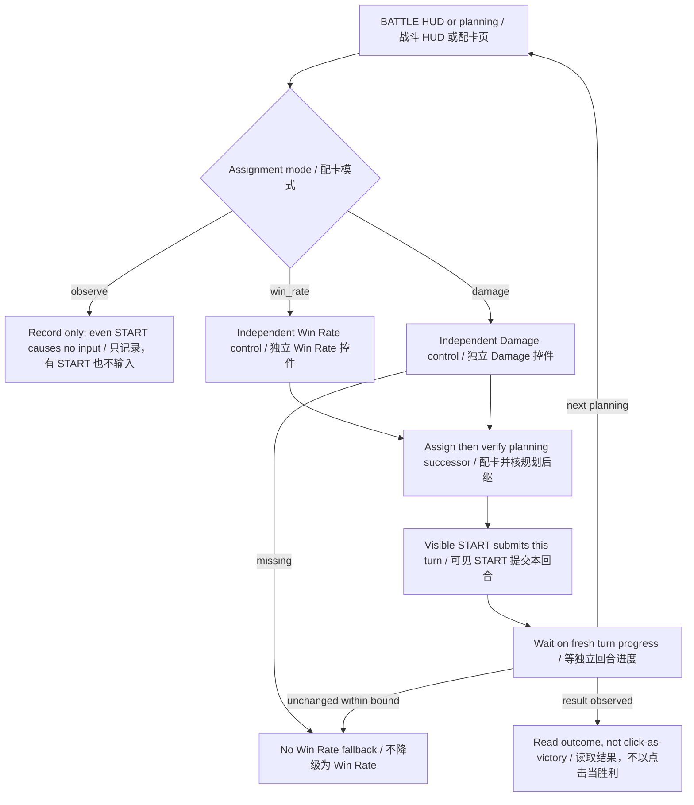

Source boundaries: `src/maalimbus/window.py:110` (`plan_step`); `src/maalimbus/battle_vision.py:1`; `src/maalimbus/runner.py:1`.


<a id="feature-4-3-7"></a>

### 4.3.7 Routes and events are different decisions

**A node is its outer hexagon plus its inner icon.** The hexagon gives the node's state and the icon its type; they are read apart (`src/maalimbus/map_hexagons.py`). Measured on floor 1 at both zooms on 2026-11-21: a node you can go to next has a cream ring (hue 8-35, saturation 30-125) in at least 5 of the 6 sectors and a lit icon; the current node has the same cream ring with its centre covered by the train; visited or not-yet-reached nodes have a gold ring; locked (`?`) nodes are unlit; the boss has a red ring. Only the column one step right of the party is searched, never the party's own column or anything behind it, and the column spacing is confirmed by the party's own hexagon reading as occupied at that spacing rather than taken from badge columns. This lane runs after the others: a pale-cream node such as the super shop falls between their colour masks, and the planner used to fall back to cleared badge nodes behind the party, which on `-141507` took seven ineffective clicks and a stop. The icon is cut out and recorded on its own; naming its type (shop, super shop, battle...) needs a reference image per type, which is game artwork and belongs to the local asset import, so `node_type` is empty for now. Choosing a route does not depend on it.

**The column pitch comes from the train sprite, not from node colour.** The gap between the train's two lamps (`lamp_gap` of `map_node_geometry.train_body`) scales with the map zoom: over the GUI runs' MAP frames it is 34.0-35.3 px where the columns are 192 px apart and 69.2-70.5 px where they are 384, so the pitch is lamp gap × 384/70.09 (`map_hexagons.sprite_neighbours`). With the pitch measured this way the party's hexagon no longer has to read cream to confirm it, and a boss hexagon one column ahead (beyond the `>>`) counts as the next step. The cause was floor 3 of `pi-20261122-003304`: at the zoomed-in view the whole approach to the boss glows red, the party's hexagon read as `boss` and the colour self-check refused the right 384 px, the badge lane offered only three 192 px guesses where nothing was drawn, and the distance filter, ruled at 192 px, dropped the boss as two columns away and stopped with `no_candidate_node_observed`. Node state itself is still a colour reading (cream/gold/red); a truly colour-free state reading is not implemented yet and is on the post-run architecture review.

Current measured-neighbor contract: `connected_ring_node` retains the colored lane and shares its already computed `map_clicks` rows with `_connected_white_outline`. Independent gold-badge column centres measure pitch; bright-ornament columns remain the alternative when shared columns are absent. Badge rows are clustered and their vertical phase is calibrated by the independent train. A next-column/observed-row intersection is a proposal, not a node or room identity. A shop need not have the above-node ornament used by battle rooms. Capture dimensions and the game's internal map zoom are different measurements.

Every proposed endpoint still needs original dark interior, a neutral outline in at least5of6sectors, one independently supported warm/saturated or bright-neutral outgoing corridor with share>=.70 and a unique one-column destination. Two-step, backwards, absent parts and multiple supported endpoints withhold the shortcut. The inner click box never measures pitch. `lattice_measurement` records column/row centres and the measured phase; `analysis_reference_size` names their analysis frame, while target/point/step remain native capture coordinates. `candidates_of` preserves1.25step reach and frame-bound provenance. Existing capacity, intent and Maa carrier own input; only an independent expected node panel/preview/room grants navigation success, not spending or model authority.

Actual9d06636 completed3battles, then omitted the diagonal white shop because its ornament scan found only one marker while the shared map reader measured columns548/740/932 and rows456/616/776. Source repair independently calibrates rows by train932,447 and proposes1124,607, verified by original ring/path pixels. It is not a fixed shop coordinate.128related tests pass, including192/384internal pitch,1920/1280capture and body pan, missing/ambiguous graph parts and whole-Runner bounded recovery. Retained384px cases still pass. Final full regression, new frozen installation and physical shop entry remain required.

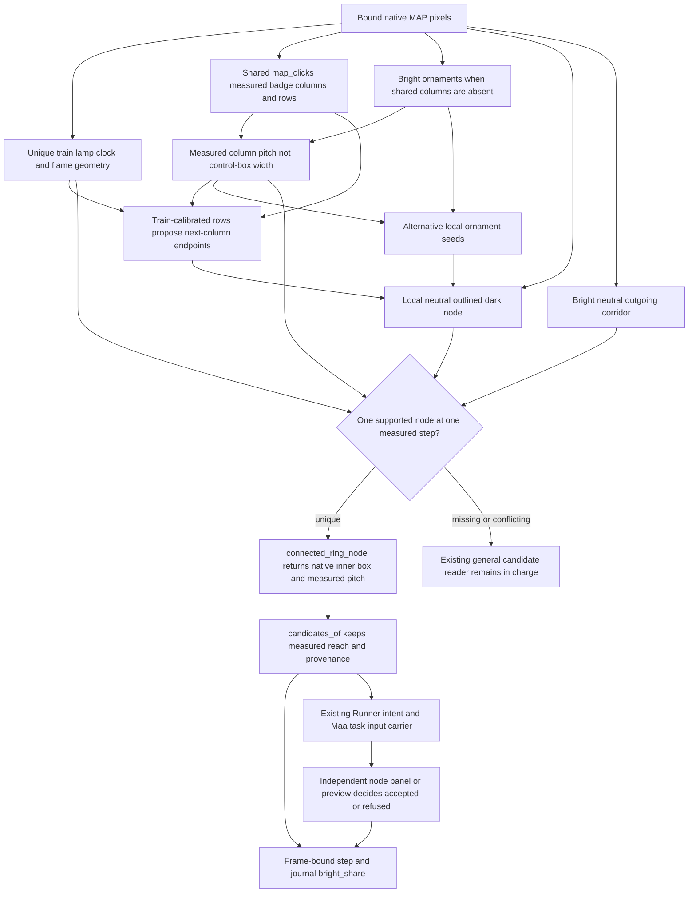

Current compact-glyph contract: actual6f763e3 floor1 frames in packaged-mirror-20261119-040251 retain a32x23/357px neutral question glyph while the old40x24/400px marker rule retains a143x117 path instead. `neutral_node_glyphs` uses the existing neutral brightness/chroma mask, a scale-aware narrow vertical close and compact fill/shape bounds; a second similarly sized glyph in the same column is required. It proposes controls without naming rooms or proving reachability. `map_clicks` reuses the existing lit_icon lane, `candidates_of` preserves node-size/one-step/ranking/successor gates, and `map_nodes_offered.native_glyphs` records the measured boxes/fill/source alongside final scores. Independent NODE_PANEL/NODE_PREVIEW remains the outcome owner. No old JSON or pending is rewritten; proposed labels do not approve a model. New glyph fields are available in the journal and frame-bound step report; automatic ingestion into the learning-review UI is not established. Mandatory synthetic negatives and retained full/panned map chains at1920/1280 pass; actual new installed map progress is still required.

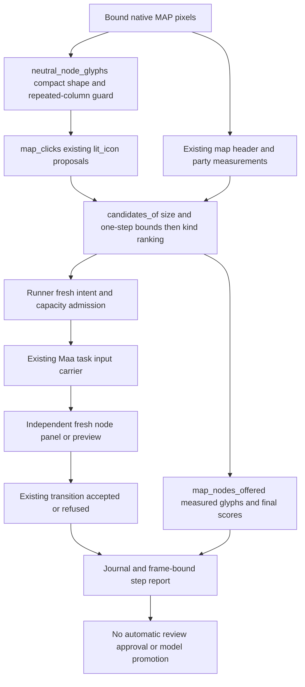

A geometric node hit does not prove panel arrival. Unknown navigation, enemy trials and event choices have different policies; 3.7 return probes do not generalize to arbitrary Accept/Confirm. Missing policies can still block with evidence. Predicted story rewards are not acquired receipts.

2026-11-16 repair: retain a unique small position mark before filtering large click targets; a 40px measurement cannot disappear merely because it is not a 190px node. Multiple marks do not infer one party position; destination size and one-step bounds remain. Seventeen narrow map checks passed, at source/replay scope; no live MAP acceptance is claimed for this repair.

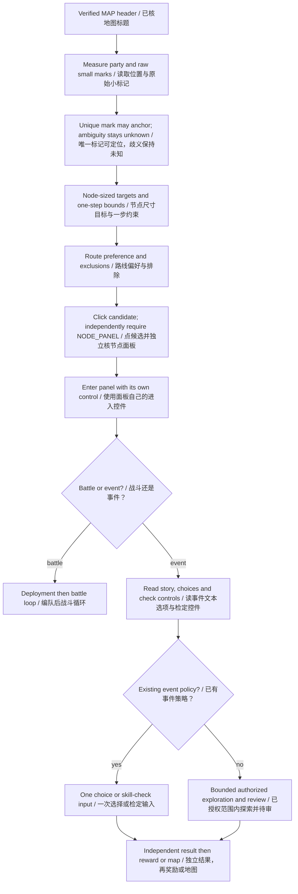

Source boundaries: `src/maalimbus/map_vision.py:1`; `src/maalimbus/event_vision.py:1`; `src/maalimbus/mirror_learning_policy.py:1`; `src/maalimbus/runner.py:1`.


<a id="feature-4-3-8"></a>

The live Mirror purchase path reconciles the game transaction only. Collect learning samples from durable receipts and ledger facts with `python tools/review_shop_purchase.py --collect-scope <run scope>` between runs. Learned mode checks existing refresh samples once per visit. Manual mode skips the queue. The returning shelf remains the authority for purchase reconciliation.

Shop pickup acknowledgement has two phases. The Runner first proves the notice control without writing an intent. If storage maintenance requires a fresh observation, the purchase remains in `confirm_intent` and the new frame can produce another plan. The funded plan writes `overlay_intent` immediately before dispatch. The returning shelf still has to prove the spend and the purchase successor. A refused successor emits `shop_receipt_blocked` with the frame, item, price, pending stage, and expected page. In the older Team2 floor-five Arrested Hymn run, frame-0258 has a notice reservation and explicit capacity cancellation, followed by the same notice in frame-0259 with no pickup dispatch.

### 4.3.8 Purchase and refresh settle separately

The final-floor fallback uses a 500-coin carry target when the current run ledger proves floors one through four and the current map observation does not contradict it. The original reserve, block list, price proof and per-visit refresh limit still govern the input. The decision log shows the effective carry target and refresh count. On the retained Team2 shelf with 1,302 coins and two completed refreshes, the updated policy proposes Carmilla at 217 coins. This is a replay of the decision, with no purchase sent.

An owned GET notice must print the pending gift in its separate name band. The generic GET header and Confirm button do not identify the gift. The runner only rereads an unreadable name or post-purchase balance within the transaction observation limit. A mismatching name preserves the pending record. The retained Team2 Millarca notice passes the name and Confirm check, and an isolated restart refuses a second acknowledgement.

`shop_skill_vision.read_replacement_modal` reads the English three-card skill chooser. On a retained native frame it identified Don Quixote, 3/2/1 copies and 2,283 coins. Two agreeing native crops recovered the left price, 45. The other cards read 75 and 120 from full-frame OCR. Printed tier badges separately verified S1→S2, S2→S3 and S1→S3. A missing or conflicting tier cannot be certified by the column position alone. Picking a front-line Identity, dispatching a selected skill change and settling its coin and skill-count receipts still require independent verification.

`shop_skill_policy.propose_replacement` scores the two copy-retention rules by the cheapest verified upgrade to S3 after the shop reserve. The Runner records each mode's predicted balance and skill counts in `shop_skill_choices_observed`. The English chooser's own Cancel anchors the existing dismissal path. Predictions cannot authorize input or settle the transaction.

At submission, the Runner saves exact identity captions that agree with a distinct printed deployment position and that card's `SELECTED` or `BACKUP` strip. A separate battle HUD observation confirms the passage into battle. The shop log checks both JSON/PNG pairs before attaching a same-run identity and its initial role. One retained Team2 example printed seven selected and five backup. This describes the initial lineup. It does not certify replacements during battle, unread identity captions or a purchase receipt.

With skill replacement enabled, the English submit path can reread unresolved `SELECTED` titles on 1920×1080 and 1280×720 captures using two agreeing three-line native OCR crops from the original frame. At 720p the reader resizes only its working pixels and reports both sizes. The full text must match one catalogue identity. On a retained 1080p Team2 board this recovered Don Quixote at printed position 1 and Ryoshu at position 2. On the retained 720p submit frame and its independent HUD successor it recovered Heathcliff at printed position 5. A conflicting or unread line remains unresolved. The replay writes no deployment state or input.

The shop ledger can recover a pending skill Confirm only from a later chooser capture for the same Sinner. It checks the retained quote, the exact coin delta and the exact three skill counts, then records a skill receipt without modifying the gift ledger. Unknown successors preserve the pending transaction. The installed dispatch and the real post-Confirm page still need acceptance.

For the unspent exit, a later chooser must show the same Sinner, coins and three owned skill counts as the selection frame before Cancel can be reserved. Once a selection is pending, an unchanged coin balance on the shelf is insufficient without the matching Cancel intent. The shelf receipt must follow that Cancel capture. The ledger keeps its prior bytes when any of those checks fail.

The Runner renders the active skill mode, deployment evidence, observed quotes and predicted deck counts through its existing decision log. A selection intent, a receipt wait and a verified charge have separate messages. Repeated snapshots with unchanged observed choices reuse the same console signature.

The Super Shop's retained shelf prints `??` under named skill cards. Full-frame OCR sometimes reads those marks as `77`. The Runner's opt-in `shop_skill_mode` path opens a named card only for a verified initial frontliner and reserves that opening at most once per Sinner per visit. After verifying the chooser, the Runner can reserve a single click on a verified upgrade card. It retains the original frame, identity, quote and expected receipt before dispatch. Only a fresh, unchanged-balance chooser can then reach Cancel and reconcile an unspent return. Gift planning excludes named skill services and ID Skill Search. The MXU task option offers off (default), keep one each of Skill 1 and Skill 2, or keep one Skill 2. It enables pre-purchase verification. The retained 1280×720 chooser's original pixels recover prices of 45, 75 and 120 in the installed Maa OCR engine with two agreeing crops per missing column. The test masks price OCR rows in memory and retains their original pixels and files. A conflicting full-frame badge stays unpriced. The selected-card indicator, paid Confirm and generic picker still require integration and live acceptance.

A refresh is reconciled on the gift slots only. The Super Shop's first-row services (ID Skill Search, Replace ... Skill) are not restocked by a refresh and print `??`, which OCR sometimes reads as `77` and sometimes not at all; counting them made one shelf read 6 rows before a refresh and 7 after it, and a correct refresh with an exact 15-coin delta was refused (`pi-20261121-200305`). `shop_transaction.refreshed_gifts` now drops the services first; the coin delta must still be exact, and the gift slots must keep their count and change.

A refresh can also be free: on floor 4 of `pi-20261122-004911` the Super Shop held 2383 coins before and after a refresh, yet the shelf restocked and the regular refresh price rose 15 -> 30 (keyword 90 -> 105), as it does after a paid refresh. The coin delta may therefore be the refresh price or 0; for 0 the button's own price must be read to have risen (`shop_vision.refreshes`) as proof the game counted the press, and the receipt records `paid=0, free=True`. Any other delta still stops the run, and a free refresh is not an offline learning sample of yield per cost.

Retained normal and Super Shop shelves cover exact OCR spellings including `Heathciffs` and `Ryōshü`. A short list of measured spellings and the possessive suffix resolve those owners without fuzzy matching. A service label with an unresolved owner still belongs outside the gift candidates. The shelf supplies the opening target only. Pricing, deployed identity and the selected replacement remain separate checks.

The generic Super Shop tile has a separate read-only observation. Two original shelves show a Starlight glyph beside question marks on its own badge, even when OCR returns `77`. The reader binds the tile and glyph to the same original image and logs the displayed currency without treating the badge as a quote. The game's notice describes the next step as choosing an Identity below the shelf. That selector and the later payment remain unverified. [Project Moon update notice, page 6](https://clan.fastly.steamstatic.com/images/43587230/287eca0a2596c05341830cae507ec2e48634671e.png)

A Purchase dialog is still an offer, not a charge: deducted currency is not required on that page. Card, confirmation, GET and shelf receipt settle separately. The bought card may remain with its own Purchased badge or disappear. Refresh requires a complete independently changed shelf, not a guess from OCR counts. In-run coins are separate from Modules/Lunacy. Rules, economy priorities and refresh caps control execution; 3.9 models only preview scores.

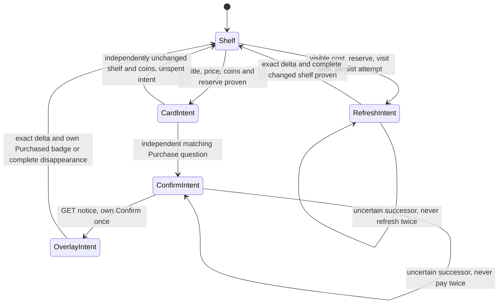

Source boundaries: `src/maalimbus/shop_transaction.py:147` (`ShopTransaction`); `src/maalimbus/shop_vision.py:1`; `src/maalimbus/shop_settings.py:1`; `src/maalimbus/shop_value_shadow.py:7`.


**2026-11-17 shared purchase execution teacher (source, not installed)**: `shop_transaction.purchase_execution_witness` is re-used by live Purchased reconciliation, `shop_outcomes.sync` and the training loader. Exact spend, a unique previously unpurchased offer and its own same-name/price Purchased badge prove execution even when unrelated slots OCR differently. Without that badge, the complete remaining shelf is still required; dialog-bound currency-only live recovery is not automatically a training example. Existing complete-shelf samples retain their content addresses and human reviews; new own-badge samples identify their distinct teacher. All five actual retained purchases passed read-only, with unchanged transaction bytes and zero game input/dataset copies (`build/shop-shared-execution-teacher-real-verification.json`);115 related tests passed,55 historical-material skips. Execution, later same-run returns and causal gift strength remain different labels. No policy promotion or new model-quality acceptance.

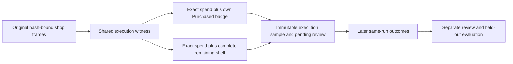

**2026-11-17 canonical purchase evidence (source, not installed)**: New in-project `shop-purchases` samples explicitly declare canonical references in `evidence-storage.json`. Immutable `sample.json` still binds the original JSON/PNG hashes, reverified on every read; delayed outcomes use the same ledger-bound originals. Existing portable mirrors, content addresses and human reviews stay intact. Missing declarations, missing/changed originals, partial mirrors, wrong roles or linked paths never trigger a guessed fallback. Three actual new samples added only18,708bytes: all5purchases collected,2with delayed labels and3awaiting outcomes; original2reviews and31config files unchanged,zero game input/policy promotion.134related checks passed; `build/shop-canonical-evidence-real-verification.json`. This accepts the evidence-reference/teacher migration, not model accuracy or complete Mirror execution.


```mermaid
classDiagram
  class PurchaseSample {
    content_address
    scope
    before_after_proofs
  }
  class EvidenceStorage {
    sample_address
    canonical_roles
  }
  class NativePair {
    json_sha256
    png_sha256
  }
  class HumanReview {
    status
    corrected_benefit
  }
  PurchaseSample "1" --> "0..1" EvidenceStorage
  EvidenceStorage --> NativePair : verify original bytes
  PurchaseSample "1" --> "1" HumanReview : preserve ownership
```

<a id="shop-gift-fusion"></a>

### 4.3.8b Fusing gifts in the shop (Fuse Gifts)

**What it does.** When a shop visit has nothing left to buy or refresh, and before it leaves, it opens the "Fuse Gifts" panel once, fuses the recipes the game itself lists under "Fusion Available", closes the panel and leaves. Recipes only (a fixed result): no random fusion, Wishmaking is never ticked (it costs Starlight), and fusing costs no coins. The switch is "Fuse gifts in the shop" in the Mirror task (`mirror_shop_fusion`, default "Fuse completed recipes", or "Do not fuse").

**The game's mechanics (measured step by step on the live client on 2026-11-24; the OCR rows of the screenshots are kept in `tests/test_shop_fusion_pages.py`).**

- When the panel opens, the owned gifts are dimmed under "Select a Keyword."; only the centre slot of the machine answers, and it opens the keyword page. **Reopening the panel forgets the keyword**; with a keyword chosen, tapping the centre slot again lets it be changed.
- The keyword page has ten tiles (BURN, BLEED, TREMOR, RUPTURE, SINKING, POISE, CHARGE, SLASH, PIERCE, BLUNT) with Cancel and Confirm. The chosen tile only gains an orange frame; no text on the page says which one is chosen: an unchosen tile has 0 orange pixels on its frame, the chosen one about 3,000.
- "Fusion Available" is already listed (dimmed) **before** a keyword is chosen, so what it lists does not depend on the keyword. It lists recipe **results**; one tap makes the game fill the slots with the owned ingredients, and the forecast reads "Guaranteed ... 100%".
- Three tier II gifts loaded by hand read "III ... 90%", as the wiki's numbers say (below). The best a random fusion reaches is 99.99%, so "exactly 100%" can only be a recipe.
- Fuse leads to the question "Fuse the selected E.G.O Gifts?", which shows pictures, a count (such as 2/3) and Cancel / Confirm: no name and no percentage. Confirm leads to the ordinary "E.G.O Gift GET!" notice with the result's name; its Confirm returns to the panel. The coins did not change (2445 -> 2445).
- One fusion was made that way: UPS System (II) + Miniature Telepole (I) -> Insulator (III).

**Each page has one input, decided by the page's own reading** (`src/maalimbus/fusion_vision.py:181` (`next_input`)):

```mermaid
stateDiagram-v2
  [*] --> Shop
  Shop --> Panel: nothing left to buy or refresh, Fuse Gifts button read
  Panel --> Keyword: Select a Keyword shown, tap the centre slot
  Keyword --> Keyword: tap the tile of the team's first system
  Keyword --> Panel: that tile's frame shows as chosen, Confirm
  Panel --> Panel: tap the entry under Fusion Available
  Panel --> Question: forecast reads 100 percent and Wishmaking box seen empty, Fuse
  Question --> Notice: armed by that Fuse, Confirm
  Question --> Panel: not armed, Cancel
  Notice --> Panel: ordinary gift notice, its own Confirm
  Panel --> Shop: nothing available or forecast below 100 percent, Close
  Shop --> [*]: Leave
```

**What cannot happen, and why.**

- Fuse is pressed only when the forecast reads exactly `100%`, the "Fusion Available" heading is present, and the Wishmaking box is **seen empty** (`src/maalimbus/fusion_vision.py:80` (`wish_empty`): the inside is one flat dark colour, mean 23 and deviation 0.1 on five frames; without a picture it counts as not empty).
- The question's Confirm answers only the one Fuse this visit just pressed on a 100% forecast (`armed` in memory, cleared by use); anything else gets the question's own Cancel.
- A keyword tile's Confirm is pressed only after that tile's orange frame is seen (`src/maalimbus/fusion_vision.py:113` (`chosen_tile`)); two taps without the frame end in a refusal by name, not a blind press.
- Gifts already loaded that are no recipe (a forecast below 100%) are left alone: Close. At most 4 fusions per visit, 2 openings of the panel, 2 taps on one entry.
- Switched off, "Fuse Gifts" is never pressed; a panel that is open anyway is only closed.
- With the Japanese resource the three pages' words are not read, so the pages are not named and the button is not found: the flow is never entered.

**The recipe table and the shopping list.** `assets/resource/base/gift-fusion-recipes.json` is imported by `tools/import_wiki_fusion_recipes.py` from "List of E.G.O Gifts/Fusion" on limbuscompany.wiki.gg (names and which gifts make which only, no artwork and no effect text; the file records the revision id, the time, the hash of the source text and the CC BY-SA 4.0 licence the wiki states). It holds 62 recipes: 3 for each of the seven systems, 40 theme-pack recipes, and 1 for super shops only. The import is strict: a group cell says how many rows it covers, and a row no group covers, or a row without exactly one result, fails the import. Reading it by hand "until the next heading" had assigned 16 rows to a group of 13.

Fusing does not need the table (the game lists what can be fused); buying does: `src/maalimbus/gift_plan.py:61` (`shop_wanted`) adds the ingredients of the team's systems' recipes to the shop's wanted list. The reason is a run on 2026-11-23: a Charge + Tremor team left a floor-4 super shop with 1,706 coins and without "Material Interference Force Field", a Charge recipe ingredient the pinned catalogue does not name. Two shelf-reading defects were fixed with it: a title wrapped onto two lines kept only its first line (`src/maalimbus/shop_vision.py:197` (`_with_second_line`)), and a long title read with one wrong glyph or a missing space matched nothing (`src/maalimbus/shop_vision.py:330` (`_read_as`)).

**The wiki's numbers (not measured by this project).** `src/maalimbus/gift_fusion.py:49` (`result_tier`) and `src/maalimbus/gift_fusion.py:61` (`keyword_chance`) hold the numbers of the section "Gift Fusion Details" on the page "Mirror Dungeon": 3 / 6 / 10 / 15 / 30 points per gift tier, a sum of at least 11, 17 and 25 yields tier II, III and IV (10, 15 and 22 in a super shop); a random fusion of 2 gifts has the keyword asked for with 60%, of 3 with 90%, of 4 or more with 99%; Wishmaking costs 5 Starlight per attempt and raises these to 90%, 99% and 99.99%. This project verified one point of it (three tier II gifts: tier III at 90%).

**Not done.** A random fusion (trading gifts of other systems for one of the team's) exists only as the decision function `src/maalimbus/gift_fusion.py:223` (`random_fusion`) with tests; it is not connected to the pages. It needs every owned gift identified with its keyword and tier, the panel shows a name only after a tap, and that reader is not written. The "Recipes" and "Fusion Guide" buttons are never pressed.

Source: `src/maalimbus/fusion_vision.py:292` (`bind`); `src/maalimbus/fusion_vision.py:62` (`page`); `src/maalimbus/fusion_vision.py:159` (`opener`); `src/maalimbus/gift_fusion.py:69` (`Recipes`); the three rows `FUSION`, `FUSION_KEYWORD`, `FUSION_CONFIRM` of `STEP_ROWS` in `src/maalimbus/window.py`; tests `tests/test_shop_fusion_pages.py`, `tests/test_gift_fusion.py`, `tests/test_shop_wrapped_titles.py`.

**Installed-app run (2026-11-24, `pi-20261123-225704`, the floor-5 shop, a Charge + Tremor team).** The program first dropped the purchase intent the previous segment had left unfinished (shelf and coins unchanged), bought Wobbling Keg itself (a Tremor gift on the wanted list, and a recipe ingredient) and three more gifts under the carry cap. With nothing left to buy it opened the panel: the centre slot, the CHARGE tile, Confirm once the orange frame was seen, the entry under "Fusion Available", Fuse once the forecast read 100%, Confirm on the question, and the notice named **Epicenter** (Gemstone Oscillator + Wobbling Keg); the panel then listed nothing, so Close, back in the shop, Leave. From opening the panel to closing it: 7 inputs in 40 seconds (03:58:23 to 03:59:03 UTC), the pages named FUSION, FUSION_KEYWORD, FUSION_CONFIRM, GIFT_GET, FUSION, SHOP in turn. Epicenter is a Tremor recipe and the keyword chosen was Charge, so "the list does not depend on the keyword" is more than an inference: the list was there before a keyword was chosen (`available` true), and a recipe of another system fused under it. One run and one recipe were accepted this way; two recipes in one visit, and a visit with an empty list, have tests only and no live sample.

**The next run's first shop (the same day, `pi-20261124-000448`) showed two things.** First, the keyword page printed its button as "✓Confirm" (it was "Confirm" the day before); read strictly the page was no fusion page, the generic dialog rule pressed its Cancel, and the step stopped as an unexpected successor. Confirm and Fuse now allow up to two non-letter glyphs in front, the frame that stopped the run reads as the keyword page again, and the resumed task (`pi-20261124-002332`) went through and left the shop. Second, an empty list cost a whole round: centre slot, keyword, Confirm, then Close, five inputs and about half a minute. The list is drawn before a keyword is chosen, so with no "Fusion Available" heading the panel is now closed at once and no keyword is chosen.

<a id="feature-4-3-9"></a>

### 4.3.9 Catalogue, account box and automatic formation

The public catalogue does not contain account ownership; unobserved does not mean unowned. Mixed-system selection uses OR matching and ranks level before keyword coverage. A sinner detail-view round trip is not a complete box scan. Complete system-matched E.G.O equipping and live successors need separate acceptance; this diagram does not claim automatic equipment for every account.

```mermaid
flowchart TD
  A["Revisioned public catalogue / 带版本公共图鉴"] --> C["Exact normalized identity index / 精确归一化人格索引"]
  B["Observed owned-only account page / 实际仅已有人格页"] --> D["Sinner header and filter proof / 罪人标题及筛选证明"]
  D --> E["Observed titles, level and evidence / 观测名称等级与证据"]
  C --> F["Reconcile by sinner and unique alias / 按罪人及唯一别名对账"]
  E --> F
  F --> G["Owned matches and unresolved rows / 已有匹配与未解记录"]
  G --> H{"Complete inventory or descending-level proof? / 全量或等级降序已核？"}
  H -->|yes| I["Owned selectable system match, highest level / 已有可选体系匹配，等级优先"]
  H -->|no| J["Do not claim highest owned identity / 不声称已选账户最高人格"]
  I --> K["Actual equip and EGO successor required / 实际装配与 EGO 后继仍需证明"]
```

Source boundaries: `src/maalimbus/owned_inventory.py:1` (`build_index`, `reconcile_titles`); `src/maalimbus/sinner_collection.py:1`; `src/maalimbus/auto_formation.py:17` (`choose_identity`).

## 4.4 `experience`: Automatic Experience Stage

- **Trigger entry**: `ExperienceTask` (`assets/resource/base/pipeline/mirror.json:2375`), option `experience_team` (`assets/interface.json:136-138`); UI text at `assets/i18n/zh_cn.json:79-80`, which states plainly that "stage selection, combat and cost verification are not supported yet".
- **Step-by-step business actions** (`agent/recognition.py:1623-1633`): first `lux_task.prepare(data_directory(ROOT), 'experience', choice)` (`src/maalimbus/lux_task.py:21`), where `choice` comes from `context.get_node_data('LuxExperienceTeam')['attach']['slot']`; `prepare` first runs `check_run` (`src/maalimbus/lux_task.py:11`) to refuse navigation while a mirror run is unfinished, then validates and saves the default team; failure gives `reject(str(error))`. Then it builds `local_device(..., deadline=now+45)` (`src/maalimbus/runner.py:380`) and calls `execute` (`src/maalimbus/lux_task.py:65`), with `result['saved_team']={slot, keywords, deployment}` attached.
- **Step-by-step business actions (navigation part)**: `target(record)` (`src/maalimbus/lux_task.py:45`) recognizes only two pages: `HOME`'s three independently readable widgets Window / Sinners / Inventory plus a unique `Drive`, and `DRIVE`'s `Luxcavation`; past `DRIVE` there is no independently verified next stop.
- **Termination conditions**: reject = an unfinished mirror run (`active_mirror_run_blocks_lux_navigation`), an illegal choice, or an existing intent belonging to another task/team; stop = the session ended or the input bound was exceeded, and `lux_task.execute` returns `lux_navigation_successor_requires_verification` after successfully clicking Drive (`src/maalimbus/lux_task.py:127-128`), which **does not count as pass**.
- **Evidence produced**: `lux-menu-home-input.json` / `lux-menu-drive-input.json` input reports, `user-lux-task-transaction.json` intent file, `lux_navigation_stopped` event, `agent-result.json`.


<a id="feature-4-4-1"></a>

### 4.4.1 Shared Experience and Thread menu chain

Both tasks share execution, differing in task key and saved team. Preparation gates precede configuration writes and device creation; execution checks Mirror exclusion again. Reaching the menu boundary is not farming completion: stage choice, cost, battle and receipts remain open.

```mermaid
sequenceDiagram
  participant A as MainTaskAction
  participant L as Mirror and Lux state / 镜牢与 Lux 状态
  participant P as Saved profiles / 保存编队
  participant M as Maa observation and input
  A->>L: prepare: exclude active Mirror and conflicting intent
  L-->>A: Validated task and team / 已核任务队伍
  A->>P: Resolve saved team, save only changed defaults
  A->>M: Observe HOME / 观测主页
  A->>L: Persist HOME before JSON and PNG hashes
  A->>M: Click independently recognized Drive
  M-->>A: Fresh DRIVE control and hashes
  A->>L: Validate both proofs then resolve HOME intent
  A->>L: Persist separate DRIVE intent
  A->>M: Click independently recognized Luxcavation
  M-->>A: Stage page requires verification / 关卡页仍需验证
  Note over A,M: At most two menu inputs, no farming or consumption / 最多两次菜单输入，不刷本或消费
```

Source boundaries: `src/maalimbus/lux_task.py:11` (`check_run`, `prepare`, `execute`).

## 4.5 `thread`: Automatic Thread Stage

- **Trigger entry**: `ThreadTask` (`assets/resource/base/pipeline/mirror.json:2386`), option `thread_team` (`assets/interface.json:146-148`); UI text at `assets/i18n/zh_cn.json:81-82`, with the same unsupported scope as the experience stage.
- **Step-by-step business actions**: shares one code path with `experience` (`agent/recognition.py:1623-1633`), differing only in `task='thread'` and the node name `LuxThreadTeam`. `lux_task.prepare` (`src/maalimbus/lux_task.py:21`) selects the saved team via `luxcavation[task+'_team']`, and `lux_task.execute` (`src/maalimbus/lux_task.py:65`) uses the same `HOME`→`DRIVE` navigation.
- **Termination conditions**: exactly as in 4.4 (same function, same reason set).
- **Evidence produced**: same as 4.4, only with `task='thread'` in the report; event names remain `lux-menu-<scene>-input.json`.
- **Stated status**: `README.md:51` lists experience/thread as verified for "independent task entries referencing saved teams", with the unfinished part being "the actual stage, cost and combat flow; currently saves the scene and stops". `docs/acceptance.md:1315-1322` likewise admits only menu navigation, leaving actual Lux stage selection, farming, cost/receipt and GUI dispatch open.

## 4.6 `rewards`: Claim Rewards

- **Trigger entry**: `RewardsTask` (`assets/resource/base/pipeline/mirror.json:2397`), option `reward_module_budget` (`assets/interface.json:155-158`); UI text at `assets/i18n/zh_cn.json:83-84` (requires this round's module budget; mail and daily-quest claiming are not supported yet).
- **Step-by-step business actions** (`agent/recognition.py:1614-1622`): first `reward_task_budget.apply(..., get_node_data('RewardModuleBudget')['attach']['maximum'])` (`src/maalimbus/reward_task_budget.py:6`), which requires a currently existing "verified, unpaid five-floor clear" run and binds the cap to that scope; then `reward_task.execute` (`src/maalimbus/reward_task.py:72`), with a 90-second deadline (`agent/recognition.py:1619`).
- **Step-by-step business actions (claim loop)**: each round `execute` calls `runner.observe` (`src/maalimbus/runner.py:657`) to read one page; `action_for` (`src/maalimbus/reward_task.py:15`) maps the page to `claim` / `confirm` / `receipt` / `pass` (`src/maalimbus/reward_task.py:10 ACTIONS`); then `runner.one_shot_click` sends one click and writes a `reward-<action>-input.json` input report; only back on `HOME` does it call `finish` (`src/maalimbus/reward_task.py:27`) to audit receipts and advance rotation. The loop is bounded at 5 iterations (`src/maalimbus/reward_task.py:108`).
- **Termination conditions**: success = `finish` passes the receipt chain and the independent HOME verification, returning `mirror_payout_and_home_verified` (`src/maalimbus/reward_task.py:68`); reject = there is no verified complete mirror run, returning `completed_mirror_run_required` (`:97-99`); stop = the page/successor is unproven, the input bound is exhausted, or the device was interrupted (`:115`, `:129-132`).
- **Evidence produced**: `reward-<action>-input.json` input reports, `user-reward-claim-transaction.json` transaction, `user-run-ledger.json` ledger events, `reward_task_stopped` event, `agent-result.json`.


<a id="feature-4-6-1"></a>

### 4.6.1 Payout and bookkeeping-only recovery

An unapproved budget preserves the offer; a previous run cap is not reused. Amounts and Pass values come from actual pages, not fixed 250/81 constants. Clear, reward acquisition, return and rotation are separate facts. Missing payout/return evidence neither disproves a clear nor permits inventing the completion chain. This task supports Mirror payout only, not mail/daily claims.

The normal Mirror task records victory from the original hash-bound 100% summary before any action changes the page. Once the current cleared run has an approved module budget, Mirror hands the paid stages to the same executor as Rewards. The executor rereads the offer and owns the durable intents, receipt checks and HOME bookkeeping. The Mirror loop reloads the rotation and counts the run only after the executor verifies receipt and return. A previous scope's budget keeps the current offer on screen.

Both Claim and the potentially charged Confirm check the current run's budget. A reduced cap must still cover the reservation before Confirm. After Confirm has been dispatched, the same-run transaction and independent evidence drive receipt, Pass and HOME reconciliation even if the spending setting disappears. The stop summary names the payout stage and input status, and shows the price and weekly bonus count only when both are bound to the observed image.

Only three offers are executable, each measured on a retained original: 6 modules with 1 weekly bonus, 5 modules with 0, and 18 modules with 3. When the cost has two digits the currency icon and the minus sign each sit 6 pixels further left, so the reader keeps two sets of positions with templates cropped from each layout's own frame, and marks found in one layout beside a cost of the other digit count are not an offer. A pair nobody has measured stays refused, 12 modules with 2 bonuses for example. The budget options still stop at 6 modules, so an 18-module offer needs the user's explicit authorization for the run, written into that run's budget.

After the last receipt is acknowledged the game shows a loader before HOME. The executor treats a loader as a wait only once this run's receipt has been acknowledged, bounded by the payout deadline; before that a loader proves nothing and the executor stops as before.

```mermaid
sequenceDiagram
  participant E as Rewards executor / 领奖执行
  participant T as Scoped reward transaction / 本局领奖事务
  participant M as Maa controller
  participant A as Readonly receipt audit / 只读回执审计
  participant L as RunStore
  E->>T: Require verified five floors and scoped budget
  loop claim, confirm, receipt, pass / 各输入阶段
    E->>M: Read fresh cost, question or receipt control
    E->>T: Persist action intent before input
    E->>M: One input, then independent successor
    M-->>T: Scoped input report and retained frame
  end
  M-->>E: Independently observed HOME
  E->>A: Four reports, actual amounts and JSON/PNG hashes
  A-->>E: Full chain proven / 完整链已证明
  E->>T: Persist bookkeeping HOME before ledger change
  E->>L: reward_received then entry_returned, rotate once
  E->>T: Mark transaction completed
  Note over E,L: If final write fails, recover exact archived events without input or rotation / 最后写失败只核归档恢复，不再输入或轮换
```

Source boundaries: `src/maalimbus/reward_task.py:27` (`finish`, `execute`); `src/maalimbus/reward_receipt_audit.py:1`; `src/maalimbus/storage.py:247` (`RunStore.record`).

## 4.7 `stamina`: Stamina Exchange (Not Implemented)

- **Trigger entry**: `StaminaTask` (`assets/resource/base/pipeline/mirror.json:2408`), no option; UI text at `assets/i18n/zh_cn.json:85-86`: "in-budget stamina exchange recognition is still in development; it currently saves the scene and stops, without spending".
- **Step-by-step business actions** (`agent/recognition.py:1634-1637`): `stamina` falls into the branch beyond mirror — it only does one `runner.observe(observer, now+30)` (`src/maalimbus/runner.py:657`), then puts the observation record into the result and returns.
- **Termination conditions**: **it never passes.** The result is fixed at `passed=False, reason='task_page_policy_not_implemented', input_sent=False, verified_clear=False` (`agent/recognition.py:1636-1637`); no stamina or currency is spent.
- **Evidence produced**: the frame pair from one observation + a `main_task_stopped` event + `agent-result.json`; the unit test `tests/test_main_task_dispatch.py:45 test_unimplemented_task_captures_evidence_and_returns_failure_without_input` pins "captures evidence, returns failure, zero input".
- **Stated status**: `README.md:52` lists stamina exchange / daily rewards as verified for "independent entry and budget basis", with the unfinished part being "the actual page and settlement; currently saves the scene and stops"; `docs/acceptance.md:944` likewise admits only a pure budget boundary passing, with no spending implementation.

---


<a id="feature-4-7-1"></a>

### 4.7.1 Actual boundaries of unfinished tasks

Dashed edges mark gaps, not executable transitions. Existing budget helpers or independent task entries do not complete these workflows; the diagram separates planned capabilities from the running pipeline.

```mermaid
flowchart LR
  A["StaminaTask"] --> B["Observe and retain frame / 观测留帧"]
  B --> C["task_page_policy_not_implemented; zero input / 页策略未实现，零输入"]
  D["RewardsTask"] --> E["Implemented Mirror payout only / 仅已实现镜牢领奖"]
  E -. "not implemented / 未实现" .-> F["Mail and daily claim / 邮件及每日奖励"]
  G["Experience or Thread"] --> H["Shared menu navigation / 共享菜单导航"]
  H -. "not implemented / 未实现" .-> I["Stage, costs, farming and receipt / 关卡成本刷本到账"]
```

Source boundaries: `agent/recognition.py:1` (`MainTaskAction.run`); `src/maalimbus/lux_task.py:65`; `src/maalimbus/reward_task.py:72`.

## 4.8 Unverified / To Be Confirmed

Updated boundary (2026-10-13): older “GUI dispatch unverified” rows below are historical snapshots. Actual GUI Start reached DUNGEON_TEAM, warning, stars and initial gifts, proving entry execution, not a full run or live offscreen Team1/Team2 search. The user confirms the previous clear; incomplete independent payout/return bookkeeping remains a separate gap.

Every anchor this chapter opened and confirmed appears as a `path:line` above. The following are **not** independently verified here and are listed honestly:

- **End-to-end GUI dispatch unverified**: none of the six paths was clicked through a real-device GUI for this chapter. The "six native task entries" recorded at `docs/acceptance.md:156-158` only rendered six options on the same GUI, with the task disabled at the time, no game connection, and no GUI Start dispatch.
- **`open_game` cold launch unverified**: `docs/acceptance.md:158` states outright that cold launch is still unaccepted (only "MuMu already in foreground" was separately verified not to relaunch, with zero input).
- **`mirror` real-device result unverified**: the real-device run cited here (`pi-20261012-112240`) ended with `reason=unexpected_successor`, `passed=false` (`docs/acceptance.md:2-8`) — a stopping point, not a clear.
- **`experience`/`thread`/`stamina` page policies unimplemented**: all three still have no stage/page policy code, and the body records them as "unimplemented" per the current state at `src/maalimbus/lux_task.py:127-128`, `agent/recognition.py:1636-1637` and `README.md:51-52`.
- **`rewards` real-device paid claiming unverified**: `docs/acceptance.md:1284-1287` says the actual GUI Start dispatch and the current Team7 five-times paid claim are still unverified, with only the retained receipt chain proven offline.
- **Policy-piece internals not line-checked**: the `mirror_learning_policy.py` / `route_plan.py` / `gift_plan.py` / `shop_priority.py` / `auto_formation.py` / `budget.py` listed in 4.3 had only their top-level symbols and line numbers checked, not their full implementations read line by line.
- **Evidence directory prefix**: the default prefix from `loop_directory` is `pi-` (`agent/recognition.py:1334-1335`); this chapter did not compare the actual `evidence/runtime/` directory listing on every machine, and only cites paths already registered in `docs/acceptance.md`.
- **`InputPreflight`'s `win32` branch internals**: only the entry to window uniqueness and identity checking was read (`agent/recognition.py:1219-1228`); the later verification details and the `input_helpers` report format are not unfolded.


## 4.9 Rotation selection and bounded list search

Entry reconciliation must run before selecting the next team. The shop receipt helper is now named shop_reconcile so it does not shadow entry reconcile.

Team targeting uses independent OCR of the current sidebar rows, never stale screen positions. Offscreen targets trigger bounded vertical Swipes inside the sidebar. Two unchanged semantic lists reverse the direction; at most twelve attempts are allowed. A separate top-header reading must confirm the team before Confirm. Numbered TEAMS #1–#40 captions are supported; custom names still require a verified slot mapping and are not guessed from names or row positions. Attempts persist in private user-team-navigation.json.

The actual failed frame passes isolated reconciliation regression; installed-product and GUI continuation require separate validation.

<a id="feature-4-10"></a>

## 4.10 Rotation policy and manual skip

The chosen policy is rotation after successful payout plus a separate manual skip, not automatic rotation on abandonment. Existing point_at supports explicit idle-team targeting; the dedicated panel, launcher command and idempotent ledger operation now exist in source. They are not rebuilt/installed/GUI accepted, so the diagram does not claim an installed button. The user confirms the previous clear; incomplete harness records are stated separately. Fixed Team1/Team2 and queue targets require the full MainTask-to-Runner-to-list path.

```mermaid
flowchart TD
  A["Start request / 启动请求"] --> B{"Active run? / 已有当前局？"}
  B -->|yes| C["Keep that run team and scope / 保留该局队伍及 scope"]
  B -->|no| D["Read queue cursor or fixed team / 读队列游标或固定队伍"]
  C --> E{"Clear, reward and return all proven? / 通关领奖返回全部已核？"}
  E -->|yes| F["Archive receipt; advance once / 归档回执，前进一次"]
  E -->|no| G["Retain facts; abandon keeps cursor / 保留事实，弃局不自动换队"]
  D --> H["Bounded sidebar selection / 有界列表选队"]
  F --> D
  G --> I["Manual skip request / 手动跳过请求"]
  I --> J{"No active run or controller? / 无当前局及活动控制器？"}
  J -->|yes| K["Explicit next-team change; not completion / 明确换下一队，不计完成"]
  J -->|no| L["Refuse change during a run / 局内拒绝改队"]
```

Source boundaries: `src/maalimbus/storage.py:151` (`point_at`, `abandon`, `record`); `src/maalimbus/task_preferences.py:1`; `src/maalimbus/team_navigation.py:1`.

<a id="feature-4-11"></a>

## 4.11 Cold launch, native journals and an authorized entry recovery

Plan and acceptance remain separate: repair observed entry defects, correct the wrong Team1 under one explicit grant, then reverify Team2 through the installed entry. On 2026-11-16, live Maa executed Halt→Confirm on the complete Forfeit question→GiveUpRewards for that Team1, followed by independent Before Entry evidence. No Claim, grace purchase, weekly toggle or refill/conversion input occurred; the prior 28 canonical hashes remain unchanged. The only new configuration is the normal game-launch transaction. This grant is spent: it is not a default automatic-abandon policy or Team2/clear acceptance. Report: `build/resume-20261116-team1-abandon-real-verification.json`; recovery scripts/account screenshots stay local.

Observed entry repairs: `game_launch.open_game` previously checked foreground five times in quick succession and returned pending while the game was still starting. Observation is now bounded to 15 seconds/at most 30 attempts at 0.5-second intervals, with one launch only; unproven successors retain intent instead of restarting. `session_flow` accepts spacing differences in the complete TOUCH TO START caption without reducing confidence or admitting other words. The free function `run_flow` cannot call an undefined self. Diagnostic click/swipe helpers use the actual Journal's `record`, not a nonexistent `note`. A Cancel that succeeded before logging failed was reconciled from original before/after PNG hashes without replaying input.

The team-library arrow differs in size from the old tutorial template. New `team-library-back.png` is a crop of its actual header; native TemplateMatch retains .92, uniqueness and the TEAM_LIBRARY page requirement. It does not authorize every unknown page. Full provenance stays in local `build/team-library-back-template-provenance.json`. Live Maa returned to the menu; this is not neural training or JP-game acceptance.

This reward modal's button strip is 19 px lower, putting Claim's centre about 3 px outside the old ROI. The updated band covers the actual buttons while retaining thresholds and independent title/To List (or To Window)/Claim anchors. Missing controls or an unknown nested confirmation yield UNKNOWN_DIALOG rather than exposing background Enter. `map_live_observe --current-page` uses Null input and proves only capture/hash validity, never map identity or business progress.

```mermaid
sequenceDiagram
  participant A as Agent / task
  participant M as MaaFramework
  participant J as Journal / intent
  participant G as Game
  A->>J: Launch intent, retain unresolved state
  A->>M: StartApp once
  M->>G: Launch Limbus
  loop Bounded successor observation, no restart
    A->>M: Read foreground and native page
    M-->>A: Fresh pixels/captions
  end
  alt Fresh HOME checkpoint / 新鲜HOME后继
    A->>J: Skip prior title steps, input_sent=False
  else Title still current / 当前仍是标题
    A->>M: One proven title touch, then observe HOME
  end
  A->>J: record pre-input intent and successor
  Note over A,G: Reward modal takes precedence over background entry
  opt Only this explicitly authorized wrong-Team1 recovery
    A->>J: Bind fresh Team1 and grant, one abandonment maximum
    A->>M: Halt / full Forfeit question Confirm / GiveUpRewards
    M-->>A: Independent Before Entry capture
    A->>J: Grant spent, retain old transactions, no clear or rotation credit
  end
```

Related source checks: **135 passed / 75 skipped**, exit 0, covering the actual Journal interface, delayed foreground after one launch, title spacing and modal positive/negative cases. Complete suite: 7 failed / 2732 passed / 710 skipped, 271.19 s, exit 1, retaining the original seven failures. New code/template still require installation; the installed Agent remains b62dbab. Team2 reentry, GUI Start, automatic training/promotion and full Mirror remain open.


**Later installation and Team2 evidence**: c515f3e installed with a 527-file source snapshot, 98 installed private/29 canonical hashes preserved and one new arrow template. Frozen MirrorTask read saved single Team2 and reached STAR_GRACES after five bounded inputs. Independent captions prove Team2, one Confirm and zero star-page inputs. `build/resume-20261116-team2-entry-real-verification.json` also checks original PNG hashes and unchanged old receipts; it does not prove GUI click, clear, payout or rotation.

Stopping at the first post-input STAR successor previously handed control back before entry acknowledgement, leaving entry_pending. Shared `run_wiring.settle_entry_successor` now checks the original intent hash and an independent successor before normal planning and stop handoff. Unknown/same-frame/foreign-scope/changed-original cases preserve pending. Related checks: 140 passed/68 skipped. Actual retained frames exercised full MirrorRunner.step with one FakeDevice input, producing phase entered. The real ledger was reconciled through the same helper after independent Team2/STAR proof audit, with zero further inputs. Final full regression: 7 failed / 2737 passed / 710 skipped, 275.20 s, own exit 1, retaining the original seven failures. Installed from 5f6a87e, self-test passed and 98 installed private/29 canonical files preserved: do not re-confirm. The one Team1 abandonment grant is completed and spent.


**Current live checkpoint (2026-11-17 00:21 UTC)**: installed Agent **39b3aaf** includes entry handoff and installed-runtime evidence protection. Actual component self-test passed, 98 installed private/29 canonical files preserved, assets unchanged, no extra game input during installation. In the same Team2 scope, frozen MirrorTask then completed six bounded inputs from STAR_GRACES to INITIAL_GIFTS. Native balances 74→64→44→14 match configured cards 2/4/5, cost60. The existing affordability rule omitted card7; the confirmation first disabled remaining-starlight conversion, independently read unchecked, then confirmed. Initial gift page received zero inputs; no module/refill/paidclaim input or floor/rotation credit. Report `build/resume-20261116-team2-stars-real-verification.json` verifies all 12 original JSON/PNG pairs and 350–750ms in-target touches. Whole-folder size is approximately **1,927,053,665 bytes**, below 2GB with only about73MB headroom. Canonical screenshots and pending-review proposals remain unchanged. Further long live running needs bounded capture/debug growth; the last short run alone wrote about32.7MB of native debug output. No cleanup or full Mirror completion is claimed.


<a id="feature-4-12"></a>
Navigation checkpoint: `Step.resume_page` declares only a stable-page wait. `run_flow` reads fresh page/hash/caption in its original ROI; independently observed HOME skips title wait/touch with skipped/input_sent=False. It neither repeats StartApp nor writes a business receipt. `finish_launch` resumes title-to-HOME only. Complete title words tolerate the observed I/vertical separator without reducing thresholds; UNKNOWN/covered pages cannot skip using background HOME text.

## 4.12 Initial catalogue previews do not authorize map gestures

The real frozen run reached INITIAL_GIFTS, then performed map normalization before the planned keyword input. The catalogue's gift icon was misread as a party mark; native zoom plus one drag moved the catalogue, while the ordinary input counter only reported the subsequent one preview click. This is a controller ownership defect, not proof of one actual device input. The five retained canonical pairs remain unchanged, selected0/2, no initial gift receipt. `build/resume-20261117-initial-scroll-retained-verification.json` records the source reclassification of those frames and an isolated whole-Runner replay.

Repair: `_normalise_view_once` requires the native record's MAP scene before pixel measurement, gestures or setting its once-per-floor flag. Non-map/unknown pages cannot spend that flag. The later MAP input passes its actual record. Initial-page recognition still requires a unique counter, selected-tray title, Refuse Gift and three unique Sinking/Poise/Charge headers; the header band covers both observed scroll positions and requires a shared row, at unchanged .85 confidence. No generic Unknown-to-click rule is added.

If a resumed zero-selection catalogue displays another group's three offers, the Runner opens the configured group once, then re-reads the title/counter before a gift pick. It does not switch a nonempty selection or repeat a pending gift. If that one preview still lacks configured full names, it reports the missing offers without another preview click. The isolated current-Poise replay proved one configured preview, zero map gestures/flag, zero selected gifts, followed by refusal on the intentionally unchanged frame.

```mermaid
flowchart TD
  Observe[Fresh native record] --> Map{MAP scene?}
  Map -->|Yes| Normalize[Bounded map normalization once per floor]
  Map -->|No| Catalogue[No map gestures or normalization flag]
  Catalogue --> Identity{Catalogue anchors and aligned headers?}
  Identity -->|Yes| Offers{Configured titles visible?}
  Offers -->|Yes| Pick[Scoped gift intent and counter successor]
  Offers -->|No, zero selected and no preview attempt| Preview[Configured group preview once]
  Preview --> Observe
  Offers -->|Still absent or already selected| Explain[Report missing offer, preserve state]
```

Related focused checks: **87 passed**, own exit0. Actual retained five-pair identity plus whole-Runner FakeDevice replay passed, zero game input. Complete suite: 8 failed / 2756 passed / 710 skipped (281.98s, exit1), original seven plus one missing new-diagram README link. The link is fixed; affected Wiki/page/initial checks passed96/29.87s. Agent installation and live resumed selection remain pending. Native host screenshot suppression was installed from b44aade; actual bounded run produced **zero native debug PNGs** and retained all canonical captures, but stopped at this separate catalogue defect. No long-run capacity acceptance.


<a id="feature-4-13"></a>
## 4.13 A pre-battle preset is not a saved Teams slot

The verified Team2 entry later displayed `Preset #1` on the first pre-battle page. The old fallback treated it as global Team1 and substituted profile1's deployment order. This was observed live: fifteen ordinary inputs cleared/rebuilt/submitted `[10,8,3,5,9,12,11,6,2,4,1,7]`, although saved Team2 asks `[3,4,9,1,7,2,12,5,8,10,11,6]`. The roster still belongs to the verified Team2 entry; this is not another wrong-Team1 entry, and no abandonment grant applies. Current run reached BATTLE_HUD and stopped normally at its configured handoff; it is not accepted as correct Team2 deployment. Its submission remains pending bookkeeping until the next normal HUD observation. The verifier reported stopped/failed for this intentional stop path; no clear or payout is claimed.

Plan/implementation: `saved_team_header` accepts only an explicit unique TEAM(S) header at the existing confidence/ROI. A preset-only page contributes no global slot and preserves verified entry/settings. A real contradictory Teams header reports a bounded zero-input mismatch, never substitutes another saved build. The Runner always derives desired deployment from that saved slot. A complete printed order is used only to verify reuse: matching order submits without reset; another permutation requires clear and the configured sequence. Partial badges never become a new order. Original D118/D119/D282 assumptions in the historical decision ledger are superseded at these runtime boundaries.

```mermaid
flowchart TD
  Labels[Fresh pre-battle captions] --> Header{Explicit Teams header?}
  Header -->|No, including Preset only| Binding[Keep verified entry and selected profile]
  Header -->|Yes, matches| Binding
  Header -->|Yes, contradicts| Refuse[Explain mismatch, preserve state, no input]
  Binding --> Saved[Read desired saved deployment]
  Saved --> Badges{Complete observed order matches?}
  Badges -->|Yes| Reuse[Submit without Clear Selection]
  Badges -->|Different| Reset[Clear and apply saved order transactionally]
  Badges -->|Incomplete| Transaction[Use counter and existing deployment transaction]
```

Focused header/order/deployment checks:82 passed/1 skipped; a new whole-Runner protocol group then passed36/1 skipped. Its cases cover Preset1 with matching Team2 order (one submit), a readable different permutation (one clear, desired Team2 unchanged), and a contradictory real TEAMS header (zero input, unchanged ledger). These replace tests that merely called the idle ledger API and pretended to exercise automatic adoption. Complete suite:8 failed/2754 passed/710 skipped,270.47s,exit1: original7 plus an obsolete Preset-as-Team header-box assertion. The assertion was corrected to explicit TEAMS and Preset refusal; affected Runner/header/deployment/Wiki group passed77/1 skipped,30.34s. Actual retained wrong-order/reset-prompt replay verified Team2 desired order without device input or private-state changes. Installed b6c4b2f: actual self-test passed,528-file snapshot verified,98 installed private/30 canonical files unchanged,assets unchanged. Current old-order battle is unchanged; next corrected live deployment remains unverified. No game input after discovering the defect.

Actual Maa NN inference also ran on the independent Team2 pre-battle frame, with the retained model `859b8546...`: ten candidate boxes, status shadow, model_trained true, quality/production/input authorization false. That count is not an accuracy measurement or formal policy promotion. Evidence, candidate labels and original frames remain local.

<a id="feature-4-14"></a>
## 4.14 A requested page handoff precedes view inputs

The first Team2 battle actually reached a native VICTORY banner (.999082) and then MAP, with10 bounded ordinary touches. All44 captured PNG/JSON hashes match. No floor clear or paid receipt was credited. However, the incoming stop-page guard ran after candidate construction: arriving at requested MAP first zoomed/dragged the view and then recorded `passed=False`. Local evidence: `build/resume-20261117-team2-first-battle-real-verification.json`. The normalization gestures are additional to the ordinary touch counter.

Plan/implementation: `MirrorRunner._incoming_handoff` runs after fresh page identity and read-only successor reconciliation, before map normalization, candidate filtering or fallback input. It settles only existing same-scope entry/submission evidence; no input or new action is authorized. A named page records a successful intentional handoff, without clear/reward credit. UNKNOWN remains an unsuccessful diagnostic stop. `_settle_battle_submission` preserves a foreign scope and observe-only state. The normal non-stop path retains its transaction checks.

```mermaid
sequenceDiagram
  participant Native as Maa observer
  participant Runner as MirrorRunner
  participant Tx as Scoped transaction
  participant View as Candidate and view planner
  Native->>Runner: Fresh named page and capture proof
  Runner->>Tx: Reconcile existing successor only
  alt Requested stop page
    Runner-->>Runner: Successful handoff, zero input, no clear credit
  else Continue
    Runner->>View: Measure candidates and plan bounded action
  end
```

Related checks:119 passed/66 historical-frame skips, including whole-Runner zero-input MAP/battle/gift/shop/claim handoffs, UNKNOWN rejection, entry successor and submission scope/observe-only counterexamples. At source-check time installation/live acceptance were pending. Complete regression:7 failed /2789 passed /710 skipped,339.90s, own exit1, same seven known failures. The installed incoming-MAP zero-input result is recorded below. The older battle's failed diagnostic result is retained rather than rewritten.

Installed acceptance: Agent5df4e8d actual self-test passed,98 private/30 canonical files unchanged. Fresh native floor1/Faith & Erosion was independently read before the actual installed MirrorTask: one step, passed/task_succeeded true, no timeout,zero ordinary input and no map_view_probe/view_normalised. All new native PNG/JSON hashes match; whole-run victory/reward remain false. Report `build/resume-20261117-incoming-handoff-real-verification.json`. This certifies the incoming-page handoff, not GUI click or dungeon completion.

<a id="feature-4-15"></a>
## 4.15 View changes invalidate coordinates, not transaction outcomes

Verified defect: normalisation measures close over the pre-gesture record. Zoom does not observe a successor; drag observes but discards it. The later candidate reader receives that old record, while committed/pending boxes and party caches can belong to another viewport. This is a coordinate-lifecycle failure, not evidence that a click succeeded or permission to clear a business intent.

Implementation plan: return the actual post-zoom/post-drag record to the Runner; every further measurement and candidate uses that record. Missing/unidentified successors permit bounded rereads, never stale-coordinate input. A view gesture cannot resolve an outstanding node action. Preserve pending semantics and evidence; retire only screen-coordinate caches/commitments after a viewport operation when no unresolved map action owns them. Bind gesture intents and successor captures in the journal and retention policy. Use protocol tests with distinguishable images plus retained actual frames, then install and continue the current floor1 run to the next correct Team2 deployment. No new entry, abandonment or old reward replay.

```mermaid
sequenceDiagram
  participant Runner as MirrorRunner
  participant View as Maa viewport gesture
  participant Read as Native observer
  participant Plan as Candidate planner
  Runner->>Runner: Preserve pending outcome and identify current MAP
  Runner->>View: Bounded zoom or drag
  View-->>Read: Capture after gesture
  Read-->>Runner: New record and image hash
  alt Fresh identified MAP
    Runner->>Plan: Use new record and fresh coordinate cache
  else Missing or unidentified successor
    Runner-->>Runner: Bounded reread, preserve intent, no stale click
  end
```

Implementation now binds post-zoom/post-drag records, prevents a second normalization after a click plan is built, retires only pixel caches without pending node outcomes, and retains each map_view_intent boundary. Related132 passed/66 historical-frame skips. One intermediate run exposed a missing-frame logging assumption in isolated recovery-budget cases; the optional diagnostic binding was corrected, without changing real-device recognition confidence. Full regression:7 failed /2800 passed /710 skipped,327.85s, own exit1, same seven known failures. Four additional pending-recovery/retention contract cases were then added; their48-case group passed. Installation and live corrected deployment remain pending.

Capacity audit found three obsolete complete launcher copies. All content identities and no-active-app state were verified before retirement:59,826,361bytes reclaimed,1,372 protected/private/native files unchanged,current installed launcher/cache preserved,zero device input. Local report `build/resume-20261117-launcher-cache-retirement-verification.json`; workspace1,924,115,938bytes after audit. This is manual audited cache retirement, not automatic cache lifecycle acceptance.

**Live-discovered follow-up**: installed70b8823 consumed fresh view records, but the bounded12-step run still failed `unexpected_successor` without timeout or room entry. The early-pinch producer bypassed the new preparation; the default box path restored raw detector order; small bright icons were removed beside large inactive badges; a nearest-centre flame reader could choose a reward badge. The source follow-up centralizes both recovery producers in `_viewport_recovery` and covers exploration swipes. A navigation goal is retained during a view change; only actual unjudged/pending node input defers it. `locomotive_marker` requires a unique small flame plus layered warm body; the amber filter invalidated the initial green-dominance hypothesis. Direct verified body anchors are not re-snapped onto a remaining destination. Small lit icons survive at node geometry and box-mode preserves kind ranking. Candidate priority scores/ranks are logged as rule scores, not neural confidence. Journal JSON now names its own frame; legacy retained JSON must be bound to its original filename during replay. Original records remain immutable.

Four real retained captures plus flame/body-removal counterfactuals passed with no input. Full regression8 failed /2813 passed /710 skipped327.44s: original7 plus a diagnostic `expanded` count that omitted the newly supported small-icon path. The count was repaired and affected tests rerun; this is not a fresh full-suite pass. Report `build/resume-20261117-map-locomotive-retained-verification.json`; installation/live room transition remain pending.


**Installed3f04545 room acceptance**: actual MAP→NODE_PANEL→next PRE_BATTLE_TEAM passed with2 ordinary clicks,1 zoom and1 drag;8 original JSON/PNG pairs verified, no timeout and no input on the final page. See `build/resume-20261117-map-locomotive-room-real-verification.json`. The next deployment exposed the fallback ownership defect below; room entry is not correct deployment proof.

**Floor3 alignment correction (2026-11-17, source only)**: the currency badge at(1073,292) borrowed a warm node icon14px to its left and lower red affinity pixels, making the unique-locomotive reader abstain. Its older fallback then chose(1021,521) instead of the real party(863,484). Require the measured warm body's centroid within10 scaled pixels of the flame's vertical axis, retaining every previous shape/colour/count/ambiguity condition. The retained native pair and flame-erasure counterfactual pass; a later actual controller remains running on387bde2, so this fix is not yet installed or live accepted. Report `build/map-flame-alignment-retained-verification.json`.

**One-node projection repair (same source slice)**: native map-20261031-154323 shows party(863,254), a white intermediate destination(1056,255), then red boss(1247,255). The old regression annotation named the boss. Correct the annotation and the actual fallback defect: mid-edge chevrons may be doubled, while a destination's own dense white icon already gives the target. Both paths now respect previous-node rejection. The original image and a chevron-only erasure counterfactual yield(1043,256) and(1056,248), respectively;62related tests pass/1historical skip. These are retained measurements, not new live movement or a full-suite pass. Report `build/map-one-step-geometry-retained-verification.json`.

## 4.16 Modal ownership and bounded reopening of an unconfirmed reset

<a id="feature-4-16"></a>

Installed72792a7 correctly read twelve inherited badges contradicting saved Team2 and opened `Reset Deployment Order?`. Generic `party_vision.plan` then read the background12/12 and clicked the underlying To Battle area before the named DEPLOYMENT_RESET owner. The modal closed; four independent observations retained12/12 and the old order. The clear remained pending and the task ended naturally:2 inputs, no timeout, no card selection or battle submission (`packaged-mirror-20261116-234249`).

Plan/source: fallback answers only UNKNOWN with no unresolved deployment input; named pages use their own planner/transaction. Fallback taps now use in-box random points and350–750ms logged spacing. The original clear is never manually discarded. Reopening requires a new PRE_BATTLE_TEAM frame, complete unique1..12 badges, unchanged12/12, an order still different from saved, the same scope and no Confirm sent. At most2 reopens survive restart with original JSON/PNG hash evidence. Reused proof, sent Confirm, card/submit pending, changed count or missing/changed evidence cannot reopen. Only independent0/12 settles the original clear.

```mermaid
stateDiagram-v2
  [*] --> FullWrongOrder
  FullWrongOrder --> ClearPending: Clear Selection intent + input
  ClearPending --> ResetModal: fresh named modal
  ResetModal --> ConfirmSent: own Confirm once
  ConfirmSent --> EmptyBoard: independent 0/12
  EmptyBoard --> SavedSelection: original pending settled
  ClearPending --> FullWrongOrder: modal dismissed / still12 and full mismatching badges
  FullWrongOrder --> ClearPending: same pending / Confirm not sent / at most2 reopens
  ClearPending --> RetainedStop: evidence changed or retry budget exhausted
  ConfirmSent --> RetainedStop: no0/12 after bounded reads
```

135 related checks passed,1 historical-frame skip. The actual retained modal reaches its own planner through full MirrorRunner.step. An isolated copy of current pending accepts reopening while preserving original fields;28 real configuration JSON hashes remain unchanged, zero device input. `build/resume-20261117-reset-modal-offline-real-verification.json` also binds2 actual ten-box neural proposals to original JSON/PNG hashes: unapproved review, shadow, no input authority. Installation and actual Confirm→0/12→twelve saved picks→battle successor remain pending. This is not complete Mirror acceptance.


## 4.17 Withheld map inputs and camera return

<a id="feature-4-17"></a>

**2026-11-17 follow-up, source-only**: the legacy header-only proposal now checks reach before reserving capacity, tried targets or game pending; a withheld proposal uses the existing bounded recovery and never claims a sent input. Normal planning, header-only dispatch and unknown exploration have separate negative execution cases in `tests/test_map_click_door.py`; valid/invalid two-axis boundaries are also exercised. The old text-count test missed compound/negative guards. Native map-retention positive fixtures now include scope, timestamps, independent PNG bindings and full floor/pack captions; absent proof remains a negative, not a relaxed retention condition.119 related checks passed. Actual live continuation is currently blocked by another game's controller; this repair is not installed or live-accepted yet.

Actual continuous session `packaged-mirror-20261117-001519` used4000 planned steps/5400seconds with no stop page, progressed battle→map, then ended naturally on `unexpected_successor` (24 reported intents; some were withheld, so this is not24 proven taps). Its map log records out-of-step inputs followed by `node_outcome_is_still_pending`: the guard did not send the tap but bookkeeping had already reserved it, blocking the recovery gesture. A normalized-camera flag also survived battle return even when the same floor returned at a different scale.

Source plan/implementation: judge an existing outstanding click first, then check the proposed point before reserving/superseding map intent, stamping click time or counting a tap. A withheld point records `map_input_withheld` with input_sent=False and enters the bounded viewport ladder; an existing genuine pending remains intact. Named battle observations rearm only `view_normalised`, so the next map visit can normalize again; this does not clear any outcome or authorize a gesture on a battle page. All gestures still consume fresh successor captures. This changes no distance/recognition threshold and grants no paid action.

```mermaid
flowchart TD
  Plan[Fresh map proposal] --> Gate{Point passes current-step guard?}
  Gate -->|no| Withheld[Log withheld / no new pending / zero taps]
  Withheld --> Recover[Bounded viewport recovery after real pending resolves]
  Recover --> Fresh[Fresh capture and new geometry]
  Fresh --> Plan
  Gate -->|yes| Intent[Reserve intent before actual Maa input]
  Intent --> Native[Maa input and independent successor]
  Native --> Verdict[Accepted / rejected / still unjudged]
  Battle[Named battle observation] --> Rearm[Rearm camera normalization only]
```

109 related checks passed, including full Runner withheld-input cases with/without genuine pending, real normalization early-return regression, callback/read guards and retention. The earlier fixture-only error (missing required settings argument) was corrected before installation. No new live map acceptance is claimed yet. Correct saved Team2 reset/order has separate32-frame/15-touch proof in `build/resume-20261117-correct-team2-order-real-verification.json`:12→0→1..12, Confirm once, final twelve badges match saved order. That session ended on loading/storage failure, not proven combat completion or whole-run success.


## 4.18 Connected map node geometry

<a id="feature-4-18"></a>

Current contract and evidence: [independent outline/path](#independent-map-path). Both normalization and candidate selection now consume the same `connected_nodes`; warm-only path wording below describes the initial dated baseline. Current installation and physical acceptance follow chapter9.


Actual continuous8fbd190 progressed through combat, bought Nixie Divergence145 and Interlocked Cogs207, refreshed15/30, verified returning shelves and left SHOP. The next MAP failure was natural, not a stop_page or timeout: box-width190 was used as pitch while the real train→red room segment measures382px. The old flame offset also mistook a lower body fragment for the train anchor.

`map_node_geometry.train_body` measures paired warm lamps, a central clock body and an independent flame. Lamp spacing gives the sprite node centre. `connected_red_node` additionally requires a compact red outline and a saturated warm outgoing segment; a grey backward edge or white chevron cannot suffice. A unique result carries the measured pitch through both candidate and final input gates. No result leaves the general reader active. The new reader does not infer clearing or progress; only a fresh native successor can do that.

```mermaid
sequenceDiagram
  participant P as Native retained frame
  participant G as Body and node geometry
  participant R as MirrorRunner
  participant M as Maa controller
  P->>G: independent train + connected red outline or lit ring + bright segment
  G->>R: unique target + measured pitch + evidence
  R->>M: one bounded in-box touch
  M-->>R: independently captured successor
  R->>R: accepted / unjudged / explicit no-op
  Note over R: Only a matching judged no-op releases its pending navigation
```

A fresh MAP rejection retires only the matching already-judged pending/commitment; the rejection journal and refusal memory remain. Unknown/unjudged or foreign pending remains unchanged.139 related tests passed, including real/scaled crops, removed lamp/clock/flame/path/node controls, an out-of-range negative and full Runner dispatch with a simulated retained NODE_PANEL successor. That replay is not live acceptance. Installed8fbd190's two real purchases are rule-based, not neural promotion. The current scope has no new clear/payout credit.

Plan: [9.4.4](9-execution-plan.md#feature-9-4-4). Local archive retains all32 native debug logs byte-exact after lossless compression; private JSON/PNG/config was unchanged. Neither cache retirement nor this stage result accepts long-run capacity or a complete Mirror run.


Actual96c15b2 continuation ended naturally after7 ineffective map inputs: normalization internally halved sprites while the screen stayed1920×1080. Whole-image resize tests alone did not cover that camera transformation. The body reader now measures clock/flame area in lamp-spacing units, with real half-zoom frame0004 as an additional retained regression.140 related checks pass; reinstallation and live successor remain pending. No current controller remains; no new floor clear or resource consumption.

The same failed session also panned the train to y≈254: the map canvas starts below the actual header, rather than at22% of the screen. Real frame0024 exposed a further failure: the red outline touched an affinity badge, moving its bounding-box centre. The intermediate run returned1 with140 passed/1 failed; this failed attempt was mistakenly committed before its exit code was checked. It was not installed.

The subsequent pixel-centroid and lamp-scaled narrow path-corridor correction passed141 related checks (pytest exit0). All24 actual MAP frames in the failed normalization sequence now yield a unique connected node with native JSON/PNG hashes retained in the read-only audit. This is retained-frame acceptance only; live continuation is still required.

<a id="feature-4-19"></a>

**Green-map correction (2026-11-17, source only)**: installed5d78e3c passed normalization but hit capacity after two grey backward-node clicks. Native142233/frame0013 shows a lit node edge mistaken for another flame; fallback read flame height, the old direction filter treated train lamps as a left arrow, and historical kind filtering discarded lit_ring. Require a non-flat flame silhouette. `connected_ring_node` combines an independent train, other measured node columns, the native ring and a bright saturated segment; only one supported one-step proposal uses the existing connected-geometry entry. The actual frame passes the full candidate→planner→distance gate with right-hand[1102,460,40,40], party[910,484], column pitch192, distance212 and path share1.0. Removed path, grey edge, two-step and ambiguous-target controls refuse this entry. Report build/map-connected-ring-retained-verification.json; actual packaged NODE_PANEL remains required. Geometry is neither room entry nor a neural policy.

## 4.19 Shared capabilities and domain constraints


Domains supply goals and invariants; shared capabilities perform interactions without inventing domain meaning. This is the normative composition target, not a claim that every task is wired.

| Capability | Business use | Required domain criteria |
| --- | --- | --- |
| Foreground navigation | Home, menus, overlays | Foreground owner, close control, expected page |
| Scroll search | Teams 1–40, catalogue, account Box | Slot/entity ID, seen-content fingerprints, search bound |
| Ordered/unordered selection | Deployment, starlight, gifts | Set, count, order and price; constraints remain distinct |
| Contextual cost confirmation | Shop purchase/refresh, module payout | Item, unit, quote, scoped budget, result accounting |
| Entity navigation | Map nodes, menu destinations | Entity ID, viewport_revision, connectivity/reachability |
| Submit and collect | Assigned battle start, GET, settlement | One submission and independent successor; completion event |

```mermaid
flowchart LR
  Goal[Task goal / domain constraints] --> Compose[Compose shared capability]
  Compose --> Proposal[Rank once / proposal]
  Proposal --> Protocol[Common action protocol]
  Protocol --> Outcome[Verified transition]
  Outcome --> Domain[Domain transaction / ledger]
  Domain --> Next[Next goal or complete]
```

Finding a team by scrolling is not selecting it; selection does not prove identity/E.G.O equipment. Reuse a proven printed deployment order rather than clearing every battle. Starlight reconciles selected cells and actual prices, not deployment-order semantics. Shop priorities, coin reserve and refresh caps remain configurable; NN ranking operates only within admitted candidates. Log rule/neural/final scores and exclusions. Bought is not good value. Lux, mail and conversion each need their own completion proof; protocol reuse does not establish task support.


<a id="feature-4-20"></a>

## 4.20 Target roles and map recovery / 目标角色与地图恢复

A MAP page can contain a node destination or page chrome. The pure planner now marks node clicks `target_role=map_node`; the offered progress control binds `target_role=page_control` and `control_id=map.progress_button`. `map_dispatch.is_node_action` alone owns the compatibility interpretation. Arbitrary/unbound role strings retain node reach. The dispatcher and map-pending bookkeeping use this same interpretation; the progress control cannot become a node commitment or an out-of-step refusal. Its original named successor contract remains unchanged. A progress control may be planned with zero destination candidates, but normal empty maps without that binding still refuse node input.

```mermaid
flowchart LR
  Frame[Fresh native foreground] --> Own{Known foreground?}
  Own -->|yes| Plan[Own-page planner target and role]
  Own -->|no| Probe[Bounded header-only recovery]
  Plan --> Role{Bound progress page control?}
  Role -->|yes| Control[Dispatch one page control / no node pending]
  Role -->|no or legacy| Reach[Require node reach / preserve pending]
  Reach --> Node[Dispatch one node attempt]
  Control --> Judge[Independent named successor]
  Node --> Judge
```

Actual installed448af15 reached the progress recovery proposal but withheld it as `map_target_outside_current_step`, then ended normally; no progress click was sent. Whole-Runner retained-MAP replay with a deliberately synthetic DUNGEON_PROGRESS successor now sends exactly one in-box click with the node guard forced to reject, and creates no node pending/commitment. Legacy/out-of-range node negatives remain; inline MAP dispatch ceiling tightened29→27. Native progress-panel opening is a separate next acceptance, not established by replay.


Foreground-ownership correction: actual5b13e55 opened DUNGEON_PROGRESS, but the old header-only fallback then emitted three blind-map attempts over that named modal and the run ended naturally. No external force-stop occurred: by the intervention check its Agent/host had already exited. `can_probe_header_only` now permits only UNKNOWN, preserving known foreground ownership; animated sheets additionally use one Dungeon Progress title plus exact high-confidence Forfeit/Continue/Config labels in three aligned columns (`dungeon_progress.floating_panel`). The old fixed ROI/thresholds remain. Original frames0021/0023/0026 reclassify to DUNGEON_PROGRESS; removing an own control defeats the new detector. A current same-scope entered/unpaid/unfinished run restores only its resume-navigation goal from an already open panel; foreign/preparing/victory/paid scopes cannot. This avoids rediscovering failed node clicks after capture restart and grants no new entry, abandonment, resource budget or receipt. Whole-Runner actual-modal replay uses its own bound Window control, not background boxes; its RESUME_DIALOG successor is explicitly synthetic.103related checks passed/43historical fixtures skipped; actual resumed gameplay remains the next live acceptance.


### Bounded occupied-room inspection / 有界检查当前房间

**Installed Floor 3 review (2026-11-20).** Run `205814` rejected three different neighboring boxes. Position relative to the locomotive preserved rejections through a pan, and the gold path reader ranked visible neighbors. Those facts still did not open a room. Leaving for HOME and returning reopened the same floor. Run `210849` kept the two earlier pan directions, tried the remaining one, and used one inspection on the occupied train. A unique clock, lamps and flame plus both gold ring flanks bound the target. Fresh `NODE_PANEL` at frame `0010`, followed by `PRE_BATTLE_TEAM` and combat, verified which control advanced this run. An independent `GIFT_GET` at frame `0062` arrived after combat. The session stopped before confirming it because the external vault journal could not be opened for writing. The ledger still requires Floor 3 completion, final receipt and return. The review proposal remains pending.

**Event result handoff.** In `214512`, the result node's visible `SKIP` was ignored in favor of repeated story taps, and read-only storage refreshes exhausted the old stall counter. `event_result.skip_button` now requires matching Result and Skip on the same frame and appears in the page journal. Only a dispatched control consumes an unchanged-story attempt. On installed `220647`, Skip changed the story and exposed the Melted Eyeball reward. A story tap then exposed `EVENT_RESULT_READY` (`0011`). Continue led to `GIFT_GET` (`0015`), and that notice's own confirmation reached MAP (`0019`). All are in-run transitions. The separate Floor 3 completion witness still requires the next floor.

**Events that end in a fight.** When an event resolves to "Combat Encounter!", the bottom-right slot of its result page reads "Commence Battle" instead of Continue. Floor 5 of `pi-20261122-040807` therefore stayed on `EVENT_RESULT`, tapped the story panel six times for a Continue that never comes, and stopped with `event_result_semantic_progress_stalled`. The English `continue` pattern now also accepts `Commence Battle`, so the page is `EVENT_RESULT_READY` and the same registered bottom-right control starts the fight; the skill check's lone "Commence" is unaffected.

**Floor 4 checkpoint.** Run `223541` verified shop receipts, beat the Floor 3 boss and recorded Floor 4 with cleared floors `[1,2,3]`. It later stopped before an input in a Floor 4 fight under capacity pressure. A same-scope installed continuation pinned 1280×720, completed that fight and returned its encounter reward to MAP. Retained frame `0066` has a visible cyan diagonal from the locomotive to the shop. At 1280 the cubic reference-size normalization fragmented the shop glyph, and the older candidate fallback offered a distant box. Linear normalization restores the existing compact body plus continuous path measurement on that exact frame. No reach threshold changed. The compact measurement has only replay evidence at this checkpoint.

Installed run `003311` used the corrected destination to open `NODE_PANEL` (`0005`) and enter `SHOP` (`0008`). The next evidence reservation timed out before any new purchase or refresh. Team2 and cleared floors `[1,2,3]` remain in the ledger. This verifies the installed click and successor for this destination. Cross-floor recognition still requires the separate generalization checks above.

The current room and a destination have different meanings. `occupied_node` requires one train's lamps, clock and flame together with either its red base or both gold ring flanks. After at most three distinct viewport pans, `Exploration.choose` may offer one `current_node_inspection` inside that train base. Canonical JSON and PNG hashes must agree. Named exit or cost overlays veto the input. A changed, independently named successor in the expected set is required for success. Four unsuccessful probes exhaust the episode. Pausing through HOME, restarting, or missing evidence leaves the attempt budget spent. Unresolved business transactions still block navigation.

```mermaid
flowchart LR
  MAP[Canonical MAP and full floor header] --> Pans[At most three viewport pans]
  Pans --> Sprite{Unique train and a verified base?}
  Sprite -->|yes| Inspect[One bounded current-room inspection]
  Sprite -->|no| Exhaust[No invented target]
  Inspect --> Judge{Independent expected page?}
  Judge -->|yes| Review[Success proposal / human review pending]
  Judge -->|no| Unresolved[Unresolved proposal / no replay]
```

Actual retained right-edge frame0014 identified the train near1823,605 rather than the middle gold badge.99related checks passed/11historical skips, including removed sprite-part negatives and a full Runner probe replay with an explicitly synthetic NODE_PANEL successor. This is not a live room reopening, dungeon completion or trained-model promotion. Rejected ordinary map probes are now withheld before durable intent/input counters; own header controls do not inherit a map-node distance test. Review proposals reference the canonical captures without copying or approving them.


Native follow-up e11d082 exposed a competing viewport action before inspection: normalization's legacy marker selected a badge, its reversed horizontal direction pushed the actual train farther right, and an unnecessary vertical drag hid the train under side chrome. The loop ended naturally for evidence capacity, not timeout; no room opened. The shared party reader now gives complete train/base evidence precedence. A ready, canonical occupied-room probe defers normalization entirely. Otherwise normalization uses content-following-finger directions, bounded horizontal centring and zero vertical motion inside the existing22–88% safe band. Each gesture still requires a fresh successor; no motion ends the bounded attempt.114related checks passed/11historical skips, including a measured-position simulation that reaches x960 from1823 with negative-x swipes and unchanged valid height. Historical direction tests that asserted the opposite Maa semantics were corrected, rather than claimed as live progress. Installation/native room entry remain separate acceptance.

<a id="node-preview-handoff"></a>
### Same-frame handoff from map to node preview

Installed/native boundary: frozen af31f4b actually passes native recognition and planner-box checks on this original image; Enter is exactly[1670,780,122,61], with zero device inputs and1736protected files unchanged. See `build/combined-installed-runtime-verification.json`; GUIStart, physical Enter and whole-run acceptance remain open.

Current defect: native retained `packaged-mirror-20261117-010749/frame-0005.json` names NODE_PREVIEW and reads Enter at[1670,780,122,61], score0.999904, but has no persisted node_preview field. The old runner wrote successor controls into the preceding in-memory record during settle; the next fresh observation lost that field. MAP expect also omitted NODE_PREVIEW. The unresolved successor audit exposed this real omission, not merely historical count drift.

Source migration wired, live reacceptance pending: `vision.node_preview` remains the sole reader with unchanged threshold/ROI. The planner derives Enter from the current named observation's own OCR/size, ignoring prior node_preview caches. MAP includes the named preview in its original action expectation. Probe retirement derives from the same `map_dispatch.node_transition` judgement and retains the original expectation, without retroactively granting a new contract to an old input. Retire the settle-time mutation of the preceding record and duplicate recognition branch. Missing Enter keeps bounded rereads; it grants no background map input. This settles navigation only, never room Enter/floor/payout/model promotion; existing provenance/review gates still own learning. Enter now returns a capture-coordinate box, fixing the old Text-object/planner shape mismatch. No new persistent state format is introduced.

```mermaid
flowchart LR
  A[MAP input and its original expectation] --> B[Independent named NODE_PREVIEW]
  B --> C[Navigation verdict from original contract]
  B --> D[Current frame OCR and size]
  D --> E{Own Enter readable}
  E -->|Yes| F[One preview Enter proposal]
  E -->|No| G[Bounded reread with no borrowed target]
  F --> H[Independent room successor]
  H --> I[Existing room-domain verdict]
```

Source acceptance:66contract/preview/map checks actually pass with no skips; unchanged original hashes and retained-page protocol replay cover arriving directly at preview, a forged stale cache, removed Enter text and a narrower original expectation. Independently retained pages are not claimed as an observed adjacent native transition. Complete regression and continuous official frozen live acceptance follow; their actual results belong to the latest checkpoint.

The static `pages.DISPATCH_FACTS` projection now names the preview successor; its drift assertion is unchanged. Runtime judgement still comes only from the original action expectation and `node_transition`. New diagrams have Wiki structural checks; no directly usable Mermaid module was found on this host and new render acceptance is not claimed.


<a id="train-anchor-projection"></a>
### Shared train position; separate room and modal ownership

Installed874709a bounded badge-target rejections on the same floor3 MAP, opened the existing pause/reentry path and returned normally on capacity before confirming Pause. No abandon/payout. Retained packaged-mirror-20261118-080819 frames6/18/20 show that existing train_body uniquely measures lamps/clock/flame, while the old party projection snaps the flame to a neighbouring badge. occupied_node additionally requires a red base for the current-room role; that does not negate a measured train position.

Source now feeds the same train_body into locomotive_marker first, preserving fallbacks and pixel thresholds. Party/tracking/ring consumers share the position. Native MapObservation resolves one borrowed controller per callback and computes MAP-only map_player; its former locals guard always serialized None. Coordinates do not establish route-node identity, edges or page success. Actual original panned frames, non-MAP negatives and borrowed-controller lifetime are checked.

Recovery confirmation requires the existing return-to-entry intent AND the current complete Pause Exploration title, both save-and-return question lines, unique Cancel and Confirm, each with its own band and0.9 confidence. Only that reader projects pause_exploration.confirm. A generic unknown_dialog.confirm grants nothing; missing/duplicate/low-score/moved/resource/abandonment questions retain ordinary dismissal. Unmeasured locales do not borrow English confirmation. The script must handle the actual modal, not a manual stage click.

115related checks pass/2historical skips; expanded map regression221pass/82historical skips predates the modal patch. These are source evidence; installed live successor, whole run, GUIStart and model promotion remain separate acceptance.

```mermaid
flowchart LR
  A[Current native image] --> B[Unique measured train body]
  B --> C[MAP party position]
  C --> D[Navigation proposals with separate edge proof]
  A --> E[Pause title and complete question and own buttons]
  F[Existing return-to-entry intent] --> G{Both purpose and modal ownership}
  E --> G
  G -->|Yes| H[One owned save-and-return Confirm]
  G -->|No| I[Own dismissal only]
```

<a id="independent-map-path"></a>
### Node outline and path appearance are independent

Installed36f2295 physically passed the former white-shop blocker: HOME→Resume→MAP→NODE_PANEL→SHOP, refresh15/30, Wrist Guards161, named GET and returning-shelf receipt, then MAP. Sharing map measurements was the right seam for that internal-zoom failure. It was incomplete as a general map solution: the next red outline has a bright white edge. The older red/warm and coloured/saturated combinations encoded a coincidence as a rule. New source separates the two properties through one `_supported_path`, not another boss coordinate or a wider reach.

The outline families still own their original shape, train, scale/distance and unique-destination checks. Each passes independently computed masks to the same51middle-segment samples, with its existing corridor width. Red retains its warm RGB plane and also accepts the existing saturated HSV plane; coloured/neutral readers retain their saturated plane. Red surrounding coverage permits at most one60degree gap, tolerating an interrupted border while rejecting open chevrons. Every family also tests the existing neutral-bright mask (S<=60,V>=200). At least one mask alone must cover>=.70; incomplete masks are not added together. A qualifying legacy mask keeps its original feature meaning. Top-level `warm_share`, `saturated_share` or `bright_share` names the accepted measurement, `path_support` records each separate fraction, and `path_appearance` names the accepted appearance. All are diagnostics, not room identity, reward value or input authority. Analysis-frame units remain explicit.

`connected_nodes` centralizes the existing red-before-ring priority and compact alternatives for both `candidates_of` and `MirrorRunner._normalise_view_once`. The runner ranks measured alternatives; normalization only needs an independently visible goal. The singular `connected_node` is compatibility for a unique result. None certifies room entry or global optimality.

```mermaid
flowchart TD
  F[Bound native MAP pixels] --> N[Existing red or coloured or neutral outline validator]
  F --> W[Existing warm or saturated pixel mask]
  F --> B[Existing neutral-bright pixel mask]
  N --> C[Endpoint and original corridor width]
  W --> H[One shared supported_path measurement]
  B --> H
  C --> H
  H --> Q{One mask alone supports at least70percent?}
  Q -->|no| R[No connected shortcut]
  Q -->|yes| G[Shape train reach guards / legacy family uniqueness]
  N --> G
  G --> J[connected_nodes shared legacy priority and compact alternatives]
  K[Compact body plus independent train and supported edge] --> J
  J --> V[Normalization defers unnecessary gestures]
  J --> P[Runner rank and page plan / existing Maa input owner]
  V -->|same original frame| P
  P --> S[Independent expected node successor]
  S --> E[Navigation evidence without room or reward inference]
```

| Outline | Supported edge | Current evidence |
| --- | --- | --- |
| Red | warm / saturated-blue / bright-neutral | actual original red/white boss passed installed2e4bb27; new broad-plane/outline guard source3920full pass, new physical variant not claimed |
| Neutral | saturated / bright-neutral | actual white shop passed36f2295; shared-path baseline installed2e4bb27; new variants remain source evidence |
| Coloured ring | saturated / bright-neutral | supplied-ring proposal unit combinations; current new detector/physical variant not claimed |

`tests/test_map_path_planes.py` covers this appearance matrix, grey/isolated-chevron/absent/split-mask negatives, real red/white native pixels at1920/1280 with body pans, and one complete Runner simulated dispatch to an explicitly synthetic panel.181affected checks pass, including the actual normalization consumer and a whole Runner with normalization enabled. Actual installed continuation and final complete regression remain open. The retained shop purchase proves transaction execution, not that Wrist Guards was optimal or that a learned policy chose it; the run used saved manual policy.

<a id="bounded-map-resume"></a>
### Bounded speculative navigation recovery

Three independently judged rejected node inputs can suggest a resume recovery; they do not prove the game is suspended. Before the existing progress input, Runner records one `map_resume_recovery_reserved` hypothesis with before-frame identity. Its in-memory `map_resume_attempted` survives auxiliary HOME/DRIVE/MIRROR_ENTRY/RESUME_DIALOG/progress/loading/unknown pages during this invocation. Another three no-ops end with `map_resume_did_not_restore_navigation` before a second progress/pause roundtrip. Only `map_dispatch.node_transition` accepting an independent expected panel/preview/room clears both this attempt and the sticky `resume_requested` goal. A new explicit task invocation has a new read/recovery budget; there is no automatic process restart or new persistent transaction. All existing business pending and original proof remain authoritative.

`map_dispatch.is_progress_action` owns the bound progress role for both node-reach exclusion and recovery reservation; diagnostic reason prose is not a dispatch predicate.

```mermaid
stateDiagram-v2
  direction LR
  [*] --> Eligible
  Eligible --> Attempted: three judged no-ops, reserve one hypothesis before input
  Attempted --> Attempted: HOME, Resume, loading
  Attempted --> Stopped: three more no-ops, no second progress input
  Attempted --> Eligible: independent expected node successor
  Stopped --> [*]
```

`tests/test_map_escape.py` exercises the actual Runner first progress dispatch, subsequent no-op terminal with no second click, auxiliary non-successors and a real node-family successor. This is synthetic dispatch/state proof; current installed9d06636's repeated save-and-return cycle is the retained failure, not successful new recovery. Source/frozen/live boundaries remain in chapter9.

<a id="navigation-diagnostic-contract"></a>
### A navigation verdict closes diagnostics, not the room

Current retained-cohort correction (2026-11-19): PRE_BATTLE_TEAM wait changes chrome in1of3 measured spends, so the current declaration is rarely; the dated historical3of3 declaration remains intact. Journal hashes and the pre-change audit are in build/deployment-ladder-cohort-observation.json. This does not change the sample/rate thresholds, runtime rung order, navigation acceptance, financial receipts or model authority.

**Audit repair plan (2026-11-18, offline only):** the page census must retain the mixed named-page/ANY contract and delegate page acceptance to `window.successor_ok`; ANY does not prove an unchanged page. Preserve the October census as historical rather than treating its old counts as today's corpus. Recovery-view calibration likewise belongs to its dated journal cohort: retain the old table, reconcile current measured classes with journal hashes, and test ordering against explicit weak/strong fixtures. Keep minimum three measurements, the one-half class boundary, stale/contradiction detection and the actual recovery ladder unchanged. Neither audit authorizes an input, a route node, a financial receipt or a learning label. Exit evidence is mixed-ANY/finite-contract counterexamples, independent current-journal census and the full serial regression, followed separately by installed gameplay.

The source runtime accepted NODE_PREVIEW through map_dispatch.node_transition, but `_settled_map_inputs` still recognized only NODE_PANEL. Successful preview inputs therefore could not close their old diagnostic obligation. CLICK window_intent now records the original plan.expect; retention consumes the same node_transition verdict against that original expectation, with independent before/after native bytes, capture times, scope, header, target and bounded touch unchanged. Missing expectations retain only the previous MAP/NODE_PANEL semantics; newer pages cannot retroactively widen an older action.

A settled earlier navigation before-image can retire during the active session after preserving the latest two accepted inputs, current tail/last causal boundary, required source/model/review/business proof and all JSON/journals. Previously scene-boundary pins retained these older MAP diagnostics until recorder exit. This neither authorizes the separate preview Enter, credits a room/floor/payout nor grants a positive learning label.91related checks pass, including three synthetic preview acceptances retaining the last two and absent/narrow/empty/malformed/duplicated-contract negatives. Actual live preview/room continuation and final combined regression remain required. No device input was sent by this source repair.

```mermaid
flowchart LR
  P[Original map plan.expect] --> I[Durable input intent]
  I --> F[Independent native successor]
  P --> J[Shared node_transition judgement]
  F --> J
  J -->|Accepted named successor| N[Navigation settled only]
  N --> E[Separate preview Enter still needs own control]
  N --> K[Keep latest two and current causal and external proof]
  K --> R[Older unreferenced diagnostic may retire]
  U[Absent or narrower historical contract] --> H[No retroactive widening]
```


**Audit repair result:**63focused checks pass. All79journal hashes are unchanged; corrected page-only census has no finite-contract unnamed landing at the existing floor. Current ladder audit has no stale/contradicted/undeclared row after explicitly separating the historical cohort and updating drag_down/MAP from3changed of3. A DRIVE wait is absent from this cohort; its by-design rule is tested with a dedicated measured fixture, rather than demanding that a mutable corpus always contain that scene. Genuine finite gaps, three unchanged drag_down samples, mixed-ANY same-page rejection and weak-before-strong ordering still fail their respective negative checks. Runtime expectations/ladder/input policy are unchanged. Evidence: build/audit-semantics-reconciliation.json. Final full regression and installed gameplay remain separate.


266Wiki diagrams actually parse with Mermaid11 in an isolated headless browser; both new bilingual navigation/storage views render, and the independent raw-protection branch was visually checked. Dense storage overview keeps vector detail through the existing readable mode. build/runtime-convergence-wiki-render-final.json; this is diagram evidence, not gameplay acceptance.
