# 6 Deployment and Operations

[中文](../zh_cn/6-deployment.md) · [← Index](index.md)

<a id="bounded-image-vault"></a>

### Automatic reclamation and the optional local image vault

The 3 GB project target guides offline maintenance. During an installed task, evidence writes and input admission check the volume's free space. The retention policy reclaims eligible diagnostics and protects the current run, ledger, pending work and review references. With explicit opt-in, offline maintenance may move sealed historical containers to a sibling directory on the same machine. The vault defaults to 512 MB. With automation closed, an operator can set this machine's separate ceiling with `tools/archive_native_images.py --enable-vault --vault-budget 768000000`. A new ceiling must cover the existing vault usage. The image index and original frame identities stay in the project. A default installation creates no external vault.

A sealed container can have a retained raw copy in the project. The transfer verifies its length and full hash against the index before and after the move, leaving the raw copy and JSON in place. A conflicting copy, a change in presence or a failed historical-ownership or protection check prevents transfer. Archive index and read precedence are unchanged.

Offline `--prepare-live` can reclaim headroom from sealed native `maafw.log` diagnostics before image processing. It uses the existing opt-in vault and controller lease. Logs must have a terminal journal, a known scope outside the active run and a modification time before the active entry. Transfer records retain the source-relative path, byte count and digest. Journal events, original images and transaction records stay in place.

Offline maintenance first moved five old containers with retained raw copies, freeing 68,827,680 bytes and keeping seven originals in place. A second offline pass split five mixed containers and moved only eligible historical members. Protected and current-run members stayed inside the project. This freed about 30.4 MB, with both mappings checked and all 655 archived originals read back. See `build/floor4-raw-twins-offload.json` and `build/floor5-vault-split-verification.json`.

Installed run `030523` completed the first Floor 5 fight and its rewards and reached turn 3 in the second. The stop stack shows an independent reference scan during raw retention after replanning. The no-progress watchdog expired before that verification finished. An offline plan found 75,720,393 reclaimable diagnostic bytes under the existing rules. A completed reference scan, distinct diagnostic projection or original-image witness check now updates only the in-memory activity clock. Journal events still follow committed retirement. The stall timeout, absolute run deadline, per-frame checks and 3 GB budget remain in effect.

After enabling the authorized 768 MB ceiling on this machine, offline maintenance moved eight sealed containers and freed 50,728,600 project bytes. The vault used 561,382,530 bytes and all 655 indexed originals passed readback. Installed Agent `e2d0eb4` continued the same Team2 entry from the map and observed a real Floor 4 boss victory. The independent post-battle `REWARD_CARD` in `014455/frame-0098` has a verified original image hash. Admission timed out before the reward action, so the ledger had yet to record Floor 4. After exit the project had about 4.48 MB free. The vault had spare capacity and zero remaining eligible historical containers. Reward selection, Floor 5, payout and rotation remain open. See `build/floor4-vault-768-offload.json` and `build/floor4-after-vault-768-team2-20261120-014454.json`.

`native_cold_vault.offload` accepts complete containers from closed recorders and excludes the active scope, newer captures and pending, review or model references. It verifies the existing index, container hash and original members before an atomic same-volume move. The transfer journal records intent and commitment. Both locations serve the same hash-indexed reader, so an interruption leaves the original accessible at one of them. Cold retirement only rewrites containers inside the project. A full vault preserves its files and leaves project-local reclamation and admission in charge.

Automatic transfer runs only under reservation pressure in a native recorder and attempts at most two containers at a time. Storage maintenance still requires an independent reread for an unsent plan. Offline maintenance uses the existing `archive_native_images.py` with `--enable-vault` or `--offload`. The bounds cover managed evidence in their respective locations. MuMu and other programs own their own storage.

Installed run `210849` hit Windows PermissionError opening the vault transfer journal under pressure. The journal and archive counts remained unchanged, and the pending gift confirmation was never sent. Optional vault write refusal now reports unavailability and falls through to the same project-local retention policy. An uncertain write or failed rollback still halts. If neither location can safely free enough room, admission stops before physical input. After exit, the authorized offline transfer moved nine sealed historical containers and freed 129,112,488 project bytes. The separate vault then occupied 389,136,049 of at most 512,000,000 bytes. All 607 indexed originals were read back successfully. Moving to a sibling folder frees project headroom on the same drive. Actual disk savings come from retiring eligible diagnostics or lossless compression.

Installed run `212340` confirmed both distinct gift notices, opened a new encounter and later reclaimed eligible diagnostic captures automatically under pressure. The external journal still refused writes. The program obtained full funding during readmission but reduced its physical reservation to one observation again. Four discarded plans ended the task before another input. After a second maintenance pass, the reservation now holds any already funded full target through the mandatory fresh observation. The owner still grants zero input successors until fresh frame validation and full readmission. The regression test verifies this handoff. A second offline transfer freed 106,828,704 project bytes and verified all 607 indexed originals again. The vault occupied 495,970,465 bytes. Same-scope combat continuation and full-run acceptance remain pending at this checkpoint.

Installed run `214512` completed the suspended fight and entered an event. Under storage pressure its first refresh reserved 9,349,634 bytes. The second held the funded 16,699,268 bytes with zero input successors, and the next fresh observation independently readmitted both successors. At 02:56:52 UTC the real device door funded the click on `frame-0081`, and `frame-0082` named the event result. The same pattern repeated on the result page. Native local reclamation and physical input after refresh are accepted for this run. Automatic external transfer on this Windows host remains unaccepted. The separate event result blocker and whole-run payout still require evidence.

Installed run `222048` reached the shop and verified the Reverberation purchase, then held the next purchase at its confirmation dialog. Near the hard ceiling, holding 16,699,268 bytes through refresh was still insufficient to leave room for both a new image and the original input allowance. A pressured second admission now prefers one additional bounded observation pair when the same eligible diagnostics can fund it. If the extra pair cannot fit, it falls back to the minimum. That larger placeholder carries zero input successors until the fresh pair is written and a new admission succeeds. The project and vault caps and protected file roles are unchanged.

Installed run `223541` exercised the larger 24,048,902-byte refresh in combat and returned to the physical input door after a fresh frame. It confirmed Wobbling Keg once, verified its receipt and left the shop, then reached Floor 4 in the same scope. Later only the minimum could be funded and four plans were withheld. A final offline transfer of one closed historical container left the vault at 510,650,016 of 512,000,000 bytes and preserved hash readback for the 607 indexed images. The 1280×720 installed continuation was a per-invocation setting. It completed the suspended fight with smaller captures and did not replace stored originals.

Actual installed de63542 run160101 sent MAX, a non-ready gold dial and WinRate; original frame8 shows assigned skills/START. Refresh-only admission discarded the pending submit and frame9 was freshly recorded, then battle_progress_stalled ended before input readmission. Thus refresh capture is physically observed, but its full post-refresh input chain is not accepted.19original files,106private/33canonical preserved in build/battle-refresh-live-outcome.json; folder2,983,506,218bytes. Mechanism review found the same HUD counter incremented by battle_progress and an obsolete inline block. Plan: one writer; storage-only refresh does not spend another unchanged-turn stall round. Normal frozen HUD still spends its original budget, changed turn still resets it, refresh count3/deadline/physical two-pair funding remain. Gold ring geometry alone is not assignment readiness; no unsupported visual threshold change. Source test/correction→full per-case XML→clean freeze→normal currentTeam2 continuous task. Whole run, paid receipt, model promotion and lost0048 remain open.

Source implemented: obsolete duplicate progress block removed; capacity_reobservations marks only unsent storage-refresh reads, so unchanged turn does not spend another stall round.274related pass/93historical skips/36.04s/ownexit0. Five new cases include original assigned-frame/native-event envelope→whole Runner→simulated START send, ordinary one-count/frozen stop, three-refresh bound, real turn reset and blind counter preservation. All five fail against the original04557e8 source. Initial replay harness missed native event fields and then the raw-frame reader strips frame names; both mistakes were corrected without changing original records or game guards. Final full XML/freeze/physical continuation remain next.

Adjacent lifecycle correction implemented before installation: independently named nonbattle/nonloading pages clear the prior fight progress/blind counters. UNKNOWN, LOADING, BATTLE_TIP and BATTLE_PLANNING preserve fight ownership; a normal planning observation still counts once and may stall.314related pass/93historical skips/61.31s/ownexit0. Eleven added cases: first five original-event/storage cases, plus six page-lifetime variants; original HOME/MAP boundary counterexample2failed/3passed before correction. Loading was initially reset because it is named, not UNKNOWN; one negative caught this and the existing is_loading predicate now excludes it. Planning fixture was corrected to carry readable wave/turn and expect one normal count. Earlier full run was explicitly terminated incomplete at35percent/exit-1 for this necessary neighbouring fix, not counted green. Complete attempt4027passed/701skipped/1NAV-only Wiki failure/843.31s/ownexit1. Bilingual chapter3 navigation was restored to line3;73Wiki/privacy checks then passed82.51s/ownexit0. Runtime SHA remains identical to the complete attempt, XML11added runtime passes/0further runtime status losses; no second complete suite or all-green complete-attempt claim. Navigation checks should precede the long regression when inserting local views; route structure alone does not check chapter layout. Actual cleanf94661d Agent installed/terminalexit0;549source snapshot,13complete compiled identities/self-test and actual frozen Runner count/six synthetic boundaries passed. Frozen native cache/capacity retained-pixel replay and memory-staging/readback retained.106private/33canonical/19current originals unchanged. Source/frozen7210references/143archived reports match; launcher unchanged. build/battle-refresh-installed-verification.json. Closed exact-ZIP duplicate retirement12copies/3,487,105bytes retained all unique bytes, every packet and current originals, folder2,985,782,070bytes. Fresh readonly target127.0.0.1:16416 is online but foreground=com.hypergryph.arknights; normal Limbus continuation was not started and no controller/input/game switch was attempted. Availability question pending. build/battle-device-foreground-readonly-block.json. Actual installed f94661d counter repair remains unaccepted physically. Closed metadata maintenance then retired37older unselected duplicate copies/10,693,655bytes, with byte-exact existing ZIP members and unchanged source-reference projection/private/originals. Directory2,978,860,288bytes. Current selection and last two return packets stay raw; older closed packets may require hash-verified native-records.zip member extraction before historical workflow CLI reading. build/battle-refresh-closed-packet-retirement-verification.json and its durable manifest. No game images, pending, review queues or unique bytes were removed.  not GUIStart/whole-run/payout/rotation/model promotion/lost0048 recovery. Full attempt NAV-only failure and subsequent73passing Wiki checks remain separately recorded.

<a id="staged-observation-credit"></a>

### Refresh observation and physical input have different lifetimes

**2026-11-20 installed login review.** The first continuous `f94661d` task, `180944`, ended on the watchdog while reserving evidence space on TITLE, with zero game input. Closed maintenance retained one byte-identical witness in each offline replay image group and recorded all 16 duplicate paths, hashes and restoration sources. This freed 12,392,159 bytes. Existing protection still applies to live originals, pending transactions and the review queue. The second continuous task, `190250`, discarded the old TITLE proposal, dispatched one login input from `frame-0003`, and observed independent HOME in `frame-0013` after loading. Both PNGs match their record hashes. The login waits sent no repeat input.

On HOME, even the next read-only refresh needed capacity. The measured 2,995,475,099 bytes in use plus 11,349,634 requested minus 5,050,858 reclaimable exceeded 3 GB by 1,773,875 bytes before the manifest allowance. The task ended with `evidence_capacity_unavailable_before_input`. Funding one admission at launch does not fund continued evidence generation. A full login capture, retained successors and the next decision all spend the same budget. The measured bottleneck is sustained capacity, so changing a page threshold or extending the watchdog would leave it intact. The same Team2 scope is active with floors 1 and 2 cleared, reward unclaimed, completed total 2 and rotation index 0. The earlier battle stall repair has yet to face another live fight. Local run report `build/battle-refresh-team2-continuation.json` and duplicate manifest `build/battle-refresh-duplicate-replay-pixels.json` preserve the evidence.

`answered_login_diagnostics` binds the one TITLE dispatch to the independently observed HOME. Only intervening reads with matching wait events and capture hashes qualify. It keeps the first response, the first sample per wait scene and the last wait, along with both action endpoints. An intervening input or contradictory response keeps the existing retention rules in force. The shared raw and cold retention planner still honours pending, review, model, source and report references. The original `190250` trace identifies five repeat waits totalling 8,131,794 bytes before external reference checks. The 3 GB cap and the two-successor input reservation are unchanged.

Actual970b8ed reused deployment, reached BATTLE_HUD turn1/MAX and committed cold retirement/deferred progress. It stopped before the next input: used2,981,072,216 +26,048,902 -5,041,504reclaimable =3,002,079,614. Retained pair986884bytes gives a sequential positive at2,995,716,864 with unchanged two successor bounds; not a prediction of the next image. build/staged-credit-live-outcome.json.

Implemented: pressured plan admits refresh-only one full pair+stop, successor_pairs0; the new actual FrameRef must independently fund full two-pair input credit and every device call rechecks it. Shared refresh_required drives both admission and native pixel-cache producer. Completed refresh cannot restart read-only staging merely on pressure; genuine further storage work can invalidate the unsent plan. Full-size/no-space still refuses before input. Same3GB, original deadline, foreign credit, pending, hashes, three rereads and full input bounds.

259related pass/9historical skips, including real Journal/pool/MaaDevice with simulated controller, full-size successors/shortage, stale five input kinds, torn/legacy/invalid owners and producer agreement. Initial9failures were old simultaneous-funding assertions; their retained names now assert staged ownership plus unchanged input guarantee. A new phase-loop counterexample failed before the completed-refresh fix and now passes. Final retained-frame replay with the same other-byte/reclaimable accounting: old joint refuses, staged refresh→refresh→input funds16,699,268bytes, one simulated input, zero device/controller.106private/33canonical/selected originals unchanged. build/staged-credit-retained-release-verification.json. Full XML/clean freeze/current battle remain next; not native dispatch or whole-run acceptance.

The native source/frame bound is unchanged; no historical size predicts new output. Scope all consumers: Runner._capacity_reobserve discards and invokes fresh read; Journal/recognition cache publishes new identity; consume_capture funds each actual pair including fallback; admit and MaaDevice door independently fund/validate the two successors. Purpose metadata alone cannot send input or approve any paid action/label.

Stable-source full4017pass/701skip/559.98s/pytest ownexit0; XML nine added passes and no existing case status losses. Prior lost0048/two coverage gaps remain explicit. Clean freeze then current sameTeam2 physical battle continuation remain next.

Actual cleande63542 Agent installed terminalexit0;549source snapshot/13complete compiled identities/self-test,106private/33canonical/current originals unchanged. Actual installed PYZ recognition and capacity code execute retained-frame staged-credit replay: old joint refuses, two refreshes then full16,699,268bytes, simulated input1/device0. Prior frozen native_TEMP/memory-staging readback retained. Source/frozen7174references/143archived reports match; launcher unchanged, folder2,967,297,809bytes. build/staged-credit-installed-verification.json. Full4017pass/701skip/559.98s/ownexit0, XML9new passes/0old status loss. Next fresh page and normal sameTeam2 continuous physical task. Not GUIStart/whole-run/payout/rotation/model promotion or lost0048 recovery.

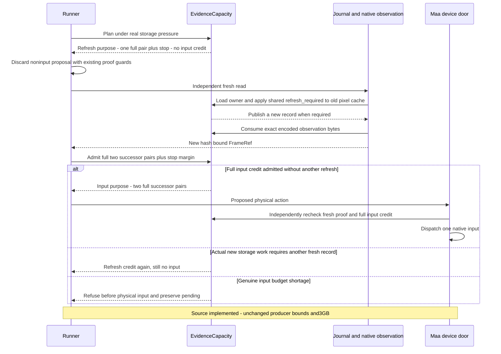

Closed maintenance removed116redundant raw Wiki capture/after/review/finish copies only after byte-exact existing ZIP verification, freeing16,927,610bytes. Every packet.json, selected artifact and last two return folders remain raw; unique bytes remain in native-records.zip. Reference projection/106private/33canonical/current original bytes unchanged. The first helper was stopped for repeated per-row folder scans;99copies were restored exactly, then the batch-reserved helper completed with a durable manifest. Folder2,962,874,554bytes; no game images, pending or review queues moved. build/closed-wiki-copy-interruption-recovery.json and closed-wiki-copy-retirement-fast-verification.json. These duplicated build outputs were not a reason to weaken game-evidence retention.

> Earlier dated simultaneous three-pair experiments below are superseded by staged observation credit; retain their original revision/evidence scope.


<a id="compression-staging-peak"></a>

### Native IPC TEMP is not an external compression budget

Installed9f2f3eb started the current PRE_BATTLE_TEAM, reclaimed two eligible raw diagnostics, and returned normally with zero game inputs. No self-log refusal recurred, but no live cold retirement commit is claimed. Next refusal: used2,996,944,097 plus5,447,788 publication bytes exceeded3GB. Actual bootstrap has native TEMP inside build/native-agent-tmp. Real isolated native_temp/first tempfile use proves compression scratch was already inside the project before require_space, then counted again for publication: scratch344bytes, used70,746 versus before70,402. build/compression-peak-before-fix-reproduction.json. This is cross-layer environment ownership, not unread game semantics.

Source compact now stages bounded xz in memory, matching existing cold rewrite design. Keep the same input/24member bounds (not process RSS), identical encoded tar/xz bytes, publication reservation/margins, readback and fresh reference/raw retirement guards. Do not change Maa IPC TEMP or add an external evidence store.116initial and242related/9historical skips pass; actual native_temp default-cache order/exact capacity/one-byte shortage/publication error and prior file-staging byte equality covered. Full XML/freeze/physical battle remain next.

Measurements reject another hopeful storage fix:352eligible raw candidates/460,135,289bytes, but first16MB batch gains only85,696bytes; PNG is already compressed. Do not claim archiving solves sustained headroom. Closed maintenance instead repacked all14,304Git objects, including unreachable/reflog objects, with identical refs/index/worktree and fsck;34,689,035bytes freed, no history pruned. Folder2,960,667,884bytes. Current raw pairs/events,106private/33canonical remain. Lost0048/two coverage gaps remain open.

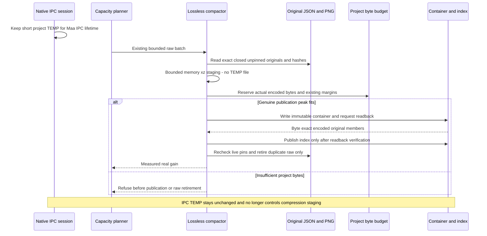

Stable-source full4008pass/701skip/553.97s/pytest ownexit0; per-case XML4new passes/0further status losses, earlier lost0048/two coverage gaps retained. Clean970b8ed installed and verified; physical continuation next.

Actual clean970b8ed Agent installed terminalexit0;549source snapshot/13complete compiled identities/self-test,106private/33canonical/current original pairs unchanged. Actual frozen archive/native_temp modules execute isolated memory-staging/readback with zero controller/input and unchanged project IPC TEMP. Source/frozen7158references/143archived reports match; launcher unchanged, workspace2,964,332,370bytes. build/compression-peak-installed-verification.json. Full4008pass/701skip/553.97s/ownexit0 and XML4new passes/0further loss. Next fresh page and continuous sameTeam2 physical task; not whole run/GUIStart/payout/rotation/model promotion or lost0048 recovery.

<a id="guarded-storage-progress"></a>

Live evidence admission verifies the current frame, capacity limit and successor reservation. A shortage reports the page, pending item, current dispatch status and missing bytes. Historical reclamation runs between controller sessions. Use `python tools/archive_native_images.py --prepare-live <closed run directory> --target-free <bytes>` to prepare headroom. The workspace cap and original-frame and pending-reference protections still apply.

### Memory activity and guarded journal persistence have different owners

Installed7726776 physically passed static reward frame1→newframe2, selection/confirm→Floor3MAP→NODE_PANEL→PRE_BATTLE_TEAM before a cold snapshot refusal. Exact isolated reproduction (real cold reclaim/Runner/Journal) changed only events.jsonl by one validated_native_archive progress row; all original bytes remained intact. Build stage reports are outside that snapshot. The observer's own persistent telemetry invalidated a correctly strict role-input byte guard. build/cold-progress-before-fix-reproduction.json. Current/private/selected raw pairs are preserved; lost0048/two coverage gaps remain separate.

Plan: verified_reads exposes two existing-lifetime delivery channels: completed-work activity (memory/deadline only) and persistent progress reports. Cold reclaim and discarded-proposal witness scopes defer persistent callbacks until guarded work succeeds, while each actual completed validation can still refresh the in-memory watch under the original deadline. Coalesce at most8stage records; nested/failing scopes cannot publish false completion. Publish cold-retirement completion only after durable commit. Keep the full byte snapshots, v1 intent semantics, actual pin checks,3GB,90s silence guard and game/pending/paid/model authority unchanged; do not filter or ignore journal rows. Normal raw retirement reports stay after unlink+fsync. Audit found two snapshot consumers: cold publication/unlink and discarded-proposal witnesses; native compaction uses independent live-reference/hash checks instead. Live monitoring will only read; manual observer reports wait until termination, avoiding needless concurrent pin changes.

Verification: actual cold/Runner/Journal callback pipeline, raw witness scope, optional/nested callbacks, bounded coalescing/failure discard, real changed role inputs/pins/index/PNG negatives and original deadline. Cheap page/corpus checks precede combined full/JUnit XML, clean Agent and currentTeam2 continuous acceptance. No whole run or lost-original recovery claim.

Implemented in verified_reads/deferred_progress, cold reclaim, discarded-proposal pruning and Runner memory activity. Initial72focused and311related/27historical skips pass;33checks rerun with the actual recognition.Journal (not a replacement logger) pass. Both guarded consumers preserve all journal bytes until scope exit, nested callbacks keep their owner, queue stays at8, deadline/changed-input/report-sink failures remain covered. Combined stable-source full4004pass/701skip/553.47s/pytest ownexit0; per-case XML shows10new passes and no further status losses. Clean9f2f3eb installed/verified; physical continuation next; the earlier two lost-original coverage gaps stay open. Current raw pairs/events,106private/33canonical and available white42/50 unchanged. No claim of installed new source or restored0048.

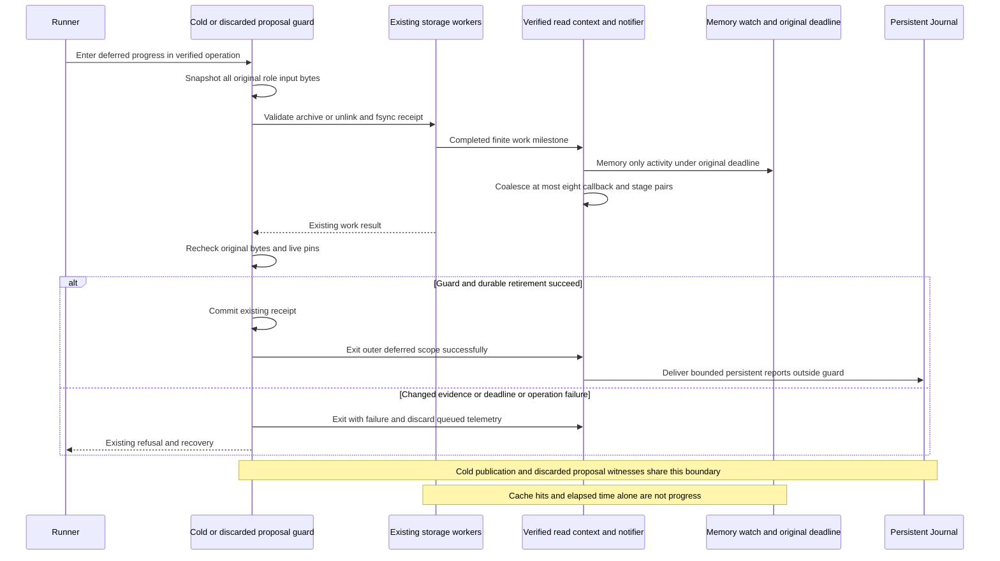

Actual clean9f2f3eb Agent rebuilt/installed terminalexit0;549source snapshot/eleven complete compiled identities/self-test,106private/33canonical/current four original pairs and available white42/50 unchanged. Lost0048JSON/hash remains, PNG not recovered. Source/frozen7150references/143archives match; launcher unchanged. Workspace2,988,287,164bytes under3GB. build/cold-progress-installed-verification.json. Full4004pass/701skip/553.47s/ownexit0; XML10new passes/0further status losses. Next normal currentTeam2 continuous physical progress-isolation acceptance; no whole-run/payout/rotation/latestGUIStart/model promotion or lost-original recovery claim.

<a id="split-source-pins"></a>

### Static source paths protect both original representations

Cache-source full regression3976pass/701skip/ownexit0 exposed two new skips, both resolutions of white-node original0048. A real raw reclamation receipt records its deletion: source scanner recognized joined evidence/runtime strings but missed ROOT / evidence / runtime / run. The JSON/hash/deletion trail survive; no exact duplicate was found among matching-size raw PNGs,65native archive containers or the named sibling snapshot. This is an unresolved lost-original evidence incident, not historical acceptance or permission to substitute nearby pixels. build/split-source-pins-outcome.json and build/reference-pin-recovery-search.json preserve scope and limits.

Plan: extend the existing non-executing AST source-pin producer for statically resolvable slash chains, literal concatenation, Path and joinpath forms. Keep module/function aliases and decorator frame sets; resolve only known string suffixes, never execute project code or invent dynamic frame IDs. Both raw and cold deletion retain the same shared reference consumer. Source parse-cache family changes to source-v3 so unchanged bytes cannot reuse the old parser's answer. Test pressure preservation in raw/cold representations, alias scope, same-size/time edits and actual source declarations. No cap increase, erased diagnostic rule or new budget authority. Preserve the missing original's JSON/hash and two explicit coverage gaps while fixing future protection; do not delete/replace/rename those skipped cases to manufacture green coverage.

Source and local fixture-dependency closure implemented.282related passed/27historical skips/50.61s/ownexit0. Read-only current-root comparison7116→7136references adds20and removes0;106private/33canonical/selected originals unchanged. Available white42/50 hashes still match;48 remains unavailable. First75pass/one real fixture-dependency failure caused explicit local fixture linkage, then78pass and final broader matrix. Same-named class fixtures conservatively union owners; unresolved dynamic paths are not claimed complete. build/split-source-pins-real-verification.json. Next combined full emits per-case JUnit XML to expose skip/coverage changes directly, then clean install and normal currentTeam2; missing original/two coverage gaps remain explicit.

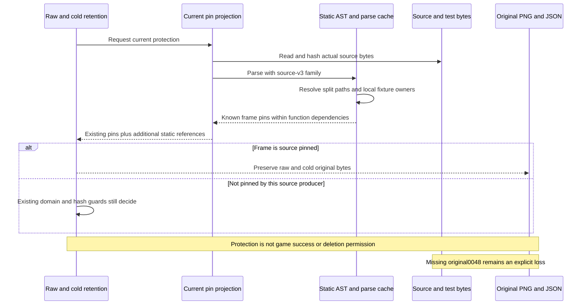

Combined stable-source full3994pass/701skip/557.49s/pytest ownexit0; per-case XML comparison shows0additional status losses and18new passes, with the earlier lost0048/two skipped resolutions still explicit. build/split-source-pins-full-tests.xml and split-source-pins-suite-comparison.json. Next clean Agent and currentTeam2 physical continuation; no whole-run or lost-original recovery claim.

Actual clean7726776 Agent rebuilt/installed terminalexit0;549source snapshot/ten complete compiled identities/self-test,106private/33canonical/current selected originals and available white42/50 unchanged. Lost0048JSON/hash remains, PNG not recovered. Source/frozen7136references/143archives match; launcher unchanged. Workspace2,979,421,427bytes under3GB. build/cache-and-pins-installed-verification.json. Combined full3994pass/701skip/557.49s/ownexit0; no further status loss/18new passes, earlier two coverage gaps explicit. Next fresh physical currentTeam2 continuation; no whole-run/recovery claim.

<a id="required-capture-cache"></a>

### Storage refresh and unchanged-pixel reuse are separate contracts

Installeddeee042 physically delivered26raw retirement completions and continued battle→REWARD_CARD. On that stable reward page, maintenance invalidated plan frame0033. The next MapObservation completed another native screenshot but LimbusRecognition reused the identical-pixel cache and returned the same original frame0033. The capacity guard correctly rejected its old path/JSON before any reward input. build/capture-cache-live-outcome.json preserves the actual chain/private/pending. The earlier fake Observer pipeline always published a new record and missed this real shared producer.

Plan: retain unchanged-pixel reuse normally. Only when this Journal's cache names the exact capacity owner frame marked fresh_capture_required, bypass that cache hit and run ordinary recognition+Journal publication from the current native image. No global cache clearing, old JSON rewrite, invented timestamp, changed consumer predicate or assumption that equal pixels mean game progress. A newly named record can carry equal PNG pixels; subsequent identical reads reuse it normally even before admission, because it is no longer the old owner frame. Missing/changed pool proof still refuses. Test required/normal/foreign/already-new/changed-image/read-failure variants through the actual cache producer, MaaObserver and FrameRef. Replay retained reward pixels with actual native OCR before full regression/freeze/continuous physical acceptance. Bypassing OCR only at this rare required-record boundary is the smallest existing-interface fix; a separate cached-analysis/new-capture protocol would need more provenance and is not introduced speculatively.

Source now implemented.229related checks/27historical skips/28.93s and31capture-profile checks/2.45s passed. Actual native Resource→ReplayController→AgentTasker→MaaObserver→MapObservation→OCR→Journal→FrameRef→admission replay passed both cases: prior cache returned frame1/refused, required-record producer wrote frame2/accepted; ordinary reuse then resumed,0device input/106private/33canonical unchanged. build/capture-cache-native-verification.json. First test collection missed agent bootstrap and one assertion confused read-event UTC with FrameRef.captured_at; corrected before long regression. First native probe completed cases but failed cleanup on an open Maa log; isolated child-process rerun passed. Full stable-source regression/clean install/physical reward passage remain next.

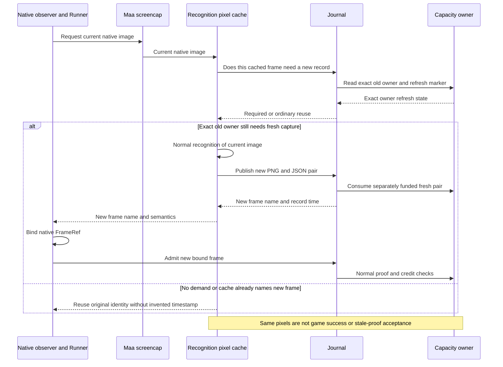

<a id="raw-retirement-progress"></a>

### Completed raw reclamation feeds the existing watchdog

Installedbf774be actually passed funded re-observation: one discard, independent fresh record, normal SDK and attack animation, then turn4. Its next stop was no_progress_watchdog/94.3s. Actual captured execution stack is admit→reserve→apply→require_space/size;50completed raw deletion receipts exist across this invocation, not necessarily all in that silence. The run-wide verified-read session had already cached archive identities, so its decompression-only milestones did not cover this real raw reclamation producer. Evidence: build/retirement-progress-live-outcome.json and build/capacity-reobserve-live-passage.json. Original current/prior pairs, private state and pending remain.

Plan: after each existing permitted raw PNG unlink **and** its deletion receipt are durably complete, publish one aggregate capture count through the existing operation-local verified_reads callback to MirrorRunner._storage_progress. No names/private pixels in this event. A plan, unchanged/cache hit, before-unlink check or failed deletion/receipt produces no progress. This is observed storage work, not a timer heartbeat or game successor; original run deadline,90s silence watch,3GB, current proof/pin rechecks and game/financial/learning authority remain. A changed reference after the first receipt must still preserve the next capture. Deadline expiry after a completed unit may stop with its receipt retained and no input. Reclamation throughput optimization remains separately unproven; the callback does not declare all batches fast or globally optimal.

Source implementation: completed raw retirement uses the existing callback after receipt fsync.211related checks passed/9historical skips/44.39s/ownexit0; stable-source full3972passed/699skipped/562.25s/pytest ownexit0; clean Agent and installed pressure acceptance remain next. First focused55pass/one incorrect no-op apply test failed; corrected test uses the actual no-op reserve entry. A subsequent bad test-path command exited4 before collection, never counted as a pass.

Verification plan: actual retention→durable receipt→Runner heartbeat with zero controller; no-op/planning/cached-read/hash/pending/unlink/receipt-fault negatives; deadline and mid-batch new pin. Run cheap current-corpus/page/audit consumers before full serial regression, clean Agent/source/private checks, then actual sameTeam2 continuous pressure acceptance. Never report whole-run success from this repair.

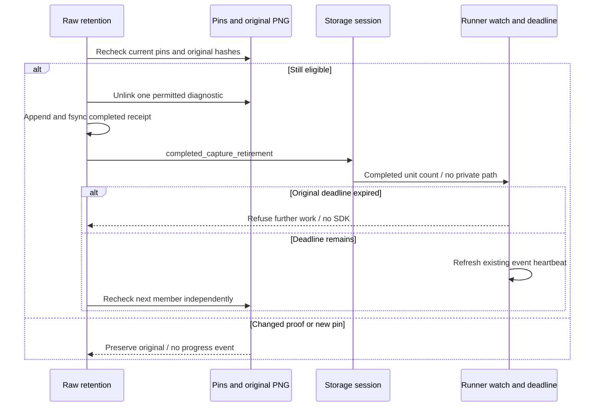

Actual cleandeee042 Agent rebuilt/installed terminalexit0;549source snapshot/ten complete compiled identities/self-test;106private/33canonical/six original pairs and stop/journal/retirement trail unchanged. Source/frozen7032references/143archives match. Launcher unchanged; workspace2,957,106,850bytes under3GB. Proof build/retirement-progress-installed-verification.json. Source full3972pass/699skip/562.25s/ownexit0. Fresh physical raw-reclamation progress/normal continuation and whole-run acceptance remain next.

<a id="funded-storage-reobserve"></a>

### Fresh observation has its own byte producer

Actual installed4d92677 passed the larger blue destination, two shop refreshes, boss, gifts/GET and independent Floor3MAP. The same invocation then stopped before a proposed battle input after four capacity-plan discards. Each admission handed back unspent credit and refilled only the two post-input pairs; the mandatory fresh capture consumed that guarantee, so the next near-cap plan needed maintenance again. Last retained HUD controls/turn stayed available; preserving its original proof for another reader is allowed. Discarding a decision cannot assume its PNG will be disposable.11original pairs,106private/33canonical and capacity-slot bytes are preserved in `build/capacity-reobserve-live-outcome.json`; currentTeam2floors[1,2]/victoryFalse/rewardFalse, not a whole-run result.

Let P be the existing complete BGR8 PNG plus bounded1MB JSON pair, S the unchanged2MB stop reserve, J the unchanged2MB diagnostic margin. Normal admission still funds2P+S. Only a planning admission requiring actual maintenance or unused-credit handoff additionally funds one fresh-observation pair:3P+S, with J checked outside the physical credit. Full1920x1080 P=7,349,634bytes, normal16,699,268bytes, funded refresh24,048,902bytes. Every placeholder byte counts inside the unchanged3,000,000,000byte project ceiling. If maintenance is discovered after the first space check, the second check verifies the complete enlarged growth, not merely P; no reservation is considered allocated until the physical placeholder is resized.

`owner.fresh_capture_required` records storage readiness, not a business pending intent. Same old frame path or identical old JSON proof cannot reuse it. A new hash-bound native record may have identical pixels (an idle HUD); it replaces the additional pair, leaving at least2P+S for the normal plan/device checks without another storage cycle. A successful new admission replaces the owner/readiness marker. `successor_pairs` remains2; optional `reobserve_pairs=1` / `reobserve_pair_bound` explain only storage credit. Two fixed checksum slots, v1 format, producer quality, original deadline and max3consecutive retry returns remain. Extra credit failure/torn slot preserves proof; late maintenance at a non-plan device check still refuses before SDK and leaves domain pending untouched. No paid budget, receipt, learning approval or controller authority follows.

294related checks passed77.25s/ownexit0, including one real Journal→pool→Runner→MaaDevice simulated-control pipeline, strict-cap full-size incompressible fresh capture plus two successors, same-proof/foreign/extra-allocation/interruption negatives and current corpus/dispatch guards. This verifies source/isolated protocols, not new physical pressure passage. Original-byte verification confirms all actual private/state/slot/raw pairs stayed unchanged offline. Stable-source full regression passed3964/699skipped/one fixture warning558.80s/pytest ownexit0 (build/capacity-reobserve-full-tests.log). Clean Agent and actual currentTeam2 pressure continuation remain next; skipped historical cases are not live acceptance.

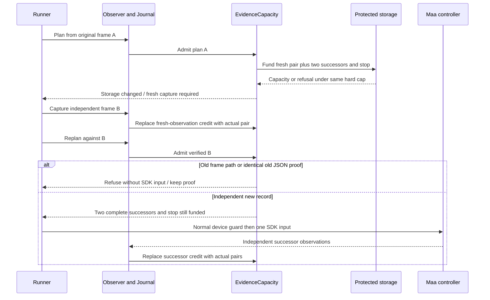

<a id="verified-storage-work"></a>

### Verified storage work is different from a silent native call

The 3 GB project size is a maintenance target. Live MXU checks actual disk availability and reports whether the project crossed the target when the task ends. Historical archives and builds retain their own offline allocation checks.

Runner declares `owner_diagnostic_poll` for explicit loader waits and battle animation waits with no outstanding turn submission. Journal groups consecutive read-only samples by owner and phase, preserving the first, latest, and changes bracketed by identical images. It releases an intermediate PNG only after checking both original hashes and checking state/review pins, then keeps OCR, hashes and the release journal. Input preflight, additional observations, failures and owner changes break the series. A general unknown wait does not establish eligibility. Historical reclamation reads the older role format.

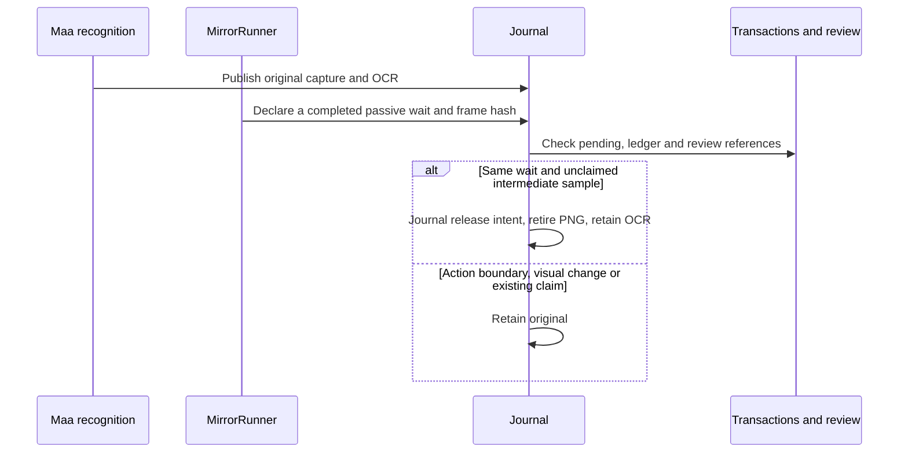

Encoded raw bytes take precedence over a cold copy. Each archived lookup rehashes the current index and actual complete container, even on an operation-local proof hit; no size/mtime shortcut. After a complete safe stream and every member hash validate, up to4096 bounded member identities may survive the64MB encoded-payload LRU. `verified_sha` preserves hash-only storage predicates; `verified_png` additionally requires a decoded image/shape. A corrupted later archive member cannot publish an earlier partial cache. The operation ends with both caches discarded. Neither API grants deletion, input, labels or receipts.

Actual same-corpus read-only pressure comparison selected exactly the same25deletion rows and preserved33canonical/106private hashes and22raw pairs. Baseline first:50.382s/100streams; candidate second:40.033s/49streams. Evidence: `build/compact-colour-retention-equivalence.json`, which binds source bytes and notes warm-order limits. It is not an Agent stack or live pressure success. Offline protected maintenance separately reclaimed107intermediate PNGs/149,627,495bytes, not key proof or transactions.

Completed container validation emits `evidence_storage_progress` through the active Runner/Journal owner, including recognition callbacks on another thread. An unchanged cache lookup emits no milestone. Real completed work may refresh the no-progress watch; it cannot extend the original run deadline. Broken proof, exhausted capacity, no actual work or a nonreturning native call still stop normally. Following storage maintenance, the original plan remains discarded and must be observed/planned afresh before input.

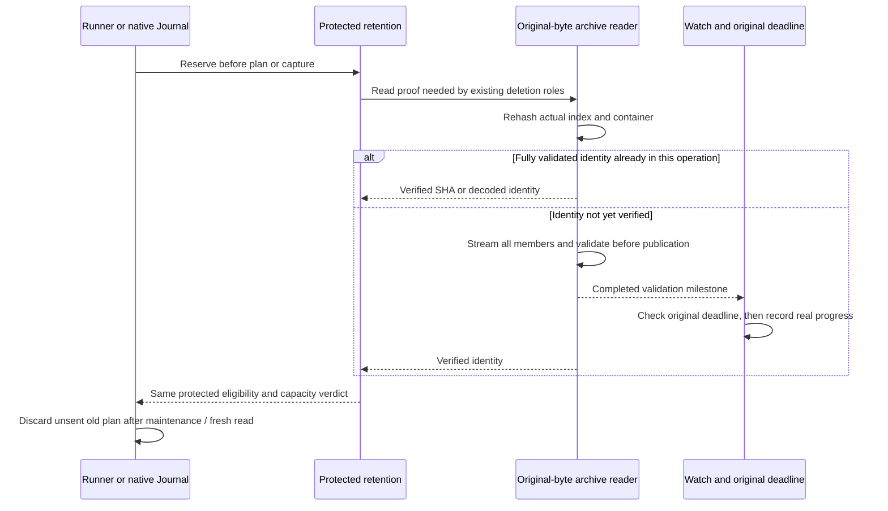


**Current storage policy / 当前容量约定（用户最新调整）**: User revised the whole-project ceiling to3,000,000,000decimal bytes (3GB). This includes source/git/build/dist/caches/models/evidence and temporary output in the folder. Older2GB runs and measurements remain historical. Capture pair/stop/journal bounds, external updater session1GB, all proof/pending guards and game resource budgets are unchanged. Actual installed Agent and launcher each embed3GB (build/service-notice-installed-verification.json); this grants no game spending.

> Scope of this chapter: MaaLimbus ships as a **portable package** for Windows — there is no installer, no registry
> writes, and no service. "Deployment" here means putting a directory on disk; "operations" means starting it,
> checking for updates, upgrading, rolling back, and reading evidence.
>
> Every technical claim in this chapter is bound to a verifiable anchor: a **source-script line number**, a
> **measured file listing with byte sizes**, or a **verification artifact retained in the repository**.
> Anything not backed by one of those three goes into 6.5 "Unverified / To Confirm" rather than being written as a
> conclusion.

## 6.1 Package Layout and Deployment Graph

### 6.1.1 Top-Level Layout (`dist/MaaLimbus/`, measured)

> Measurement time: after 2026-10-13T00:35Z. The portable package can be rebuilt at any moment by
> `tools/make_local_app.py` — it was rebuilt once during this session, which added one `MaaLimbus.backup-*` under
> `dist/`. Byte sizes and counts therefore drift with rebuilds; **paths and structure do not**.

| Item | Type | Size | Notes |
| --- | --- | --- | --- |
| `MaaLimbus.exe` | file | 31,158,272 B | MXU client (Tauri-built ProjectInterface V2 frontend) |
| `interface.json` | file | 3,732,723 B | ProjectInterface V2 project definition; the global default entry |
| `LICENSE` | file | 35,184 B | Full GPL-3.0 text |
| `README.md` / `README_en.md` | file | 8,297 / 7,859 B | In-package welcome pages pointed at by `interface.json`'s `welcome` |
| `build-info.json` | file | 933 B | Metadata and self-test result of this assembly |
| `agent/` | dir | `MaaLimbusAgent.exe` 5,880,171 B + `_internal/` | PyInstaller-frozen Python Agent |
| `launcher/` | dir | `MaaLimbusLauncher.exe` 2,012,660 B + `_internal/` | Out-of-package update launcher |
| `maafw/` | dir | 19 files + 2 subdirectories | MaaFramework native runtime |
| `assets/` | dir | `resource/`, `i18n/`, `misc/` | All recognition resources and translations |
| `docs/` | dir | 31 flat files + `agents/`, `wiki/` subdirs (45 files recursively) | User-facing documentation |
| `config/`, `evidence/`, `build/` | dir | created at runtime | Private run data, **never written by the build** |
| `THIRD_PARTY_NOTICES/` | dir | 6 license files + README | Third-party attribution |

Things that do **not** exist in the measured package — do not assume them on this page or elsewhere:

- `runner/MaaLimbusRunner.exe` — **release packages only**. The release assembly freezes `tools/run_native.py`
  (`tools/build_windows_package.py:149`); the local development assembly does not (grepping `MaaLimbusRunner` hits
  only `tools/build_windows_package.py`, `tools/make_local_app.py`, and `src/maalimbus/update_install.py:70`). The
  current `dist/MaaLimbus/` has no `runner/`.
- `sources/` — the release assembly writes it; the local development assembly writes it only with `--mxu-proof`
  (`tools/make_local_app.py:163-166`). `Test-Path dist/MaaLimbus/sources` is `False` for the current package.
- `package-manifest.json` — `Test-Path` is `False`. The release assembly generates it
  (`tools/build_windows_package.py:195-197`); the local development assembly does not.

### 6.1.2 Deployment Graph

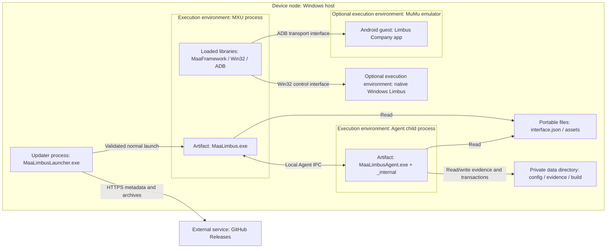

### 6.1.3 Who Assembles Each Top-Level Item

| Top-level item | Release package source | Local development package source |
| --- | --- | --- |
| `MaaLimbus.exe` | `tools/build_windows_package.py:138` (copies `mxu.exe` from the MXU archive) | `tools/make_local_app.py:162` (same) |
| `maafw/` | `tools/build_windows_package.py:139` (from `stage/maa/bin`) | `tools/make_local_app.py:167` (from the build-time `--maafw`) |
| `agent/` | `tools/build_windows_package.py:148` (PyInstaller freezes `agent/main.py` → base name `MaaLimbusAgent`) | `tools/make_local_app.py:195` (same freeze logic) |
| `runner/` | `tools/build_windows_package.py:149` (freezes `tools/run_native.py` → `MaaLimbusRunner`) | not produced |
| `launcher/` | `tools/build_windows_package.py:151` (freezes `tools/launch_app.py` → `MaaLimbusLauncher`) | `tools/make_local_app.py:197` (same) |
| `interface.json` | rewritten by `tools/build_windows_package.py:152-160`; rules in `tools/make_local_app.py:71-82` (`packaged_interface()`) | `tools/make_local_app.py:188-189` |
| `assets/`, `docs/`, `THIRD_PARTY_NOTICES/` | copytree from the repository root | `tools/make_local_app.py:184-185` |
| `README.md`, `README_en.md`, `LICENSE` | copied from the same sources at `tools/make_local_app.py:186-187` | same |
| `config/`, `evidence/`, `build/` | **never written by the build**, created at runtime | same |

The path rewriting done by `packaged_interface()` is what makes the deployment correct
(`tools/make_local_app.py:71-82`):

- `agent.child_exec` → `./agent/MaaLimbusAgent.exe`
- `license` → `./LICENSE`
- `icon` → an icon under `assets/`
- `welcome` → `./README.md`
- `languages` → language files under `assets/`
- every `resource` path: `./resource/xxx` → `./assets/resource/xxx`

The release assembly additionally writes `sources/` (`tools/build_windows_package.py:161-167`, containing
`MXU-v2.7.1-source.zip`, `MaaFramework-v5.12.2-source.zip`, `MaaLimbus-source.zip`) and `package-manifest.json`
(`tools/build_windows_package.py:195-197`).

### 6.1.4 The `dist/` Directory Families Outside the Package

`dist/` is not merely "an app directory" — it doubles as the **runtime working area**. Measured counts:

| Directory family | Measured count | Created by |
| --- | --- | --- |
| `MaaLimbus.backup-<32hex>` | 37 | `tools/make_local_app.py:102` (`backup=out.parent/(out.name+'.backup-'+uuid.uuid4().hex)`: the old package is renamed and kept when the assembly is replaced) |
| `MaaLimbus.staging-<32hex>` | 1 | `tools/make_local_app.py:159` |
| `.maalimbus-launcher-<32hex>` | 5 | `tools/launch_app.py:37` (the launcher copies its own frozen directory next to the app before running) |
| `.maalimbus-startup/` | 1, containing `launcher.lock` | `tools/launch_app.py:60-61` (`work = app.parent/'.maalimbus-startup'`; `ControllerLease(work/'launcher.lock')`) |
| `private-state-before-binding-<hex>` | 1 | `tools/bind_local_state.py:32` |
| `.maalimbus-update-<32hex>` | **0** | the install journal directory from `src/maalimbus/update_install.py`; cleaned up after a normal completion |

Operational implication: `dist/` grows monotonically with every assembly and every launch. These directories are
rebuildable caches, **except** that `MaaLimbus.backup-*` is the only rollback evidence — do not delete them right
after an upgrade (see 6.4).

## 6.2 How MXU, MaaFramework, and the Agent Relate

The default MXU route has two gameplay-automation hosts: the GUI/Rust Maa bridge and a separate Python Agent. The updater launcher, WebView and emulator input helpers have separate lifetimes. **ProjectInterface V2 is a configuration specification, not a required extra CLI process.**

Implementation basis: verified pinned MXU **v2.7.1 / 9fa8cc51**, [maa_agent.rs](https://github.com/MaaXYZ/MXU/blob/9fa8cc51e8ff8cd89d99f3ea55fe3a7a82e6ede3/src-tauri/src/commands/maa_agent.rs#L305): Rust creates AgentClient and submits through `tasker.post_task` (same file L746). This repairs the process boundary; reading source does not certify live GUI behavior.

### 6.2.1 Runtime Hosts

| Process | Executable | Role |
| --- | --- | --- |
| MXU client | `MaaLimbus.exe` | Reads PI V2 `interface.json`; its in-process Rust bridge creates Maa controller/resource/tasker and calls native `post_task` |
| Optional CLI | `maafw/MaaPiCli.exe` | Independent PI V2 command-line entry; presence in the package does not mean default MXU launches it |
| Python Agent | `agent/MaaLimbusAgent.exe` | Execution side for custom recognitions and custom actions. Registers every `limbus_*` node and handles game-specific scene recognition and business actions |
| Native libraries | `maafw/MaaFramework.dll`, AgentClient, AgentServer and others | Maa APIs and IPC loaded by their hosts, not another independent scheduler process |

### 6.2.2 The Contract: PI V2 Declarations and Agent IPC

Key anchors in `assets/interface.json`:

| Anchor | Content |
| --- | --- |
| `assets/interface.json:2-5` | `interface_version: 2`, `name: MaaLimbus`, `version: v0.1.2` |
| `assets/interface.json:9-13` | `languages`: `zh_cn` / `en_us` / `ja_jp` |
| `assets/interface.json:14` | the `controller` array, see below |
| `assets/interface.json:69-86` | `resource`: `en` → `./resource/base` + `./resource/en`; `jp` → `./resource/base` |
| `assets/interface.json:87-92` | `agent`: `child_exec: python`, `child_args: [../agent/main.py]` (source form) |
| `assets/interface.json:93-102` | `group`: `mirror`, `daily` |
| `assets/interface.json:103-170` | `task`: `open_game` / `mirror_loop` / `experience` / `thread` / `rewards` / `stamina` |
| the `agent` block of `dist/MaaLimbus/interface.json` (a local build output, absent from a public checkout) | packaged form: `child_exec: ./agent/MaaLimbusAgent.exe` |
| the `icon` field at the end of the same file | `icon: assets/misc/Don-Quixote.png` |
| the `welcome` field at the end of the same file | `welcome: ./README.md` |

The four controllers and where they land:

| `controller` name | `interface.json` anchor | Control method | Code path |
| --- | --- | --- | --- |
| `windows-window` | `:16` | Win32; window class regex `^UnityWndClass$`, window title regex `^LimbusCompany$`; screencap `Background`, mouse `SendMessageWithCursorPos`, keyboard `PostMessage` | `src/maalimbus/windows_controller.py:9-22` (`controller_profile()` filters `type == 'Win32'`; `native_methods()` maps `MaaWin32ScreencapMethodEnum` / `MaaWin32InputMethodEnum`) |
| `windows-background` | `:31` | Win32; mouse `SendMessageWithWindowPos` | same |
| `windows` | `:46` | Win32; screencap `ScreenDC`, mouse/keyboard `Seize` (exclusive foreground) | same |
| `mumu-adb` | `:61` | `type: Adb` | `src/maalimbus/adb_device.py`: `discover()` goes through `Toolkit.find_adb_devices` (`:28`); `build()` constructs an `AdbController` (`:97-103`) |

The `mumu-adb` input method carries a **trap that was verified on real hardware**:
`src/maalimbus/adb_device.py:21` defines `INPUT_NAMES` (`1 AdbShell` / `2 MinitouchAndAdbKey` / `4 Maatouch` /
`8 EmulatorExtras`), `:22-23` defines `SCREENCAP_NAMES` (`64 EmulatorExtras`, etc.), and `:5-6` records the input
priority `EmulatorExtras > Maatouch > MinitouchAndAdbKey > AdbShell`. When screencap acceleration is not requested,
`input_policy()` (`:46-63`) falls back to `adb shell input tap` — and **the game ignores that path**. In the
2026-10-12 `maafw.log`, `AdbShellInput::click x=125 y=527` and `Controller.Action.Succeeded` appear together while
the `DUNGEON_TEAM` slot never changes. That is why `agent_binaries()` in `tools/make_local_app.py:44-68`
**hard-requires** `maatouch/universal/maatouch` and fails loudly instead of degrading silently (`:183` copies it
into the package's `maafw/MaaAgentBinary`).

### 6.2.3 What Is Inside `maafw/` (measured byte sizes)

| File | Bytes | Purpose |
| --- | --- | --- |
| `MaaFramework.dll` | 2,536,448 | Core library |
| `MaaPiCli.exe` | 958,464 | ProjectInterface V2 command-line runtime |
| `MaaWin32ControlUnit.dll` | 670,720 | Win32 control-unit implementation |
| `MaaAdbControlUnit.dll` | 787,456 | ADB control-unit implementation |
| `MaaToolkit.dll` | 540,160 | Device discovery and utilities (where `Toolkit.find_adb_devices` lives) |
| `MaaUtils.dll` | 632,832 | Shared utilities |
| `MaaAgentClient.dll` / `MaaAgentServer.dll` | 1,227,264 / 1,388,032 | Agent client / server |
| `MaaNode.node` / `MaaNodeServer.node` | 1,018,880 / 987,648 | Node bindings |
| `MaaCustomControlUnit.dll` | 315,392 | Custom control-unit base |
| `MaaGamepadControlUnit.dll` | 350,208 | Gamepad control unit |
| `MaaRecordControlUnit.dll` / `MaaReplayControlUnit.dll` | 341,504 / 402,432 | Record / replay control units |
| `onnxruntime_maa.dll` | 19,182,080 | Inference runtime |
| `opencv_world4_maa.dll` | 13,774,336 | Image processing |
| `DirectML.dll` | 18,527,776 | GPU inference backend |
| `fastdeploy_ppocr_maa.dll` | 1,138,688 | OCR |
| `ViGEmClient.dll` | 130,048 | Virtual gamepad driver client |
| `plugins/MaaPluginDemo.dll` | 9,728 | Plugin sample |
| `MaaAgentBinary/` | 92 files | On-device Android agent binaries: `maatouch/universal/maatouch`, `minicap/<abi>/` (arm64-v8a, armeabi-v7a, x86, x86_64, covering android-9..31), `minitouch/<abi>/minitouch`, `LICENSE`, `README.md` |

Deployment implication: `maafw/` is a **single 60 MB-scale unit**, and its integrity is enforced at package level
rather than per file. The release package is validated through `package-manifest.json` in `update_stage.py`
(see 6.4.2).

### 6.2.4 Startup Order

<a id="launcher-lifetime-capacity"></a>

**Installed verification, 2026-11-16**: the launcher now reuses `.maalimbus-launcher-<64hex>` by complete bundle SHA256 and reserves whole-project peak capacity before its first copy. Different versions do not overwrite active older helpers. `refreeze_agent.py --component launcher` replaces only the launcher, retaining independent Agent/resource fingerprints; temporary rollback lasts through validation only. Two installed `--prepare-only` calls reused the same directory with identical hashes/mtimes for 62 files. Whole-folder size stayed 1,821,257,783 bytes on the second call; 96 installed private files, 28 canonical files and the Agent/MXU binaries were unchanged. Evidence: `build/resume-20261116-installed-launcher-reuse-verification.json`. This accepts preparation reuse, not GUI restart or public newer-version delivery. UUID-helper counts in the older snapshot above are not current measurements.

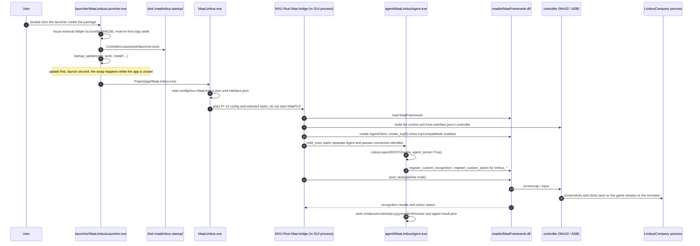

## 6.3 Build and Packaging

### 6.3.1 Two Pipelines

The repository has **two non-interchangeable** assembly pipelines whose outputs share a name but differ in content:

| Pipeline | Script | Output location | Positioning |
| --- | --- | --- | --- |
| Release package | `tools/build_windows_package.py` | `build/windows-package-<32hex>/MaaLimbus-win-x64/` | For distribution. Carries `runner/`, `sources/`, `package-manifest.json`, and exports release assets |
| Local development package | `tools/make_local_app.py` | `dist/MaaLimbus/` (atomic replace through `.staging-*` + `.backup-*`) | On-machine development and real-device verification. No `runner/` or `sources/` |

Evidence for the split: `tools/make_local_app.py:35-36` hard-codes
`MXU_SHA256 = '1B5487AA2442062A489E20134A82F946f76F57E733A8D8D284C3C76AAF8053E5'` and
`PREPARED = ROOT/'build/windows-package-28e4293e95e847dcb6f335d2b824cc7a/MaaLimbus-win-x64'` — meaning the local
development assembly **consumes** the release assembly's intermediate state. They are two stages of one chain, not
two independent implementations.

### 6.3.2 Release Package: `tools/build_windows_package.py`

Pinned versions and hashes (`ARCHIVES` at `:21-30`): MXU v2.7.1, MaaFramework v5.12.2. `:118` first asserts a clean
git worktree; `:128` creates `build/windows-package-<uuid4().hex>` as the stage.

Assembly steps:

1. `:136` `app = stage/'MaaLimbus-win-x64'`
2. `:138` `MaaLimbus.exe` ← the MXU archive's `mxu.exe`
3. `:139` `maafw/` ← `stage/maa/bin`
4. `:148-151` freeze the three Python entry points: `agent/main.py` → `MaaLimbusAgent`, `tools/run_native.py` →
   `MaaLimbusRunner`, `tools/launch_app.py` → `MaaLimbusLauncher`
5. `:152-160` rewrite `interface.json`
6. `:161-167` write `sources/` (three source archives)
7. `:168-174` run `agent --self-test`
8. `:178-194` write `build-info.json`
9. `:195-197` write `package-manifest.json`
10. `:199-201` `export_assets` → `build/windows-package-latest.json` (confirmed present)

The actual fields of `build-info.json` (sampled from the current `dist/MaaLimbus/build-info.json`):

```json
{
  "project": "MaaLimbus",
  "development_only": true,
  "packaged_app": false,
  "source_commit": "5e9dfc5528494550eca7ff01c9eea26f706aaf02",
  "source_dirty": true,
  "built_at": "2026-10-13T00:35:23.259095+00:00",
  "mxu_sha256": "1b5487aa2442062a489e20134a82f946f76f57e733a8d8d284c3c76aaf8053e5",
  "mxu_modified": false,
  "mxu_source_sha256": null,
  "pending": ["MXU UI validation", "live input postcondition", "full five-floor loop"],
  "self_test": {
    "passed": true,
    "application_root": "D:\\fgoa\\MaaLimbus\\dist\\MaaLimbus.staging-87ecfbf73a0c41b78282157772835029",
    "runner_root": "D:\\fgoa\\MaaLimbus\\dist\\MaaLimbus.staging-87ecfbf73a0c41b78282157772835029",
    "private_state_directory": "D:\\fgoa\\MaaLimbus\\dist\\MaaLimbus.staging-87ecfbf73a0c41b78282157772835029\\config",
    "device_controller": false,
    "locales": ["en", "jp"]
  }
}
```

Two fields deserve attention:

- `development_only: true` and `packaged_app: false` — the current package is a **development package**, not a
  distributable release artifact.
- `self_test.application_root` points at `MaaLimbus.staging-87ecfbf73a0c41b78282157772835029`, and that staging
  directory **no longer exists** in `dist/` (the surviving one is
  `MaaLimbus.staging-1619589fdb01498a8ad5905319306fb0`, left by a different assembly). In other words
  `build-info.json` records the path from assembly time, so it necessarily goes stale once the package is
  atomically replaced — and the staging directory it records is **never** the one left on disk. Any logic that
  trusts `application_root` must tolerate this.

### 6.3.3 Local Development Package: `tools/make_local_app.py`

Key behavior:

- `:159` creates `MaaLimbus.staging-<uuid4hex>` first; the entire assembly happens inside staging
- `:102` on replace, the old package is renamed to `MaaLimbus.backup-<uuid4hex>` (this is where the 36 backups in
  `dist/` come from)
- `:216` `replace_local_app(staged, out)` performs the atomic replace
- `:199-215` writes `build-info.json` (same schema as the release package)
- `:44-68` `agent_binaries()` hard-requires `maatouch/universal/maatouch`; `:183` copies it into the package's
  `maafw/MaaAgentBinary`

### 6.3.4 Building the MXU Client

`tools/build_mxu_client.py` (77 lines):

- `PIN = '9fa8cc51e8ff8cd89d99f3ea55fe3a7a82e6ede3'`
- `pnpm install --frozen-lockfile` → `pnpm tauri build --no-bundle`
- Outputs: `build/mxu-interactive-artifact/mxu.exe`, `MXU-MaaLimbus-source.zip`, `build-proof.json`

Its `build-proof.json` carries `ui_verified: false` — **the build script does not verify the UI**. This is the same
open item as `MXU UI validation` in the `pending` list of `dist/MaaLimbus/build-info.json`, recorded in two places.

Companions: `tools/patch_mxu_client.py` patches the MXU sources; `docs/windows-package.md` (83 lines) records the
pinned hashes and the build command:

```
python tools/build_windows_package.py --mxu <MXU archive.zip> --maa <Maa archive.zip> \
    --mxu-source <...> --maa-source <...>
```

Pinned values: MXU `825A62AF...` (v2.7.1), Maa `55DCEE23...` (v5.12.2), MXU source `B350877C...` (commit
`9fa8cc51e8ff8cd89d99f3ea55fe3a7a82e6ede3`), Maa source `0013BAAA...` (commit `f625a60edec...`).

### 6.3.5 Pipeline Graph

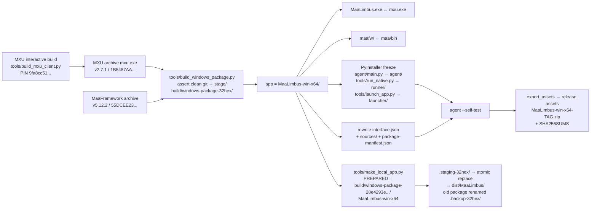

## 6.4 Update and Rollback

### 6.4.1 The Code and Files Involved

| Stage | Location |
| --- | --- |
| UI entry | `desktop/mxu/SoftwareUpdatePanel.tsx`: `invoke('limbus_project_update_check')`; option `optionKey="software_auto_update"` (`globalScope`); the panel notes that with auto-update enabled, a check "will not replace the software immediately" |
| Tauri command | `desktop/mxu/limbus_update.rs`: `#[tauri::command] pub async fn limbus_project_update_check() -> Result<serde_json::Value, String>`, resolves `current_exe`'s parent as the app, runs `app/launcher/MaaLimbusLauncher.exe --app <app> --check-only` with `creation_flags 0x08000000` (CREATE_NO_WINDOW), then reads back `config/user-update-check-result.json` |
| Launcher | `tools/launch_app.py`: `:37` self-copies to `.maalimbus-launcher-<hex>`; `:60-61` `work = app.parent/'.maalimbus-startup'` + `ControllerLease(work/'launcher.lock')`; `:67` `startup_update(app, work, install=installer)`; `:72` `Popen(app/'MaaLimbus.exe')` |
| Update decision | `src/maalimbus/startup_update.py`: `:28` `check_project_update()` writes `config/user-update-check-result.json`; `:32-44` `update_enabled()` reads `globalOptionValues.software_auto_update` from `config/mxu-MaaLimbus.json` (default `True`); `:47-82` `startup_update()`, with the version regex `v?\d+\.\d+\.\d+` at `:60` and `build/startup-update-result.json` written at `:81` |
| Remote query | `src/maalimbus/releases.py`: GitHub `releases/latest`, 2 MiB cap, ETag `If-None-Match`, `User-Agent: MaaLimbus/0.1.0` |
| Staging | `src/maalimbus/update_stage.py` (204 lines) |
| Install | `src/maalimbus/update_install.py` (176 lines) |
| Path resolution | `src/maalimbus/runtime_paths.py`: `:8-16` `application_root()` (frozen: `exe.parents[1]`); `:23-40` `data_directory()` reads `config/user-data-root.json` (rejects symlinks / junctions / chained paths); `:43-51` `ledger_path()` |
| Controller and launcher exclusion | `src/maalimbus/controller_lease.py`: Windows gameplay now uses a session named mutex; the legacy controller.lock path is diagnostic identity only; other named file locks still use msvcrt |
| CLI entries | `tools/check_update.py` (`:18` `--check`; `:26` `--stage` → `stage_release(...)` into `build/updates`), `tools/install_update.py` (`:17` `install_staged(args.stage, args.install, ROOT/'build/controller.lock')`) |

### 6.4.2 State Transitions

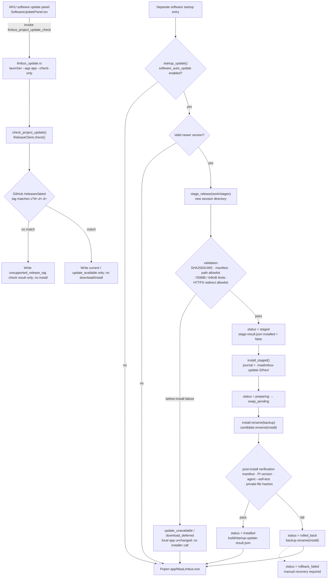

Validation rules in `update_stage.py` (`select_assets`, `:27-41`):

- Only a **published stable release** is accepted, and the tag must match `v?\d+\.\d+\.\d+` (`:27`)
- **Exactly one** app archive: `MaaLimbus-win-x64.zip` or `MaaLimbus-win-x64-<tag>.zip` (`:32-35`)
- **Exactly one** checksum file: `SHA256SUMS` or `<zip>.sha256` (`:37-40`)
- Limits: archive ≤ 700,000,000 B and checksum ≤ 65,536 B (`:41`)
- HTTPS redirect allowlist: `github.com`, `release-assets.githubusercontent.com`,
  `objects.githubusercontent.com` (`:58-60`)

`verify_package` (`:125-134`) requires the manifest to contain at least these six keys: `MaaLimbus.exe`,
`interface.json`, `LICENSE`, `build-info.json`, `agent/MaaLimbusAgent.exe`, `runner/MaaLimbusRunner.exe`; and it
**rejects** any entry whose first path segment is `config` / `evidence` / `build` / `logs` (`:134`) — a package may
not smuggle private run data.

Key constraints in `update_install.py`:

- `PRIVATE = ('config', 'evidence', 'logs', 'build')` (`:14`) — these four directories are treated as private data
  during a swap and are not replaced
- `metadata()` (`:32-42`) validates `interface.json`'s `name == MaaLimbus`, `interface_version == 2`, the version
  regex, and the GitHub URL
- `closed_app()` (`:49-73`) uses PowerShell `Get-CimInstance Win32_Process` to check whether `maalimbus.exe` /
  `maalimbusagent.exe` / `maalimbusrunner.exe` are still running, excluding `external_launcher_pid` (`:64`)
- `self_test()` (`:76-85`) runs `agent --self-test`
- `install_staged()` (`:94-176`): journal = `install.parent/('.maalimbus-update-'+uuid4hex)` (`:124`), with
  `candidate/` and `backup/` (`:126`); downgrades are rejected (`:115-116`); an unresolved prior journal blocks a
  new install (`:117-122`)
- State machine: `preparing` / `swap_pending` / `installed` / `failed` / `rolled_back` / `rollback_failed`

### 6.4.3 Measured Evidence

Two **offline verification artifacts** are retained in the repository, and they are the entire basis for the claim
that the update chain works:

**Staging verification** (`build/update-stage-verification.json`, produced by `tools/verify_update_stage.py`,
1005 B):

- `scope: "retained development ZIP and derived stable release metadata; offline transport"`,
  `network_requested: false` — this is an **offline replay** that never touched the network.
- Result block: `status: staged`, `version: v0.1.2`, `installed: false`, `executed: false`,
  `created_at: 2026-10-10T03:34:38.127635+00:00`
- Stage directory: `build/update-replay/update-519b040d520d422e9497633b834d878b/`
- Package fingerprint: `files: 827`,
  `sha256: 9b968cb94eaf119a5903571f99dfd49ad7c17679a66aa72f621a3a597aaf1c11`
- Source package commit: `source_package_commit: c12960bfb6e52d0b22903e905a8541949396cea7`
- Three things it did **not** cover:
  `pending: ["installed process exit", "backup and rollback installation", "installed version/configuration verification"]`
- `public_release_verified: false`, `verified_clear: false`

**Install verification** (`build/update-install-verification.json`, produced by `tools/verify_update_install.py`,
1646 B):

- `scope: "isolated retained development package; real filesystem swap and Agent self-test"`,
  `network_requested: false`
- Baseline: `baseline_application: D:\fgoa\MaaLimbus\dist\MaaLimbus`, `version_before: v0.1.1` →
  `version_after: v0.1.2`
- Normal path: `install.status: installed`, `rolled_back: false`, `verification.agent_self_test: true`,
  `private_files: 1`; the backup lands in
  `build/update-install-verification-87058ed37d204bb1b10e4091972201c9/.maalimbus-update-099b3a0b49584997b4ce0c0d13b583ae/backup`
- Fault-injected path: with the fault injected into post-install verification, it produced
  `rollback.status: rolled_back`, `rolled_back: true`, `reason: installation_or_verification_failed` — so the
  rollback path was actually executed, not merely designed
- Both artifacts jointly state `desktop_install_changed: false`, `public_release_verified: false`,
  `game_input_sent: false`, `ui_verified: false`; the install side carries
  `pending: ["MXU UI restart/version verification"]`

**Historical runtime snapshot (2026-10-13)**: `dist/MaaLimbus/config/user-update-check-result.json` and
`dist/MaaLimbus/build/startup-update-result.json` then reported
`status = unsupported_release_tag`, `current_version = v0.1.2`, `available_version = maalimbus`,
`newer_available = false`, `requested = false`, `installed = false`.

That historical query failed because `update_stage.py:27` requires a tag matching `v?\d+\.\d+\.\d+`, while
the old release's tag was the literal string `maalimbus`. Do not treat this old snapshot as current GitHub state.

That historical cache snapshot recorded `etag`, `failures: 0`, `retry_at`, release id `404282926`,
`tag_name: "maalimbus"`, `published_at: 2026-10-06T03:30:13Z` and `assets: []`. The actual cache has since
been updated; these are not claims about its current contents.

One deployment trap: `dist/MaaLimbus/config/user-data-root.json` is
`{"version": 1, "directory": "D:\\fgoa\\MaaLimbus\\config"}` — this portable package's private state is **bound to
the source tree's `config/`**, not to `dist/MaaLimbus/config/` inside the package. The two copies therefore
diverge. `dist/MaaLimbus/config/` holds 14 `user-*.json` transaction files, including `user-launch.json` (measured:
`{"graces":"2,4,5,7","grace_budget":100,"gift_keyword":"charge","gift_search":"refuse","update":true,"update_stage":true}`).

### 6.4.4 Honest Boundaries

These facts must be stated plainly, or readers will overestimate the maturity of the update chain:

1. **No install against a real release has ever been verified** (`public_release_verified: false`).
2. **No real desktop-UI update flow has ever been verified** (`ui_verified: false`, `desktop_install_changed: false`,
   `pending: ["MXU UI restart/version verification"]`).
3. Historical `maalimbus` was not semver; current v0.2.0 is valid but has no uploaded Windows ZIP/checksum assets, so public installation is still unproved.
4. `docs/deployment.md` (75 lines) is **not** a deployment document. It describes the in-game "deployment order"
   battle-prep task; the real packaging document is `docs/windows-package.md` (83 lines). The naming misleads, so
   when cross-referencing, go by filename rather than intuition.
5. The `application_root` in `build-info.json` is the staging path from assembly time and goes stale once the
   package is replaced.


<a id="feature-6-4-5"></a>

### 6.4.5 Update transaction and failure rollback

**Current check, 2026-11-16**: the actual new launcher queried the then-public v0.2.0 (a release of the earlier development repository, not of this one), with no uploaded installation assets. First requested=True, immediate repeat False; neither downloaded/installed. Installed interface declares v0.2.0 while source interface declares v0.1.2; after normal packaging-path conversion only version differs. Reconcile version authority before release. A pre-install stage validation failure now returns update_unavailable and preserves local software; ambiguous failures after attempted installation remain blocked. Related update/install checks passed 78 with 1 skipped. Actual frozen launcher verified fallback through normal startup handling using isolated older metadata and retained real release metadata: install_attempted=False, no network request, no GUI, actual private state unchanged (`build/resume-20261116-frozen-startup-fallback-verification.json`). This does not prove public newer-package installation or GUI restart.

Isolated offline newer-candidate stage/install, private preservation, cache and rollback have evidence; these do not establish public GitHub delivery or an actual GUI restart version. An unsupported release tag cannot install. The older statement that GUI remained running and dist was untouched described that documentation session only: on 2026-11-16, Agent and launcher were independently replaced while GUI was closed; no public release was published.

**Capacity implementation (new launcher installed; full production update still open)**: the normal external launcher now uses `UpdateSession.stage/install/recover`. The project ceiling is3,000,000,000bytes under the latest user instruction. One fixed external temporary session per installation is capped at 1,000,000,000 bytes. Its default location is a project sibling, independent of OS TEMP: actual frozen verification found TEMP falling back to the helper working directory, splitting backup discovery and contaminating the immutable cache. That dependency has been removed. Reserve declared downloads, then validate every ZIP path/type/size and reserve the entire expanded size before extracting the first file. Delete the archive after package validation. Before replacement reserve project net growth (including private directories) and the temporary candidate plus complete old-app backup. Verify every backup file by SHA256 and fsync `replacement_pending` before removing the closed old installation and copying the new one. This is recoverable copying, **not an atomic cross-volume rename**. Verify public files, installed Agent self-test and four private-directory hashes; restore the old app on failure. Capacity/preparation failure can leave the old app usable only when its complete file snapshot remains unchanged.

Success removes this session's stage and retains one rollback. A subsequent update retires the prior terminal backup instead of accumulating history. An interrupted **external helper reentry** restores before reading possibly missing app metadata. A corrupt backup preserves both the current files and backup and reports `rollback_failed`. If the in-app launcher file itself is missing after interruption, the retained external helper must perform recovery; automatic desktop-shortcut recovery after power loss remains unverified. The legacy same-volume `install_staged` remains an isolated-verification entry and now reserves its project candidate peak. 102 related tests passed, with one Windows symlink-permission skip, covering compressed expansion, private corruption, interruption during backup/replacement, corrupt rollback and another restore failure. The installed frozen helper separately restored all three synthetic interrupted-app files before continuing with retained cache (`build/resume-20261116-frozen-update-recovery-verification.json`); actual private state and helper reuse stayed intact, project about 1.88 GB (`build/resume-20261116-stable-launcher-frozen-verification.json`). These are isolated-file/synthetic-package checks, not a complete production candidate, public download or GUI restart.

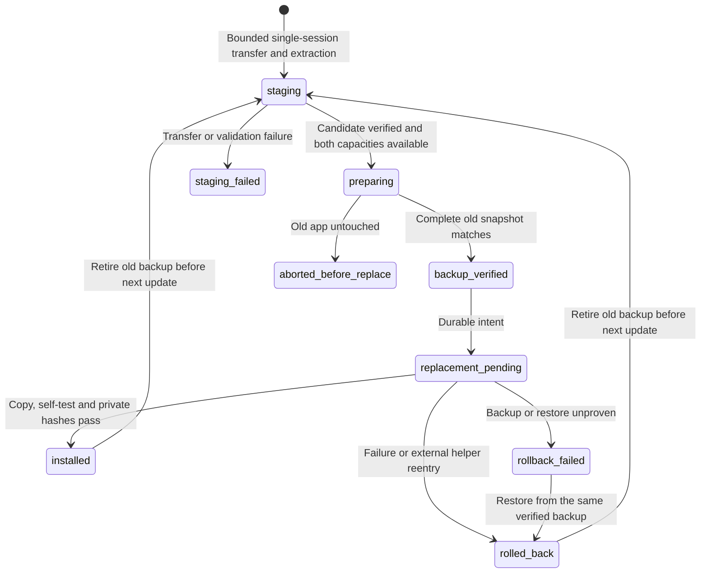

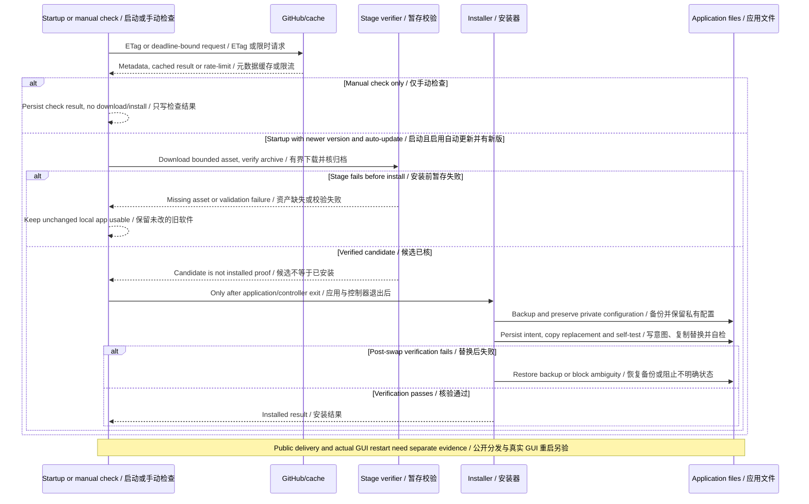

Source boundaries: `src/maalimbus/startup_update.py:1`; `src/maalimbus/update_stage.py:1`; `src/maalimbus/update_install.py:1`.

### 6.4.6 Bounded public reference source cache

<a id="feature-6-4-6"></a>

The pinned Lix checkout consumed234,669,642bytes including Git history. A first complete-tree snapshot preserved958 files/146,623,251 checkout bytes and verified the commit object, Git root tree and every blob;2,084 protected/private/runtime files remained byte-identical. The final **reference subset** retains516 files in12,193,367bytes: all code/config/license text, every dependency of the four importers and two candidate map models for future offline research. Unused supplier OCR/Python binaries, fonts and artwork are omitted from this cache. The full958-entry tree index and original commit object still verify pin431b432; this is explicitly not a complete runnable supplier checkout or a closed redistribution audit. No private/game evidence was moved outside the project.

`tools/pinned_lalc.py` supports the original pinned checkout and this archive. Archive/member hashes, safe paths, uniqueness, expansion limits, pinned commit/tree, explicit Windows newline normalization and each importer's required members are checked before a temporary extraction. Temporary source is removed on return/failure; no permanent external history dump. All four actual importers ran against the subset in an isolated output directory (332 gifts,95 theme names/5 glyphs,4 battle glyphs and22 editor images); generated supplier assets match current resources. One unrelated native theme-glyph source PNG is already absent in the historical corpus; its current resource hash is intact, and this cache work does not restore or certify it.

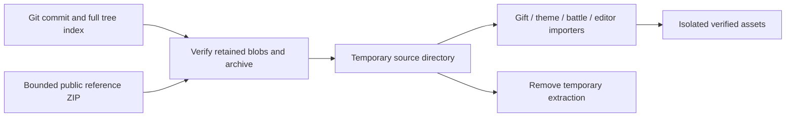

Reports: `build/resume-20261117-source-reference-subset-verification.json` and `build/resume-20261117-source-subset-importer-real-verification.json`;12 source-cache tests passed. Actual project size after the subset was1,886,505,594bytes; later captures/tests can change that number. Existing Maa/MXU corresponding-source/native-license gates are unchanged. This frees capacity; it does not prove long-run storage sufficiency, GUI Start or Mirror completion.

## 6.5 Unverified / To Confirm

| Item | Current state | Action needed |
| --- | --- | --- |
| Staging against a real release | Current v0.2.0 has no uploaded installation assets; newer complete-package acceptance is offline | Align source/package versions, publish a new semver release with Windows ZIP/checksum assets, then verify real download/install/version; a tag alone is insufficient |
| Update flow inside the MXU UI | `ui_verified: false` | On a real desktop, click "check for updates" once and observe the version number after restart |
| Portable-package private state location | Bound to the source tree's `config/` | Decide whether this is intentional (development mode) or needs rebinding |
| `dist/` working-directory growth | 36 backups/5 helpers is historical; new bounded launcher installed, isolated frozen recovery passed, project about 1.88 GB | Verify a complete production candidate; preserve unresolved evidence; public delivery/GUI restart remain separate |
| Release-vs-development package differences | Confirmed via source anchors | If distributing externally, re-run both 6.4.3 verifications against the release package |
| The name `docs/deployment.md` | Mismatched with this chapter's subject | Consider renaming to `docs/battle-deployment.md` to reduce cross-page mis-references |


## 6.6 Public-output privacy boundary

Public-source export checks local user paths and literal player IDs before opening the ZIP. Errors expose only filename, line and category, never matched values. Local .local.json learning policies, logs and jsonl files are excluded from source archives. Current document home-user paths have been redacted.

This gate covers current text only, not screenshots, model datasets, existing Git history or older releases. Private config/evidence/build remain excluded; final public-package inventories and account-bearing images need separate review.

<a id="feature-6-7"></a>

## 6.7 Package provenance and private-data exclusion

Text scanning does not audit every image, training artifact or historical Git commit. Five native DLL byte checks, 86 copyright records and Python notices have concrete gates; complete transitive corresponding source, static linkage and artwork distribution remain open. Private learning-review bundles are not public source assets.

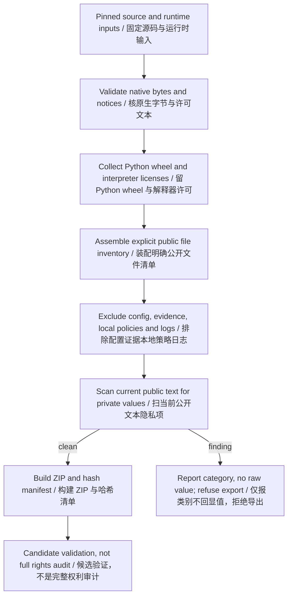

Source boundaries: `tools/build_windows_package.py:1`; `src/maalimbus/public_privacy.py:1`; `tools/native_dependency_notices.py:1`.

The public source ZIP scans and copies the same committed Git snapshot. Ignored or untracked files under a public directory are excluded. The guard checks common Windows configuration and script formats, including UTF-16 with a byte-order mark, colon- and hyphen-separated MAC addresses, and literal GitHub and OpenAI project token formats. Review other credential formats and GitHub metadata separately.

Git's archive attributes also exclude private configuration, local test probes, evidence, and key files from generated source archives if those files are accidentally tracked. This protects archives generated from revisions containing the rule. A file already committed remains accessible through Git, and an older release tag retains its original archive rules.

<a id="feature-6-8"></a>

## 6.8 Evidence capacity, single-copy storage and install boundary


The entire project tree is capped at **3,000,000,000 bytes**, including git, source, build, dist, caches, models and evidence. This diagram is the normative deployment target. Shared content-addressed storage remains unimplemented. The source-only pre-dispatch reservation slice is described in6.8.1; it is not installed or a new service.

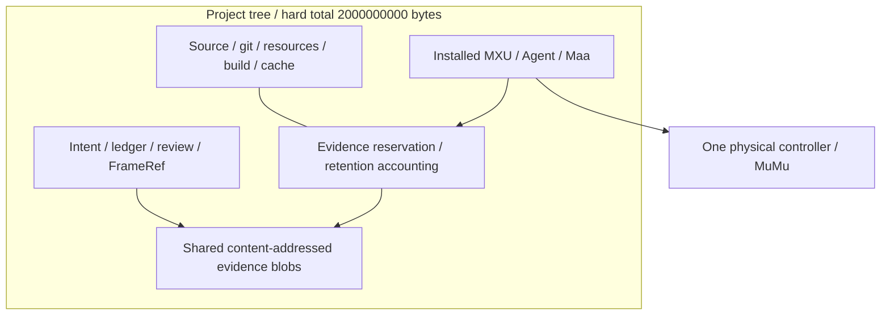

Admission reserves before/after/required result and metadata capacity before durable intent and input. Capacity refusal belongs before dispatch. After crashes reconcile the reservation with pending state. Do not discover missing successor capacity after clicking. The original capture_retention.reserve runs at frame write. EvidenceCapacity now reserves successor credit before the Mirror Agent main plan and direct inputs; Journal consumes exact pair bytes. Per-input admission inside composite native nodes, independent tasks and CLI remain incomplete. HUD retention is not whole-store migration acceptance.

Pin unresolved attempts, spending/credit, floors, teams/rotation/reentry, reviewed and model-acceptance evidence. Bound learning candidates by episode/object/page diversity; retain representative animation and causal tails for judged inputs. Reclaim only after references, original hashes and durable manifests are checked. Compression/deduplication preserves causal links. Reclamation creates no business success or training label and cannot move data outside to evade the cap.

Record source, installed package and running-process versions separately. Develop offline while the controller runs; do not replace its dist. Bound temporary test artifacts. Self-tests alone do not establish GUI Start, upgrade/restart or whole-run acceptance. Existing separate updater-session and rollback constraints in [6.4](6-deployment.md#feature-6-4-5) remain; this contract grants no broader authority.


<a id="feature-6-8-1"></a>

### 6.8.1 Placeholder capacity and restart recovery (source wired)


Battle capture-tier implementation plan (2026-11-18): verify actual native/Agent reverse SetOption and capture dimensions before integrating page-owned downsampling. One real1920frame with no START text loses its dial at1280 because shape gates use fixed pixels. First reuse shared calibration analysis in start_button/dial_control, transforming nativeOCR geometry only, retaining words/confidence and returning capture coordinates once. Original witnesses and Maa device scaling remain unchanged. Preserve shape/fill/brightness/title gates with real positives and erased/dim/speck/false-caption controls. Then only independently named battleHUD may try1280; other pages or insufficient low reads require a fresh1920read before domain planning, never old coordinates/invented identity. Global default and legacy paidPI paths remain1920. Deadline/capacity and actual cross-Agent callbacks must be verified before installation/live continuation.

<a id="battle-capture-profile"></a>

#### Qualified battle capture profile

Installed follow-up: clean2f724c8 passes the same frozen cross-Agent chain/ordinary MirrorLoop observe-only and two control cases per size; normal startup15actions/exit0.98installed-private/31canonical/597review-config files and model preserved. See `build/capture-profiles-installed-real-verification.json`; no new game input or model promotion.

Implemented source, native offline verified (2026-11-18); installation and live acceptance are tracked separately in the current checkpoint. `MirrorLoopAction` wraps its normal `MaaObserver` with `BattleCaptureObserver`. The first read uses1920. Only a hash-bound native HUD with readable turn and assignment/Start control qualifies the next read for1280. A smaller non-HUD or insufficient read is followed by one independent1920 capture under the caller's original deadline, before returning to domain planning. Rejected sizing disables the optimization. Explicit `MAALIMBUS_TARGET_LONG_SIDE` retains fixed-profile behavior; the global/legacy PI default stays1920.

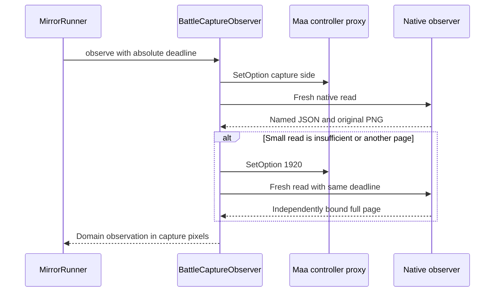

This policy grants no action, spend or learning approval. `Journal.before_input` declares a1920×1080 possible successor to `EvidenceCapacity.admit`, which reserves two worst-case full pairs even when the before-image is1280. No new reservation may be needed to store that fallback. Start/dial shape checks use the shared1920 analysis image and return original capture coordinates; native OCR words/confidence and Maa's capture-to-device conversion are unchanged.

Actual source Agent/proxy tests bind1920HUD→1280HUD→1280SHOP→fresh1920SHOP, successful reverse SetOption calls and normal Agent exit. The ordinary production MirrorLoop also reaches its named `observe_only` terminal with zero input. That actor deliberately returns native failure for an unfinished dungeon: the verifier accepts only confirmed task end plus the exact read-only result, never marks a dungeon passed. Shop read-only interpretation skips transaction reconciliation and outcome-label writes; active purchases still require scope. Real no-START-text positive and pixel-erased counterexamples pass native OCR at both sizes. Evidence: `build/capture-profiles-native-door-source-final.json`, `build/battle-capture-dial-1280-source.json`, `build/battle-capture-dial-1920-source.json`. These are retained-frame/native integration proofs, not current gameplay, GUI Start, model quality or whole-run capacity.

##### Borrowed controller lifetime inside a callback

Installed05782de launched Limbus natively from Android launcher, then its first MirrorTask actor observation raised an access violation with zero page clicks. `build/callback-controller-lifetime-live-failure.json` pins the original first frame and failure. The callback repeatedly obtained controller for device, capture and startup-serial checks. Pinned5.12.2 [RemoteTasker source](https://github.com/MaaXYZ/MaaFramework/blob/v5.12.2/source/MaaAgentServer/RemoteInstance/RemoteTasker.cpp#L173-L184) replaces its unique_ptr on every getter; previous Python Controller wrappers borrow that pointer and become invalid. This is neither an unknown-page OCR verdict nor a failed click.

Production resolves the controller once in the current MirrorLoop callback and shares it across MaaDevice, BattleCaptureObserver and startup checks. No cross-callback cache or additional controller is introduced. The foreground validator retains copied device identity instead of Context/native handles; every invocation still independently reads the actual foreground, and later metadata mutation cannot retarget it. Regression must invalidate the previous borrowed proxy on every lookup and exercise cold-start; a constant fake and an isolated observe-only MirrorLoop cannot cover this real entry. Native/runtime failures retain a bounded Python call stack.40focused checks actually pass with no skips; af31f4b is now actually frozen with the native observation chain verified and1736protected files unchanged (`build/combined-installed-runtime-verification.json`). Continuous live reacceptance remains open. Older installed replay claims remain historical slices.

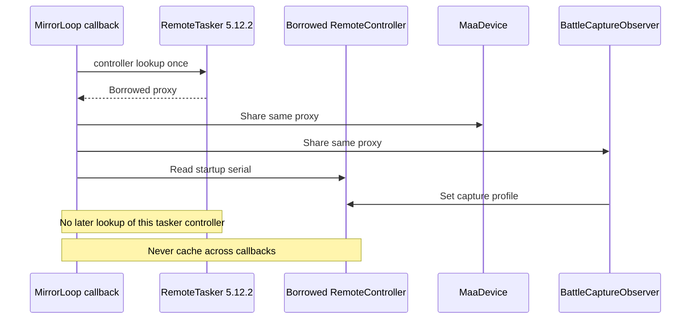

<a id="capture-neural-calibration"></a>

#### Frozen neural observation and original captures

**Shared analysis and frozen neural participation (2026-11-18; installed, frozen offline verified).** `capture_geometry` now owns calibration-to-capture conversion and the explicitly interpolated analysis image. Star readers and pre-battle border measurement share only those mechanics. The neural owner still requires its own native Details/Battle captions, matching capture size and four independently measured borders at the unchanged.72 floor; grid_slot is a search-window index, never a sinner class. ROI return to capture pixels and Maa NeuralNetworkDetect receives the original capture, not the interpolated analysis image. Existing imports keep compatibility wrappers.

The installed35b035f actual frozen callback passed13of14 retained1280 cases but exposedzero neural ROI/inference on pre-battle, despite shadow/model_trained fields. Source repair now executes12ROI, yielding10unreviewed boxes at1280 and11at1920 on the selected retained sample; a separate original native1280 pre-battle capture also passes the participation requirement. These counts are not accuracy/12-sinner completion; native_quality_passed remainsFalse.82 focused checks pass, including erased-edge/missing-caption controls, unchanged class ownership and IPC-child cleanup. Agent2978cfa is now actually frozen/installed with self-test and544-source fingerprint matching. Both frozen profiles pass14cases with28normal session exits: original1280sample11ROI/10boxes,1920sample12ROI/11boxes.597configuration/review/model metadata files remain unchanged; isolated proposals retain reviewed=False/training_eligible=False/input_authorized=False and never enter the real training set. The first new frozen run had5capacity failures; only after removing22.95MB of regenerable WebView cache with app closed did replay pass, with the failed report retained. build/neural-capture-installed-real-verification.json binds actual artifacts and both reports. All234diagrams now actually parse and both new neural sequences rendered. GUIStart/live new neural callbacks and whole-run completion remain unverified.

```mermaid
sequenceDiagram
  box Host process
    participant H as Maa host
    participant N as Maa NeuralNetworkDetect
  end
  participant A as Frozen Agent
  participant Q as Isolated pending queue
  H->>A: limbus_scene with original capture pixels
  A->>A: Own page captions and four-edge search geometry
  A->>H: Native recognition request with capture-space ROI
  H->>N: Original capture and audited model
  N-->>H: Native class, box and score
  H-->>A: Recognition result
  A->>Q: Unreviewed proposal, training and input disabled
  A-->>H: Bound Journal and actual inference flag
  Note over H,Q: Diagnostic replay creates no real game input or new training episode
```

The verifier reuses the installed Agent IPC launcher and loads installed resources. Only the scene recognition callback is called, with isolated data and input-forbidden replay controllers. Temporary case evidence is kept within the3GB workspace and removed after its owned child exits. The first external-temp probe failed with PermissionError before registration; moving bounded temporary evidence inside the workspace made TCP callbacks work. Explicit IPC also failed and remains a recorded failure. The pinned Maa5.12.2 Windows Transceiver usesC:/Temp for IPC; no OS permission changes are made. Probe auto transport follows the existing MXU tcpCompatMode setting (currentlyTrue), not a silently rewritten preference. Frozen results must bind the executable, build metadata, verifier/helper/native-library hashes, exact input pixels, original frame and normal exit; registration alone cannot pass an observation requirement.

<a id="capture-star-calibration"></a>

#### Star calibration and native crops

**Star capture profile, 2026-11-17 (installed; native offline verified)**: the1280 observer previously sent the1920 conversion-cost crop outside the image and failed the native job. Star grid/card targets, price crops, the independent Available reads and conversion checkbox now share the existing calibration-to-capture boundary. Borders/templates are measured on an explicitly interpolated1920 analysis image; returned targets and all new OCR ROI are capture pixels. Confidence floors are unchanged. A high-confidence `Availabl` fragment only requests a new exact native `Available` label read; it never replaces that label or discards conflicting digits.

Actual same-page original samples supply Available74/14, four requested prices10/20/30/40, checked conversion70 and unchecked conversion0. At each of1280/1920, four intact cases and two explicitly pixel-erased counterexamples passed through the actual Agent observer/Maa DLL: absent price produces no board, absent balance stays unproven.48 related checks passed/14 historical evidence skips. Reports `build/native-star-capture-1280-final.json` and `build/native-star-capture-1920-final.json` bind original JSON/PNG hashes, resized/mutated pixel hashes, source snapshot, verifier and actual native library; zero physical input and no real policy/transaction writes. Actual frozenAgent35b035f self-test/543-source fingerprint passed;98installed-private/31canonical files and assets unchanged, zero GUI/controller/input (build/star-capture-installed-verification.json). This is not new star spending, live lower-resolution entry or learned-policy acceptance.

```mermaid
sequenceDiagram
  participant C as Original capture
  participant O as Maa OCR
  participant G as Star layout reader
  participant P as Existing transaction and planner
  C->>O: Capture-space label and numeric crops
  opt Full-frame label omits final letter
    O->>O: New exact native label read before numeric reads
  end
  O->>P: Fresh agreeing amounts or unproven evidence
  C->>G: Interpolate only the supported analysis profile
  G->>P: Card and checkbox boxes returned in capture coordinates
  Note over P: Existing scope, budget, selected cards and no-conversion rules still apply
```

The global default remains1920. Paid reward readers/preparation still require their1920 layout, and surviving local native frames do not include a valid Hard5 claim/confirm/receipt chain for a1280 replay. An old failed-entry offer cannot substitute for that chain. Legacy standalone PI star actions also retain fixed template geometry; this observer/Runner correction does not certify them. Extend those acceptance paths before making1280 a whole-product default.

#### Fixed-profile calibration trial

**1280 capture trial (2026-11-17)**: at about1.983GB resident data, two worst-case1920 successor pairs still refuse the next input. The actual Agent observer/offline Maa controller passed8/8 original bound cases at each of1280 and1920, including all12 deployment positions, Hard/settled theme cards and purchase1008→863. Tilted animated cards need not produce selectable candidates; a separate settled frame proves those. Related checks:79passed/78historical-evidence skips, not live whole-run acceptance. Capture default remains1920; trial `MAALIMBUS_TARGET_LONG_SIDE=1280` live before changing the default. Preserve originals and identify interpolated analysis as such. Confidence, reconciliation and capacity limits remain unchanged.

Visible next room (2026-11-17): when the fresh full MAP header, unique train, measured one-step pitch, saturated connection and room are visible, with no pending/rejected navigation, `_normalise_view_once` returns that original frame to the same planner without controller-start zoom. Independent NODE_PANEL still judges acceptance. Rejected/unknown/offscreen goals retain existing gesture recovery.103related checks pass, including native pixels and erased-line counterexamples. Actual155302 subsequently accepted MAP→NODE_PANEL→PRE_BATTLE_TEAM at1280; whole-run and later star dispatch remain open. Retired only three inactive MXU demo binaries byte-identical to installed counterparts,2,964,992bytes; three closed logs losslessly archived,2,165,546bytes freed. No game PNG/JSON removed.

```mermaid
flowchart LR
  N[Native1280 capture and original JSON] --> O[Maa OCR and actual-size crops]
  N --> G[Calibrated geometry on1920 analysis grid]
  G --> B[Candidate boxes returned in1280 coordinates]
  O --> P[Same planner and successor verdicts]
  B --> P
  P --> M[Maa alone converts capture coordinates to device]
```

Historical `controls_by_id` verified_on boxes are measured1920 pixels; the registry's1280 normalized reference is a separate contract. Observer/Runner recompute from the original registry at each capture size, never from an already scaled map. Fixed out-of-range participant crops; own Clear Selection/To Battle controls take precedence over broad DEPLOYMENT identity. `tools/verify_capture_scale_native.py` uses an input-forbidden ReplayController, cleans generated files after the child process exits and retains original hashes/native results in local reports. It neither connects the emulator nor writes real budgets.
Live discrepancy (2026-11-17 20:31 UTC): dcc7309 session153100 had its first pinch rejected by Maa for out-of-range endpoints, zero actual inputs, normal terminal rather than timeout. Source now scales zoom, recovery vectors and map-progress controls to capture size;97 action/coordinate/replay checks pass. Actual Maa MultiSwipe completed182 touch callbacks in an offline sink at each size without out-of-bounds coordinates; all8 observation/purchase cases pass again. This is not physical device input. Preserve failed-frame/intent evidence and do not rewrite a controller refusal as gameplay success. Four closed native text logs were ZIP-readback verified before removing only raw duplicates, freeing1,373,493bytes; no game PNG/JSON removed. Next freeze and continue live.


#### Durable capacity reservation and crash recovery

EvidenceCapacity uses one logically sized placeholder and two fixed8KiB checksummed metadata slots under the whole project evidence/runtime tree. Ordinary size checks see the credit as occupied. Alternate sequenced slots: fsync resize intent, change placeholder size, persist ready. Restart reconciles only a size matching the recorded before/after; other sizes or unverified metadata are preserved and refuse input. Storage recovery never emits business success.

```mermaid
sequenceDiagram
  participant P as MirrorRunner plan
  participant C as EvidenceCapacity
  participant T as Domain transaction
  participant M as MaaDevice
  participant J as Native Journal
  P->>C: admit with verified before JSON/PNG
  C-->>P: sized successor credit or no-input refusal
  P->>T: persist domain input intent
  P->>M: dispatch proposal
  M->>C: recheck before native call
  M-->>J: independent subsequent capture
  J->>C: consume exact encoded pair bytes
  J->>J: save PNG and JSON
  P->>C: terminal result writer releases own remaining credit
```

Source admission budgets two successor pairs at observed geometry using the enforced bgr8-json1mb-v1 producer profile:8bit RGB PNG and at most1,000,000bytes of complete JSON per frame, plus2MB STOP. Journal validates uint8 BGR three channels and metadata size before credit consumption/writing, without trimming fields. The separate2MB journal margin remains. This profile still needs installation/native validation. This is not unlimited credit for arbitrary geometry changes, oversized metadata or extra reads. Journal replaces credit with exact pair bytes; the terminal writer releases only the owner/consumer session pool. MirrorLoopAction wires Journal.before_input into MaaDevice. Main plans and unknown exploration admit before domain intent; click/swipe/key/pinch recheck before native calls. No game pending state, spending grant or labels are changed by storage recovery.

Evidence:16 capacity tests passed, including the real retained deployment-reset modal through the full step: insufficient capacity sends no confirmation and preserves original transaction bytes. Historical MAP/NODE_PANEL pixels passed through actual Journal at an isolated full budget; next input made zero native requests, terminal result survived and31real private files were unchanged. Local report: build/evidence-capacity-retained-verification.json. Offline source only: no installation, MuMu connection, whole-run capacity acceptance or per-input coverage inside every composite native node.


Additional verification: capacity scope is read dynamically from current loop.run_id across rotation. Unverified pool metadata remains byte-identical while bounded diagnostic headroom can save the original stop plus release error. The user message distinguishes the withheld next input from earlier input counts. The new pinch-adapter compatibility failure in the full snapshot was fixed;74final related checks passed. Read-only inventory:818PNGs,8exact-duplicate groups/16redundant copies,only15,587,385potential unique-blob bytes saved. No images removed; deduplication alone is not a whole-run2GB capacity exit. Retention must still migrate by reference role and verified outcome.


<a id="feature-6-8-2"></a>

Report-backup deduplication (2026-11-17): all103 original generation4 JSON members are byte-identical in active generation5. Original ZipInfo/level9 reconstruct the exact4,171,152byte ZIP/digest. Keep a54,300byte recipe and retire only the redundant old ZIP, net4,116,852bytes freed. Current archive/all gamePNG/JSON/human reviews remain. `python tools/restore_report_snapshot.py build/historical-report-generation4-recipe.json` verifies in memory by default; `--restore` atomically recreates the old ZIP within budget.5roundtrip/tamper checks pass, plus actual pre/post retirement reconstruction. A future codec mismatch refuses, never fabricates success.


### 6.8.2 Closed-report archive and reference invariance

Incremental closed-report archive plan (2026-11-18): retain the existingversion1reader protocol. Explicitly select sealed build reports, verify original bytes and old index/ZIP, then make a deterministic next-generation ZIP. Keep every old file before publishing the new index; afterwards independently compare reference sets before hash-checked raw report retirement. Preserve an exact reconstruction recipe and retire the old container only after byte-identical reconstruction. A durable storage-operation record recovers before/after index publication and partial retirement. Changed inputs, links, duplicate paths, tampering or insufficient space cannot delete unknown files. No game transaction, native screenshot, review or model changes. Validate source, then migrate actual reports and independently test the installed reader.

Old full-run reports contain repeated OCR/step objects but remain evidence. evidence_reports adds an optional read tier only for closed JSON directly under build: original path, byte count, SHA256 and ZIP/member locator are bound in a version1 index. Raw reports may remain; verify original bytes and archive members before any retirement. Configuration, pending transactions, capture frames and human reviews cannot migrate into this tier.

```mermaid
flowchart LR
  Raw[Closed report original bytes] --> Zip[Hash-verified ZIP member]
  Zip --> Index[Immutable report index]
  Index --> Reader[read_report_bytes]
  Index --> Pins[Archived report reference scanner]
  Pins --> Same[Same protected native frame references]
  Missing[Missing / changed / unsafe archive] --> Refuse[Refuse reclamation / preserve evidence]
```

Validate current index and ZIP bytes; reject duplicate members, path escape, links, encryption, oversized expansion and member hash mismatch. Limits:256members,16,000,000bytes each,128,000,000expanded bytes total. Archive parsing participates in capture_retention._reference_keep so the same PNG/JSON pins survive. Missing/corrupt archives cannot silently unprotect images. Cache identity includes both index and ZIP bytes, not timestamps.

Read an old path with python tools/read_evidence_report.py build/old-report.json; default output is metadata, explicit --text returns original text. MaaLimbusAgent.exe --evidence-storage-check constructs no controller and reports the same reference-set count/digest for source/frozen before/after parity. The read tier is implemented; actual migration and installation are recorded separately. Compression establishes neither business completion nor model quality.


Incremental entry: `tools/rollover_report_archive.py` plans by default and mutates only with explicit`--apply`. It reuses the controller lease and requires the app closed, creating no gameplay controller. Explicit selection carries a sealed declaration and each original path/size/SHA, based on terminal-task inspection rather than file age. Existing256-member/16MB-member/128MB-expanded bounds remain. A checksummed operation carries old/new indexes, original-container recipe and selection digest. Only prepared/completed are persisted phases; diagram intermediates are derived from the active index and surviving files, not new database states. All old bytes survive before publication, then raw reports retire only after old-path readback and reference checks. The oldTeam7 verifier uses the common report reader and cannot recertify historicalTeam7 from currentTeam2 ledger.

```mermaid
stateDiagram-v2
  direction LR
  state "Old index active" as OldActive
  state "Prepared on disk" as Prepared
  state "Candidate on disk" as CandidateReady
  state "New index active" as NewActive
  state "Retiring copies" as Retiring
  state "Complete" as Complete
  [*] --> OldActive
  OldActive --> Prepared: Write operation
  Prepared --> CandidateReady: Write ZIP and recipe
  CandidateReady --> NewActive: Publish index
  NewActive --> Retiring: Verify bytes and pins
  Retiring --> Complete: Retire verified copies
  Prepared --> Prepared: Recheck old inputs
  NewActive --> NewActive: Recheck archive
  Retiring --> NewActive: Resume interruption
  Complete --> Complete: Idempotent repeat
  Complete --> [*]
```


Actual incremental migration (2026-11-18):33related checks pass, including recovery before/after publication, partial raw retirement and after old-container retirement; completed repeat preserves file hashes. Actualgen5had120members (103belonged togen4); gen6has143members/5,956,061bytes/SHA79d2c1c3… . All23sealed reports/6,875,015original bytes read back at old paths with originalSHA.3,375configuration/nativeJSON/PNG/review/model files unchanged;5,888protected-reference digest matches the actual installedAgent reader. Generation4/5were independently reconstructed as exactly4,171,152/5,295,978bytes and originalSHA in memory, with no redundant ZIP written. Folder decreased from1,974,026,557to about1,968,502,913bytes including operation/recipe/audit overhead. No images removed and no full-run capacity claim. Reports build/report-rollover-generation6-real-verification.json and report-archive-generation6-installed-reader.json. No GUI/game input/model promotion. Full regression and final documentation checks recorded separately.


Complete slice regression:6failed/3353passed/709skipped365.24s, own exit1; same six historical failures with no additions (build/20261118-report-rollover-full-tests.log). First state rendering parsed but recovery labels overlapped; horizontal layout/short labels now rerender correctly in both languages, all236diagrams actually parse, and the real localWiki preview verifies natural/readable size, fit and restored size.50Wiki/privacy checks pass; documentation acceptance is not gameplay acceptance.

<a id="feature-6-8-3"></a>

### 6.8.3 Exact-byte admission and input-free HOME retention

`documents.write_document` serializes once and admits actual UTF-8/LF net growth; `storage.write_json` admits the full atomic temporary peak before fsync/replace. Refusal precedes overwriting old bytes. The CLI controlling host also applies `native_evidence.configure_host`, disabling extra failed-probe debug PNGs while retaining canonical Journal proof and text logs.

`window_capture_session_closed` seals capture inputs, not business success. Only sealed sessions with exclusively hash-bound HOME observations, explicitly allowed read-only events and no inputs can reclaim unreferenced intermediate PNGs under pressure. Keep the first representative, last two captures, all JSON and every configuration/model/review/report reference. Unknown events or mixed pages do not qualify.

```mermaid
flowchart LR
  Bytes[Encode exact UTF-8 bytes] --> Peak[Admit net output or full atomic temporary]
  Peak --> Write[Write canonical document]
  Home[Sealed input-free HOME history] --> References[Revalidate hashes and external references]
  References --> Keep[Keep representative, last two and all pinned proof]
  Keep --> Retire[Durable plan then retire unreferenced PNG only]
```

Actual evidence:34 closed reports were archived with identical original reference pins; frozen/source reference digests matched. The old CLI HOME wait later reached2,004,334,741bytes, including9 native on_error copies from a host missing debug suppression; report copies alone were not the cause. Seven pixel-identical duplicates were verified and reclaimed; two unmatched images remain. After actual producer termination and original hash/event audit,23 input-free HOME reads were sealed;14 unreferenced intermediate PNGs reclaimed26,690,795bytes, preserving all23 JSON and53 configuration files. Report:`build/sealed-home-retention-real-verification.json`.122 related checks passed; whole-run capacity and learning quality remain unaccepted.


<a id="feature-6-8-4"></a>

### 6.8.4 Navigation review references / 导航复核引用

Unknown-navigation proposals already contain original before/successor JSON/PNG paths and four hashes. New `Exploration.finish` bundles keep proposal/review/trace only; existing mirrors are checked for conflict. Canonical references remain protected. `review_storage` supports only the exact semantic-frame and navigation queues: unreviewed/non-training/pending/unedited entries with unchanged canonical and mirror bytes. Human approval, correction, notes, missing or changed proof refuse compaction. Review and transaction metadata are never rewritten.

```mermaid
flowchart LR
  Proposal[Immutable attempt paths and hashes] --> Canonical[Canonical before / successor proof]
  Review[Human review bytes] --> Validate[Recheck entire plan and each deletion]
  Canonical --> Validate
  Mirrors[Legacy byte-identical mirrors] --> Validate
  Validate --> Retire[Unlink mirrors only]
  Validate --> Preserve[Preserve all labels and original evidence]
```

Actual28 legacy mirror files reclaimed16,154,250bytes; all28 canonical sources and7 proposal/review pairs match the original plan hashes. `build/navigation-review-compaction-real-verification.json`. This is single-copy evidence migration, not a newly approved label, trained model or navigation success.


Archive generations3/4: closed-report members increased34→95→103. Each generation preserves original report bytes/hash/path bindings and the same protected reference set; obsolete derived ZIP containers were retired only after every old member matched the new verified generation. Historical index bytes and transfer audits remain. Reports:`build/closed-report-generation3-real-verification.json` and `build/closed-report-generation4-real-verification.json`. Separately621old diagnostic text files (6,561,520bytes) are retained in a1,353,216byte ZIP;46inactive prototype WebView cache files (5,368,674bytes) were rebuildable,857private/review files unchanged. No canonical capture or settings were removed in that operation (`build/closed-text-cache-retirement-result.json`).


<a id="feature-6-8-5"></a>

Inflight ordinary-turn reads: only a bound full nativeHUD with readableTURN, actualWin/Rate/Damage captions, the STARTpixel control and in-box350–750ms proposed delay permits `hud_evidence` to sample unreferenced middle reads. No later input/named-page barrier; current tail must remainUNKNOWN/LOADING. Keep before-image, first of each uncertainty scene and latest two; hashes/JSON/businesspending/human pins remain. This role neither names the unknown page animation nor grants success. TURN+1/VICTORY/MAP still need independent outcome gates.144related tests pass, including real control pixels/wrong control/short touch/cross-input/missingfirst/stale capture/human pin/next-turn controls; source pending live installation. Historical full-suite failures remain, not an all-green claim.

```mermaid
sequenceDiagram
  participant P as MainTask preflight
  participant J as Native Journal
  participant O as Map and Battle observers
  participant C as Storage admission
  participant D as Page-domain projection
  participant S as startup_evidence
  P->>J: Bound preflight frame
  O->>J: Fresh actor frame
  C->>D: diagnostic_index
  D->>S: Check original prefix hashes, scope, time and no input
  S-->>D: Verified capture records or no authority
  D->>D: Compare full deployment order or HUD counters and captions
  D-->>C: startup_previews and required actor image
  C->>C: Recheck actual input and human-review references
  opt Pressure and independently authorized diagnostics
    C->>C: Retire only old replica PNG, keep JSON and actor proof
  end
  Note over C,J: This grants storage eligibility, never game success or input authority
```


HUD startup reads (2026-11-17): shared `startup_evidence.preview_records` checks only scope/recorder, an input-free prefix, original hashes/native timestamps and≤30seconds. Page success remains outside this mechanical layer. Deployment compares12ordinals/explicit team; HUD requires equal readableTURN/WAVE plus actual Win/Rate/Damage captions, never fixed-position fallback. Preflight/MapObserve replicas become startup_previews; latest BattleObserve is the required actor image. Real input/human-review references override.139related checks pass. Actual turn1START→turn2 occurred; this fight is not yet won. Following normal2GB admission refusal,7answered diagnostics/5,944,285bytes retired with2,595metadata/protected files unchanged; beforeSTART/afterTurn2/firstunknown kept. Git packed only375existing loose objects11,983,874→1,601,229bytes; verify-pack/fullfsck passed before git prune-packed removed duplicate loose copies. No history/refs pruning; folder about1.988GB, later run differences recorded separately.


Startup preflight replica (2026-11-17): `startup_order_preview` requires the same scope/recorder, no intervening input, at most30seconds, two bound native images with own Clear Selection/Battle/12of12, all12ordinals≥.9 and equal explicit team identity. Only the earlier preflight is diagnostic; actual actor before-image is required. This explicit role may supersede structural recency; external references and real input boundaries remain stronger. Unknown/missing controls/order/team/scope/time/hash discrepancies refuse.111related tests pass;12final cases include team/episode counterexamples. Actual1,711,781bytes retired with2,574metadata/protected files unchanged. This is retention authority, not identity/E.G.O/victory labeling. Host and Actor share the explicit1280 environment; default1920 unchanged.

### 6.8.5 Diagnostic roles and closed map attempts / 诊断引用与已判断地图尝试

A pin census measures retention roots; it must not recursively become another root. `reference_inventory` recognizes the exact legacy read-only/count-consistent diagnostic schema (or its explicit evidence_reference_inventory kind). Extra proof/transaction fields, input sent, duplicate paths or inconsistent counts preserve normal pinning. Original report/archive bytes stay unchanged. This does not remove real state, model, human-review or acceptance references; those are still independent roots.

Closed nonfinancial MAP diagnostics may release an older input image only after an explicit accepted/rejected map_click_result matches its original target, in-box350–750ms intent and hash-verified native before/after images. Accepted must independently be NODE_PANEL; rejected must be MAP. Unjudged/superseded attempts, active producers and corrupt/missing proof do not qualify. First representatives, recent captures, final causal pair, source/acceptance references and all transaction/model/review pins remain. All canonical JSON, event logs and state remain unchanged; this storage decision never creates a game success or approves a training label.

```mermaid
flowchart LR
  Census[Read-only pin inventory] --> Measure[Measure roots without adding a root]
  Roots[Transaction / model / human review / acceptance] --> Keep[Retain original proof]
  Closed[Closed recorder] --> Judged{Explicit matching MAP verdict and native hashes?}
  Judged -->|no| Keep
  Judged -->|yes| Eligible[Diagnostic eligibility only]
  Eligible --> Pins{External pin or final causal pair?}
  Pins -->|yes| Keep
  Pins -->|no under pressure| Trail[Revalidate / durable unlink trail]
```

UNKNOWN/LOADING observations retain one uncertainty representative in a named-page visit; they cannot fabricate a new named-page boundary on every MAP/UNKNOWN animation alternation. Actual named foreground changes still retain both sides.78related checks passed, including changed successor, foreign target, unjudged, active/no-terminal and pending-reference negatives. Whole-dungeon sustainable storage is still open. Local actual reclamation is reported separately in build/typed-retention-real-verification.json.


The frozen Agent now declares a Maa-screenshots-and-images runtime profile. Both package builders remove only OpenCV's optional opencv_videoio_ffmpeg video-file plugin from a newly generated candidate. Source VideoCapture/VideoWriter use or any bundled PE static/delay import of that plugin refuses trimming. Installed components are not direct trim targets. The candidate records removed bytes/hash; actual installed self-test must still roundtrip PNG, resize, load Maa native libraries and parse EN/JP resources. Maa screenshot/input/native models stay in their original runtime.47packaging checks passed; installed/native acceptance is separate. This excludes an unused video-file capability, not evidence or a dependency required by the declared image task profile.


**Selection-count commit.** The deployment domain emits deployment_selection_committed only after its original transaction observes the exact one-card count increment. `deployment_evidence.selection_commit` independently binds before/after frame hashes, original native participant-counter ROI/threshold and the planned prefix. The payload explicitly sets completion=count_increment_only and identity_order_verified=false. It grants no spending, identity/order acceptance, learned label or battle credit. Diagnostic recording failure preserves the already-settled domain step and falls back to keeping its captures.

`_older_selection_diagnostics` consumes verified commits, retaining the latest two pairs in each continuous scope/order/count sequence. On pressure only earlier acknowledged selection images become eligible, including in the current recorder; first/last boundaries and every external transaction/model/review/source pin still win. Pending/unjudged steps produce no commit and remain protected. All JSON/event/state bytes remain. Missing previously retired pairs do not invalidate newer intact commits; changed or foreign proof cannot authorize its own images. Tests include native0→1/12 replay, wrong prefix, Boolean index, skipped count, changed PNG/hash/page/path, pending pins and actual isolated reclamation followed by another commit. This is bounded diagnostic storage, not automatic team verification.

```mermaid
sequenceDiagram
  participant R as Runner
  participant D as Deployment transaction
  participant J as Canonical journal
  participant E as Evidence retention
  R->>D: Observe independent counter successor
  D-->>R: One increment settled / pending cleared
  R->>J: Hash-bound count-only SelectionCommit
  J->>E: Consume verified commits
  E->>E: Keep latest two + all independent pins
  Note over D,E: No budget, team-identity, learning or victory credit
```


Native a0db93b resumed the same selection from3/12 to8/12 without another reset. Five actual SelectionCommit events were emitted and no diagnostic-commit error occurred. The next before-step capture hit a separate pool-consumption check: its would-be total exceeded the cap by51,904bytes after independent native/diagnostic growth. No unacknowledged card input followed; pending remainedNone. The pool consumer now attempts the same protected reclamation after consuming its placeholder and before allocating the exact frame pair. Admission diagnostic headroom is2MB. Retention first prefers eight recent diagnostic frames, then retries its already supported two-frame minimum only if eight cannot fund the allocation; all stronger pins remain.87related checks pass, including independent log growth between admission/capture, exact original JSON preservation, full-budget credit use and conditional tail reduction. The failed session and full cause are preserved; native recovery of this pressure path still needs acceptance.


**RecorderSession is not RunScope.** Native de23609 automatically reclaimed six old acknowledged selection images and resumed8→9/12, then its next input was declined for capacity. Per-recorder diagnostic tails still duplicated one business selection across restarts. `deployment_evidence.diagnostic_index` now orders intact native count commits by timestamp/scope/order/capacity; named non-selection page/reset barriers and count rollback separate batches. Only progressing groups spanning multiple recorders can supersede older recorder structural first/tail/last-selection pins, retaining the latest two native commits globally. Unacknowledged or non-selection inputs remain hard pins; the active recorder retains its actual recent captures/current causal pair. Every external state/model/human-review/source reference still wins. If one side of a verified selection pair has an external pin, both sides remain.

A hash-verified PRE_BATTLE_TEAM bootstrap preview may retire only when the first actual input is a card selection and its original before-record counter/hash matches that preview's counter before any earlier input. It is a redundant read-only preview, not a new outcome. All JSON/logs remain; missing old diagnostic images do not become fresh game evidence.91related checks passed, including cross-recorder continuation, foreign scope, native battle/reset barriers and whole-pair pending protection. This changes diagnostic structural pins for a logical selection; it does not reset a transaction or claim team identity/order correctness. Native acceptance follows separately.


**Zero-input capacity snapshots.** A failed recorder that sent no input is not a new selection epoch. Repeated PRE_BATTLE_TEAM reads may supersede older zero-input capacity diagnostics only when they match a previously verified selection checkpoint in the same explicit run_scope (legacy journal episode is a compatibility source). Require a closed evidence_capacity_unavailable_before_input ending with clicks_sent0, no input/flow/gesture/confirmation intent, no device-input admission and no explicit stop_page. Keep the two latest later native reads across recorders; scope mismatch, missing newer read, actual input, reset/battle boundary or an explicit human handoff prevents this eligibility. External pins still win. MirrorLoop start now always records run_scope independently of learning being enabled.100related checks passed, including these negative controls and original pair/pending protection. The latest native attempt remained9/12 with zero new input; this source extension still needs installation/live acceptance.


**Submitted-selection diagnostic closure.** Actual f027512 reached12/12→one submit→native BATTLE_HUD, with the complete printed order independently matching the saved order; see `build/team2-correct-order-battle-real-verification.json`. Later pressure reclamation may supersede older acknowledged selection diagnostics only after a same-scope full-prefix count commit, independent full-count submit before-image, explicit submit intent and hash-bound native HUD successor. Preserve submit/HUD input boundaries, all external references and pair closure. Missing/changed HUD, incomplete count, foreign scope or an intervening input refuses closure.71related checks passed; this extension still needs installation/native battle continuation. No full identity/E.G.O, victory or payout claim follows.


**Input-free battle snapshot closure.** Installed732f2bf resumed the same battle but four redundant no-input capacity-failure HUD captures occupied headroom. The new projection requires the same explicit scope, named-page visit and readable wave/turn, with two newer hash-verified native HUD reads, before retiring older zero-input capacity diagnostics. A different named page, turn change, explicit stop_page, any intent/input admission or foreign scope refuses closure. External transaction/human/model references remain protected.79related checks passed; installation/native pressure recovery remains open, with no inferred combat progress or payout.


Native observer parity: map_observed explicitly carries input_sentFalse, whereas battle_observed omits it. The no-input diagnostic projection now reads both observation event kinds, still requiring the whole recorder to have no intent/input admission and independently verifying the original HUD/hash/turn. An absent observation field grants no input authority.79related checks include this real missing-field schema; native continuation remains to verify.


Producer profile is now implemented in source: bgr8-json1mb-v1 requires uint8 BGR three channels and at most1,000,000bytes of complete JSON. Reject a mismatch before credit consumption/writes, without trimming fields. Admission verifies8bit RGB IHDR and sizes two future pairs from this same profile:16,699,268bytes at FullHD, with2MB STOP included and a separate2MB journal margin unchanged. Tests cover incompressible FullHD pixels plus invalid format/RGBA-before/oversize-metadata negatives. Old frames are unchanged; all908remaining native PNGs are8bit RGB and the largest of1283record JSONs is38,394bytes. See build/native-capture-profile-retained-verification.json. Installation/native pressure recovery remain open; recognition/transaction/budget criteria are unchanged.


**A HUD window belongs to the battle scope, not a controller recorder.** hud_evidence.diagnostic_index projects answered nonfinancial HUD reads within the same explicit scope and named-page visit. Each pair requires original image/JSON hashes, native HUD identity, ordered timestamps and a known in-box350–750ms touch intent. A different named page, even in a legacy recorder without scope, cuts the visit. Unknown controls, missing/changed proof and malformed metadata gain no eligibility. Keep the two latest answered causal pairs across recorders plus every external root; an external reference to either endpoint protects both. A redundant preflight picture may be superseded by the independently captured first actual before-image. Current input/tail and unresolved boundaries remain protected. This answers a diagnostic read obligation only, not assignment, submission, victory or a positive learning label.99related checks passed. Source-only native pressure planning reclaimed17.5MB; installation/live continuity remain open.


```mermaid
flowchart LR
    A["Recorder A: native before/after"] --> S["scope + battle-page visit"]
    B["Recorder B: native before/after"] --> S
    S --> W["Two latest answered diagnostic pairs"]
    R["External transaction/model/review roots"] --> P["Keep the whole referenced pair"]
    W --> C["Pressure-only PNG eligibility"]
    P --> C
```

native_evidence.bound_frame owns shared byte binding; deployment retains a compatibility alias and HUD calls the common reader directly. Domains still judge participant counts, native HUD identity or game successors themselves: file-hash verification is not business success. Final119contract/retention checks passed; the new logic still needs installed live verification.


Preflight read-role clarification: redundant HUD observations before the first known nonfinancial input may follow two later independent native HUD witnesses with intact pixels/hashes in the same scope/page visit. Exclude the actual input before-image; an unknown first intent or absent later native pixels refuses this eligibility. Retired input pixels are not resurrected and missing images never prove action success.119related checks passed. The diagnostic profile audit reuses the same already-retained original battle-entry HUD as turn1 baseline and the original turn2 successor, avoiding an extra pinned intermediate input pair. No business receipt/ledger was rewritten.


**Complete-turn diagnostic checkpoint.** A first post-Start HUD at the same turn only answers a read obligation; it does not prove submission effects. Require an independent native counter n→n+1 in the same scope/page visit, no wave contradiction, original JSON/PNG binding and ordered bounded touch intent before closing older HUD diagnostics. Preserve the first uncertainty representative, latest checkpoint pair and every external root. The storage successor of that input may use the proven new-turn HUD instead of additionally pinning a superseded immediate animation frame. Unknown inputs, different named pages, changed/missing original pixels or reversed time refuse closure. A newer turn or two later native answered pairs may supersede a checkpoint; recorder restarts do not pin one forever.128related checks passed. No ledger/victory/resource/positive-learning label is written; installed live behavior remains to verify.

```mermaid
stateDiagram-v2
    [*] --> WatchingStart
    WatchingStart --> WatchingStart: Same-turn HUD or transient frame
    WatchingStart --> TurnCheckpoint: Native counter advances once in same visit
    WatchingStart --> NoClosure: Other input / page boundary / invalid proof
    TurnCheckpoint --> EarlierDiagnosticsClosed
    EarlierDiagnosticsClosed --> Superseded: New turn or two later native read pairs
    NoClosure --> [*]: Preserve original boundaries
```

17closed window-run reports were archived byte-for-byte into generation5,120total; all native references and869private/review files remain unchanged,zero PNG deletions/game inputs. Old archive/index retained; peak1,987,729,450 and final1,968,211,922bytes. See build/closed-report-archive-generation5-real-verification.json; originals remain readable with evidence_reports.read_report_bytes.

**2026-11-17 report reference-role migration**: `evidence_report_roles` interprets a completed battle census `pairs` field only under an original-report SHA and narrow schema; report bytes stay intact. First HUD, independent VICTORY and final MAP endpoints remain strong, as do other fields and config/model/review/source references. Role identity participates in both raw and archived reference caches. Unknown roles, changed bytes, extra pending/business fields or missing endpoints retain ordinary recursive protection. A role does not itself authorize deletion: existing capture-owner closure rules still apply.89related tests passed; actual original census hash unchanged,all2,618independent business/model/review references preserved.30closed noncritical diagnostic PNGs/48,333,636bytes retired with original JSON/deletion trail retained,zero input,workspace1,935,378,535bytes (`build/report-role-census-real-verification.json`,`build/report-role-capture-retention-result.json`). This makes evidence roles explicit; neither the2GBcap nor game receipt guards were relaxed.

```mermaid
flowchart TD
  A[Original report bytes] --> B{Matching SHA and narrow census schema?}
  B -->|no| C[Ordinary recursive reference protection]
  B -->|yes| D[Keep required business endpoints]
  D --> E[Capture owner judges closed diagnostics]
  E --> F{Independent transaction, model or review pin?}
  F -->|yes| G[Preserve original image]
  F -->|no| H[Hash-checked retirement with durable trail]
```

**2026-11-17 closed battle diagnostics and grouped retirement (source, not installed)**: Actual floor3first battle reached turn5then MAP and the next node panel, before capacity refused the next input. Earlier retention missed BATTLE_PLANNING intermediates and could retire a successor first, stranding diagnostics whose witness disappeared. Same-run native Start→complete MAP floor/pack or independent VICTORY now closes only the diagnostic visit, retaining the two latest exit checkpoints; it writes no floor/win/payout/learning label. Unknown input boundaries, the first uncertainty representative, actual latest frames and independent pins still override. Answered ordinary HUD reads can close within the active recorder; PLANNING retires only inside an original before/after read chain. Eligible causal components retire together. All capture_reclaim_intent members persist before the first unlink; after a crash, only matching original JSON/PNG hashes continue that cleanup, while new references/changed bytes preserve files.138related checks passed, including interrupted deletion and zero game-state writes. Actual10images/18,984,087bytes retired,exit before57/MAP66 and allJSON retained,workspace1,964,756,800bytes,zero input (`build/battle-exit-atomic-retention-result.json`). The original7full-suite failures remain open; this narrow pass is not all-green or complete Hard5acceptance.

```mermaid
stateDiagram-v2
  [*] --> OrdinaryRead
  OrdinaryRead --> AnsweredRead: independently bound native HUD
  AnsweredRead --> RetirableComponent: later reads or known native battle exit
  RetirableComponent --> Prepared: all original member hashes and fresh references checked
  Prepared --> Retired: all member intents durable before unlink
  Prepared --> ResumeCleanup: interruption after partial unlink
  ResumeCleanup --> Retired: same bytes and no new independent reference
  ResumeCleanup --> Preserved: changed bytes or new reference
  Retired --> [*]
```


<a id="capture-retention-ownership"></a>
### Capture retention ownership

The recorder distinguishes image identity from retention authority. A workflow keeps original PNG/JSON proof while an input is unresolved and for its durable receipt. Replays, model review and source fixtures keep their explicitly required originals. A diagnostic reference can still name OCR and event metadata after ordinary pixels retire.

During a normal run, the loading wait declares its frame as a diagnostic sample after the step finishes without input. The recorder retains the first and most recent PNG of a continuous wait, plus a transient change between identical frames. It records the hash and reclaimed byte count when it removes a middle PNG and leaves the OCR and page history in place. A different step, an input plan, or an ambiguous capture closes the sample series. Explicit observe-only sessions retain their captures. This path only handles declared loading samples. Existing transaction, fixture and review retention continues to cover the rest of the corpus.

The native task checks available disk space and continues to fund two successor pairs before dispatch. The 3 GB workspace figure is reported at task exit as a maintenance target. Workspace maintenance, build and update tools still use their own workspace allocation checks. Native evidence admission does not scan or prune closed history while a task runs.

First migration: the loop declares a completed observation-only wait in its existing step event. After the recorder closes, storage may retire the middle PNGs of a continuous same-scene series of declared waits. It checks the frame name and image hash, keeps the series ends, isolated pixel changes bracketed by identical frames, and existing causal boundaries, and honors every external proof owner. The JSON and journal are retained. Older journals without declarations use the existing rules. This migration does not convert legacy balances, shop receipts or fixtures to metadata-only proof. A later migration must move each workflow's permanent proof into explicit ownership before reducing path-based protection.

```mermaid
flowchart LR
  OCR["Native observer: frame and hash"] --> J["Step journal: observation and wait outcome"]
  J --> S["Closed-session storage maintenance"]
  B["Transactions, replays and training: required originals"] --> S
  S --> R["Retain OCR, event and protected originals"]
  S --> P["Retire eligible middle diagnostic PNG"]
```

MXU evidence on 2026-11-20: the native host acknowledged the pending gift once and observed the shop again. The atomic receipt write was refused after the host wrote additional error screenshots outside the Agent reservation. The pending receipt and both canonical frames were preserved. Fourteen closed diagnostic images with independently matching canonical pixels moved into the existing local vault, retaining the original encoded files. The MXU overlay now supplies `save_on_error: false` as the default for a new MaaToolkit config. Existing configuration still owns its explicit value. The installed SDK replay produced one error PNG with the setting enabled and zero with it disabled, with the text log and zero input in both cases. A newly built MXU and the next physical shop receipt remain separate acceptance points.

Acceptance: an interrupted or input-bearing interval retains its original pixels; the original action and successor can still be reopened; repeated normal use reduces the retained diagnostic footprint below the workspace ceiling. Measure bytes on the closed local recorder and verify the same-run MXU continuation separately.

<a id="native-image-cold-storage"></a>
### Lossless native image cold storage

`native_image_archive` selects only ordinary MAP/HUD/UNKNOWN/LOADING diagnostics from closed sessions. Five newest sessions and transaction/model/human-review/source/report strong references stay raw. Unlike deletion, an unreferenced first/tail diagnostic may archive losslessly: its complete original bytes, logical name and canonical JSON remain. The entire folder is capped at3,000,000,000bytes under the latest user instruction. Small hash-bound tar.xz batches retain original encoded PNG bytes without resizing, re-encoding or changing canonical JSON, FrameRef capture times or business state. Temporary compression output is bounded and removed, never permanent external storage.

```mermaid
sequenceDiagram
  participant M as Storage maintenance
  participant R as Original PNG and JSON
  participant A as Local tar.xz
  participant I as Atomic index
  M->>R: Read original bytes and strong references
  M->>A: Write bounded archive within root budget
  A-->>M: Exact byte and hash readback
  M->>I: Publish original logical path binding
  M->>R: Recheck references and original hashes
  M->>R: Retire duplicate raw PNG only
  Note over R,I: JSON and capture identity remain unchanged
```

`read_png` prefers raw files and cannot conceal corrupt raw bytes behind an archive. Missing originals require index/container/member hash, uniqueness, size and regular-file checks. `bound_frame` and runner-owned frame reads use this layer, preserving original logical capture identity. Unmigrated direct-file consumers retain raw critical fixtures; this is not a whole-repository reader migration. Interruption before publication keeps originals; interruption afterward leaves resumable duplicates. New references block retirement. `archive_native_images.py` owns the existing controller lease but creates no device controller. Production capacity may attempt at most two batches without extending the original task deadline; remaining pressure retains proof and reports concrete byte counts.

Checks: `tests/test_native_image_archive.py`, `tests/test_startup_recovery_dispatch.py`. Chapter9 records actual storage, installation and live boundaries separately; readable archives do not establish a completed run.

<a id="source-fixture-pins"></a>
### Source fixture references and legacy readers

The2026-11-18 serial full baseline returned9failed/3480passed/709skipped, exit1. Three new failures were not visual assertion regressions: the old300-character reference window missed module path aliases and frame names in parameterized decorators, leaving archive-only copies for fixtures still using cv2/direct file access. The earlier raw-source-pin coverage claim did not hold for these counterexamples.

`capture_retention._source_references` now parses Python AST within the same reference owner, combining module/local run aliases, decorators and function literals. Parsing is read-only: no imports, execution or guessed dynamic frame numbers. Invalid Python refuses reclamation. Conservative extra retention is allowed; unsupported dynamic syntax is not proof of no references. Prose keeps its local reference scan. Candidate selection, post-publication retirement and existing-plan validation still use the same `_reference_keep`; no competing pin registry was added.

```mermaid
flowchart LR
  Source[Source aliases and parameterized frame literals] --> Pins[Shared reference inventory]
  Domain[Pending / review / model / required proof] --> Pins
  Pins --> Gate[Recheck before raw retirement]
  Pins --> Raw[Preserve originals for legacy direct readers]
  Archive[Hash-bound original archived bytes] --> Restore[Controlled exact-byte restoration]
  Restore --> Raw
  Raw --> Consumer[Unchanged native / source fixture consumers]
```

Actual maintenance under the controller lease restored7original PNGs/8,471,353bytes, verifying each original JSON/PNG hash. Archive/business state remained unchanged;1736previous protected files retained their hashes. Observed folder size was1,945,160,470bytes under the unchanged2000000000limit. Storage checks76passed and the original two map groups37passed, restoring the three new failures' original assertions. Proof: `build/source-fixture-restoration-real-verification.json`. Six historical corpus/statistical failures remain open; rerun the full suite serially after subsequent source convergence. This source pin correction is not installed and does not establish live completion or migration of every reader.


<a id="original-read-session"></a>

### Original-image read sessions during capacity admission

On 2026-11-18 the combined installed runtime resumed the same Team2 floor3 MAP through TITLE / HOME / DRIVE; this floor is not complete. Repeated archive decompression inside pre-input capacity admission exceeded the90s no-progress watchdog. A read-only reproduction exceeded120s in diagnostic_index → bound_frame → read_png. Pinch admission and dispatch were not reached. Preserve slots, transactions and originals. See `build/combined-current-orphan-host-stop.json` and `build/current-map-capacity-readonly-plan.log`.

Implementation plan: one bounded read session per plan / reserve, released on exit. Read and hash actual index/container bytes on every request; reuse full validation, decompression and decoded dimensions only for unchanged bytes. Existing raw originals retain priority; damaged raw files cannot fall back to the archive. Caching cannot judge pages, approve labels or change reclamation eligibility. Pending / review / model / source pins retain priority. Validate tampering, eviction and identical plan output, then measure the real capacity check before installation and same-run continuation. Hard-exit result publication and native host cleanup remain separate open capabilities.

```mermaid
sequenceDiagram
  participant C as Input capacity admission
  participant R as Retention plan
  participant P as Deployment HUD viewport projections
  participant B as bound_frame verifier
  participant V as Operation scoped original reader
  participant D as Original PNG index and archive bytes
  C->>R: Reserve next evidence pair
  R->>V: Open bounded read session
  R->>P: diagnostic_index
  P->>B: Bind canonical JSON and PNG identity
  B->>V: Read original image
  loop Each original read
    V->>D: Read bytes and verify actual SHA
    V->>V: Reuse bounded verified decoding when bytes match
  end
  V-->>B: Original hashes and dimensions
  B-->>P: Validated original frame
  P-->>R: Existing diagnostic roles and required proof
  R->>V: Release operation cache
  R-->>C: Existing eligible plan or refusal
```

Capacity maintenance completed under the existing controller lease, with no controller/input: the ordinary reserve path (including eight→two-frame preference and fresh apply) took51.56s, reclaimed8,219,888bytes, and left1,985,127,595bytes.924current protected/config/capacity files retained their hashes. Report: build/original-read-session-reservation-real-verification.json. Two initial diagnostic envelopes accidentally pinned their administrative candidates; they were normalized to the existing capture_retention_plan format, with their exact original bytes preserved in .original.txt sidecars. No runtime pin exception or business proof relaxation was added.

Final complete source regression:3failed/3510passed/709skipped in409.74s, own pytest exit1 (`build/original-read-session-full-tests.log`). The same two ladder-cohort audits and successor census remain red;118focused storage/original/capacity checks pass. No claim of an all-green suite, current installed parity or full Mirror completion.


<a id="archive-page-ownership"></a>

### Cold-storage eligibility owns bytes, not game pages / 冷存储资格不解释游戏页面

2026-11-18 installed44add20 passed live pinch admission in37s and produced its own new MAP frame. The following drag was refused before dispatch: used1,997,580,598 / requested3,166,457 / cap2,000,000,000 / eligible-deletion0. Agent and native host returned normally with a separate Mirror failure result. Same Team2/floors[1,2] remain; this is not completion. Report: `build/capacity-repair-continuous-20261118T120826Z.json`.

Read-only census found267,641,933bytes of hash-bound, unreferenced raw captures in closed old sessions, mostly PRE_BATTLE_TEAM / SHOP / EVENT / reward/menu pages. The cold-store candidate scene whitelist excluded them. Planned correction: remove only that business-page classification from lossless storage; instead verify the canonical native JSON/PNG frame identity. Keep closed-session proof, newest-five exclusion, all source/transaction/review/model/acceptance raw pins, unsafe-path checks, original-byte readback before retirement and2GB staging margin. No receipt, battle success, label approval, pending reconciliation or deletion eligibility follows from an archive decision. An unknown scene may be stored losslessly without guessing its meaning. Unclosed sessions and referenced frames stay raw. First validate binding/pin/closure negatives, then actually archive under the existing lease and rerun the complete suite against the retained originals before freezing/resuming.

```mermaid
flowchart TD
  S[Old canonical capture pair] --> C{Closed session and outside newest five?}
  C -->|No| Raw[Keep raw original]
  C -->|Yes| P{Independent strong reference?}
  P -->|Yes| Raw
  P -->|No| B{Original JSON PNG identity valid?}
  B -->|No| Raw
  B -->|Yes| A[Publish hash verified lossless container and index]
  A --> V[Read back exact original bytes]
  V --> G[Recheck current references and record hash]
  G --> R[Retire duplicate raw bytes only]
```

Actual source maintenance:113focused pass;16bounded batches retained225additional logical originals, all535images/52containers independently verified,3338protected/config/model/review/metadata hashes unchanged. Workspace1,982,206,087→1,962,145,489bytes. No controller/input/pending change. Report `build/archive-page-ownership-real-verification.json`; full regression against this archived corpus and installation remain next.

Reader migration follow-up: `_completed_battle_inputs` and `_older_hud_diagnostics` still used raw PNG existence/digest for read-only result/HUD witnesses. They must read exact originals through `native_image_archive.read_png`; actual deletion candidates continue to require a real raw file. Preserve the same scene/event/hash rules and conservative missing/tampered refusal. The first post-archive full run was explicitly stopped incomplete after this source inspection; its `.interrupted.json` records no pass claim. Validate raw/archive identical eligibility plus changed archive/event/raw negatives, then run the final complete suite.

Archive-reader closure: `_completed_battle_inputs` and `_older_hud_diagnostics` now read exact PNG originals through the shared archive reader, while unlink candidates still require raw files.123related checks pass, including raw/cold identical eligibility, corrupt archive/event/record/raw refusal and valid later-independent-HUD semantics. Actual7cold battle-result witnesses across6runs retain native bindings;47completed-input diagnostics and1answered-HUD diagnostic remain readable, private configuration hashes unchanged. The post-archive64MB reservation probe took27.40s and correctly reports insufficient/zero reclaimable; this does not establish whole-run headroom. Proof: build/archive-original-readers-real-verification.json. First post-archive full run was deliberately interrupted incomplete for this reader omission; final complete regression follows. No semantic threshold, outcome, resource or pending change.

Final complete regression against the actual archived corpus:3failed/3536passed/709skipped in416.22s, pytest exit1 (`build/archive-page-readers-final-full-tests.log`). Same three historical ladder/successor census failures, unchanged skip count. The earlier post-archive attempt is explicitly incomplete, not a pass. New storage/reader changes require frozen installation and live same-run continuation; no full-run capacity, GUIStart, payout or model-promotion acceptance.

<a id="review-original-storage-boundary"></a>
### Current storage blocker: proof ownership versus physical raw files

**Observed, not fixed**: installed620b245 saved the sameTeam2 exploration through the complete owned Pause question and independently reached HOME; the next input was refused for2GB capacity. Host/Agent returned normally. No abandon, floor3 completion, payout, GUIStart or whole-run acceptance. Report build/train-pause-continuous-20261118T141429Z.json; exact refusal used1,997,640,319/requested7,936,286/reclaimable0. Final complete source regression3failed/3565passed/709skipped retains the same three historical audits.

Read-only original-reference inventory finds427protected raw PNGs/633,762,284bytes, of which review queues reference281/436,875,086bytes.237untouched pending semantic proposals validate;80PNGs/115,419,541bytes depend exclusively on those documents. This counterfactual changed no protection, original, proposal or approval. It is not safe reclaimability. Private game pending, models, source fixtures and independent report references remain stronger.

**Pre-implementation diagnosis (historical); current source closure below**: a logical original-byte reference and a raw-required consumer are different contracts. learning_dataset.local_file currently demands is_file; digest reads raw bytes; semantic_labels and sinner_dataset decode raw paths; exported/training/native-evaluation tools must be included in the closure. Preserve root/link/PNG/JSON/size/hash checks and raw-corruption refusal. Read-only consumers must not materialize files or approve a label implicitly. Pending review status is learning authority, not a storage-deletion grant. All original PNG bytes and metadata must survive any cold representation; source/model/business-pending raw requirements stay until their actual consumers are verified. The existing deletion owner remains separate from lossless storage.

Serial next work: inventory every scoped reader/export/review consumer; migrate one shared original-byte interface with raw/cold positive and corruption/foreign-path negatives; prove unchanged proposal/config/original hashes on real pending samples; then evaluate bounded lossless cold storage under the same2GB peak. Rerun complete regression, freeze clean source, then resume the current HOME through official installed tasks continuously. Do not repeat the unchanged capacity failure as an acceptance run. Do not infer full-run headroom from compression estimates. This is a runtime storage/consumer convergence item, not a new game feature or an upstream Wiki plugin defect.

```mermaid
flowchart LR
  P[Immutable proposal and original hashes] --> A[Review authority remains pending]
  P --> R[Original-byte reader contract]
  R --> W[Raw PNG with current validation]
  R -. proposed parity .-> C[Verified cold exact original]
  R --> U[Review and dataset consumers]
  U --> E[Explicit approval and separate training gates]
  B[Business pending and model and source raw needs] --> K[Independent storage protection]
```

This earlier diagram records the proposed boundary; the source implementation and remaining installed/live acceptance are below.

<a id="learning-original-readers"></a>
### Exact-original readers: source wired, installed acceptance pending

No new serialized frame or label format. learning_dataset.original_bytes reads exact raw/archived PNG bytes; digest hashes those bytes; read_image decodes identical BGR pixels; local_file admits a missing canonical PNG only through this project's verified index. It rejects foreign roots, links, nonregular files and missing evidence. A corrupt raw image wins over an archived copy. Reads never materialize images or approve labels. A returned canonical Path can be logical: callers must use these readers rather than is_file/read_bytes/imread. JSON/model/text files retain raw-file requirements.

Producer/consumer closure: Journal/native FrameRef owns capture time, dimensions and hashes; semantic_labels preserves proposal/native identity and unreviewed teachers; sinner_dataset revalidates human review, original crops, exact export bytes and native-resize pixels. All caller locations are in route learning-original-readers: owned/sinner teacher tools, preprocessing comparisons, native detector/card-ROI evaluations, trained-shadow verification, gallery sanity, capture reconciliation, map manual review and map dataset/YOLO export. External trainers consume the verified exported raw dataset. Shop/transition review families remain independent raw-required references; their financial/learning authority is unchanged.

Lossless storage alone may defer a proposal's raw-file need after verifying its exact known schema, all reviewed/complete/training/input flags false, unchanged default pending review, canonical metadata/image hashes and any legacy copies. Other state/model/source/report/review references still win. The ordinary deletion projection receives no exemption and retains pending-review proof. Candidate selection still requires a closed old recorder and preserves the newest five. After publication, each original's review owners and current state are reread before unlink; a new human note/approval/reference keeps raw. Raw needs of other members cannot falsely accumulate into this member's ownership. Unsupported/new schemas stay raw.

Tests:194related pass/10historical skips, plus44final ownership checks. Includes actual research-export procedures with exact raw/cold image bytes and native-resized pixels, immutable proposal/FrameRef/manifests, changed archive/raw/metadata, foreign ancestor/project roots, review edits during publication, independent pins, malformed/changed proposals and active/recent exclusions. One new fixture used a display name rather than the authoritative sinner class; corrected to LABELS[0], preserving the exact review-binding assertion. No production threshold was relaxed.

Actual offline maintenance:56originals archived in11profitable bounded batches; six remaining candidates had no lossless gain. All62candidate JSON/PNG identities, capture times, dimensions and pixel hashes match;3309protected/config/review/model/metadata files retain SHA. All591originals/63containers verify. Folder1,986,155,764→1,976,495,315bytes including the proof, about9.66MBnet freed; this is not90.7MBfreed or whole-run headroom. build/cold-learning-originals-real-verification.json stores hashes under path keys as an audit inventory, not new evidence ownership. No controller/input/approval/pending changes. Git later preserved13536local objects and52refs/reflogs/index/config hashes while freeing another3.61MB; its initial readonly-attribute failure was recovered and fsck verified before retry. build/git-full-object-repack-final-verification.json. Current full regression/freeze/live completion are still pending.

```mermaid
flowchart TD
  J[Journal and native FrameRef] --> R[Exact-original bytes and BGR reader]
  W[Raw PNG] --> R
  C[Verified cold original] --> R
  R --> S[Semantic and gallery proposals]
  R --> D[Reviewed sinner manifest and crop checks]
  R --> L[Explicitly reviewed page manifest]
  R --> V[Native detector ROI shadow and preprocessing checks]
  R --> M[Map manual labels and dataset export]
  R --> Q[Capture and inventory reconciliation]
  M --> Y[Verified map YOLO image export]
  D --> E[Exact or native-resized export]
  E --> N[Separate training and native evaluation gates]
  S --> P[Explicit human review remains pending]
  P --> O[Lossless raw-need projection only]
  X[Independent state model source report review] --> K[Raw protection]
  O --> A{Closed owner and no independent raw need}
  K -->|Referenced images stay raw| W
  A -->|All guards pass with exact readback| C
  A -->|Any guard fails| W
  P --> B[Ordinary deletion keeps all pending proof]
```

Complete serial regression after actual cold storage:3failed/3592passed/709skipped433.42s, own pytest exit1 (`build/cold-learning-complete-full-tests.log`). Same historical ladder/successor audits, unchanged skip count. A subsequent navigation diagnostic contract repair has91focused passes; final combined regression follows. This is not all-green/product acceptance.


Final combined serial regression:3615passed/709historical skips,pytest exit0,430.02s. The earlier three audit failures were reconciled using runtime ANY semantics and unchanged journal hashes, with explicit negative controls and historical calibration retained. See build/runtime-convergence-final-full-tests.log and the navigation diagnostic section. Clean freeze/live remain next.


266Wiki diagrams actually parse with Mermaid11 in an isolated headless browser; both new bilingual navigation/storage views render, and the independent raw-protection branch was visually checked. Dense storage overview keeps vector detail through the existing readable mode. build/runtime-convergence-wiki-render-final.json; this is diagram evidence, not gameplay acceptance.


**Scope closure plan after installed capacity refusal:** one `native_evidence.journal_scope` reader separates an absent legacy start field from an explicit null/empty/malformed fact. The existing consistent typed semantic episode may bind a recorder; no fact or conflicting facts cannot. MAP, viewport, HUD and deployment diagnostic consumers share it. Original JSON/journals are never backfilled. Keep all native/timestamp/header/input-boundary/review/model/state guards and distinct pending authority. First prove synthetic malformed/conflict negatives and current retained eligibility without mutation; if cold originals become ordinary deletion candidates, close that storage consumer explicitly before reclaiming. Final serial regression, clean freeze and actual continuous sameTeam2 remain required.


**Cold deletion consumer plan:** actual shared-scope verification exposes24already answered cold diagnostics (28,864,524encoded original bytes),0raw candidates; the raw-only planner cannot release them. Extract its unchanged ordinary-deletion groups as the shared authority. Representation-specific reclamation may rewrite one verified tar.xz with surviving exact PNG bytes, persist the before/after group bindings before atomic index publication, read back all survivors and only then unlink the old container. A complete causal group must fit inside that container; partial/mixed components remain. Recheck original JSON, index, current references and role eligibility before publication/deletion. Corruption, pending/new references or ambiguous interruption preserve originals; recover a published-but-not-unlinked rewrite by restoring its bound original mapping. Retain every JSON/journal and deletion receipt. This grants no success/label/input/spend authority. Tests cover raw/cold role parity, independent pending/review protection, survivor identity, interrupted publication/unlink and budget/changed-proof negatives; actual protected hashes precede any maintenance.


<a id="cold-diagnostic-lifecycle"></a>
### Shared recording scope, cold deletion and unused-credit handoff

Installedcb33fe2 actually sent one HOME→DRIVE input, then stopped before the next input:used1,996,041,210/requested6,816,104/reclaimable0. Its host and Agent ended normally. Current game is last proven DRIVE; sameTeam2/floors[1,2] remain, no clear/payout. `build/original-consumers-continuous-20261118T204604Z.json`. Earlier all-green3615/709 is this installed source's regression, not the following new source.

Producer/consumer closure: `native_evidence.journal_scope` reads only explicit typed `mirror_loop_start.run_scope` and `semantic_frame_proposal.episode`; missing is distinct from explicit null/invalid/conflicting. The MAP, viewport, HUD and deployment diagnostic readers share it. Current typed start producers are unchanged; legacy journals are never backfilled. Native images, clocks, scope boundaries, header/turn/count proofs, outstanding inputs and all independent references still decide actual diagnostic roles. Scope binding grants no game operation or budget.

`capture_retention.diagnostic_groups` is the common ordinary-deletion authority. Raw plan/apply retains its existing behavior; cold reclamation admits complete causal groups inside one container, preserving partial or mixed components. `cold_retention.reclaim` rewrites at most8containers per call (runtime requests1), checks actual role-input bytes, current references, index/JSON/PNG bindings and the2GB staging peak. It persists a checksummed intent with operation ID, before/after group mappings, old/new container hashes, role and role-input digest. Survivors keep their exact original bytes; atomic index publication precedes old-container unlink and a committed receipt. Nothing updates game pending, a human review, model weights or a business ledger.

Recovery restores a published-but-not-unlinked original mapping after verifying its old physical bytes, even if external JSON changed; that JSON remains unchanged and its original hash still fails subsequent verification. If unlink already happened, verified surviving mappings permit only recording the existing storage completion. Ambiguous mappings/corrupt receipts preserve files and stop cleanup. Process-interruption injection is tested; automatic repair of a physically torn/corrupt JSONL record is not claimed.

Actual source maintenance retired11already domain-qualified cold diagnostics across4rewrites, keeping3225protected hashes and98installed-private files. All remaining581originals/64containers verify, and every original JSON/journal is unchanged. GC net11,257,363bytes; including the saved baseline the phase ends about1.973GB. `build/cold-retention-real-verification.json`. This is not deletion of all legacy failures or proof of whole-run headroom.

Pre-input credit also has an ownership lifecycle: under pressure, `EvidenceCapacity.admit` may return unused placeholders only for this directory's owner/consumer, before dispatch, then reserve the same complete two-pair target. This makes room for safe archive staging. Failed readmission leaves actual proof and game pending intact and sends no input; foreign credit stays untouched. Two fixed slots reconcile interrupted resize. FullHD target remains16,699,268bytes plus the unchanged journal margin. This new source has117scope,159archive/retention and53handoff-related focused passes (overlapping); complete regression, clean freeze and continuous installed sameTeam2 acceptance remain next.

```mermaid
flowchart TD
  J[Typed start scope and proposal episode] --> S{One consistent explicit scope}
  S --> D[MAP viewport HUD and selection diagnostics]
  S -->|No valid fact or conflict| H[Keep original diagnostics]
  D --> G[Shared ordinary deletion groups]
  P[Pending review model source report pins] --> G
  G --> R[Raw plan and apply]
  G --> C[Cold container exact-survivor rewrite]
  C --> I[Atomic index and original-byte checks]
  I --> U[Old container unlink and storage receipt]
  I --> N[Shared native exact-original readers]
  N --> E[FrameRef review and dataset consumers]
  O[Pressure on own unused credit] --> T[Return placeholders before dispatch]
  T --> G
  R --> A[Readmit full two-pair target]
  U --> A
  A --> B[Existing input and resource-budget gates]
```

```mermaid
stateDiagram-v2
  [*] --> Qualified: Domain roles and current pins
  Qualified --> IntentLogged: Budget and original bytes verified
  IntentLogged --> Staged: Exact survivor container
  Staged --> IndexPublished: Atomic mapping update
  IndexPublished --> OldRemoved: Fresh references and unchanged proof
  OldRemoved --> StorageCommitted: Durable storage receipt
  IntentLogged --> Restored: Failure with old bytes present
  Staged --> Restored: Failure with old bytes present
  IndexPublished --> Restored: Failure with old bytes present
  OldRemoved --> StorageCommitted: Recovery verifies existing completion only
  Restored --> [*]
  StorageCommitted --> [*]
```


<a id="storage-plan-refresh"></a>
### Storage maintenance returns to observation before dispatch

`EvidenceCapacity.admit` returns `storage_maintenance`, the typed `capacity_sequence`, and the original `before_frame` / JSON SHA / PNG SHA. `Journal.before_input` records admission with `input_sent=False`. `MirrorRunner.step` discards that unsent plan before any domain intent, rereads the native page, and plans again; at most three consecutive maintenance returns fit inside the existing invocation deadline. A fourth ends without dispatch. Ordinary direct/composite inputs cannot reuse their prior coordinates after maintenance: Journal refuses them before SDK dispatch; automatic composite resumption is not yet accepted.

A discarded proposal is not a submitted input boundary or receipt. `capture_retention._discarded_capacity_plans` requires the matching typed admission, exact original hashes, an aware capture/discard time, and an earlier independent same-page/same-size native representative in the same no-input interval. Only known nonfinancial navigation/HUD pages qualify. Actual input endpoints, domain-required proof and all pending/review/model/source/report references win. `prune_discarded_plan` retires only the qualifying duplicate raw PNG before the replacement observation, preserving its JSON, journal, representative and durable storage receipt. Global raw planning tags the same diagnostic role; interrupted retirement rechecks the current witnesses, so a new input invalidates disposal authority. This avoids a read/cleanup/read growth loop without turning unknown pages into completion or using stale quotes.

105focused checks pass including a fresh control projection, zero-input bounded retries, changed witnesses and independent owners. The HOME test publishes the registered control projection; a free OCR caption is not that control. Prior complete3663passed/709historical skips precedes this last refresh change. Final combined regression, clean install and continuous actual task remain required.

```mermaid
flowchart TD
  N[Native frame and current control projection] --> P[Plan without domain intent]
  P --> A[Admit unchanged full two-pair capacity]
  A -->|No maintenance| G[Existing domain gates and input]
  A -->|Storage work or owned credit handoff| D[Discard unsent plan with exact frame hashes]
  D --> Q{Three consecutive returns or fewer}
  Q -->|Yes| R[Retire eligible duplicate before rereading]
  Q -->|No| Z[Zero-input bounded ending]
  H[Earlier independent native representative] --> R
  K[Pending and actual-input proof always wins] --> R
  R --> N
  A -->|Direct input after maintenance| F[Refuse stale direct dispatch]
```


Final serial regression:3686passed/709historical skips/1duplicate-LICENSE fixture warning,480.98s,pytest exit0 (build/storage-refresh-final-full-tests.log). Wiki navigation repaired without a relaxed rule;272Mermaid diagrams parse and six local lifecycle/replan views render in an isolated browser (build/storage-lifecycle-wiki-render.json). Source/privacy review passed. Clean install and actual sameTeam2 continuous task remain next; GUIStart/full run/payout/rotation/model promotion not accepted.


2026-11-18 22:55UTC: clean source db1c8d2 actually rebuilt/installed with terminal exit0,547source files/current fingerprint/self-test;98private and31canonical hashes preserved; source/frozen storage parity6230references/3a27ba8262f2a17096ae2e7402ffe39b9d4c8e69667c4e9192cc96732fd40617. Workspace about1.975GB. Evidence build/storage-refresh-installed-verification.json. No live task started: fresh MuMu foreground is Arknights and MAA.exe is present, preserved without switching/stopping/input; availability question pending (build/storage-refresh-live-preflight.json). SameTeam2 ledger remains entered/floors[1,2], no clear/payout/rotation. Continuous installed acceptance/GUIStart/model promotion remain open; no new input or budget authority.


Final serial source regression:3689passed/709historical skips/1duplicate-LICENSE fixture warning,523.01s,pytest exit0 (build/login-three-gb-full-tests-final.log). Login direct/recovered fresh observations share one startup owner and maintenance reobserve before intent/attempt/deadline;55focused and79combined/30updater checks passed with overlap. Whole-project source budget is3,000,000,000bytes under the latest user instruction; external updater session1GB and capture/resource/approval bounds unchanged.274Mermaid blocks parse/two local startup views render. Prior installeddb1c8d2 actualTITLE run ended normally0inputs; both Agent and launcher embedded budgets were2GB. Clean dual rebuild and currentTITLE→sameTeam2 continuous task follow; no new live completion/payout/rotation/model promotion.


Actual dual rebuild/install completed: clean source3eb6a81,547source files/current Agent fingerprint/self-test; Agent and launcher embedded workspace constants each3000000000bytes, new startup-owner/reobserve methods present.98private/31canonical hashes unchanged; source/frozen storage6234references digest6992206fec8c2046532f7399ca5ae8ddd992c359c5166efb3a87baff9aea7a1c equal. Directory about1.985GB. build/login-three-gb-installed-verification.json. CurrentTeam2 still entered/floors[1,2]; no new live input yet. Next fresh clock/process/LimbusTITLE then one continuous installed task. GUIStart/fullrun/payout/rotation/model promotion unaccepted; previousTITLE0input failure belongs to olddb1c8d2.


<a id="native-gui-publisher-warning"></a>
### Actual GUI launch publisher warning

Current resolution2026-11-19T06:25UTC: the user approved Run, the workspace opened, and the user clicked GUI Start then normally closed the app after failure. Fresh pi-20261119-012451 proves actual MainTask/Team2 dispatch and0input cached-notice stop; all31canonical game-config hashes match baseline. Proof build/service-notice-gui-start-verification.json. The earlier publisher warning below is historical/resolved; Computer Use higher-integrity click access remains unavailable. This does not prove whole-run or server availability.

At2026-11-19T02:06UTC a normal process launch of the actual installed MaaLimbus.exe produced the same PID25280; its only returned window is Windows `Open File - Security Warning` for dist/MaaLimbus/MaaLimbus.exe (publisher could not be verified). Two Computer Use launch-interface timeouts were followed by actual process/window inspection. This is distinct from MuMu availability, the game server outage and an observed UAC prompt; it does not establish whether a later UAC prompt will appear. No app workspace or GUI Start is verified, and no Agent/game controller is running. Preserve the same process: no repeated launch, binary replacement, automated security-prompt approval or security-setting workaround.

Evidence: build/native-gui-current-session.json, its native-gui-launch log and actual window accessibility. The user was asked to verify the path and click Run themselves; a reply remains pending. Afterwards select a freshly returned app window, inspect tasks/autorun and verify the normal GUI entry. A process or publisher dialog is not a running GUI task. The independent game outage/zero-input refusal is documented in[the runtime notice consumer](3-runtime.md#service-notice-owner). Whole-run/GUIStart/payout/rotation/neural promotion remain unaccepted.
