# 9 End-to-end repair and learning-system implementation plan

[中文](../zh_cn/9-execution-plan.md) · [← Index](index.md)

<a id="post-passage-review"></a>

### Review after passage, not only after another failure

When an installed run actually passes a repaired blocker, review the observed game mechanism, the producer/consumer/state handoff it proves and the remaining variants. While it runs, inspect native evidence read-only and retain analysis in memory; persist the causal review at the next natural return or normal maintenance boundary. This is a review of the fix, not a new approval or a reason to pause a healthy script. Inspect neighbouring pages and indirect consumers before calling a local rule general. Compare the shared-measurement solution with page-specific offsets/fallbacks; retain the simpler design only where evidence supports it, never claim global optimality.

Current review: the shared path producer correctly passed the original boss/floor-gift/theme handoff, but the prior matrix missed coloured compact glyphs under internal zoom although existing `map_vision` comments already described floor-dependent palettes. Add theme×zoom×pan×consumer cases rather than another hard-coded blue exception. The first cache draft also accidentally changed hash-only deletion predicates into decode-validity predicates; five storage regressions caught this, so the APIs were split and exact same-corpus eligibility was verified. The stack draft had an unimported symbol, caught before installation. Initial focused6failed/132passed is retained; corrected overlapping67and132focused checks pass. These are not current full-suite or installed passage claims.

Scoped Wiki/diagrams, serial final regression and cleanAgent b62fe4e/private/bytecode verification are complete. Next resume the current normal invocation continuously from the owned progress panel. Record actual passage and review this design again against neighbouring branches. Full Floor2–5, receipt/rotation, login-to-whole-run and model promotion remain unaccepted. Neural sinner inference remains shadow/qualityFalse/inputAuthFalse; provisional semantic sampling does not authorize a learned shop policy.

Review before the final regression found a further shared-path omission: the red family still admitted only warm/white edges. The extended red/lit/neutral × warm/blue/white matrix exposed recoloured chevrons being treated as nodes. A complete-loop hypothesis was then refuted by the real reward badge interrupting the outline; six coarse angular bins also admitted an open chevron. Actual measurements before choosing the final rule: original red/white node maximum angular gap13.84degrees, retained warm node5.88degrees, synthetic open chevron86.66degrees. The red reader now measures continuous surrounding coverage with at most one missing hexagonal sector(60degrees), for every path plane; legacy warm measurement priority remains. This accepts interrupted outlines without treating an arrow as a room. It is a scoped geometric criterion, not a claim of universal optimality.114related checks pass43.16s/ownexit0. The earlier incomplete full-suite run was explicitly superseded, not accepted.

Process correction: measure the retained positive and negative cases before inventing a guard. Writing the closed-loop and coarse-bin rules before that measurement caused two avoidable failed regressions. Retain those failures as counterexamples; do not relax a test or wait for another live failure to learn the same mechanism. Final serial source regression3920passed/699skipped/516.60s,pytest ownexit0 (build/compact-colour-full-tests-final.log/exit). CleanAgent b62fe4e installation/private/bytecode verification is complete; new physical passage remains pending.

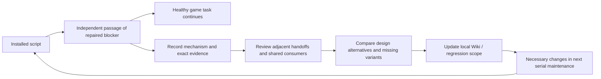


Review of the repair process: the prior palette/pan/screen-resolution tests used only one retained internal zoom, so a70px body cap survived despite known independent map zoom. A larger constant would repeat that error; one lamp-scaled producer and native-coordinate outputs serve both normalization and dispatch. Resetting recovery on every page hop would permit HOME/resume loops; accepted node progress is the narrower shared boundary. The first full run also exposed a preventable sequencing miss: new live logs changed the corpus audit (three Resume→LOADING→MAP traces), so run the cheap successor/plan/ladder corpus audits immediately after each live return, before the long stable-source regression. Preserve the3952pass/699skip/one-failure result and its reason; never add an exception count or call that suite green. This compares scoped alternatives, not a universal optimality claim.

<a id="current-checkpoint"></a>

## Current checkpoint —2026-11-20

**2026-11-23: the public installed app took a Team 2 Hard run from floor 1 to the reward dialog, with more than ten stops on the way.** Every segment was started from MXU's Start (MuMu ADB controller). Each stop was one reading or reconciliation gap, fixed, rebuilt and resumed in place: the pale super-shop node, `??` services in a Super Shop refresh, the event Result SKIP sharing a box with the skill check SKIP, the question after refusing an owned gift, the column pitch before a boss at the zoomed-in view, a free refresh, theme packs under a decorative heading, an event that ends in a fight (Commence Battle), a click on a transitional deployment frame, and a service label that lost a letter. The last segment `pi-20261123-133044` resumed in the floor 5 shop, won the boss and stopped on `RUN_REWARD_DIALOG` with `reward_module_budget_pending` (offer: 5 modules, weekly bonuses 0/3); no claim input was sent. Program time per floor: 30.6 / 20.4 / 31.0 / 31.4 / 33.3 minutes. Not verified: one Start running the whole run without interruption, the claim and return, a second run and rotation, and a cold pretask start on the desktop window.

**2026-11-21 (UTC): floor 5 cleared, stopped at the reward offer.** Installed `b112566` was started from MXU's Start button on the MuMu ADB controller and continued the same Team2 run. The task entered the boss node from the floor 5 map and won after 11 turns; the ledger recorded the floor 5 clear and the final victory from the hash-bound 100% summary page `frame-0267`. The task then stopped at the reward dialog as designed, with `reward_module_budget_pending`, and sent no Claim. The dialog reads weekly bonuses 3/3 on and a Claim cost of 18 modules. The budget options stop at 6 modules and the executor does not change weekly bonuses, so this offer needs either the user's explicit authorization for this run or bonuses lowered in the game to fit the budget. The run took 13 min 07 s and 49 inputs; its directory `pi-20261120-193352` stays local. The payout receipt, the independent return to HOME and the rotation remain unaccepted.

The post-passage review has two findings. The first is storage. With the 3 GB limit turned into a reminder the task was no longer stopped by capacity, so the previous blocker was passed; but this one boss battle left 269 originals, about 389 MB, and the project directory rose to about 3.40 GB, above the reminder. Retention density for battle frames is the next quantity to measure. The second is page identity. Thirteen of the 49 inputs had no basis. The battle page prints status counts under its units, inside the guide book's dot band; OCR joined several counts into one digit token and `carousel_dots` took that token for the dot row. Seven combat animation frames were therefore read as `TUTORIAL`, and each sent one click to the book's header corner. After six of them the "once per battle" speed toggle was pressed again, because that latch follows page continuity rather than the battle. The clicks landed on empty parts of a combat animation and did no visible harm this time; the same misread on a page with a back button in the top-left corner would be a real wrong input. Across all 4,407 retained frames the old rule accepted eight tokens, every one a battle count and none a real dot row. The source now requires a dot row to be at least 80% ring glyphs and carries five measured counter-examples. The rebuild described next carries this fix into the installed build; the scope of the speed latch is the adjacent gap left unchanged.

**Later the same day: the 18-module offer was claimed and booked.** The user chose in chat to claim in full, 18 modules with weekly bonuses 3/3. The source first gained recognition and execution of this measured offer, see [4.6.1](4-business-flows.md#feature-4-6-1), and the installed build was rebuilt from the clean commit `a2546a0`. MXU stopped at a Windows security prompt on this launch and never showed its workspace, so the claim used the headless entry of the same installed Agent, `tools/verify_packaged_mirror_loop.py`. Run `packaged-mirror-20261120-205012` sent four inputs: Claim, Confirm, the receipt acknowledgement and the pass acknowledgement. The receipt page read 750 and the pass level 203. The next two frames were `LOADING`; the executor treated them as an unproven successor and stopped, with the reward already received. Run `packaged-mirror-20261120-205246` audited the four input reports and their originals at HOME with no input and recorded the receipt and the return. The ledger's completed runs went from 2 to 3 with no active run. The rotation holds only `[2]`, so it still points at Team2 and this run cannot accept multi-team rotation; one GUI start carrying a run from entry to payout has still not been observed.

This part of the review has five findings. First, the payout path hard-coded the measured offers in three places and its boxes had only been measured for a one-digit cost, so the first two-digit offer could be neither read nor executed. Second, the executor did not wait through the loader after the last receipt. The source now treats a loader as a bounded wait once this run's receipt has been acknowledged; the rebuild from `5c57e55` carries it into the installed build, and it has not been exercised live. Third, with the folder above 3 GB the evidence reclamation could not start, because its deletion trail had to fit under the target first. The trail is now admitted against the folder's size after reclamation, and 226 unreferenced intermediate captures were retired that way with every referenced frame kept. Fourth, the Agent still checks its socket scratch directory against a hard 3 GB limit at startup, so "3 GB is only a reminder" holds only once a task is running: at 3.0027 GB the Agent did not start. Fifth, on this machine the installed launcher and MXU can be held by a Windows security prompt that only the user can answer; the headless entry is a substitute for that launch, not its acceptance.

With user approval, installed `75d4f7b` moved 28 sealed containers to the local sibling vault capped at 512 MB and released 260,003,952 bytes of project budget. Index entries and private configuration were preserved. All 607 indexed originals read back, and the installed compiled reader verified all 228 relocated originals again. Local reports are `build/native-vault-team2-activation.json` and `build/native-vault-installed-readback.json`. [Automatic reclamation](6-deployment.md#bounded-image-vault) describes the policy.

The same installed revision's continuous task `202015` crossed the previous admission stop from `MIRROR_ENTRY` through `RESUME_DIALOG` to the Floor 3 map. Its live journal recorded pages, components and successor proposals. After map clicks were rejected, the script saved, returned and entered the same exploration again. Two independent reads after the second Resume were clearly `LOADING`. The generic `WAIT_PAGES` handler ran before the dedicated loading handler and stopped on `page_unreadable_after_waiting`. Source dispatches named loading to its existing clock before the generic wait, clears stale unknown-page time at the phase boundary and uses the original loading and run deadlines. The repaired second loading-to-map transition still needs installed live verification. Team2 retains floors 1 and 2 and no reward. The current rotation contains only `[2]`, so it cannot demonstrate switching teams. Local run report `build/vault-team2-continuous.json`.

Three rejected Floor 3 map clicks are bound to `frame-0012/0015/0020`. The train anchor was readable. A leftward contrast cue missed every detected neighbor by 129–155 pixels, but the box branch still used the cue to exclude measured neighbors on the other side. Source requires an arrow to bind a detected neighbor before it can filter candidates. Existing candidate ranking and successor judgement remain in charge. Map component records also use the native floor and pack boxes separately. The node transition still requires a fresh live successor.

Installed `9a64a33` run `193007` observed `MIRROR_ENTRY` with the Floor 3 exploration showing. Storage admission hit the 240-second watchdog with zero inputs. Its execution stack locates the wait in review-evidence scanning for cold compression candidates. The ending still reported a finished observation and an empty page. Team2 remains at two cleared floors with no reward, completed count 2 and rotation index 0. Login diagnostic maintenance freed 8,131,794 bytes and preserved the causal captures. Sustained evidence capacity remains open. Local report `build/answered-login-team2-continuation.json`. The [page and route projection](3-runtime.md#page-journey) ties the observation, plan, admission failure and ledger milestones to the same scope and original frames. Whole run, actual reward, return and rotation remain live acceptance work.

Installed route-record revision `b4694c0` preserved 106 private and 33 canonical files. The installed compiled modules replayed the same original frame and recorded two entry components, the same-frame proposal, expected successors, floor milestones and `evidence_admission`. A simulated change to HOME cleared the previous proposal from the current view. Replay sent zero game inputs. Local evidence is `build/page-journey-frozen-verification.json`. The project has about 8.5 MB free. An in-memory re-encoding test across two historical containers saved only 81,520 bytes and left records and index untouched. See `build/cold-image-repack-feasibility.json`. Continuous live resumption still needs sustained evidence capacity.

After the user returned MuMu, installed `f94661d` started through normal `OpenGameTask` → `MirrorTask` with the same Team2 scope and two cleared floors. The first attempt hit the storage watchdog before login. After removing byte-identical offline replay copies, the second sent the title input and independently observed HOME. It then refused the next input for capacity before Mirror navigation. The same scope is active, with lifetime completed count 2, rotation index 0 and reward unclaimed. Sustained capacity is the current dependency. Floor 3 battle passage, actual receipt, return, rotation, GUI Start and model adoption still require their respective live traces. [Deployment and operations](6-deployment.md#staged-observation-credit) records the two frames, byte accounting and causal review.

Earlier installation and regression records follow.

Actual installed de63542 run160101 sent MAX, a non-ready gold dial and WinRate; original frame8 shows assigned skills/START. Refresh-only admission discarded the pending submit and frame9 was freshly recorded, then battle_progress_stalled ended before input readmission. Thus refresh capture is physically observed, but its full post-refresh input chain is not accepted.19original files,106private/33canonical preserved in build/battle-refresh-live-outcome.json; folder2,983,506,218bytes. Mechanism review found the same HUD counter incremented by battle_progress and an obsolete inline block. Plan: one writer; storage-only refresh does not spend another unchanged-turn stall round. Normal frozen HUD still spends its original budget, changed turn still resets it, refresh count3/deadline/physical two-pair funding remain. Gold ring geometry alone is not assignment readiness; no unsupported visual threshold change. Source test/correction→full per-case XML→clean freeze→normal currentTeam2 continuous task. Whole run, paid receipt, model promotion and lost0048 remain open.

Source implemented: obsolete duplicate progress block removed; capacity_reobservations marks only unsent storage-refresh reads, so unchanged turn does not spend another stall round.274related pass/93historical skips/36.04s/ownexit0. Five new cases include original assigned-frame/native-event envelope→whole Runner→simulated START send, ordinary one-count/frozen stop, three-refresh bound, real turn reset and blind counter preservation. All five fail against the original04557e8 source. Initial replay harness missed native event fields and then the raw-frame reader strips frame names; both mistakes were corrected without changing original records or game guards. Final full XML/freeze/physical continuation remain next.

Adjacent lifecycle correction implemented before installation: independently named nonbattle/nonloading pages clear the prior fight progress/blind counters. UNKNOWN, LOADING, BATTLE_TIP and BATTLE_PLANNING preserve fight ownership; a normal planning observation still counts once and may stall.314related pass/93historical skips/61.31s/ownexit0. Eleven added cases: first five original-event/storage cases, plus six page-lifetime variants; original HOME/MAP boundary counterexample2failed/3passed before correction. Loading was initially reset because it is named, not UNKNOWN; one negative caught this and the existing is_loading predicate now excludes it. Planning fixture was corrected to carry readable wave/turn and expect one normal count. Earlier full run was explicitly terminated incomplete at35percent/exit-1 for this necessary neighbouring fix, not counted green. Complete attempt4027passed/701skipped/1NAV-only Wiki failure/843.31s/ownexit1. Bilingual chapter3 navigation was restored to line3;73Wiki/privacy checks then passed82.51s/ownexit0. Runtime SHA remains identical to the complete attempt, XML11added runtime passes/0further runtime status losses; no second complete suite or all-green complete-attempt claim. Navigation checks should precede the long regression when inserting local views; route structure alone does not check chapter layout. Actual cleanf94661d Agent installed/terminalexit0;549source snapshot,13complete compiled identities/self-test and actual frozen Runner count/six synthetic boundaries passed. Frozen native cache/capacity retained-pixel replay and memory-staging/readback retained.106private/33canonical/19current originals unchanged. Source/frozen7210references/143archived reports match; launcher unchanged. build/battle-refresh-installed-verification.json. Closed exact-ZIP duplicate retirement12copies/3,487,105bytes retained all unique bytes, every packet and current originals, folder2,985,782,070bytes. Fresh readonly target127.0.0.1:16416 is online but foreground=com.hypergryph.arknights; normal Limbus continuation was not started and no controller/input/game switch was attempted. Availability question pending. build/battle-device-foreground-readonly-block.json. Actual installed f94661d counter repair remains unaccepted physically. Closed metadata maintenance then retired37older unselected duplicate copies/10,693,655bytes, with byte-exact existing ZIP members and unchanged source-reference projection/private/originals. Directory2,978,860,288bytes. Current selection and last two return packets stay raw; older closed packets may require hash-verified native-records.zip member extraction before historical workflow CLI reading. build/battle-refresh-closed-packet-retirement-verification.json and its durable manifest. No game images, pending, review queues or unique bytes were removed.  not GUIStart/whole-run/payout/rotation/model promotion/lost0048 recovery. Full attempt NAV-only failure and subsequent73passing Wiki checks remain separately recorded.

<a id="public-goal"></a>

## Public-version goal (opened 2026-11-23)

This is a long-running goal, not an implemented fact; the baselines below are measured and the completion signs are exits still to be reached. It has four workstreams: public repository maintenance, periodic architecture review informed by the game's mechanics, task breakdown, and feedback into the Wiki and the project-wiki skill (framework problems found here go upstream as issues or pull requests).

### Completion signs

| # | Completion sign | How it is measured | Baseline 2026-11-23 |
| --- | --- | --- | --- |
| G1 | The slowest floor takes at most 10 minutes | A whole run of the installed app started from MXU's Start; program active time is attributed from run events to the floor it was on (time stopped waiting for a fix does not count) | One run, Team 2, Hard: floors 1-5 took 30.6 / 20.4 / 31.0 / 31.4 / 33.3 minutes, of which battle and loading pages 16.5 / 13.0 / 23.9 / 23.3 / 23.4 |
| G2 | Good user experience | One Start clears five floors and claims the reward with no developer intervention, three runs in a row; a stop says its cause and next step in the user's words | This run stopped more than 12 times between floor 1 and floor 5, each needing a code change and rebuild; MXU stays on "Starting" when the Agent fails to start |
| G3 | Settings are not redundant and sit where they belong | No option in `interface.json` without a task that references it; each setting appears in one place; deployment order does not need 12 dropdowns | 2026-11-23: the 22 unreachable options and the 47 unreferenced text keys are deleted and kept out by a test (see C1 below); how deployment order is set is undecided |
| G4 | Developable after open-sourcing | A fresh clone without game assets installs, tests and builds; a source change leads to the Wiki sections and figures that describe it; public CI is green | The public checkout's full suite passes (4380 passed, 713 skipped with reasons); routes cover 89 of 157 modules; none of 328 figures is declared, so the change review cannot reach a figure |

### Workstreams and task breakdown

| Workstream | Tasks | Signs |
| --- | --- | --- |
| A Public repository maintenance (hygiene first) | A0 public-tree hygiene is the exit of every commit: `tools/check_public_tree.py` reports 0 findings (private paths, account and device identifiers, game assets, binaries, image metadata, private text), release packages and CI artifacts are held to the same standard, and docs and tests keep only the diagnostics they need; A1 confirm scope before every push and release; A2 re-verify each release from an anonymous clone and the downloaded package; A3 make 3 GB a warning line: start-up and offline tools only warn above it, evidence is moved out and never deleted; A4 local import of theme pack card art (not tracked, not in a release) | G4 |
| B Periodic architecture review | B1 break down battle time (wait polls, UNKNOWN during animations, capture and evidence writes) and plan how to get under 10 minutes; B2 read node state without fixed hue bands, from shape and relative brightness; B3 do not act on a page that has not settled (the 0/12 transitional deployment frame); B4 one vocabulary for same-slot buttons (Continue / Proceed / Commence Battle); B5 a post-passage review after every completed run, written back | G1 G2 |
| C Settings and interface | C1 inventory every option and remove or reconnect the unreferenced ones; C2 deployment order by "read from the game and save", with a one-line input as fallback; C3 stop messages in the user's words; C4 do not leave the interface on "Starting" when the Agent fails to start | G2 G3 |
| D Wiki and skill feedback | D1 redraw the architecture figures to the current structure and declare them in routes; D2 every new module gets an owner route; D3 run the change review in CI as an advisory; D4 de-identify framework problems found here and send them upstream as issues or pull requests | G4 |
| E 24-hour hosting | E1 one "daily" entry does what the day's schedule asks: experience and thread dungeons each a set number of times per day, Mirror Dungeon on chosen weekdays with a set number of runs, reward claims and stamina exchange, each switched by the user; E2 each item is booked per server day or week, finished items are not repeated and an interrupted one resumes; E3 with MXU's timer and the pretask, starting the app is enough to host a full day unattended; E4 one failed item does not take the others down, and a stop says its cause in the user's words | G2 G3 |
| F The program recycles by itself | F1 at the end of a run the program applies the retention rule: frames cited by a ledger or transaction stay, other intermediate frames move to an archive with a manifest, with no manual step; F2 rebuilds and updates no longer copy evidence (done with hard links); F3 above the warning line the program warns and makes room instead of refusing to start | G2 G4 |
| G Run data | G1 every run writes structured metrics: time per floor and page, stop reasons and counts, recognition score distributions, turns per battle, purchases and refreshes; G2 a read-only summary tool turns many runs into trends that answer "where does the time go, where does it stop most"; G3 checkpoints at key nodes (page not settled, missing reading, budget and space) are counted in the metrics, not only logged; G4 metrics carry no account, device or local path | G1 G2 G4 |

Before a task starts, record its owner and exit evidence in this section; when it is done, write the measured result back into the baseline column above. Anything unverified does not count as done.

**Where assets come from.** Nothing that reaches the public repository carries an identifier (no account, device, local path, or screenshot showing account data). Game images are taken from the public wiki (limbuscompany.wiki.gg) first, downloaded on the user's machine by an import tool that records source and hash; until redistribution is confirmed, the artwork itself stays in ignored local paths and out of public Git, release packages and CI artifacts.

**Where E stands, and its phases (checked 2026-11-23).** Of the six tasks, open game is complete; the Mirror task is implemented but one uninterrupted run is not yet accepted; the experience and thread dungeons only navigate to the Luxcavation page, with no stage choice, battle, result or count option; stamina exchange observes one frame and returns "not implemented"; reward claiming covers the Mirror clear only, not mail or daily missions. The ledger held a running total and no per-day or per-week booking, and an unfinished Mirror run refuses the two dungeons. Phases: (1) the schedule ledger `daily_ledger` (done); (1b) the Mirror task asks the ledger by schedule (done 2026-11-23, not yet accepted on the installed app): the Mirror task's own options choose "every day / Monday to Friday / weekend / Mon-Wed-Fri / Tue-Thu-Sat" and "runs per day"; on a day that is not chosen, or once the day's runs are booked, a start ends before anything looks at the game and says why; a run is booked only after five floors, the claimed reward and the return to the lobby. By design there is no separate "daily" entry repeating the six tasks' settings: each task asks the ledger itself and a timer only presses Start. A run finished by the separate rewards task is booked too, and runs completed with no schedule chosen are booked as well, so switching the schedule on mid-day does not play extra; (2) finish the two dungeons and add count options; (3) a "daily" entry that works the ledger item by item, skips what is done and only records a failed item; (4) stamina exchange, mail and daily missions; (5) a 24-hour unattended acceptance with MXU's timer: the installed client was confirmed to carry scheduled execution policies (`schedulePolicies`) and run-on-launch (`autoRunOnLaunch`), so hosting needs no scheduler of this project's own, only tasks that can answer "does today still owe this"; neither has been exercised by this project yet. The server day (default 06:00 Korea time, week from Thursday) is the commonly stated value, not measured by this project; the game's notice page is the authority.

**Where F stands (2026-11-23).** The program already reclaimed old diagnostic frames by its retention rule when space ran short, but by deleting the PNG (the JSON record and a hashed reclaim trail were kept). That single deletion point, `capture_retention.retire_capture`, now moves the frame to `<project folder>-evidence-archive/` under the same path and writes where it went into the trail; on one volume it is a rename, across volumes the copy is compared with the planned digest before the original is removed, and a different file already at that archive path stops the reclaim. Automatic recycling therefore no longer destroys evidence.

**F1 reclaim at the end of every task (2026-11-23).** A check showed that the installed app only tests free disk space while it runs and reclaims nothing, so an installation left running grew past the warning line task after task (3.41 GB measured after two days of runs). Now, once a task has written its result and while it still holds the controller lease, `capture_retention.settle` moves the reclaimable intermediate frames to the archive by the existing retention rule, aiming 0.4 GB below the line; a target out of reach still moves what can be moved and is stated in `storage-settle.json` and the GUI log; a failed reclaim prints one line and does not change the task's outcome; a task whose run folder is outside the installation (a test, a diagnostic) touches nothing. The program only adds to the archive and tells the user its size and place past 8 GB. One real measurement on the installed folder: 31 s to plan, 545 frames (0.81 GB) moved, the project from 3.41 GB to 2.60 GB, 248 s in all. Nearly all of that went into re-reading every reference before each frame (about 0.4 s a read), so the end-of-task reclaim now re-reads references every 15 s and bounds the moving phase to 180 s; frames it did not reach keep their written intent and are moved first when the next task ends. Because reclaiming is a move and no longer a deletion, a frame that gains a reference inside the interval has only changed place and is still readable in the archive under the same path. The offline tool is unchanged and re-reads before every frame. The time after this change is not measured yet; the next installed task writes it into the run history. Not done yet: writing less at the source (an ordinary user does not need a PNG of every frame).

**G1/G2 run history (2026-11-23).** When a task ends, `run_history` appends one row (about 2 kB) to `user-run-history.jsonl` in the data folder: time per floor and page, a count of every event, checkpoint counts (waits, re-reads, refusals, missing readings, inputs, observations, battle turns, purchases, floors over the 10-minute target), the stop reason and what this task's reclaim moved. A row holds no account, device or local path: a task is named by its run folder and a game run by the first eight characters of its id. `python tools/run_report.py --history` turns the rows into a trend; a floor played across several tasks of one game run is summed per game run, so "slowest floor" is a whole-run figure. Unlike `run_report`, which reads journals, the history is still there after journals and frames are reclaimed, so it is the long-term data. When a floor passes 10 minutes inside a task, the GUI log says so. Not done yet: recognition confidence distribution, and a dedicated count for the G3 checkpoint "page not settled". Missing readings are counted, and the first use showed a coupling: one task of 2026-11-23 took 261 steps, one of them on the map page, yet `map_party_unread` occurred 260 times. The party marker of the map is read on every page (shop, battle, event) and cannot be found there. One read costs about a millisecond, so it is not where the time goes; but with its two companion events it fills about a fifth of that journal and distorts the "missing readings" figure. It should be read on the map page only; not changed yet (the change is in the run loop and needs acceptance on the installed app).

**B2 rerouted: the next map step is read from the game's own ">>" mark (late 2026-11-23; the user had said the hexagon reading cannot be relied on).** The new run stopped on the floor 4 map: the hexagon reader offered the party's own sprite and missed the one node the mark pointed at, and leaving and re-entering did not help (`map_resume_did_not_restore_navigation`). The game draws a double chevron halfway along every path the party may take, with the same shape on every theme; so the next node = party + 2 x (mark - party), and the node itself need not be read. Finding the mark names no colour either: every theme tints its ground and its paths (red, purple, teal, sepia) while the mark is grey and brighter than the ground it lies on, so the mask is taken relative to the ground around the party. The party position and the column pitch still come from the train sprite's lamp gap. Checked against the installed app's stored runs: of 46 map clicks the game accepted, a mark was read on 43, the computed position was the accepted node on 42 (within 90 px) and came first on 36; on the frame that stopped the run it is the node on the right. Marked nodes lead the candidates; where another reader measured the same node its more exact box is used, the other readings follow as a fallback, and a frame with no readable mark is still answered by the older readers. The planned "node state without fixed colour bands" is therefore no longer on the critical path. Not accepted on the installed app yet.

### First measurements (2026-11-23)

**More measurements on the installed app (evening of 2026-11-23).** The first real end-of-task reclaim with the interval re-read: at the end of a 33-minute Mirror task 645 frames (0.84 GB) were moved and the project came back under its 2.60 GB target in 36.1 s (the per-frame re-read had taken 248 s for 545 frames). The same task was the first time floor 1 of a new run was played without a stop: 24.2 minutes of program time, still far above the 10-minute target; that task waited 246 times, re-read 32 times, sent 139 inputs and made 636 observations. The "floor 6" that appeared in per-floor times was a booking error: payout time after the fifth floor was booked to a floor that does not exist, and is now booked to no floor.

**Where G4 stands: is the project developable by people (independent review, 2026-11-23).** A reviewer with no context of this repository read it read-only; its key figures were spot-checked. Verdict: the periphery can be changed by a person with confidence; the core loop is in practice changeable only by an AI agent holding the whole context. Good: the README states honestly what is and is not there; CI runs on a clean Windows checkout; commit messages say what was not verified; the observer and device are injected, planning in `window.py` is pure, `STEP_ROWS` and the `pages.py` registry have drift tests; the recent small modules (`mirror_schedule`, `run_history`, `global_settings`) are readable. Obstacles: `MirrorRunner.step` is one function of 3,339 lines (457 `if`s, 98 `return`s), `window._plan_step` 812, `vision.classify` 469, `recognition.analyze` 433; 46 of 1,694 functions carry a type annotation and the loop state is an untyped dictionary of 131 keys; there is no linter, formatter or type checker; about a third of the modules use a dense several-statements-per-line style while some dozens of tests assert on source text, so a blanket reformat breaks them; source comments hold 496 `Dnnn` references of which 134 numbers are defined nowhere under `docs/`, and 513 dated run ids; the largest Wiki page is 350 KB and the citation tool reports 142 of 217 judgeable citations drifted (1,899 in all); routes cover about 60% of the modules and miss common questions such as "the shop bought the wrong thing" or "which files change for a new page"; there was no contributor guide and there are no issue or pull-request templates; the full suite takes about ten minutes with over seven hundred skips and competes with a running installed app for one controller lock. The review's order of improvements: (1) a contributor guide and a one-page architecture (a first `CONTRIBUTING.md` is written); (2) replace source-text assertions with behavioural or AST checks; (3) adopt ruff lint and format in CI; (4) split `step` into per-page handlers; (5) type the state, the observation record and the plan; (6) comments state invariants, history moves to the decision log; (7) test tiers and an injectable lock path; (8) a Wiki diet with symbol citations; (9) generate `interface.json` from a template checked in CI; (10) separate supported tools from one-off probes. Measured against G4, "developability after open-sourcing is ensured", this sign is **not met** today.

**B1 where the time goes.** GUI runs of 2026-11-21 to 23 (23 segments, 100.1 minutes of program time), each step's duration plus the wait before it attributed to its page:

| Page | Steps | Total (min) | Per step (s) | Note |
| --- | --- | --- | --- | --- |
| Battle animation wait (UNKNOWN) | 394 | 39.6 | 6.0 | 10.6 minutes of it is waiting between steps |
| Battle command page (BATTLE_HUD) | 165 | 20.2 | 7.3 | two steps per turn: auto-assign, start |
| Deployment page | 40 | 5.5 | 8.4 | one observation takes 2.7 s, the slowest of any page |
| Map | 34 | 5.5 | 9.7 | |
| Other non-battle pages | about 270 | about 17 | 5-7 | results, shop, gifts, events, loading |

The longest of 24 battles took 6.6 minutes. The loop spaces its actions at least 4 seconds after the last input (`interval` in `runner`), so no step is shorter than 5 seconds. Compressible items by expected gain: (1) replace the fixed spacing with "act once the page has settled", which also answers the transitional frame of B3; (2) merge a battle turn's assign and start into one step; (3) the source of the deployment page's 2.7 s observation; (4) the polling cadence during animations. Each needs a before/after time on the live rig before it is adopted; this table is only the baseline.

**Inside one step.** A battle command step that sends an input takes 6.55 s on average (122 steps): 2.4 s between the settle read after the click and the next battle read (present in about half the steps, about 4.8 s each), about 2.2 s of battle reads around the click, and about 0.5 s for the native click task. The action spacing on battle pages is already 1.5 s (`BATTLE_INTERVAL`), so the bottleneck is repeated reading inside a step, not the pause between steps. A map step takes 7.29 s (18 steps): 1.8 s re-reading after the click, 1.5 s computing candidates, 0.9 s reading before the click. Conclusion: cut the repeated observations inside a step first, then shorten the spacing; both need a before/after on the live rig.

**C1 option inventory.** `assets/interface.json` defines 714 options and 6 tasks; 22 cannot be reached from a task, a global option, a controller or the pretask: `deployment_position_1..12`, `deployment_preset`, `pack_name`, `pack_weight`, `run_team`, `team_build_name`, `team_build_slot`, `team_keywords`, `team_keywords_extra`, `team_name`, `team_slot`.

**C1 cleaned up (2026-11-23).** The 22 options above were deleted from `assets/interface.json` (714 -> 692, a pure deletion with the rest of the text untouched). Their pipeline nodes cannot be reached from the entry of any of the 6 tasks, so runtime behaviour is unchanged; `tools/expand_team_slots.py` no longer handles three of them, so a rerun does not bring them back; `tools/prepare_resources.py` writes the early five-task skeleton and now refuses to replace the maintained interface by default. `tests/test_interface_reachability.py` keeps "defined but unreachable" at zero. The 47 text keys in the three language files that no label referenced (31 used only by these options, 16 unused since earlier) were deleted too (175 -> 128 each, line deletions only), and the same test file now keeps every text key in use and every used key present in all three languages. Not done yet: how deployment order is set.

**C1 continued: the interface does not promise what the program cannot do (late 2026-11-23; the user pointed out entries with no real function).** An independent audit compared every entry's text with what its code does; its findings were spot-checked and hold. Five entries left the interface, their code stays: (1) the "GitHub automatic update" switch: the updater runs only inside the launcher program while the README tells users to open `MaaLimbus.exe`, and it accepts stable releases only while only pre-releases exist, so it never ran for a user of the public package; the unmodified MXU's own update check does not work either, with no source configured and a version below 1.0; (2) "Skill Replacement Check": it opens the skill chooser, selects a card and cancels, and never buys; (3) the stamina task: one screenshot, then "not implemented"; (4) the gift search choice: both cases refuse; (5) the shop's "learned" mode: no model and no samples at run time, so it behaved as the manual rules. Kept and renamed: the experience and thread dungeons say "in development"; "Collect rewards" became "Claim Mirror rewards" (mail and dailies are not claimed); the three Windows controllers lost "recommended" and say "not accepted yet"; the Japanese resource says experimental (25 of 90 recognition strings); "follow the launch setting" became "Default" everywhere (the interface offers no way to save that setting); "observe only" for battle assignment says it is for debugging. A guard in `tests/test_interface_reachability.py` keeps these entries out while they have no function. There are now 252 options and 5 tasks. The update, rotation and resource-diagnostics panels of the custom client are likewise invisible to public users and remain open.

**C2 team settings redone (2026-11-23; the user called the dropdowns unusable).** A check showed that a team took 15 options: an edit switch, a name no code read, the systems, and 12 deployment-position dropdowns each listing all 12 sinners; 600 options and 6,400 dropdown entries for 40 teams. The dropdowns defaulted to roster order rather than the saved order, the app never loads saved teams back into its fields, and the same sinner could be chosen twice (refused only on save). A team now has two settings, each defaulting to "keep": the systems (a dropdown) and the deployment order (one line of text). `keep` means no change; `game` forgets the saved order so the run follows the order the game itself shows for that team (the run loop already supported this: with no saved order it leaves the selection alone); otherwise the sinners are written in order by number or name, for example `6 8 7 3 5`, and the ones not named follow in roster order. A sinner named twice or an unknown word is refused by name. Options went from 695 to 175 and the interface definition from 3.5 MB to 1.2 MB. Three older defects went with it: rotation positions 21-40 all defaulted to team 20; the team options of the two Luxcavation tasks named a default case they did not have; the seeding tool and two verification tools that only served the old shape and had no references were deleted. Not done, and not accepted on the installed app yet: gift and pack preferences and the starlight plan are still edited from the Mirror task and only for teams 1-20; battle assignment mode and shop rules, which belong to a team by the game's logic, are still one global value; the 12-cell click editor of the custom client (`desktop/mxu/TeamBuildEditor.tsx`) still writes the old options and must be retired or rewritten.

**C2, second version (the same evening, user feedback).** The user made three points: fixing the systems to combinations such as "Charge+Tremor" is odd, they should be ticked freely, all of them or none at all (let the program buy freely); teams do not only serve the Mirror Dungeon, so this is "Mirror team settings"; and besides "keep" the deployment order needs something more direct than typing. A team still has two settings: gift systems are "keep" or "choose again" (a multi-select of the 12 systems; none ticked ties the team to no system); the order is "keep", "follow the order set in the game", "tick the sinners who deploy first" (ticked first, the rest in roster order) or "write the whole order". Each ticked case writes one key of its own into the `attach` of a single node; MaaFramework was measured to merge `attach` by top-level key (a nested object is replaced whole), so several ticks take effect together. Ticking systems also writes `formation_keywords`, otherwise a value left by an import would outrank the choice when the starting gift is picked. The sections are named "Mirror team N". There are now 295 options and the interface definition is 1.4 MB. Known: with no system ticked the starting gift still falls back to the launch default; this version is not accepted on the installed app yet.

**C2, third correction (same evening, user feedback).** "Tick the sinners who deploy first" cannot say an order; the user pointed it out at once and it was removed. The user offered two alternatives: dropdowns in which a chosen sinner disappears from the others, or a screenshot record of the deployment order. The first cannot be done in the unmodified MXU (option definitions are static and cannot filter one another; it would need the self-built client). The second was adopted: with no saved order the run already deploys the order arranged in the game, and it now reads the numbers on the twelve cards of the team page, records the order with that frame in `user-team-order-records.json` and writes the order it read to the task log. The record is evidence of what was read and changes no behaviour; a frame the record names is not moved out by the automatic reclaim. The order now has three ways: keep, follow the game (recommended), or write the whole order. There are 255 options. Not accepted on the installed app yet.

**Wiki line citations go stale silently (found 2026-11-23).** When the two definition files shrank, the checker reported only the 22 line numbers past the end of the file; a citation still inside the file but pointing at the wrong line is invisible to it. Chapter 1's line numbers for the task declarations, for example, had already drifted when a pretask was added earlier. Citations into these two files were relocated by "the key the old line belonged to, and the line text must be identical", but line citations into data files are fragile by nature: cite the key instead, or have the checker compare the cited line's content. This is also worth reporting to the upstream skill.

**Whether a cleared run claims its rewards is the Mirror task's own setting (2026-11-23, asked for by the user).** A cleared run used to stop on the reward page until someone wrote "this run may spend N modules" into the settings file by hand. The Mirror task now has "Claim rewards after a clear" with two choices: claim (the default), or do not claim and stop on the reward page. The first version asked for a module limit (5 / 6 / 18); the user pointed out that a run's rewards cost 5 modules apart from weekly bonuses, so the only question is whether to claim, and it was changed the same day. "Claim" is saved internally as the standing limit `auto_claim_modules`, set to the largest measured offer (18), so the claim goes through with or without weekly bonuses switched on in the game; that switch is the player's and the program leaves it alone. When the offer cannot be read the task stops on the reward page and clicks nothing. An answer given for one particular run, a refusal included, outranks the standing limit; a claim already reserved or sent is not affected by a change of the setting. The program does not touch the weekly-bonus switches and does not click "Give Up Rewards". The same day added a page variant: after the game is closed on the reward page, re-entering from the dungeon list shows "To List" where "To Window" stood, with a lower score for the floor count (0.65); the old page gate refused it and an authorised claim stopped (no click sent). Both spellings are accepted now. Acceptance on the installed app is recorded below.

**There are two payout routes (seen live 2026-11-23).** Claimed inside the run right after the clear: Claim → Confirm → the "Rewards Acquired" receipt → the pass popup → the lobby. Claimed after the game was closed on the reward page and the dungeon was entered again from the list: Claim → Confirm → the pass popup, straight onto the Mirror entry page, with no receipt page and no return to the lobby. On the second route the program used to refuse the pass popup ("Pass receipt absent or repeated"): the rewards had arrived and the ledger did not say so. That route now takes the balances as its receipt: starlight and the weekly projection cap on the frame before the claim, the two amounts the dialog offered, and the same two balances on the pass popup's frame; both must have grown by exactly the offer (measured 3220 → 3285 and 50 → 100 for an offer of 65 and 50). A number that is missing or ambiguous, or a difference that is not the offer, proves nothing. Once the pass popup is acknowledged the game does not rest on the entry page: it goes on to ask "Will you enter Mirror of ...?", because the Enter that reopened the dialog is still being answered (seen live the same day). The return page is therefore the Mirror entry page or that question over it, but only for this run's own transaction once it is confirmed, its pass popup acknowledged on the balance receipt and its bookkeeping not yet finished; at any other time the entry page is still where a new run starts. Known gap: when the pass does not level up on this route (no popup), the program stops instead of going on.

**The task log names every page the loop recognised (2026-11-23, user feedback).** The log a person watches used to get a line only when an input was sent on a new page, and most pages showed their internal identifier, so it did not look as if every screen was being recognised. Now a line is written at the end of a step when the recognised page changed, an input was sent, or the task stopped there ("step N · page: shop (SHOP) · acted"); a page that is waited on gets a line every tenth step with the count; each page and each action inside the payout gets its own line. All 63 registered pages have a name a player would use, and a test keeps that true for pages added later.

**Fusing gifts in the shop (2026-11-24; the user pointed out the shop's fusion had never been used).** The fusion panel was first walked by hand on the live client, a frame taken at every step, and only then were the reader and the inputs written; the details and invariants are in [4.3.8b](4-business-flows.md#shop-gift-fusion). Three findings. (1) The game itself lists the recipes whose gifts are all owned under "Fusion Available"; one tap loads the ingredients and the forecast reads 100%, so a recipe fusion does not need every owned gift identified. The program presses Fuse only on a forecast of exactly 100% with the Wishmaking box seen empty. (2) What made the program miss recipes was buying: a Charge + Tremor team left a floor-4 shop with 1,706 coins and a Charge recipe ingredient on the shelf, because the catalogue does not name it, its title wraps onto a second line and only the first was read, and a long title with one wrong glyph matched nothing. All three are fixed, and recipe ingredients joined the wanted list. (3) The recipe table is imported strictly from the wiki (62 recipes, with revision id and licence); the first parse by hand had put three groups wrong, so the importer guesses nothing about which rows a group covers. **Not done**: random fusion is a tested decision function with no page reader. **Acceptance**: first walked by hand once (UPS System + Miniature Telepole -> Insulator); then the installed app itself bought Wobbling Keg in the floor-5 shop, fused Epicenter and left normally (`pi-20261123-225704`, 7 inputs in 40 seconds). That is one run and one recipe. There was a wait in between: the installed app had been started elevated, this session could not close it, and the project's own installer therefore refused to replace its files; that check was not worked around, and the rebuild waited until the user had quit the app. The lesson for people: a feature that was "never used" does not show in any log, only against a list of the game's own entries; of the shop page's three buttons, Enhance Gifts and Sell Gifts are still unused.

<a id="run-review-20261124"></a>

### Stage review: one complete Mirror run, lost at the floor-5 boss (2026-11-24)

After this run the user asked for a look back over all of it. The subject is one run from the evening of 2026-11-23 into the 24th (ledger `ea52b509…`, team 2, systems Charge + Tremor, hard): four floors cleared, the floor-5 boss not beaten in 22 program turns, and after the user took over by hand it still ended at a total progress of 95%. Every figure comes from the event logs of this run's eight task segments and `user-run-history.jsonl`; no experiment was run for it.

**The run in numbers.**

| Item | Value |
|---|---|
| Program time | 140.1 minutes in 8 task segments (7 stops) |
| Minutes per floor | 24.2 / 24.1 / 25.6 / 36.7 / 28.8; the target is 10 |
| Of which battle | 16.1 / 16.0 / 20.3 / 29.9 / 22.7, 105.0 in total, 75% |
| Battle turns | 94, about 67 seconds a turn |
| Observations | 2,831, of which 1,645 (58%) were pages not named, nearly all battle animation |
| Coins | on entering the five shops 906 / 1363 / 1834 / 2538 / 2597, on leaving 506 / 764 / 1384 / 1706 / 1872 |
| Spent on gifts | 18 gifts for 2,781 (5 of them other systems' gifts bought only to meet the carry cap), 225 on refreshes |
| Never spent | 1,872 in hand at the boss, about 38% of the run's income |
| Fusions | 2, both from today (one by hand, one by the program) |
| Highest gift tier | III; no tier IV, nothing enhanced |

**Finding 1: the program gets through pages and decides almost nothing.** How to pass each page safely is worked out in detail; what to choose is a fixed rule, or the first option.

- Theme pack: `neutral_default` on all five floors, which is the first card. The floor-5 boss was picked that way.
- Map: the nearest lit node. The node kinds in the events are only looks (`lit_icon`, `path_node`, `lit_ring`, `gold_badge_node`); the program does not know which is a battle, an event or a shop.
- Floor gifts: the smallest trial penalty wins, and the team's system is worth 40 points. A Charge team met Curriculum Vitae (Charge, and an ingredient of the T-5 recipe) twice and took it neither time: once because its trial scored higher, once because its trial text was not understood; both times another system's gift was taken.
- Shop: only names the catalogue files under the team's systems, two plain refreshes; never a keyword refresh, an enhancement or a sale, and fusion only since today. So the coins pile up.
- Battle: win-rate assignment and Start every turn; no E.G.O, no targeting.
- Starlight: at most 60 per run by the saved rule (3 graces bought this run), with 3,285 in the account. That is the user's saved setting; it is recorded here as a fact only.

**Finding 2: getting stronger and getting faster are the same thing.** 75% of the time is battle at over a minute a turn; a weak team takes more turns and does not beat the boss. So the 10-minutes-a-floor target is reached mainly by having a formed build from floor 3 on, not by trimming waits. The user's judgement (the coins did not go into strong gifts, no tier IV by floor 5) agrees with the numbers.

**Finding 3: there are places to spend, and the program does not know them.** By the wiki's fusion points (not measured here), three tier III gifts, or two tier III and one tier II, fuse into tier IV, and three gifts give the keyword asked for with 90%. This run bought 18 gifts and took 12 floor gifts; five of the bought ones are other systems' gifts bought to meet the cap, which is exactly what a random fusion is made of. Gifts at 280 coins appeared on the shelf twice (Fragment of Desire, Crushed Memory) and were not bought. The keyword refresh (120 coins) was never used. Enhancement was never used; its page has not even been seen.

**Finding 4: a lost run stops on the reward page.** Below a total progress of 100% the program names the summary a lost run, opens the reward dialog and stops because the ledger holds no five-floor clear (`completed_mirror_run_required`). The dialog has three buttons: give the rewards up (the user's rule: never), back to the window, and Claim for 5 modules. Whether a lost run's partial rewards are worth 5 modules is the user's decision, and the program has no answer to it yet, so unattended a single lost run blocks every run after it. The reason name in that row of the code still reads "opens its rewards only to give them up", the opposite of the rule; the give-up button is on the forbidden list and was never pressed, but the name and its comment are wrong and are to be changed.

**Finding 5: of the seven stops, five were corners of reading or reconciling a page, and two were a person pressing Stop.** In order: the deployment page did not change, the shop notice named another gift (fixed), a free gift's effect text was taken for a price (fixed), the map did not restore navigation (which led to the ">>" reader), a refresh did not reconcile (fixed); of the last two, one was a Stop pressed in the shop to look at the fusion panel and one was the user pressing Stop in the boss battle to take over. Both are logged as `the_page_read_did_not_come_back_inside_its_window`, and only after that does the interface say "stop task": a stop a person asked for is recorded as a fault, and the run history gained two failures that were not.

**What the game itself reuses.** Each page has its own coordinates and rules today; the game is assembled from a few things used again and again.

- **The gift tile**: tier at the top left, system icon at the bottom right, name underneath. The shop shelf, the fusion panel, floor gifts, reward cards, the gift notice and the recipe list all show the same tile. The program reads the name only, not the tier or the icon, so it does not know what it owns or how strong it is, and cannot tell the system of a gift the catalogue does not name. Read once, the tile serves six places.
- **The two-button question**: leaving the shop, a purchase, the fusion keyword and the fusion question all put Cancel on the left and Confirm on the right, in nearly the same place. Each has its own region constants today.
- **The "E.G.O Gift GET!" notice**: already one page shared by purchases, fusion and events. This is the example done right.
- **Coins and price badges**: the shop's coins, the prices under buttons (Refresh 45, Keyword Refresh 120, Heal 100), the before and after balance in the purchase dialog.
- **The twelve sinner portraits along the bottom**: in the shop, in events and in battle, with their HP. The program looks at them only when somebody is dead.
- **The same operations**: "pick in a grid, confirm, notice, back" (buying, fusing, enhancing, selling, picking a gift); "one of several cards" (theme packs, reward cards, starting gifts); "pay, then prove it by the balance" (purchase, refresh, heal, Starlight graces). The shop transaction is a full implementation of the third; the others are each written separately.

What is missing for the program to be flexible is the layer in between, "what state is this run in": which gifts (name, tier, system), how many coins, which floor, the team's HP, which pack. With it the decisions above have something to stand on; without it each page can only keep its own rule.

**Material for modelling.** The "learned" mode is empty today (no model, 14 samples). What this run left that can be used: 53 shelf readings (names, prices, coins, what was done), 35 purchase rankings, 20 floor-gift rankings, 5 theme-pack choices, 35 map picks and 94 battle turns; the configuration folder holds the shop ledgers of 9 runs and 24 lines of run history. What is scarce is outcomes: 4 runs finished, plus this lost one. Five outcomes cannot train "is this purchase worth it". So the order is: write the game knowledge down as rules first (tiers, recipes, fusion points, a goal for spending), and record every decision as one row with the state and the options it had; with some tens of runs that carry outcomes, a model can replace the weights in those rules. What a model can do now and rules cannot is recognition: the tier and system icon of a gift tile, and the kind of a map node.

**Tasks, in order.**

1. **A lost run**: ask the user whether to claim; walk the reward page by that answer, file the run as lost and do not count it as completed. Change the wrong reason name with it.
2. **A gift tile reader**: tier, system icon and name, first on the fusion panel (15 tiles a screen), to know what the run owns.
3. **A rule for spending**: from floor 3 on, coins above some amount must turn into tiers. In order: completed recipes, random fusion (three gifts of other systems for one of the team's), keyword refresh, buying high tiers. Needs task 2.
4. **Floor gifts**: the team's system and recipe ingredients must outweigh the trial penalty, at least on the first two floors.
5. **Enhancement**: walk its page by hand first and take frames, as was done for fusion.
6. **Map node kinds** and **theme pack choice**: read them first, then decide.
7. **A stop a person pressed is recorded as that**: today it shares a reason name with a real page-read timeout.
8. **A decision record**: one row per decision (state, options, choice, what came of it) for a later model.
9. **Shared readers for the question dialog and the tile**: collected along with tasks 2 and 5, not a task of their own.

Battle itself (E.G.O, targeting) is not on the list: what it gains can only be measured once the build is formed.


**Review task 1 done: whether a lost run is claimed is an option (2026-11-24, the user's decision).** The user first answered "claim", then pointed out that it should be something one can choose. With "Claim" chosen for "Claim rewards after a clear", the Mirror task now shows one more item, "A run that ended before the dungeon was cleared (lost)": claim it too (the default) or do not claim (stop on the reward page). How: (1) the ledger knows one more ending. A summary whose total progress is below 100%, or a reward dialog that prints an unfinished floor (`Floor 5 [HARD] 3/4`), records `run_lost` with that frame as its proof; a run is won or lost, never both. (2) The payout chain asked for "five floors and a victory" in four places; all four now ask `run_wiring.payout_state`: won, lost, or neither. A lost run passes only when the user chose to claim it. (3) A lost run spends no weekly bonus: an offer that includes one is refused. (4) The dialog and the ledger must tell the same story: a ledger that says lost against a dialog showing a cleared floor 5, or the reverse, is refused, because that is another run's dialog. (5) When the payout is filed, the run goes with the runs that did not finish, noted as having had its partial rewards claimed; the count of completed runs does not rise and the team does not rotate, so the team that lost tries again. (6) The dialog's page gate asked for a finished floor (N/N), so the dialog of a lost run was not a reward page at all and its offer could not be read; both are accepted now and the count says which it is. (7) The row once named "opens its rewards only to give them up" is named "opens its reward dialog"; the give-up button was always on the forbidden list, and a new test pins it there. **Live (the same run, two task segments).** The first segment (`pi-20261123-235849`) read the lost run from the dialog, sent Claim and the "Claim the rewards?" Confirm, and stopped with "pass receipt absent": a lost run shows no "Rewards Acquired" page, and what follows the Confirm is the pass level-up popup over the run summary. That stop was the designed one: the modules were spent once and nothing was filed. The popup is now taken as the receipt: the page under it is still the summary below 100%, and the Starlight amount the summary prints equals the amount the dialog offered (40 on both frames). The second segment (`pi-20261124-000448`) acknowledged the popup, went through the loader to the lobby and filed `lost_run_payout_and_home_verified`; in the ledger the run went with the runs that did not finish, the completed count stayed at 4, the team did not rotate, and the task went on to start the next run as its run count asks. One sample: what follows the Claim of a lost run that does not level the pass up has not been seen. **Not handled**: a lost run does not count towards the schedule's runs per day, so one team can lose and pay 5 modules again and again in a day, bounded only by the time allowance of the task (three hours a run, twelve at most).

**The run after the review was cleared (2026-11-24, the same team).** After the lost run's partial rewards were claimed, the task started the next run by itself as its settings ask (ledger `660251ee…`, team 2 again). It was cleared, and the count of completed runs went from 4 to 5. Program time was 114.9 minutes (140.1 for the run before), the floors took 18.8 / 17.0 / 26.5 / 22.5 / 29.5 minutes, battle was 77.0 minutes or 67%, over 76 turns; 21 gifts were bought for 3,894 coins, none of them on the first four floors only to meet the cap (5 of 18 in the run before). It stopped five times on the way, each time on how the program read or pressed a page, never on a fight it could not win: (1) the fusion keyword page printed its button as "✓Confirm"; (2) a single free gift's effect text said "Max HP" and was taken for a trial; (3) a purchase notice wrapped the name onto two lines and only the first was read; (4) on turn 19 of the floor-5 boss the colour reading of the START dial took in the lit skill chips beside it, the press missed, the program pressed Win Rate again, and Win Rate is a switch, so one turn went on, off, on, off through four rounds; (5) the cleared run's payout came like the lost one's, with no "Rewards Acquired" page and the pass popup over the summary. All five are fixed and were resumed through on the installed app; with (4) fixed the first press sent the turn out and the boss fell on it. **A correction to yesterday's review.** Finding 2, that getting stronger and getting faster are the same thing, still points the right way, but this run shows another layer: the same team with the same way of fighting cleared the floor 5 it could not clear yesterday, with nothing changed but purchases that matched its systems and stops that were fixed. Yesterday's boss fight was taken over at turn 16; six of those turns also had repeated presses, but the turns were advancing, so that fight cannot be put down to this dial defect, and why it was lost is still not known. What still stands: 17 to 30 minutes a floor is far from 10, fusion was not used once in this run (no recipe was ever complete), and floor 5 bought six gifts only to bring the coins down, so coins still do not turn into high tiers. **How the program reads the Win Rate switch**: lit, about half of the button is red; unlit, under 1% (.496 and .001, a second apart on the same board). A lit switch is not pressed again, the dial is; unread, the old order stands. **The run after that showed the time limit.** The third run, started by the task after the clear (`pi-20261124-023156`), ran for 90 minutes through three floors without a single stop, and was then cut off on floor 4 by the wall clock of the task: 90 minutes for the whole task whatever the run count, where one run measures 115 to 140 minutes, so a task asked for three runs could not finish one. The allowance is now per run asked for: three hours each, twelve at most; an explicit budget is taken as given.

**The third run was wiped three times by the same boss (2026-11-24).** With the time limit changed the third run (ledger `9c46ad1f…`) went on: floor 4 cleared; the floor-5 shop bought 8 gifts and **fused two recipes in one visit**, Coupled Oscillation (a Tremor recipe of three gifts) and Epicenter. It is the first live sample of two recipes in one visit; both went entry, 100%, Fuse, Confirm, notice, and the second needed no new keyword. Then the boss: wiped in 23 turns, retried, wiped in 21, retried, wiped in 22, 70 minutes for the three fights, and none of it the dial or the switch (no turn stood still). The program retried twice as it is set to and stopped on the defeat page (`defeat_retries_exhausted`) with none of its three options pressed. **This takes half of the previous paragraph back.** The floor-5 theme pack of all three runs was "The Wedge in the Wake of Dawnbreak", because the program always takes the first card and that pack was first every time. The same team against the same boss: not beaten in the first run (taken over, ended at 95%), beaten on turn 19 in the second, and wiped three times in the third with two recipe gifts in hand. So the second run's clear cannot be read as "fixing the stops was enough": this boss is at the edge of what the team can do, and the win was one attempt in five. Other packs were offered each time (Unrelenting Might; Yield My Flesh to Claim Their Bones, Spring Cultivation; LCB Regular Check-up, Excessive Gluttony); whether they are easier is not known, and the program has never tried one. **Tasks this moves up**: the theme pack choice (task 6) is no longer for later, it must at least be able to avoid a pack it has lost to; and what to do on the defeat page once the retries are used up, which today is to stop and wait for a person. That is the user's decision and has not been asked yet.

**What happens after a wipe with the retries used up is an option too (2026-11-24; the user chose to end the run and claim).** The Mirror task has one more item, "After a wipe with the retries used up": end the run (default) or stop and wait. The defeat page offers three rows, return to stage select, retry, and accept results and return to stage select, with one Confirm that commits the row picked. The program retries first (twice at most, as before); with the retries used up and "End the run" chosen it picks the "Accept results" row and then Confirm. Accepting was only reachable with the command-line flag `--defeat-accept`, and it was half written: nothing followed the row, the next step pressed the same row again, and Confirm was never pressed; by the records it had never been walked live either. The step from a highlighted row to its Confirm is now there (`defeat_accept_sent`). Accepting ends the run, its summary reads below 100%, and the lost-run path takes over: claimed or not by the setting for a run that ended before the dungeon was cleared. **Not verified**: what the game shows after accepting and confirming has not been seen live; the emulator was closed when this was written.

**The fourth run stopped on floor 4: after refusing an owned gift, the map's floor did not read (2026-11-25).** After the emulator restart the third run beat the floor-5 boss on a fresh attempt and its rewards were claimed and checked; the task then started a fourth run by itself. Floors 1 to 3 were cleared, and after the third battle of floor 4 the single free gift offered was Golden Urn, already owned. The program refused it and confirmed, as its rule says, and then stopped with `floor_gift_refusal_successor_not_proven` (`pi-20261124-215839` frame-2173). The refusal had landed and the page was the map. What stopped it is the proof that a refusal must be followed by the map with its floor read: a node icon scrolled under the caption "Exploring Floor 4" made it read "ExploringFlapr", so the floor was empty. This is not a fade: a screenshot three minutes later still shows the caption unreadable, and 4 of that task's 41 map reads had no floor. Walking the map does not depend on it; only this proof does. A first fix that read the map a few more times was written and withdrawn after that screenshot. What is there now: when the digit does not read, the pack line under the caption is matched against this run's own pack record, and a pack the run took for exactly one floor, already proven by a map, names that floor (`ThemeTransaction.held_floor`); if it does not match the run stops as before. Also, a refusal whose Confirm was sent and whose successor was never booked stays in the record across a restart, and the next gift page of the same run would then stop on `floor_gift_previous_transaction_unresolved`; a different gift page of the same run now closes that refusal (`reconcile_outlived_refusal`) without replaying any press. **Not verified**: neither path has been walked live; the game is standing on the floor-4 map with that pending refusal still in the record.

**How the damage terms relate, and the first correction to trial pricing (2026-11-25).** The user pointed out that five floors should not normally end in lost clashes, and asked whether the program understands clash power, damage and power. It had not been modelled before; this was checked against the wiki (Damage Formula rev 204334, Offense Level & Defense Level rev 204162, Battles rev 204340). Final damage = coin roll × (1 + sum of static modifiers) × (1 + sum of dynamic modifiers), and the coin roll is the skill's final power at that coin. **Base Power and Final Power** count in the clash and in every coin's damage; **Clash Power** counts in the clash only; **Offense Level** gives +1 clash power per 3 levels above the opponent's (rounded down) and enters damage as (Off − Def)/(|Off − Def| + 25); **Defense Level** enters only that damage term; **Damage Up %**, resistances, critical hits (+20%) and clash count (3% each) enter damage only; heads chance = 50 + SP (−45 to 45). Enemy Offense Level over three runs: +6 in each of the two that were lost, +2 in the one that was cleared. +6 is exactly +2 enemy clash power whatever the starting difference; +2 is +0 or +1 depending on where that difference sat (the earlier statement to the user that +2 equals +0 was inaccurate and is corrected here). Three runs show a direction, not a proof. The number of trials is forced by the game (most pages are two out of four); the program only decides which. Two entries of the price table contradicted or missed the formulas: Base Power (180) was cheaper than Clash Power (240) although its effect strictly contains the other's, and the fourth run's 04:23 page took "Base Power +1" over "Clash Power +1" for it; and "Final Power +N" was outside the grammar, so a card carrying it was never chosen and two-of-four became two-of-three. Base Power and Final Power now cost the same (250), above Clash Power (240); the extra 10 is the damage share the table already gives an Offense Level (three levels are one clash point at 80 each, the remaining 10 is damage). "Defense Skill Final Power" and "Plus Coin Power / Minus Coin Power" stay unpriced. The other weights (defense 10, damage dealt 20, damage taken 3) are policy numbers and were not changed without evidence. **Not done yet**: picking a floor gift still ignores how strong the gift itself is, because the catalogue has neither tier nor effect; that needs the gifts' tier and keyword imported from the wiki first (facts only, not the effect prose) and then the effect text parsed into the terms above. Skill replacement is not implemented; its entry was removed in `55d986b`.

**Picking a floor gift now looks at the gift itself (2026-11-25).** The user's reading of three runs was that the gifts taken were weak. Part of the cause is structural: the ranking looked at the trial, the system and ownership, and the catalogue has no tier. The facts of 538 Mirror Dungeon gifts are now imported from the wiki's data module (tier, cost, keyword, enhancements, and the kinds of effect a description mentions; no description text, no artwork), and the ranking has one more term, the gift's own worth. The rule, the weight table and the boundary are in [4.3.4b](4-business-flows.md#floor-gift-ranking). The importer is strict: its first run stopped on two irregularities of the wiki (one entry writes desc twice; six names exist both as a story-dungeon gift and as a Mirror Dungeon gift, filed under different keywords), and both are handled by the wiki's own display rule and recorded in the file. **Not verified**: tests only, nothing live; the shop does not use tiers yet; the effect terms do not enter the score yet.

**Resuming the fourth run: one fix seen working live, and an 18-minute shop loop and a stale clock found (2026-11-25).** The installed app was rebuilt at `c94ae4b` and resumed from the floor-4 map (`pi-20261125-150822`). **Seen working**: at the next gift page the leftover refusal, confirmed but never booked, was closed (`floor_gift_pending_refusal_outlived`), and floor 4 was cleared; the path that names the floor by its pack line did not come up this time. **Found, a shop loop.** In the floor-5 shop the plan asked for Nightvision Goggles (184). Its purchase dialog read the name as "lightvision" over "Coggles" beside the badge "2018 > 1834", so the price agreed exactly; the name, though, was allowed one slip, so the dialog was answered with Cancel, the reservation retired, the shelf read and the same card opened again: 89 times between 20:35 and 20:53, until one frame read the first letter. The goal for a floor is ten minutes and this alone took eighteen. Two changes: with the price and the coins both agreeing the name may carry one more slip (counted on the whole name, lines in any order; the existing word-by-word comparison would pass two entirely different words at a tolerance of two, so it is not used), and a card opened and cancelled twice in one visit is left on the shelf while the rest is dealt with (`ShopTransaction.held_back`). **Found, a stale clock.** After a battle is submitted an unreadable page starts a 180-second clock, and that clock was only cleared by a later unreadable page with nothing pending. The battles in between all had pages that read, so it was never cleared; at 20:56, on the first unreadable frame after the floor-5 battle's loader (the WAVE 1 banner), it still held the 20:09 battle's start, counted 2834.7 seconds waited, and the task ended with `the_submitted_turn_never_showed_a_page`. Any page that reads now ends that clock; the loader does not. **Not verified**: these three changes have tests only; the game is standing in that floor-5 battle.

**The fourth run was cleared; the first frame of the main menu after the payout did not read (2026-11-25).** The floor-5 boss battle took 22 minutes and 21 turns (21:10-21:32 UTC, `pi-20261125-161038`) and the summary read 100% total progress. The payout walked all four steps (Claim, the confirmation, Rewards Acquired, the pass level-up); this time the offer was **18 modules with the weekly bonus at x3**: the game's weekly reset is at 21:00 UTC, all three bonuses were back, and the program claimed at the configured ceiling (18) without touching that switch. The loader then ended and the next frame was the main menu still sliding in (its bottom tabs below the edge, frame-0506); it read as no page and the payout task stopped with "Reward page or successor not proven", although the rewards had arrived. On the next start the program booked the run as completed on the main menu (completed runs 6 to 7, no input). The change: once this run's receipts are acknowledged, a page that does not read is waited on and read again like the loader, for at most six frames in a row and with no input; a page that stays unreadable still stops. **What this run took**: floor 4 about 44 minutes (two stretches, with one shop visit that bought seven gifts), floor 5 about 46 minutes (18 of them the shop loop above, 22 the boss battle). That is far from ten minutes a floor; the two largest pieces are the boss battle itself and the loop that is now fixed. **Not verified**: this wait has tests only.

**The fifth run was two minutes old when scheduled maintenance ended the session (2026-11-26 01:00 UTC).** With the installed app rebuilt at `33ee1bb` a fifth run was started (`pi-20261125-195746`): logged in at 00:58, entered the dungeon, bought three graces, picked the starting gifts and reached the gift search page. At 01:00:22 the game showed "Server is under Scheduled Maintenance. You will be able to login after 12:00 (KST)", and the program pressed that notice's own Close as designed (one owned Close per invocation); the game then showed "Cannot operate the game. Shutting down now." The program did not know that dialog, so it named the gift search page behind it as the current page, pressed Refuse Gift twice more (under the dialog, to no effect) and stopped with `unexpected_successor`: a reason that speaks of saved state where the cause was server maintenance. The clock had been read before this run was started, and Thursday at this hour is close to the usual maintenance window; it was started anyway, and the opening of a run was spent for nothing (the starlight is gone). By AGENTS.md, "game time and content windows", the right move was to wait until maintenance was over. The change: the dialog is now a known service notice (`service_notice.session_shutdown`); when it is on screen no input is sent, the invocation ends with `the_game_says_it_cannot_be_operated_and_is_shutting_down`, and the run's record is kept as it is. Its Close shuts the client down and is not treated as a way on. **Not verified**: tests only; whether the run is still there after maintenance, and on which page, has not been seen. Whether a maintenance notice met mid-run should get that one Close at all was left unchanged.

**After the client update the Drive page was not recognised: the Mirror Dungeons card was redrawn (2026-11-26).** After maintenance the login first met "Game client is not up to date", and the program stopped with `game_client_update_required` and no input. Once the user had updated the game it was started again (`pi-20261126-023925`): from the main menu it pressed Drive, did not recognise the Drive page it arrived on, and after five rounds stopped with `the_same_plan_repeated`. The cause: the Drive page is recognised by its "Inferno" heading plus the words "Mirror Dungeons" in the menu band, and the update turned that card's title into a glowing caption over a banner picture, which neither the full-frame read nor the existing band re-read (at the frame's own scale) finds; the menu also gained a Schemacraft card. Tried offline with the app's own OCR: enlarging the whole frame or the whole band gave fragments, while cutting the band into overlapping slices about one card high and enlarging each four times read "Dungeons" at .999, in two frames and in both slices covering the card. The change (`drive_menu_native.magnified`): only when both reads at the frame's own scale found nothing is this done; a box is carried back by dividing by the whole factor and adding the slice's corner, and one that does not land in the menu band is dropped; the click still uses the caption's own box, never a fixed coordinate. The whole repair was run with the real model on three post-update frames: each went from unnamed to Drive at a cost of 0.5 to 0.7 seconds; a main menu frame does not trigger it, and a pre-update Drive frame is read once with the same result as before. One older contract test assumed the reader returns the same box whatever picture it is given, which no longer holds once other pictures are read; it now answers only for the frame itself and says why. **Not verified**: it has not yet been pressed through live, and whether other pages (entry, team, in-floor) changed with the update is not known.

**The fifth run was resumed; in the floor-1 shop the coin counter read at .898 and the run stopped (2026-11-26).** With the installed app rebuilt at `9af6e5a` (`pi-20261126-030355`): the enlarged read worked live, the redrawn Drive page was recognised at 08:04 UTC and the dungeon entered; the run that maintenance had interrupted was still there, the game asked whether to continue, and the program continued; it then refused the gift search, took a theme pack, cleared floor 1's battles and an event, and entered the shop. There it bought Venomous Skin (147) and Bio-venom Vial (259) as planned, and after the second notice was acknowledged the shelf came back printing "455" as its coin count: the right number (714 − 259), read at a score of .898 where .9 is required, on a still page that reads the same every time. The program stopped with "Unique high-confidence shop currency not proven" while the card already carried its Purchased badge. The change: a counter read between .85 and .9 is believed only when it prints a number the shop record already expects (with a reservation open, the coins it was written against or what is left once its price is paid; otherwise the count the visit's last proven step ended on: `ShopTransaction.held_coins`, `shop_transaction.faint_counter`). With nothing expected, a number outside the expectation, or two faint tokens in the counter's place, the run stops as before. Replayed on a copy of the real record and frame from the moment of the stop: the purchase reconciles (by the card's own Purchased badge plus the coin delta) and the next shop decision gets 455 and goes on to the next offer. **Not verified**: tests and that replay only, nothing live; the game is standing in the floor-1 shop with that purchase still pending in the record. Ranking by gift tier has still not been seen live: this run has not reached a gift page yet.

**The fifth run was cleared without another stop; after it the game asked to be restarted for a download (2026-11-26).** This stretch used the entry that does not go through the graphical interface (`tools/verify_packaged_mirror_loop.py`: the same installed task and the same frozen Agent), because the user was going to sleep and could not quit the installed app again for a rebuild; the sixteen choices were taken from the configuration the interface saved (`packaged-mirror-20261126-042150`, build `a6f0f44`). Resumed in the floor-1 shop, it ran from 09:21 to 11:08 UTC straight to the clear and the payout (5 modules, no weekly bonus); completed runs 7 to 8. **Seen working live in this run**: a coin counter just under the floor believed on the record's account (reconciliation, re-entry and the next decision all passed, then the fusion panel and the exit); tier points appeared in a live ranking for the first time: on the 10:05 free page First-aid Kit −40, Charred Disk 0, Respite 0, and on the 10:31 free page Lightning Rod −80 (−40 system, −40 tier), Disk Fragment −40, Endorphin Kit 0; gifts of another team's system (Charred Disk, The Book of Vengeance) got no tier points. **It did not change which gifts were taken in this run**: both pages were two out of three, and the two the old rule would have taken (ties broken by the alphabet) are the same two, in another order. So a ranking that carries the tier has been seen live; a better gift taken because of it has not. The shop did not loop on a cancelled dialog; the submit clock did not misfire; and the main menu read at once after the payout, so the wait for it was not needed. **What it took** (a floor ends when the next floor's map is entered): floor 1 about 17 minutes (two stretches), floor 2 15, floor 3 25, floor 4 27, floor 5 36, about two hours in all; not materially faster than the earlier clears and still far from ten minutes a floor. **After the clear**: on the main menu the program pressed Drive to start the next run and the game answered "A new download has been added. The game will be closed; please restart the game to download the update." The program did not know the dialog, named the main menu behind it, pressed Drive once more under it and stopped with `unexpected_successor`. It is now a known service notice (`service_notice.restart_for_download`): no input, and the invocation ends with `the_game_asks_to_be_restarted_to_download_an_update`. Its Confirm closes the game so that it downloads on the next start; closing the game and taking a download are left to the player. **Not verified**: the notice has tests and the recognition of two real frames only; the game is standing on that dialog and the remaining two runs were not played. **One thing noted and not fixed**: the entry without the interface is meant to read the choices the interface saved (`gui_preferences.read`), but it does not understand the current configuration layout and returns nothing, so the packaged defaults would apply (a 500-coin shop reserve, a run count of 0); this time the sixteen saved choices were put into the form it can replay, by the same rule `interface.json` gives.

**The entry without the interface now reads the choices the interface saved, and replays them whole (2026-11-26).** The thing noted and not fixed in the previous entry: `gui_preferences.read` took the first entry of the task list, and since "launch emulator" and "open game" were put at its head the Mirror task is the third, so every field read as empty. The task is now found by its name (a list from before tasks carried names is still read by its first entry that holds a Mirror field). Also, even when read, only the team and the starting system were replayed, and the shop reserve, the claim choices, what to do after a wipe and the rest fell back to packaged defaults; `gui_preferences.task_override` now works out the whole set by `interface.json`'s own rule (each option of the task contributes the pipeline override of its chosen case, and so does each option nested under a chosen case), and `tools/verify_packaged_mirror_loop.py` uses it when no `--gui-log` is given. What cannot be replayed whole is refused by name instead of dropped: an option that is not a plain choice, a case the interface does not have, two choices patching one node; the tool then reports why and keeps the two fields it had. On the user's real configuration the sixteen nodes it computes are the same, one by one, as the set put together by hand for the previous entry. **Not verified**: no run has been started with it yet (the game is standing on the dialog that asks for a restart).

**Remember the emulator, close the game, close the emulator (2026-11-26, asked for by the user).** The user asked for the "start the game inside the emulator" group to be completed: a task that detects the emulator and remembers it, so that starting it later is a choice; finishing tasks to close the game, close the emulator, act on the computer and quit this program; and an option to bring the game's resolution, frame rate and similar settings to one standard before starting. After each point was asked about: computer actions and quitting the program stay with MXU's own special tasks and are not rebuilt; three tasks are added (detect and remember the emulator, close the game, close the emulator), and the emulator pretask gains the choice between the remembered emulator and manual entry. How they work, their boundaries and what is not verified are in [docs/native-control.md](../../native-control.md#unattended-start). The "one standard before starting" part goes only as far as a **read-only report**: the detect task reads the emulator's resolution, DPI and frame rate and warns when they are not the values the program was verified on (1280×720, 240, 60). MuMu's manager can change them, but the user also said that changing someone's emulator settings is not quite right, so nothing is changed; the game's own display settings page has not been looked at. Also on this day the sixth run was interrupted on floor 1: the user switched the same emulator to another game, the program could not read the page and stopped with `page_unreadable_after_waiting`, and no input was sent to the other game in front. **Not verified**: the three tasks and starting from the remembered record have synthetic tests only, plus one read-only detection on the development machine.

**The new tasks ran live; the emulator pretask now waits for Android to finish booting (2026-11-26).** Once the user had finished with another game they asked for the emulator start to be tried. In the installed app the four tasks each ran once (detect and remember, open game, close game, close emulator), and the emulator was started twice from the remembered record. Meanwhile the user pressed Start in the desktop window themselves: the pretask returned after 8 seconds, MXU connected at once, failed three times within four seconds, and the task list never began. The pretask waited only for the ADB port, and that day the port answered 4 and 14 seconds before Android had finished booting; the boundary had always been written down, and this time it stopped the user. After the port answers the pretask now asks Android whether it has booted (a read-only `adb connect` and one `getprop`), through the remembered adb or the `adb.exe` beside the program; without an adb nothing changes. Run once from source on the real emulator: it returned after 18 seconds, with Android booted. One MXU crash was also observed (a list ending in close emulator, the emulator restarted from outside, MXU reconnecting by itself and then stopping the Agent); a separate rerun did not reproduce it and the cause is not known. Details are in [docs/native-control.md](../../native-control.md#unattended-start). **Not verified**: the packaged app does not carry the boot wait yet, and the whole pretask, connect and task list sequence has not yet succeeded from the desktop window.

<a id="stage-closeout-20261126"></a>**Stage closeout (2026-11-26; the user judged the Mirror task to have no major problem left and called for review and optimisation).** **Where things stand**: eight completed runs; six runs were observed on the public build in this stage, three of them cleared (the second, fourth and fifth), one lost, one cleared on a fresh attempt after three wipes, the sixth in progress. Every stop removed since the first clear came from a live run: wrapped shop titles and a misread dialog name, a coin counter read just under the floor, one gift cancelled over and over, the clock after a submit, the main menu after a payout, the map proof after refusing an owned gift, the Drive page after the client update, and the maintenance and restart-to-download notices. The fifth run was the first to go from resume to payout without a stop. **Against the four completion signs**: (1) slowest floor at most ten minutes: not met and not close; the fifth run's floors took 15 to 36 minutes, about two hours in all, roughly seven tenths of it in battle, and the floor-5 boss alone took 21 turns and 22 minutes; (2) interface: the task list gained three device tasks, but every task is followed by about 50 seconds of evidence housekeeping, so a one-second task shows as finished almost a minute later; (3) settings neither redundant nor badly placed: the Mirror task has 16 choices, this stage only added to them, and they have not been reviewed; (4) developability after opening the source: the guard tests stopped my changes several times (reason-word counts, transaction method families, inline page checks, unclassified failure names, the read-only flow) and CI was green after every push but one, where a subset of the tests had been run before pushing. **Tests only, not yet reached live**: the map's floor proven by its pack line; ending the run after a wipe; the wait when the main menu does not read after a payout; the session-shutdown and restart-to-download notices (the latter recognised on two real frames); the entry without the interface reading the saved choices itself; ranking by tier actually changing a gift taken. **Not done**: skill replacement; effect terms in the score; tier in shop purchases; one display standard before a start (only a read-only report exists and the game's own settings page has not been looked at); avoiding a theme pack a run was lost to; whether a maintenance notice met mid-run should still get its Close. **Not explained**: one MXU crash (see the entry above) and a single failure of `test_update_install` in one full run. **Next stage, in order of expected gain**: 1. time: first measure where one battle turn goes (waiting on animation after a submit, reading the page, assigning) and then decide what to cut, with ten minutes a floor still the goal; 2. storage: 7 GB of run records against a 3 GB warning line already slows the end of every task, the rollback folder holds 40 builds at about 21 GB and the archive about 18 GB, and a retention policy is needed, moving rather than deleting, for the user to decide; 3. gifts and trials: use the effect terms, use the tier in the shop, and find evidence for the policy weights; 4. a foreground guard: stop by name when the app in front mid-run is not the game, instead of "page unreadable"; 5. a review of the 16 choices for ones to merge or move down; 6. reach the tests-only items above live. **Three working rules written down**: run the full suite before a push; when verifying by replay, list every call site first and check each; read the clock before a live task and start no new run close to the weekly maintenance.

**The sixth run stopped on the map two minutes after it was resumed: the caption's space read as a full stop or a comma (2026-11-26).** The user reported a failure. The record (`pi-20261126-181001`): after the resume two nodes were pressed on the floor-1 map, then the page read as UNKNOWN and the run stopped with `page_unreadable_after_waiting`; the list went on to "close the game" and "close the emulator", and both succeeded, their first real use at the end of a list. The page was the map, with a node scrolled under the caption, which read "Exploring Floor.1" and "Exploring Floor,1" at .97. The caption parser already treated several dot glyphs as the space, but not the full stop or the comma. Both are added; replayed on the three frames of the stop, each gives floor 1 and the pack name. This is one more variant of the earlier unread floor digit: a node under the caption spoils the read, and the variants are being fixed one at a time. **Not verified**: tests and the replay only.

**Completion sign changed: ten minutes a floor is no longer required (2026-11-27, the user's decision).** The fifth run's 107 minutes were broken down for the first time. Attributed to the page read at the time, 62% went to frames with no name, which is battle animation; 10% to the battle controls; and about 28% to everything else (map, gifts, shop, results). The run submitted 96 turns, with a median of 56 seconds between two submits and the slowest tenth over two minutes; 2188 page reads took 45.7 minutes in all (overlapping the animation waits), 1.2 seconds at the median. More than six tenths of a run is the game playing its own animations, which the program cannot shorten. Seeing this, the user decided: keep looking for time to gain, but ten minutes is not required. The first row of the table above is therefore no longer a completion sign and time becomes a standing area for improvement; the other three stand. This is one run, coarsely split; the inside of a turn (waiting after a submit, reading, assigning) has not been separated yet.

**One press in the desktop window ran the whole start; the sixth run stopped with the party on a node it still owed (2026-11-27).** The user pressed Start in the desktop window with the emulator closed (`pi-20261126-213041`): the pretask returned after 19 seconds, MXU connected at the first attempt, all four entries of the list began, the game was opened, logged in, and the sixth run resumed: the first time the whole pretask, connect and task list sequence ran from the desktop window. The caption fix also held; the page read as the map. The program then found no destination three times and stopped with `no_candidate_node_observed`, and the list went on to close the game and the emulator. The cause: the run had last been cut off in a floor-1 battle, that battle was still owed, and the party stood on its node; the game takes it back in by a press on that node, while the map reader only looks ahead of the party. The same happened on a floor-5 boss node on 2026-11-24 and was pressed by hand then, not fixed. A bounded fallback is added (`run_wiring.own_node_offer`): when the map offers no destination twice in a row, the node under the party is offered once as the only destination; a map that offers a destination again clears the memory, and a press that changes nothing stops the run as before. **Not verified**: tests only; it has not been pressed live.

**The first fallback did not trigger; a second shape is covered (2026-11-27).** After the rebuild the sixth run was resumed again (`pi-20261126-231526`): this time the map did offer a node ahead, the program pressed it three times with no effect, tried the progress panel, and stopped with `map_resume_did_not_restore_navigation`. The first version only handled a map that offers nothing; here a destination was offered and the game ignored it because the battle behind was still owed, and the memory of refused targets ended up refusing the only candidate. Second version: when every destination ahead has been pressed without effect, the node under the party is offered once at once, instead of that candidate again; the step that carries the own node does not clear the memory, so it is not pressed repeatedly, and only a destination the game accepts clears it. **Not verified**: tests only; that the battle is owed is my reading of the two stops, and a press on the own node re-entering the battle has not been seen live. **Live result (same day, `pi-20261126-233844`)**: after the node ahead was refused, `map_own_node_offered` was noted and the node under the party pressed; five seconds later the game showed the node panel, and the program entered, passed the team page and fought the battle, then took the reward card, visited the shop and went on from the map. The reading that the battle was owed and is re-entered by a press on the own node is supported once live; the first shape (a map that offers nothing) still has tests only.

**Gift filing works for every team, and the shop buys by tier (2026-11-27).** The user asked whether gifts of teams other than Charge/Tremor can be bought and whether the badge is recognised. It is not; filing came from the name through the bundled catalogue, which lacks 145 of the gifts in the wiki table, in all ten keywords. The table of facts is now version 2: 61 retired gifts that had slipped in are dropped (538 to 477), all 136 status names the descriptions use are classified and the table is closed (a new status stops the import), and every gift falls in one of seven relations; the shop list gains the team gifts the catalogue lacks and, within one priority, buys the higher tier first; the floor gift ranking uses the table too. Rules, list lengths and limits are in [4.3.4c](4-business-flows.md#gift-relation). **Not verified**: tests only; terms record no condition or amount and still do not enter the score; badge recognition is not built; no other team has a live record.

**Four changes to the settings: the step bound, the keyword dictionary, starlight under the team, reading the deployment order (2026-11-27).** Asked for by the user, looking at the installed app. (1) The option "Steps per task window" is gone: a player counts runs, and a number of loop steps means nothing to them; its default was 400 steps, less than one run (a run takes about 600 to 800), so with no run count named it cut a run in half. Steps are now only an internal net (at least 4000, 1500 per run asked for); what stops a window is the run count, the stall watch and each page's own bounded tries. (2) The keyword choices follow the game's own dictionary and order (`src/maalimbus/game_vocabulary.py`): the ten keywords of the shop's Keyword Refresh dialog, seven systems then three damage types; the Identity filter panel gives the set that describes an Identity (Skill Attack Type, Skill Affinity, the seven system keywords, Rarity, Uptie Tier). The two meet in the systems and the damage types. The list used to be alphabetical with an extra "Vestige" (a material, not a keyword), now removed; "Keywordless" stays at the end as the program's own switch, not a word of the game. (3) Starlight buffs are set under each team in the global settings, next to its gift systems and deployment order: which of the ten cards, and how much starlight a run may spend. The Mirror task keeps only the star rule source, whose default is now "Follow the current team"; a team with no plan keeps the saved rule (`mirror_starlight.resolve` returns None) and is not stopped. The nested editor the task used to carry is removed. (4) A new task, "Read the deployment order" (reshaped later the same day, see the next paragraph) (`src/maalimbus/team_order_task.py`): the player opens a team screen that shows the twelve cards with their numbers and runs the task; it reads one frame, clicks nothing, reads TEAMS # and the twelve numbers, saves them as that team's order and writes them to the log. Incomplete or repeated numbers save nothing and say what was missing. The pre-battle team page inside a dungeon prints no TEAMS # (replayed on eight frames of `pi-20261126-233844`: all twelve numbers were read, the team number was not); the order is then saved for the team of the run in progress, which the ledger names, and with neither a team number nor a run in progress nothing is saved. The reading is the one a run uses when it follows the game (`runner.team_state`). **Not verified**: the new task has tests and the replay above on stored frames; it has not run as a task in the installed app. The card positions are the ones measured on the pre-battle team page, and whether the team screen outside the dungeon (the one with the TEAMS list on the left) has the same layout, and whether its team number is read, has not been checked; the team's starlight options have not been looked at in the MXU window; the ten starlight cards still have numbers, not names.

**Reading the deployment order, settled: recorded by the task team by team, chosen in the settings (same day, third version).** This changed three times in a day, the first two because I built before asking where the entry should be. The first version read one frame and wrote it into the team's settings; the user looked for it in the order dropdown. The second added a choice there, which could only read when the next run reached the team page; asked why the settings could not simply run it, I answered that it could not be done, without checking. Checked: the stock MXU 2.7.1 client has select, checkbox, input, switch and hotkey options and no button, so it is true of the stock client only; the repository carries a self-compiled route (`tools/patch_mxu_client.py`, `desktop/mxu/`) that could. The user decided against the settings and set the present shape: the task (`src/maalimbus/team_order_task.py`) takes "how many teams", goes down the TEAMS list from #1 pressing one team row at a time (dragging the list for a row that is not on screen, with `team_navigation.browse`, the search a run uses to find its team), and records a team when the header shows that team and the twelve numbers are a complete 1 to 12 (`user-team-order-records.json`). A team that cannot be read, or whose row was pressed without the page following, is skipped with the reason and the rest are still read. Only list rows are pressed and the list dragged; no card is pressed. The third choice of the order dropdown is "Use the recorded order" (`global_settings.RECORD`, `team_order_record.latest`): it takes the team's record, and with no record keeps the order the team has and says so in the log instead of refusing the Mirror task. The marker of the second version is removed. The team page inside a dungeon has no list and no team number; there only the team of the run in progress is read. **Live result (`pi-20261127-032808`, installed app, three teams)**: the user left the game on the team screen outside a dungeon and the task was run. The page was named `PRE_BATTLE_TEAM`, and the card positions, the header's team number and the list rows were all read; two team rows were pressed, the task took 20 seconds, and teams 1 and 3 were recorded, team 1 as in the user's screenshot. Team 2 was skipped: only five were picked in the game (counter 5/12) and only five cards carried a number. A team that is not full is ordinary, so a rule was added (`team_order_task.completed`): when the page's counter says how many are picked and the numbers on the cards are exactly 1 to that count, the reading is complete, and the unnumbered cards follow in roster order (the rule a typed order uses for sinners it does not name); with no counter, or numbers that disagree with it, nothing is recorded. That run also left the game on TEAMS #3 where the user had #1: pressing a row changes the team the game has selected on this screen, so the task now selects the starting team again when it is done and says so when it could not. **Second live run (`pi-20261127-034919`, after the rebuild)**: all three teams were recorded, team 2 as "only the first five picked in the game, the rest in roster order"; TEAMS #3 was selected at the start and at the end. **Not verified**: selecting the starting team again did not actually happen in that run (the last team read was the one it started on) and has tests only; a list that has to be dragged (teams from the eighth on) has simulated tests only; "use the recorded order" has not been used in a run.

**The life of a record (same day; the user asked how often a team is recorded and whether a record can be deleted).** There is one record per team, the latest: reading again replaces it, and when the order is unchanged the first frame it was seen on is kept and only the count of readings goes up. A record carries its source: `task` for the order-reading task, `run` for what a Mirror run notes while following the game; a run never replaces a task record (`team_order_record.record`), or "use the recorded order" would switch orders without the player knowing. "Use the recorded order" takes the latest record at every start of a Mirror task and writes which one to the log, so a team read again uses its new record next time. The task gained a choice of what to do: read and record, show what is recorded, delete records (`team_order_task.show`, `clear`); the last two read and write the record file only, do not look at the game or press anything, and are answered before the agent checks the game's identity. Deleting a record does not change an order a team already took from it: a record is a reading, the order is the team's own setting. **Not verified**: source, count, show and delete have tests only; the three records made live on 2026-11-27 were written before the source field existed, carry none and count as `run` until the teams are read again.

## Dated feasibility history

Everything below is a historical snapshot. Words such as “current”, “latest” and “next” describe the snapshot's own time, not the current checkpoint above. Local diagrams/contracts remain linked from task routes.

Actual clean2e4bb27 Agent rebuilt/installed terminalexit0;549source snapshot/self-test/PYZ verify shared supported_path in all3outline readers and connected_node in both candidate/normalization consumers. Prior counter/shared-row/bounded-resume repairs retained.106private/33canonical hashes preserved;33rdfile is the real scoped shop receipt created during prior live run, and all canonical hashes remained unchanged during offline maintenance. Source/frozen storage6770references/775a43ffbc48d6a91f5afaa6d8f88e06a5f26f09fb4d6a52bb62dec96d09e14c match; directory2,815,926,893bytes, Agent/unchanged launcher each3,000,000,000bytes. Proof build/independent-path-installed-verification.json.181affected checks passed, final stable-source full regression still outstanding. Next actual currentTeam2 red/white boss entry and normal continuous run; no physical boss/fullrun/payout/model promotion claim from installation.

Independent path source now also shares connected_node between actual candidates_of and _normalise_view_once, closing the consumer mismatch that could zoom an already visible red goal.181affected checks passed32.30s/ownexit0 (build/independent-path-focused-final.log), including outline x path matrix, original red/white scale/pan/reach, actual normalization with no gestures and whole fake Runner with normalization enabled. Existing threshold/shape/distance/priority stay unchanged; no fixed coordinate, no physical boss success claimed.290Mermaid blocks parse and the local producer/consumer flow was rendered and visually reviewed. Next clean Agent and actual normal continuation; final complete stable-source regression remains outstanding.

Actual installed36f2295 sameTeam2 run packaged-mirror-20261119-071105 resumed HOME/entry/Resume toMAP, selected the previously missing white shop through independent NODE_PANEL/SHOP, refreshed15and30, purchased WristGuards161 with named GET/returning-shelf receipt, and left SHOP. It then stopped naturally no_candidate_node_observed/stop_confirmedTrue before red boss joined by bright neutral path. Active1ff scope retained, no floor/run/payout or model promotion.19original pairs and actual scoped shop state preserved in build/white-endpoint-live-outcome.json; folder2,813,600,139bytes under3GB. Repair review: shared map columns/row calibration removed internal-zoom/ornament assumptions for this shop; next case shows outline colour and path colour are independent, not one combined room class. New plan: one shared path support helper evaluates existing warm/saturated and bright-neutral masks independently at unchanged70percent threshold, used by all outline families while retaining each shape/scale/one-step/uniqueness check. Test appearance combinations and original red/white case plus grey/chevron/missing/ambiguity negatives before installed resume. No fixed boss coordinate or widened fallback. Final stable-source full regression still outstanding; prior full3857pass/1corrected-hook failure is not current full green.

Actual clean36f2295 Agent rebuilt/installed terminalexit0;549source snapshot/self-test/PYZ verify shared map measurements/train-calibrated rows and bound-progress ownership/recovery limit, retaining typed counter fix.106private/32canonical hashes preserved. Source/frozen storage6690references/366a99910338e3df7ebb1c31be8d8365eeadd8649f892799fcd01f4fd80ff33c match; directory2,762,482,981bytes. Agent and unchanged launcher both embed3,000,000,000bytes. Proof build/white-endpoint-installed-verification.json.203affected checks pass; first full3857pass/699skip/1hook failure was corrected but final stable-source full regression remains outstanding. Actual sameTeam2 white-shop entry/continuous run is next; installation is not physical navigation, full-run, payout or model-promotion acceptance.

Source white-endpoint/one-resume repair:128geometry/ownership/cohort checks passed. First full3857passed/699skipped/1architecture-hook failure503.62s/ownexit1; replaced new reason-text dispatch with shared map_dispatch.is_progress_action, also used by existing node ownership.203affected plan/runtime/page/map/recovery checks then passed46.91s (build/white-endpoint-ownership-focused.log). Original163 full-candidate source measurement proposes1124,607 from192px measured columns, train-calibrated rows and original ring/path;0device input/106private unchanged, build/white-endpoint-retained-verification.json. Final complete regression on stable source remains outstanding; do not call current full suite green. Next clean Agent freeze and actual white-shop entry through normal continuous pipeline. Preserve currentTeam2 and3GB; no whole-run/payout/model-promotion claim.

Actual installed9d06636 continuous packaged-mirror-20261119-060820 resumed8to12 without Clear, submitted, completed3battles and reused full saved order by submit-only on encounters2/3. It then omitted the connected white shop, tried invalid alternatives, repeatedly paused/saved toHOME and resumed, ending naturally page_unreadable_after_waiting/stop_confirmedTrue; activeTeam2scope1ff1f6450eb14f27a62db11415e8d9cd remains entered, victoryFalse/rewardFalse. Pause Exploration is save-and-return, not abandonment.12original pairs and current private/state hashes retained by build/deployment-provenance-live-outcome.json. Folder2,759,143,928bytes under3GB. Counter repair review: correct shared producer/consumer fix, unchanged original binding, partial selection and inherited order proven live; avoidable extra full regression came from omitted bootstrap/cohort impact checks. New map plan: reuse existing map_clicks measured badge columns/rows instead of assuming bright-ornament scan sees all internal zoom levels; calibrate repeated row centres against independent train, propose next-column intersections, require original neutral ring/dark centre/bright one-edge path and unique endpoint. No room identity or success follows from a proposal. Bound speculative pause/resume to one attempt until a genuine node transition; returning throughHOME/resume alone cannot renew it. Source then relevant shape/mode/zoom/pan/missing/ambiguity and whole-Runner recovery checks precede final regression/build/live. Not implemented or whole-run accepted yet.

Actual clean9d06636 Agent rebuilt/installed terminalexit0;549source snapshot/self-test/PYZ verify plain fallback provenance, strict new Journal metadata and legacy team_state guard.106private/32canonical hashes preserved, including committed8of12 currentTeam2 transaction. Source/frozen storage6584references/f113907ad5a1e8a32ffc8b2506bc400e09b285384468bdb17813546c2c335de4 match; directory2,441,281,764bytes. Agent and unchanged launcher each embed3,000,000,000bytes. Proof build/deployment-provenance-installed-verification.json.3831full passed/699skipped/539.94s/ownexit0; actual continuous resume is next, not yet battle/clear/payout/model promotion acceptance.

Final serial regression3831passed/699skipped/1duplicate-LICENSE fixture warning539.94s,pytest ownexit0 (build/deployment-provenance-full-tests-final.log and exit receipt).49targeted regressions pass after explicitly fixing diagnostic bootstrap and current-cohort wait declaration. Actual Maa normal/forced fallback8/12 producer→Journal→FrameRef→team_state passed0input/106private/32canonical/original bytes preserved.286Mermaid blocks parse; local dataflow rendered and visually reviewed. Source is ready for clean Agent freeze then normal installed continuous Team2 resume from8/12; no Clear/replay, battle/clear/payout/model promotion credit is inferred.3GB unchanged.

Counter provenance source/native replay passed normal and forced primary-gap cases: actual native8/12 through Journal/FrameRef/team_state,0device input,106private/32canonical and original crash bytes unchanged. First full regression3828passed/699skipped/3failed549.93s (ownexit1): tool bootstrap style and two current-cohort ladder audit contradictions. Fixed tool import convention and explicitly recalibrated PRE_BATTLE_TEAM wait1of3 to rarely, keeping historical3of3, thresholds and runtime ordering unchanged. Current8selected transaction stays preserved; final serial regression and installed continuation remain required.286Mermaid blocks parse, local producer/consumer flow rendered and visually reviewed.

Current actual70f71fc run packaged-mirror-20261119-051846 independently entered the384px white neighbor and pre-battle deployment. SameTeam2scope1ff1f6450eb14f27a62db11415e8d9cd selected/committed first8 of saved order[3,4,9,1,7,2,12,5,8,10,11,6],pendingNone,not submitted. It then crashed team_state AttributeError str.get. Actual frame0026 local_ocr contains13dict records plus3stringified native _Read objects from enlarged participant-counter fallback; producer put attribute objects into provenance and JSON default=str hid the type error. Plan: fallback writes a purpose-named plain-data proof (crop/scale/results) and keeps normalized Text records separate; Journal.frame validates new local_ocr list-of-records/JSON data before writing; team_state ignores incompatible legacy entries without inventing unavailable-card proof or rewriting old evidence. Verify forced fallback producer→Journal→native FrameRef→team_state, malformed/new-write negatives and immutable oldframe/current8selection; serial full regression/freeze then resume remaining cards without reset. Native sinner model inference actually executed in shadow (10–11boxes),qualityFalse/productionFalse/inputAuthFalse; not promoted control. No battle/clear/payout. Preserve rawpairs and current deployment via build/white-map-live-outcome.json;3GB unchanged.

Actual clean70f71fc Agent installed terminalexit0;549source snapshot/self-test/PYZ verify measured white neighbor plus prior glyph/Drive ownership repairs.106private/32canonical baseline hashes preserved; source/frozen storage6498references/0dca6ab975025f48fb50301d2faf0c425f3e6b55c08588e2f3e6d3e12445211c match; directory2,373,304,218bytes. Agent and unchanged launcher both embed3,000,000,000bytes. Proof build/white-map-installed-verification.json.3813full passed/699skipped/499.96s/ownexit0. Actual currentTeam2scope1ff1f6450eb14f27a62db11415e8d9cd continuous resume is next; completed purchases/event are not replayed. No whole-run/login/payout/rotation/model promotion acceptance is inferred.

Current white-neighbor source repair: existing connected-ring owner now measures independent ornament columns, unique train, local dark neutral ring and bright outgoing corridor before returning one native inner target and measured step. General192px fallback and colored lane unchanged; bright_share remains distinct from warm_share.56focused passed, including native-pixel scale/pan and missing-part/grey/two-step/ambiguity negatives. Complete serial3813passed/699historical skips/1duplicate-LICENSE fixture warning,499.96s/pytest ownexit0 (build/white-map-full-tests.log).284Mermaid blocks parse and local measured-neighbor flow rendered/visually reviewed. Actual prior92a3f68 resumed sameTeam2scope1ff1f6450eb14f27a62db11415e8d9cd, entered one real glyph node and completed its event, then stopped before384px white neighbor; no battle/clear/payout/rotation. Raw failure pairs/current pending preserved by build/drive-map-live-outcome.json. Clean new Agent freeze then actual continuous resume remain next; neither whole-run acceptance nor model promotion is inferred.3GB unchanged.

Actual clean92a3f68 Agent installed terminalexit0;549source snapshot/self-test/PYZ verify compact neutral glyphs, frame-report provenance and exact owned-Drive hit reset.106private/32canonical baseline hashes preserved; source/frozen storage6426references/aebe6fc62ec44e101911ead24ab714051a2a0d3fe8b4854bea7378cbfa93a23f match; directory2,308,545,501bytes. Agent and unchanged launcher both embed3,000,000,000bytes. build/drive-map-installed-verification.json.3792full passed/699historical skips/459.92s/ownexit0; before/after same-Context native proof retained. Actual continuous currentTeam2scope1ff1f6450eb14f27a62db11415e8d9cd resume is next. Prior entry/gifts/graces are completed and not replayed; fullrun/login/payout/rotation/model promotion and automatic glyph review-UI ingestion are not established.

Current source repair passed: compact neutral MAP glyph proposals reuse existing lit_icon ranking, with measured boxes/fill/source in journal and frame-bound step reports; exact Runner-owned one-action MirrorDrive resets only its native per-invocation hit.30focused passed/1retired historical skip. Actual same-Context Maa production replay proves one click then skipped dispatch before repair, two distinct successful clicks after repair;9caption/negative cases also pass,0device inputs,106private/32canonical/original bytes unchanged (build/drive-reentry-before-fix-native.json, build/drive-map-after-fix-native.json). Complete serial3792passed/699historical skips/1duplicate-LICENSE fixture warning,459.92s,pytest ownexit0 (build/drive-map-full-tests.log).282Mermaid blocks parse;3local ownership/flow views rendered and visually reviewed. Actual prior6f763e3 task reached Hard floor1 but no battle/clear; activeTeam2scope1ff1f6450eb14f27a62db11415e8d9cd and its purchases remain preserved. New Agent freeze and actual continuous resume are next. Frame labels remain provisional; neither automatic ingestion of new glyph fields into review UI nor model promotion is established.3GB unchanged.

> Earlier checkpoints below retain their original scope.

Actual clean6f763e3 Agent rebuild/install terminalexit0;549source snapshot and actual PYZ verify detector.9/native boxes/shared Drive band.106private/31canonical baseline hashes preserved; source/frozen storage6298references/af3ab9df4596e96ce94eb45360514bbb819d69644f1e58235ca7dbd211650bf5 match. Directory2,195,668,376bytes, both Agent and unchanged launcher embed3,000,000,000bytes. Proof build/drive-event-installed-verification.json.3772full passed/699historical skips/446.18s/ownexit0. Actual current-page normal continuous task is next; not script-login/fullrun/payout/rotation/model promotion proof. Saved ProjectWiki task index was actually delivered by this host SessionStart on resume; that delivery does not check source currentness or establish business completion.


Current Drive event-layout repair: same-image native detector.9 over the existing classifier/MirrorDrive band replaces fixed mirror-row OCR, retains actual native boxes and locale guards. Passive Lux probe covers measured old/new rows but grants no input.36focused passed/43historical skips; actual Maa9cases and old/new production one-memory-click handoffs passed,106private/31canonical/original bytes unchanged/0device input. Serial complete3772passed/699historical skips/1duplicate-LICENSE fixture warning,446.18s/pytest ownexit0, build/drive-event-full-tests.log.280Mermaid blocks parse and the local ownership view is visually reviewed. Clean Agent install then actual continuous task follow. Actual prior5e2ba53 run started atHOME, reachedDrive and stopped beforeMirror; not script login/fullrun/payout/rotation/model-promotion proof.3GB cap remains.

Actual clean5e2ba53 Agent rebuild/install terminalexit0;549source snapshot/self-test/PYZ verifies bounded login response, client-update foreground and shared planner.106private/31canonical current baseline hashes preserved; Agent and unchanged launcher each3,000,000,000bytes. Source/frozen storage6290references/ab1d0930f36a7df1d2c27e31ae4fe4a5112a9d53c2e276899d72fefdc1454965 match; directory2,156,385,438bytes. Proof build/login-response-installed-verification.json. Full3756pass/699historical skips/517.35s/ownexit0. Updated game1.119.1/code494 current-page continuous installed task is next; no whole-run/payout/rotation/model promotion claim.

Current follow-up: exact client-update foreground blocks background TITLE and grants no Close/Store input. One acknowledged Start consumes the original180s response window through independent observations, without duplicate Start or business-pending credit. Actual old55 title run and delayed notice are preserved in build/login-response-live-observation.json; exact notice arrival time is unknown. User updated actual game to1.119.1/code494. This source is now installed, while live acceptance is still pending; whole-run/payout/rotation/model promotion remain open.

**Actual installation verified; live next**: Actual Agent rebuild/install terminalexit0, clean source55c4872/549source snapshot/self-test/PYZ shared planner+ACK+cold-reader+service successor passed.106private/31canonical hashes unchanged; Agent and launcher each embed3000000000bytes. Source/frozen storage6282references/ebb0f07205c8f88e20d34cc8e56aab4937fe0f34f453a5d44b4ebaa544ec176a equal; workspace2,128,721,201bytes. Proof build/service-dismiss-installed-verification.json. Current-page continuous installed task is next; this is not whole-run/payout/rotation/model promotion acceptance.

**Planned bounded-notice recovery revision (GUI evidence2026-11-19T06:24Z)**: Actual GUI Start reached installed MainTask/Team2 and stopped0input on the unchanged old maintenance modal; this proves GUI dispatch, not current server unavailability. Replace the stale-modal dead end with one owned Close per native invocation, then a fresh independent observation. Keep the exact-title/unique-control gate, Maa-only random in-box350–750ms input, complete capacity admission/fresh-replan rule and original deadline. No date/time inference or server-readiness claim follows from closing it.

Reuse `unknown_exploration.Exploration` as the shared navigation attempt/review owner for ordinary unknown controls and the named service-close lane. The service lane has its own fixed private file/device scope, while every pending attempt globally blocks a new reservation in that lane, including index0. Add native dispatch acknowledgement only after Maa returns successfully. Missing acknowledgement may reconcile only from independent positive successor evidence; unchanged/ambiguous outcomes retain exact pending bytes. Complete/partial service evidence, same-modal/changed-background controls, transport/write failures, index0 and altered proof need explicit negatives. No old pending, financial state or review approval is cleared to admit a Close. The service attempt is a presentation transition, not a receipt, ledger retirement, expiry, completion or model promotion. Review proposal/before-after refs remain provisional. Repeated notice after the one allowed Close ends with an accurate client-notice reason, not repeated entry/claim.

Exit sequence: actual GUI trace/preserved state → shared protocol/retained-frame tests and actual native memory one-close replay → full serial regression → clean Agent freeze/private preservation → one installed continuous task from the actual current page. The user has closed the app; MuMu remains untouched. GUI version label isv0.2.0 while the independent resource version remainsv0.1.2; installed source fingerprint5793bc6 was current, do not infer an updater change from the title alone.

**Current installed/live checkpoint / 当前实际安装与实机检查点**: Actual clean5793bc6 Agent install/self-test/549source fingerprint passed; actual PYZ verifies foreground notice, Runner owner, independent idle-ledger veto and one-node dispatch.98private/31canonical hashes preserved; both Agent/launcher embed3000000000bytes; source/frozen storage6254references/97821c1ecc8558632c4dd4b6ad2568e08895f0223e12a98a3cef9fa655439e6e match. Normal installed OpenGameTask→MirrorTask now observes UNKNOWN_DIALOG, vetoes idle retirement and ends server_scheduled_maintenance with0inputs/timed_outFalse/stop_confirmedTrue; all98/31hashes and ledger/pending bytes remain exact. Source full3715passed/709historical skips/590.26s/ownexit0. Folder2,044,683,416bytes under user3GB cap. Proof build/service-notice-installed-verification.json and service-notice-live-verification.json. Server says login after12:00(KST), no date; no restart/Close/replay/expiry/payout/rotation inferred. Ledger Team2/floors[1,2] is retained history, not proof that the current server session remains recoverable. Observed shop learning state5samples/5automatic-ready/neural_policy_appliedFalse does not prove5new samples, training or promotion. Fullrun/GUIStart/payout/rotation/model promotion and actual host hook delivery remain open.

> Earlier checkpoints are historical feasibility evidence. / 下文旧检查点仅保留原可行性证据。

**Current source checkpoint / 当前源码检查点**: Final serial source regression3715passed/709historical skips/1duplicate-LICENSE fixture warning,590.26s,pytest ownexit0 (build/service-notice-one-action-full-tests.log and exit receipt).124focused/43historical skips and actual Maa6caption cases +production one-memory-click handoff +zero-input outage callback passed.278diagrams parse/four local views render/visually checked (build/service-notice-wiki-render-final.json). Service notice veto protects canonical scene, Runner direct/recovered observations and independent MainTask idle-ledger retirement. Clean Agent installation and actual current-outage refusal follow; no whole-run/GUIStart/payout/rotation/model promotion claim. Current user folder cap3,000,000,000bytes; older checkpoints below are historical.

> Older checkpoints below are historical; current source/runtime evidence takes precedence. / 以下检查点为历史切片，当前源码与实机证据优先。

**Current source/native checkpoint / 当前源码与原生检查点**: Current installed8ca1b3a actual Drive→Mirror entry succeeded, but legacy next traversal entered/confirmed before the next Runner plan, met Scheduled Maintenance and tore the child task; later input was refused, normal stop/timed_outFalse/stop_confirmedTrue. Report build/drive-menu-continuous-20261119T010241Z.json;98private/31canonical hashes unchanged. Current source repairs one owned MirrorDrive action, foreground notice priority, Runner shared zero-input owner and independent idle-entry retirement veto.124focused pass/43historical skips. Actual Maa production recognition/Click sends one expected memory click and returns; native outage callback reads UNKNOWN_DIALOG/complete12:00(KST) notice/zero input, all private/original hashes preserved (build/service-notice-one-action-native-current.json).278Mermaid blocks parse/four local views render and visually inspected. Full source regression, clean Agent install, actual outage refusal and post-maintenance current-run reconciliation remain next. Server notice has no date; no automatic replay, old-scope expiry, payout or completion is inferred. GUIStart/whole-run/rotation/model promotion remain open.

**Current maintenance/one-action repair plan / 当前维护分流与单动作修复计划**: Actual installed8ca1b3a passed Drive→Mirror entry, then native MirrorDrive traversed its legacy next chain into Enter/confirmation and hit Scheduled Maintenance. It ended normally without timeout; later loop input was refused by the torn-controller guard.98installed private/31canonical hashes unchanged; current physical server notice says login after12:00(KST). Plan: bound only the Runner-dispatched MirrorDrive job to its own recognized click (runtime next/on_error override, standalone graph unchanged); classify the precise central maintenance title ahead of background pages and terminate through a shared read-only notice owner before dungeon reconciliation/input. Partial title evidence also vetoes background input; no guessed clock-date, re-entry, expiry, payment or pending reset. Verify bound retained notice/negative captions, failed-job guard and actual Maa one-click handoff, then full regression/clean Agent freeze; live continuation waits for actual server availability.

**Current actual installed checkpoint / 当前实际安装检查点**: Clean8ca1b3a Agent rebuild/install terminalexit0;548source fingerprint/current self-test; actual PYZ contains drive_menu_native and observer call.98private/31canonical hashes preserved; Agent+unchanged launcher each embed3000000000bytes. Source/frozen storage6250references/599021f7c1aab3b82f61791ee5f2f78295d77941766af33a803dd49ef989abd0 equal; folder2,023,189,478bytes. Proof build/drive-menu-installed-verification.json.3703/709 complete regression passed before freeze. Next fresh clock/process/actual page and one normal installed sameTeam2 continuation; no new live progress/GUIStart/fullrun/payout/rotation/model-promotion claim.

**Current complete regression / 当前完整回归**: Final serial regression:3703passed/709historical skips/1duplicate-LICENSE fixture warning,575.97s,pytest exit0 (build/drive-menu-combined-full-tests-final.log and exit receipt). Actual Maa5.12.2 production-helper replay4bound images/2masked negatives passed again after the tool bootstrap convention repair;98private/31canonical/original JSON and pixels unchanged (build/drive-menu-native-verification-bootstrap-final.json).276Mermaid blocks parse/two local views rendered and visually checked. Agent repair is still source-only until clean freeze and actual continuation; launcher already embeds3GB. GUIStart/fullrun/payout/rotation/model promotion remain unaccepted.

**Native mode-caption replay completed**: Actual Maa5.12.2 production-helper replay passed four bound retained mode images and two masked-caption negatives, input-forbidden memory controller/zero device attempts. Broken coarseFrame0019 now yields native Inferno.998857 and Dungeons.995119 at the real card target[634,483,90,18]; missing heading/card gives no target.98private/31canonical and original metadata/pixels unchanged. build/drive-menu-native-verification-bootstrap-final.json. This proves actual ROI helper/production card-box geometry, not a frozen callback or live progress; full regression/new Agent freeze/continuous task remain next.

**Current concrete runtime repair**: installed3eb6a81 passed actual login→HOME/DRIVE with folder above old2GB, then normal same-plan guard stop. Split decorative heading skipped local menu OCR, causing falseHOME on shared navigation. Close [same-image mode-caption producer/consumer seam](3-runtime.md#drive-mode-caption-owner), native replay → full regression → clean freeze → sameTeam2 continuation. No new game feature or pending reset.

**Current installed checkpoint**: Actual dual rebuild/install completed: clean source3eb6a81,547source files/current Agent fingerprint/self-test; Agent and launcher embedded workspace constants each3000000000bytes, new startup-owner/reobserve methods present.98private/31canonical hashes unchanged; source/frozen storage6234references digest6992206fec8c2046532f7399ca5ae8ddd992c359c5166efb3a87baff9aea7a1c equal. Directory about1.985GB. build/login-three-gb-installed-verification.json. CurrentTeam2 still entered/floors[1,2]; no new live input yet. Next fresh clock/process/LimbusTITLE then one continuous installed task. GUIStart/fullrun/payout/rotation/model promotion unaccepted; previousTITLE0input failure belongs to olddb1c8d2.

**Latest serial source checkpoint**: Final serial source regression:3689passed/709historical skips/1duplicate-LICENSE fixture warning,523.01s,pytest exit0 (build/login-three-gb-full-tests-final.log). Login direct/recovered fresh observations share one startup owner and maintenance reobserve before intent/attempt/deadline;55focused and79combined/30updater checks passed with overlap. Whole-project source budget is3,000,000,000bytes under the latest user instruction; external updater session1GB and capture/resource/approval bounds unchanged.274Mermaid blocks parse/two local startup views render. Prior installeddb1c8d2 actualTITLE run ended normally0inputs; both Agent and launcher embedded budgets were2GB. Clean dual rebuild and currentTITLE→sameTeam2 continuous task follow; no new live completion/payout/rotation/model promotion.

**Current storage policy / 当前容量约定（用户最新调整）**: User revised the whole-project ceiling to3,000,000,000decimal bytes (3GB). This includes source/git/build/dist/caches/models/evidence and temporary output in the folder. Older2GB runs and measurements remain historical. Capture pair/stop/journal bounds, external updater session1GB, all proof/pending guards and game resource budgets are unchanged. Source Agent/launcher both require clean rebuild before installed3GB acceptance; no game spending is granted.

**Latest actual failure and repair plan**: device released and freshLimbusTITLE observed; installeddb1c8d2 normal0input stop exposed rereadTITLE bypassing startup owner. Reuse startup handoff after the recovered fresh read, share maintenance reobserve before login intent, verify retained/native negative cases → serial full regression → clean freeze → sameTeam2 continuous task. No manual game input/abandon/payout. [Local contract](3-runtime.md#fresh-startup-owner).

**Current installed/device checkpoint**: 2026-11-18 22:55UTC: clean source db1c8d2 actually rebuilt/installed with terminal exit0,547source files/current fingerprint/self-test;98private and31canonical hashes preserved; source/frozen storage parity6230references/3a27ba8262f2a17096ae2e7402ffe39b9d4c8e69667c4e9192cc96732fd40617. Workspace about1.975GB. Evidence build/storage-refresh-installed-verification.json. No live task started: fresh MuMu foreground is Arknights and MAA.exe is present, preserved without switching/stopping/input; availability question pending (build/storage-refresh-live-preflight.json). SameTeam2 ledger remains entered/floors[1,2], no clear/payout/rotation. Continuous installed acceptance/GUIStart/model promotion remain open; no new input or budget authority.

**Latest final source checkpoint**: Final serial regression:3686passed/709historical skips/1duplicate-LICENSE fixture warning,480.98s,pytest exit0 (build/storage-refresh-final-full-tests.log). Wiki navigation repaired without a relaxed rule;272Mermaid diagrams parse and six local lifecycle/replan views render in an isolated browser (build/storage-lifecycle-wiki-render.json). Source/privacy review passed. Clean install and actual sameTeam2 continuous task remain next; GUIStart/full run/payout/rotation/model promotion not accepted.

**Current serial checkpoint**: 105focused pass; first combined suite3685passed/709skipped with one chapter-navigation failure, repaired without weakening the rule; final validation follows. Storage maintenance now discards unsent plans and rereads before input, with bounded retries and exact duplicate ownership. SameTeam2 last provenDRIVE; no complete-run acceptance. Combined full regression → clean install → continuous installed task, in that order. [Contract](6-deployment.md#storage-plan-refresh).

<a id="historical-checkpoint-20261118"></a>

New source scope/cold-deletion/handoff closure:117/159/53overlapping focused checks pass. Actual11cold diagnostics retired;3225protected hashes/98private unchanged,581originals/64containers verify,folderabout1.973GB. Installedcb33fe2 remains DRIVE after one actual input and normal capacity refusal, sameTeam2/floors[1,2]. Full regression against this actual maintenance corpus, then clean freeze and continuous native task follow. No new game feature, reduced capture bound or pending reset.

2026-11-18 final serial regression:3615passed/709historical skips/1duplicate-LICENSE fixture warning,430.02s,pytest exit0 (build/runtime-convergence-final-full-tests.log). Page census now retains mixed ANY and uses runtime successor_ok; historical counts/calibration remain explicit, genuine finite-contract and contradictory-view negatives still fail.79journal hashes unchanged. No runtime expectation/ladder/input rule changed. Actual lossless maintenance retains591originals/63containers and3309protected hashes; folder about1.973GB. Next clean freeze and currentHOME→sameTeam2 continuous installed task; GUIStart/full run/payout/rotation/model promotion are not yet accepted.

Latest completed learning-storage regression3failed/3592passed/709skipped433.42s preserves historical audit failures. Navigation diagnostics now share original action expectations and may retire older answered MAP inputs during an active recorder while keeping latest two/current/external proof;91focused pass. Final combined full suite follows before clean freeze/live.


**Current source checkpoint**: original-byte consumer closure is implemented,194related/44final ownership checks pass. Actual56additional originals archived,62candidate identities and3309protected hashes unchanged;591originals/63containers verify. Git all13536objects retained; folder about1.973GB. Full serial regression on this actual cold corpus, clean freeze and sameTeam2 currentHOME continuous run are next. Installed source still620b245. [Consumer/storage boundary](6-deployment.md#learning-original-readers); earlier dated checkpoints below are historical.


**Latest actual checkpoint**: installed620b245 pause/save recovery→HOME is proven, then capacity refuses next input before dispatch. SameTeam2/floors[1,2] retained; no whole-run acceptance. Normal hook trust/local selected-task delivery and closed Wiki snapshot byte preservation are verified; real host delivery is not observed. Next repair is [original-byte consumer closure](6-deployment.md#review-original-storage-boundary), with raw/cold evidence parity before another installed invocation. Earlier dated source/install notes below are historical.


**2026-11-18 14:09 UTC source checkpoint**: shared measured train position/native map_player and owned Pause question are implemented.115related pass/2historical skips; complete3failed/3565passed/709skipped419.25s, same historical audits. Installed source still874709a before this freeze; its last invocation stopped normally before Pause confirmation on capacity, sameTeam2/floors[1,2]. Folder about1.975GB after verified Git/cache maintenance; no claim of whole-run headroom. Next freeze/install and one continuous native same-run invocation. [Local ownership](4-business-flows.md#train-anchor-projection). Prior dated checkpoints are historical.


**Latest install (2026-11-18 13:08 UTC)**: clean874709a Agent rebuilt/installed exit0, self-test/546source fingerprint match;98installed-private/31canonical preserved. Source/frozen storage diagnostics agree on6196protected references/digest; folder about1.963GB. Proof `build/archive-page-readers-installed-verification.json`. Full3failed/3536passed/709skipped remains honest. Next continuous sameTeam2 installed invocation; not whole-run/GUIStart/long-run capacity acceptance.

Final complete regression against the actual archived corpus:3failed/3536passed/709skipped in416.22s, pytest exit1 (`build/archive-page-readers-final-full-tests.log`). Same three historical ladder/successor census failures, unchanged skip count. The earlier post-archive attempt is explicitly incomplete, not a pass. New storage/reader changes require frozen installation and live same-run continuation; no full-run capacity, GUIStart, payout or model-promotion acceptance.


**Latest storage checkpoint (2026-11-18 12:31 UTC)**: installed44add20 sent one pinch with a fresh MAP successor, then refused the next drag before dispatch for missing capacity; both Agent and native host ended normally, Team2/floors[1,2] unchanged. Source now separates page-independent lossless archiving from domain-qualified deletion.113focused pass. Actual16batches preserve535logical originals across52containers;3338protected/config/model/review/metadata hashes unchanged, folder1,962,145,489bytes. Complete regression on the archived originals, source freeze and same-run continuation are next. GUIStart/full run/payout/model promotion remain unaccepted. [Cold-storage eligibility](6-deployment.md#archive-page-ownership) and the [dictionary](1-overview.md#glossary) define the boundary. Earlier dated checkpoints below are historical.


**Current checkpoint (2026-11-18 12:05 UTC)**: installed Agent source af31f4b (callback lifetime/current-frame NODE_PREVIEW repairs) actually resumed TITLE through HOME/DRIVE to the same Team2 floor3 MAP. Scope13e46c794c8445d199a634de6d815c05 retains floors[1,2], no clear/payout. Repeated archive reads in capacity admission then exceeded the90s watchdog; pinch admission/dispatch were not reached. Agent absence was proved and only its orphan host closed, without game restart or pending reset. The earlier OpenGame success result is not Mirror success; hard-exit reporting/host cleanup remain open.

**Source repair and next action**: one bounded original-read session per plan/reserve, actual index/container SHA on every read, no corrupt-raw fallback or eligibility change.118focused pass; full3failed/3510passed/709skipped409.74s retains the two ladder-cohort audits and successor census. Real read-only plan22.83s; full existing reserve/reclaim51.56s preserved924protected file hashes and left1,985,127,595bytes. Freeze the repair, then continuously resume this run. These checks do not establish GUIStart, whole-run capacity, payout or model promotion. Future paid input still needs current scoped budget and fresh cost. See [original read sessions](6-deployment.md#original-read-session).

The earlier feasibility slices below are historical; their word “current” refers to their own recorded time, not this checkpoint.

**Current FrameRef slice (2026-11-18, source/native offline)**: reproduced/fixed battle-event metadata borrowed from a newer shop. Shared immutable FrameRef is created after own original JSON/PNG verification; MaaObserver/capture sizing share it without changing domain UNKNOWN/spend/label authority.68focused,111related/77skips and original-frame/native-SDK reference-field checks pass; full6failed/3420passed/709skipped363.44s, original six. Later cold-start harness/Wiki combined92pass; actual packaged startup remains next.240diagrams parse, bilingual new sequence/FrameRef data fields render,62routes; complete Observation/pixel access/executor remain open.597private/config/review/model files unchanged. User returned MuMu; Android online, only loopback16416 reconnected, current actual foreground is Androidlauncher with Limbus installed. Freeze new Agent then run continuous existing OpenGameTask→MirrorTask, without replaying old Team2 inputs.

**Current installed acceptance (2026-11-18 02:05 UTC)**: clean source2f724c8 actually frozen/installed; self-test and545-source fingerprint match. Frozen native proxy verifies battle1920→1280 and independent1920 cross-page fallback, plus ordinary MirrorLoop observe-only with zero input; normal IPC remains15actions and normal exit. Two cases per1280/1920 pass real-dial positive/pixel-erased negative checks.98installed-private/31canonical/597configuration-review-model files and model weights unchanged; folder about1.973GB. Full6failed/3385passed/709skipped367.95s, original six, still not all green.238diagrams actually parse, bilingual preview titles and fit/readable toggles verified; dictionary/runtime/deployment/migration plan and60routes synchronized. MuMuAndroid still stopped at01:55, no game launched/switched or current controller; sameTeam2floor3turn2 is only the last historical proof. No GUIStart/new floor/payout/rotation/model promotion/whole-run capacity acceptance. See `build/capture-profiles-installed-real-verification.json` and the [local sizing sequence](6-deployment.md#battle-capture-profile).

**Current capture slice (2026-11-18 01:59 UTC, source verified / installation next)**: qualified HUD may use1280; other/insufficient small reads require independent1920 under the same deadline. Both reads reuse the single door and pre-input credit covers two worst-case full pairs. Native cross-Agent and ordinary MirrorLoop observe-only pass, zero game input; shop read-only skips transaction/label effects, active purchases still need scope. Final full6failed/3385passed/709skipped367.95s, own exit1, original six; four initially added failures fixed. All238diagrams actually parse, new bilingual sequences render, dictionary/runtime/deployment/migration plan and60routes updated.597configuration/review/model files unchanged. Installed Agent remains2978cfa pending a closed-controller clean-source freeze. MuMuAndroid still stopped at01:55, no game launched/switched. Not live continuation, model promotion or whole-run capacity acceptance. See [capture sizing and capacity](6-deployment.md#battle-capture-profile).

**Current increment (2026-11-18 00:39 UTC)**: generation6archive is active,23reports read back at old paths with exact bytes/SHA,143members.3,375original configuration/capture/review/model files unchanged;5,888protected references match the actual installedAgent. Both oldgeneration4/5ZIPs reconstruct byte-exactly; application components unchanged.33related checks pass, full6failed/3353passed/709skipped(365.24s,same six), folder about1.969GB; not long-run capacity or gameplay progress. MuMuAndroid remains stopped, zero new game inputs; sameTeam2lastprovenfloor3turn2 retained. Next final documentation checks and planned live continuation must not replay old actions.

**Current continuation (2026-11-18 00:16 UTC)**: Agent2978cfa actual freeze/install exited0; actual self-test and544-source fingerprint match, clean origin,98installed-private/31canonical files and assets preserved. Installed callbacks passed14cases at each1280/1920 via native TCP following existing MXU settings, including missing-price/balance controls and actual neural execution; every child exited normally. Original1280 pre-battle sample:11verified-edge ROI/10unreviewed boxes;1920:12ROI/11boxes. Maa receives original capture pixels; quality remainsFalse, no promotion/training.597configuration/review/model metadata files and model weights unchanged. First new frozen run passed9with5capacity refusals; while app closed,22,949,109bytes of regenerable WebView cache were removed, then both profiles passed. Workspace about1.973GB; original frames/labels/transactions retained.82related and50Wiki/privacy checks pass; full suite6failed/3339passed/709skipped,362.30s, own exit1, six historical gaps still open. Actual Mermaid parser first rejected14diagrams; reserved IDs/message delimiters corrected,234/234now parse, new bilingual neural sequences rendered. This is not business E2E. Current MuMu instance RPC reports is_android_started=False/is_process_started=False; ADB list empty/known port closed, MAA process remains, no game/controller launched or switched. Last game proof stays sameTeam2floor3turn2/floors[1,2], no clear/payout/rotation. GUIStart/fullMirror/low-resolution paid paths and long-run capacity remain open. See6.8.1/capture-neural-calibration.

**Neural purchase-order audit (2026-11-16, implemented/installed; live quality still open)**: completed the planned hash binding, runtime holdout recomputation, tamper counterexamples and isolated training/export round trip. Per-offer scores and participation state are logged. Installed prediction on a hypothetical input matches source, without device input or actual configuration changes. The retained candidate stays shadow and its original corpus is missing; formal purchasing-policy application is not claimed. See 9.4.1 for implementation, local diagram and evidence limits. The conflicting next-node annotation was checked against original pixels and a chevron-erasure control; see4.15. That map repair has since been installed and partial room entry verified; it does not establish full-run completion or model quality.

**Update-capacity phase (2026-11-16)**: implemented and installed the single-session update/rollback plan in 6.4.5. Actual frozen verification exposed TEMP falling back inside the helper; a stable project sibling now separates the 1 GB session and 2 GB project budgets. 102 related tests passed / 1 skipped. The frozen helper recovered all three isolated interrupted-app files across processes, with actual configuration unchanged. Complete production candidate, public delivery, GUI/desktop-shortcut power-loss recovery remain open. Latest complete suite: 7 failed / 2656 passed / 710 skipped in 259.21s, before the final TEMP-location repair; narrow checks do not make the suite green. See route `update-capacity-recovery`; no game input or payout progress in this phase.

**2026-11-16 update**: preserve the historical specification and evidence below. Current facts and pending work are distinguished in 9.1, 9.3, 9.3.1, 9.4 and 9.7. An old date, live milestone or green suite cannot certify this recovery.

This is the **October 14 execution specification**, not a completion report. DSH implements; Codex owns architecture, interfaces, acceptance criteria and review. `PROJECT.md`, `docs/design.md` and `docs/acceptance.md` remain authoritative. Each board card references a phase, dependencies, changed files, checks and actual evidence. Starting work, passing unit tests or observing a repaint does not close a phase.

This is an adaptable technical plan, not a code lock, approval process or mandatory full-site read. Enter the relevant phase through [quick routes](../agent-index.md); independent work may proceed in parallel. Report routes used and actual deviations.

**Current execution slice**: frozen observer/neural capture repair is installed and replay-verified. When the actual MuMu Android instance is available, freshly observe its page before continuing the sameTeam2. Last observed page was floor3HUD, notMAP. Do not replay deployment, START, gifts, GET or entry, or spend a foreign-scope reward budget.

## 9.1 Baseline and ownership

Actual Mermaid parsing found14syntax failures among234diagrams, primarily reserved actor ID Loop and unescaped semicolon message separators. Repair local IDs/punctuation without changing interactions, then reparse every diagram and render the new neural sequence; parsing is not implementation or live acceptance.

**Slice result**: plan executed,14cases per frozen profile pass with28normal diagnostic session exits. Neural quality/production input remain unauthorized.234/234diagrams parse and both new neural sequences rendered. Physical game remains unavailable; replay is not a new training episode or complete run. Reports: build/neural-capture-installed-real-verification.json, frozen-observer-1280-capacity-recheck.json, frozen-observer-1920-final.json, neural-capture-wiki-mermaid-final.json.

**Original slice plan: frozen observer over IPC (2026-11-17; results above).** Reuse `tools/verify_packaged_agent_ipc.py` to run a bounded read-only probe while its actual installed child is connected; extend the existing capture-scale verifier rather than create another observer. Load installed resources and call only `limbus_scene` with the expected scene, using an input-forbidden replay controller and isolated temporary data/evidence. Bind the actual executable, native library, build metadata, original/resized pixels and fresh journal result; require normal disconnect/exit. Check the same price/balance negatives and record native neural participation plus pending-label status. Keep raw temporary copies bounded and remove them when their owned native process ends; canonical originals and actual configuration remain unchanged. Acceptance is frozen callback/IPC/resource integration, not GUI Start, game completion, policy promotion or a new training episode.

The first actual frozen1280 run passed13of14 cases but the pre-battle neural requirement failed: shadow/model_trained was present withzero verified ROI and no native inference. Repair the mechanical size dependency by sharing calibration analysis with the star readers, while the pre-battle owner retains its own native captions/four-edge tests. Return ROI to capture coordinates and give Maa NeuralNetworkDetect the original capture; do not use grid position as a class, relax thresholds or promote quality. Repeat source and frozen probes at both sizes. TCP succeeded; IPC refusal and temporary-path write failures stay explicit. Follow the installed MXU transport setting and use bounded in-workspace temporary evidence, with no OS permission changes.

<a id="feature-9-1"></a>

**Latest read-only device check (2026-11-16 19:34 UTC)**: ADB reports device online and Limbus is the Android resumed activity. The subsequent Maa Null-input observation identified STAR_GRACES with zero device input (`build/resume-20261116-followup-readonly.log`). The map-specific probe returns 1 because the page is not MAP; that must not be described as offline ADB. Historical HOME screenshots and this STAR capture describe different times.

**Current checkpoint (2026-11-16)**: the latest complete suite is **7 failed / 2631 passed / 710 skipped, exit 1, 252.35 s**, in `build/resume-20261116-post-map-fix-full-tests.log`. Earlier complete runs had 47 and 25 failures. Missing historical evidence, archive statistics and a real next-node prediction disagreement remain open; the suite is not green. This complete run preceded the later startup-stage fallback repair, whose related update/install checks passed 78 with 1 skipped. Latest independent Agent/launcher installations each preserved **98 installed private files and 28 canonical files**. Component installation does not certify GUI dispatch, correct team entry or a dungeon completion.

**Device and startup boundary**: ADB connects at `127.0.0.1:16416`. The source/Maa in-process run `evidence/runtime/packaged-mirror-20261116-132550`, bounded to 10 steps, records 23 frames HOME → DRIVE → STAR_GRACES, preset `stop_page_reached`, and zero star/module input. This is not packaged GUI acceptance. Entry had defaulted to Team1: one native arrow through `recover_unspent_entry` returned to MIRROR_ENTRY, preserving four canonical hashes with no star/module input. Its human-review candidate means only “return to menu.” A later source MainTask resume returned to STAR_GRACES; cancellation and team-editor arrival remain unproved, so **Team2 reconfiguration is incomplete**. Source run `pi-20261116-135906` also exposed a host-directory mismatch causing the driver to report missing; environment binding was repaired, not GUI acceptance. Reconcile canonical old scope and intermediate team/entry proof.

The whole-folder hard limit, including temporary builds, is **2,000,000,000 bytes**. Recovery moved approximately 2.25 GB → 1.74 GB → 1.896 GB after installation → 1.884 GB after cleanup; the latest checkpoint is about **1.919 GB**, retaining dist runtime. `Journal.frame` uses lossless PNG level 6 and a pre-write cap; semantic/exploration copies reserve capacity first. Installation keeps one bounded OS-temp rollback through validation/cleanup instead of accumulating a second project-local Agent. Under the cap, do not proactively delete frames; pending/model/review evidence references are protected. The following table is historical, not the current page.

| Area | Checked fact | Claim still unsupported |
| --- | --- | --- |
| Star balance | The original 75 only_rec reading fell below .85. Two detected crops and isolated recovery have evidence: `src/maalimbus/grace_balance_native.py:1`, `src/maalimbus/grace_transaction.py:120` | Every layout works or every historical purchase settled |
| Native navigation | AgentTasker at `agent/recognition.py:1410` runs callback subtasks through Context; source252c0d2 supplies the missing Device adapter | A source change updated every installed instance |
| DSH progress | `build/grace-stop-page-star-graces.json` records3 packaged-entry inputs to the star page and explicitly reports dungeon_complete=false. Later private state records four selected cards; reconcile each against its own native frames | Three inputs completed the dungeon; a transaction file alone proves the entire live chain |
| Settings and scores | Custom MXU was built/installed; the GitHub button visibly exists; `src/maalimbus/decision_log.py:1` formats scores | Portrait/star persistence was fully accepted or shadow predictions selected purchases |
| Models and usage | `src/maalimbus/neural_shadow.py:1` and `src/maalimbus/shop_value_shadow.py:1` separate perception, shadow prediction and control; `src/maalimbus/resource_diagnostics.py:1` now has a sampler prototype and read-only CLI; the GUI remains unverified | A model file means active policy inference; whole-GPU load belongs to this script; a backend sampler means the panel is complete |

Only one device controller may operate at a time. DSH may parallelize offline data, documentation and telemetry work; live inputs are serial. Codex maintains this specification/interfaces while DSH records actual acceptance. Preserve each other's uncommitted work. Recheck git, installation, current run state and screenshots before acting; the table is a baseline, not the current game screen.

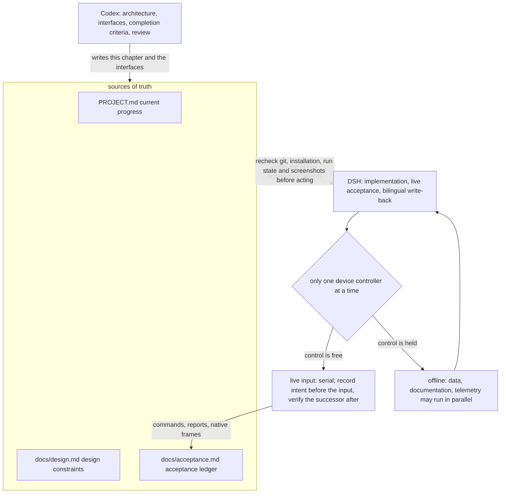

## 9.2 Dependencies, board cards and phase exits

<a id="feature-9-2"></a>

| Card | Depends on | Implementation and output | Evidence required to close |
| --- | --- | --- | --- |
| P0 Reconcile reality | None | Check active run, historical star intent, actual page and installed version; classify unresolved intents as settled, cancelled with history, or unproven | Same-scope before/after PNG/JSON/hashes and visible cost/balance; no repeated purchase; write the disposition into acceptance |
| P1 Actual startup pipeline | P0 | Install the adapter; GUI Start through MainTask, MirrorLoop and native subtasks; bind GUI mode/target, ledger and selected game header | Real GUI-start trace, matching Agent/resources and page progression; another CLI entry cannot substitute for a GUI click |
| P2 Core dungeon loop | P1 | Map, events/battles, rewards, shop and floors; reuse verified deployment; repair and resume each successor failure | One actual five-floor Hard clear, traceable floor/purchase/refresh/GET successors; script-operated play, not manually bypassed stages |
| P3 Settings and explanatory logs | P1; delivery depends on P2 | Forty slots, portrait order, base stars, fixed/rotation, explicit run count versus step/time bounds; weights and final scores | Save, normal close/reopen, native parameters and selected game header agree; repeated starts do not reapply transactions; real logs contain components, tie-breaks and exclusion reasons |
| P4 Local usage | After P1, parallel with P2 | Implement CPU/RAM/GPU/VRAM collection and UI under 9.6 | Independent same-window measurements; missing provider, timeout, exited process and disabled sampling cases; no background busy loop when off |
| P5 Learning loop | Real P2 trajectories; offline collection can start earlier | Evidence bundles, labels, review, grouped splits, training, native evaluation, shadow comparison and reversible promotion under 9.4/9.5 | Independent episodes, model/dataset/teacher/evaluation hashes and actual inference-node logs; unpromoted candidates stay explicitly shadow |
| P6 Integrated acceptance | P2–P5 | Latest merged tests, packaged self-test, GUI-start/continuous-run evidence and wiki/design reconciliation | Completed 9.7 matrix with evidence, correct installed build and no unexplained failure; public release has separate license/privacy/update requirements |

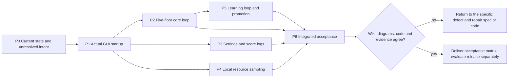

P0/P1 have partial evidence but still need final reconciliation. Do not bulk-close P2–P6. Add trigger, original evidence, hypothesis, change, positive/negative cases and resumed run to the relevant card. An unrelated green test does not resolve the original failure.

## 9.3 Automatic recovery and run count

<a id="feature-9-3"></a>

**Same-run recovery repair (2026-11-16, source/retained-replay level)**: a game scope and a recorder directory are different identities. `FloorGiftTransaction.retire_stale_run` / `retire_stale_commit` must not retire an unresolved same-run transaction because the directory, observer process or OCR changed. Trial OCR on another card may drift while the already-sent selection's target, original evidence and counter still agree: recover that selection without replaying its input. This alone proves neither a gift receipt nor a cleared floor. Installed live successor verification remains pending.

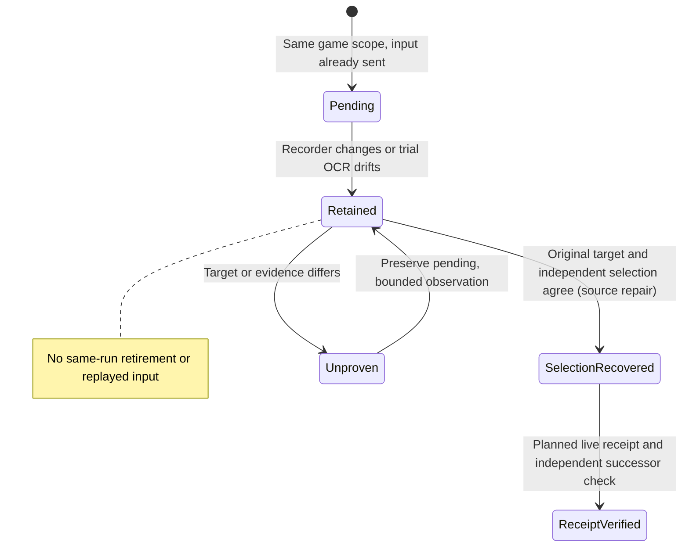

Unknown does not immediately terminate the whole task. Distinguish animation, missing recognition, reversible overlays, sent transactions, unknown effects and missing resource authorization. Use Maa for proven controls. Unknown effects may participate in existing bounded exploration under player budgets, with uncertainty in the score. **An unread purchase result calls for rereading and reconciliation, not another purchase.**

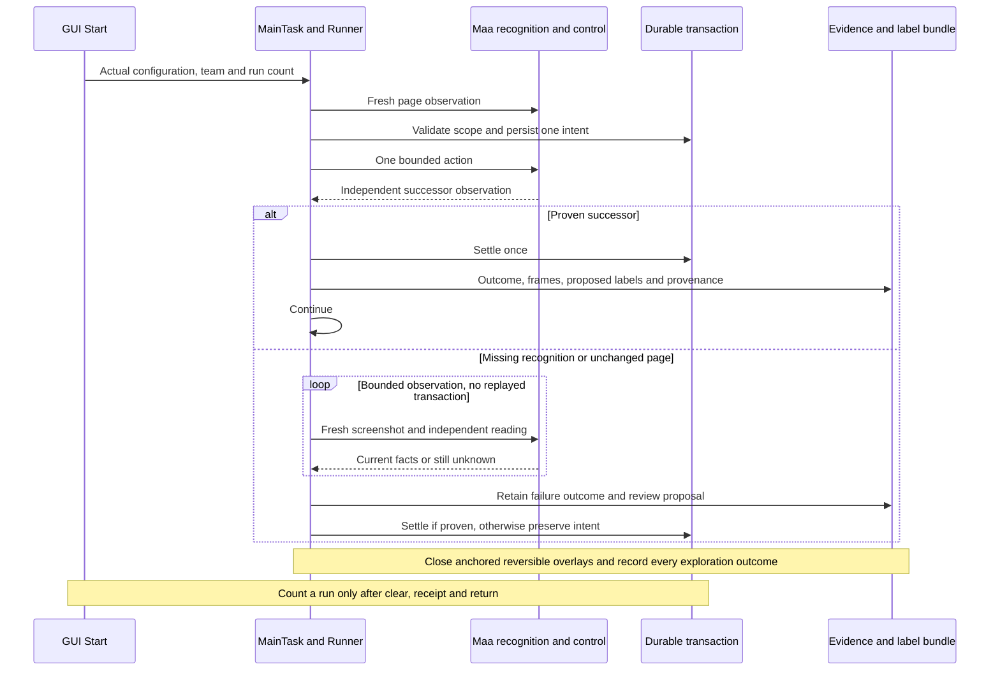

Specify attempt/time/no-progress bounds by action. Star purchases currently have up to 3 observation-only retries; that is not a universal retry policy. Candidate attempts record target region, before/after frames and whether the expected page changed. Pause that branch only after its bound; independent collection, offline work and defect repair may continue. Closing an overlay must not become an unapproved payment.

Run count is the player's number of complete dungeons, separate from step and time bounds. Saved means read saved configuration; deployment size, team count and loop steps cannot imply dungeon count. Repeating N runs needs per-scope spending authorization. Missing authorization retains cleared/unpaid state; historical 6-module approval is not reusable permission.

**Delivered (2026-10-14)**: the player's saved complete-run count is `Settings.run_count` (`src/maalimbus/runner.py:158`) with the PI option `mirror_run_count` (`assets/interface.json:22254`), carried by the pipeline node `MirrorRunCount` (`assets/resource/base/pipeline/mirror.json:2659`) and read at `src/maalimbus/mirror_task_options.py:9`. Reaching it is judged only from the ledger's own delta: `MirrorRunner._run_count_reached` (`src/maalimbus/runner.py:1393`) subtracts this launch's baseline from `RunLedger.completed_runs`, a total that advances only on `entry_returned` (`src/maalimbus/storage.py:287`) -- an event the ledger refuses without five cleared floors, a victory and a claimed reward. At the player's N the window stops with `run_count_reached` (`src/maalimbus/runner.py:2807`), the step record and `summary()` carry `verified_runs={target,completed}` (`src/maalimbus/runner.py:3196`), and the log prints `verified runs: x of y this launch (z in the ledger)` (`src/maalimbus/event_log.py:149`). **Not yet exercised live**: no run in the current window has finished, so this stop path is covered by unit tests only.

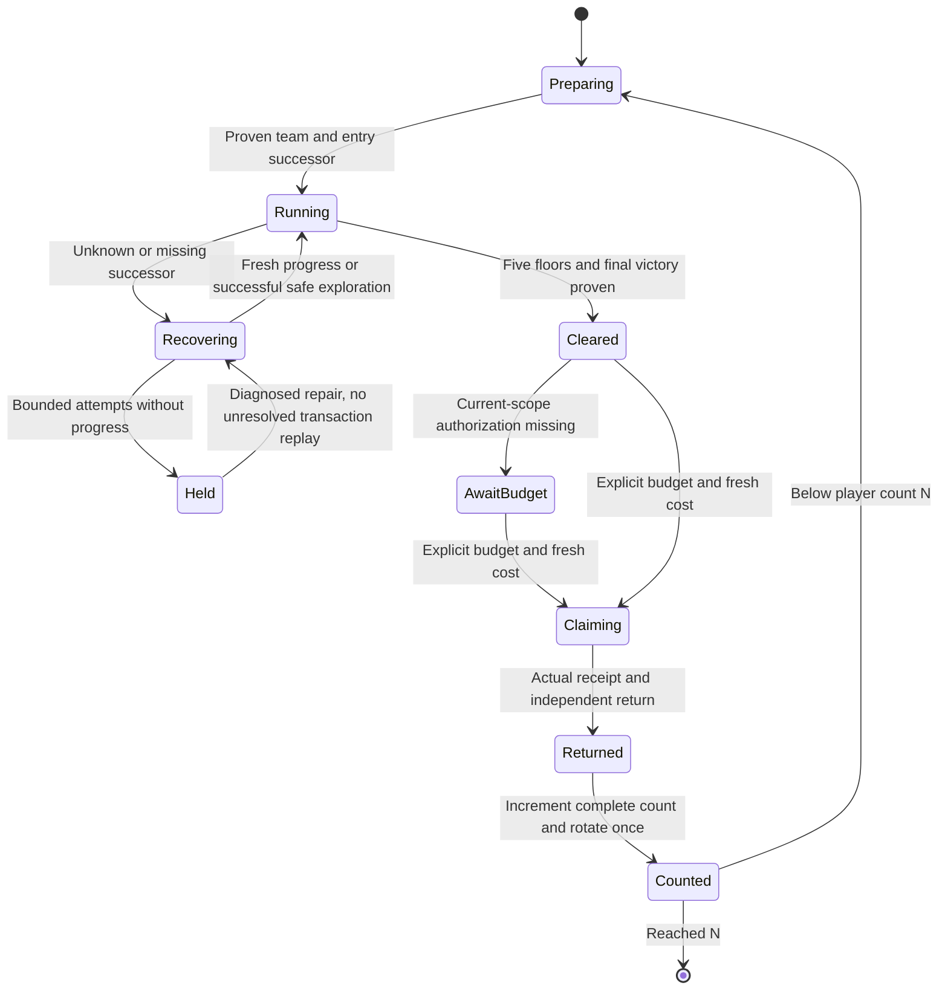

### 9.3.1 Actual adapter from GUI Start to native subtasks

<a id="feature-9-3-1"></a>

**Two IPC startup causes and the next ownership boundary (2026-11-16)**: system TEMP `xrpg*` CreateDirectory returned AccessDenied, leaving libzmq internal `make_fdpair` AF_UNIX connect with an empty address, then bad FD/epoll. External `C:/Temp` AF_UNIX separately failed 89 times with WSA10013 / NTSTATUS 0xc0000022 (`build/owned-agent-outer-ipc-summary.json`). The paired fix is an owned child’s short writable TEMP/TMP plus atomically bound loopback `AgentClient.create_tcp(0)`: `build/owned-agent-temp-paired.json` registered 15 actions and exited 0. Earlier TCP-only/socket-initialization failures do not negate that combination. This is not a broken DLL or UAC requirement; system ACL/TEMP/firewall settings were unchanged. The formal `native_agent.native_temp` context and AgentMain are installed; only existing MXU `settings.tcpCompatMode` was set True, preserving other user JSON values and game budgets. `build/resume-20261116-native-temp-tcp-accepted.log` again records 15 actions/exit 0. The next packaged MirrorTask exposed unreadable AppData controller.lock misreported as another_controller_owns_game; source could take the lock and CIM showed no controller. `ControllerLease` now preserves existing exclusion through a Windows-session named mutex; unrelated file locks are unchanged. Cross-process/thread and old-installer checks passed 43 with 1 skipped. The packaged rebuild is complete: its native mutex self-check passed, and the frozen Agent rejected acquisition while source held the same mutex. Actual packaged MirrorTask then registered 15 actions through TCP, observed STAR_GRACES and ended at the configured stop page with zero inputs (`build/resume-20261116-packaged-main-task-native-fixed.json`). This accepts packaged dispatch/observation, not GUI clicking, correct Team2 entry or a dungeon completion. Latest component installation preserved 96 private files and 28 canonical configuration files. Route: `agent-ipc-startup`.

**Native intermediate-page handoff (source/pipeline checks)**: MirrorEnter/MirrorEntryConfirm now stop through read-only nodes at DUNGEON_TEAM; DungeonTeamConfirm stops at LEVEL_WARNING. Fifteen new tests and a selected group of 56 passed / 18 skipped support those handoffs, not every entry path. Independent legacy MirrorHard remains open. Prove the team/entry from actual intermediate pages; a menu return or subsequent STAR resume is not successful Team2 reconfiguration.

**Coordinate investigation (2026-11-16, proved and repaired through native callbacks)**: `tools/verify_controller_coordinates.py` called the actual installed Maa **5.12.2** DLL (SHA256 `b22e9ac36f9fe6ffadd13afa405d6cc6759f1fdd7ed763e0a88e2e5c8f8d4e06`) with an in-memory custom controller. At raw 1280×720 / recognition 1920×1080, the old runner's manual `wm size` conversion followed by native `ControllerAgent` frame-to-raw conversion delivered a click at (427,240), not (640,360). The baseline `build/controller-coordinates-native-before.json` returned 1. After removing manual scaling, all four direct/pipeline click/swipe routes exact-match; `build/controller-coordinates-native-after.json` returned 0 with **zero device input**. Native implementation: [MaaFramework v5.12.2 ControllerAgent](https://raw.githubusercontent.com/MaaXYZ/MaaFramework/v5.12.2/source/MaaFramework/Controller/ControllerAgent.cpp#L967). ADB subsequently connected and bounded source/Maa navigation reached STAR_GRACES. This proves that entry progression, not packaged IPC/GUI or the integrated game input chain. Reconcile canonical old scope and native intermediate team/entry proof, then verify the rebuilt controller mutex, team and actual successors; the paired IPC repair does not complete the whole chain.

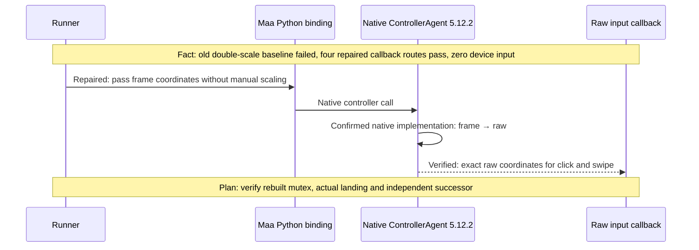

The implemented chain is `MainTaskAction.run → MirrorLoopAction.run → MaaDevice → MirrorRunner → run_node → AgentTasker.post_task → Context.run_task`. Use `python tools/wiki_route.py startup --limit 1` for current symbol locations rather than static line numbers in a diagram. `MirrorLoopAction.run` must pass `AgentTasker(context)` to Device. Runner obtains that tasker from Device to execute NODE plans through the native Pipeline. The missing adapter caused the historical `a node plan needs a Maa tasker` error.

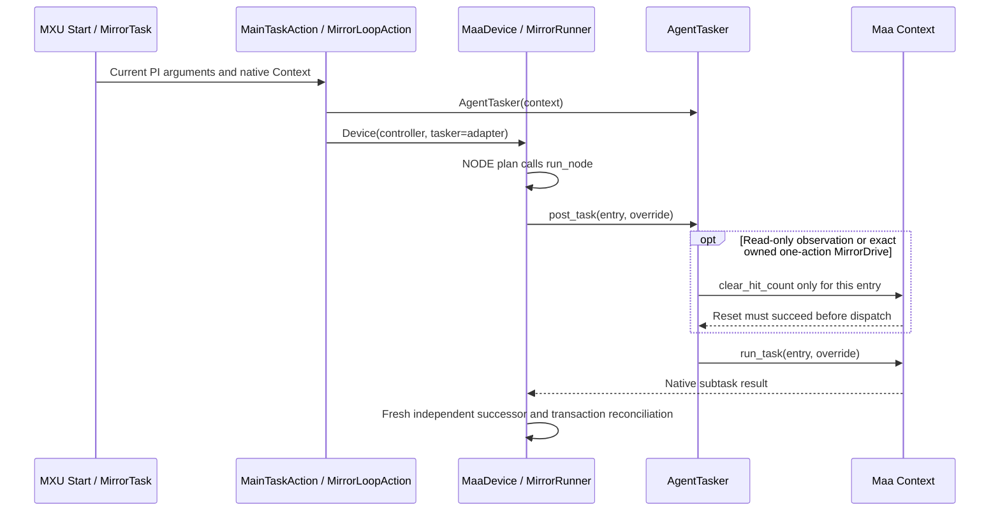

The CustomAction already occupies the framework worker. Do not replace this with `context.tasker.post_task` and wait for its own queue; `AgentTasker` documents why. This view explains implemented wiring, **not, on its own, a live GUI Start or a five-floor completion**; those still need the installed version, the actual GUI selection and the successor frames. Read-only observations reset per read. The exact Runner-owned one-action MirrorDrive has its own per-invocation hit exception; other input graphs and transaction history are preserved.

**Delivered (2026-10-14)**: the app rebuilt from `8ca1ac1` (whose parent `d574a26` is the node-panel identity fix) was launched as a real GUI (`dist/MaaLimbus/MaaLimbus.exe`, process 34940) and its own Start button was pressed with real pointer input at 07:22 local. The run `dist/MaaLimbus/evidence/runtime/pi-20261014-072228` opened on scene `NODE_PANEL` -- the state the packaged CLI run was stopped on before `d574a26` -- and dispatched `CUTSCENE -> EVENT_CHOICE -> EVENT_RESULT -> GIFT_GET -> PRE_BATTLE_TEAM -> BATTLE_HUD -> MAP -> NODE_PANEL -> GIFT_GET`, so the chain above is now observed live rather than only wired. Still not proven this way: a complete five-floor run and the saved-run count's stop path.

**Reached live, then repaired (2026-10-14)**: the same run went on to 254 frames / 71 inputs -- `BATTLE_HUD` 20, `MAP` 8 node clicks, `SHOP` 7 including 4 `SHOP_PURCHASE`, `GIFT_GET` 6, `NODE_PANEL` 5 (every one through `panel_enter_is_the_only_forward_input`, so the identity fix was exercised live), `GIFT_PICK` 4 and `REWARD_CARD` 2 -- and stopped on `floor_gift_commit_receipt_not_proven`: its `Select 2/2` press was answered with a notice printing `Dark Vestige`, a name from neither the pick page's offers nor the two cards the run's own clicks ticked (`frame-0252`), while the receipt rule required the notice to name one of the selections. The rule now keeps the two facts apart: the notice page and its own name plate prove the press, and the receipt retains both names -- the pick it answers and what the device printed (`FloorGiftTransaction.notice_matches_a_pick` and `receipt_intent(..., on_notice_page=True)` in `src/maalimbus/floor_gift_transaction.py`, the gate and the labelled note in `src/maalimbus/runner.py`, pinned by `tests/test_gift_receipt_settling.py` against the retained frame `evidence/runtime/gui-20261014-072228/frame-0254.json`). A name the selection cannot account for is still refused on any page that is not a notice page, because the middle band is a loose read. In the live retest that followed (`pi-20261014-080122`, 08:01 local) the same page shape came back with a name that did match: that run's own `floor_gift_ranking` selected `Today's Expression` (`selection_source: single_free_select_button`), the `Select` click was answered by the notice, and the transaction committed a receipt whose printed title and successor frame are both recorded (`config/user-floor-gift-transaction.json`, `receipts[0]`: `frame-0059.json` -> `frame-0060.json`), so the chain continued past the point where it had stopped before. The outside-selection branch itself -- a notice whose printed name answers none of the picks -- is still only unit-tested.

**The shelf and the store (2026-10-14)**: the next launch on the folded build stopped after 3 inputs on the same refusal, one blank wide -- that run's own reservation frame `frame-0002` read the 144-coin slot as `Crownof Roses` and its returning `frame-0008` printed `Crown of Roses`, so `_fold` now drops the blanks beside the confusable class and the `rn` ligature (a title still cannot be shortened: the letters and digits have to agree one for one). Underneath it the phase would have ended for good: the launch after that raised `Configuration/state exceeds 2 MiB` before its first input, because the decision context recorded `owned_bought` as the whole purchase records and every record carries its own context, so `config/user-shop-<scope>.json` had reached 2,464,332 bytes. The runner now records their names, `shop_transaction._context` enforces that shape at the store boundary, and `tools/prune_shop_state.py` rewrote the live files (2,464,332 -> 46,950 bytes) touching only that field. Both are unit-tested -- the prune tool included -- and the repaired shelf was replayed against the real frames, which now list no offending offer; the rebuilt app is what has to show it live.

**The same reader gap, on the shelf (2026-10-14)**: that retest run then walked on to floor 3 and stopped at `Shop successor shows an offer the shelf never held` (68 steps / 67 clicks, `passed: false`) while settling its `Rusted Cutting Knife` purchase (244 coins, 1530 -> 1286). The store kept `pending.stage: overlay_intent`, and the returning shelf held the same six slots with the bought card under its own `Purchased` badge -- but the visit's own reservation frames read the 160-coin slot as `Thomy Path` and the returning shelf read `Thorny Path`, its catalogue name (`assets/resource/base/gift-catalog.json`, `gifts[280]`), so a strict title comparison called a card the shelf had held all along an offer it never held. The shop's fold now closes the condensed `rn` ligature into `m` beside the typeface's other confusable glyphs (`src/maalimbus/shop_transaction.py`), pinned by `tests/test_shop_transaction.py::test_a_condensed_ligature_reads_as_the_same_slot` and its negative; replaying the stopped store against the returning frame settles it (`reconcile_purchase: True`, `bought[-1] = Rusted Cutting Knife`, `pending` cleared). The installed application has to carry the fold before the five-floor clear can be attempted again.

**Waiting for the shelf to finish redrawing (2026-10-14)**: the rebuilt app was started from its own button again (`pi-20261014-193945`, 19:39 local) and stopped after one input -- the shelf held nothing the plan wanted, so the run paid the 15-coin refresh (`[1478,168,86,28]`, currency 1127) and the successor frame `frame-0004` read two of the six slots with the still pre-refresh counter, proving neither the delta nor a changed complete shelf. The transaction rule is right to refuse that frame (`ShopTransaction.reconcile_refresh`, `src/maalimbus/shop_transaction.py`), so the runner now waits instead of stopping: up to three unproven successor frames in one visit are noted as `shop_refresh_settling` and re-observed, the intent stays unclaimed through the wait, and the fourth still stops the window (`src/maalimbus/runner.py`, pinned by `tests/test_runner.py::test_a_refresh_successor_read_mid_change_waits_before_it_stops`). The live proof is the next launch on that shop.

### 9.3.2 Plan for adapting to the redesigned Mirror Dungeon (2026-10-15)

<a id="feature-9-3-2"></a>

The game replaced the mirror dungeon UI wholesale in 2026-10: the entrance is now `Mirror of Sisyphus` (`DUNGEON 08`), the right column reads `Exploring / Weekly Bonuses / Parallel Superposition Mode / INFINITY MIRROR`, and the grace page and the buy confirmation were redrawn entirely. The recognition layer compares no artwork: it reads OCR text and normalised boxes only (`find` at `src/maalimbus/vision.py:19`, `classify` at `src/maalimbus/vision.py:63`), so the redesign broke it only through **text shape** and **drawing detail**; the adaptation proceeds "read-only first, real input second, and fix only the one place the live run proves broken".

Read-only proof: `python tools/verify_packaged_mirror_loop.py --app dist/MaaLimbus --address 127.0.0.1:16416 --adb "<MuMu>/adb.exe" --observe-only --stop-page MIRROR_ENTRY` builds the controller with `input_enabled=False` (`tools/verify_packaged_mirror_loop.py:117`) and clicks nothing; real input needs `--authorize <nonce>`, gated by `AUTHORIZATION` and `authorized(nonce)` in `src/maalimbus/runner.py`.

| Page | How the redesign broke it | Live evidence | State |
| --- | --- | --- | --- |
| MIRROR_ENTRY / ENTRY_CONFIRM / DUNGEON_TEAM / LEVEL_WARNING | unaffected | `evidence/runtime/packaged-mirror-20261015-071912/frame-0001..0009` | driven through live |
| STAR_GRACES | the page was redrawn: OCR reads `Select All Graces` as `Select Al Graoes`, and the card geometry and badge offset moved too | `frame-0010` of the same run, judged by `build/probe_star_page.py` and `build/probe_grace_grid.py` | fixed in `45adac7` |
| STAR_CONFIRM | the checkbox was redrawn: the old artwork goes 1.00 → 0.83 ticked / 0.15 empty, so the 0.92 exact gate called it unknown | `frame-0011` of the same run, both states kept as `evidence/runtime/star-confirm-20261015/{checked,unchecked}.png` | fixed in `c6df293` |
| INITIAL_GIFTS / GIFT_GET / GIFT_SEARCH / GIFT_SEARCH_FORGO / THEME_PACKS / MAP / NODE_PANEL / CUTSCENE / EVENT_CHOICE / EVENT_RESULT_READY / EVENT_CHECK / EVENT_CHECK_RESULT | unaffected | the `map_observed.scene` sequence of `frame-0012..0036` in the same run | driven through live |
| transitional `UNKNOWN` frames | a mid-switch frame carries no identity | 2 such frames in the same run, re-read and continued on its own | waiting is allowed, no input |

The fix in `45adac7` relaxes character-exact matching into **bounded tolerance** (`close_to` / `find_read` in `src/maalimbus/vision.py`, edit distance at most 2, still requiring exactly one candidate per token), and lets the grace page try the proved geometry first and then locate the card borders from measured edges (±24px, density floor 0.04), returning failure rather than guessing when ten bordered cards are not there. The fix in `c6df293` reads the checkbox state from **two independent channels**: the retained template and the bright stroke inside the box (0.17 ticked, 0.00 empty), answering unknown and refusing when they disagree (`conversion_state` at `src/maalimbus/grace_vision.py:206`).

What still needs live proof (the unfinished part of this plan): a full five-floor clear and the payout page; the stop path that honours a saved run count (this round pinned `mirror_run_count=3`, `mirror_run_bounds=2000`, single team 2) has no live evidence yet; and a GUI Start that walks five floors by itself. Also, this machine has no Rust toolchain and the `desktop/mxu` overlay changes make `tools/make_local_app.py` refuse to reinstall with `Modified MXU artifact is stale` (`src/maalimbus/mxu_distribution.py:10`), so verification at this stage goes through `build/refreeze_agent.py`, which re-freezes the agent (keeping a backup and a self-test); the MXU panel itself stays unverified.

The reconciliation discipline for this section: a redesign adaptation re-anchors only from live frames and never from guessed coordinates, and every change must be verified by launching the real script once more before it may be written down as "driven through live".

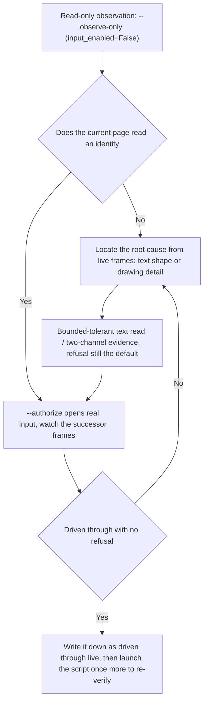

### 9.3.3 What a GUI Start decides when the old run is still playing (2026-10-15)

<a id="feature-9-3-3"></a>

Live root cause (the scene this section was written from): the GUI Start was really pressed at 09:55, but the Mirror Dungeon entry stopped right after "启动前核对旧局与队伍设置" with `mirror_settings_rejected`, and `dist/MaaLimbus/evidence/runtime/pi-20261015-095517` holds 0 frames and 0 clicks. The two log errors are the observation node reading no page (`the observation node recorded no page for this frame`, `src/maalimbus/runner.py:648`, `:659`) and the local participant OCR having no evidence (`Maa local participant OCR returned no evidence`, `agent/recognition.py:284`).

Why the scene looked like that: the read-only and the live-authorized verifier runs (`evidence/runtime/packaged-mirror-20261015-070250`, `-071416`, `-071912`) had entered a real Hard run and left the game on `PRE_BATTLE_TEAM`; the ledger entry `active` (id `616264a2…`, team 1, phase `entered`) is still in the app's own data root `D:\fgoa\MaaLimbus\config` (pointed at by `dist/MaaLimbus/config/user-data-root.json`). **A run under way is not an idle entry**: `reconcile_idle_entry` (`src/maalimbus/run_wiring.py:255`) may only retire the old run when the freshly taken frame proves an idle `MIRROR_ENTRY` or a `DUNGEON_TEAM` picker; here the observation produced not even one frame, so the whole entry was refused.

The plan in this section: the entry pre-flight must separate two cases -- "the ledger has a run and this frame proves the game no longer holds it" retires it as before; "the ledger has a run, but this frame names no page at all" keeps that run and leaves page reading to the loop itself, and never sends input on a frame it could not read. The tolerant branch only records `mirror_entry_preparation` (`retired=False` plus the observation error verbatim), then continues into `GlobalSettingsAction.apply` and `MirrorLoopAction` exactly as it would with no stale entry; an unreadable frame is still handled as an unknown page -- no click, wait only.

| Scene | Expected behaviour | Evidence required |
| --- | --- | --- |
| ledger `active` is null | enter the Mirror Dungeon with the applied settings | the app log shows `mirror_loop_start` |
| ledger `active` set, frame proves idle entry or picker | retire the old run, then enter with the applied settings | `mirror_entry_preparation` with `retired=True` and a disposition |
| ledger `active` set, frame names no page (this section's live scene) | **keep that run**, continue into the loop and let it re-read the page | `mirror_entry_preparation` with `retired=False` plus the observation error verbatim, and no further `mirror_settings_rejected` |

The second fact that must be remembered too: the app's real data root is `D:\fgoa\MaaLimbus\config`, not `dist/MaaLimbus\config`. Settings written into `dist` are only displayed by the GUI, while the agent reads the former; pinning things like "single team slot 2 / 3 runs this session / 2000 steps" must write the app's own data root.

Acceptance wording: with the game parked on a Mirror Dungeon page that is under way, pressing the GUI Start must really reach the loop (readable in the app's own log), and must no longer stop at `mirror_settings_rejected` for "no evidence"; when the first frame cannot be read, the loop still stops honestly as an unknown page.

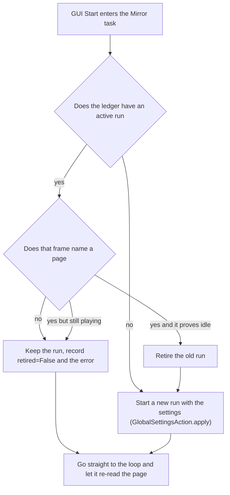

### 9.3.4 What the entrance and the deployment do when the participant counter cannot be read (2026-10-15)

<a id="feature-9-3-4"></a>

Live root cause (13:01-13:08 on site): the entry observation raised `Maa local participant OCR returned no evidence` on the `PRE_BATTLE_TEAM` page, and the exception happened **inside the observation node** (the `PRE_BATTLE_TEAM` branch of `agent/recognition.py`), so the tolerance in 9.3.3 never got a chance to act: the Maa task failed first and the app showed a failed Mirror task (`dist/MaaLimbus/evidence/runtime/pi-20261015-130827`, 0 frames).

Measurement: the redesigned team page draws the counter as `2/12`, and a live frame reads it as `2/12` at box `[1610,745,250,80]` with score `0.997` (`evidence/runtime/packaged-mirror-20261015-131001/frame-0001.json`). `team_vision.participants` (`src/maalimbus/team_vision.py:46-62`, pattern `:9`, ROI `:10` = `(0.86,0.66,0.97,0.78)`) recomputes `(2,12)` offline on that frame; what used to fail was the old crop `(1680,738,180,92)`, which cut the numerator off, while the new crop `(1610,745,250,80)` keeps margin on both sides.

The plan in this section: whether the counter was read is not a condition for the page being a page -- a frame whose counter has not settled is still a frame. The node records the missing read and lets it through, and the loop's own bounded re-read (`src/maalimbus/runner.py:1696-1702`) decides whether to continue or to stop honestly; the node never fails the whole start-up over a missing read again.

| Situation | Expected behaviour | Evidence requirement |
| --- | --- | --- |
| The counter is readable | Judge the team and the deployment as before | A `2/12`-shaped count in the frame and a result under `deployment_participants` |
| The counter is unreadable (a rolling or unsettled frame) | The node records the missing read and continues; the loop re-reads a bounded number of times | The frame carries no count while the page identity holds, and no node-level exception appears |
| The re-reads run out | Stop honestly at the deployment step without sending input | Stop reason `deployment_transaction_or_counter_missing` with `clicks_sent` unchanged |

Acceptance: pressing the GUI Start again while the game sits on a settled `PRE_BATTLE_TEAM` page must reach `mirror_loop_start` and the deployment decision instead of letting the observation node fail the whole task.

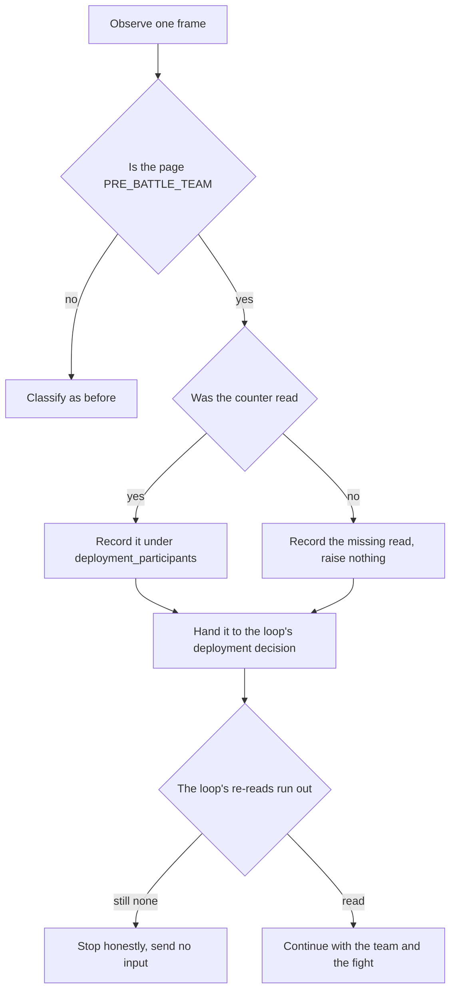

### 9.3.5 The redesigned purchase dialog: a currency badge read as one token (2026-10-15)

<a id="feature-9-3-5"></a>

Situation: the 17:31 GUI start played all the way into its third shop and stopped on the purchase question with `the_shop_asked_about_a_purchase_and_its_confirm_was_not_read` (`src/maalimbus/window.py:614`), sitting on two `SHOP_PURCHASE` frames (`dist/MaaLimbus/evidence/runtime/pi-20261015-173132/frame-0250/0251.png`).

Root cause (reproduced offline): the redesigned question is titled `Purchase E.G.O Gifts` with a `Purchase` button, and all three `native_purchase_dialog` anchors matched -- but the currency transition `1102 > 895` is read as the single glued token `'1102895'`, so `purchase_balances` cannot find a 'before' number and returns None; `matching_purchase_question` (the authorization for spending) then returns None and the page can only refuse.

Fix: in `src/maalimbus/shop_vision.py`, `purchase_balances` first reads the two separated numbers of the older layout; when they are absent it splits the glued token with the after-token that sits beside it (`^\d{1,4}` plus that after-token plus `$`), and returns None when it cannot. Authorization still demands `before - after == price` and `before == the coins recorded with the intent`, so a wrong split cannot buy anything.

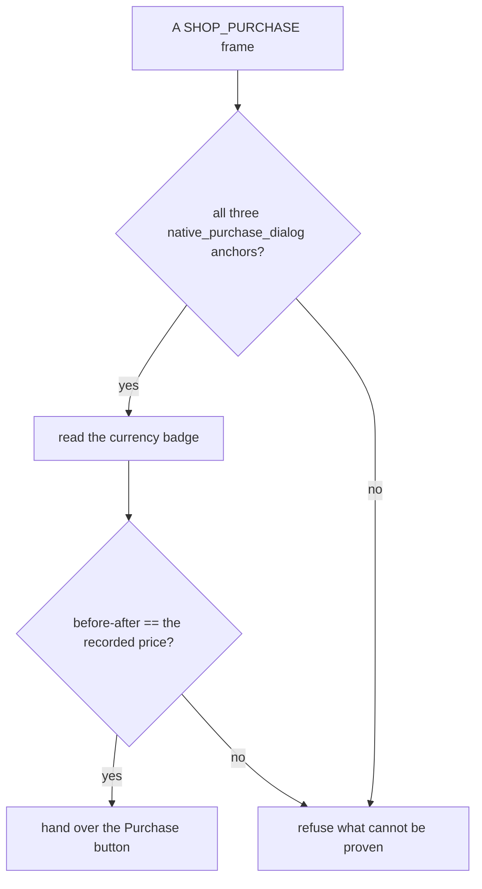

| Anchor | Redesigned reading | Rule |
| --- | --- | --- |
| Title | `Purchase E.G.O Gifts` [674,236,292,34] .999 | `^Purchase E\.G\.O Gifts$` in (.32,.20,.55,.27) |
| Confirm | `Purchase` [1092,706,128,34] 1.000 | `^Purchase$` in (.50,.58,.70,.80) |
| Cancel | `X Cancel` [710,702,156,42] .912 | `^[X×]?\s*Cancel$` in (.31,.58,.50,.80) |
| Badge | `1102895` plus `895` | the after-token splits out the before, and before-after=207=the price |

Acceptance: on that same frame `purchase_balances` returns (1102,895) and `matching_purchase_question(records,'Awe',207,coins=1102)` returns the `Purchase` box; with the price changed to 208 it must return None. Tests live in `tests/test_shop_vision.py`, including a live-frame case that skips when the frame is not retained.

### 9.3.6 Counting completed Mirror Dungeons, and opening the gift search (2026-10-15)

<a id="feature-9-3-6"></a>

The user's rule (m01434): stop counting steps as the goal -- **count completed Mirror Dungeons** and keep the step window as a safety net; and **open up the gift search** so it learns its own purchase strategy, while the coins are neither hoarded nor drained to nothing.

What already holds: the stop condition is the loop's own completed-run count (`src/maalimbus/runner.py:2846` `_run_count_reached`, target recorded by `runner.py:3237` in `verified_runs`), not the step count; the step window comes from `MirrorRunBounds` (`src/maalimbus/mirror_task_options.py:27-30`, 1..2000). So when a run count is named the entry raises that window to at least 4000 (the `loop.run(steps=...)` call in `agent/recognition.py`), which keeps a five-floor dungeon from being cut halfway by a number the user picked to mean 'three dungeons'. The coin balance rules already exist: `CARRY_CAP_COINS = 1500` (`src/maalimbus/shop_settings.py`) with a reserve default of 500 (`:74` of the same file) -- keep a part, spend the excess, which is exactly 'not hoarded too much, not left at nothing'.

What is not implemented (and must not be written as if it were): the gift search page has only two paths today -- `refuse`, or leaving through Select without spending starlight (`src/maalimbus/window.py:763-785`) -- and the task option accepts only `saved`/`refuse` (`src/maalimbus/mirror_task_options.py:22-26`). To really open it, the run needs: pick at most three gifts off the pool by their score, pay starlight, prove the spend with a receipt-backed durable transaction, and never count a purchase without a receipt.

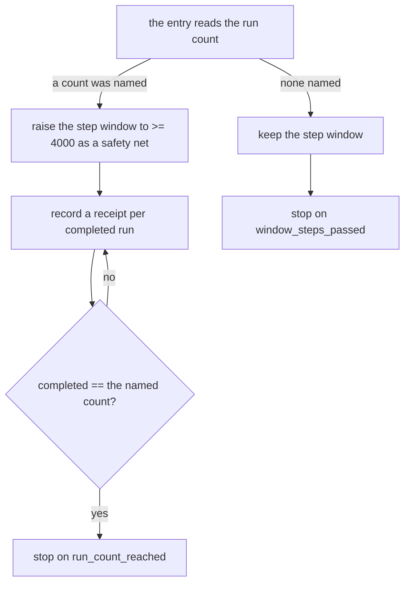

| Situation | Expected behaviour | Evidence requirement |
| --- | --- | --- |
| A completed-run count was named | Stop on the count; steps only as a safety net | This invocation's `run_count_reached`, matching `verified_runs` and successful Agent ending |
| No count was named | Keep the original step-window behaviour | Stop reason `window_steps_passed` |
| The gift search once open | Pick by score and pay the starlight | A starlight-spend receipt plus the successor frame |
| The gift search today | Only refuse or leave, spending nothing | The event shows the refuse/select branch |

Acceptance: with the count set to three, one start must run through to the third completion receipt; until the search is open, neither a log nor a document may claim it is buying.

The installed verification host reads the normal Agent result and journal after the task ends. `window_steps_passed` can describe a bounded window, and `verified_clear` records a clear observed in that window. The host's `dungeon_complete` requires a positive `verified_runs.target`, an exact `ledger_total − counted_at_launch` delta equal to that target, a matching `run_count_reached` from the current invocation, and a successful Agent ending. `RunStore.record` increments the ledger only on verified return after the five floors, victory and reward. A payout-only resume can complete without a new clear observation. For an explicit positive `--run-count`, the host exits unsuccessfully when the count is unmet and still records any bounded progress. The verdict tests exercise both cases. GUI Start, physical settlement and rotation still need their own evidence.

### 9.3.7 Two false stops on the reward page: a catalogue typo and what counts as a price (2026-10-15)

<a id="feature-9-3-7"></a>

Both live stops happened on a reward page, and neither was the game changing: our own predicates were wrong.

**One: `floor_gift_identity_unknown`.** `dist/MaaLimbus/evidence/runtime/pi-20261015-180214` played 345 frames and then stopped on the reward page. The page did print a title, but the mirror catalogue `assets/resource/base/gift-catalog.json` spelled that gift `Arrested Hymm` while the client prints `Arrested Hymn` (all 20 occurrences in the retained `build/learning-review` corpus are Hymn). Normalised, the two differ by one letter, and over 12 characters `difflib` scores only 0.9167, under the 0.93 gate in `src/maalimbus/gift_vision.py` `text_identity`, so it returned None and the run stopped. Two things were done: the catalogue entry is now `Arrested Hymn` (**without** touching `icons[].path` or `sha256`, so icon integrity is unaffected), and `text_identity` gained a fallback that only accepts a single name of length ≥ 8 one edit away; a short name or two candidates still refuse, so the original ambiguity guard is not loosened.

**Two: `three_free_gift_trial_or_cost_present`.** `pi-20261015-172214` stopped on the three-choice reward page because the veto treated `Defense Level`, `Max HP`, `Cost` and similar words as evidence of a trial or a purchase page. The redesign prints **each card's own effect text inside the card**, and `Defense Level Down until` `[844,534,244,25]` is the first card's effect sentence on a page whose buttons are plainly `Refuse Gift` and `Select`. The veto now reads for wording that carries a price: a shop/trial noun (`Modules`/`Purchase`/`Shop`/`Lunacy`/`Mounting`/`Trials`) or a trial/price word immediately followed by a number (`Enemy Level`/`Defense Level`/`Damage Taken`/`Max HP`/`Cost`); plain effect phrasing no longer vetoes.

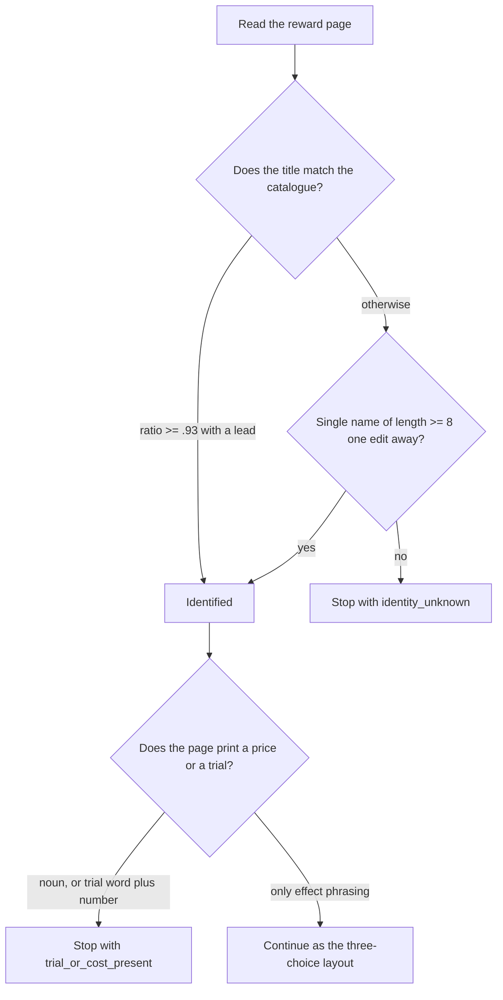

| Situation | Expected behaviour | Evidence required |
| --- | --- | --- |
| One wrong letter in the catalogue, client prints the right title | Still resolves to that gift | `tests/test_gift_vision.py` asserts `Arrested Hymm` resolves to `Arrested Hymn` |
| A plain effect sentence inside a card | Does not veto the three-choice layout | `tests/test_three_free_gifts.py` asserts the offers still come back for `Defense Level Down until` |
| Real trial or price wording | Still vetoes | The same file asserts it raises for `Enemy Level +2` and `Mounting Trials` |
| Icon paths and hashes | The rename touches neither | `gift-catalog.json` `icons[].path`/`sha256` unchanged, catalogue integrity check still passes |

Acceptance: one start gets past the three-choice reward page and the purchase confirmation and keeps playing; `three_free_gift_trial_or_cost_present` still appears when the page really is a trial or a purchase, while a gift outside the catalogue now falls back to the title the page printed (9.3.9) instead of stopping the run.

### 9.3.8 A page that cannot be read, and a recognition call that never returns: the viewport ladder and the stall watchdog (2026-10-15)

<a id="feature-9-3-8"></a>

The spoken rule: four stops in one day, and the user asked for the pattern instead of a fifth patch — "do not fix one problem per problem" — and stated the rule directly: on a screen like this, always try zooming the map out first (m02370, m02456–m02457). The four stops (a purchase dialog whose currency badge could not be balanced, a floor zoomed in until a single tile filled the screen, a skill-check strip that had not faded in, a shop that never offered what the plan was waiting for) share one shape: **the view currently yields nothing, and a view can be moved by a gesture**. So the answer is two general mechanisms, not four more special cases.

**First mechanism: a step that did not land spends one rung of a viewport gesture before the run is allowed to end.** `RECOVERY_LADDER` (`src/maalimbus/runner.py:301-306`) is `pinch_out`, `drag_down`, `drag_up`, `wait`. The zoom-out rung reuses the gesture calibrated on the live game: `pinch_out` (`runner.py:315`) with `MAP_ZOOM_OUT = {'centre': (960, 540), 'radius': 320, 'factor': 0.55, 'seconds': 0.9}` (`runner.py:290`, the same values `tools/map_zoom.py` proved), two fingers walking in from +/-320 to +/-176 over 12 steps; a controller that cannot simulate two fingers raises `NotImplementedError` and **never degrades into clicking the map**. `_recover` (`runner.py:3321`) keys on `page|stop reason`, spends one rung per stop (`state['recovery_rung']`), and only a stop that has spent the whole ladder ends the run; the events are `window_recovery` and `window_recovery_exhausted`, counted on their own as `artifacts['recoveries']`. The safety property is in the comment and in the tests: **every rung moves the view and presses no game control**, which is what makes the ladder safe on a page whose layout is not known yet. Set `recovery_tries` to 0 to turn the behavior off.

**On the map the first rung is spent before another candidate node is tried.** A map click that leaves the page exactly where it was means the node the plan aimed at was never on screen: live run `pi-20261015-200848` clicked five candidates in ninety seconds with `Exploring Floor 3` never changing, and the run looked wedged until the user stopped it. `_map_zoom_once` (`runner.py:3304`) therefore spends the pinch on the first stalled map click, books it as the ladder's rung 0 (`state['recovery_for']` and `recovery_rung = 1`) so the ladder cannot spend the same rung twice, and only the *next* stalled click falls back to another candidate (`window_map_retry`). The event is a `window_recovery` with `gesture=pinch_out` and `before_another_candidate=true`; a step that does land clears `map_zoom_for` together with the rest of the recovery state.

**Second mechanism: a recognition call that never returns cannot be recovered by any gesture, so the process is ended from outside the loop.** In `dist/MaaLimbus/evidence/runtime`, run `pi-20261015-191205` wedged inside one OCR call at 19:16:07 and then produced no frame, no event and no result for twelve minutes; the user saw "it stopped and cannot even be opened" (m02283). The process was alive with every thread waiting: a hang, not a loop. `stall_watchdog` (`runner.py:342`) watches the frame heartbeat: `_observe` refreshes `artifacts['heartbeat']` on every frame (`runner.py:1582`), and once no frame has arrived for `stall_seconds` (default 300, `STALL_SECONDS` at `runner.py:3358`) a daemon thread writes the stop through `_record_stall` (`runner.py:3382`) into the run's own directory and then calls `os._exit(4)`, so the GUI reports a failed task instead of hanging silently.

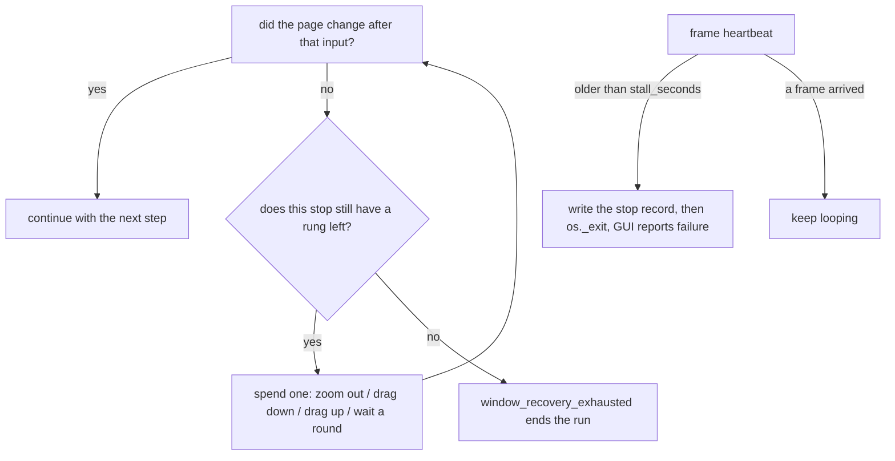

| Situation | Expected behavior | Evidence required |
| --- | --- | --- |
| The map is zoomed in and the nodes are off screen | pinch the map out first, then read the page again | `window_recovery` with `gesture=pinch_out`, `artifacts['recoveries']` rising |
| A map click moved nothing at all | pinch the map out *before* trying another node, once per stalled click | `window_recovery` with `before_another_candidate=true`; `tests/test_recovery_ladder.py::test_the_map_view_moves_before_another_candidate_is_tried` |
| The same page fails again for the same reason | one rung per stop; only a spent ladder ends the run | `tests/test_recovery_ladder.py::test_the_ladder_is_spent_once_per_stop_and_then_the_run_ends` |
| A recognition call never returns | after the limit, write the record and end the process; the GUI reports failure | the `stall_watchdog` cases return once given `rounds`; live heartbeat is `artifacts['heartbeat']` |
| The controller cannot simulate two fingers | raise instead of degrading to a click | `test_a_controller_that_cannot_simulate_two_fingers_refuses_instead_of_clicking` |
| The old behavior is wanted | with `recovery_tries = 0` a failed step ends the run immediately | the legacy cases pass that setting and still assert their original stop reason |

Acceptance: on the live game, failing on a zoomed-in map must first stop the step with `the_view_is_pinched_out_so_the_page_shows_all_of_itself` and a `window_recovery` event instead of ending the run; a wedged recognition must end as a failure within `stall_seconds` instead of hanging silently. This ladder only covers "the view cannot be read"; it does not fix a wrong criterion (that is 9.3.5 and 9.3.7).

### 9.3.9 A modal that cannot be read does not end the run: the dialog's own Cancel, and gifts outside the catalogue (2026-10-15)

<a id="feature-9-3-9"></a>

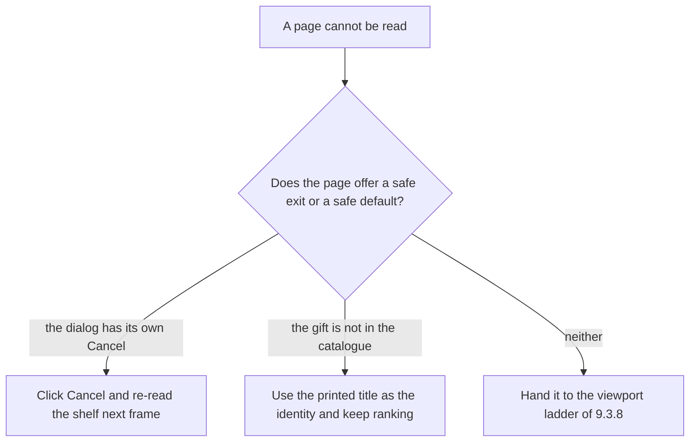

User wording (m08238): "be more structured, more frameworked -- this plainly has a more fault-tolerant upstream implementation", plus the direct question "surely every gift that is not in the catalogue will not stop the run?". Both stops share one upstream fact: **the page already offered a safe exit or a safe default, and the criterion treated it as nothing to continue with.**

**The purchase dialog: its own Cancel is the answer.** The live run `dist/MaaLimbus/evidence/runtime/pi-20261015-202635` stopped on the redesigned purchase dialog (`Purchase E.G.O Gifts` + `Purchase` / `✗ Cancel`) with `the_shop_asked_about_a_purchase_and_its_confirm_was_not_read`. The criterion chain, `matching_purchase_question` (`src/maalimbus/shop_vision.py:354`), demanded the gift name, `before - after == price` and `balances[0] == coins` all strictly equal; the shop had just read `1808` while the dialog badge read `1809`, and one token of drift refused the purchase. The new `purchase_dialog_answer` (`shop_vision.py:408`) treats the modal as a question with a safe exit: only a name that is adjacent (`close_to(..., 1)`) **and** a badge that spends exactly the reserved price answers `('purchase', box)`; every other reading answers `('cancel', box)`, with `COIN_DRIFT = 2`. `window.py:610` clicks that Cancel and re-reads the shelf on the next frame instead of ending the run, and the old refusal survives only for a dialog whose Cancel cannot be read either.

**A gift outside the catalogue: the page's own printed title is the identity.** `floor_gifts.observe` (`src/maalimbus/floor_gifts.py`) used to raise `floor_gift_identity_unknown` whenever `catalog.text_identity` returned `None`, so any gift missing from `assets/resource/base/gift-catalog.json` ended the run. `identity_of` now falls back to the title the page itself printed: no string is invented, the offer still ranks and still reaches the receipts, and its keyword set is simply empty (`keywords_of`) -- `rank` already treats "no keywords" as no roster benefit, and learning records the sample under the name it saw.

| Situation | Expected behaviour | Evidence |
| --- | --- | --- |
| The dialog cannot be read as the reserved purchase | Click its own Cancel and re-read the shelf next frame | `tests/test_shop_vision.py::test_the_dialogs_own_cancel_answers_a_question_it_cannot_authorize` |
| Shop currency and dialog badge differ by a token or two | Still confirm the reserved purchase | `COIN_DRIFT = 2`; `test_a_drifted_coin_counter_is_the_reader_not_another_purchase` |
| A reward page offers a gift the catalogue lacks | Use the printed title as the identity and keep ranking | `identity_of` / `keywords_of`; `tests/test_floor_gifts.py` green |

Acceptance: neither an unreadable modal nor a gift outside the catalogue may end a run by itself; the only remaining single-run ender is an exhausted viewport ladder (9.3.8).

### 9.3.10 A scene read is not an authorization: the button on the purchase page, and the retired reservation (2026-10-15)

<a id="feature-9-3-10"></a>

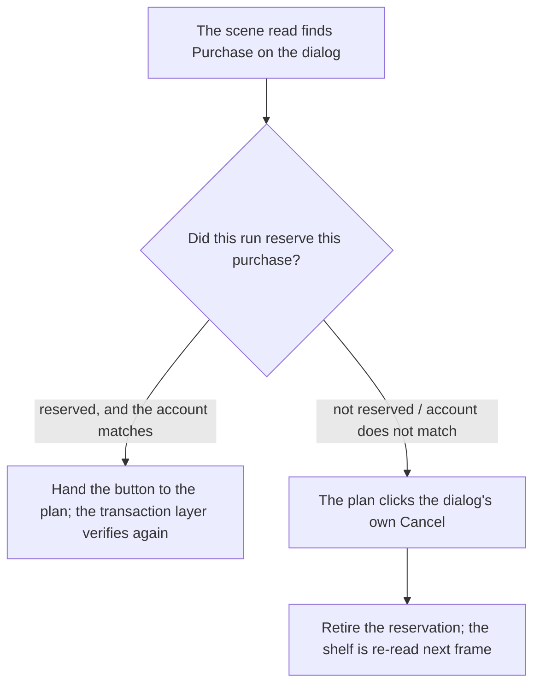

The operator's wording (m08238): 'how does *this* fail too?', asking for the more fault-tolerant upstream implementation. 9.3.9 fixed the "cannot be read" half; this section fixes the other half: **a reading was treated as an authorization**. The live run `dist/MaaLimbus/evidence/runtime/pi-20261015-212438` started at 21:24:38 and stopped two seconds later with `mirror_loop_failed; Full matching purchase title/price/question not proven` (`src/maalimbus/shop_transaction.py:384`): a 159-coin reservation left by the previous run met a dialog whose own badge asked 390, the button the scene read was planned anyway, the transaction layer refused to authorize it, and the whole run ended.

Three structural changes:

- **A scene read no longer poses as an authorization.** On the `SHOP_PURCHASE` page `shop_state` (`src/maalimbus/runner.py:1111`) no longer hands a `confirm` over: the dialog's `Purchase` is only a scene anchor, and what was read (`readable`) only writes the trace reason. The page's only authorization comes from the `SHOP_PURCHASE` branch of `_observe` (`runner.py:2074`), which computes `purchase_dialog_answer` from the reserved intent's name, price and coin count, and falls back to `shop['cancel']` when the account does not match.
- **A question nobody reserved also has an exit.** When the page carries no reservation at all (the operator clicked the card, or the previous run died on the dialog), the `Cancel` that `native_purchase_dialog` reads is the only input offered (`a_purchase_question_this_run_never_reserved`).
- **The reservation must be retired together with the Cancel.** `ShopTransaction.retire_pending` (`shop_transaction.py:390`) clears `pending` before the Cancel lands and records why in the visit (`visits[...]['retired']`). Without it the shelf would refuse every later purchase as 'already reserved' and the run would sit on the same dialog forever.
- **A wrapped gift name is read by its words, not by the order its lines arrived in.** The dialog folds its own gift name over two or three stacked lines, and the recogniser orders those boxes by where they land rather than by reading order: the live `pi-20261015-213416/frame-0001.json` read `Clear Mirror, Calm Water` as the three boxes `Mirror, Calm`, `Clear`, `Water`, so the name check never held, every frame answered the dialog with its own Cancel, and the shelf picked the same gift again - the 21:34 run clicked that one card five times and ended on `the observation node recorded no page for this frame`. `names_match` (`src/maalimbus/shop_vision.py`) compares the band as a **word multiset** instead: the order of the lines is not part of the proof, the client font's single-glyph slips still are. The same live frame confirms a 390-coin reservation on its first frame.

| Situation | Expected behaviour | Evidence required |
| --- | --- | --- |
| The scene read finds `Purchase` on the dialog | Not handed to the plan; only a proven account is | `tests/test_shop_vision.py::test_the_purchase_pages_own_button_is_never_an_authorization` |
| The page carries a question this run never reserved | Its own Cancel is clicked; nothing is bought and the run continues | the `SHOP_PURCHASE` branch at `runner.py:2074` |
| After the Cancel | The reservation is retired and the shelf can be bought from again | `tests/test_shop_transaction.py::test_a_reservation_the_modal_never_asked_about_is_retired` |
| A gift name wrapped over several lines, its boxes out of order | Still read as that gift and the purchase confirmed | `tests/test_shop_vision.py::test_a_wrapped_gift_name_is_read_in_whatever_order_its_lines_came` |

Acceptance: within one start, a purchase question is answered with its own Cancel and the run continues, whether it could not be read or was never reserved; a button the transaction layer cannot authorize no longer ends the run. **The authorization step itself must also know the redesigned dialog**: it no longer asks for the `Would you like to purchase ...?` sentence the new client does not print, but uses the same evidence the plan does - the gift band matched by its words, the badge spending exactly the reserved price, the coin counter on the reserved intent (`ShopTransaction.reserve_confirm` asks `purchase_dialog_answer` first and falls back to the older question sentence only when the dialog cannot be read that way). The live `pi-20261015-214921` run died on that sentence (started 21:49:21, stopped eleven seconds later, inputs=1): the plan had authorized the dialog, the transaction layer could not find the question, and the run ended.

### 9.3.11 A purchase is labelled by what the same run later observed: gated participation of the value model (2026-10-15)

<a id="feature-9-3-11"></a>

**Symptom**: the purchase samples kept being recorded (`shop_purchase_learning_samples.neural_policy_applied=false` in `dist/MaaLimbus/evidence/runtime/pi-*/agent-result.json`, the log line "购买学习样本已记录：7；价值神经模型尚未应用"), but the runtime root `assets/resource/base/model/shop-value` did not exist, so `shop_value_shadow.rank_preview` took `purchase_value_model_missing_rule_fallback` every time. Samples were captured and nothing labelled them; "human review" was a gate nobody operated.

**The rule**: the benefit of a purchase is **not written by a human**, it is what that same run observed *after* it — `shop_value_training.label_from_outcomes()` derives it: a floor clear is worth its floor (0.2 each), a victory 1.0, a reward or an early return 0.1. The label digest covers only the hash-bound bits (`outcomes_digest`), so the order the evidence arrived in cannot change the label. `review_sample()` writes `review.json`/`outcome.json` only when a **ledger-bound later observation** exists (`approved_by=observed_run_return_in_scope`, `training_eligible=true`, `human_approved` still false); a folder with no bound later observation stays pending and is counted (`delayed_outcome_evidence_missing`) instead of inventing a benefit. The loading side (`load_reviewed_episodes`) trusts nothing on disk: it re-derives, excludes a sample whose claimed benefit disagrees with its evidence as `objective_label_mismatch`, and re-checks `action_executed`, `training_eligible`, content address and ledger binding.

**Participation is gated**: the trainer holds out whole runs with `split_by_scope` and only writes `participation=ranked` when the candidate proved its own ordering on that holdout (at least 4 pairs and accuracy 0.6); otherwise it writes `shadow`. `rank_preview` re-verifies the hash chain on every load (`weights_sha256`, `dataset_sha256` equal in three places, `evidence_verified`, `reviewed_episodes` equal to `verified_episodes`, weights finite and in bounds) and then honours the participation: `ranked` sorts **inside the set the plan already approved**, `shadow` reports scores and leaves the order alone. Neither overrides "the gift the plan asked for" (`the_gift_plan_asked_for_this_offer`) — the model only decides which of the plan's own candidates is bought first.

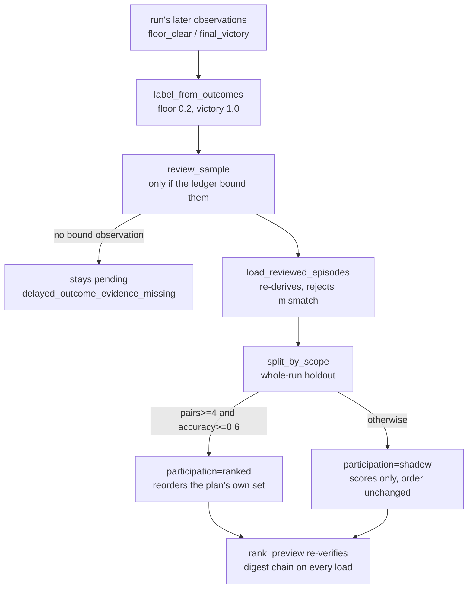

| Situation | Expected behaviour | Evidence required |
| --- | --- | --- |
| The run cleared a floor after the purchase | the label follows the floor, written into the review file | `tests/test_shop_value_review.py::test_the_label_is_the_runs_own_later_observation` |
| Evidence without a bound digest | not a label | `tests/test_shop_value_review.py::test_a_later_observation_without_a_bound_digest_is_not_a_label` |
| Nothing bound was observed after the purchase | stays pending, nothing invented | `tests/test_shop_value_review.py::test_a_purchase_the_run_never_followed_up_stays_pending` |
| The candidate cannot prove held-out ordering | shadow only, order unchanged | `tests/test_shop_value_review.py::test_a_promoted_candidate_reorders_the_offers_and_a_shadow_one_does_not` |
| The stored label disagrees with its evidence | re-derived and excluded at load | `tests/test_shop_value_review.py::test_a_candidate_with_a_dataset_digest_that_does_not_re_derive_is_ignored` |

Acceptance: `python tools/shop_value_review.py --install` reviews the folders, trains, and installs `weights.json` and `modelcard.json` into `assets/resource/base/model/shop-value`. Measured state on 2026-10-15: of 10 folders, 7 are labelled from observation and 3 stay pending (no later observation); 1 verified run / 6 rows, a 0-pair holdout with unknown accuracy, therefore participation is **shadow** (scores visible, order unchanged). **This is not "the network is live"**: steering starts when a second verified run makes a held-out comparison possible — what is missing is runs that finish, not a human reviewer.

**Continued (2026-10-16): the ledger's `abandoned` list is still the ledger, and with one label value the gate refuses correctly.** The paragraph above recorded the gap as "what is missing is runs that finish". Checked against the code, it is two different things.

1. **A second held-out run was structurally impossible.** `_scope_evidence` (`src/maalimbus/shop_value_training.py:389`) looked for the scope's evidence binding only in `active` and `receipts`, while `run_wiring.expire()` files an expired or superseded run under `abandoned` -- and `f855ac82c2b1429aae9c747a122213b8` is there (note: the team picker was drawn with no dungeon in progress). Its own four `floor_clear` events are exactly the later observations that label that visit's purchase, and they were excluded as `delayed_outcome_scope_not_in_run_ledger` for not being in the first two lists. Reading only those two meant a purchase could be labelled only *while its own scope was still active*: the corpus could never hold two scopes, the holdout never had a pair to score, and `ranked` was not "not yet reached" but unreachable. `_ledger_runs()` (`:374`) now reads `active`/`receipts`/`abandoned` together, still refusing a scope the ledger files twice as `run_ledger_scope_ambiguous`; the live corpus went from 1 run / 6 rows to 2 runs / 7 rows with a 6-row holdout.

2. **With two runs the labels are still one value, and this time the gate is right to refuse.** `label_from_outcomes` takes the *run's* own maximum later return, so every row of one run carries essentially the same number: how far that run eventually got is the label of every purchase in it. The live 7 rows report `label_values` `[0.6]`, so `len(targets) > 1` keeps the card a shadow. That is not a defect -- a corpus with a single target value has no "which is better" comparison to learn, and promoting it would only produce a ranker that writes the constant on its face. The training report and the modelcard now carry `label_values` and the reason (`candidate_shadow_blocked_because_every_row_in_the_corpus_carries_the_same_outcome_value_0.6`) instead of a bare `shadow` verdict.

   What would let it start steering is not more purchases of the same kind but runs whose **outcomes differ** -- the same gift bought sometimes and skipped sometimes, with different aftermaths. One confound has to be admitted first: because the label is how far the run got, cross-run samples can teach *which gifts appeared in strong teams* rather than which gifts are worth buying. Before `ranked` is handed over that confound needs a control (purchases compared within one team, say), or `ranked` is just a correlation written into an order.

### 9.3.12 Reset-modal ownership and unconfirmed-input recovery

Plan: move fallback ownership into party_vision.plan; name reopening as reserve_clear_reopen intent, with existing confirm_clear/observe readers. Preserve pending, at most2 reopens.135 related checks/1 historical-frame skip pass, including full retained Runner dispatch, page-dispatch ratchet and transaction API classification. Intermediate full regression:11 failed/2834 passed/710 skipped316.65s;4 new integration failures (added UNKNOWN branch and unclassified reopening API) are repaired with corresponding checks. The original7 failures remain; no new all-green suite is claimed. Source, local state diagram and actual acceptance criteria are in[4.16](4-business-flows.md#feature-4-16). Install and continue the current run without intermediate stop-page checkpoints; preserve spending authority, actual stall and capacity boundaries.

<a id="feature-9-3-13"></a>

### 9.3.13 Native failure cause and continuous execution

Source plan: inject the actual guarded-callback latch into MaaObserver, check it around each native observation and preserve error type/message/node in the result. `ObservationCallbackFailed` has its own cause; an exhausted evidence budget must not become empty-page timeout retries.74 related callback/read tests passed; the later combined map/capture/cache group passed109. Existing transient read failures retain their bounded retry behavior. Current installed d6f61a7 has not yet received this source change.

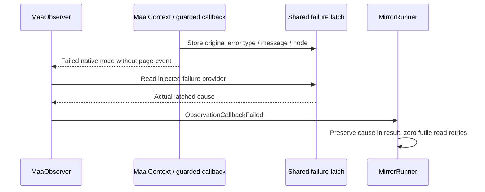


Continuous execution uses no stop_page; an actual stall, backend failure or unapproved cost remains a real ending. The controller is left running while independent source/Wiki work proceeds. Source changes are installed only after that controller has ended. The last continuous session ended on a real map-state defect, not a deliberate intermediate checkpoint; repair and state diagram are in[4.17](4-business-flows.md#feature-4-17).

## 9.4 Learning and policy architecture

<a id="feature-9-4"></a>

**Launcher capacity repair (installed; preparation verified)**: `launcher_cache.stage_launcher` reuses an external helper by complete bundle content hash instead of copying it on every start. Different versions do not overwrite active older helpers; first copy reserves project peak capacity, damaged caches refuse replacement and failed staging is cleaned. The new launcher was independently installed; 19 installer/cache/prepare/diagnostics tests passed. Two actual installed `--prepare-only` calls retained the same directory, hashes/mtimes of 62 files and whole-folder size; private state and Agent/MXU were unchanged. Normal GUI start/exit and public update delivery remain open; preparation proof does not replace them. See the local deployment diagram and evidence in [6.2.4](6-deployment.md#launcher-lifetime-capacity).

**Learning evidence deduplication (2026-11-16)**: `persist_frame_proposals` already records canonical PNG/JSON relative paths and both SHA256 digests; `workspace.protected_evidence` pins the originals. New queues retain metadata/review without another image copy. `review_storage.compaction_plan` / `compact` remove only byte-identical legacy frame mirrors from untouched pending reviews with intact canonical sources. Reviewed, edited, missing-source or mismatched entries remain untouched. The whole plan and each unlink are revalidated; canonical evidence and label bytes are retained. Actual compaction removed 164 exact mirrors, freeing 173,772,748 bytes and reducing approximately 1.96 GB to 1,788,261,000 bytes. The semantic-queue/storage group passed 56 tests; this is not model-quality or dungeon acceptance. The earlier Back transition candidate incorrectly named team configuration: retain its original bytes and add a hash-bound correction recording only MIRROR_ENTRY, without approving a training label.

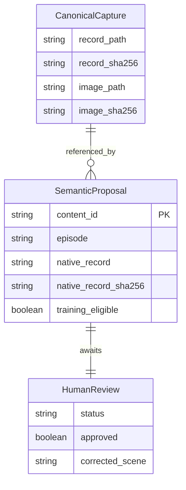

**Reproducibility gap (2026-11-16)**: trained ONNX files and some weights remain; not all weights disappeared. Root `yolo11n.pt` has SHA256 `0ebbc80d…`, matching initialization weights. `best.pt` and `last.pt` in `runs/detect/build/sinner-training-real-20261012-v2/train/weights/` belong to the old **40-epoch** run, not the current **120-epoch** model card's checkpoint `683b02a4…`. The current **130-sample manifest/annotation/120-epoch checkpoint chain remains unrestored**. Native NN research and shop shadow establish neither reproducibility nor a promoted policy. Preserve remaining models/weights, model cards and review references. Recover original materials or recollect episode-separated data, then repeat native held-out evaluation and shadow comparison; an old training report is not a current reproduction.

Promoted inference/policy below is a **design target**, not a claim that production already enables it. Existing foundations are `src/maalimbus/unknown_exploration.py:1`, `src/maalimbus/semantic_labels.py:1`, `src/maalimbus/learning_dataset.py:1`, `src/maalimbus/neural_shadow.py:1`, `src/maalimbus/shop_learning.py:1` and `src/maalimbus/shop_value_shadow.py:1`. MaaFramework supplies recognition, control and pipelines; training, review and promotion are project extensions, not a built-in Maa trainer.

Verified the pinned [MaaFramework v5.12.2 Pipeline protocol](https://github.com/MaaXYZ/MaaFramework/blob/v5.12.2/docs/en_us/3.1-PipelineProtocol.md): NeuralNetworkDetect loads a detector and returns recognition results at this layer. Training and purchase-policy evaluation remain project responsibilities. The purchase MLP is a custom strategy extension, not a built-in Maa trainer or native image detector. The flag-only ranked bypass is now repaired and installed as below; the retained candidate still lacks formal ordering eligibility.


#### Installed runtime evidence protection

Plan: resolve proof references against both canonical `evidence/runtime` and installed `dist/MaaLimbus/evidence/runtime`. An ambiguous application-relative reference conservatively protects both local counterparts. Pending transactions, ledger/model/review records retain their JSON/PNG pairs; cleanup must exclude an installed evidence tree containing a pinned pair. Validate isolated root/installed references, relative paths and pressure cleanup before installation. This changes retention, not gameplay authorization or model promotion; no actual cleanup is part of this repair.


Source implemented: 53 storage/semantic tests and 16 install/fingerprint tests passed. Actual read-only before/after enumeration adds 716 protected paths; installed evidence was previously a cleanup candidate and is now excluded. No cleanup was executed. Installation and a full current-suite rerun remain separate.


Installed from 39b3aaf, actual component self-test and private preservation passed. Remaining capacity work: the six-input live star path created about32.7MB of native debug output in addition to canonical pairs. Prefer bounded host-side Maa SaveDraw/SaveOnError options and representative learning capture; do not delete referenced proofs or treat AgentServer as the host. Maa global options belong to the controlling process. No debug cleanup has been performed.


### Host debug copies and canonical evidence

Plan: apply Maa global image-output settings in the actual controller host, after Toolkit defaults and before controller tasks. Keep native text logging and the Journal PNG/JSON/hash pairs. Check acknowledgements and refuse configuration failure before gameplay. AgentServer must not pretend to configure an independent MXU process. `native_evidence.configure_host` is connected to the packaged MirrorTask verifier and current-page observer; it does not yet modify the MXU host.

```mermaid
flowchart LR
  Host[Controller host] -->|SaveDraw / SaveOnError / DebugMode false| Maa[Maa native runtime]
  Host -->|Own resources and frozen Agent| Task[MirrorTask]
  Task --> Journal[Canonical PNG + JSON + SHA256]
  Journal --> Queue[Referenced learning / transaction evidence]
  Maa --> Text[Native text logs retained]
```

11 host-policy / packaged-verdict / Journal checks passed. The actual Null-input current-page observer acknowledged all native settings and captured INITIAL_GIFTS; this is not gameplay, GUI-host integration or a complete-run storage guarantee. No historical debug images or canonical proof were removed. The current short-run output remains intact. Remaining work: sample redundant learning proposals and retain bounded unreferenced captures without discarding pending transactions, meaningful labels or floor/payout proof.


### Bounded admission and pressure-only capture retention (implementation)

Outcome: continue a whole Mirror run inside the latest user-approved3,000,000,000bytes without removing pending/approved review material or business evidence. Runtime semantic admission separates object/gallery and empty-frame quotas per episode/locale: at most32 in each bucket, with one empty representative per scene (at most64 new proposals). Explicit offline collection remains unsampled. Legacy empty frames cannot starve real sinner-box review. Existing proposals/reviews remain immutable, and a sampling refusal never grants input or stops gameplay. Unknown successful transitions retain their separate evidence path.

Journal will reserve the next pair before writing. Only when capacity requires it, a read-only retention plan may select unreferenced intermediate PNGs, retaining JSON/hash history, recent captures, first/last frames, page changes, input before/after frames and state/model/review/report/source/test references. Malformed or incomplete provenance makes a candidate ineligible. Each unlink needs a durable manifest and hash/reference revalidation. Do not recycle another active capture stream or delete whole runtime directories. If meaningful/protected evidence alone exhausts the budget, report that limit rather than silently discarding it.

Exit evidence: protocol tests for sampling/idempotence/manual-review immutability and pressure/changed-proof/installed-root retention; read-only actual plan, then audited compaction only where eligible; installed frozen task continues from current HUD without replaying submission. No promotion, clear or payout claim follows from storage tests.

`semantic_labels._frame_admission` now implements the runtime quota; `capture_retention.plan/apply/reserve` implements the Journal reservation and audited reclamation. The CLI `tools/capture_retention.py` defaults to a read-only plan and requires that exact saved plan to apply. Its existing controller lease excludes a concurrent live task; it creates no device. The86 related tests and43 Wiki checks passed, including nested report references. Installation and continuation evidence are recorded separately below when actually completed.

```mermaid
flowchart TD
  Frame[Native frame and OCR] --> Reserve{Next PNG / JSON fits 3 GB?}
  Reserve -->|yes| Journal[Write canonical pair and hashes]
  Reserve -->|no| Plan[Select unreferenced intermediate PNGs]
  Plan --> Protect[Keep business / review / model / input boundary proof]
  Protect --> Intent[Persist reclaim intent and revalidate hashes / references]
  Intent --> Journal
  Journal --> Admission{Runtime candidate admitted?}
  Admission -->|yes| Queue[Immutable proposal for review]
  Admission -->|no| Sample[Log sampling reason and continue]
  Queue --> Review[Human or independent teacher review]
```

Actual offline audit:46 unreferenced intermediate PNGs removed,73,979,164bytes reclaimed; all original JSON/hash records and1,327 private/review/native/referenced files unchanged. Workspace1,903,771,882bytes, device inputs0. Local report `build/resume-20261117-capture-capacity-audit.json`; Complete regression:7 failed /2779 passed /710 skipped,290.42s, own exit1, same seven known failures. Installed5d84501 later continued the first battle to VICTORY and MAP; its incoming-stop defect remains under repair (4.14). Long-run capacity, floor clear and payout are not certified.

<a id="feature-9-4-1"></a>

**2026-11-17 observation deadline and reference parse cache (source)**: an actual cold reference scan took about10seconds; repeated pressure checks could consume a30second native observation deadline. `workspace.cached_references` rereads every file and hashes its bytes, caching only lexical references for at most4096 files. Each scan resolves current paths/links, sharing parent resolutions. New files and same-size edits with unchanged mtime remain visible. Capacity, deletion authority and game transactions are not cached; per-unlink JSON/PNG hashes, fresh reference checks and durable manifests remain. Independent object/empty quotas preserve every prior proposal/review byte.68 related tests passed; installation, actual pressure timing and full-suite results remain separate acceptance steps.

Full regression:7 failed /2821 passed /710 skipped in344.46s, pytest exit1; same seven historical archive/count/next-node discrepancies (`build/resume-20261117-reference-admission-full-tests.log`). Later invalid-path and Windows newline guards are included in the final68 related passes. Actual old/new reference sets match exactly (5,242 paths);11.222s original versus4.239s cold /2.278s warm. Offline pressure reclamation retained1,439 protected/private/metadata hashes and removed only12 eligible intermediate PNGs (20,637,356bytes); all original JSON remains, workspace1,935,578,642bytes with64MB reserved for deployment. The12-file audit took34.614s outside a native observation; this is not a promise that arbitrary pressure work fits30seconds. Report `build/resume-20261117-correct-deployment-capacity-verification.json`.

```mermaid
sequenceDiagram
  participant J as Journal
  participant R as Reference scanner
  participant C as Bounded parse cache
  participant F as Current files
  J->>R: Capacity pressure / revalidate before unlink
  R->>F: Enumerate and read current bytes
  R->>C: SHA256 + root/path/family
  alt same bytes
    C-->>R: Immutable lexical references
  else new or changed bytes
    R->>R: Parse and replace bounded entry
  end
  R->>F: Resolve current parents and links
  R-->>J: Current protected paths
  J->>J: Recheck PNG/JSON hashes before reclaim
```

### 9.4.1 Recomputable purchase-order participation

`verification_summary` now includes observation, target and actual review-byte hashes in its dataset digest; weights also bind train/holdout scope membership. `shop_value_promotion.evaluate` re-encodes these bound records and uses the same MLP forward as runtime. It checks independent scopes, unique purchases, the deterministic training split, nonconstant labels, at least four comparable heldout pairs and accuracy >=0.6. Modelcard participation is a request; handwritten scores never become displayed heldout metrics. Legacy candidates without the receipt may still predict in shadow, without reordering or stopping Mirror.

`rank_preview` only reorders the plan's supplied candidates, adding no offers or prices. Logs bind each prediction to name and price and distinguish shadow from ranking values, alongside manual weight, rule-queue score, recomputed metrics and rejection reason. `buy_learning_applied` means ordering participation; `purchase_input_authorized=False` means scoring grants no spending authority. Existing page/transaction/player-budget logic still owns Maa inputs. Model export/copy reserves the project3GB capacity first.

```mermaid
flowchart TD
  ROW["Verified purchase and delayed outcome<br/>observation / target / review SHA"] --> DATA["Dataset digest"]
  DATA --> WEIGHT["Weights bind dataset digest and scope split"]
  DATA --> R["Runtime: re-encode, same forward, recompute holdout"]
  WEIGHT --> R
  CARD["Modelcard requests ranked or shadow"] --> R
  R --> Q{"Independent scopes, nonconstant labels<br/>pairs >= 4 / accuracy >= 0.6"}
  Q -->|Pass and ranked requested| ORDER["Reorder only plan candidates"]
  Q -->|Insufficient or inconsistent| SHADOW["Keep rule order; log shadow scores and reason"]
  ORDER --> TX["Existing page / transaction / player budget"]
  SHADOW --> TX
  TX --> MAA["MaaFramework input and successor evidence"]
```

Related checks: **335 passed / 208 skipped**, followed by diagnostic additions **82 passed / 1 skipped**. The first related run failed Wiki navigation placement; correcting and rerunning passed, preserving the actual failure exit code. The installed Agent now executes the retained model in its self-test: a hypothetical offer scores about 0.5441 and matches source. 98 installed private files and 28 canonical configuration files remain unchanged, project about 1.88 GB. Evidence: `build/resume-20261116-installed-shop-participation-verification.json`, with packaged prediction/source parity true and no controller/game input. That score is neither a live quote nor causal gift strength.

The retained modelcard records two episodes/seven rows, all labelled 0.6 and zero comparable heldout pairs. Current `build/learning-review/shop-purchases` is absent, leaving zero retrainable rows; metadata cannot replace missing original evidence. Preserve the candidate/shadow behavior and recollect actual varied outcomes with independent episodes before retraining. Synthetic export/runtime and tamper tests prove protocol behavior, not live purchase-policy quality. The old train-head expectation conflicts with the later one-step rule and lacks its original successor image; that failure remains pending live evidence.

<a id="feature-9-4-2"></a>

### 9.4.2 Automatic factual labels and manual decision precedence

An isolated 2026-11-16 reproduction found two overwrite paths: `review_sample` replaced manual rejection/correction with automatic approval, while `shop_outcomes.sync` reset existing outcome approval. The plan has three deliveries: preserve manual input; refresh untouched automatic records from new same-run evidence; connect labelling to normal collection without affecting game transactions. These source deliveries, isolated round trips and Agent installation are complete: c997729, 526-file source fingerprint, self-test passed, 98 installed private/28 canonical files preserved. `build/resume-20261116-auto-label-installed-verification.json` confirms packaged/source scorer parity, not new live-account labels. Complete regression: 7 failed / 2707 passed / 710 skipped, 258.75s; the same seven failures remain.

The collector validates purchase/delayed evidence under existing transaction rules, then merges observations while preserving manual approval and label ownership. Missing current ledger observations do not disprove or erase old outcomes. Archived abandoned scopes use the common ledger reader too. New evidence, labels and temporary copies reserve project capacity before writing; evidence is published after temporary-file hash verification, preserving a different file that appears during copying.

`shop_review_state.review_problem` separates untouched pending data, fingerprinted automatic output, manual approval/rejection and unknown edits. The content fingerprint detects normal automatic writes and later editing; **it is not an authority credential or proof of human identity**. Manual records are not auto-rewritten. Automatic labels reverify purchase delta, original JSON/PNG, chronology and scope ledger. Unknown outcomes remain pending instead of receiving a guessed low return. Each file is atomic, but the pair is not: an interrupted update is completed from the same verified observations on retry, while intervening human edits are preserved.

The manual tool records an explicit non-teacher reviewer and removes inherited automatic claims. The loader accepts that manual benefit but still rechecks every original proof; approval cannot make a corrupt image or wrong scope valid. A legacy manual tool's inherited automatic label_source cannot overrule an explicit manual reviewer. Editing an automatic value without manual takeover preserves the edit but cannot masquerade as verified objective training data.

```mermaid
sequenceDiagram
  participant C as MirrorRunner / collector
  participant F as Sample folder
  participant A as Automatic fact teacher
  participant H as Manual review tool
  participant L as Training loader
  C->>F: Verify purchase/delayed evidence, merge without resetting manual decision
  C->>A: Current scope and ledger
  alt Manual decision or unknown edit
    A-->>C: Preserve files, return reason
  else Untouched automatic output or initial pending
    A->>A: Reverify delta, image hashes, chronology and scope
    A->>F: Proven factual label, atomic individual files, automatic provenance
  end
  H->>F: Explicit manual benefit or rejection, images untouched
  L->>F: Reread review, original evidence and ledger
  L->>L: Exclude rejections/bad proof, distinguish manual and objective targets
  Note over C,L: Label failure does not invalidate a proven game action, training/promotion separate
```

Normal SHOP collection invokes factual labelling without an external manual review CLI. Runner logs report labels ready/manual decisions preserved, without equating labels with model training/ranking. Earlier related checks: 323 passed / 208 skipped. No new actual-account labels or live buying-quality evidence is claimed.

**Delayed outcome dispatch plan and implementation (2026-11-16)**: the last purchase may never be followed by another SHOP. After durable ledger commits, `record_ledger_event` dispatches same-scope floor/victory observations to `shop_outcomes.refresh_scope`. `reward_task.finish` collects after receipt/HOME archival and transaction completion, retaining the pre-rotation scope. A normal Mirror launch attempts missing labels once; observe-only does not collect. Label failure preserves successful bookkeeping/payout. A later Mirror or completed-payout launch retries labels only, without repeating device input, payout or rotation. No transaction means no writes; foreign scopes and path traversal refuse. Purchase/delayed evidence is still reverified and manual decisions retain precedence.

```mermaid
flowchart LR
  G["Maa observation/input and successor checks"] --> B["Commit actual floor/victory to ledger first"]
  P["Independent receipt and HOME audit"] --> A["Archive payout and complete transaction"]
  B --> C["Same-scope refresh_scope"]
  A --> C
  R["Explicit launch retry; except observe-only"] --> C
  C --> V["Reverify purchase and delayed evidence"]
  V --> L["Factual label or preserved manual decision"]
  V --> F["Failure stays pending; no ledger reversal or input replay"]
```

New isolated checks cover last purchase→victory, payout archival→labels, label-only recovery after failure and no collection on read-only launch. Related group: **174 passed / 75 skipped**, exit 0. Receipt auditing is explicitly isolated in the new synthetic dispatch test and remains covered by existing audit tests; this is not a new live receipt. Agent rebuilt/installed from b62dbab with actual self-test and scorer parity passed, 98 installed private/28 canonical hashes preserved, assets/model unchanged. Complete regression: 7 failed / 2720 passed / 710 skipped, retaining the original seven failures. See PROJECT/acceptance and `build/resume-20261116-delayed-dispatch-installed-verification.json`. Installation does not prove new live labels or GUI dispatch. Automatic retraining and private model publication remain open; the complete self-learning loop is not accepted.

```mermaid
flowchart TB
  PI["MXU and ProjectInterface settings"] --> RUN["MainTask / MirrorRunner"]
  RUN --> MAA["MaaFramework Resource and Pipeline"]
  MAA --> PER["OCR / Template / native neural recognition"]
  PER --> FACT["Current-frame facts and confidence"]
  FACT --> RANK["Rules, manual weights, promoted policy; distinct provenance"]
  RANK --> TX["Budget, intent, successor and settlement"]
  TX --> INPUT["Single Controller input"]
  FACT --> BUNDLE["Episode evidence and proposed labels"]
  TX --> BUNDLE
  BUNDLE --> REVIEW["Independent teachers and human review"]
  REVIEW --> TRAIN["Offline grouped splits and training"]
  TRAIN --> EVAL["Model card, native held-out evaluation, shadow comparison"]
  EVAL --> GATE{"Promotion criteria met?"}
  GATE -->|no| SHADOW["Remain shadow or fall back to rules"]
  GATE -->|yes, design target| PER
  GATE -->|yes, design target| RANK
```

Inventory actual model callers versus proposal-only/shadow/off nodes, with hashes and runtime traces. Perception and purchase value require separate acceptance: a successful purchase proves a transaction, not gift strength; repainting or winning one encounter does not prove optimal choice. Manual priorities, reserve, refresh cap and allow/block lists remain effective. Models cannot expand spending limits.

Split perception training/validation/test by episode; adjacent frames from one run are not independent acceptance. Fix classes, thresholds, error metrics and fallback conditions before promotion, then evaluate through native Maa on new episodes. Compare purchase policies with the rule baseline through replay and shadow ranking using measured outcomes. Insufficient evidence keeps shadow status; loading a model is not applied learned control.

## 9.5 Labels, scores and evidence data model

<a id="feature-9-5"></a>

This is a **logical model**, not a claim that each entity already has a database table. Map existing JSON/JSONL fields explicitly; specify missing fields before implementing them. Separate original frames, OCR facts, outcomes, inferred labels and human judgments. Keep correction versions. Logs show only weights actually used, components, final score, tie-break, exclusion reason and actual model participation.

```mermaid
erDiagram
  EPISODE ||--o{ OBSERVATION : contains
  OBSERVATION ||--o{ DECISION : supports
  DECISION ||--o{ SCORE_COMPONENT : explains
  DECISION ||--o| INPUT_INTENT : may_send
  INPUT_INTENT ||--o{ OUTCOME : observed_as
  OBSERVATION ||--o{ LABEL_PROPOSAL : proposes
  OUTCOME ||--o{ LABEL_PROPOSAL : constrains
  LABEL_PROPOSAL ||--o{ REVIEW : versioned_review
  DATASET_VERSION ||--o{ SAMPLE_REFERENCE : pins
  SAMPLE_REFERENCE }o--|| EPISODE : grouped_by
  MODEL_VERSION }o--|| DATASET_VERSION : trained_from
  MODEL_VERSION ||--o{ EVALUATION : measured_by
  EPISODE {
    string scope
    string build_hash
    string policy_version
  }
  OBSERVATION {
    string png_hash
    string record_hash
    string scene
  }
  SCORE_COMPONENT {
    string source
    float value
    string direction
  }
  LABEL_PROPOSAL {
    string status
    string teacher_hash
    string uncertainty
  }
```

A review bundle includes manifest, before/after frames/OCR, intent/outcome, score trace, label proposal and review state. Pin references by hash, not replaceable names alone. Collect failures too, but unknown is not a negative example and no progress does not necessarily mean the button was wrong. Evidence/review controls training eligibility; a model's own prediction cannot recursively become its independent teacher.

## 9.6 Resource monitoring deployment and interface

<a id="feature-9-6"></a>

Monitoring owns no controller, takes no screenshots and blocks no inputs. Disable stops its background work. Start with low-frequency sampling; expose the interval and measure overhead. Read overall GPU/VRAM and script CPU/RAM. Process GPU requires provider and attribution semantics. Missing values are null plus reason, not zero.

Current source boundary: `resource_diagnostics.sample` implements process CPU/RAM and whole-device GPU/VRAM sampling; `NvidiaSmiProvider` has fixed arguments and a timeout. `tools/resource_diagnostics.py` is a read-only CLI. CPU 100% means one busy core and may exceed 100% across cores. Process GPU has an injectable interface only, defaulting to `unsupported / no_per_process_gpu_provider`; concrete attribution is not implemented. GUI async integration, toggling and independent same-window live measurements remain unverified. Query the `gpu` route for current symbols and narrow tests. Structural route validation cannot prove these behavior claims.

```mermaid
flowchart LR
  subgraph Desktop["Local Windows deployment"]
    UI["MXU / Tauri GUI"] -->|read-only command, planned integration| COL["Existing synchronous sampler; async GUI integration planned"]
    COL --> OS["OS process metrics"]
    COL --> GPU["GPU provider adapter with timeout"]
    UI --> IPC["Maa Agent IPC"]
    IPC --> AGENT["Python Agent"]
    AGENT --> FW["Native MaaFramework recognition and control"]
    RES["Resource images, dictionaries, ONNX and model cards"] --> FW
    FW --> MUMU["MuMu / Limbus"]
    AGENT --> PRIVATE["Private state, logs, evidence and review bundles"]
  end
  GPU --> TOTAL["Whole-device load shared with MuMu and DSH"]
  GPU --> ATTR["Process attribution when available"]
  COL --> SNAP["Timestamped structured snapshot with provenance"]
  SNAP --> UI
```

Use the [diagnostics contract](../../plan-20261014-recovery-diagnostics.md): version, sampled_at, interval_ms; process role/pid/cpu_percent/rss_bytes/status; GPU provider/device_name/util_percent/vram_used_bytes/vram_total_bytes/status. Separate totals and process samples; state CPU normalization. Do not collect/publish GPU UUID, user/machine identifiers or raw command output; do not change system privileges.

P4 covers independent same-window measurement, non-NVIDIA/missing tools, timeout, exited Agent, multiple GPUs, toggling and sampling during play. If inference creates GPU load but attribution is unavailable, show overall-only/unavailable process metrics. DSH chooses the adapter and documents it here without changing the architecture boundary.

## 9.7 Acceptance matrix and reconciliation

<a id="feature-9-7"></a>

**Current exit work (2026-11-16)**: P0–P6, four-task coverage, NN quality, real GUI Start and the original scope remain open. Native coordinate callbacks pass; the installed Agent TEMP+TCP repair registered 15 actions and exited 0. The next controller-file access misdiagnosis has a source repair using a session mutex for existing ownership; packaged rebuilding is underway, without live acceptance. Two read-only handoffs expose intermediate team/entry pages, but legacy MirrorHard remains open and Team2 reconfiguration is unproved. Reconcile canonical old scope, team and entry successors, then proceed against the actual clock/page/ledger. The target remains **Hard five floors → actual receipt → independent HOME → one rotation → reentry**. The last complete suite remains 47 failed / 2513 passed / 709 skipped; focused checks do not replace it. Preserve the historical archive-audit disagreement rather than weaken thresholds because frames are missing.

- [ ] P0: Native evidence gives historical card4 a definite disposition; settlement and cancellation differ; no repeat purchase or invented receipt.
- [ ] P1: One actual packaged GUI Start enters the intended pipeline; native navigation works and evidence identifies the installed build.
- [ ] P2: The script clears five Hard floors, reuses correct deployment and retains each floor reward/purchase/refresh settlement.
- [ ] P3: Verify Team1, Team2 and Team22 systems/order/EGO individually; offscreen browsing uses fresh rows and selected headers; fixed and rotation modes do not leak. Unimplemented EGO equipment cannot pass.
- [ ] P3: Portrait/star persistence and native application agree; dungeon count N is separate from step/time bounds; candidate/components/final score/provenance/reason appear in logs.
- [ ] P4: Resource measurements agree with independent readings, missing values are honest, toggling works and sampling never owns a controller.
- [ ] P5: Unknown attempts, success/failure bundles, human review, episode splits, native evaluation, actual inference and policy promotion each have distinct evidence.
- [ ] P6: Latest merged suite has no unexplained failure; actual GUI→five floors→receipt→return→one rotation/reentry, with explicit current budgets.
- [ ] P6: Paired wiki/local diagrams match code/evidence; planned components are relabelled by actual state; privacy and release are checked separately.

Close cards with requirement→actual code/configuration→check→artifact→difference→resolution, not merely another progress paragraph. Partial work keeps a next step. Distinguish interruption, bounded timeout, user actions and program errors; old-run frames cannot prove a new run. Acceptance/PROJECT hold current progress; this chapter keeps stable completion criteria.

```mermaid
flowchart LR
    W["phase work: card, dependencies, changed files"] --> E["evidence: verification commands and actual artifacts"]
    E --> R["write-back: docs/acceptance.md, PROJECT.md, wiki"]
    R --> V{"review: are this card's exit criteria met"}
    V -->|met| Done["phase complete"]
    V -->|not met| H["stays partial: record the difference and the next step"]
    H --> W
    Done --> M{"P6: is the whole check suite green"}
    M -->|unexplained failure| H
    M -->|none| Ship["commit and push"]
    B["interruption, timeout, user action"] --> X["attributed separately from a program error"]
    X --> H
```

## Unverified / open questions

This chapter delivers an executable plan and design views, **not completed P0–P6**. GPU UI, model promotion, explicit continuous count, Team22 system/EGO and the integrated loop require their own artifacts. Observe DSH's active run; documentation work must not restart its controller or replace the running application.


## 9.3.12 A click verdict must name the frame it judged, and the party must be readable

`map_click_result` used to carry `frame: None` always: the expression read
`getattr(self,'frames',None)`, and `frames` only exists on the journal, not on `Runner`. The frame
name is now stored in `state['map_click_frame']` when the click goes out, and all three verdicts
(rejected / accepted / page unchanged) consume it; a click that changed nothing now still records a
verdict instead of vanishing. Live check: `packaged-mirror-20261022-075450`, 388 events, 13
verdicts, 13/13 with a frame name, 0 `None`, 0 silently dropped.

`player_marker` returns `None` on the live frames, so the loop could not restrict itself to adjacent
nodes. `map_vision.party_point()` locates the party by its own torch (two stacked warm highlights);
it reads 14 of 14 map frames in that run, and the consecutive displacement `(829,440)->(826,561)`
matches one lattice step.

The hypotheses the data refuted are recorded here too: the badge point is already inside the node
(`(1020,327)` sits within the `?` hexagon, while "drop 106" lands in empty space below it); setting
`GOLD_MARK_DROP` to 106 fails two existing tests, so the offset varies per page and a global
constant is wrong by construction; and thresholding orange by area yields badge icons, not edges.
The detector's centres on `frame-0034` coincide with `gold_marks` because the labels come from the
rule -- what has to change here is the labelling target, not the recogniser.


## 9.3.13 An inferred lattice point is no longer a node; a refusal streak must say the exploration is not resumed

`lattice_step` candidates used to treat a computed lattice point as a node centre.
`frame-0057` of `packaged-mirror-20261022-080630` shows some of those points landing inside
a node and others in empty space, with nothing in the frame to tell them apart. Each lattice
point is now snapped onto the nearest badge centre within 120 px (the badge centre is the node
the game offers, see the `badge_mark` section) and dropped when there is none: better one click
fewer than a click on bare background.

A refused map click has two causes the frame cannot separate: the candidate was wrong, or the
exploration is not resumed yet. The controlled experiment (one device, one candidate set) gives
the criterion: before the resume nine clicks produced only 300-2000 px of animation, and the
first click after it opened the node panel (107860 px). `map_refusal_streak()` therefore records
`map_clicks_refused_while_the_exploration_may_be_unresumed` at the third consecutive refusal and
`accepted` clears it. It only **names** the case; the resume navigation itself is not implemented
and remains a known gap.


## 9.3.14 A map that refuses every node resumes the exploration instead of clicking again

When `map_refused_streak` reaches three, the runner puts the map page's progress control into
`plan_controls['map.progress_button']` (`MAP_PROGRESS_CONTROL`, `src/maalimbus/runner.py`), and
`window.plan_map` returns the `the_exploration_must_be_resumed_before_a_node_click` plan before
it would click a candidate node. When the streak is below three the behaviour is unchanged.

The criterion is the controlled experiment recorded in 9.3.13: nine clicks before the resume
produced only 300-2000 px of animation, and the first click after it opened the node panel
(107860 px). Clicking one more candidate in that state is wasted; what is missing is the resume.

Known limits: `MAP_PROGRESS_CONTROL` came from a single frame and is verified at one resolution
only, and `plan_map` currently only issues "open the progress control"; `Resume` inside
`Dungeon Progress` is still handled by the ordinary plan on the following frames.


## 9.3.15 The last link of the resume chain: the panel's Continue needs an anchor

`window.plan_step` has long had a `DUNGEON_PROGRESS` branch that presses only
`dungeon_progress.continue_button` and refuses to guess without an anchor. Live run
`packaged-mirror-20261022-084358` shows the resume plan opening the panel and then hitting
`continue_button_not_anchored` immediately: the branch existed, nothing bound it.

The runner now binds the OCR row whose text is `continue` on that page, and never `Forfeit`:
of the panel's five buttons only Continue continues the current exploration, `Forfeit` ends
the run and `Config` changes settings mid-run.

The fix carries its own lesson: search for an existing branch before adding a page. This
round wrote a duplicate branch first and rolled it back.


## 9.3.16 Only a node one step out can move the party

`map_clicks` ordered its candidates but never constrained reachability, so the loop kept
clicking nodes two or more steps away and every verdict came back `rejected` while the party
stood still (`packaged-mirror-20261022-085428`: party at `(1052,562)`, targets from
`(576,361)` outward). A hand click on a neighbour 219--395 px away opened its panel.

`map_vision.adjacent_to(party, boxes)` now keeps only candidates whose centre is 150--430 px
from the party, applied in `runner.candidates_of`. An unread party filters nothing, so a
missing reading never leaves the run with nothing to try.

An exact lattice match against `(384,0)/(192,110)/(0,220)` dropped real neighbours -- the
measured offsets match no single step vector -- so the filter is a distance band.


## 9.3.17 Without a party reading there is no node to click

`party_point` searched only to `0.79 × width`, but a party that has walked east stands at
`x≈1628` (all of frame-0006/0010/0014 in `packaged-mirror-20261022-090550` returned `None`).
The fallback was "an unread party filters nothing", so the adjacency constraint never applied
and the loop spent six clicks on nodes two steps away while the party stood still.

Now the band reaches `0.95 × width` (all three frames read `(1628,558)`), and `candidates_of`
returns **no candidates** when the party cannot be read, so the loop takes its named
stop/recovery path instead of guessing.


**2026-11-17 capture retention refinement (source)**: HUD/UNKNOWN/LOADING oscillation is one storage segment, retaining each scene's first example, recent frames and input/unknown-exploration boundaries. This does not merge gameplay states. Only older successfully closed controller sessions may compact ordinary intermediate input boundaries, retaining their last causal pair; failed/uncertain sessions remain conservative. Confirmed Null-input read-only probes may compact repeated non-map captures only with complete task-stop/no-input proof. JSON/hash history and explicit business/model/review/report/source references remain protected.64 related tests passed. An actual read-only plan still found only about13MB eligible because legacy pending review records pin many captures; these policies do not magically reclaim that protected evidence. No new capture deletion was applied by this refinement.


<a id="feature-9-4-3"></a>
### 9.4.3 Supplier map classifier compatibility plan (not runtime integration)

```mermaid
flowchart LR
  Source["Pinned supplier ONNX + preprocessing"] --> Adapter["Fixed batch + ImageNet graph adapter"]
  Source --> Reference["CPU ORT reference"]
  Adapter --> Native["Maa native top class and score"]
  Adapter --> ORT["ORT full logits"]
  Reference --> Compare["Numerical comparison / no quality claim"]
  Native --> Compare
  ORT --> Compare
```


Pinned source inspection found two external classifiers, not detectors: mirror_legend has RGB NCHW dynamic-batch3x110x130→8 logits; mirror_path has3x224x224→9 connection logits. Supplier preprocessing applies ImageNet mean/std; path outputs need independent sigmoid, whereas MaaFramework.NeuralNetworkClassify retains raw logits internally and applies softmax; the current public result exposes only top class/rounded score. Maa's pinned native implementation resizes with INTER_AREA, converts BGR→RGB and divides255, then uses the model's input shape directly. A dynamic batch and missing mean/std cannot be ignored.

Plan: (1) bind supplier ONNX/classes/preprocessor hashes to the verified Git source cache; (2) create an explicit fixed-batch ONNX adapter with mean/std in graph and unchanged weights/logits; (3) compare actual CPU inference to Maa-native inference on retained real crops using the same resize and report differences; (4) keep all new outputs external-model shadow proposals, with input_authorized=False and no claim of local training or heldout quality. Crop/scale quality and later independent transition labels need their own tests before runtime participation. Temporary candidate output is bounded and removed; current game controller is not replaced. No detector or shop-policy quality is inferred from classifier numerical parity.


Actual offline compatibility probe now passes6samples (two models×three real regions): fixed-batch/ImageNet graph adapters preserve full logits in CPU ORT, and Maa-native top class/score agree. Source model/label/preprocessor hashes are bound to the pinned Git snapshot. Native full logits are unavailable; no detector, local training, heldout quality or runtime control is accepted. Temporary models are removed after the probe.

<a id="feature-9-4-4"></a>
### 9.4.4 Measure a connected node instead of using a click-box ruler

Actual continuous run bought two gifts/refreshed twice, then stopped naturally on MAP. The next red node is about384px from the train, while190px click-box width was treated as pitch; a badge/chevron won instead. The train flame also changes shape with animation: a fixed65px flame-to-node lift selected a body fragment.

Plan: detect the train body by paired warm lamps, central clock body and independent flame; derive its node centre from lamp spacing. Admit a compact red node outline only when the visible outgoing line connects it to that anchor. Bind one-step reach to that measured segment, keep its full measurement in logs, and leave other frames on the existing reader. Negative tests remove each independent part/line, add ambiguity and cover scaled real frames. A fresh native NODE_PANEL successor is required for live acceptance; no manual node click or unconditional distance relaxation. Pending actions remain subject to the existing causal successor/rejection rules.

```mermaid
flowchart LR
 Body["Paired lamps + clock + flame"] --> Anchor["Measured train node centre"]
 Ring["Compact red outline"] --> Line["Visible connecting segment"]
 Anchor --> Line
 Line --> Reach["Measured pitch and candidate"]
 Reach --> Native["Maa touch then fresh successor"]
```

Storage: preserve native frames/config/review state; retire only verified inactive downloadable WebView component cache. This does not accept long-run storage capacity or neural control.


<a id="feature-9-4-5"></a>
### 9.4.5 Outcome-owned evidence retention under pressure

A MAP verdict.frame names its original input, never a new capture; it no longer rewinds the storage observation cursor. A normal no-op becomes a diagnostic candidate only with the matching target,350–750ms in-box intent, original PNG bindings, fresh full same-floor MAP and explicit rejected verdict. The current final input pair, closed final MAP, unjudged/interrupted attempts and all external business/learning roots remain protected. Two later distinct native MAP captures may replace already-answered viewport endpoints; unanswered intents and required checkpoints from other owners remain stronger.134related checks passed. Actual6diagnostic images/6,775,901bytes retired with836private-review files/11critical pairs/all JSON unchanged; closed text logs separately compressed losslessly, saving885,529bytes.

An independent viewport projection now owns view diagnostics: `viewport_evidence.diagnostic_index` accepts only a fresh original MAP after an explicit zoom/drag intent, in the same scope and floor/pack. UNKNOWN, other inputs, missing/changed images, reversed timestamps or mixed scopes provide no retirement authority. Keep two latest read pairs and every unanswered intent. A zero-input `map_view_probe` cannot permanently pin a proven redundant diagnostic. Required endpoints are unioned across projections, so viewport supersession cannot erase a battle-exit checkpoint; external business/model/review roots remain stronger. This proves neither physical dispatch, movement nor navigation, and writes no game state or learning approval.102related checks passed.

Canonical review storage now covers both purchase outcomes (`shop-purchases`) and regular refresh yield (`shop`). An explicit family-bound sidecar points to original native JSON/PNG hashes; portable datasets still carry copies. Creation reserves its output before writing, and repeated collection preserves human decisions and sample addresses. Actual four refresh samples were reverified after removing16 exact mirrors/7,619,730bytes;14 native originals and823 private/review records stayed unchanged. Closed native text logs were losslessly archived separately, recovering9,054,375bytes.108 related tests passed. This fixes duplicate growth, not full-run capacity acceptance. The latest stopped controller reached the second floor3 battle HUD; do not replay entry/deployment. Same Team2 floors[1,2], no floor3clear/payout/rotation.

```mermaid
flowchart TD
  Sample["Purchase outcome / refresh-yield review"] --> Sidecar["Explicit family + native hashes"]
  Sidecar --> Keep
  Classify["Evidence ownership"] --> Critical{"Critical business/model/review reference?"}
  Critical -->|yes| Keep["Keep proof"]
  Critical -->|no| View{"Answered ordinary viewport diagnostic?"}
  View -->|yes| Candidates
  View -->|no| Result{"Completed battle with matching native proof?"}
  Result -->|yes| Candidates["Older ordinary intermediates"]
  Result -->|no| HUD{"Allowlisted HUD diagnostic + verified later HUD?"}
  HUD -->|no| Keep
  HUD -->|yes| Candidates
  Candidates --> Pins["Keep last two HUD pairs / scene boundaries / recent frames"]
  Pins --> Audit["Durable intent + revalidate + reclaim under pressure"]
```


The continuous run reached floor2 while captures approached the2GB cap. Retaining every ordinary battle tap in a closed failed controller session forever wastes space even when that battle has an independently captured result. Plan: compact only older battle-input boundaries whose later BATTLE_RESULT JSON/PNG hashes remain valid; retain the last battle input pair, every scene boundary, unknown exploration, all business/model/review references and recent frames. Current/unfinished battles and missing/changed result proof remain conservative. Consider closed sessions even among the newest five; preserve each session's recent window rather than blanket-protecting whole directories. Metadata and durable reclamation history remain byte-exact. No game-state mutation or change to live input logic. Validate isolated missing/changed proof and reference controls, then inspect an actual read-only plan before any reclamation.


<a id="feature-9-4-6"></a>
<a id="runtime-migration"></a>

### 9.4.6 Accepted runtime migration deliveries

2026-11-18 rebaseline: preserve all earlier source, installation, self-test, screenshot replay and live results as feasibility material, not accumulated acceptance for this convergence. FrameRef/TransitionVerdict have partial production consumers; generic Observation, unified execution/judgement and the complete capacity/read path remain incomplete. Separate the installed version from new source. Older next-step prose and counts below are historical slices; the following order is current.

| Order | Deliverable and boundary | Exit evidence |
| --- | --- | --- |
| 0: Wiki integration | project-wiki is the sole generic entry; independent project router and SessionStart saved-index bridge; normal user trust observed, host invocation still open | Old/new CLI and import compatibility, actual installed-reader delivery, unknown-file/overflow/version/escape negatives; no runtime completion claim |
| 1: Contract verification | Verify unique producers/consumers, units, foreground, scope, recovery and learning boundaries in chapters1–7; mark proposed types unimplemented | Route each critical failure through the dictionary to one predicate, preserving original pending transactions |
| 2: Runtime convergence | Unify fresh observation, foreground dispatch, input attempts and successor judgement; login/overlays own their controls, never background MAP clicks; retire replaced branches | Original failure and erased/wrong-scope/stale-frame/not-sent negatives through the shared production entry; bounded UNKNOWN exploration without invented success |
| 3: Capacity and serial regression | Preserve key evidence through one read interface under3000000000bytes (latest user-approved3GB); serialize maintenance, tests, build and live operation; no source editing during tests | Exact reference readback, pre-input capacity refusal, pytest's own exit status and every remaining failure; focused passes do not replace the suite |
| 4: Continuous official-install acceptance | Verify installed fingerprint/private state; recover the same current Team2 run from the actual login page; one continuous MainTask without timeout restarts | Login→HOME→same run→remaining floors→actual payout within authorization→independent HOME; handle any new budget only at its fresh offer |
| 5: Independent learning quality | No feature expansion or automatic shadow promotion in this effort; first audit teacher/self-label/human-review provenance | Separate inference, policy participation, independent quality and benefit; absent proof remains unaccepted |

See [8.7–8.8](8-agent-rules.md#project-wiki-hooks) for context use and actual-diff return. Six views answer local questions: chapter2 responsibility architecture, chapter3 interaction sequences, chapter4 local business flows/states, chapter5 data relationships, chapter6 actual deployment/capacity, chapter7 acceptance. One overview cannot replace local producers/consumers. Update the affected formal section when a plan changes. Only an unaddressed generic Skill gap, rather than project integration, warrants an unmerged upstream PR.

Historical slice records:

Next slice: native observation frame binding (2026-11-18, implementation plan). Retained-frame replay proves that an event naming battleframe0011 can receive newer shopframe0055 OCR/hash from old runner.observe. Implement shared immutable FrameRef identity: original session-local record location, frame_id, original capture time or explicit unknown, JSON/PNG hashes and actual size. MaaObserver and capture sizing share original-byte validation/event completion. Missing/changed/conflicting named proof cannot borrow the newest file; named UNKNOWN still follows domain bounded exploration. Preserve explicitly legacy unnamed replay without inventing FrameRef. Reused pixels do not imply a new business completion. Validate cross-frame/erased/conflicting metadata controls and actual retained originals, then source/frozen native entry. Do not alter transactions, spending/model authority or claim a complete Observation/kernel migration.

Historical recovery/storage checkpoint (2026-11-18, before the user revision to3GB): recorded and executed recovery share canonical refusal kind; non-MAP never gets map pinch/drag, while explicit control exploration remains. Only a proven successful cold launch creates one at-most180s read window in the same Agent/device, bounded by original run deadline and never reset per read. Capacity refusal retains actual cause and used/required/reclaimable/limit;2GB unchanged. Losslessly pack Git loose objects with identical object set/refs/fsck; uncertain recovery pair has explicit strong references and capture retirement keeps original hashes/pending protection. Read-only lossless-PNG archive feasibility is being measured; no originals migrated/deleted, integrate only after measured benefit and transparent read verification. After fixes/acceptance, one controller continues the same run without observation-timeout restarts.

```mermaid
flowchart LR
  A["A: contracts + failure replay corpus"] --> B["B: one map-to-next-floor chain"]
  B --> C["C: full Mirror + interrupted recovery"]
  C --> D["D: shared task capabilities + validated learning"]
```


The architecture is accepted; chapters1–7 own the contracts and [2.4](2.4-runtime-redesign.md) only routes readers. Delivery status below does not equate architecture acceptance with implementation or installation.

Stage-B capture slice (2026-11-18): verify Maa5.12.2 reverse SetOption first, then reuse the single read door for battle1280/independent1920 fallback and full-successor credit. Source/native cross-Agent integration is verified; installation/live status follows the top checkpoint. Ordinary production MirrorLoop observe-only also runs through its real entry with shop effects isolated. Whole Mirror and independent model quality remain open; sizing optimization is not stage-B exit evidence. See the [6.8.1 local sequence](6-deployment.md#battle-capture-profile).

| Stage | Delivery | Current fact | Exit evidence |
| --- | --- | --- | --- |
| A | Dictionary/core contracts and legacy adapters | Normative docs integrated; common types/adapters incomplete | Preserved pending; counterexample replay and field provenance |
| B | One map chain and capacity reservation | Page judge implemented/installed; Mirror capacity source slice wired; geometry and full coverage open | Packaged map→battle→shop→next floor within3GB |
| C | Whole Mirror capability migration | Incomplete; preserve existing domain transactions | Fixed team/rotation/actual credit/reentry and crash recovery |
| D | Cross-task and learning adoption | Incomplete; NN shadow/independent results insufficient | Task interface reuse; independent-episode quality and policy benefit |

Latest run: packaged0af685f continued through a floor2 shop into battle and ended at08:12UTC because protected evidence exhausted2GB. No restart or pending reset. Capacity repair is a stage-B exit condition, not permission for duplicate controllers or deleting critical proof.


Historical first-slice implementation record (2026-11-17): use a small immutable MapTransition with accepted/rejected/unjudged outcomes, deriving allowed named successors from the existing planner rather than duplicating its table. Preserve UNKNOWN/loading/covered outcomes and the original pending; only an independently named allowed successor can promote it. Log before/after frame identities for later supervision. Replace the old `not MAP => accepted` path instead of adding another competing verdict. Also retire completed battle input boundaries by their actual BATTLE_RESULT evidence, even while the overall controller session continues: unfinished current battles remain protected. This removes the process-ended assumption that still forced capacity stops between battles. Validate missing/changed proof, active unfinished segments and deferred-then-late-success recovery before installation.


Capacity follow-up: the next native session again hit the2GB cap mid-battle. Protect critical business/model/review evidence, but older ordinary HUD assignment/start/speed diagnostics need only their representative state and last two causal pairs once independent subsequent HUD reads exist. They are not receipts or proof of strategic benefit. Plan a narrow allowlist for those nonfinancial controls; unknown exploration, paid/EGO/other actions and unanswered latest input remain conservative. This stores fewer historical pixels without claiming the old action succeeded. Regression children must disable disposable bytecode, which otherwise grew the project beyond its cap during a full run; actual caches were removed with configuration hashes unchanged.


First implemented slice (not completion of stage A): immutable `map_dispatch.MapTransition` derives named successors from the existing planner. UNKNOWN/loading/covered/unexpected pages remain unjudged; original pending survives, known successor retires only its matching target/commitment, and before/after frame identity is logged. Removed the competing step-tail `page != MAP => accepted` path and tightened the MAP dispatch ceiling30→29. Geometry-based displacement judgement remains a separate legacy path for stage B; this does not claim all map inference is unified.272 related tests pass. A verified retained MAP→NODE_PANEL pair and four explicitly synthetic uncertainty controls pass with31actual private files unchanged and zero input.

Latest complete regression before the final outcome-owner consolidation:7 failed/2921 passed/709 skipped in333.00s, own pytest exit1; the original seven historical archive/count/next-target issues remain. The preceding10-failure run also exposed a new probe's nested replay import and two stale tests: the old normalization spelling and an assumption that a real sample queue must always contain pending items. These were repaired with behavior/evidence checks, preserving the10-independent-scope training minimum. Actual shop readiness is2verified rows from1scope, so training_ready=False/production_enabled=False.

Retention now separates critical business proof from ordinary HUD diagnostics: earlier nonfinancial assignment/start/speed inputs with a fresh verified HUD read can compact while retaining the last two causal pairs, scene representatives/recent frames and all external references. Completed battles can compact inside a continuing controller session; unfinished or unverified business actions remain protected. Real offline reclamation27,980,768bytes preserved793referenced files,29top-level private JSON files and986native JSON files. During the earlier full regression Python regenerated11.3MB disposable bytecode and briefly exceeded the folder cap; that cache was removed, and the test runner now disables bytecode for its children. This overshoot is recorded as a defect, not long-run capacity acceptance.


2026-11-17 offline contract migration: runtime_contracts.TransitionVerdict now owns the three canonical verdict values and validates immutable successor contracts/reasons. MapTransition is a compatibility alias and the production map judge uses this record; no second verdict owner or broader successor table added.50 related tests passed. This source is not installed/live verified. MuMu is reserved by the user for another game: no device connection, controller or native input during migration; retained-frame validation only.


Contract-migration verification:65 Wiki/contract checks passed in37.72s; the broader related map/retention selection passed50 checks in5.61s. Retained native MAP→NODE_PANEL JSON/PNG hashes verified, four synthetic obscuration controls preserved original pending,31actual private configuration files unchanged,zero controller/input.48routes resolve current symbols. These are offline source/document checks, not new live/GUI/full-run acceptance; full-suite failures remain separately recorded.


2026-11-17 stage-B source capacity migration: EvidenceCapacity placeholder, dual-slot resize recovery, exact Journal consumption and terminal release are wired to the Mirror Agent.16capacity tests and84related passes (66historical-fixture skips); retained pixels through actual Journal at an isolated full budget, next-input refusal and31unchanged private files verified. Full-suite snapshot7failed/2950passed/709skipped,349.34s; subsequent dynamic-scope/terminal-report changes passed74related checks, not a new whole-suite pass. Not installed; MuMu reserved by user for another game, no controller connection. Remaining: per-input composite-node admission, independent tasks/CLI, arbitrary reads/geometry/oversized metadata, whole-run pressure and shared single-copy evidence storage.


2026-11-17 pre-live capacity blocker:38823aa installed/self-tested with98installed private files/31canonical files preserved. MuMu online at Android home, no click. Read-only23MB admission planning finds only1.3MB reclaimable, so migrate closed build reports into byte-exact archives with reference preservation first. Do not delete captures/receipts or widen spending. Reader source is wired; archive activation follows a frozen reference-set parity check.


2026-11-17 stage B startup/capacity implementation: immutable archive activation is installed and source/frozen pins match. Fresh HOME was incorrectly held at the title wait, yielding23 reads and zero input before failure. Declarative navigation checkpoints, exact-byte writers, CLI native debug suppression and sealed input-free HOME retention are now implemented and passed122 related checks. Installation/live continuous Mirror acceptance follow separately; no pending transaction, payout budget, victory or rotation changed. Seven earlier full-suite failures remain open.


2026-11-17 live migration correction: installed1bd533a,98installed/31canonical files preserved; actual fresh HOME checkpoint completed with one observation/zero input. Installed MirrorTask then navigated HOME→DRIVE→MAP floor2/The Unconfronting in the existing Team2 scope. Reverse two-finger calls used an empty controller ID and blocked; the existing watchdog recorded the ending and Agent exited. Its orphan verifier host was closed only after actual producer absence and terminal evidence, not a timeout restart. Native MultiSwipe/task-context routing plus actual-producer-aware host cleanup now pass78 input/host checks; extended reference-review group95passed/11historical skips. Real Maa Resource accepted the new node with zero controller/input. Navigation review mirrors were retired by original hashes; original evidence and labels retained. New gesture installation/live acceptance follow separately.


Native continuation4fab9e5 actually zoomed/panned on floor2, then declined a node input for evidence capacity (three recorded ordinary/exploration inputs; normalization gestures are additional). It ended normally, not a timeout. Audit found the normalizer still bypassed the new pinch owner; caller migration and59focused checks/9historical skips now cover this. A closed-session retention plan can reduce diagnostic tail8→2 while retaining all action/scene boundaries, private/model/review/report pins and JSON; apply only with original hash/reference checks and actual producer absence. This does not resolve game pending or approve a learning label.


2026-11-17 target-role slice: installed448af15 used the shared device pinch and capacity gate, but progress-panel recovery was still tested against node reach and ended normally on map_target_outside_current_step. The planner now supplies an explicit node/page-control role and bound control ID; the dispatcher and node bookkeeping share map_dispatch.is_node_action. Zero-candidate progress recovery remains possible; unbound/legacy nodes retain reach checks. Whole-Runner retained-MAP plus synthetic-progress replay and negative role controls pass; actual opening remains to install/live verify. No abandonment, new resource grant or bookkeeping credit.


2026-11-17 ownership slice: actual progress opening is verified, resume is not. Named-panel background probing and animation-induced MAP misclassification were separately exposed, then corrected in the shared foreground predicate/detector. Same-current-scope entered run may restore the resume goal, never completion or spend.103related checks pass/43historical skips; install/native acceptance follow. Closed-report archive now retains103reports with identical original bytes and reference pins; redundant derived containers retire only after member equality.621old diagnostic text files are losslessly archived;46inactive prototype WebView cache files rebuilt on demand were retired,857private/review files unchanged, no native frame deletion in that cache operation. These bounded migrations do not establish long-run capacity or trained-policy quality.


2026-11-17 callback transport follow-up: actual named-panel recovery returned the same Team2 floor2 without blind-map probes; independent21pair audit:`build/native-existing-team2-navigation-real-verification.json`. Reverse swipe still inherited an empty Controller ID after the composite pinch; callback input now declares Context ownership for click/swipe/pinch instead of inferring route health from ID.85related checks pass; installation/live gesture/room progress remain next. This is not new clear, payout, GUI Start or neural quality.


2026-11-17 occupied-room/viewport slice: native Context gestures work, but installed e11d082's pre-planning normalizer hid the current room before its new probe could dispatch. The repair moves complete sprite evidence ahead of legacy badge guesses, lets an admitted own-room control keep its viewport, and corrects the shared gesture direction/zero-motion contract.114related passes/11historical skips; full-run and current native room entry are still open. This applies accepted Observation→Capability→bounded action→independent successor semantics locally; it does not claim common LaunchSpec/ActionProposal/EvidenceStore migration is finished. The extra probe is one current-room inspection after three pans, not an unlimited retry or a model-approved training label.


2026-11-17 native room acceptance: ca292fd independently opened the current room and reached PRE_BATTLE_TEAM. A read-only hash/geometry/native node-panel audit is build/current-room-native-real-verification.json. The real proposal remains human-review pending/training-ineligible; no model promotion, new floor clear or paid receipt is claimed. The continuous task then ended naturally for evidence capacity before deployment input. EvidenceStore migration now distinguishes pin inventories, unknown/loading observations and explicitly judged closed MAP diagnostics;78related checks pass. Global2GB pressure remains a runtime acceptance concern rather than permission to discard business or review proof.


Image runtime profile b714aac is actually installed: optional video backend omitted, actual PNG/resize/native-library/EN-JP-resource self-test passed,98installed private and31canonical files preserved. Team2 remains a partial selection; count-commit producer→retention wiring is the next source slice, with native continuation still required. The slice implements domain-owned count acknowledgment consumed by shared evidence storage; it does not infer a correct team or self-approve labels.


2026-11-17 logical-scope storage slice: de23609 proved actual automatic reclamation and8→9/12 continuation. Remaining capacity pressure exposed recorder-local tails. The next source slice projects verified selection commits across recorder restarts, with native page/reset/count barriers and preserved unknown/non-selection/external pins.91related checks pass. This is the accepted game-scope/recorder separation applied to EvidenceStore; native full deployment and battle remain unaccepted.


Old40-epoch artifact storage update: the24original files under runs/detect/build/sinner-training-real-20261012-v2/train/ are retained in the sibling sinner-training-real-20261012-v2-closed.zip. Original member bytes/paths/hashes were verified before loose copies were removed, including the distinct best.pt and last.pt checkpoints. Runtime ONNX/config/review are unchanged. See build/closed-research-training-archive-verification.json; the missing120-epoch chain remains unrecovered.


Latest retained research container: the24original40-epoch files are now in the sibling sinner-training-real-20261012-v2-closed.tar.xz (solid tar+xz). The ZIP mentioned above was a retired derived container. All24original payloads/hashes were reread; distinct checkpoints were not merged and runtime ONNX/config/review are unchanged. The missing120-epoch chain remains unrecovered.

2026-11-17 installed7263634 actually reused all12/12printed deployment badges on floor3, matching the saved order. One To Battle touch674ms,noClearSelection/individual picks,then nativeHUD; original before/HUD hashes are in build/team2-floor3-inherited-deployment-real-verification.json. This proves deployment slot order, not complete identities/EGO: independent captions resolve6/12; actual native neural inference produced11proposal boxes,stillshadow/qualityFalse/inputAuthorizedFalse. The battle remains active; nofloor3clear/finalpayout/rotation yet.


266Wiki diagrams actually parse with Mermaid11 in an isolated headless browser; both new bilingual navigation/storage views render, and the independent raw-protection branch was visually checked. Dense storage overview keeps vector detail through the existing readable mode. build/runtime-convergence-wiki-render-final.json; this is diagram evidence, not gameplay acceptance.
