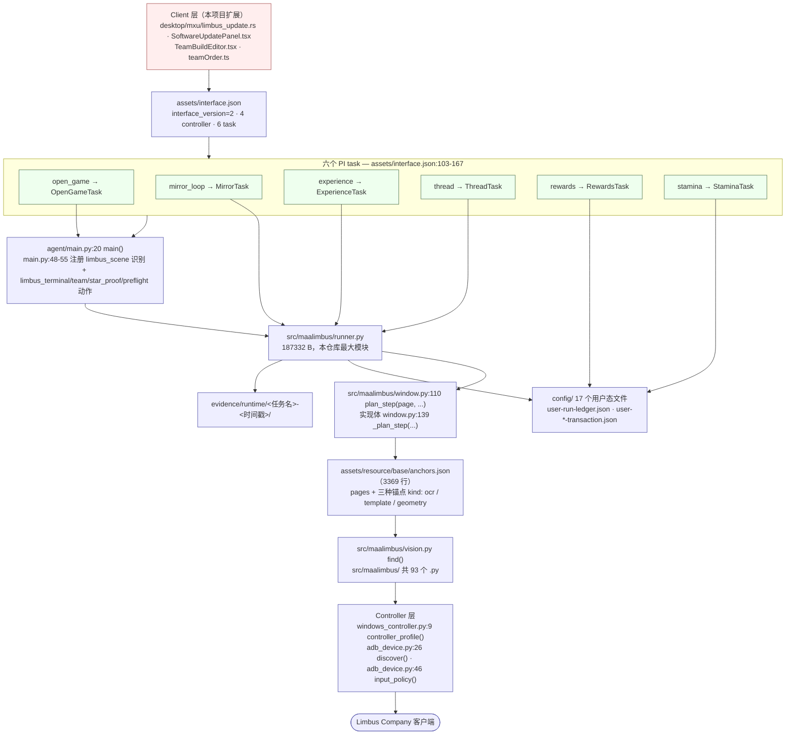
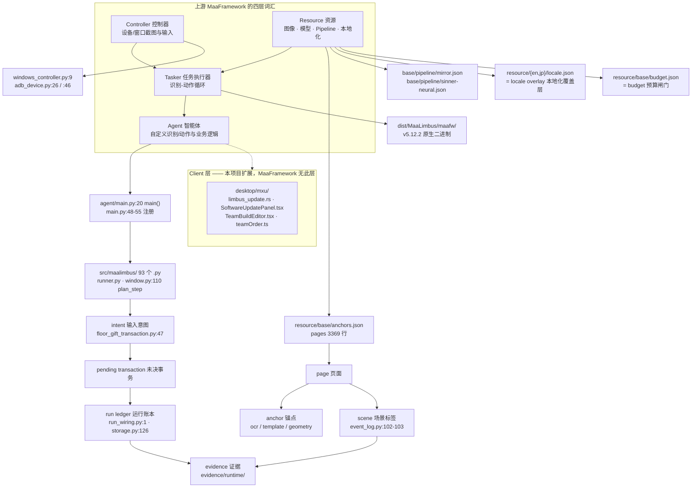

# 1 概览与术语

[English](../en_us/1-overview.md) · [← 索引](index.md)

**Current storage policy / 当前容量约定（用户最新调整）**: User revised the whole-project ceiling to3,000,000,000decimal bytes (3GB). This includes source/git/build/dist/caches/models/evidence and temporary output in the folder. Older2GB runs and measurements remain historical. Capture pair/stop/journal bounds, external updater session1GB, all proof/pending guards and game resource budgets are unchanged. Source Agent/launcher both require clean rebuild before installed3GB acceptance; no game spending is granted.

本章回答四个问题：MaaLimbus 是什么、六个主任务各做什么、现在完成到什么程度、文档里的词和依赖边界怎么读。每个技术断言都绑定可核验锚点（`相对路径:行号`、测试名或 `evidence/runtime/...`）；核验不到的显式写「未验收」。

## 1.1 这是什么 & 完成度

### 目标链路

- 一句话：**困难镜牢 1–5 层 → 确认领奖 → 切换已保存队伍 → 继续刷取**；之后是预算内的 Enkephalin 兑换/补充、邮件与每日任务（`PROJECT.md:9-10`、`README.md:25`）。
- 技术定位：MaaFramework Win32 controller + ProjectInterface V2 + MXU + Python Agent（`AGENTS.md:3`），面向 Limbus Company Windows 原生客户端，提供英语与日语资源包（`README.md:8`、`README.md:23`）。
- 上游版本钉死：`pyproject.toml:10` → `dependencies = ["maafw==5.12.2", "numpy>=2", "opencv-python>=4.10"]`；本机运行包捆绑的是同一个 release v5.12.2（`docs/maaframework-conformance.md:24-27`）。
- Pipeline 只有两个文件：`assets/resource/base/pipeline/mirror.json`、`assets/resource/base/pipeline/sinner-neural.json`。

### 六个主任务

任务声明在 `assets/interface.json`；标签与描述以仓库自带的 i18n 为准（`assets/i18n/zh_cn.json`、`assets/i18n/en_us.json`、`assets/i18n/ja_jp.json`）。

| task name | entry | 中文标签 | 仓库自述的职责 |
| --- | --- | --- | --- |
| `open_game` | `OpenGameTask`（`assets/interface.json`） | 打开游戏（`assets/i18n/zh_cn.json`） | Android 用 Maa 启动并确认前台；已打开时不重复启动。Windows 需先连接游戏窗口（`assets/i18n/zh_cn.json`） |
| `mirror_loop` | `MirrorTask`（`assets/interface.json`） | 自动镜牢（`assets/i18n/zh_cn.json`） | 用总设置保存的队伍、体系和出战顺序，在此选单队或轮换；默认困难，消费须有配置预算（`assets/i18n/zh_cn.json`） |
| `experience` | `ExperienceTask`（`assets/interface.json`） | 自动经验本（开发中）（`assets/i18n/zh_cn.json`） | 引用保存队伍，经 Drive 进入 Luxcavation；未完成镜牢会阻止导航（`assets/i18n/zh_cn.json`） |
| `thread` | `ThreadTask`（`assets/interface.json`） | 自动纺锤本（开发中）（`assets/i18n/zh_cn.json`） | 引用保存队伍，经 Drive 进入 Luxcavation；未完成镜牢会阻止导航（`assets/i18n/zh_cn.json`） |
| `rewards` | `RewardsTask`（`assets/interface.json`） | 领取镜牢奖励（`assets/i18n/zh_cn.json`） | 领取当前已通关镜牢的奖励，需要本轮模块预算（`assets/i18n/zh_cn.json`） |
| `stamina` | `StaminaTask`（`assets/interface.json`） | 体力兑换（`assets/i18n/zh_cn.json`） | 入口已于 2026-11-23 从界面移除：它只截一张图就返回未实现。管线节点 `StaminaTask` 和 Agent 分支保留，做好再放回任务列表 |

四个 controller 也在同一文件里声明：`windows-window`、`windows-background`、`windows`、`mumu-adb`（`assets/interface.json:14-68`）；资源声明 `en`/`jp` 两份（`:69-86`）。

### 完成度（诚实版）

`README.md:45-54` 的对照表是当前最集中的口径：

| 功能 | 已验证范围 | 未完成部分 |
| --- | --- | --- |
| Windows / ADB 控制 | MuMu 原生 Maa 输入、随机框内落点、进程和单控制器门禁 | Windows 游戏输入及日语实机 |
| 总设置与任务 | 六个 MXU 主任务入口、全局队伍、镜牢单队/轮换选择 | 总设置完整编辑重启与 GUI 开始执行验收 |
| 困难镜牢 | 英语实际五层（CLI/`window_step` 路径，见下）、完整藏品回执、真实付费领奖、Team2→Team7 再入场 | 任意布局、商店/融合、长期无人值守 |
| 战斗与选包 | 原生触摸 WinRate/START、独立 Hard/标题门禁、有界下拖 | 智能配卡、完整策略与日语 |
| 经验本 / 纺锤本 | 独立任务入口引用已保存队伍 | 实际关卡、消费和战斗流程；当前保存画面停止 |
| 体力兑换 / 每日奖励 | 独立入口和预算基础 | 实际页面和到账；当前保存画面停止 |
| GitHub 更新 | 桌面启动器接入缓存、持久限流、校验、保配置安装/失败回滚 | 公开新版本下载及可见重启版本 |
| 黑盒学习 | 实际Maa原生ONNX推理、预测框、独立教师/人工复核规则；当前购买5份延迟客观标签同属1episode | 模型仍shadow、input_authorized=False；原购买语料缺失，正式策略质量／自动再训练未验收。不能沿用10月「无模型／仅两样本」作当前事实 |

**源码与安装实证边界（2026-11-17）**：10月8日交接所述“成品只有入口能跑”已不是当前事实。当前frozen MirrorTask已实证同一Team2前两层及第三层地图／部署／战斗；1280实际节点、完整继承顺序和START→第2回合均有原始图／JSON。新的完整五层、最终到账／轮换及GUI绿色开始按钮整链仍未验收；历史CLI五层链不能补这些缺口。实时进度只查[当前检查点](9-execution-plan.md#current-checkpoint)，再核进程与原始页。

再补三条必须知道的口径：

- **没有已验收的发布包**，且「启动进程、任务返回成功和离线测试通过均不代表镜牢通关」（`README.md:31-32`）。一次英语困难五层链路（含领奖与保存队伍轮换再入场）有 MuMu 实机证据（`README.md:23`、`README.md:25`），但任意布局、版本与长期无人值守都未被承诺。
- **仍缺完整范围实证**：全人格／E.G.O核对、当前五层最终到账／轮换、原生GUI开始到终点、正式模型策略质量。部分pre_battle_identity_report与真实购买／GET链已实证，不能再整项写成“尚无任何实机证据”。见9.4和当前检查点。
- **商店与学习**：当前scope有5笔原生报价／购买／到账对账；存在已训练ONNX和购买评分候选，当前仍shadow。5份客观延迟标签来自同一episode，不是独立策略收益证据；不会自动冒充人工认可或批准新预算。详见9.4.1／9.4.2。

**证据落点**：运行证据在 `evidence/runtime/<任务名>-<yyyymmdd-hhmmss>/`，启动记录在 `build/native-launch*.json`，日志在 `build/native-live.*.log`（`README.md:64`）。本仓库当前该形态的运行目录为 918 个（本地目录计数，2026-10-12；数量会随运行增长）。

### 图 1：项目全景图

## 1.2 术语表

### MaaFramework 的四层词 + 本项目扩展的一层

上游把系统分成 Controller / Resource / Tasker / Agent 四层；MaaLimbus 沿用这套词汇并给出自己的落点。**注意最后一层 Client 是本项目的扩展，MaaFramework 里没有这一层**，本 wiki 一律显式标注。

| 层 | 英文原名 | 中文 | 职责 | MaaLimbus 落点 |
| --- | --- | --- | --- | --- |
| 1 | Controller | 控制器 | 设备/窗口截图与输入 | `src/maalimbus/windows_controller.py:9 def controller_profile(interface_path: Path, name: str)`；`src/maalimbus/adb_device.py:26 def discover(serial, adb_path=None)`、`adb_device.py:46 def input_policy(record, allow_fallback=True)` |
| 2 | Resource | 资源 | 图像/模型/Pipeline/本地化 | 声明在 `assets/interface.json:69-86`（en/jp）；`assets/resource/base/anchors.json:6`；`assets/resource/base/pipeline/mirror.json`、`assets/resource/base/pipeline/sinner-neural.json`；`assets/i18n/{zh_cn,en_us,ja_jp}.json` |
| 3 | Tasker | 任务执行器 | 执行 Pipeline 的识别-动作循环 | 上游 MaaFramework 二进制（运行包内 `dist/MaaLimbus/maafw/`）；版本与出处核验见 `docs/maaframework-conformance.md:8-27` |
| 4 | Agent | 智能体 | 自定义识别/动作与业务逻辑 | `agent/main.py:20 def main()`；`agent/main.py:128-140` 注册自定义识别与动作（`limbus_scene`、`limbus_terminal`、`limbus_map_observe`、`limbus_battle_observe`、`limbus_mirror_loop`、`limbus_main_task`）；实现体在 `src/maalimbus/` |
| 5 | **Client（本项目扩展，MaaFramework 无此层）** | 客户端 GUI | ProjectInterface V2 客户端界面 | `desktop/mxu/limbus_update.rs`、`desktop/mxu/SoftwareUpdatePanel.tsx`、`desktop/mxu/TeamBuildEditor.tsx`、`desktop/mxu/teamOrder.ts` |

### 规范词典：唯一语义入口

本节是正式规范的术语定义源；上下文文档和后续章节引用这里，不各自重定义。历史字段经兼容适配解释，不能仅靠改名宣称已迁移。目标契约见[2.6](2-architecture.md#feature-2-6)，实现进度见[9.4.6](9-execution-plan.md#runtime-migration)。

| Canonical term | 中文 | 定义与禁止混用 |
| --- | --- | --- |
| `Frame / FrameRef` | 帧及其引用 | 公共不可变FrameRef绑定原文件位置、frame_id、捕获时间或显式未知、JSON／PNG哈希及实际尺寸；原生绑定器校验字节后创建。捕获时间不是后续读取事件时间，同像素不等于同一捕获或业务成功。 |
| `EvidenceCensus / RequiredProof` | 诊断清单 / 必须保留的证明 | 一次性的诊断全量哈希核验清单，与必须保留的业务证明端点不同；声明必须匹配原报告SHA及限定schema。只有截图所有者已判定可回收的非关键诊断图才可退出保留，账本/model/review独立引用仍覆盖。 |
| `EvidenceReportRef` | 封存报告引用 | 原报告路径、字节数、SHA256与可选归档成员定位；不等于当前运行状态或交易收据。压缩后原有帧保护引用必须保持不变。 |
| `Observation` | 观察记录 | 不可变的观测事实、页面假设、前景控件、几何与来源；不隐式选目标。统一类型是迁移目标，当前原生帧记录需适配。 |
| `identity_only` / `battle_hint` | 读取范围 / 调度提示 | MaaObserver现有参数：前者只读新鲜页面身份，后者只决定新原生读取的先后；都不是业务完成、缓存控件或输入授权。 |
| `CAPTURE_PROFILE` | 原生截图生产者格式 | bgr8-json1mb-v1同时约束Journal实际输出与未来证据预留：uint8 BGR三通道、完整JSON不超过1,000,000字节；不代表识别阈值或游戏成功。 |
| `NativeFrameBinding` | 原生帧字节绑定 | 逻辑证据值；`native_evidence.bound_frame`返回原JSON/PNG hash及记录，验证像素/尺寸绑定。不是业务状态类，不推断页面、动作成功或胜利。 |
| `scene / page / Overlay` | 场景标签 / 裁决页面 / 遮罩 | scene 是生产者输出的场景标签；page 是本次决策采用的前景页面身份；Overlay 是可能拥有输入权的覆盖层。旧字段同名不证明前景已裁决。 |
| `anchor` | 锚点 | 可复检的识别断言；现有 anchors 模块的 kind 为 ocr/template/geometry。识别锚点不等于授权输入。 |
| `BoundingBox / viewport_revision / map_pitch` | 检测框 / 视口版本 / 地图间距 | 框是有坐标空间的矩形；视口版本在缩放/平移后使旧坐标失效；间距是节点中心距离，不是框宽或屏幕分辨率。 |
| `CalibrationPixels / CapturePixels / DevicePixels` | 校准像素 / 捕获像素 / 设备像素 | 历史控件与手势使用1920×1080校准；`frame_coordinates`仅将其换成当前截图坐标。地图/主题可在1920分析栅格测量，但必须返回原捕获尺寸。Maa独占捕获到设备输入转换，Python不得二次缩放；这些像素坐标不是注册表1280归一化参考尺寸。 |
| `CaptureProfile` | 捕获尺寸策略 | Maa原生截图尺寸选择；已验证HUD可用1280，跨页／不足独立重捕1920；不是页面身份、输入授权或模型质量。每份原始PNG实际尺寸为准，分析插值不改变证据尺寸。 |
| `startup_previews / required` | 启动诊断副本 / 执行前必需图 | Same input-free capture prefix; common native identity/time checks, domain-owned semantic equality. The actor before-image and actual input/review references remain required. These storage roles never authorize an action, credit a reward or approve policy quality. |
| `inflight_reads` | 未决普通回合的中间读取 | Unreferenced UNKNOWN/LOADING sampling after an anchored ordinary START reservation; keep before/first/latest and every review pin. Pending stays pending; this is neither a page-class prediction nor outcome/learning approval. |
| `OwnedRoster (account Box)` | 账户已拥有人格集合 | 用户点击罪人后看到的已拥有人格，与全图鉴 index 对账；不使用 Box 指代检测框。 |
| `Sinner / Identity / E.G.O` | 罪人 / 人格 / E.G.O | 罪人是十二位角色之一；人格是角色的可装备形态；E.G.O 是独立装备。识别罪人不证明人格或 E.G.O 已装备。 |
| `TeamSlot / SavedTeamProfile / PresetSlot` | 游戏队伍槽 / 保存方案 / 预设槽 | 游戏左栏 1–40 队号、脚本保存的体系/顺序方案、游戏预设槽属于不同命名空间，不能凭整数相等互认。 |
| `DeploymentOrder / GridCell / rotation_cursor` | 出战顺序 / 网格位置 / 轮换游标 | 顺序由选中序号证明；网格是卡片位置；游标是轮换队列下标，不是队号。 |
| `LaunchSpec / RunState` | 启动规格 / 运行事实 | LaunchSpec 固定本次已解析的任务、队伍、次数、策略和预算引用；RunState 保存当前 scope、阶段、绑定及业务事件。新设置不能静默改写旧未决动作。 |
| `ActionProposal / ActionAttempt` | 动作提议 / 输入尝试 | 提议包含候选、分数、约束与后继判据；action_id 标识逻辑动作，attempt_id 标识一次物理尝试。提议不是已发送。 |
| `TargetRole` | 目标角色 | 地图节点适用格距/导航事务；页面控件适用自身控件绑定。角色不能由当前页面或裸坐标猜出；未迁移 MAP 点击保持节点门禁。  当前房间检查仅由原帧哈希和完整列车几何绑定，不是新目的地，不由任意 MAP role 字符串豁免格距。 |
| `SelectionCommit` | 选择计数提交 | Domain-settled one-step participant-count increment, bound to original JSON/PNG hashes and the planned prefix. It does not verify identity, E.G.O, order, battle or payout. Its only consumer currently bounds diagnostic storage. |
| `RecorderSession` | 捕获会话 | One process-owned capture directory/log; restarting it does not create a new game RunScope. Verified selection diagnostics may be superseded across recorders in the same progressing domain scope. |
| `intent / pending transaction` | 持久意图 / 未决事务 | intent 在可能输入前持久化，因此只能证明尝试已预留，不能单独证明已发送；pending 表示结果未结算，也可能是发送状态不明。恢复先核证据，不凭 pending 重放。 |
| `TransitionEvidence / TransitionVerdict` | 后继证据 / 后继裁决 | 证据绑定前后 FrameRef 与原生动作轨迹；裁决唯一值 accepted/rejected/unjudged。unjudged 不是失败样本或成功；历史 undetermined 文案归入 unjudged。 |
| `dispatch_status / input_sent` | 原生提交状态 / 旧尝试标志 | `uncertain`表示已尝试但执行结果未确认；`input_sent=True`在此表示请求尝试，不是游戏效果、账本事件或训练真值。不能换通道重放，不同于发送前拒绝。 |
| `borrowed controller` | 回调内借用的原生代理 | Maa5.12.2 RemoteTasker每次controller getter替换旧代理；同一回调只解析一次并共享，不跨回调缓存。设备、截图策略和startup检查必须遵守此生命周期。 |
| `node_preview.enter` | 当前帧派生控件 | 捕获坐标[x,y,w,h]，不是Text对象或持久化字段；从当前具名预览自己的OCR/size派生，不借前帧缓存。它只提议Enter，不证明已进入房间。 |
| `passed (legacy field)` | 旧通过标志 | 必须按生产者解释：可表示计划允许继续、节点返回或脚本步骤通过；不能直接映射为后继 accepted、通关、到账或训练标签。 |
| `Receipt / Acknowledgement / run ledger` | 收据 / 确认输入 / 运行账本 | Receipt 是绑定业务对象/数额/后继的结果证据；Acknowledgement 是关闭或确认动作；账本仅接纳已证明业务事件。点击 Confirm/GET 不等于已入账。 |
| `floor_clear / final_victory / reward_received / HOME / reentry` | 楼层完成 / 最终胜利 / 到账 / 主页 / 再入场 | 五个独立事实，分别给出证据。到达下一层不等于最终领奖，看到主页不等于本轮到账，看到入场页不等于新轮已进入。 |
| `ExecutionBudget / ResourceBudget` | 执行预算 / 资源预算 | 执行预算限制尝试、时间、步数；资源预算必须给 scope、币种/单位、上限与 fresh 报价。局内币、星光、Module、Lunacy 不能用裸整数互换。 |
| `CompletionFact` | 业务完成事实 | 经原始帧和当前 run scope 校验的业务完成事实，可由观察直接产生，不依赖下一次点击成功；不等于 ActionOutcome、资源授权或策略质量。当前地图检查点由 run_wiring.observe_map_checkpoint 产出。 |
| `EvidenceCapacity / reserved credit` | 证据容量预留 | 计入项目总大小的存储空间信用；不是 Module/星光等资源授权，不代表输入已发送、事务完成或标签已批准。 |
| `refresh credit / input successor credit` | 观察预留 / 输入后继预留 | 源码purpose refresh仅为一次完整观察加停止余量预留，不授权物理输入；独立新记录之后另行足额预留两份输入后继。同生产者上限及3GB，不是游戏资源授权。 |
| `storage credit handoff` | 未使用容量交接 | 下次输入前，单一同步Journal可在压力下交回自己未用的占位；实际派发前必须重新预留相同完整两组后继及停止／日志余量。实际图片、pending和消费权威不变。 |
| `journal_scope` | 录制scope绑定 | 只消费typed start.run_scope／proposal.episode显式事实。缺字段可由一致显式事实补足；null、非法、冲突或完全没有事实不能绑定。仅用于诊断归属。 |
| `drive_menu_probe` | 模式字幕读取探针 | A mode-only anchor permits at most two native OCR crops on the same pixels and vetoes HOME. It is neither a DRIVE verdict, a click target nor a game result. |
| `service_notice` | 服务器前景通知 | 精确维护标题否决背景输入和旧局归档；恢复原文没有日期，不生成重试期限。完整唯一Close只授权一次有界导航；独立后继只标注关闭，不授予服务器／业务局状态。 |
| `client_update_required` | 游戏客户端必须更新的前景通知 | 游戏精确文案否决背景TITLE；Close／Store框仅是元数据，不授权输入；客户端更新不等于登录或镜牢成功。 |
| `login_response_wait` | Start已确认发送，等待服务器／界面后继 | 使用原180秒绝对窗口并受任务截止时间收紧；重读不续期、不重复Start，不结算业务到账。 |
| `discarded capacity plan` | 容量维护后丢弃的只读计划 | Never submitted; exact typed admission and an earlier native representative are required before duplicate retirement. Reobserve/replan before dispatch; not an actual-input boundary or outcome. |
| `cold diagnostic retirement` | 冷诊断退役 | 普通领域删除分组可退役未被引用的归档中间诊断；存活PNG原字节及全部JSON／journal保留。archive committed仅为存储收据，不代表游戏完成或标签批准。 |
| `lossless archive / diagnostic reclamation` | 无损归档 / 诊断回收 | 前者按闭合会话、独立引用与原字节绑定决定冷存储资格，保留完整原PNG/JSON，不解释页面或批准业务；后者另需领域已回答的诊断角色，才可永久回收非关键中间截图。强引用原图继续留raw，除非其所有读者已另行迁移验证。 |
| `verified_reads` | 原图读取会话 | 单次plan/reserve共享的有限RAM缓存，每次仍读实际索引/容器字节并验SHA；原图存在时优先，退出释放。不改变FrameRef身份、2GB磁盘上限、回收资格或动作授权。 |
| `NavigationCheckpoint` | 导航检查点 | 新鲜稳定页/hash/原ROI文字已满足后续等待；跳过旧导航步骤，不代表曾发送输入或业务成功。 |
| `capture_reclaim_intent` | 存储回收意图 | 整组具体文件回收前已持久化的存储义务；只可继续删除同一原JSON/PNG哈希的旧诊断，新增业务/model/review引用或字节变更继续保护。它不等于游戏输入intent，不批准动作结果或学习标签。 |
| `CaptureSessionSeal` | 采集封存 | 输入生产者结束的存储事件；不裁决游戏 pending、收据或学习标签。 |
| `RuleScore / NeuralScore / DecisionLog` | 规则分 / 神经分 / 决策记录 | 分别记录分量、权重、排序方向、约束、最终分与选中原因；只由一个策略所有者完成最终排序。得分高不等于质量已通过。 |
| `InferenceExecuted / PolicyParticipated / DecisionChanged` | 执行推理 / 参与策略 / 改变决策 | 三个不同事实：运行模型、分数进入正式排序、相对无模型基线改变选择。旧 model_applied/learned_applied 按生产者原语义适配，不统一冒充生产授权。 |
| `Prediction / TeacherLabel / HumanReviewed` | 预测 / 教师标签 / 人工复核 | 预测不是独立教师；后继验证可批准客观动作结果，不批准策略最优。自动 approved 不等于人工认可；人工修订优先且保留来源。 |
| `TrainingEligible / QualityPassed / ProductionEnabled` | 可训练 / 质量通过 / 生产启用 | 三层分别证明；ModelTrained 只表示有训练产物。off/shadow/ranked 等旧模式按各模型现有实现解释，shadow 不接管设备输入。 |
| `Episode / CaptureSession` | 独立游戏局 / 采集会话 | Episode 以真实 run scope 区分完整游戏局；一个 scope 可跨多个重启采集会话。训练/验证按 episode 切分，不能把重启后的相邻帧当独立局。 |
| `Designed / Implemented / Installed / LiveVerified / E2EAccepted` | 规范确定 / 源码实现 / 已安装 / 实机验证 / 整链验收 | 架构接受是规范决定；其余状态需各自提交、安装与指定范围实证。局部实机验证不得缩写为整个项目已完成。 |

### 图 2：术语关系图

## 1.3 依赖与许可边界

### 上游 vendored 关系

- `sources/upstream/MaaFramework/` 是本仓库内的一份 MaaFramework 源码检出，当前 HEAD = `cc5fef675f42ca899e12bc4932ff37ac1278853c`（本地 `git rev-parse HEAD`，2026-10-12）。许可与来源清单记录的规格/API 阅读锚点正是该 commit（`THIRD_PARTY_NOTICES/README.md:9-16`）。该检出 `git describe --tags` 无 tag 可用，所以**以 commit 为准**，不要引用 tag。
- 运行包捆绑的是同一个 release v5.12.2：`docs/maaframework-conformance.md:24-27` 记录本机 `build/portable check .../build-info.json` 的 `inputs.maa = MAA-win-x86_64-v5.12.2.zip`，与 `pyproject.toml:10` 的 `maafw==5.12.2` 一致。
- 本机另有 `build/maafw-v5.12.2/`（读规格时的本地副本）与 `build/maafw-src/`（`docs/maaframework-conformance.md:17-22` 列出的阅读清单）。

### MXU

- MXU 2.7.1，commit `9fa8cc51e8ff8cd89d99f3ea55fe3a7a82e6ede3`，是本项目改过的 Windows 桌面可执行文件的基础；原始 AGPL 声明在 `THIRD_PARTY_NOTICES/MXU-AGPL-3.0.txt`（`THIRD_PARTY_NOTICES/README.md:19-20`），随包源码 `sources/MXU-v2.7.1-source.zip`（`THIRD_PARTY_NOTICES/README.md:22`）。改动候选另带 `MXU-MaaLimbus-source.zip`（`THIRD_PARTY_NOTICES/README.md:23`）。
- **边界**：MXU 的 AGPL-3.0 标注在（`THIRD_PARTY_NOTICES/README.md:26`），根许可证不重新授权第三方材料（`README.md:70-74`）。

### 许可文本与边界

- 本仓库自有代码：AGPL-3.0-or-later，见根 `LICENSE`（`THIRD_PARTY_NOTICES/README.md:3`、`README.md:70`）。这是本项目此前的选择，**不是 MaaFramework 要求应用采用 AGPL**（`README.md:70`）。
- MaaFramework 原生运行时 5.12.2 是 **LGPL-3.0**（不是 AGPL）：原文 `THIRD_PARTY_NOTICES/MaaFramework-LGPL-3.0.md`，及其引用的 `THIRD_PARTY_NOTICES/GPL-3.0.txt`（`THIRD_PARTY_NOTICES/README.md:9-10`、`README.md:72`）；v5.12.2 的实际 release commit 与源码压缩包见 `THIRD_PARTY_NOTICES/README.md:14-16`。
- LALC 来源素材 AGPL-3.0（`THIRD_PARTY_NOTICES/README.md:26`）；MaaCommonAssets（`dabcd4681ac990dc4361de26416d986abd80e4aa`）MIT（`THIRD_PARTY_NOTICES/README.md:39-40`）；PaddleOCR Apache-2.0（`THIRD_PARTY_NOTICES/README.md:41-42`）。
- 冻结 Python/MaaDeps 运行时 notice：新 Windows 包需要保留 MaaDeps v2.12.2 Windows 运行时（`THIRD_PARTY_NOTICES/README.md:49-57`）。
- 分发边界：新 Windows 包需附带许可文本、来源版本、构建说明及适用的对应源码，**目前尚未发布该包**（`README.md:76-78`）；Lix 来源的素材不能靠替换根许可证改成 LGPL（`README.md:74`）。

## 本章未覆盖

- 各模块的职责边界与设计取舍 → 第 2 章。
- 一次运行内部的控制流与时序 → 第 3 章。
- 端到端业务链路的分步说明 → 第 4 章（本轮预留未交付）。
- `config/` 17 个用户态文件的字段含义与 run ledger 的完整数据模型 → 第 5 章。
