# 3 运行时

[English](../en_us/3-runtime.md) · [← 索引](index.md)

<a id="page-journey"></a>

### 页面组件与可续跑的路径记录

原生 Agent 为每次尝试分配 `step_attempt`。同一次的识别、动作意图和后继观察写入相同编号，重新观察与重新规划会分到新编号。 `step_observation` 同时记录阶段、原帧、哈希和耗时。该标识只用于关联日志，事务及后继仍各自提供成功证据。

镜牢自己的读取和输入节点通过 `native_pipeline_task` 记录 MaaFramework 的流程、识别与动作回调，包括各自的编号和单调时钟耗时。`Context.run_task` 返回的子任务编号把回调记录与 `step_observation` 的原帧绑定。回调 Context 可能指向父任务，因此用子任务的返回值关联。Agent 只收集六个镜牢节点，排除回调的 focus 与 OCR 内容。原生动作失败时，MXU 任务日志显示节点、任务编号及耗时。识别候选落空不会输出动作失败。MXU 在执行前注册客户端回调。

`PAGES` 是页面名和归属表，`anchors.json` 描述组件，`describe_page` 把实际读到的组件绑定到这张原图。已读清、未读清、多候选、历史几何和未检查分别记录。静态框与未检查的图像模板都不算本帧可用控件。入口的 `entry.enter_button` 和 `entry.status` 复用分类器自己的 OCR 读数。实机 Team2 的第 3 层入口里 Enter 和 Exploring 同时可见，单看 Enter 无法区分续局和开新局。

运行时在 `events.jsonl` 写入 `page_checkpoint`。页面、楼层或组件状态变化时，记录原帧、组件和账本剩余里程碑。有动作方案时，在预留与派发之前记录控件、动作和允许的后继。提议、实际输入、独立后继和账本到账保留各自的记录。`python tools/run_ledger.py status --journal <events.jsonl>` 为同一局显示已观察的路径、最后画面、同帧提议和已验证楼层。分支房间由现场决定。旧记录可以定位中断点，重启先看新帧并核对未决事务，再从当前页面续跑。后到的不同画面使旧方案退出当前视图。

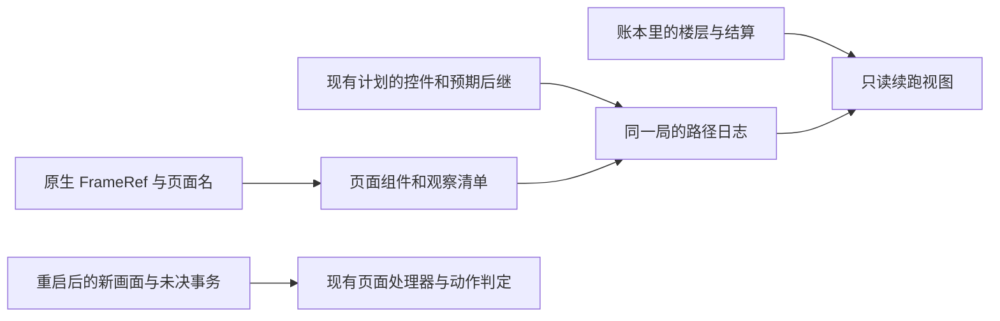

当前 `PAGES` 有 63 个名称，43 个能直接对应已有组件目录。目录覆盖数不代表每个组件都已通过实机验证。首段把镜牢入口、预留阶段及日志读者接通。后续把各页面已有的动态读取接入同一组件输出，并逐页验证缺失和歧义反例。文件中断、手动切页、同名页进入不同子状态均需要独立后继实证。

<a id="battle-progress-lifetime"></a>

### 跨存储补观察的单一战斗进度写入者

#### 表盘位置与回合就绪

同一场 Team2 的原帧区分了这两件事。`packaged-mirror-20261119-160101` 的未配卡表盘在两种截图尺寸下都未通过严格亮盘识别。没有 `START` 字样时，按 Win Rate 文字找位置的兜底仍返回了目标，实机提前点击后回合未动。随后 Win Rate 配好了技能并亮起 `START`。独立的存储补观察仍读到这一状态，随后旧停滞计数结束了任务。

本次回放核对了 10 张原始 PNG 的哈希。离线从识别输入去掉 `START` 后，暖色像素占比随兜底框而变。当前未配卡两帧为 0%，已配卡约 79%，但此前一次真实推进第 4 回合的画面去掉文字后只测得 16%。另有一张无文字原帧通过了现有严格亮盘判定。当前的 0% 和 79% 分界不足以确定通用亮度阈值，强制阅读文字也会遗漏无文字的原帧。测量明细保存在本地 `build/battle-start-readiness-review.json`。

`start_button` 同时服务 `BattleObservation` → `MaaObserver` → `MirrorRunner` → `plan_step`，以及 `begin_turn_plan` → 原生 `BattleStartTurn` 节点。安装版续跑若仍出现提前空点，先在同一帧传递证据类型。明确的 START 或严格亮盘可支持直接提交；只有位置兜底时，连续任务先用已配置的配卡控件，再独立读取本回合的新证据。单独提交节点没有配卡历史，需要自身的就绪证据。修改前用未配卡、已配卡、无文字和回合中断样本走两条入口。提交是否推进仍由新回合、攻击阶段或结算页独立判定。下一次整局续跑使用当前已安装的战斗计数修复。

实际安装de63542的160101运行发送MAX、未就绪金色表盘、WinRate；原始frame8已配卡/START亮起。只读预留丢弃未发出的提交，frame9已独立新读，却在足额输入再准入前以battle_progress_stalled结束。因此仅补观察实机成立，不能称其后完整输入链通过。build/battle-refresh-live-outcome.json保留19份原始文件、106private/33canonical，目录2,983,506,218字节。机制复盘找到battle_progress和旧内联块对同一HUD重复计数。方案：只保留一个写入者，纯存储补观察不再扣相同回合的停滞额度；普通冻结HUD仍按原上限停止，真实换回合重置，三次补观察/总截止/物理双后继足额要求不变。金色外框不等于配卡就绪，不无测量改视觉阈值。源码反例/修正→全量逐例XML→干净冻结→同Team2正常连续任务。整局/付费收据/模型提升/0048缺口仍开放。

源码已实现：移除旧重复进度块，仅用既有capacity_reobservations标记未发送计划的存储补观察，同回合不重复扣停滞额度。274相关通过/93历史跳过/36.04秒/自身退出0。新增5例包含原始已配卡帧/原生事件包→完整Runner→模拟START派发、普通单次计数/冻结停止、三次刷新上限、真实换回合重置及盲读计数保留。同5例在原04557e8源码全部失败。初版回放夹具漏了原生事件字段，之后又忽略原始帧reader会去掉frame名；均修正夹具，没有改原始记录或游戏门。最终全量XML/冻结/实机续跑仍待完成。

安装前已补相邻生命周期修正：独立命名且非战斗/非加载的页面清掉上一场进度和盲读计数；UNKNOWN、LOADING、BATTLE_TIP、BATTLE_PLANNING保留同场归属，正常配卡观察仍计一次并可停滞。314相关通过/93历史跳过/61.31秒/自身退出0。共新增11例：前5个原始事件/存储衔接，加6种页面生命周期；原HOME/MAP边界反例修前2失败/3通过。初稿因LOADING已命名而误重置，反例发现后用既有is_loading明确排除；配卡夹具改为带可读波次/回合并预期普通一次计数。此前全量为这项必要邻接修正主动中止于35percent/退出-1，未计通过。完整尝试4027通过/701跳过/1项NAV文档失败/843.31秒/自身退出1；第3章双语导航恢复到第3行后，73项Wiki/隐私检查通过82.51秒/自身退出0。运行时SHA与完整尝试完全相同，XML新增11项运行时通过/无更多运行时状态丢失；没有重跑第二次完整套件，不称完整尝试全绿。新增局部图时应先跑导航/格式检查再跑长回归，路由结构不能代替章节布局校验。实际干净f94661d Agent已安装/退出0；549源码、13完整编译身份/自检及实际冻结Runner计数/六个合成页面边界通过；保留冻结原生缓存/容量原帧回放、内存暂存读回。106private/33canonical/19当前原始证据不变。源码/冻结7210引用/143归档报告一致，Launcher未改。build/battle-refresh-installed-verification.json。封闭维护按精确ZIP移除12份重复副本/3,487,105字节，全部唯一字节/packet/当前原始证据保留，目录2,985,782,070字节。下一步新页面和同Team2连续实测，不称GUIStart/整局/领奖/轮换/模型提升/0048恢复；完整尝试的NAV失败和随后73项Wiki通过仍分别记录。

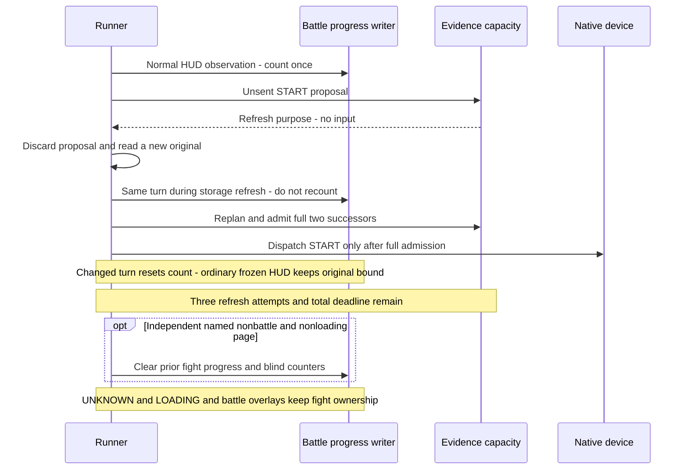

本章讲「一次运行里，画面怎么变成动作、动作怎么发出去、循环什么时候停」。
<a id="dead-producer-handoff"></a>

### 生产者退出、结果归属与停机诊断

`jobs.wait_task` 与 `stop_tasker` 现在连“提交原生停止请求”本身都覆盖在期限内，而不是只轮询一个可能根本拿不到的job。安装版验证器也限制断连调用，只回收自己拥有的子进程，先保存失败报告，再退出可能重入无响应调用的原生析构路径。收尾不会重试游戏动作，也不把未确认停止算成功。

OpenGameTask成功且独立前台验证通过后，验证器先核对另存的原始启动结果字节，再退役共享结果文件名。MirrorTask必须写自己的新结果；看门狗退出不能继承 `game_already_foreground` 作为镜牢结果。原始启动证明仍保留。

两个看门狗的结束记录都保留实际执行线程最多24层Python位置：仅文件名、行号、函数名，不记录源码文本、局部值或参数。它用于诊断下一次原生/几何/存储卡住的位置，不能倒称已证明上一轮未捕获的原因。原生读/输入与存储仍有各自期限。

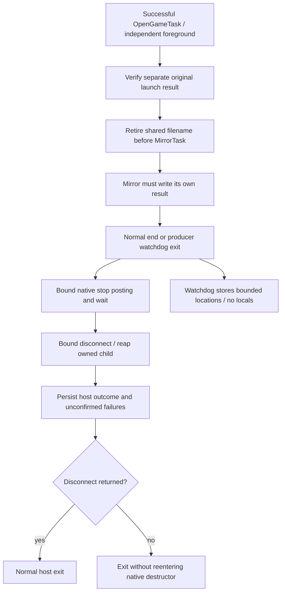


- 上游词汇对照：Controller（截图/输入）、Resource（图像/模型/Pipeline/本地化）、Tasker（跑 Pipeline 的识别-动作循环）、Agent（自定义识别/动作）。
- 本项目自有扩展（MaaFramework 无此层）：Client = ProjectInterface V2 客户端 GUI（`desktop/mxu/`）。

阅读约定：`相对路径:行号` 是可核验锚点；凡未亲自打开确认的内容，本章显式标注「未验收」。

---

## 3.1 识别与页面模型

### 3.1.1 两层命名：`scene` 与 `page`

运行时有**两个**页面标识，不要混用。

| 标识 | 定义者 | 入口 | 判据 |
|---|---|---|---|
| `scene` | OCR 文本 + 归一化位置 | `src/maalimbus/vision.py:63 def classify(records, locale, size)` | 本帧读到哪些字符串、落在哪个 ROI |
| `page` | 锚点表 `pages[].id` | `src/maalimbus/runner.py:839 def resolve_scene(registry, directory, record)` | scene + 锚点命中 + overlay 优先级 |

- 文本读取原语：`src/maalimbus/vision.py:19 def find(records, pattern, roi, size, threshold=.65)`；文本记录类型 `src/maalimbus/vision.py:13 class Text`（`text / box / score`）。
- overlay 压过底层标签：`src/maalimbus/window.py:79 def resolve_overlay(page, *, overlay_hit)`，命中即返回 `'TUTORIAL'`（`src/maalimbus/window.py:88`）。理由写在 `src/maalimbus/window.py:82-86`：overlay 自己的 continue 控件不随卡片变化，所以「看得见 continue」优先于下面的标签。
- 自清页面列表 `WAIT_PAGES`：`src/maalimbus/window.py:76`，值为 `('UNKNOWN', 'BATTLE_RESULT', 'DEFEAT')`。这些页面 planner 不发输入，driver 只等它自己变。

### 3.1.2 anchor 表

文件：`assets/resource/base/anchors.json`（共 3369 行）。运行期常量：`src/maalimbus/runner.py:225 REGISTRY = ROOT / 'assets/resource/base/anchors.json'`。

顶层结构（`assets/resource/base/anchors.json:1-6`）：

```json
{
  "version": 1,
  "reference_width": 1280,
  "reference_height": 720,
  "note": "...",
  "pages": []
}
```

每页字段（以 `map` 页为例，`assets/resource/base/anchors.json:7-45`）：

| 字段 | 含义 | 例 |
|---|---|---|
| `id` | 页面 id，就是运行时的 `page` | `"map"`（:8） |
| `title` | 人读的标题 | `"楼层地图（Exploring Floor N）"`（:9） |
| `evidence` | 该假设的留档观测路径 | `"evidence/runtime/map-advance-20261006-014737/frame-0001.json"`（:11） |
| `identity[]` | 判据锚点 | `map.floor`（:16）、`map.pack_name`（:29） |
| `controls[]` | 已证明的控件框 | `map` 页为空（:42） |
| `live_derived[]` | 不写死坐标、现算的量 | `map_vision.node_markers(image)`（:44） |

`identity` 锚点的形状是 `{id, kind, pattern, roi, threshold, note}`（`assets/resource/base/anchors.json:15-27`）。`kind` 的合法值：`src/maalimbus/anchors.py:19 KINDS = ('ocr', 'template', 'geometry')`。

锚点表的加载与离线复检全在 `src/maalimbus/anchors.py`：

- `src/maalimbus/anchors.py:24 def load(path)`、`src/maalimbus/anchors.py:31 def validate(registry)`、`src/maalimbus/anchors.py:53 def validate_anchor(anchor, page_id)`
- `src/maalimbus/anchors.py:92 def resolve_evidence(registry, root)`
- 逐 kind 的判据：`check_ocr`（`:122`）、`check_template`（`:132`）、`check_geometry`（`:159`）
- 汇总：`src/maalimbus/anchors.py:169 def evaluate_anchor(...)`、`src/maalimbus/anchors.py:192 def evaluate(...)`、`src/maalimbus/anchors.py:212 def failures(report, *, require_geometry=False)`

运行期把锚点表摊成 `{anchor 名: 像素框}`：`src/maalimbus/runner.py:693 def controls_by_id(registry: dict) -> dict`。planner 拿到的 `controls` 就是这个映射（`src/maalimbus/window.py:146-147` 的 docstring 明确：`controls` maps anchor names such as `node_panel.enter_button` to pixel boxes）。

### 3.1.3 视觉识别模块

地图页几何全部现算，集中在 `src/maalimbus/map_vision.py`：

- 阈值常量集中在文件头：`REFERENCE_WIDTH = 1280`（`:48`）、`BADGE_THRESHOLD = 0.90`（`:49`）、`LATTICE_PITCH = (384, 320)`（`:537`）、`CLICK_SIDE = 40`（`:538`）。
- 节点与玩家：`class NodeMarker`（`:132`）、`badge_nodes`（`:146`）、`node_markers`（`:186`）、`player_marker`（`:238`）、`flame_player`（`:275`）、`yellow_flame_player`（`:293`）、`player_of`（`:396`）、`train_player`（`:418`）。
- 通路与候选：`lit_nodes`（`:715`）、`lit_rings`（`:720`）、`path_end`（`:734`）、`marker_boxes`（`:791`）、`chevron_target`（`:816`）、`advance_candidates`（`:490`）、`advance_plan`（`:511`）。
- 点击与整页：`map_clicks`（`:853`）、`map_header`（`:1147`）、`map_page`（`:1196`）、`read_map_asset`（`:1224`）、`route_decision`（`:1239`）。
- 非地图页：`node_panel`（`:94`）、`enter_target`（`:124`）、`pre_battle_team_page`（`:1129`）、`battle_target`（`:1140`）。

同目录下的其它视觉模块（依据 `agent/recognition.py:20-43` 的 import 列表，本次未逐个打开正文）：`battle_vision`、`team_vision`、`gift_vision`、`theme_vision`、`grace_vision`、`star_vision`、`overlay_vision`、`overlay_dismissal`、`shop_vision`、`event_vision`、`deployment`、`deployment_*`。

### 3.1.4 本地化 overlay

**与共享事实契约的冲突（以代码为准）**：契约写「`assets/resource/base/locale.json` 叠在 base 上」，但该文件**不存在**。实际布局是：

| 文件 | 行数 | 作用 |
|---|---|---|
| `assets/resource/en/locale.json` | 89 | Agent 识别用的英文正则表 |
| `assets/resource/jp/locale.json` | 26 | 同上的日文表 |
| `assets/resource/en/pipeline/locale.json` | 1（内容 `{}`） | MaaFramework 管线文本本地化（en） |
| `assets/resource/jp/pipeline/locale.json` | 未验收 | 同上（jp） |

加载点只有一个，且**只加载所选语言那一份**，没有 base 叠加：

- `agent/recognition.py:103 self.locale = json.loads((ROOT / f'assets/resource/{locale}/locale.json').read_text(encoding='utf-8'))`
- 语言名来自 ProjectInterface 的 `resource.name`，缺省 `'en'`：`agent/main.py:42-45`（`resource = json.loads(os.environ.get('PI_RESOURCE','{}'))`；`locale = resource.get('name','en')`；`recognition = LimbusRecognition(locale)`）。

用法是「按 key 取正则再交给 `vision.find`」，例：

- `agent/recognition.py:421` — `find(records, self.locale['gift_confirm'], (.53,.65,.68,.73), size, .85)`
- `agent/recognition.py:159` — `find(records, self.locale['inferno'], (.70,.07,.99,.3), size)`
- `src/maalimbus/vision.py:57` — `locale.get('cancel', r'(?!x)x')`

`jp` 表每个 key 都写成 `日文正则|英文正则` 的交替式，例如 `assets/resource/jp/locale.json:2 "home_drive": "^ドライブ$|^Drive$"`。

---


<a id="feature-3-1-5"></a>

### 3.1.5 识别、浮层与新观测

scene、page、浮层和观测新鲜度是四个不同判断。无新分析事件不是未知页面，不能回用上一次日志当点击后继；有画面但页面未知，才进入 3.7 的探索分支。浮层返回只使用独立读到的控件，不用底层页面的按钮。

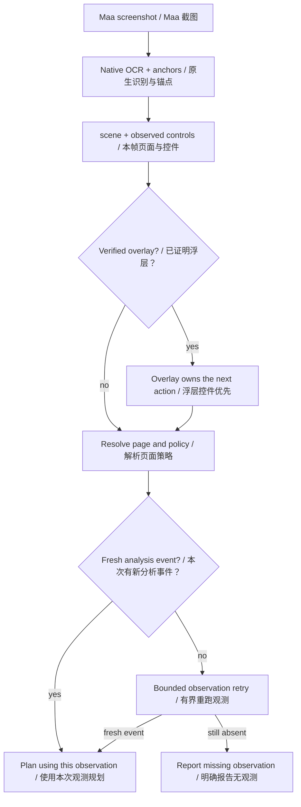

源码落点：`src/maalimbus/runner.py:1` (`MaaObserver.observe`, `resolve_scene`); `src/maalimbus/overlay_dismissal.py:1`; `agent/recognition.py:1`.

## 3.2 决策与执行

### 3.2.1 `plan_step` 的单输入契约

入口签名（`src/maalimbus/window.py:110-114`，逐字）：

```python
def plan_step(page, *, controls=None, start_box=None, auto_assign=None,
              candidates=None, candidate_index=0, nodes=None, arrows=None, team=None,
              reward=None, gift=None, cards=None, graces=None, initial=None,
              search=None, check=None, defeat=None, bonus=None, difficulty=None,
              shop=None, battle_assignment='win_rate'):
```

- **收什么**：一个 `page` 字符串（锚点 id）+ 关键字观测载荷。载荷全部是本帧已读到的数字与框（候选节点框、队伍卡徽章、奖励计数、技能检定的 slot 等），docstring 逐项列在 `src/maalimbus/window.py:146-158`。契约里没有历史、没有设备、没有网络——它是纯函数。
- **返回什么**：一个 plan 字典，由 `src/maalimbus/window.py:91 def _plan(page, action, *, target=None, node=None, expect=(), reason, detail=None, advance=False, to=None, duration=None)` 构造，键为 `page / action / target / node / expect / reason / advance`，可选 `to / duration_ms / detail`（`src/maalimbus/window.py:93-103`）。
- **拒答**：`src/maalimbus/window.py:106 def _refuse(page, reason)` 返回 `_plan(page, RECORD, reason=...)`。
- **二次判决**：`plan_step` 本体只做一件事——把落在 `FORBIDDEN_CONTROLS`（`src/maalimbus/window.py:50-63`）里的 target 改判为 `control_is_forbidden`（`src/maalimbus/window.py:128-135`）。两个例外白名单：`STAR_CONFIRM` 的 `star_confirm.cancel_button` 与 `GIFT_PICK` 的 `gift_pick.refuse_button`（`src/maalimbus/window.py:129-133`）。
- **实现分工**：`src/maalimbus/window.py:139 def _plan_step(...)` 与入口同签名，承载「page → 输入」的全部分派；`plan_step` 只是禁区判决 + 委派（`src/maalimbus/window.py:120-127`）。
- **调用方**：`src/maalimbus/runner.py:2415-2425`，在 `MirrorRunner.step`（`src/maalimbus/runner.py:1490`）内：`plan = plan_step(page, controls=plan_controls, arrows=arrows, difficulty=difficulty, start_box=record.get('start_box'), auto_assign=record.get('auto_assign_buttons'), battle_assignment=settings.battle_assignment, candidates=candidates, candidate_index=choice_index, team=team, reward=reward, gift=gift, cards=cards, graces=graces, initial=initial, check=check, defeat=defeat, search={'mode': settings.gift_search}, shop=shop, bonus={'spend': state['run_settled_itself']})`。
- 导入点在 `src/maalimbus/runner.py:67`（`from maalimbus.window import ...` 那一行）。`src/maalimbus/runner.py:1-31` 的顶部 docstring 另点名 `tools/window_step.py` 是第二个前端；该文件本轮已打开并核实可用（419 行，`tools/window_step.py:62-209` 是它的 `build_parser()`，`C:\Python313\python.exe tools\window_step.py --help` 能正常打印用法），细节见 3.5。

### 3.2.2 一个真实的数据形状示例

下面这份按 `_plan` 的真实字段定义（`src/maalimbus/window.py:93-96`）与 `UNKNOWN_DIALOG` 上 `confirm_proven_owned_gift_refusal` 这个真实分支（`src/maalimbus/runner.py:2434`）组装；字段名逐字来自代码：

```python
plan = {
    'page': 'UNKNOWN_DIALOG',
    'action': 'click',
    'target': [x, y, w, h],              # progress/控件框，像素
    'node': None,                        # 非 None 时改走 pipeline 节点
    'expect': ['MAP', 'REWARD_CARD', 'UNKNOWN'],
    'advance': False,                    # True = 本页标签应保持不变，靠帧变化证明
    'reason': 'confirm_proven_owned_gift_refusal',
}
```

字段语义（全部有代码锚点）：

| 键 | 语义 | 锚点 |
|---|---|---|
| `page` | 规划时的页面 id | `window.py:93` |
| `action` | `'click'` / `SWIPE` / `NODE` / `RECORD` | `window.py:93`；常量从 `src/maalimbus/runner.py:67` import |
| `target` | 点击/drag 的框（`None` = 不发输入） | `window.py:94` |
| `node` | 走 pipeline 节点时不设 target | `window.py:95` |
| `expect` | 成功后继页集合，`ANY` 表示「只要变」 | `window.py:95`、`window.py:1046-1048` |
| `reason` | 决策理由字符串，同时是日志键 | `window.py:95` |
| `advance` | 本页预期不变，帧变化即证据 | `window.py:96`、`window.py:1064` |
| `to` / `duration_ms` / `detail` | 仅 drag 与带附件的分支 | `window.py:97-102` |

判决记录由 `src/maalimbus/window.py:1052 def step_result(plan, *, sent, before, after, page, frame_changed=False)` 组装，返回 `{action, reason, passed, page_before, page_after, expect, clicks_sent}`（`window.py:1050-1056`）。

### 3.2.3 loop guard（防重复动作）

实现在 `MirrorRunner.step` 的收尾处：`src/maalimbus/runner.py:2985-2995`。

```python
if page not in LOOP_GUARD_EXEMPT and plan.get('reason') not in LOOP_GUARD_EXEMPT_REASONS:
    key = (page, plan['action'], plan.get('node'),
           None if plan.get('target') is None else tuple(plan['target']))
    state['repeated_plans'][key] = state['repeated_plans'].get(key, 0) + 1
    if state['repeated_plans'][key] >= max(2, settings.loop_guard):
        entry['passed'] = False
        entry['stopped'] = 'the_same_plan_repeated'
        self.note('window_loop_guard', plan=list(key), repeats=state['repeated_plans'][key])
        return self._result(page, plan.get('target'), True, entry['stopped'], done=True)
```

- 计数以「(页, 动作, 节点, 目标框)」为键；页面一换就清零（`src/maalimbus/runner.py:2968`）。
- 默认阈值 `loop_guard = 3`（`src/maalimbus/runner.py:160`），CLI `--loop-guard`（`src/maalimbus/runner.py:3271`）。判据是 `>= max(2, loop_guard)`，所以最小有效值是 2。
- 豁免名单：页面级 `LOOP_GUARD_EXEMPT = ('TUTORIAL','BATTLE_HUD','BATTLE_PLANNING')`（`src/maalimbus/runner.py:77`）；理由级 `LOOP_GUARD_EXEMPT_REASONS`（`src/maalimbus/runner.py:88-117`，含教程翻卡、战斗交替、剧情连点等，每条都留了 live 证据）。
- 跨页的「领奖家族」另有一个计数器：`CLAIM_FAMILY = ('RUN_CLAIM','RUN_REWARD_DIALOG','RUN_REWARD_CONFIRM')`（`src/maalimbus/runner.py:83`），`claim_steps > max(1, settings.claim_tries)` 时以 `'claim_family_made_no_progress'` 停止（`src/maalimbus/runner.py:2974-2978`）。

### 3.2.4 budget（步数 / 时间 / 花费）

三类预算，互不相干：

1. **步数预算**：`src/maalimbus/runner.py:2999 def run(self, *, steps=300, interval=6.0, round_limit=5, deadline=None)`；主循环条件 `while self.state['step'] < goal and walked < max(0, int(round_limit))`（`src/maalimbus/runner.py:3014`）。CLI 默认 `steps = 1`、`rounds = 3`（`src/maalimbus/runner.py:154`）。
2. **时间预算**：`deadline`（`src/maalimbus/runner.py:2999`）。Agent 侧由动作参数算出：`budget = loop_budget(params)`、`deadline = time.monotonic() + budget`（`agent/recognition.py:1503-1504`）；`loop_budget` 读 `params['budget']` → 环境变量 → 默认 `LOOP_BUDGET_SECONDS`（`agent/recognition.py:1318-1323`）。超时是 `TimeoutError`，收敛为 `result['reason'] = 'loop_deadline_exceeded'`（`agent/recognition.py:1540`）。
3. **花费预算**（Enkephalin / Modules）：`src/maalimbus/budget.py`。`src/maalimbus/budget.py:66 def plan_spend(amount, *, budget, spent=None, purpose='module_conversion') -> dict` 给「能不能花」，`src/maalimbus/budget.py:101 def apply_spend(...)` 再补上要落盘的账。拒绝原因按顺序是 `budget_not_configured` / `budget_amount_must_be_positive` / `purpose_not_allowed` / `budget_zero` / `budget_exhausted` / `request_exceeds_remaining` / `amount_not_multiple_of_step`（`src/maalimbus/budget.py:11-15`）。默认 `status='pending'` ⇒ 一律回答「否」（`src/maalimbus/budget.py:70-93` 与 `budget.py:11` 的说明）。静态表在 `assets/resource/base/budget.json`。

### 3.2.5 动作下发

`plan['action']` 的三条出口（`src/maalimbus/runner.py:2498-2524`）：

- `NODE` → `run_node(self.tasker, plan['node'], self.deadline)`（`runner.py:2503`；`run_node` 见 `runner.py:1136`：`tasker.post_task(name)` + `wait_task`）。
- `SWIPE` → 起点在目标框内抖动、终点在 `plan['to']` 附近 ±8px 抖动，`self.device.swipe(point[0], point[1], drop[0], drop[1], duration)`（`runner.py:2504-2517`）。
- 其它 → `box = inset_box(tuple(plan['target']), .3)`，框内抖动一点，`self.device.click(*point)`（`runner.py:2518-2524`）。

输入发出前先落意图：`self.note('window_intent', page=..., target=..., reason=..., point=..., delay_ms=...)`（`runner.py:2564` / `:2579` / `:2587`），`note` 转手 `Journal.record`（`src/maalimbus/runner.py:1413`）。

---

## 3.3 Runner 循环

### 3.3.1 一次往返

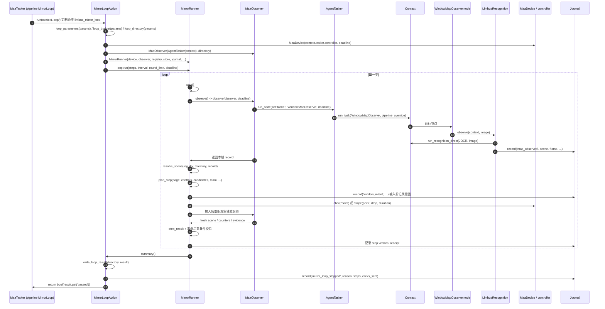

对应代码：`agent/recognition.py:1499-1561`（动作主体）、`src/maalimbus/runner.py:1490 def step`、`src/maalimbus/runner.py:604 class MaaObserver`、`agent/recognition.py:1410 class AgentTasker`、`src/maalimbus/runner.py:628 def observe`、`agent/recognition.py:1119 class MapObservation`、`agent/recognition.py:143 LimbusRecognition.observe`。

**为什么观察要绕 `AgentTasker` 而不是 `context.tasker.post_task`**：`context.tasker` 的任务执行器是单 worker，在自定义动作里 post 一个节点会排在「正在等它的那个任务」后面，等待最终以 stop 结束、杀掉本次运行；`Context.run_task` 是框架自己提供的「从回调里同步跑一个节点」的口子。这段理由逐字写在 `agent/recognition.py:1424-1431`，而 `post_task` 里额外做了一件事：读一次性节点 `WindowMapObserve` / `WindowBattleObserve` 前必须 `context.clear_hit_count(entry)`，否则 `max_hit=1` 会让下一次观察被永久跳过（`agent/recognition.py:1440-1446`）。
当前单动作例外：`Context.run_task` 也共享输入节点计数。Runner拥有的MirrorDrive派发只由精确覆盖 `{MirrorDrive: {next: [], on_error: []}}` 标识；AgentTasker在此次调用前只清该节点的hit count。独立／非自有图、其他输入节点和全部业务事务保持原状态；重置失败不派发。子任务内部max_hit1不改，清原生计数不授予重放业务事务的权力。实际同Context生产内存重放先证明第二次派发失败，修复后两次均成功（build/drive-reentry-before-fix-native.json、build/drive-map-after-fix-native.json），零设备输入。


另一处容易踩的坑写在 `MaaObserver.observe` 的 docstring（`src/maalimbus/runner.py:622-633`）：只看「最新一条同类事件」会把**上一帧**的页面当成这一帧，所以节点没记事件时会重跑 `read_tries` 次，日志点名了 `evidence/runtime/packaged-mirror-20261012-032032` 这个真实踩坑现场。

### 3.3.2 主循环的退出条件

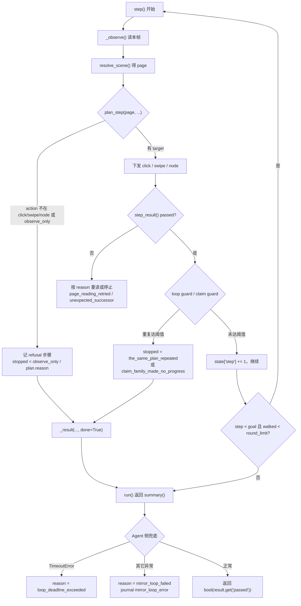

退出的四类，全部有锚点：

| 类别 | 触发 | `stopped` / `reason` 值 | 锚点 |
|---|---|---|---|
| 成功/正常收尾 | 预算走完或本页已无事可做，循环自然返回 | 由 `run()` 返回 `summary()` | `src/maalimbus/runner.py:3014-3021`、`:3187` |
| 预算耗尽（步数） | `state['step'] >= goal` 或 `walked >= round_limit` | 无 stop 字符串，`done=False` | `src/maalimbus/runner.py:3014` |
| 预算耗尽（时间） | `deadline` 到期抛 `TimeoutError` | `'loop_deadline_exceeded'` | `agent/recognition.py:1540` |
| 拒绝（planner 拒答） | `plan['action']` 不是可执行动作 | `'observe_only'` 或 `plan['reason']` | `src/maalimbus/runner.py:2445-2446` |
| 拒绝（页面没动 / 重读用尽） | `step_result` 判 `passed=False` 且不再重读 | 该步自己的 `reason`（如 `unexpected_successor`） | `src/maalimbus/runner.py:2876`、`:2914` |
| 拒绝（协议守门） | loop guard / claim family | `'the_same_plan_repeated'` / `'claim_family_made_no_progress'` | `src/maalimbus/runner.py:2991` / `:2978` |
| 拒绝（调用方点名的页） | `stop_page` 到达 | `'stop_page_reached'` | `src/maalimbus/runner.py:1538`、`:2898` |
| 错误 | 任何未捕获异常 | `'mirror_loop_failed'` + `journal mirror_loop_error`（带 traceback） | `agent/recognition.py:1538-1546` |

`_result` 的 `done` 语义：`'done': bool(done or stopped is not None)`（`src/maalimbus/runner.py:3183`）——只要这一步产生了停止字符串，就结束。

**未验收项**：`MirrorLoopAction.run` 的返回值是 `bool(result.get('passed'))`（`agent/recognition.py:1553`），而 `passed` 的完整赋值路径（含「整局成功」的正向判据）本次未逐行验收；已知相关的是 `record_ledger_event` 在 `final_victory` / `reward_received` 事件上置 `state['run_settled_itself'] = True`（`src/maalimbus/runner.py:2821`）。

---

## 3.4 Agent 集成

### 3.4.1 注册了什么

`agent/main.py` 的第 48-69 行是全部注册点：

**自定义识别（1 个）**

| 名字 | 实现 | 锚点 |
|---|---|---|
| `limbus_scene` | `LimbusRecognition(locale)` | `agent/main.py:128` |

`LimbusRecognition` 是 `CustomRecognition` 子类（`agent/recognition.py:312`），MaaFramework 调它的 `analyze(self, context, argv)`（`agent/recognition.py:759`）——`custom_recognition_param` 里给 `scene`，`analyze` 读帧后比对，不等就返回 `None`。

**自定义动作（共 5 个）**

| 名字 | 实现类 | 锚点 |
|---|---|---|
| `limbus_terminal` | `LimbusTerminal` | `agent/main.py:129` |
| `limbus_map_observe` | `MapObservation` | `:135` |
| `limbus_battle_observe` | `BattleObservation` | `:136` |
| `limbus_mirror_loop` | `MirrorLoopAction` | `:139` |
| `limbus_main_task` | `MainTaskAction` | `:140` |

`main.py:130-134` 留了一条注释解释为什么两个只读观察节点也必须注册：`custom_action` 未注册的节点根本跑不起来。

2026-11-27 之前这里是 15 个：另外十个（`limbus_team`、`limbus_star_proof`、`limbus_initial_gift_proof`、`limbus_initial_receipt_proof`、`limbus_difficulty_proof`、`limbus_preflight`、`limbus_theme_observe`、`limbus_deployment_proof`、`limbus_battle_plan_observe`、`limbus_global_settings`）只被纯管线的旧镜牢层节点引用，随那一层一起删除，见[第 9 章的清理记录](9-execution-plan.md#legacy-pipeline-layer-removed)。`InputPreflight` 与 `GlobalSettingsAction` 两个类还在，由 `MainTaskAction` 直接调用，不再作为管线动作注册。

Pipeline 侧的对应节点（`assets/resource/base/pipeline/mirror.json`）：`WindowMapObserve`（`:108-115`，`custom_action: limbus_map_observe`）、`WindowBattleObserve`（`:116-123`）、`MirrorLoop`（`:124-150`，`custom_action: limbus_mirror_loop`，参数含 `steps: 400`/`interval: 4.0`/`rounds: 3`/`run_store: config/user-run-ledger.json`）、`MirrorLoopDone`（`:151-156`，`DoNothing`）。`MirrorDrive`（`:2-22`）是循环按名字投递的唯一一个点击节点，`next` 与 `on_error` 都是空表。`runner.py:135-156` 的 `PIPELINE` 常量是同一批节点的 Python 副本（`prepare()` 会写出来）。

### 3.4.2 Agent 侧注册与回调

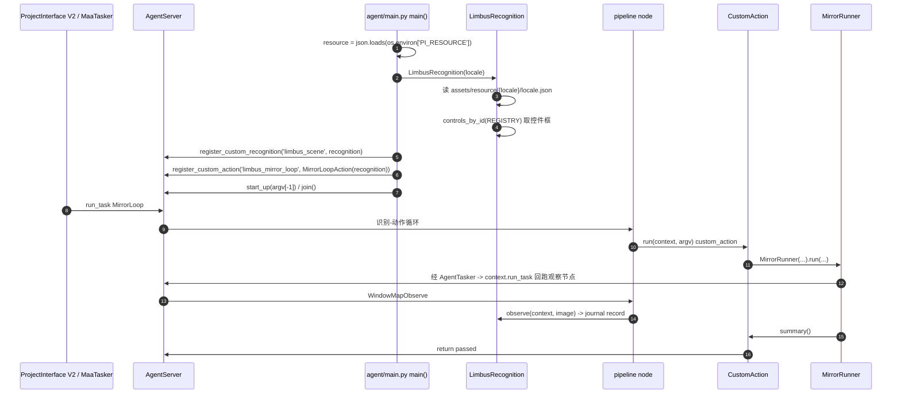

对应代码：`agent/main.py:20-72`、`agent/recognition.py:103-141`、`agent/recognition.py:1478-1561`。

### 3.4.3 `MirrorLoopAction` / `MaaObserver` / `Context.run_task` 的调用关系

三者是一条链上的三个角色：

1. **`MirrorLoopAction`**（`agent/recognition.py:1478`）是整局的外壳。它把 PI 已经给 Agent 的三样东西转交给 `runner`：controller 当设备（`runner.MaaDevice(context.tasker.controller, deadline=deadline)`，`agent/recognition.py:1502-1510`）、`context.run_task` 当 tasker（`runner.MaaObserver(AgentTasker(context), directory)`，`:1510`）、证据目录当日志（`journal = Journal(directory)`，`:1502`）。它的 docstring（`:1479-1492`）写明：输入经 controller 自己的 `post_click`/`post_swipe` 出去，因为那个 controller 才是拥有设备的一方。
2. **`MaaObserver`**（`src/maalimbus/runner.py:598`）是「从 Maa 管线节点读一页」。它只依赖 context 上的三个东西：`tasker`、`run`、`journal`（`:598-613`）。它按 `WindowMapObserve` / `WindowBattleObserve` 两个节点名读（`:622-633`），战斗页会追加读一次 `battle_observed`（`:646`）。
3. **`AgentTasker`**（`agent/recognition.py:1410`）是适配器。它让 `MaaObserver` 看到熟悉的 `post_task` 接口，实际转到 `context.run_task(entry, pipeline_override)`（`agent/recognition.py:1428-1437`），并把同步结果包成恒为 `done=True` 的 `AgentJob`（`agent/recognition.py:1397-1407`）。

**边界**：`agent/` 只做两件事——用 `maa` SDK 的类型（`CustomAction` / `CustomRecognition` / `JOCR`，`agent/recognition.py:15-18`）实现回调，以及把 PI 给的 context 适配成 `src/maalimbus` 认识的接口。所有决策、识别、账本、视觉都在 `src/maalimbus/` 里；`agent/main.py` 自己不判断任何页面。`src/maalimbus/runner.py:70-72` 说明了为什么需要这层适配：仓库根要相对 `runtime_paths.ROOT` 解析，因为 Maa agent 的 cwd 不是仓库（`src/maalimbus/runtime_paths.py:8-20`）。

### 3.4.4 证据与结果落盘

- 一次整局一个目录，Agent 侧默认 `evidence/runtime/pi-<yyyymmdd-hhmmss>`（`agent/recognition.py:1337`）；本项目证据目录的统一形态是 `evidence/runtime/<任务名>-<yyyymmdd-hhmmss>/`。
- 整局摘要写 `agent-result.json`：`agent/recognition.py:1361 def write_loop_result(directory, result)`。
- 人类可读日志写 `run.log`：`agent/recognition.py:1377 def write_run_log(directory, result)`。
- 每步的 `observation` / `plan` / `frame` / `passed` / `clicks_sent` 攒在 `artifacts['steps']` 里，随 `summary()` 一起返回（`src/maalimbus/runner.py:2894`）。
- 崩溃路径也会落盘：`mirror_loop_error` 事件（带 traceback）之后仍然 `write_loop_result` + `write_run_log`（`agent/recognition.py:1538-1546`）。
- 模块级 `_load_registry()` 读的也是同一份锚点表（`src/maalimbus/runner.py:3292`）。

## 3.5 如何本地驱动一次运行

本节给出真实命令与产物落点。脚本本身本轮只核实到命令行解析这一层（见本章末尾的未验收清单）。

**入口一：带 UAC 的启动器**（`README.md:56-64`）：

```powershell
./tools/start_native.ps1 -Binary <Maa 原生库目录> -Locale en -Seconds 180
```

- `-Binary` 必填，且该目录里必须存在 `MaaFramework.dll`，否则脚本直接抛错（`tools/start_native.ps1:4`、`:11`）。
- `-Locale` 只接受 `en` / `jp`（默认 `en`）；`-Seconds` 取值范围 1..3600（默认 180）（`tools/start_native.ps1:5-6`）。
- 它用 `-Verb RunAs` 走标准 Windows UAC，不替用户批准（`tools/start_native.ps1:32-33`）；若已经有一个控制器在跑（`MaaLimbusAgent.exe` / `MaaLimbus.exe`，或命令行指向本仓库 `run_native.py` 的 python 进程），脚本会在启动前抛出 `MaaLimbus already has a running controller; inspect its session first`（`tools/start_native.ps1:12-16`）。
- 真正的进程由 `tools/native_session.ps1` 拉起：`python -u tools/run_native.py --binary <dir> --locale <en|jp> --seconds <n> --live`（`tools/native_session.ps1:18-19`）；它在 `Seconds + 45` 秒后强杀子进程，超时退出码固定为 `124`（`tools/native_session.ps1:22-28`）。
- 这条命令不带 `--entry`，所以跑的是 `run_native.py` 的默认入口。2026-11-27 起默认入口是 `MirrorTask`（界面上的镜牢任务：按已保存的设置跑循环，仍受 `-Seconds` 限时）；此前是只做入口导航的 `MirrorHard`，已随纯管线的旧镜牢层删除（[清理记录](9-execution-plan.md#legacy-pipeline-layer-removed)）。改动后尚未在实机上通过这个启动器跑过。

**产物落点**（每一条都能在脚本里查到）：

| 产物 | 路径 | 出处 |
| --- | --- | --- |
| 启动请求与状态 | `build/native-launch-request.json` | `tools/start_native.ps1:27-44`；状态有 `uac_requested` / `launch_failed_or_cancelled` / `wrapper_started` |
| 包装进程记录 | `build/native-launch.json` | `tools/start_native.ps1:45-47` |
| 退出码与是否超时 | `build/native-launch-result.json` | `tools/native_session.ps1:29-31` |
| 实时 stdout / stderr | `build/native-live.stdout.log` / `build/native-live.stderr.log` | `tools/native_session.ps1:11-12` |
| 当前会话描述 | `build/live-session.json` | `tools/run_native.py:148` |
| 运行证据目录 | `evidence/runtime/`（Agent 侧目录名形如 `pi-<yyyymmdd-hhmmss>`） | `README.md:64`；`agent/recognition.py:1337-1347` |

**入口二：`tools/window_step.py`**（419 行，自带设备、证据目录与账本的一次性窗口工具）：

- 必填 `--binary`（`tools/window_step.py:65`）、`--address`（`:74`）与 `--authorize`（`:75`，nonce）。
- 常用开关：`--steps` 默认 1（`:76`）、`--rounds` 默认 3（`:78`）、`--interval` 默认 4.0（`:95`）、`--loop-guard` 默认 3（`:145`）、`--claim-tries` 默认 6（`:153`）、`--observe-page`（`:160`）、`--observe-only`（`:164`）；完整清单在 `tools/window_step.py:62-209` 的 `build_parser()`。
- 发任何输入之前，必须在 `build/map-probe-authorization.json` 里为命令行传入的 nonce 授权 `live_input_authorized`（`tools/window_step.py:16-17`）。
- 循环体不在这个文件里：它只做命令行、设备、证据目录与打印，循环在 `src/maalimbus/runner.py`（`tools/window_step.py:19-22`）。

## 3.6 出问题先看哪里

先看这次运行的证据目录，再看日志里的**停止原因字符串**，最后查下面这张表。

| 现象 | 到哪里看 | 依据 |
| --- | --- | --- |
| 每步一行的人类可读日志 | `run.log` | `agent/recognition.py:1377 def write_run_log` |
| 机器可读的逐事件流 | `events.jsonl`（`window_intent` / `map_observed` / `battle_observed`） | `src/maalimbus/runner.py:1409 def note` |
| 结果摘要 | `agent-result.json` | `agent/recognition.py:1361 def write_loop_result` |
| 停止原因的一句话解释与建议 | `src/maalimbus/event_log.py:20-73` 的 `GLOSSARY` 表（取词函数 `explain()` 在 `:79-89`） | 该表把每个 reason 映射成「什么意思、下一步看什么」 |
| 同一页同一动作反复走、停不下来 | reason `the_same_plan_repeated` | `src/maalimbus/runner.py:2991` |
| 领奖家族原地打转 | reason `claim_family_made_no_progress` | `src/maalimbus/runner.py:2978` |
| 输入发出去了但页面没动 | reason `unexpected_successor` | `src/maalimbus/window.py:1065`、`src/maalimbus/runner.py:2914` |
| 时间预算用尽 | reason `loop_deadline_exceeded` | `agent/recognition.py:1528-1533` |
| 循环抛异常而不是正常停止 | 事件 `mirror_loop_error`（带 traceback），reason `mirror_loop_failed` | `agent/recognition.py:1534-1546` |
| 走到调用方点名的页就停 | reason `stop_page_reached` | `src/maalimbus/runner.py:1538` |
| 页面没有可靠控件，只记录不发输入 | reason `page_is_observe_only` | `src/maalimbus/event_log.py:47-50` |
| 打包 / 控制台日志 | `build/*.log`（例如 `build/mirror-console-*.log`） | 仓库 `build/` 下的运行日志 |
| 测试报 `PermissionError [Errno 13]`，路径是 `%LOCALAPPDATA%\MaaLimbus\controller.lock` | 先确认本机是否真有一个 app 或 agent 实例在跑；这是锁被占用，不是代码缺陷 | 锁路径由 `src/maalimbus/controller_lease.py:12-14` 决定；`docs/wiki/zh_cn/7-quality.md` 的「套件与真实实例的资源竞争」一行记着这个现象 |

---

## 未验收 / 存疑清单（本章）

- `assets/resource/jp/pipeline/locale.json` 的内容与行数未打开。
- `tools/window_step.py`（第二个前端）已打开：`--help` 能跑、开关与授权门禁都已核对（见 3.5），但**没有实际驱动过一次**，所以「能跑」只到命令行解析这一层，不是端到端验收。
- `MirrorLoopAction` 返回值中 `passed` 的完整赋值路径未逐行验收（见 3.3.2）。
- `src/maalimbus/map_vision.py` 之外的同目录视觉模块只依据 `agent/recognition.py:20-43` 的 import 列表列出，正文未逐个打开。
<a id="feature-3-7"></a>

## 3.7 未知页探索与待审标签

未知并非一律停止。当前探索只允许原生证明的导航控件和地图视口拖动，每个未解决片段最多三种候选；拖动画面改变不能单独证明打开了节点。支付、领奖、退出局和已有 pending 不由探索绕过。proposal、前后 JSON/PNG、trace.log、review.json 在同一私有目录；继续任务不等于自动批准标签或批准生产模型。

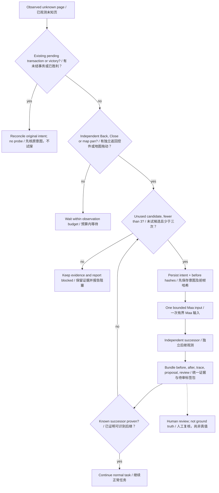

源码落点：`src/maalimbus/unknown_exploration.py:1` (`candidates`, `Exploration.choose/reserve/finish`); `src/maalimbus/runner.py:3024` (`_explore_unknown`).


<a id="feature-3-8"></a>

## 3.8 罪人模型、独立教师与上线边界

真实 ONNX 已训练并接到 MaaFramework 原生影子推理；不能再写成“没有模型”。当前质量门禁未通过，production_enabled/input_authorized 为 false。十二槽教师独立读卡片与印刷 order badge，网格位置不等于部署序号。模型预测、教师候选、人工认可标签必须分开，不能让模型用自己的预测给自己验收。

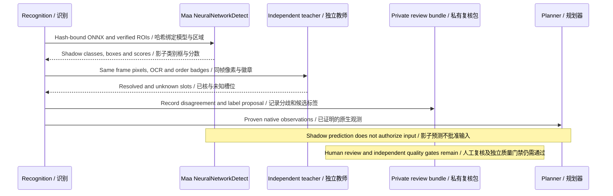

源码落点：`src/maalimbus/neural_shadow.py:98` (`verified_model`, `observe`); `src/maalimbus/pre_battle_identity.py:1`; `src/maalimbus/learning_dataset.py:1`.


**独立教师字段的验收范围（2026-11-17 实帧）**：`pre_battle_identity_evidence` 对同一 PRE_BATTLE_TEAM 原图独立测卡边、读 caption，再查完整图鉴，`detector_read=False`。`verified_against_saved_order` 同时要求12个人格解析以及各自印刷徽标与保存顺序一致；本次仅6个人格解析，因此此字段为False。部署槽位徽标12/12已由独立的顺序核验通过，两项证明分别保留。实际原生模型执行产生11个候选框，quality/input_authorized仍False。原帧及摘要见 `build/team2-floor3-inherited-deployment-real-verification.json`。

| 字段 | 证据所有者 | 当前证明 |
| --- | --- | --- |
| `order_badges` | 原生徽标 OCR | 12个完整徽标，槽位出战顺序匹配 |
| `verified_against_saved_order` | 独立人格caption教师 | 需12个解析人格及徽标对应，本次False/6个已解析 |
| `native_inference_executed` | Maa NeuralNetworkDetect | True，11个预测框，保留模型hash及ROI来源 |
| `native_quality_passed / input_authorized` | 独立质量与策略门禁 | False；预测继续走影子记录 |

<a id="feature-3-9"></a>

## 3.9 购买价值学习与规则执行的分界

已接离线训练与影子预览，但当前真实样本不足，不能称神经网络正在决定购物。未买的商品不是负样本，支付成功也不是收益标签；必须关联同 scope 的后续结果。候选缺失或无效时沿用规则，手动经济饰品权重和预算仍是执行依据。影子函数保持原排序。

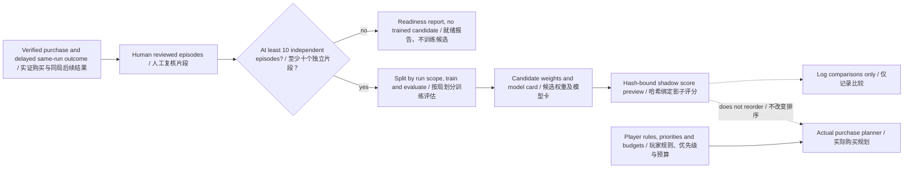

源码落点：`src/maalimbus/shop_value_training.py:422` (`verify_episode_evidence`, `load_reviewed_episodes`, `split_by_scope`); `src/maalimbus/shop_value_shadow.py:7` (`rank_preview`).

<a id="feature-3-10"></a>

## 3.10 统一动作协议与有界未知恢复


执行器只执行策略已选择的动作，裁决器只判断这个动作的后继。`accepted/rejected/unjudged` 是唯一后继值；无新帧、加载、遮罩或不相关页面均不能提升为成功。下面是目标协议，通用执行器尚未完成；已有地图页名裁决是其首段实现。

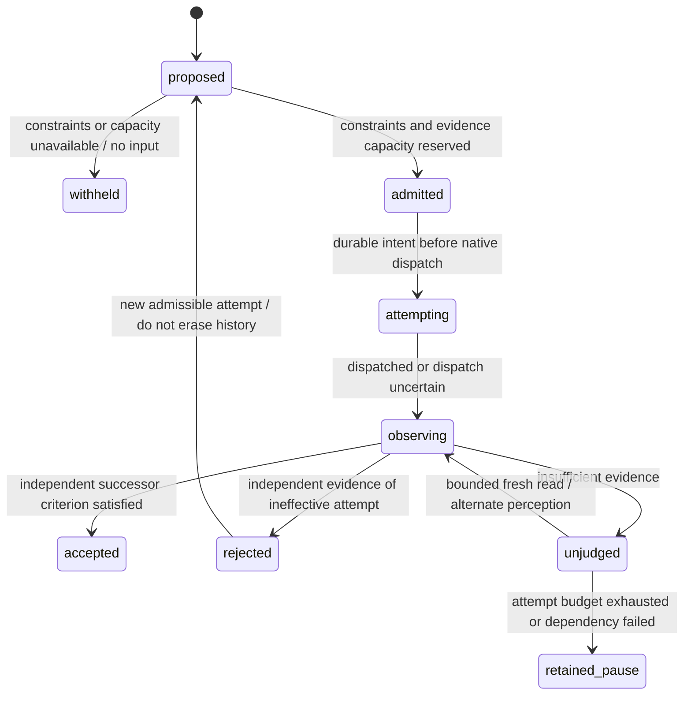

输入尝试异常也可能已到设备；记录 dispatch uncertainty，先观察，不能凭异常重发。持久 intent 不等于 sent。普通无成本导航可补读 ROI、关闭独立识别的遮罩、有限平移或尝试未失败候选；不得用 pending 抹除、重复同一点或降低资金门槛冒充学习。350–750ms 框内随机触摸和有界 Swipe 仍经 Maa。

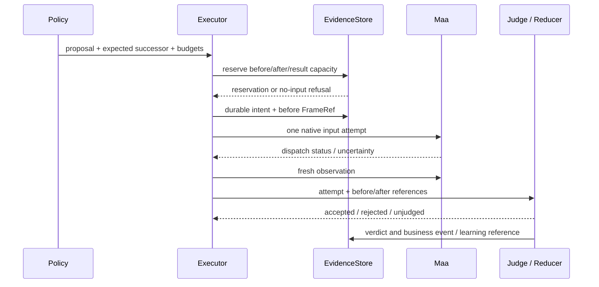

尚未准入就不得发送；未决的付费/领奖结果仅允许补证，不再支付。旧事务兼容适配要保留原字节及 scope，不把统一协议实现为清空 pending。`passed` 等旧布尔由各生产者映射，禁止成为通用成功判据。


Native callback gesture migration: `MaaDevice.pinch` now carries one `MultiSwipe` through the same `AgentTasker` / `Context.run_task` route as callback clicks. Two simultaneous bounded contact trajectories belong to Maa; reverse `post_touch_down` with an empty proxy ID is never called. Local controllers without a task retain the direct route only with a nonempty binding. A refused composite action is not retried as individual fingers. `jobs.wait_task(producer_alive=...)` stops waiting after actual Agent exit and requests termination of the existing task, without creating a controller or interpreting death as game success. [Maa5.12.2 protocol](https://github.com/MaaXYZ/MaaFramework/blob/v5.12.2/docs/zh_cn/3.1-%E4%BB%BB%E5%8A%A1%E6%B5%81%E6%B0%B4%E7%BA%BF%E5%8D%8F%E8%AE%AE.md#multiswipe).


Viewport caller audit: the first native-pinch patch covered MaaDevice, but `_normalise_view_once.zoom` still bypassed it with raw `pinch_out`. The next real MAP-only start happened to have a usable raw binding and zoomed, so that does not verify the repaired callback route. This caller now invokes `device.pinch` with the original calibrated endpoints/duration; whole-step retained tests forbid the raw route and require fresh successor measurements.59related checks passed/9historical skips. Source-only until the following installation; keep the previous active Agent unchanged.


Callback transport convergence: `AgentTasker.input_route=context` now explicitly owns callback click/swipe/pinch dispatch. `MaaDevice._send` uses the native Context carrier before consulting a reverse post, even when an ID appears valid; an empty binding also routes through its existing task. Healthy local controller calls remain direct. Native2df97b4 recovered the existing Team2 panel→confirmation→HOME→Drive→same-floor MAP (21original JSON/PNG pairs independently hash-verified, no background-map probes), then its old reverse swipe hung on an empty native controller ID. The watchdog ended the Agent; only its orphan verifier host was subsequently closed.85related checks pass, including forbidden reverse calls for empty/None/apparently-valid callback IDs; this is source routing proof, not the next installed live dispatch. Key/start-app/general child-node coverage remains separate.


<a id="feature-3-11"></a>

## 3.11 页面身份预检与战斗控件读取

同一原生任务恢复BATTLE_HUD时，旧入口和循环各运行地图+战斗两个观察节点，在首次输入前产生四张大图。MainTask的active-run预检现在只请求identity_only：取得本次新鲜页面身份来判断旧局是否仍活跃，不读取战斗分配控件。循环观察可把同一recorder最近的具名原生页面当作battle-first调度提示，仍必须运行新原生节点并核新增事件；提示不能返回旧画面/控件、结算pending或授权输入。较新的非战斗页面覆盖旧提示，缺帧继续已有重读/失败协议，输入后必须独立再观察。此处是读取职责收敛，统一Observation类型仍是迁移目标。

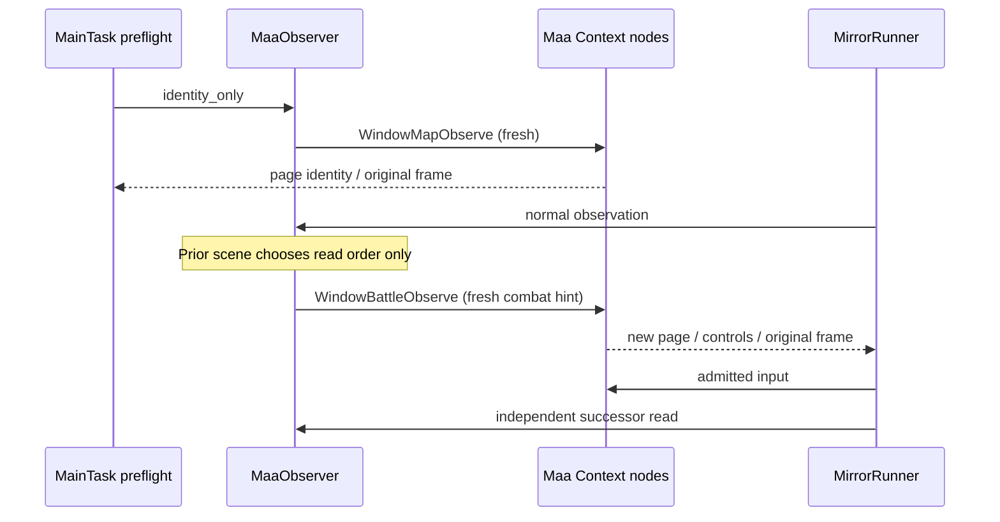

源码：`MaaObserver.observe`、`MainTaskAction.run`；119项相关检查通过。安装及原生战斗输入仍待实证，不把减少截图当成胜利。


3.11实证补记：安装2fad8a9及后续ceb4457均在首次战斗输入前仅产生两次新鲜观察；ceb4457实际到第二回合。原图hash/回合核验见`build/native-capture-profile-battle-real-verification.json`。这关闭本段的重复四图问题，未关闭整层/整局或GUI Start验收。

捕获层续作（2026-11-18，源码／原生离线）：`BattleCaptureObserver`仅选择原生捕获尺寸；两次实际读取都复用`runner.observe`有界入口，不能旁路统一读取。领域规划仍只接收自己的新观察：合格HUD可1280，跨页／信息不足须同期限内独立1920。输入前预留大图后继容量。正式MirrorLoop商店只读不触发交易或标签写入。见[尺寸与容量时序](6-deployment.md#battle-capture-profile)；不是实机通关或模型质量验收。

<a id="feature-3-12"></a>

## 3.12 原生观察的同帧补全

保留原始帧协议重放已经复现：旧入口把frame0011战斗事件补成更新frame0055商店的OCR／哈希。`MaaObserver.requires_frame_ref`现通过唯一`runner.observe`入口调用`native_evidence.observation_frame`，捕获尺寸策略也复用该绑定。公共不可变`FrameRef`只标识原始JSON／PNG、实际尺寸及原捕获时间；不代表新鲜业务结果或输入授权。

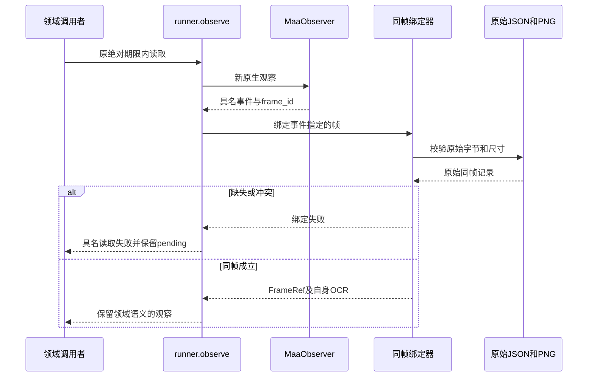

JSON／PNG哈希、显式尺寸／OCR／local_ocr／既有FrameRef冲突都不能靠“最新文件”修补。读取事件utc与FrameRef捕获时间不同：重复像素可复用原帧；旧捕获时间未知则保留None，不用当前时间伪造。原生具名UNKNOWN仍进入原有领域探索，不改写成成功或直接阻断一切未知页面。旧无名回放仍是legacy适配、没有verified FrameRef；旧具名回放仅可补自身JSON，不借后续页面。当前只迁移原生元数据绑定，通用不可变Observation、像素访问／其他latest文件调用及完整executor仍未完成。

源码与原始帧验证：`tests/test_observation_frame.py`、`tools/verify_observation_binding_retained.py`；原生／成品入口复用`tools/verify_capture_profiles_native.py`，逐项比对实际回调FrameRef与原始字节。安装和实机状态以第9章当前checkpoint为准。


<a id="deployment-counter-provenance"></a>
### 部署人数的生产者与消费者

`LimbusRecognition.observe` 把备用识别结果分别用于 `Text` 识别记录和纯 JSON 的 `local_ocr` 证据。证据记录 `deployment_participants_fallback`、原生 ROI、放大比例4、`only_rec=False`、源阈值和原生结果框/置信度。它仅证明人数，不证明卡片死亡、不可用、账号所有权或模型输入权限。已有识别/采信阈值及 Maa 坐标所有权不变。主计数读取实际同样使用检测 OCR，其元数据修正为真实的 `only_rec=False`。

`Journal.frame` 在写文件和增加帧序号前拒绝非列表/非字典、非 JSON 及非有限数的新证据，不改写历史字节。`runner.team_state` 忽略旧材料中不兼容的条目；仅 `purpose=deployment_availability` 且 `accepted is True` 的字典可提供不可用证据。人数仍读原帧，忽略字符串不会凭空增加不可用卡片或改变保存顺序。

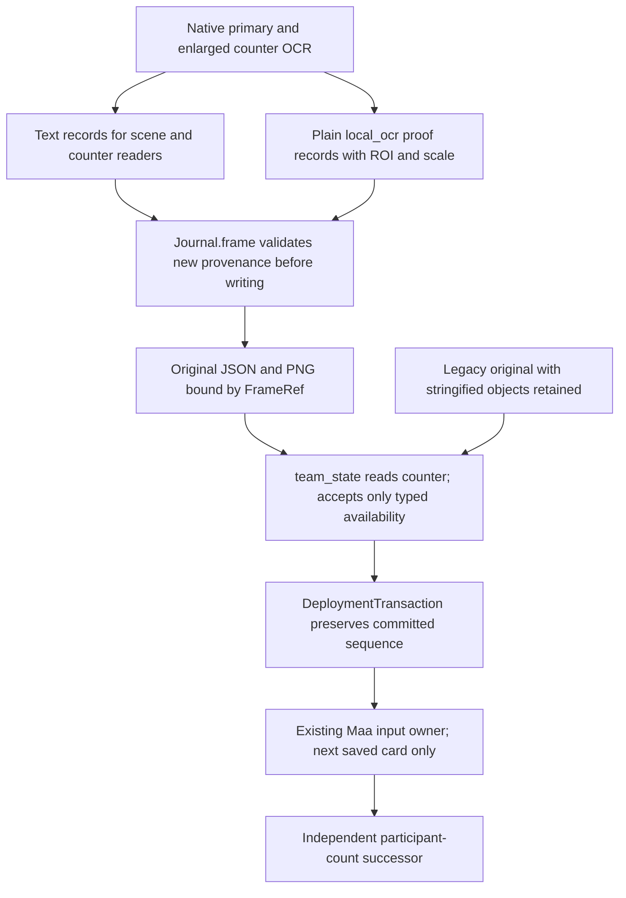

实际安装70f71fc已到 PRE_BATTLE_TEAM 并提交八次选择，随后因备用 provider 对象被静默字符串化、消费者对字符串调用 `.get` 而崩溃。原 frame0026 字节保留。`tests/test_deployment_provenance.py` 检查生产/消费边界及隔离8/12恢复不清空；`tools/verify_deployment_counter_native.py` 用真实 Maa OCR 经过生产 observe、Journal、FrameRef、team_state，分别验证正常及注入主识别缺失的情况。两组均读到8/12，零设备输入、106私有/32规范配置哈希不变，诊断帧不进入学习队列。这是源码原生回放，不是成品继续运行或整局验收；状态见第9章。

安装版通过后的修复复盘：8/12→12/12→独立战斗HUD→三场战斗结果；后两场沿用保存徽标顺序，仅提交出战。游戏跨战斗保留部署顺序，网格位置、人格标题与印刷部署徽标仍是不同事实。本次失败是生产/消费类型不一致，不是游戏拒绝；共享边界修复加旧材料适配保留证据，没有改UI坐标或置信阈值。首次影响检查漏掉工具导入约定及可变语料诊断，造成可避免的第二轮全量测试；应在最终全量前选齐这类检查，通过测试也不能证明下一个页面交接。运行原件、下一处地图/恢复缺口见build/deployment-provenance-live-outcome.json及第9章。

<a id="startup-recovery-dispatch"></a>
### Startup and recovery dispatch / 启动与恢复分流

`kind_of(reason, stopped_reason, plan_reason)` 统一决定日志和实际恢复动作。只有明确识别的 MAP 可以缩放／拖动；其它页面保留领域自己的未知控件探索与有界重读。成功原生 StartApp 可给当前设备一次180秒绝对启动窗口，始终受原任务截止时间约束；已在前台、其它设备和重复读取不能续期。

登录页用既有 finish_launch 的完整文字、ROI、阈值识别为 TITLE，正式 STEP_ROWS 计划经 Maa 输入通道执行，先记录意图，一次确认发送后等待独立后继，不在未决时重发。它在镜牢事务对账之前处理前台登录，保持原未决事务；第一个登录输入可建立自己的180秒后继加载窗口，反复读取不能续期。过去只有 finish_launch 表，却未接入正式 MirrorLoop，这是本次登录卡住的实际接线缺口。HOME 独立后继才记录登录返回，不给通关、消费或到账加分。

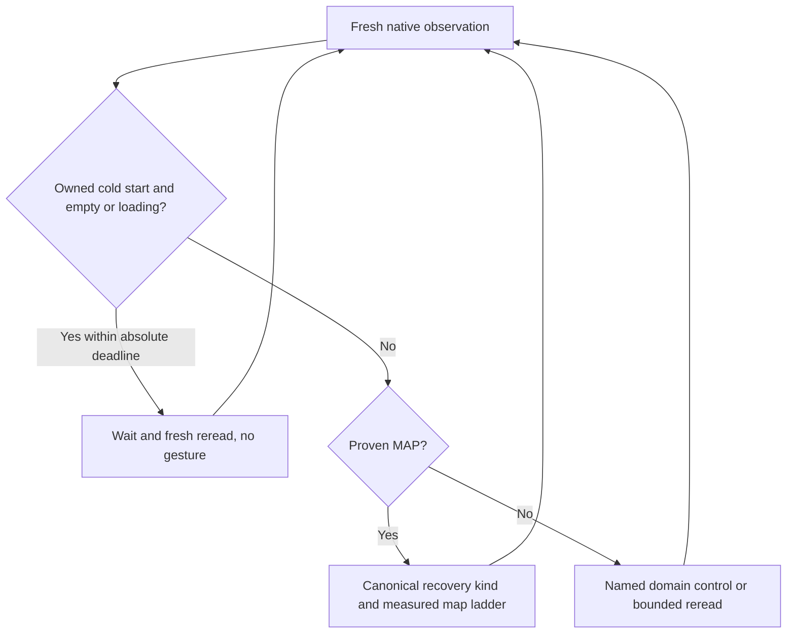

保留的原生失败日志记录 reread_text，却在 UNKNOWN 请求 pinch_out；针对性测试复现并修复这处分流矛盾。请求手势或取得容量预留不证明设备真正执行；容量错误保留实际字节数字到任务结果。安装行为与完整镜牢仍须独立原生／实机验收。

<a id="native-input-owner"></a>
### 原生输入所有者与不确定提交

`MaaDevice`的click/swipe在提交前选择唯一通道：已有Tasker时始终通过该Tasker发一个原生节点；AgentTasker继续由已有Context执行。健康本地Tasker也不先试一次Controller直发。仅明确的standalone调用保留直接Controller通道，截图到设备坐标仍由Maa5.12.2转换一次。pinch保留已有同一Tasker/Context MultiSwipe，不新增驱动。

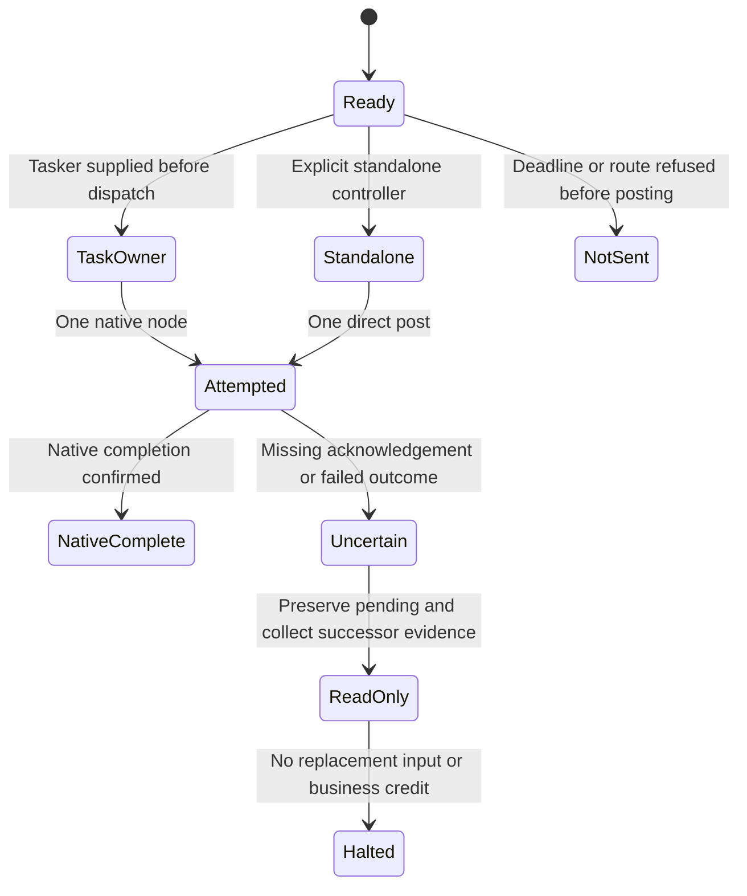

此前本地post超时会立即换任务通道重发同一payload；原调用线程仍可能稍后执行，缺ACK不能证明零输入。这条竞争路径已删除。`InputDispatchUncertain`与发送前`RouteLost`分开：前者锁住该device后续输入，在现有期限内补一次独立读取，记录`input_sent=True`、`dispatch_status=uncertain`、native请求次数及`transition_verdict=unjudged`，保留领域pending后结束本次失去确认的输入会话；即使异常被下层捕获，入口锁存和summary也不能把它改成成功或零输入。它不是UNKNOWN页面的停止规则，原有有界语义探索仍在。

原生节点返回成功仍不代表游戏后继或到账。旧`rebinds`字段不再把正常任务输入计为重新连接；`pipeline_inputs`计已完成的任务承载，`input_attempts`计本device调用，不能冒称所有复合Pipeline内的物理触点总数。按键、其它直接子节点和通用ActionProposal/Executor的完整迁移仍开放。

相关输入／冷启动回归85通过/18历史样本跳过；实际Maa5.12.2内存控制器验证直发与Tasker两种声明入口的1920→1280坐标只换算一次，零设备输入。报告`build/input-owner-coordinates-native.json`绑定实现和DLL哈希。源码未安装，真实设备与整局验收另记。

`floor_gift_selected_without_scoped_evidence`由`floor_gift_transaction.prepare`在选中数非零、没有匹配scope的选择记录且无Owned基线时产生，分类为`bad_saved_state`。分类负责找到恢复所有者，不允许重新点礼物或编造收据。当前留存语料与十月固定统计不一致的三个审计仍是未关闭项；不能改历史次数或恢复手势权重来把回归凑绿。完整套件与实机状态以`PROJECT.md`和`docs/acceptance.md`最新检查点为准。


<a id="fresh-startup-owner"></a>
### Fresh startup observation handoff / 新鲜启动观察的所有权交接

安装版 db1c8d2 的 `packaged-mirror-20261118-180151` 实际观察为 TITLE→UNKNOWN→重读恢复 TITLE，零输入后以 `page_unreadable_after_waiting` 正常结束。重读已经恢复完整登录文字，却绕过前面的登录页处理器，导致通用计划器缺少 `title.start`。这是运行管线缺陷，不是缺权限、未知藏品价值，也不是登录成功。

`MirrorRunner._startup_handoff` 现在用于首次原生观察和重读恢复的已知新页面，均位于镜牢事务核对之前。TITLE 仍须在原 ROI／阈值内读到完整 finish_launch 文字，仅该文字自己的控件框可交给 `_resume_login`。HOME 可凭不同原图核对已有的真实登录输入，不解决镜牢 pending 或改写奖励状态。登录页不使用地图视角手势。

普通计划与登录共用 `_capacity_reobserve`：发生空间维护时，在 window_intent、login_input_entry、尝试次数和启动截止时间写入之前丢弃未发送计划；下次读取新页面并重新构造目标，不重置尝试上限或原始截止时间。确认发送一次Start后，在原有180秒绝对窗口内等待后继；TITLE／UNKNOWN／LOADING／CONNECTING不触发第二次Start，客户端更新提示优先于等待；完整两对截图预留和所有输入／业务门禁保持。55项相关检查通过；仍需完整回归、干净冻结／私有文件与存储一致性核对和实际连续运行，不能将源码修复当作已安装验收。

真实安装版55c4872的packaged-mirror-20261119-022827已发送两次坐标正确的登录输入，任务结束后只读观察才出现迟到的客户端更新提示；原生日志将920,825／928,837正确映射到613,550／619,558，SDK回执不等于服务器成功。源码现在在一次成功派发Start后使用原有180秒绝对窗口等待，不因仍是TITLE重发；到期准确报告缺少后继。精确更新文案优先于背景TITLE。用户已更新游戏至1.119.1/code494，但这本身不是登录／镜牢进度。112项聚焦通过；保存的迟到通知真实原生OCR为UNKNOWN_DIALOG／完整client_update_required，零内存输入（build/login-client-update-native.json）。完整回归、新冻结与更新后连续实机仍待进行。

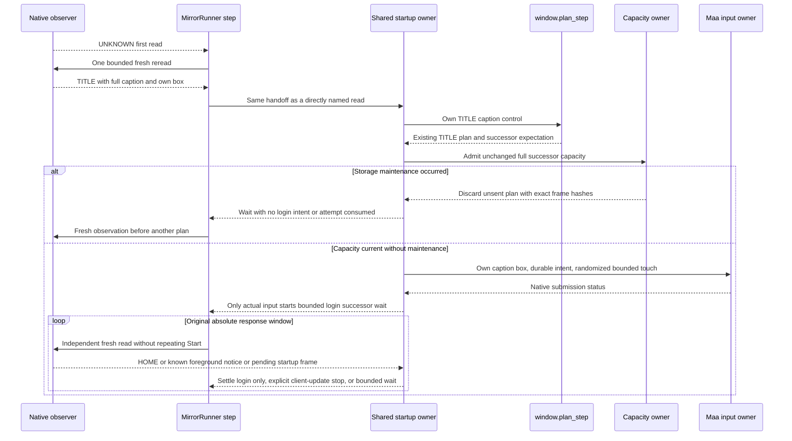


Final serial source regression:3689passed/709historical skips/1duplicate-LICENSE fixture warning,523.01s,pytest exit0 (build/login-three-gb-full-tests-final.log). Login direct/recovered fresh observations share one startup owner and maintenance reobserve before intent/attempt/deadline;55focused and79combined/30updater checks passed with overlap. Whole-project source budget is3,000,000,000bytes under the latest user instruction; external updater session1GB and capture/resource/approval bounds unchanged.274Mermaid blocks parse/two local startup views render. Prior installeddb1c8d2 actualTITLE run ended normally0inputs; both Agent and launcher embedded budgets were2GB. Clean dual rebuild and currentTITLE→sameTeam2 continuous task follow; no new live completion/payout/rotation/model promotion.


<a id="drive-mode-caption-owner"></a>
### Mode content versus shared navigation / 模式内容与共用导航栏

当前故障与范围：安装版5e2ba53的 `packaged-mirror-20261119-033031` 在更新1.119.1后的实际HOME启动，发出两次Drive导航输入后以 `page_unreadable_after_waiting` 停止，尚未进镜牢，也不能证明脚本登录。绑定frame0010中活动版Mirror Dungeons行上移，旧固定裁剪读到Under Construction。更早3eb6a81的Inferno拆字、8ca1b3a的单动作修复均为历史证据；Team2账本保留历史，不代替服务器当前会话证明。

生产／消费契约：`vision.drive_menu_probe` 只凭已有Inferno或新旧实测带内高置信Luxcavation请求有界同帧读取并否决HOME，不授予点击。`drive_menu_native.repair` 在既有 `DRIVE_MIRROR_BAND` 内调用.9原生检测OCR；该归一化菜单带与classify、MirrorDrive目标查找一致。保留检测器返回的合法原生图像框，绝不用大搜索框当点击目标。完整Inferno缺失时仍用.9精确only_rec裁剪，其框表示裁剪本身。缺字、低分、错字、越界、错位或非法框都不授予控制。locale正则、弹窗／领域优先级及只由Maa进行最终输入缩放保持。

`LimbusRecognition.observe` 在规范JSON／Journal.frame之前记录原生文字与local_ocr出处；classify仍要求完整模式字幕，analyze／MirrorDrive仍要求DRIVE及其自己的新鲜mirror文字。Runner用该观察规划，执行一个自有节点（next／on_error置空）后独立读取后继。数据集／人类复核消费者得到教师证据，不等于批准、模型推广或额外消费权。不改写旧JSON、未决事务或预算。

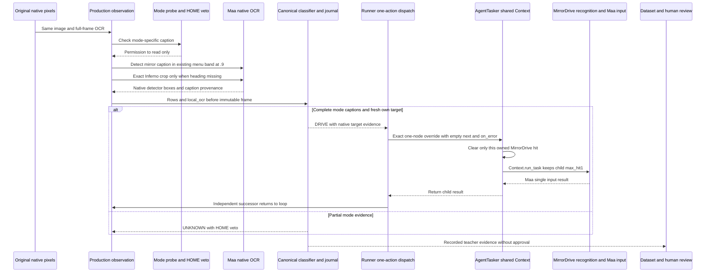

退出证据：不依赖旧证据存在的两种布局／缩放／反例契约加历史帧检查36通过、43历史证据缺失跳过。实际Maa5.12.2生产helper九例（五保留正例／四遮挡反例）通过，新旧布局分别通过生产识别／Click节点且仅一次内存点击。新版Dungeons.997610框[648,316,110,22]、内缩目标[670,320,66,14]。106私有／31规范配置及原始字节未变，零设备输入（`build/drive-event-native-verification.json`）。完整串行回归3772通过／699历史跳过／1重复LICENSE夹具警告，446.18秒、pytest自身退出0（build/drive-event-full-tests.log）。这仍是源码／原生内存证明，干净冻结安装与实际连续任务接着执行；启动器3GB未改。通关、到账、轮换、模型推广与JP游戏另验。


<a id="service-notice-owner"></a>
### 服务器通知的前景所有权

实际安装版8ca1b3a运行 `packaged-mirror-20261118-200244` 已进入镜牢入口；继承的MirrorDrive.next却在Runner下一次规划之前，又点击了入场／确认。服务器维护浮层被背景误判为MIRROR_ENTRY，子任务失败；后续循环点击被原有“控制器已释放”守卫拒绝。98私有／31规范配置哈希不变，未推断通关、领奖或旧scope失效。服务器原文只写12:00(KST)后可登录，没有日期。

`known_service_notice`先识别中央精确客户端更新标题，再看维护／背景TITLE；可记录Close／Go to Store框，但两者都不授权输入，其余控件读不全仍否决背景。Runner返回game_client_update_required，不创建导航预留，不改业务状态。同一读取器同时保护MainTask旧局协调及规范分类器。已有维护通知的有界关闭仍单独执行，close_candidates显式拒绝客户端更新类型。

`service_notice.scheduled_maintenance` 以精确、高置信中央标题拥有前景。完整、唯一的时间说明与Close通过 `close_candidates` 只授权每次原生调用的一次关闭导航；字段不全仍否决背景，不能点击Close。`vision.classify` 输出UNKNOWN_DIALOG，MainTask的 `run_wiring.reconcile_idle_entry` 对旧版误判记录也独立否决背景归档。Runner的 `_startup_handoff` 在直接观察和重读恢复后，均先调用 `_service_handoff`，再进行镜牢事务协调。保留原截止期限及容量准入后的重新观察规则。没有日期的12:00(KST)原文和弹窗关闭都不能证明当前服务器可用。

Runner通过window.plan_step取得已有UNKNOWN_DIALOG关闭计划，不另建手写计划词汇；命名维护后继判定比该通用计划的ANY关闭预期更严格。

普通未知导航与命名维护关闭共同使用 `unknown_exploration.Exploration`。固定私有文件 `user-service-navigation.json` 归当前账户数据目录所有，独立于业务局scope；pending只允许None或有效尝试下标，0也是pending。`reserve` 在派发前保存原始JSON/PNG哈希，Maa成功返回后才由 `acknowledge` 持久化回执。未收到回执且后继不变／不明时，原pending字节不动，跨调用也不能重放；只有独立明确的正向后继能在缺ACK时恢复。已收到回执最多再独立读两次，随后结算结果；同次调用即使再次遇到弹窗也不再点击Close。弱残余标题／时间／中央Close只能否决成功标签，不能授权输入。`finish` 写临时标签、trace及独立人工复核文件，不授予批准、训练资格、消费或账本信用。原始与冷存储PNG共用已有原字节读取器；证明损坏时保留pending。

实际GUI开始 `pi-20261119-012451` 已到达安装版5793bc6的MainTask／Team2，0输入停在缓存弹窗；它证明GUI派发，不证明此刻服务器仍维护。125项聚焦检查通过、仅1个历史地图夹具缺失跳过；已将历史回放从整模块跳过中拆出，合成pending／ACK守卫实际执行。Maa5.12.2真实内存回放运行源码Runner启动步骤、生产原生观察器及MaaDevice／AgentTasker输入载体：对GUI原图关闭一次，再独立观察MIRROR_ENTRY并生成待复核导航标签；业务账本、私有／规范配置和原始证据保持（build/service-dismiss-plan-native-final.json）。原6个标题案例与单动作Drive回放仍通过。这是源码／原生内存证据，完整回归3742通过／699历史跳过／522.76秒／自身退出码0；新修复的干净冻结与连续实机仍待进行，不当安装版或整局验收；日文游戏维护文案未验证。

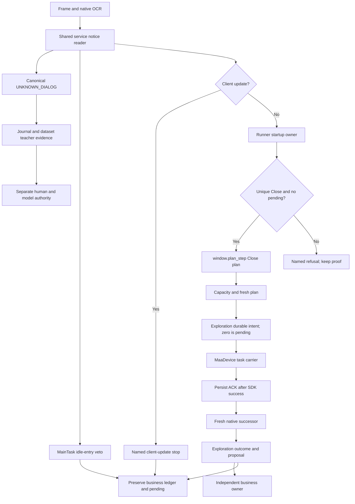

```mermaid
stateDiagram-v2
 [*] --> Ready
 Ready --> PendingUnacknowledged: reserve intent
 PendingUnacknowledged --> PendingAcknowledged: persist SDK ACK
 PendingUnacknowledged --> PendingUnacknowledged: no replay
 PendingUnacknowledged --> ProvisionalProposal: proven positive successor
 PendingAcknowledged --> PendingAcknowledged: two rereads max
 PendingAcknowledged --> ProvisionalProposal: observed outcome
 ProvisionalProposal --> DomainOwner: UI transition only
 ProvisionalProposal --> Stopped: repeated notice after Close
 DomainOwner --> [*]
 Stopped --> [*]
```
