# 4 业务流程

[English](../en_us/4-business-flows.md) · [← 索引](index.md)

<a id="map-shape-generalization"></a>

### 跨层节点识别与事件流转

节点类型由六边框内的图案判定。边框亮度、连线和列车位置由导航识别使用，提供当前这一跳的可达证据。两者分别记录，点击之后仍由新页面核对实际发生了什么。节点类别不依赖层数、主题包或颜色。事件流按选项、检定、结果、继续和奖励的可见控件流转。显示的成本和后果影响策略，事件名称不决定走哪套流程。现有都市和庭园文本特例仍在，通用迁移需分别验收退出与副作用。

`tools/audit_map_glyph_shapes.py` 用第 3 层暖色节点框内图案对照独立第 4 层青色地图。不给匹配器色相，已知邻域内商店匹配 0.803、问号 0.949、战斗 0.783。战斗图案在首领邻域也得 0.700，需更多反例。第 4 层原图在现用探测器中有一项候选，抹去颜色后为零。报告 `build/map-glyph-shape-cross-floor.json` 只验证已定位的局部跨层匹配，自动定位和整层通过仍需验收。用于验收的完整保留层和主题必须与校准样本分开，至少包含可达、已走过、遮挡、箭头和相似图标。

全地图对照中，商店和问号的最高分都落在对应图案上。战斗参考的最高分 0.795 却落在节点之间的背景和连线上，高于真实战斗邻域的 0.783。节点几何要先筛出候选，框内匹配只给类型。灰色问号仍能识别类型，当下的可达性另行取证。

同一第 4 层原帧用三组边缘阈值试验闭合轮廓。商店框在三组中都是同一个 47×44 像素框，框内商店得分 0.803，问号 0.559，战斗 0.391。连线上的战斗误峰没有通过外框筛选。暗问号、战斗和首领也都没有通过，所以完整轮廓只适合作为一种定位证据。暗节点与遮挡仍需验证局部边框、行列间距等独立证据。报告逐项存了轮廓框、已知节点覆盖和所有候选的分类分数，RGB 通道对换前后结果一致。该实验尚未进入安装版导航。

同局第 4 层商店已实机完成六笔购买和两次刷新。三次续跑都使用冻结 Agent `c6ef7ea`，保留同一 Team2 账本。最后一次 `013256` 核销购买后通过离店确认回到 MAP。下一跳已出一个候选框，证据准入没有发出这次地图点击。确认弹窗、GET、回到货架和离店各自拥有独立后继帧。日志中的商店判断来自现行规则。

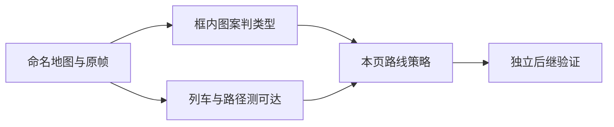

<a id="compact-colour-handoff"></a>

### 紧凑有色目标及共用消费者

`map_node_geometry.connected_compact_nodes` 复用 `map_vision.lit_components`，按紧凑图标尺寸测量，保留已有110亮度/70色差条件。必须有唯一独立火车、以灯距测量的向前一跳邻域，且某一个独立的饱和色/中性亮线平面覆盖至少70%。走廊宽度来自图标自身尺寸的不确定范围；图标不等于房间身份。`saturated_share` 与历史 `warm_share` 分开，没有固定蓝色房间坐标或换色模板。

`connected_nodes` 保留已有红框优先于环框的规则，再给出紧凑图标的全部合格备选。`runner.candidates_of` 与 `MirrorRunner._normalise_view_once` 共用该生产者：可见目标不再触发无用手势；排序仍在 runner，按已有种类等级、再按实测距离。紧凑图标是 `lit_icon`，不伪称环框；日志记录每个备选及最终等级、距离、连线覆盖率。候选不能结算点击，仍须独立后继确认。单数兼容读法在多个备选时不伪称唯一测量。

原始 `packaged-mirror-20261119-074547/frame-0121` 的蓝问号只有27x24像素，且有两条真实高亮的前向分支。旧全局环框/大图标尺寸条件遗漏了问号。换色、缩放、平移派生帧与合成派发后继属于源码证据，该小图标修复已在安装版b62fe4e实机通过，本轮大内部缩放修复仍待实测；另一分支不能因为蓝色就被标成战斗。消费收据和学习策略权限不变。

安装版b62fe4e本轮已实际用一次输入跨过紧凑蓝问号，延迟的独立NODE_PANEL确认后，继续事件和战斗（`build/compact-colour-live-blue-node-verification.json`）。保护性回收实际退休15张PNG/20,850,771意向字节，丢弃两个未发送计划，重新读取后继续到MAP，没有重启（`build/compact-colour-live-storage-verification.json`）。这证明了对应交接，不等于整局完成或存储吞吐最优。

随后原始MAP帧0124暴露独立的内部缩放耦合：灯距70.09px，下一目标图标95x59px、相距383px。旧图标上限70px取自屏幕分辨率，但地图另有内部缩放。`connected_compact_nodes` 现在以两倍独立灯距约束图标上限，保持原色差/填充/长宽比/向前邻域/路径判据。小截图复用环框读法已有的1920px分析归一化，再执行固定形态学操作，并把每个像素证明换回原生坐标；防止720p闭合核把图标、光晕和路径粘成一体。点击框不能充当格距尺。

主题×分辨率矩阵还暴露同一钟体的内外两组灯，以及奖励小标产生的斜伪灯对。`train_body` 仅在中心钟体于较小灯距十分之一内吻合时合并测量，保留更保守的内侧灯距；两个独立钟体仍拒绝。水平灯对同时受原7px屏幕上限和十分之一灯距约束。派生换色/分辨率变体中的反例灯距22.26px却上下错6.81px；嵌套69/90px测量对应同一原始钟体。这里明确测形状，不按最大火焰选队，也不接受任意暖色块。初次7失败/87通过、后续1失败/204通过保留，没有放宽测试。最终相关205通过/9跳过/81.77秒/自身退出0（`build/lamp-scale-alignment-focused.log/exit`）；干净Agent4d92677安装/九个编译身份现已核实，大图标实机通过仍是下一项；最近全量/检查快照修正边界见Wiki9。

最终回归前复核又发现同一连线遗漏：红色分支仍只支持暖色/白线。扩展红/彩色/中性外观×暖色/蓝色/白色路径后，反例暴露了换色箭头被误当节点。随后“完整闭合”假设被实际奖励小标遮断外框的原帧推翻；粗略六分箱也会让开放箭头混过。先测量再定最终规则：原红框白线节点最大角缺口13.84度，保留暖色节点5.88度，合成开放箭头86.66度。红色读法现在对每种路径都测连续环绕覆盖，最多允许缺一个六边形扇区(60度)，保留旧暖色测量优先级；能容纳遮断外框，又不把箭头叫房间。这是有证据范围的几何判据，不是全游戏最优性证明。114项相关检查43.16秒/pytest自身退出0；此前未跑完的全量已明确作废，不计通过。

流程修正：先测保留的正例和反例，再确定识别约束。先写闭合/分箱规则再测原帧，造成了两轮本可避免的回归失败；保留失败反例，不放宽测试，也不等下一次实机失败才学同一机制。最终串行源码回归3920通过/699跳过/516.60秒，pytest自身退出0（build/compact-colour-full-tests-final.log/exit）；该源码随后作为b62fe4e安装并实机跨过小蓝问号；后续较大内部缩放图标是当前缺口。

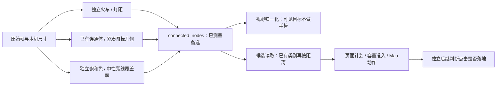

扩大全量首次以3952通过/699跳过/1失败541.71秒结束：三次保留的Resume→LOADING→MAP观察跨过原审计样本门槛，暴露恢复计划漏列过渡名。RESUME_DIALOG有限契约现在允许LOADING等待，仍拒绝HOME/SHOP/BATTLE；地图后继判决仍把加载页当unjudged，不刷新恢复、不增加楼层/收据或模型权限。加载原有时钟与零输入策略不变。这是生产者/消费者契约修正，不是往观察计数例外表填数字让审计变绿。

<a id="map-recovery-episode"></a>

### 故障周期在节点被独立接受后结束

实际帧0124的越步提案在输入前被拒，随后恢复也被拒：`recovery_since` 仍属于648.5秒前的MAP故障，期间明明已经有独立接受的房间、事件和战斗。页面名相同不代表同一个故障周期。`MirrorRunner._map_verdict` 统一拥有accepted/rejected判决；只有accepted调用 `map_dispatch.retire_recovery_after_progress`，仅退休MAP的recovery_for/rung/episode/since，并记录接受原因/后继帧。下次故障开启自己的原有有界窗口；其他页面的恢复、未决点击、财务pending、run scope和全局截止时间不变。UNKNOWN、rejected/superseded输入、HOME/resume等辅助导航不能刷新故障预算。延迟的预期页面接受与已有独立移动接受共用这个所有者。

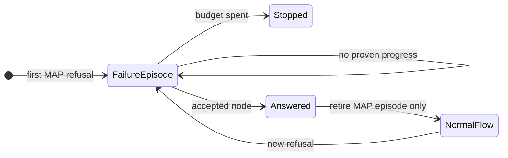

这修正周期寿命，不授予无限重试，也不靠停启规避。源码检查覆盖延迟节点接受、下一次恢复时钟及辅助页/pending反例；安装版连续通过仍是另一项验收。


本章讲「用户在 MXU 里点下一个主任务之后，游戏里实际按什么顺序发生什么」。词汇沿用第 3 章：Controller（截图/输入）、Resource（图像/模型/Pipeline/本地化）、Tasker（跑 Pipeline 的识别-动作循环）、Agent（自定义识别/动作），外加本项目自有的 Client 层（`desktop/mxu/`，MaaFramework 无此层）。

阅读约定：`路径:行号` 是可核验锚点；凡本章没有亲自打开确认的内容，统一收在最后一节「未验收 / 待核实清单」。

图内简写规则（只用于图内，正文一律写完整路径）：`mirror.json` = `assets/resource/base/pipeline/mirror.json`；`recognition.py` = `agent/recognition.py`；`runner.py` = `src/maalimbus/runner.py`。

---

## 4.1 六个入口与唯一的业务分发函数

### 4.1.1 入口是投递桩，不是流程图

ProjectInterface 声明六个主任务（`assets/interface.json:103-167`），每个任务的 `entry` 指向 Pipeline 里一个节点：

| 任务名 | entry 节点 | option | 声明行 |
|---|---|---|---|
| `open_game` | `OpenGameTask` | 无 | `assets/interface.json:104-110` |
| `mirror_loop` | `MirrorTask` | 10 个 | `assets/interface.json:111-129` |
| `experience` | `ExperienceTask` | `experience_team` | `assets/interface.json:130-139` |
| `thread` | `ThreadTask` | `thread_team` | `assets/interface.json:140-149` |
| `rewards` | `RewardsTask` | `reward_module_budget` | `assets/interface.json:150-159` |
| `stamina` | `StaminaTask` | 无 | `assets/interface.json:160-166` |

六个节点在同一个 Pipeline 文件里，而且**长得一模一样**：`recognition: DirectHit`、`action: Custom`、`custom_action: limbus_main_task`、`custom_action_param.task` 写死成上面六个值之一，最后 **`next: []`、`on_error: []`**。

- 节点起始行号：`assets/resource/base/pipeline/mirror.json:5273`（OpenGameTask）、`:5284`（MirrorTask）、`:5295`（ExperienceTask）、`:5306`（ThreadTask）、`:5317`（RewardsTask）、`:5328`（StaminaTask）。
- 也就是说：**Pipeline 图在这六条链路上不做任何流程编排**。它只把「用户点了哪个任务」投递给 Agent；真正的分支、前置校验、循环与停机都在 Python 里。
- 这个设计被测试钉住：`tests/test_main_task_dispatch.py:24 test_six_main_tasks_reference_saved_builds_and_no_diagnostic_entry` 断言六个 `entry` 的 `custom_action` 都是 `limbus_main_task`，且六个任务都不默认勾选。
- 反过来，在 `src/maalimbus/` 下 grep 不到 `ExperienceTask`/`ThreadTask`/`StaminaTask`/`RewardsTask` 这些名字：这六条链路的入口只存在于 Pipeline 与 `assets/interface.json`。

### 4.1.2 统一分发骨架

<a id="cold-launch-verification"></a>

成品冷启动验证补充（2026-11-18，源码）：`verify_packaged_mirror_loop.py --open-game`显式串联安装资源的OpenGameTask→MirrorTask，保留同一Controller／Agent，各MainTask分别取得原有lease。只接受已核实Android桌面或Limbus；其他前台应用在创建输入控制器前拒绝。observe-only不能申请冷启动。启动必须具名成功结果＋正常任务结束，再独立核Limbus前台；原始启动结果另存，失败不进入镜牢，不重试pending启动。默认无此flag仍要求Limbus已在前台。该入口验证不是GUI按钮实证；正式pipeline逻辑仍来自原有MainTask／game_launch。

Agent 侧只注册了一个自定义动作：`agent/main.py:69 AgentServer.register_custom_action('limbus_main_task',MainTaskAction(recognition))`。业务全在 `agent/recognition.py:1564 class MainTaskAction` 的 `run()`（`agent/recognition.py:1571`）里。

**业务流程视图（镜牢）：** 此图只表达业务决策和结果，不把函数调用当作业务步骤。

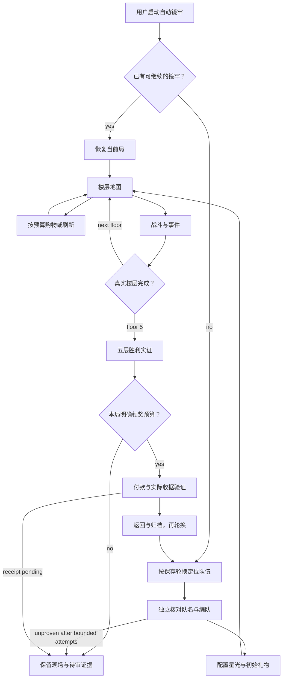

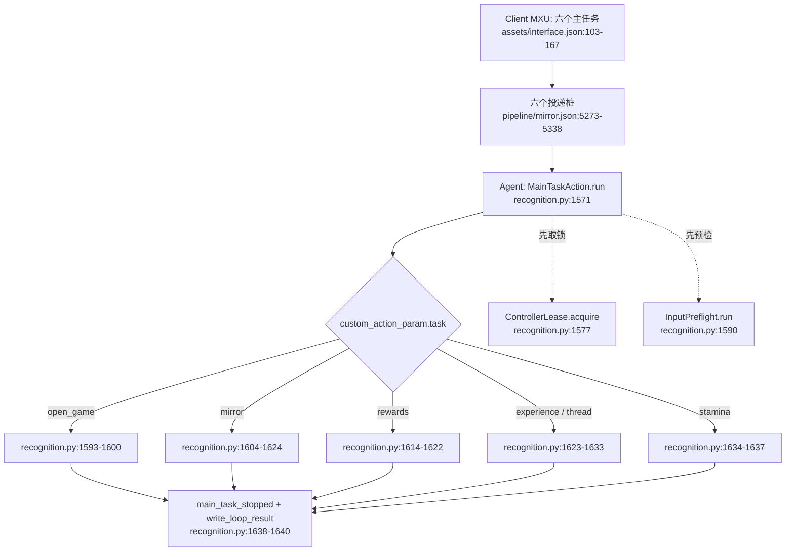

（图内简写见本章开头。）

分发前的三段公共动作：

- 任务名校验：`from maalimbus.task_preferences import TASKS`，`TASKS` 定义在 `src/maalimbus/task_preferences.py:5`；不在其中就抛 `ValueError('Unknown main task')`（`agent/recognition.py:1575`）。
- 证据目录：`agent/recognition.py:1326 def loop_directory(params)` 先取 `params['directory']`、再取环境变量 `MAALIMBUS_RUN_DIR`（常量 `agent/recognition.py:1254`）；两个都没有就用 `ROOT/'evidence/runtime'/('pi-'+时间戳)`（`agent/recognition.py:1334-1335`）。六个投递桩的 `custom_action_param` 里只有 `task`，所以 GUI 直跑主任务的默认证据目录是 `evidence/runtime/pi-<yyyymmdd-hhmmss>/`；命令行工具用的 `window-<...>` 前缀不走这条路径。
- 单控制器门禁：`ControllerLease.acquire(ROOT/'build/controller.lock')`（`agent/recognition.py:1589`）。锁的实际落点由 `src/maalimbus/controller_lease.py:8 def lease_path` 改写到 `%LOCALAPPDATA%/MaaLimbus/controller.lock`（`src/maalimbus/controller_lease.py:12-14`），类定义在 `src/maalimbus/controller_lease.py:18`。抢不到锁就 `reject('another_controller_owns_game')`（`agent/recognition.py:1590-1591`），**零输入**。

### 4.1.3 三类终止与统一出口

`run()` 用内层函数 `reject(reason)`（`agent/recognition.py:1579`）表达「拒绝」，它固定写出 `passed=False, reason=<原因>, input_sent=False, verified_clear=False`。所有分支最后都走同一个出口：`journal.record('main_task_stopped', **result)`、`write_loop_result(directory, result)`、`return bool(result.get('passed'))`（`agent/recognition.py:1673-1675`）。

| 终止类 | 含义 | 典型 reason | 是否已发输入 |
|---|---|---|---|
| 成功 | 该链路自己声明的要求被验证 | `existing_windows_game_verified` / `game_foreground_after_native_launch` / `game_already_foreground` | 视分支 |
| 拒绝 | 前置条件不成立，动作开始前就停 | `another_controller_owns_game` / `Actual Windows game identity failed` / `Actual controller identity failed` | 否 |
| 停止 | 走到边界或未实现处，保存现场后停 | `task_page_policy_not_implemented` / `lux_navigation_successor_requires_verification` | 视分支 |

证据产物固定是两类：`Journal`（`agent/recognition.py:76`）往目录里追加 `events.jsonl`（`agent/recognition.py:82-85`）；`Journal.frame()` 每写一帧落一对 `frame-NNNN.png` + `frame-NNNN.json`（`agent/recognition.py:87-97`）；最后 `write_loop_result()` 写一份 `agent-result.json`（`agent/recognition.py:1372-1375`）。真实实例：`dist/MaaLimbus/evidence/runtime/pi-20261012-112240/events.jsonl`（`docs/acceptance.md:10`），以及 `dist/MaaLimbus/evidence/runtime/pi-20261012-123906/`（66 帧、179 事件，`docs/acceptance.md:1367`）。

---

## 4.2 `open_game`：打开游戏

- **触发入口**：`OpenGameTask`（`assets/resource/base/pipeline/mirror.json:5273`），`custom_action_param.task='open_game'`，无 option。界面文案见 `assets/i18n/zh_cn.json:75-76`：Android 用 Maa 启动并确认前台，游戏已经打开时不重复启动；Windows 请先连接游戏窗口。
- **逐步业务动作**（`agent/recognition.py:1581-1588`）：
  1. 读 `context.tasker.controller.info.get('type')`。
  2. 若已经是 `win32`：跑 `InputPreflight`（`agent/recognition.py:1196`），失败即 `reject('Actual Windows game identity failed')`；通过则直接返回 `passed=True, reason='existing_windows_game_verified', input_sent=False`，**不重新启动游戏**。
  3. 否则调用 `maalimbus.game_launch.open_game(controller, data_directory(ROOT), journal)`（`src/maalimbus/game_launch.py:8`）。
- **冷启动内部**（`src/maalimbus/game_launch.py`）：要求 ADB 控制器，否则抛错（`:11-12`）；先查是否已在前台，命中 `PACKAGE+'/'` 就直接返回 `game_already_foreground`（`:19-24`）；持久意图文件 `user-open-game-transaction.json`（`:14`）里已有未完成事务就拒绝第二次启动（`:25-26`）；写意图并 `journal.record('game_launch_intent')`，再 `controller.post_start_app(LAUNCH_INTENT)`（`:27-31`）；最多 5 轮独立确认前台（`:32-39`），成功是 `game_foreground_after_native_launch`，否则 `launch_foreground_not_proven` 并带 `pending=True`（`:40`）。
- **终止条件**：成功＝前台被独立确认（上述三种 reason 之一）；拒绝＝控制器不是 ADB、存在别的未完成启动事务、或身份预检失败；停止＝5 轮仍未证明前台（`pending=True`）。
- **产出证据**：`game_launch_intent` / `game_open_observed` 事件 + `user-open-game-transaction.json` + `agent-result.json`。


<a id="feature-4-2-1"></a>

### 4.2.1 启动意图与前台确认

此图只覆盖实际实现的打开游戏任务，不包含重新登录或关闭别的游戏。当前暂停期间不调用此路径。冷启动完整实机验收仍开放。

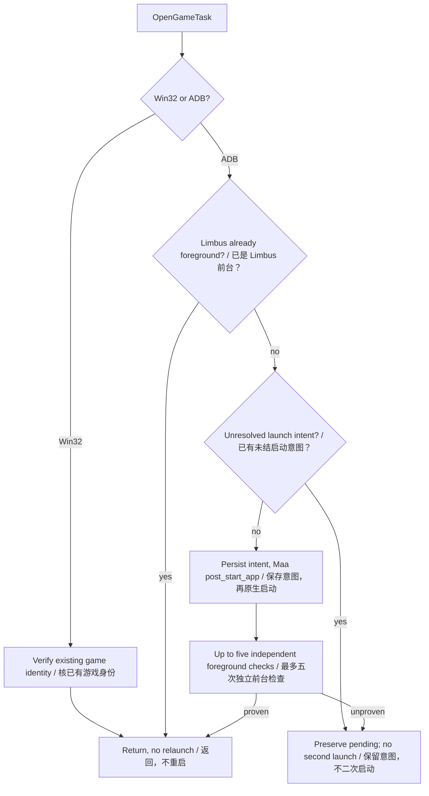

源码落点：`src/maalimbus/game_launch.py:8` (`open_game`); `agent/recognition.py:1571` (`MainTaskAction.run`).

## 4.3 `mirror`：自动镜牢

- **触发入口**：`MirrorTask`（`assets/resource/base/pipeline/mirror.json:5284`），10 个 option（`assets/interface.json:117-128`）；文案见 `assets/i18n/zh_cn.json:77-78`。
- **逐步业务动作**（`agent/recognition.py:1604-1624`）：
  1. `GlobalSettingsAction.run`（`agent/recognition.py:1473`、`:1462`）先把总设置里显式编辑过的全局队伍与镜牢队列落盘，记 `global_build_settings_applied` 且 `device_input=False`。
  2. `mirror_preferences.collect`（`src/maalimbus/mirror_preferences.py:6`）→ `apply`（`:21`）：把本次勾选的藏品允许/禁用、主题包偏好写进保存队伍。
  3. `mirror_starlight.collect`（`src/maalimbus/mirror_starlight.py:74`）→ `apply`（`:17`）：星光规则来源与预算。
  4. 读 `MirrorLoop` 节点的 `custom_action_param`，再叠加 `mirror_task_options.collect`（`src/maalimbus/mirror_task_options.py:5`）得到的初始关键词、礼物搜索、步数上限、出战指派。
  5. 用 `shop_settings.FIELDS`（`src/maalimbus/shop_settings.py:289`）把 `MirrorShopPolicy` / `MirrorShopRefreshLimit` / `MirrorShopCoinReserve` 三个节点逐项覆盖进参数（`agent/recognition.py:1641-1644`）；解析逻辑在 `src/maalimbus/shop_settings.py:134 resolve_shop_settings` 与 `:282 collect`。
  6. 交给 `MirrorLoopAction.run`（`agent/recognition.py:1478`、`:1499`）：建目录、读参数与预算（`:1501-1504`，默认 5400 秒，`agent/recognition.py:1259`），组装 `runner.MaaDevice`（`:1517`）与 `runner.MaaObserver`（`:1518`），再建 `runner.MirrorRunner`（`:1257`、`:1526`）并调 `run(steps, interval, round_limit, deadline)`（`src/maalimbus/runner.py:2907`）。
  7. 循环内部每步决策读的是一组独立的策略件：`src/maalimbus/mirror_learning_policy.py:1304 strategy_score`、`:587 plan_route`、`:779 shop_plan`、`:931 skill_replacement`、`:432 gift_utility`；`src/maalimbus/route_plan.py:108 plan_route`、`src/maalimbus/gift_plan.py:15 load`、`src/maalimbus/shop_priority.py:5 load`、`src/maalimbus/auto_formation.py:17 choose_identity`、`src/maalimbus/budget.py:66 plan_spend`。
- **逐步时序**：

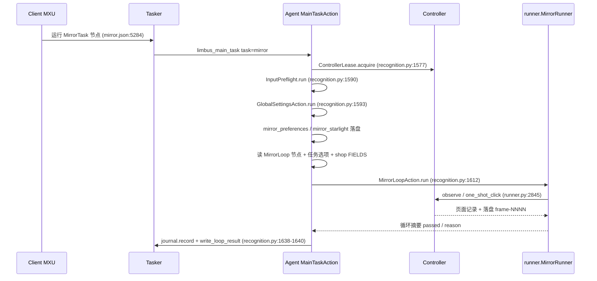

- **终止条件**（`agent/recognition.py:1528-1553`）：成功＝循环摘要 `passed=true`；停止＝本轮预算耗尽或设备作业超时，记 `loop_deadline_exceeded`；失败＝循环抛异常，记 `mirror_loop_error`（带 traceback）并返回 `passed=False, reason='mirror_loop_failed'`。
- **产出证据**：`mirror_loop_start` / `mirror_loop_stopped` / `mirror_loop_error` 事件，`agent-result.json` 与人类可读运行日志。

### 4.3.1 一次商店访问的输入（含死位复活）

商店页（`SHOP`）不是「看一眼就走」的页面：`src/maalimbus/window.py:594-652` 对一个商店帧只允许一个输入，顺序固定。

1. **买之前先看有没有死位。** `config/user-deployment-transaction.json` 的 `saved_order` / `unavailable` 加上 `shop_revive.key_losses(..., positions=KEY_POSITIONS=7)`（`src/maalimbus/shop_revive.py:269`）给出「前七个存档位里死掉的卡」；非空且店里印着 `Heal Sinner`（`shop_revive.py:85`，服务框在 `SERVICE_X=(180,660)` × `SERVICE_Y=(540,800)`，`:33-34`）就先点这颗服务——`window.py:623`，`expect=(ANY,)`、`advance=True`，因为弹窗自己会说明下面发生什么。
2. **弹窗的三步各自由自己的文字证明。** `HEAL_SINNERS`（`vision.py:266-269`：标题 **且** 三个编号行）→ 点它自己的第三行（`window.py:999`）→ `REVIVE_PICK`（`vision.py:286-288`：`Select the Sinner to revive.` + 标题）→ 先点死位头像（`shop_revive.slot_box(card)`，`BAR_FIRST_CENTER=112` + `BAR_PITCH=115`，`:180-187`）再点弹窗换出来的状态按钮（`window.py:583`）→ `REVIVE_DONE`（`vision.py:283-285`：`… revived, returns to battle.` + `Leave`）→ 点它自己的 `Leave`（`window.py:566`）回到商店。哪一步没有自己的字，就在那一步拒绝（`_refuse`），不猜。
3. **复活是花钱，所以记的是收据不是点击。** 规划时写下 `state['revive_receipt']=dict(card, cost, coins_before)`；回到商店页后只有 `coins_before - 当前币值 == cost` 才调 `deployment_transaction.book_revive`（`src/maalimbus/deployment_transaction.py:73`）写进 `revives`，否则记 `shop_revive_receipt_not_proven`。实机判据 `window-20261012-214803`：3093 → 2993，`cost=100`，`card=6`（Hong Lu）。
4. **其余输入按固定优先级。** 货架上 gift plan 想要的卡，或「这次会带出上限以上的钱」必须花掉的卡（`window.py:633`，原因串 `buying_the_gift_the_gift_plan_asked_for` / `spending_the_coins_this_visit_would_carry_out_on_the_shelf`）→ 刷新（`window.py:643`，受刷新次数与储备金约束）→ 离店（`window.py:651`）。买成的记账在 `shop_transaction.py:458`，刷新回执在 `:478`；卡片标题的混淆字比对见 2.3 的 D14。

上面四步的形状（每一跳都由它自己那一页印的字把关，没有字就停）：

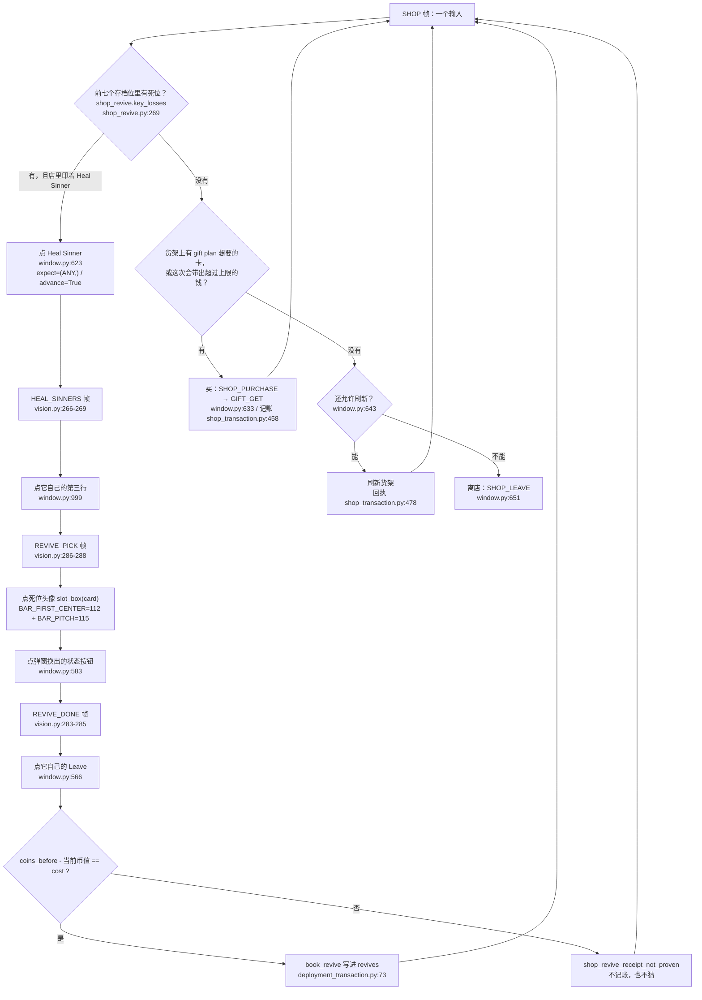

（实机走通的只有 `window-20261012-214803` 那一步：3093 → 2993 的复活收据；整条路由由一次 planner 运行跑完仍在待验收清单里，见 7.3。）


<a id="feature-4-3-2"></a>

### 4.3.2 入场与列表上下查找

队列值由 RunStore 驱动，不从当前屏幕已选队伍反推设置。目标在上方时手指向下滑回 Team1/Team2；两次列表语义不变只反向一次，之后停并记录。图中的查找块可能由多次循环 step 完成，命中目标后退出搜索，不是强制执行十二次。默认编号 1–40 支持，重命名槽位仍需独立映射。实机 Team1/Team2 跨屏回滑尚待暂停解除后的产品入口测试。

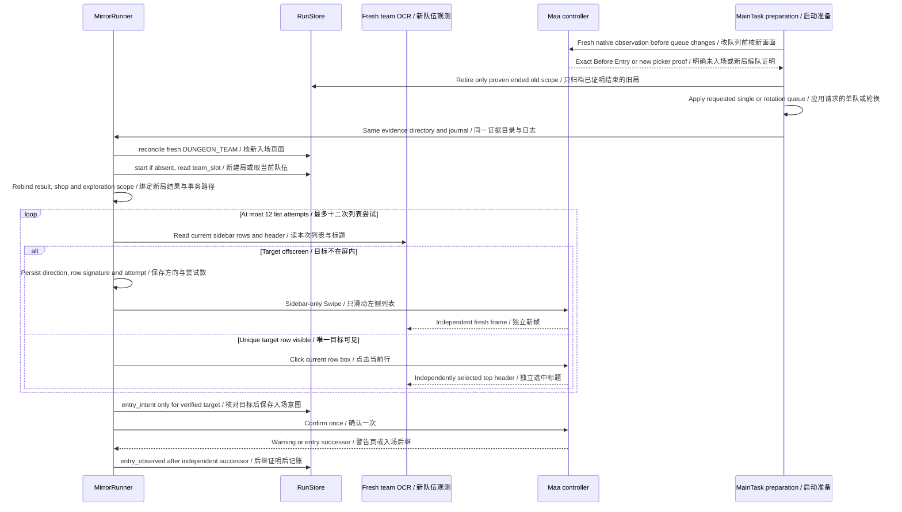

启动前不会仅凭 MIRROR_ENTRY 这个宽分类清旧状态：Before Entry 和 Enter 必须独立高置信读出，JSON/PNG 哈希和尺寸必须一致。真实活动局、入场 pending 和同局领奖 pending 保留。旧局通关事实保留，但不根据“现在无局”推断奖励已到账；新队列在此核对之后才应用。设置拒绝写明确结果/人类日志，不再只有红色失败。

源码落点：`src/maalimbus/run_wiring.py:156` (`reconcile`); `src/maalimbus/team_navigation.py:1` (`browse`, `prepare`); `src/maalimbus/runner.py:1` (`MirrorRunner.step`).


<a id="feature-4-3-3"></a>

### 4.3.3 每场部署：复用、修正与提交

复用的依据是卡片印刷部署序号与保存顺序一致，不能用网格位置或人数满了代替。明确不同顺序才清空；人数变化与不可用卡片单独证明。复活回执在同局事务重建时保留，不会因新战斗重复花钱。

印刷序号本身也不由单次识别决定：同一张卡的序号在它的徽章带上按三个不同取景各读一次，只有两次读出同一个数字才采信；一次都读不到的那张卡保留 `None`，页面就按“顺序不确定”继续补观测，而不是被误当成“确定冲突”去清空重排。实机证据：`evidence/runtime/packaged-mirror-20261014-063205/frame-0103.json` 第 11 张卡的 '4' 在原取景对里被裁掉，整局停在 `deployment_order_digits_incomplete_after_retries`；补一个留边取景后十二张全部读出，页面按确定冲突清空重排。`evidence/runtime/packaged-mirror-20261012-101555/frame-0027.json` 反过来要求保留原取景，所以两个取景都留。两页都由 `tools/verify_deployment_numbers_native.py` 无控制器复放，取景规则由 `tests/test_deployment_numbers.py` 固定。

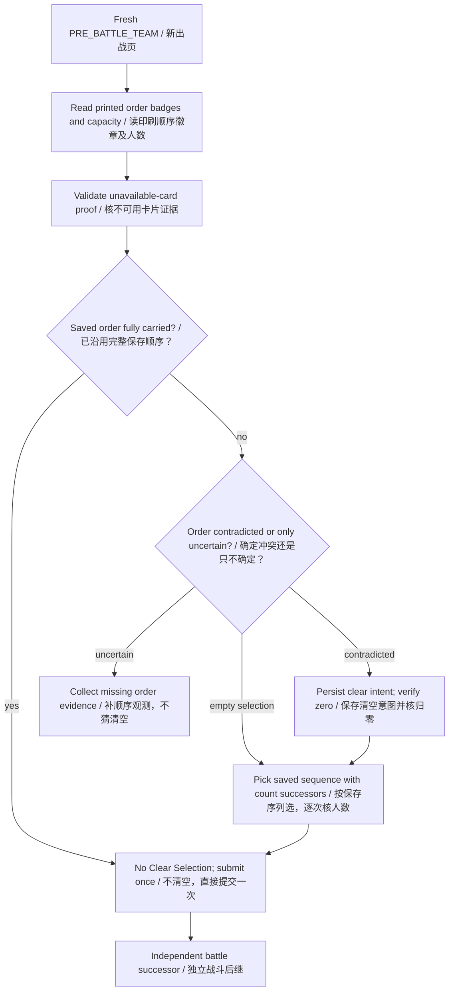

源码落点：`src/maalimbus/deployment_transaction.py:5` (`prepare`, `intent`, `observe`); `src/maalimbus/team_vision.py:1` (`assignment_numbers`, `carries_saved_order`); `src/maalimbus/deployment_numbers_native.py:1` (`read_assignments`).


人数的生产/消费契约见 [3.12](3-runtime.md#deployment-counter-provenance)。已提交的部分序列不是完整顺序冲突：保留的8/12应从保存序列第九位（罪人8）继续，不清空、不重选前八人；每次独立人数后继才提交下一选择。人数证据不能变成卡片不可用证据。新增原生回放保留旧崩溃双文件及真实事务字节；成品续跑仍待验收。

<a id="feature-4-3-4"></a>

### 4.3.4 楼层礼物选择、到账与恢复

安装版 `022456` 打完 Team2 第四层首领后，依次进入遭遇奖励与两轮藏品。第一轮 GET 确认露出 1280×720 的免费三选一。标题和按钮可读，但共用读取器使用了 1920 宽的挂牌偏移，三个点击框都左移约 32 像素。`reward_vision.gift_cards` 现在按实际捕获宽度缩放偏移和框尺寸。保留原帧独立读出 0/1 和 Melted Eyeball、Downpour、Lightning Rod。安装版 `023252` 补记 Grand Welcome，未重发 GET。它随后实际选择 Downpour，处理新收据并进入第五层 Hard 主题 The Heartbreaking，账本持久化已清楼层 `[1,2,3,4]`。

状态图的每条边是事务守卫，不是点击成功的假定。GIFT_GET、GIFT_PICK、REWARD_CARD、THEME_PACKS、MAP 只是后继家族；仍须对应完整标题、下一份 offer 或最终完成条件。恢复与即时结算共用后继读取器，恢复不重发 GET 确认。已拥有礼物替换记录 expected/printed，不伪造原礼物到账。

```mermaid
stateDiagram-v2
  [*] --> Picking
  Picking --> PickPending: persist pick intent before input
  PickPending --> Picking: exact same offer and counter plus one
  Picking --> CommitPending: required selections; Select once
  CommitPending --> ReceiptPending: full named GET; persist ack intent
  ReceiptPending --> CommitPending: next named notice independently proven
  ReceiptPending --> Completed: final successor independently proven
  ReceiptPending --> ReceiptPending: missing successor; observe only, no replay
  PickPending --> PickPending: unknown counter; preserve pending
  Completed --> [*]
```

源码落点：`src/maalimbus/floor_gift_transaction.py:10` (`RECEIPT_SUCCESSOR_PAGES`, `observe_receipt`); `src/maalimbus/runner.py:3070` (`_receipt_successor_offers`, `_resolve_floor_receipt`).


**2026-11-17 已拥有替换与旧归属恢复（源码；真实零输入核账通过）**：本次选取顺序是 Skeletal Crumbs、Employee Card，但游戏先显示已拥有的 Employee Card 对应的 Faint Vestige，再显示 Skeletal Crumbs。GET 顺序不是点选顺序。新未知替换优先归属唯一已拥有的未领选项；旧 pending 错挂到第一选项时，独立下一张具名 GET 加唯一 owned 选项才可修订，并保存原归属。恢复读 printed 名，而非要求替换名等于 expected。

`floor_receipt_recovery.recover_closed_receipts` 校验同 scope 已结束 recorder 的原生双哈希、两次独立 GET 自身 Confirm、实际点位/350–750ms、原帧/后继时序和完整 SELECT FLOOR 3 标题。在隔离事务中调用同一结算器，只有完整链才一次原子发布；缺图、短触摸、重复确认、越界点位、过期后继、异局或未结束记录保留原 pending 字节。实际2收据已仅凭原件完成，另30配置不变、零输入/领奖/轮换，`build/team2-floor2-retained-receipt-recovery-real-verification.json`；运行时恢复入口已接线但待安装。35相关通过/48历史材料跳过；第三层 Devoured Gluttony 的独立 MAP 已出现，楼层账本仍待正常入口同步，不手动伪造通层记录。


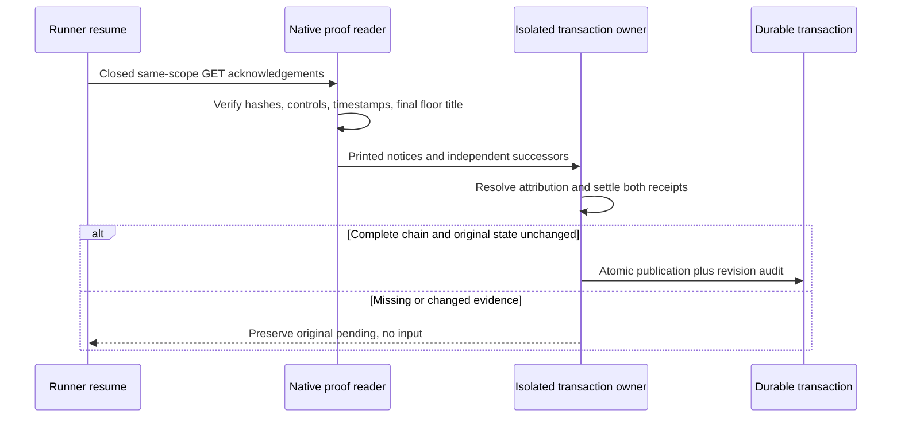

**2026-11-17 独立观察检查点**：通层事实属于 CompletionFact，不依赖下一次点击是否成功。Runner 在候选、视口操作与 handoff 之前调用 `run_wiring.observe_map_checkpoint`；它要求同 run scope/entered、原始 JSON/PNG 绑定和独立 MAP 楼层+完整主题标题，observe-only 不写账。MAP3 证明 floor2 的事实已由同一组件实证补入：[1,2]，5笔商店样本均取得同局后继结果标签；未支付/轮换/推广模型。53相关测试通过；`build/team2-floor2-observation-checkpoint-real-verification.json`。新自动入口待安装/实际观察验收，不能把零输入组件核账说成完整镜牢通关。

<a id="feature-4-3-5"></a>

### 4.3.5 初始礼物、搜索与楼层主题

星光消费另受本局可见成本与预算门禁约束，图不授予消费。一次购买把星光正好花完时，页面上只剩星光图标旁的一个 0，检测读不到它，整帧 OCR 也只给出低置信度的读数；这样的读数只在账面自己算出余额必须为 0 时才成立，并且计数位置上不能有任何别的数字，买卡后的入账还要两次独立观察一致（`src/maalimbus/grace_vision.py` 的 `available_starlight` 与 `zero_successor`，`src/maalimbus/grace_transaction.py` 的 `is_zero_expected`）。读数正常的余额不受影响。初始礼物 GET 回执、搜索 Refuse 确认和主题 Swipe 是三个独立事务，不能因页面稍慢而重放上一动作。图概括阶段，不代表所有搜索分支已有实机验收。

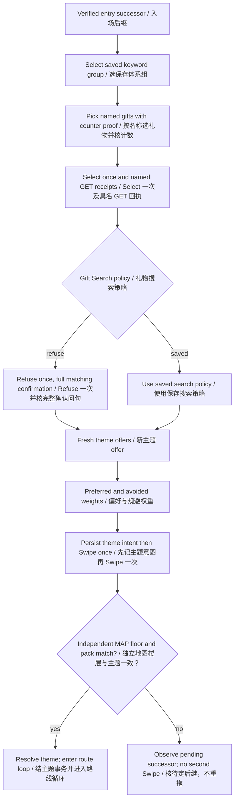

源码落点：`src/maalimbus/initial_gifts.py:1`; `src/maalimbus/initial_transaction.py:1`; `src/maalimbus/theme_transaction.py:5` (`intent`, `observe`).


### 4.3.5.1 星光已发送意图的恢复

`src/maalimbus/grace_balance_native.py:1` keeps two detected numeric reads under
an independent Available label. `src/maalimbus/grace_transaction.py:120`
reconciles only matching scope/configuration, retained frame hash/current visible
cost and an exact current delta. Missing evidence triggers observation retries,
never another purchase. Native retained tests pass; the current live recovery and
full-pipeline acceptance remain open. See the concrete plan in
[recovery and diagnostics](../../plan-20261014-recovery-diagnostics.md).

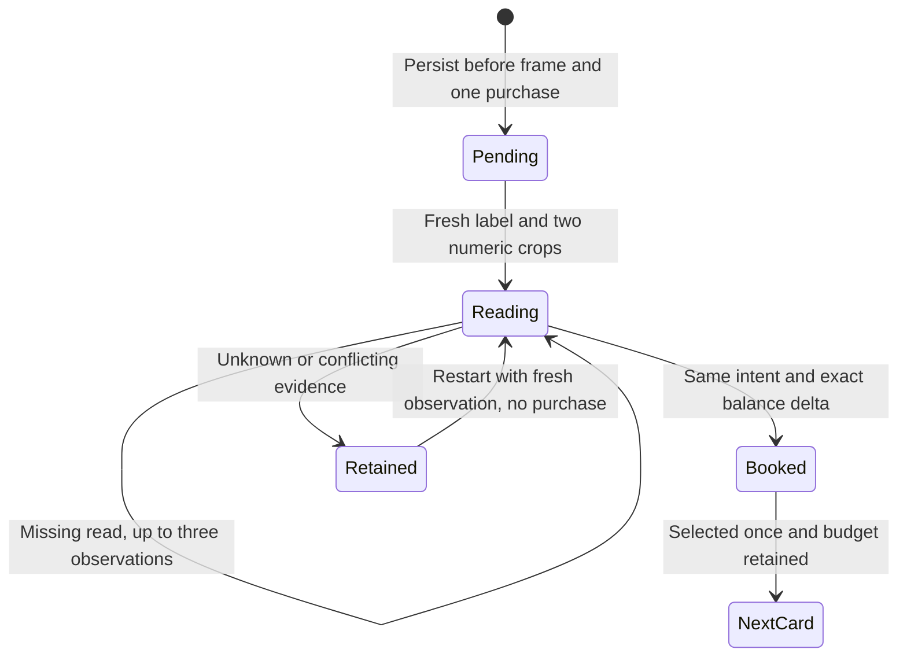

<a id="feature-4-3-6"></a>

### 4.3.6 战斗配卡与真实进度

saved 配置先解析为保存的具体模式；图从解析后开始。技能逐卡顺序编辑与模型直接配卡尚未完成。HUD 与 UNKNOWN 来回不等于战斗前进，进度停滞需记录具体边界；START 只提交当前回合。

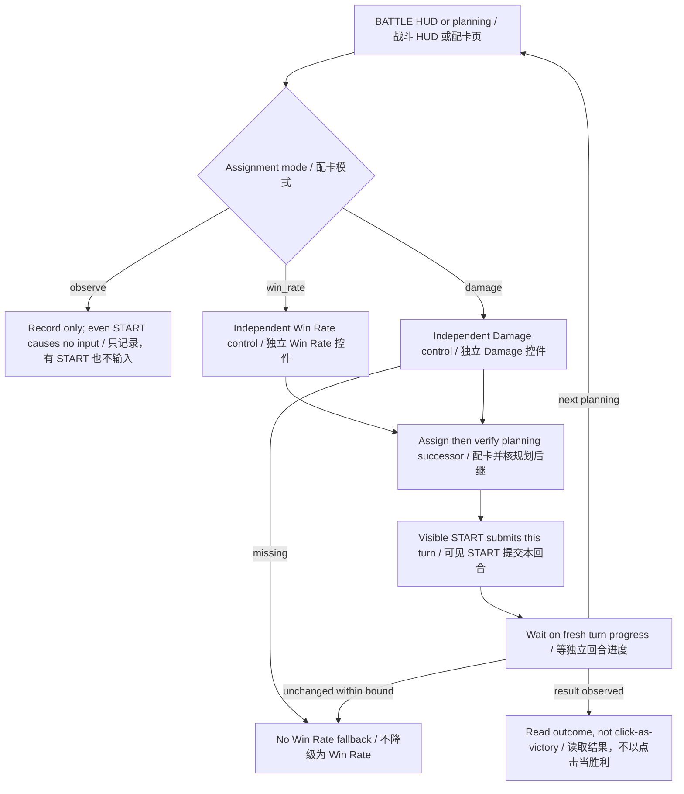

源码落点：`src/maalimbus/window.py:110` (`plan_step`); `src/maalimbus/battle_vision.py:1`; `src/maalimbus/runner.py:1`.


<a id="feature-4-3-7"></a>

### 4.3.7 路线与事件是不同决策

**节点 = 外层六边形 + 内部图标。** 六边形给出节点状态，图标给出节点类型，两者分开读（`src/maalimbus/map_hexagons.py`）。2026-11-21 第 1 层两种缩放下实测：可以走的下一个节点是奶油色环（色相 8–35、饱和度 30–125）覆盖六扇区中至少五区、且中心图标点亮；当前节点同样是奶油色环但中心被火车遮住；已走或前方未到的节点是金色环；未解锁（`?`）不亮；Boss 是红环。只在当前列右边一列里找亮起的六边形，当前列及其左边一律不算；列距由我方所在六边形在该间距下读成「占用」来确认，不直接采信徽标列距。这条读法排在其他通道之后：超级商店这类淡奶油色节点落在其他通道的颜色掩码之间，之前因此退回到我方身后的已清徽标节点，在 `-141507` 上连点 7 次无效后停机。图标只单独切出并记录，类型（商店、超级商店、战斗……）需要每类一张参考图，那是游戏素材，要走本地素材导入，所以目前 `node_type` 为空；选路不依赖类型。

当前实测相邻节点契约：`connected_ring_node` 保留彩色通道，将自己已经读到的 `map_clicks` 记录共享给 `_connected_white_outline`。优先由独立金色徽标列中心测间距；缺少共享列时仍可由亮装饰列测量。对重复徽标行聚类，并由独立火车位置校准纵向偏移。“下一列与已观测行的交点”只是候选，不等于节点或房间身份；商店不必有战斗房间那种上方装饰。截图尺寸与游戏内部地图缩放是不同测量。

每个候选仍须原图暗内区、六扇区至少五区的中性轮廓、单张颜色掩码采样比例>=.70的有色或亮中性出发线和唯一的一列内目标。跳两格、向后、缺少部件或多个受支持端点均不使用快捷路。点击内框不能充当列距。`lattice_measurement`记录列/行中心和实测相位，`analysis_reference_size`注明这些值的分析帧；target/point/step仍属于原生截图坐标。`candidates_of`保留1.25step距离及原帧证据。既有容量、意图和Maa通道拥有输入；仅独立且符合预期的节点面板/预览/房间可证明导航成功，不能推导消费或模型权限。

实际9d06636已完成三场战斗，随后漏掉斜向白色商店：装饰扫描只读到一个标记，共享地图读取器却测到548/740/932列及456/616/776行。源码由独立火车932,447校准行，提出1124,607，再核原轮廓和路径像素；不是商店固定坐标。128项相关检查通过，含192/384内部列距、1920/1280截图、地图体平移、缺部件/歧义和整体Runner的有界恢复。原384像素材料继续通过。最终全量、新冻结安装及实际商店进入仍须验收。

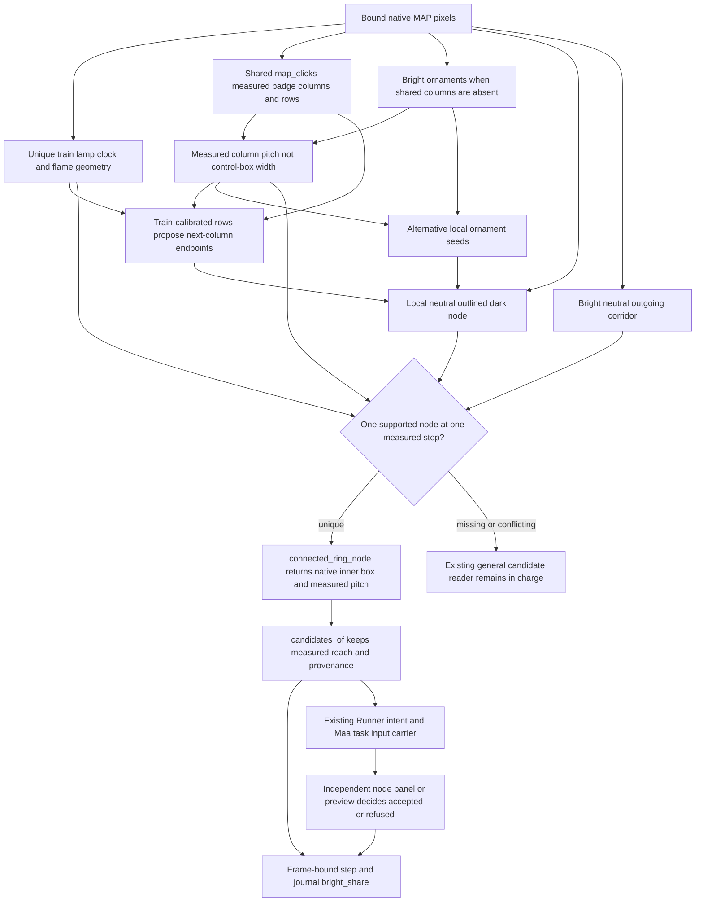

当前小图标契约：实际6f763e3第1层 packaged-mirror-20261119-040251 保留了32×23／357像素的中性问号，而旧40×24／400像素标记规则留下143×117路径亮线。`neutral_node_glyphs` 使用既有中性色亮度／色差掩码、按尺寸缩放的窄竖向闭运算与紧凑形状／填充边界，并要求同列另一个尺寸相近图标；只提出控件，不命名房间或证明可达。`map_clicks` 复用既有lit_icon通道，`candidates_of` 保留节点尺度／一步距离／排序／后继门禁，`map_nodes_offered.native_glyphs` 随最终评分记录测量框、填充度和出处。独立NODE_PANEL／NODE_PREVIEW仍拥有结果裁决。不改旧JSON或未决事务；建议标签不批准模型。 新测量字段可从日志及绑定原帧的步进报告复核，但尚未证明学习审阅UI会自动消费这些字段。必跑合成反例及1920／1280原图、平移图完整候选链通过；新安装版实际地图推进仍需验收。

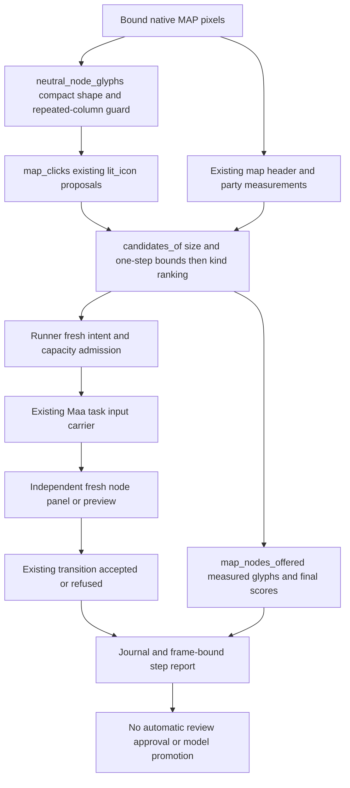

节点几何命中并不证明进入面板。未知导航、未知敌方试炼与未知事件选择有各自策略，3.7 的返回探测不能泛化为任意 Accept/Confirm；没有匹配策略时仍可能保留现场停止。不能把故事文本猜出的收益当实际到账。

2026-11-16 修复：先保留唯一的小型位置标记，再过滤大型点击目标；40px 标记不能因为不是 190px 节点而丢失。多个标记不推断唯一队伍位置，目标仍受节点尺寸与一步距离约束。17 项地图窄测试通过；这是代码/回放层，尚无本轮 live MAP 通过证明。

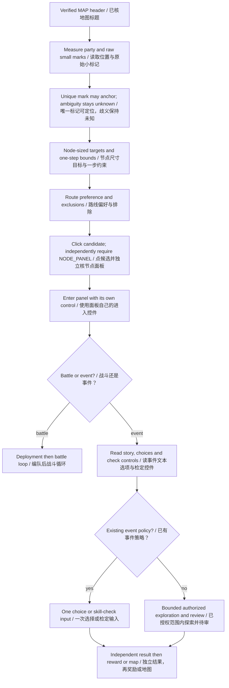

源码落点：`src/maalimbus/map_vision.py:1`; `src/maalimbus/event_vision.py:1`; `src/maalimbus/mirror_learning_policy.py:1`; `src/maalimbus/runner.py:1`.


<a id="feature-4-3-8"></a>

镜牢实时购买与结算只处理本轮游戏事务。学习样本整理移到离线命令 `python tools/review_shop_purchase.py --collect-scope <本局 scope>`，它读取持久化收据和账本。学习模式按一次商店访问只读核验已有刷新样本，手动模式不读取此队列。真实收据仍由商店后继对账。

商店购买领取浮层的确认分两步。Runner 先用当前原图只读验证确认框，容量维护要求重观测时，购买仍处于 `confirm_intent`，因此新帧能重新生成计划。当前计划获得输入容量后，才持久化 `overlay_intent` 并派发一次确认。回到货架后仍须读取实际扣款和购买后继。若后继不可证，`shop_receipt_blocked` 记录当前帧、商品、价格、事务阶段和预期页面。Team2 第五层 Arrested Hymn 的旧版停机证据是 frame-0258 的确认预留和容量取消，紧接 frame-0259 的同一浮层；没有浮层派发记录。

### 4.3.8 购物与刷新分别结算

当前局账本已证实前四层、且当前地图楼层读数无冲突时，第五层保底策略以 500 金币为离店结余目标。配置的最低保留额、禁买清单、报价验证和每次到店的刷新次数继续约束输入。决策日志显示实际使用的结余目标和已经刷新的次数。回放 Team2 的保留货架时，1,302 金币且两次刷新已用完，新规则提出以 217 金币购买 Carmilla。回放没有发出购买输入。

商店 GET 浮层必须在独立名称区显示未决藏品。通用 GET 标题和 Confirm 按钮只能定位浮层。名称或购买后的余额读不到时，Runner 在事务观测上限内重读；明确读到其他藏品时保留未决。保留的 Team2 Millarca 实机帧通过名称和 Confirm 核对，隔离账本重启后拒绝再次预留确认。

`shop_skill_vision.read_replacement_modal` 识别英文三列技能替换页。保留实机帧读到堂吉诃德、三种技能各 3/2/1 张及 2,283 金币。两次一致的 Maa 局部 OCR 补读左列报价 45，另外两列全帧读到 75 和 120。卡片印刷等级分别证实 S1→S2、S2→S3、S1→S3。等级缺失或冲突时单凭列位置无法确认。前排人格绑定、派发替换、金币和技能张数结算仍待独立验证。

`shop_skill_policy.propose_replacement` 对两种留牌规则分别比较已验证的升 S3 报价，在金币保留线以上选最低价。Runner 用 `shop_skill_choices_observed` 记录各模式预测的张数与余额。英文替换页的 Cancel 为已有退出流程提供定位。预测不能授权输入或结算交易。

提交出战时，Runner 把精确人格标题与唯一印刷部署序号及卡片本身的 `SELECTED`／`BACKUP` 状态绑定，再用独立的战斗 HUD 帧确认进入战斗。商店日志核验两组 JSON／PNG 后才附上同局人格及其初始角色。一组 Team2 实机帧读到 7 名初始上场、5 名后备。战中替补、未读准的人格和购买回执仍需各自的证据。

启用技能策略后，英文 1920×1080 和 1280×720 战前提交可从原帧对未识别的 `SELECTED` 卡片做两组三行局部 OCR。720p 只在内存放大识别像素，并记录原图与识别尺寸。两组读数须一致，并完整匹配唯一图鉴人格。Team2 的 1080p 原图补读到印刷第 1 位堂吉诃德和第 2 位良秀。720p 提交原图和独立战斗 HUD 回放核对出印刷第 5 位前排希斯克利夫。冲突或读不全仍保持未知。回放不改部署状态、不发送输入。

技能 Confirm 处于未决时，商店账本只接受时间更晚、同一罪人的替换页。原报价、金币差额和三种技能张数同时吻合后，才单独记一笔技能收据。后继不明时保留未决，不进入藏品确认或刷新流程。安装版派发与实机 Confirm 后的页面仍待验收。

已选技能若要按未消费退出，必须先从更晚的替换页证实同一罪人、相同金币和相同的三项技能张数，才能预留 Cancel。选卡后只看到同余额货架仍不能销账，必须有对应 Cancel 意图，且货架截图时间晚于 Cancel 原帧。条件不满足时保留账本原字节。

Runner 通过既有决策日志展示当前模式、前排证据、实读报价和预测张数。预留点选、等待后继、核实扣款分别输出。仅帧号变化而决策依据一致时，控制台不重复打印报价。

高级商店实机货架在具名技能卡下显示 `??`，全帧 OCR 有时会读成 `77`。显式设置 `shop_skill_mode` 后，Runner 只为已验证的初始前排打开具名技能卡，每次到店同一罪人最多保留一次打开意图。替换页证实同一罪人和余额后，Runner 可预留一次卡片选择输入，先记录原始帧、人格、报价和预测收据。随后只在独立读到余额未变的替换页时才可 Cancel 并核对未消费回架。藏品规划排除具名技能服务和 ID Skill Search。MXU 任务选项可关闭（默认）、一二技能各留一张，或只留一张二技能。该选项启用购买前核验。留存的 1280×720 选择页在安装版 Maa OCR 上逐列读取，缺失报价由两次相符的窄读补全，得到 45、75、120。复核只在内存屏蔽报价 OCR 行，保留原始像素和文件。全帧已有冲突报价时，该列仍无可用价格。选中状态、付费确认与通用选人页仍待接入及实机验收。

普通店和高级店的保留货架里分别读到了 `Heathciffs` 和 `Ryōshü` 等 OCR 拼写。识别只接受测得的拼写和英文所有格形式，不用模糊匹配。能识别是技能服务但不能证实罪人时，这一项也不会进入藏品候选。货架只提供打开控件，报价、上阵人格和选中的替换仍分别核验。

高级店的通用选人卡有独立的只读记录。两张原图的卡片费用区显示星光图标和问号，OCR 有时读成 `77`。读取器把卡片和图标绑定到同一张原图，记录屏幕显示的币种，问号不计为报价。游戏公告说明下一步是在货架下方选择人格，实机选人和后续付款尚未验收。[Project Moon 更新公告第 6 页](https://clan.fastly.steamstatic.com/images/43587230/287eca0a2596c05341830cae507ec2e48634671e.png)

Purchase 弹窗报价尚未消费，不能在此页要求钱已扣完。card/confirm/GET/货架到账分别结算；卡片可能留在货架并显示自己的 Purchased 标记，也可能消失。刷新读数必须证明完整新货架，不能靠 OCR 数量变化猜已经成功。局内 coins 与 Modules/Lunacy 预算分开。静态硬规则、经济优先级和刷新上限控制当前行为，3.9 的模型仅作影子预览。

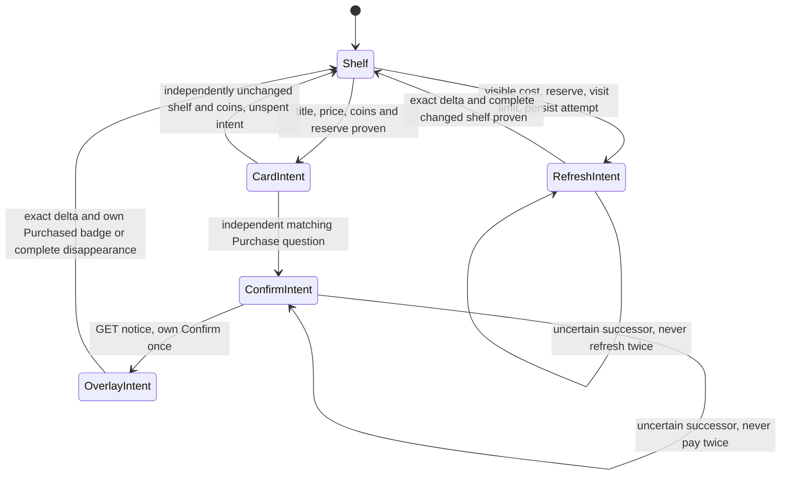

源码落点：`src/maalimbus/shop_transaction.py:147` (`ShopTransaction`); `src/maalimbus/shop_vision.py:1`; `src/maalimbus/shop_settings.py:1`; `src/maalimbus/shop_value_shadow.py:7`.


**2026-11-17 购买执行教师统一（源码，待安装）**：`shop_transaction.purchase_execution_witness` 供实际 Purchased 分支、`shop_outcomes.sync` 和训练加载器共同复核。精确扣款、唯一未购买的原商品、后继同名同价商品自己的 Purchased 标记足以证明执行；其他槽位 OCR 不一致不再挡住采标签。没有自己的标记则仍须完整剩余货架；实际流水线允许的问句绑定 currency-only 恢复不自动进入训练。旧完整货架样本保持原内容地址和人工 review；新教师名称单独说明 own-badge 证据。5 笔实际保留购买均只读通过，交易字节不变、零设备输入/样本复制（`build/shop-shared-execution-teacher-real-verification.json`）；115 相关测试通过、55 历史材料跳过。购买执行、后来通层/领奖相关结果与藏品因果强度是三个不同标签；当前没有策略晋级或新模型质量验收。

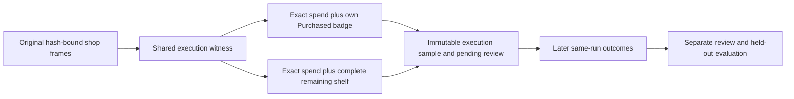

**2026-11-17 购买样本原件引用（源码，待安装）**：新建的项目内 `shop-purchases` 样本使用 `evidence-storage.json` 明确声明 canonical 引用。不可变 `sample.json` 仍绑定原始 JSON/PNG 双哈希，读取器每次复核原件；后续通层结果也直接引用同一账本绑定的原始证据。旧可移植副本继续支持，不改内容地址、人工 review 或已有镜像。没有声明、原件缺失/变更、半份镜像、错误角色或链接路径均不以另一份文件猜补。3个真实新样本只增加18,708bytes；5笔购买已全部采集、2笔有后继结果标签、3笔仍待结果，原2份review和31配置文件字节不变，零设备输入/策略晋级。134相关测试通过；`build/shop-canonical-evidence-real-verification.json`。这节实现的是证据引用与教师迁移，不是训练精度或完整镜牢验收。


```mermaid
classDiagram
  class PurchaseSample {
    content_address
    scope
    before_after_proofs
  }
  class EvidenceStorage {
    sample_address
    canonical_roles
  }
  class NativePair {
    json_sha256
    png_sha256
  }
  class HumanReview {
    status
    corrected_benefit
  }
  PurchaseSample "1" --> "0..1" EvidenceStorage
  EvidenceStorage --> NativePair : verify original bytes
  PurchaseSample "1" --> "1" HumanReview : preserve ownership
```

<a id="feature-4-3-9"></a>

### 4.3.9 图鉴、账户 box 与自动编队

公共图鉴不包含账户 ownership；未观测不等于没有。选择器的混合体系是 OR 匹配，等级先于匹配体系数量。点击 sinner 的详情往返不能冒称已经扫描完整 box。体系 E.G.O 全量装配与实际后继仍须单独验收，此图不是已完成每个账户自动装备的证明。

```mermaid
flowchart TD
  A["Revisioned public catalogue / 带版本公共图鉴"] --> C["Exact normalized identity index / 精确归一化人格索引"]
  B["Observed owned-only account page / 实际仅已有人格页"] --> D["Sinner header and filter proof / 罪人标题及筛选证明"]
  D --> E["Observed titles, level and evidence / 观测名称等级与证据"]
  C --> F["Reconcile by sinner and unique alias / 按罪人及唯一别名对账"]
  E --> F
  F --> G["Owned matches and unresolved rows / 已有匹配与未解记录"]
  G --> H{"Complete inventory or descending-level proof? / 全量或等级降序已核？"}
  H -->|yes| I["Owned selectable system match, highest level / 已有可选体系匹配，等级优先"]
  H -->|no| J["Do not claim highest owned identity / 不声称已选账户最高人格"]
  I --> K["Actual equip and EGO successor required / 实际装配与 EGO 后继仍需证明"]
```

源码落点：`src/maalimbus/owned_inventory.py:1` (`build_index`, `reconcile_titles`); `src/maalimbus/sinner_collection.py:1`; `src/maalimbus/auto_formation.py:17` (`choose_identity`).

## 4.4 `experience`：自动经验本

- **触发入口**：`ExperienceTask`（`assets/resource/base/pipeline/mirror.json:5295`），option `experience_team`（`assets/interface.json:136-138`）；文案见 `assets/i18n/zh_cn.json:79-80`，其中明确「关卡选择、战斗及消耗验证尚未支持」。
- **逐步业务动作**（`agent/recognition.py:1623-1633`）：先 `lux_task.prepare(data_directory(ROOT), 'experience', choice)`（`src/maalimbus/lux_task.py:21`），`choice` 来自 `context.get_node_data('LuxExperienceTeam')['attach']['slot']`；`prepare` 先跑 `check_run`（`src/maalimbus/lux_task.py:11`）拒绝在未完成镜牢期间导航，再校验并保存默认队伍；失败即 `reject(str(error))`。随后建 `local_device(..., deadline=now+45)`（`src/maalimbus/runner.py:380`）并调 `execute`（`src/maalimbus/lux_task.py:65`），结果附加 `result['saved_team']={slot, keywords, deployment}`。
- **逐步业务动作（导航部分）**：`target(record)`（`src/maalimbus/lux_task.py:45`）只认两种页面：`HOME` 上独立可读的 Window / Sinners / Inventory 三个控件 + 唯一的 `Drive`，以及 `DRIVE` 上的 `Luxcavation`；到 `DRIVE` 之后没有已独立验证的下一站。
- **终止条件**：拒绝＝有未完成镜牢（`active_mirror_run_blocks_lux_navigation`）、选择非法、既有意图属于别的任务/队伍；停止＝会话结束或超出输入界，`lux_task.execute` 在成功点到 Drive 之后返回 `lux_navigation_successor_requires_verification`（`src/maalimbus/lux_task.py:127-128`），**不算通过**。
- **产出证据**：`lux-menu-home-input.json` / `lux-menu-drive-input.json` 输入报告、`user-lux-task-transaction.json` 意图文件、`lux_navigation_stopped` 事件、`agent-result.json`。


<a id="feature-4-4-1"></a>

### 4.4.1 经验与纺锤共享的菜单链

两个任务共享实现，只在任务键和保存队伍不同。准备门禁在写配置与创建设备之前；执行再核镜牢排斥。成功走到菜单边界不是刷经验/纺锤完成，stage 选择、成本、战斗与到账仍未实现验收。

```mermaid
sequenceDiagram
  participant A as MainTaskAction
  participant L as Mirror and Lux state / 镜牢与 Lux 状态
  participant P as Saved profiles / 保存编队
  participant M as Maa observation and input
  A->>L: prepare: exclude active Mirror and conflicting intent
  L-->>A: Validated task and team / 已核任务队伍
  A->>P: Resolve saved team, save only changed defaults
  A->>M: Observe HOME / 观测主页
  A->>L: Persist HOME before JSON and PNG hashes
  A->>M: Click independently recognized Drive
  M-->>A: Fresh DRIVE control and hashes
  A->>L: Validate both proofs then resolve HOME intent
  A->>L: Persist separate DRIVE intent
  A->>M: Click independently recognized Luxcavation
  M-->>A: Stage page requires verification / 关卡页仍需验证
  Note over A,M: At most two menu inputs, no farming or consumption / 最多两次菜单输入，不刷本或消费
```

源码落点：`src/maalimbus/lux_task.py:11` (`check_run`, `prepare`, `execute`).

## 4.5 `thread`：自动纺锤本

- **触发入口**：`ThreadTask`（`assets/resource/base/pipeline/mirror.json:5306`），option `thread_team`（`assets/interface.json:146-148`）；文案见 `assets/i18n/zh_cn.json:81-82`，未支持范围与经验本相同。
- **逐步业务动作**：与 `experience` 共用同一条代码路径（`agent/recognition.py:1623-1633`），只差 `task='thread'` 与节点名 `LuxThreadTeam`。`lux_task.prepare`（`src/maalimbus/lux_task.py:21`）用 `luxcavation[task+'_team']` 选择保存队伍，`lux_task.execute`（`src/maalimbus/lux_task.py:65`）走同一套 `HOME`→`DRIVE` 导航。
- **终止条件**：与 4.4 完全一致（同一函数、同一 reason 集合）。
- **产出证据**：与 4.4 一致，只是报告里 `task='thread'`、事件名仍为 `lux-menu-<scene>-input.json`。
- **口径**：`README.md:51` 把经验本/纺锤本列为「独立任务入口引用已保存队伍」已验证，未完成部分是「实际关卡、消费和战斗流程；当前保存画面停止」。`docs/acceptance.md:1315-1322` 同样只承认菜单导航，实际 Lux 关卡选择、刷取、消耗/回执、GUI 派发仍是开放的。

## 4.6 `rewards`：领取奖励

- **触发入口**：`RewardsTask`（`assets/resource/base/pipeline/mirror.json:5317`），option `reward_module_budget`（`assets/interface.json:155-158`）；文案见 `assets/i18n/zh_cn.json:83-84`（需要本轮模块预算；邮件与每日任务领取尚未支持）。
- **逐步业务动作**（`agent/recognition.py:1614-1622`）：先 `reward_task_budget.apply(..., get_node_data('RewardModuleBudget')['attach']['maximum'])`（`src/maalimbus/reward_task_budget.py:6`），它要求当前存在「已验证、未领奖的五层通关」运行，并把上限绑定到该 scope；再 `reward_task.execute`（`src/maalimbus/reward_task.py:72`），deadline 为 90 秒（`agent/recognition.py:1619`）。
- **逐步业务动作（领奖循环）**：`execute` 每轮 `runner.observe`（`src/maalimbus/runner.py:657`）读一页；`action_for`（`src/maalimbus/reward_task.py:15`）把页面映射成 `claim` / `confirm` / `receipt` / `pass`（`src/maalimbus/reward_task.py:10 ACTIONS`）；再用 `runner.one_shot_click` 发一次点击并写 `reward-<action>-input.json` 输入报告；回到 `HOME` 才调 `finish`（`src/maalimbus/reward_task.py:27`）做回执审计并推进轮换。循环上限 5 次（`src/maalimbus/reward_task.py:108`）。
- **终止条件**：成功＝`finish` 通过回执链与 HOME 独立验证，返回 `mirror_payout_and_home_verified`（`src/maalimbus/reward_task.py:104`）；拒绝＝没有已验证的完整镜牢运行，返回 `completed_mirror_run_required`（`:97-99`）；停止＝页面/后继未被证明、输入界耗尽或设备中断（`:115`、`:129-132`）。
- **产出证据**：`reward-<action>-input.json` 输入报告、`user-reward-claim-transaction.json` 事务、`user-run-ledger.json` 账本事件、`reward_task_stopped` 事件、`agent-result.json`。


<a id="feature-4-6-1"></a>

### 4.6.1 领奖与只记账恢复

未授权预算保留报价页，不能借用上一局预算。确认金额和 Pass 数值来自实际页面，不固定 250/81。通关、奖励到账、返回与轮换分别记账；已通关但领奖/返回证据缺失，不能推断没通关，也不能伪造完成链。此任务当前只实现 Mirror 子流程，不含邮件/每日奖励。

正常镜牢任务在页面改变前，从哈希绑定且显示 100% 的原总结页记通关。本局通关及模块预算获批后，镜牢把付费步骤交给与「领奖」相同的执行器。执行器重读报价，负责持久化输入意图、核对收据和返回 HOME 的记账。收据和返回通过后，镜牢才重读轮换位置并计入完成次数。上一局的预算会让本局停在当前报价页。

Claim 和可能扣费的 Confirm 各自检查当前局预算。预算在两步之间降低时，旧预留额必须仍在新的上限内。Confirm 已经发出后，核对到账浮层、通行证回执和返回 HOME 依据同局事务及各自的原图证据，可以在预算设置缺失时续做。停机摘要显示领奖阶段、是否已发送本步输入，以及从绑定原图读到的费用和周奖次数。找不到可信报价时明确显示未核实。

可执行的报价只有在保留原图上实测过的三种：6 模块配 1 次每周加成，5 模块配 0 次，18 模块配 3 次。费用变成两位数时，货币图标和减号各左移 6 像素，识别器按位数分两套位置和各自原图裁出的模板，图标位置与费用位数不一致就不算报价。没有实测过的组合继续拒绝，例如 12 模块配 2 次。预算选项目前只到 6 模块，18 模块的报价要由用户对本局明确授权后写入本局预算。

最后一张回执确认之后，游戏先显示加载页再回到 HOME。执行器只在本局回执已经确认之后把加载页当作等待，并受领奖期限约束；在那之前，加载页不证明任何东西，照旧停下。

```mermaid
sequenceDiagram
  participant E as Rewards executor / 领奖执行
  participant T as Scoped reward transaction / 本局领奖事务
  participant M as Maa controller
  participant A as Readonly receipt audit / 只读回执审计
  participant L as RunStore
  E->>T: Require verified five floors and scoped budget
  loop claim, confirm, receipt, pass / 各输入阶段
    E->>M: Read fresh cost, question or receipt control
    E->>T: Persist action intent before input
    E->>M: One input, then independent successor
    M-->>T: Scoped input report and retained frame
  end
  M-->>E: Independently observed HOME
  E->>A: Four reports, actual amounts and JSON/PNG hashes
  A-->>E: Full chain proven / 完整链已证明
  E->>T: Persist bookkeeping HOME before ledger change
  E->>L: reward_received then entry_returned, rotate once
  E->>T: Mark transaction completed
  Note over E,L: If final write fails, recover exact archived events without input or rotation / 最后写失败只核归档恢复，不再输入或轮换
```

源码落点：`src/maalimbus/reward_task.py:27` (`finish`, `execute`); `src/maalimbus/reward_receipt_audit.py:1`; `src/maalimbus/storage.py:247` (`RunStore.record`).

## 4.7 `stamina`：体力兑换（未实现）

- **触发入口**：`StaminaTask`（`assets/resource/base/pipeline/mirror.json:5328`），无 option；文案见 `assets/i18n/zh_cn.json:85-86`：「预算内体力兑换识别尚在开发，当前保存现场后停止，不消费」。
- **逐步业务动作**（`agent/recognition.py:1634-1637`）：`stamina` 落进镜像之外的分支——只做一次 `runner.observe(observer, now+30)`（`src/maalimbus/runner.py:657`），然后把观察记录塞进结果并返回。
- **终止条件**：**永远不通过**。结果固定为 `passed=False, reason='task_page_policy_not_implemented', input_sent=False, verified_clear=False`（`agent/recognition.py:1636-1637`）；没有消费任何体力或货币。
- **产出证据**：一次观察写入的 frame 对 + `main_task_stopped` 事件 + `agent-result.json`；单测 `tests/test_main_task_dispatch.py:45 test_unimplemented_task_captures_evidence_and_returns_failure_without_input` 钉住「保存证据、返回失败、零输入」。
- **口径**：`README.md:52` 把体力兑换/每日奖励列为「独立入口和预算基础」已验证，未完成部分是「实际页面和到账；当前保存画面停止」；`docs/acceptance.md:944` 也只承认纯预算边界通过、没有消费实现。

---


<a id="feature-4-7-1"></a>

### 4.7.1 未完成任务的真实边界

虚线表示缺口，不是执行边。预算基础或独立入口存在不等于这些业务已完成；图保留边界，避免把想做的能力画成已经运行的 pipeline。

```mermaid
flowchart LR
  A["StaminaTask"] --> B["Observe and retain frame / 观测留帧"]
  B --> C["task_page_policy_not_implemented; zero input / 页策略未实现，零输入"]
  D["RewardsTask"] --> E["Implemented Mirror payout only / 仅已实现镜牢领奖"]
  E -. "not implemented / 未实现" .-> F["Mail and daily claim / 邮件及每日奖励"]
  G["Experience or Thread"] --> H["Shared menu navigation / 共享菜单导航"]
  H -. "not implemented / 未实现" .-> I["Stage, costs, farming and receipt / 关卡成本刷本到账"]
```

源码落点：`agent/recognition.py:1` (`MainTaskAction.run`); `src/maalimbus/lux_task.py:65`; `src/maalimbus/reward_task.py:72`.

## 4.8 未验收 / 待核实清单

更新边界（2026-10-13）：下列旧记录的“GUI 未派发”是当时快照。实际 GUI Start 已走过 DUNGEON_TEAM、警告、星光与初始礼物，证明入口已执行，但未证明整局和 Team1/Team2 实机跨屏滑动。用户确认上局通关；独立领奖/返回记账不全仍是另一项缺口。

本章已经逐条打开确认的锚点见上文每处 `路径:行号`。以下内容本章**没有**独立验证，如实列出：

- **端到端 GUI 派发未验收**：六条链路里没有任何一条被本章用真机 GUI 点过。`docs/acceptance.md:156-158` 记录的「六个原生任务入口」只在同一 GUI 上渲染出六个选项，当时任务被禁用、没有游戏连接、没有 GUI Start 派发。
- **`open_game` 冷启动未验收**：`docs/acceptance.md:158` 明说冷启动仍未接受（只单独验证过「已在前台的 MuMu」不重启、零输入）。
- **`mirror` 的实机结果未验收**：本章引用的真机 run（`pi-20261012-112240`）以 `reason=unexpected_successor`、`passed=false` 结束（`docs/acceptance.md:2-8`），是一个停机点而不是通关。
- **`experience`/`thread`/`stamina` 的页面策略未实现**：三者的关卡/页面策略都还没有代码，正文按 `src/maalimbus/lux_task.py:127-128`、`agent/recognition.py:1636-1637`、`README.md:51-52` 的现状写成「未实现」。
- **`rewards` 的真机付费领奖未验收**：`docs/acceptance.md:1284-1287` 说明实际 GUI Start 派发与当前 Team7 付费 5 次领奖仍未验证，只离线证明了保留回执链。
- **策略件的内部行为未逐行核对**：4.3 里列出的 `mirror_learning_policy.py` / `route_plan.py` / `gift_plan.py` / `shop_priority.py` / `auto_formation.py` / `budget.py` 只核对了顶层符号与其行号，没有逐行读完整实现细节。
- **证据目录前缀**：`loop_directory` 的默认前缀是 `pi-`（`agent/recognition.py:1334-1335`）；本章没有逐台机器比对 `evidence/runtime/` 下实际目录清单，只引用了 `docs/acceptance.md` 里已登记的路径。
- **`InputPreflight` 的 `win32` 分支内部**：只读到窗口唯一性与身份校验入口（`agent/recognition.py:1219-1228`），后续校验细节与 `input_helpers` 报告格式未展开。


## 4.9 轮换选队与有界列表搜索

加载下一队前必须先进行账本 reconcile；商店回执的局部调用现命名 shop_reconcile，避免遮蔽入场 reconcile。

队伍定位使用当前侧栏的独立 OCR 行，不用旧屏幕坐标。目标不在可见列表时只在侧栏内有界上下 Swipe；两次语义列表不变则换方向，最多十二次尝试。找到目标后仍须顶部标题独立证明选队成功，才能 Confirm。默认 TEAMS #1–#40 的编号可读；自定义队名仍需要经验证的槽位映射，不能把名字或列表位置猜成编号。导航尝试保存在私有 user-team-navigation.json。

本轮已用真实失败帧在隔离状态中证明 reconcile 不再异常；实际成品更新与 GUI 再启动仍须另行验证。

<a id="feature-4-10"></a>

## 4.10 轮换政策与手动跳过

用户已选“成功领奖后轮换，另加手动跳过”，不是弃局自动轮换。当前 point_at 可在无 active 时手动定位已保存队伍；专用跳过按钮、launcher 命令及幂等 ledger 操作已新增源码；尚未重建/安装/GUI 验收，不能当已安装按钮。上把通关由用户确认；脚本保留记录不足时单独注明，不能将其称为游戏未过。Team1、Team2 固定与轮换目标需经过 MainTask→Runner→列表定位的完整路径测试。

```mermaid
flowchart TD
  A["Start request / 启动请求"] --> B{"Active run? / 已有当前局？"}
  B -->|yes| C["Keep that run team and scope / 保留该局队伍及 scope"]
  B -->|no| D["Read queue cursor or fixed team / 读队列游标或固定队伍"]
  C --> E{"Clear, reward and return all proven? / 通关领奖返回全部已核？"}
  E -->|yes| F["Archive receipt; advance once / 归档回执，前进一次"]
  E -->|no| G["Retain facts; abandon keeps cursor / 保留事实，弃局不自动换队"]
  D --> H["Bounded sidebar selection / 有界列表选队"]
  F --> D
  G --> I["Manual skip request / 手动跳过请求"]
  I --> J{"No active run or controller? / 无当前局及活动控制器？"}
  J -->|yes| K["Explicit next-team change; not completion / 明确换下一队，不计完成"]
  J -->|no| L["Refuse change during a run / 局内拒绝改队"]
```

源码落点：`src/maalimbus/storage.py:151` (`point_at`, `abandon`, `record`); `src/maalimbus/task_preferences.py:1`; `src/maalimbus/team_navigation.py:1`.

<a id="feature-4-11"></a>

## 4.11 冷启动、原生日志与已授权入场恢复

本节计划与验收分开：先修实测入口缺陷，再以单次明确授权纠正错误 Team1，最后用安装版重新验证 Team2。2026-11-16 已实测执行错误 Team1 的 Halt→完整 Forfeit 问句 Confirm→GiveUpRewards，独立后继为 Before Entry；没有 Claim、星光购买、周奖切换或补资源输入，原28项配置哈希保留。唯一新增配置是正常打开游戏事务。该授权已用完，不是默认自动弃局策略，也不证明 Team2 或通关完成。实证在 `build/resume-20261116-team1-abandon-real-verification.json`；恢复脚本及账户截图只留本地。

实测入口修复：`game_launch.open_game` 原本连续快速查五次前台，游戏尚在启动就返回 pending；现在有界观察15秒/至多30次，每次间隔0.5秒，只发送一次启动，未核后继仍保留事务、不重启。`session_flow` 接受完整 TOUCH TO START 的空格差异，不降低阈值或接受其它词。`run_flow` 是自由函数，不能调用不存在的 self；普通辅助点击/滑动统一用真实 Journal 的 `record`，不再调用不存在的 `note`。已成功的 Cancel 因日志异常未收尾时，用原始前后PNG/hash恢复，未重复输入。

Team library 的箭头尺寸与旧 tutorial 模板不同。新增 `team-library-back.png` 来自实际 header 裁剪，按原生 TemplateMatch、.92、唯一匹配和 TEAM_LIBRARY 页面限定读取；它不泛化为所有未知页可点。完整来源只留本地 `build/team-library-back-template-provenance.json`。Maa 实测返回菜单；这不是神经模型训练或JP游戏验收。

奖励弹窗本次按钮带低19px，Claim中心落在旧ROI下界外约3px。识别带覆盖实际按钮，仍要求原阈值和独立标题/To List(或To Window)/Claim；关键文字缺失或嵌套未知确认时保留 UNKNOWN_DIALOG，禁止把其后台 Enter 当入口。`map_live_observe --current-page` 使用Null输入，只证明当前截图/hash已读；不把未知页截图成功当地图或业务推进。

```mermaid
sequenceDiagram
  participant A as Agent / task
  participant M as MaaFramework
  participant J as Journal / intent
  participant G as Game
  A->>J: 启动意图，保留未核状态
  A->>M: StartApp 一次
  M->>G: 启动 Limbus
  loop 有界后继观察，不重启
    A->>M: 读前台和原生页面
    M-->>A: 新鲜截图/文字
  end
  alt Fresh HOME checkpoint / 新鲜HOME后继
    A->>J: Skip prior title steps, input_sent=False
  else Title still current / 当前仍是标题
    A->>M: One proven title touch, then observe HOME
  end
  A->>J: record 输入前意图与后继
  Note over A,G: 奖励弹窗优先，后台入口不可用
  opt 仅本次明确授权的错误Team1恢复
    A->>J: 绑定新鲜Team1与授权；最多弃局一次
    A->>M: Halt / 完整Forfeit问句Confirm / GiveUpRewards
    M-->>A: 独立Before Entry截图
    A->>J: 授权用完、保留旧事务；不计通关或轮换
  end
```

相关源码检查 **135 passed / 75 skipped**，退出码0；覆盖真实 Journal 接口、单次启动后迟到前台、标题空格及奖励浮层正反例。完整回归7 failed / 2732 passed / 710 skipped，271.19s，退出码1，保留原七项失败。新增代码/模板尚待重建安装；当前安装版仍是 b62dbab。Team2重新入场、GUI Start、自动训练/晋级和完整镜牢仍开放。


**后续安装与 Team2 实证**：c515f3e 已重建安装，527文件源码指纹，98安装私有文件/29项目配置保留，新增箭头模板1份。打包 Agent 的 MirrorTask 读保存的单队2，5次有界输入后到 STAR_GRACES；独立标题证实 Team2、Confirm一次、星光页零输入。`build/resume-20261116-team2-entry-real-verification.json` 同时核原PNG/hash和旧回执不变；不证明GUI点击、通关、领奖或轮换。

停在输入后第一个 STAR 后继时，旧代码在入场后继记账前交还，留下 entry_pending。共享 `run_wiring.settle_entry_successor` 现核原意图hash和独立后继，在普通计划及停页交还前收尾；未知/同帧/外来scope/原字节变更均保留 pending。140相关通过/68跳过；真实保留帧通过完整 MirrorRunner.step + FakeDevice 一次输入重放，phase为entered。实际账本已用同一helper核原Team2/STAR证据后零输入补记为entered；完整回归7 failed / 2737 passed / 710 skipped（275.20s，自身退出码1），保留原七项失败；5f6a87e已安装，自检通过，98安装私有文件/29配置原字节保留，不能重按Confirm。一次授权的Team1弃局已完成，不再可用。


**最新实机检查点**：39b3aaf Agent 已安装自检通过，98安装私有/29主配置保留。相同Team2 scope的成品MirrorTask从STAR_GRACES经6次350–750ms框内输入到INITIAL_GIFTS；实际余额74→64→44→14，已买2/4/5共60，7号因余额不足略过。确认前禁用了剩余星光兑换并独立读到unchecked；初始藏品页零输入，无模块/补充/付费领奖，无楼层或轮换记功。`build/resume-20261116-team2-stars-real-verification.json`核12组原JSON/PNG/hash。文件夹约1,927,053,665字节，仅余约73MB；继续长跑前需约束截图/debug增长，本段原生debug约32.7MB。不宣称完整镜牢完成。


<a id="feature-4-12"></a>
运行时导航 checkpoint：`Step.resume_page` 仅声明稳定页面的等待点；`run_flow` 先读新鲜页面/hash/原ROI文字，已独立到达 HOME 则跳过标题等待/触摸，记录 skipped/input_sent=False，不重发 StartApp、不写业务收据。`finish_launch` 只接续标题到主页。标题完整词间仅容忍实际 OCR 的 I/竖线分隔，不降低阈值；遮罩或 UNKNOWN 不能按后台主页文字跳步。

## 4.12 初始藏品预览不授权地图手势

真实成品到INITIAL_GIFTS后，竟先在目录页执行地图规范化。藏品图标被误当我方标记，原生缩放及一次拖拽移动了目录；普通输入计数只记后面一次体系预览点击，不能当成设备实际只输入了一次。五组原JSON/PNG原字节保留，选中仍0/2，无初始藏品回执。`build/resume-20261117-initial-scroll-retained-verification.json`记录这五帧的源码重识别及隔离完整Runner重放。

修复：`_normalise_view_once`必须先有原生MAP场景，才测像素、发手势或消耗本层一次规范化标志；非地图/未知页不消耗标志。后续地图输入传入实际record。初始页仍要求唯一计数器、右侧藏品标题、Refuse Gift及唯一Sinking/Poise/Charge三标题；标题带覆盖两种实测滚动位置，三者必须同一行，.85阈值不变。不增加“未知就点”的通用授权。

恢复时若0选中却展示另一体系的三个报价，Runner只打开配置体系预览一次，再读完整标题和计数后选礼物。不切换已有选择，不重试pending礼物。一次预览后仍没有配置完整标题，报告缺失报价，不再重复点预览。当前Poise帧的隔离完整Runner重放证明：配置体系预览一次、零地图手势/标志、零礼物选择，故意不给后继变化时正常报告缺失。

```mermaid
flowchart TD
  Observe[新原生record] --> Map{MAP场景?}
  Map -->|是| Normalize[每层一次有界地图规范化]
  Map -->|否| Catalogue[不发地图手势也不消耗标志]
  Catalogue --> Identity{目录锚点与同排标题?}
  Identity -->|是| Offers{配置标题可见?}
  Offers -->|是| Pick[绑定礼物意图与计数后继]
  Offers -->|否且0选中且未试预览| Preview[配置体系预览一次]
  Preview --> Observe
  Offers -->|仍缺失或已有选择| Explain[保留状态并报告缺失报价]
```

87项相关检查通过，退出码0；五组真实保留帧身份核验与完整Runner FakeDevice重放通过，零实机输入。完整套件8 failed / 2756 passed / 710 skipped（281.98s，自身退出码1），为原七项加新增图索引缺链接一项；链接已补，相关Wiki/页面/初始选择96项复测通过（29.87s）。Agent安装和实机恢复选择仍待验。原生宿主截图抑制已从b44aade安装，实测此段原生debug PNG为0且保留原始截图，但在独立的目录缺陷停下，不当整局容量验收。


<a id="feature-4-13"></a>
## 4.13 战前预设不等于已保存Teams槽位

已验证的Team2入场在首次战前页显示`Preset #1`。旧回退把它当全局Team1，并借用1队出战顺序。实机记录了15次普通输入，清空/重排/提交`[10,8,3,5,9,12,11,6,2,4,1,7]`，而保存的2队要求`[3,4,9,1,7,2,12,5,8,10,11,6]`。人格阵容仍来自已验证Team2入场，并非再次误入Team1，不能使用弃局许可。当前已到BATTLE_HUD，按配置正常交还；不能验收为正确2队部署。提交记账留pending，下一次正常HUD观察才能收尾。验证器对此有意停页路径报stopped/failed，不宣称通关或领奖。

计划/实现：`saved_team_header`只接受现有阈值/ROI内唯一明确TEAM(S)标题。只有Preset时不提供全局槽位，沿用入场实证及设置。真实Teams标题与绑定矛盾则解释并零输入结束，绝不暗换另一保存方案。Runner始终从该保存队伍读目标顺序。完整屏幕编号仅用于核验复用：相同直接提交，不同则清空并按配置事务化选择；残缺编号不能变成新目标。历史决策D118/D119/D282的旧假设在这些运行边界已被取代。

```mermaid
flowchart TD
  Labels[新战前标题] --> Header{明确Teams标题?}
  Header -->|无, 包括只有Preset| Binding[保留入场绑定及所选保存方案]
  Header -->|有且匹配| Binding
  Header -->|有且矛盾| Refuse[解释矛盾, 保留状态, 零输入]
  Binding --> Saved[读保存的目标出战顺序]
  Saved --> Badges{完整屏幕顺序匹配?}
  Badges -->|是| Reuse[直接提交, 不Clear Selection]
  Badges -->|不同| Reset[清空并按保存顺序事务选择]
  Badges -->|残缺| Transaction[结合计数与已有部署事务]
```

相关标题/顺序/部署82通过/1跳过；新增完整Runner协议组36通过/1跳过，覆盖Preset1与正确2队顺序只提交一次、完整错序只清空一次且目标不变、真实Teams矛盾零输入且账本不变。替换了只调用空闲账本API、假装验证自动采用另一队的旧测试。完整套件8 failed/2754 passed/710 skipped，270.47s，退出码1：原7项加一个旧Preset即Teams的框断言。断言已改为明确TEAMS及拒绝Preset；相关Runner/标题/部署/Wiki77通过/1跳过，30.34s。真实错序/重置问句保留帧重放确认目标仍是2队顺序，零设备输入及真实私有状态修改。b6c4b2f已安装：实际自检通过、528文件指纹核验、98安装私有/30主配置保留、资源不变。当前旧顺序战斗保持原状；后续正确部署仍待实机验收。发现缺陷后未再输入游戏。

独立Team2战前帧也实际执行了Maa NN推理，保留模型`859b8546...`给出10个候选框；状态shadow、model_trained true，但quality/production/input授权均false。框数不等于准确率或正式策略晋升。原图、候选标签与证据均保留本地。

<a id="feature-4-14"></a>
## 4.14 指定停页先于视口输入

Team2第一场战斗实际出现原生VICTORY横幅（.999082）并返回MAP，普通触摸10次、44对PNG/JSON hash全部匹配，没有记整层通关或付费到账。但incoming stop-page门禁排在候选构造之后：到指定MAP先缩放/拖动视口，随后又记成`passed=False`。本地报告`build/resume-20261117-team2-first-battle-real-verification.json`；地图规范化手势不在普通触摸计数里。

计划/实现：`MirrorRunner._incoming_handoff`位于fresh页面识别和只读后继核对之后、地图规范化/候选过滤/回退输入之前。仅结已有同scope入场/部署后继，不授权新输入。已识别页面记成功主动交还，不记通关/领奖；UNKNOWN仍为未成功的诊断停页。`_settle_battle_submission`不动不同scope与observe-only状态。正常非停页路径保留原事务检查。

```mermaid
sequenceDiagram
  participant Native as Maa观察器
  participant Runner as MirrorRunner
  participant Tx as scope事务
  participant View as 候选与视口规划
  Native->>Runner: fresh命名页面与截图证据
  Runner->>Tx: 只核对已有后继
  alt 指定停页
    Runner-->>Runner: 成功交还、零输入、不记通关
  else 继续
    Runner->>View: 测候选并规划有界动作
  end
```

相关检查119 passed/66历史帧缺失跳过，覆盖whole-Runner地图/战斗/藏品/商店/领奖停页零输入、UNKNOWN拒绝、入场后继与部署scope/observe-only反例。源码检查当时尚未安装/实机验收；全量回归7 failed /2789 passed /710 skipped，339.90s，pytest原退出码1，同七项旧失败；installed incoming-MAP零输入结果见下；旧战斗的失败诊断报告保留，不倒改成通过。

安装后实证：Agent5df4e8d实际自检通过，98私有/30canonical文件不变。先独立原生读到floor1/Faith & Erosion，再运行installed MirrorTask：一单步、passed/task_succeeded均true、无timeout、普通输入0且没有map_view_probe/view_normalised；新PNG/JSON hash全匹配，整局victory/reward仍false。报告`build/resume-20261117-incoming-handoff-real-verification.json`，只认证incoming停页交还，不认证GUI点击或整局完成。

<a id="feature-4-15"></a>
## 4.15 视口变化只失效坐标，不判定事务结果

已确认缺陷：规范化测量闭包一直引用手势前record；zoom不读后继，drag读了却不接收返回值，之后候选仍用旧图。commit/pending框和party缓存可能属于另一视口。这是坐标生命周期问题，不是点击成功证据，也不授权清除游戏事务。

实施计划：将实际post-zoom/post-drag record返回Runner，后续测量与候选全部用新record。后继缺失/未识别时有界重读，不能用旧坐标输入；视口手势不能解决未决节点动作。保留pending语义与证据，仅在没有未决地图动作占有时退役屏幕坐标缓存/commitment。Journal与保留策略绑定手势intent和后继图。先用可区分图片的协议测试与真实保留帧验证，再安装，继续当前floor1至下一场正确Team2部署；不重入、不弃局、不重放旧奖励。

```mermaid
sequenceDiagram
  participant Runner as MirrorRunner
  participant View as Maa视口手势
  participant Read as 原生观察器
  participant Plan as 候选规划器
  Runner->>Runner: 保留未决结果并识别当前MAP
  Runner->>View: 有界zoom或drag
  View-->>Read: 手势后截图
  Read-->>Runner: 新record与图像hash
  alt fresh已识别MAP
    Runner->>Plan: 新record与新坐标缓存
  else 后继缺失或未识别
    Runner-->>Runner: 有界重读、保留intent、不点旧坐标
  end
```

实现已绑定post-zoom/post-drag record、禁止生成点击计划后再规范化视口、只退役无未决节点结果的屏幕坐标缓存，并保留每次map_view_intent边界；相关132 passed/66历史帧缺失跳过。中间一次运行暴露隔离recovery-budget样例缺少frame时的日志假设，已改为可选诊断绑定，不降真实识别阈值。全量回归7 failed /2800 passed /710 skipped，327.85s，pytest原退出码1，同七项已知失败；之后补充4个pending-recovery/截图边界案例，所在48例分组通过。安装与实机正确部署仍待验收。

容量审计另发现三份完整旧launcher副本，核完整内容identity且无活跃程序后退役：释放59,826,361字节，1,372份保护/私有/原生文件不变，当前installed launcher与当前缓存保留，设备输入0。报告`build/resume-20261117-launcher-cache-retirement-verification.json`，审计后目录1,924,115,938字节。这只证明一次手动审计回收，不证明自动缓存生命周期已完成。

**实机后续发现**：installed70b8823已消费fresh视口记录，但12步有界运行仍以unexpected_successor结束，无timeout、未进房间。早期pinch生产者绕过新准备逻辑；默认box路径又恢复原探测顺序；小亮图标被大暗金币框挤掉；以画面中心挑火焰还会把金币认成我方。源码后续将两种恢复入口统一到`_viewport_recovery`并覆盖探索swipe；导航目标在移视口时保留，只有真实未决节点输入阻止移动。`locomotive_marker`要求唯一小火焰与分层暖色车身，当前琥珀滤镜否定了最初的绿色占优假设；不再把已确认车身锚点吸到剩余目标节点上。小亮图标保留节点几何，box模式保留类型排序；日志写规则优先分/排序，不伪装神经置信度。Journal JSON现在自带frame名称，旧保留JSON回放须绑定原文件名，原记录不回写。

四张真实保留帧及移除火焰/车身反例零输入通过。全量8 failed /2813 passed /710 skipped327.44s：原7项加expanded诊断计数漏算新小图标路径；计数已修正并重跑相关检查，不能当成新全量通过。报告`build/resume-20261117-map-locomotive-retained-verification.json`；安装/实机进房间仍待验收。


**3f04545安装后的实机结果**：MAP→NODE_PANEL→下一场PRE_BATTLE_TEAM已实际通过，2次普通点击、1次zoom及1次drag，8组原始JSON/PNG哈希通过，无timeout，未在编队页输入。报告`build/resume-20261117-map-locomotive-room-real-verification.json`。随后正确顺序重置被旧party兜底抢占的缺陷见4.16，不能将进房间视为已正确部署。

**第三层车身对齐修复（2026-11-17，仅源码）**：金币角标(1073,292)借用了左侧14px的暖色节点及更下方红色属性图标，使唯一车头读数弃权；旧兜底随后给出(1021,521)，真实队伍为(863,484)。新增车身暖色像素重心距火焰垂直轴不超过10个缩放像素的条件，保留原有形状／颜色／像素数／歧义要求。原始native帧及仅擦除火焰的反例通过；后续实际控制器仍以387bde2运行，因此没有热替换，也未宣称此修复已安装或实机验收。报告`build/map-flame-alignment-retained-verification.json`。

**单节点投影修复（同一源码批次）**：native map-20261031-154323明确显示队伍(863,254)、白色中间节点(1056,255)、随后红Boss(1247,255)。旧回归标注错误指向Boss。已纠正标注及实际兜底缺陷：边中点箭头可倍增投影，目标节点自己的白色密集图标已经是目标，不能再倍增；两条路径都排除前一节点。原图与仅擦除箭头的反例分别给出(1043,256)、(1056,248)；62项相关检查通过／1项历史fixture跳过。这是历史测量，不是新的实机移动或全套通过。报告`build/map-one-step-geometry-retained-verification.json`。

## 4.16 弹窗所有权与未确认重置的有界恢复

<a id="feature-4-16"></a>

现场：installed72792a7识别12个旧部署徽章与Team2保存顺序不符，点击Clear Selection，真实出现`Reset Deployment Order?`。通用`party_vision.plan`误读遮罩后12/12，先于已识别的DEPLOYMENT_RESET分支点背后To Battle区域，弹窗关闭；其后4次独立观察仍12/12/旧顺序，原clear pending未确认，任务自然结束。保留会话`packaged-mirror-20261116-234249`，2次输入，无timeout、未选卡/出战。

计划与源码：兜底只回答UNKNOWN且没有未结部署输入；所有已识别页由其自身planner/事务处理。兜底本身的点击改为框内随机点和350–750ms日志/间隔。原clear pending不手工清空：新PRE_BATTLE_TEAM须有完整唯一1..12徽章、仍12/12、仍不同于保存顺序、同scope且Confirm从未发送，才允许重新打开重置弹窗，最多2次，次数与原JSON/PNG hash证明持久化。重用旧证明、已发Confirm、card/submit pending、人数变化、图片/JSON缺失或变更均不获得重开许可；真正0/12后才用原observe规则结算clear。

```mermaid
stateDiagram-v2
  [*] --> FullWrongOrder
  FullWrongOrder --> ClearPending: Clear Selection intent + input
  ClearPending --> ResetModal: fresh named modal
  ResetModal --> ConfirmSent: own Confirm once
  ConfirmSent --> EmptyBoard: independent 0/12
  EmptyBoard --> SavedSelection: original pending settled
  ClearPending --> FullWrongOrder: modal dismissed / still12 and full mismatching badges
  FullWrongOrder --> ClearPending: same pending / Confirm not sent / at most2 reopens
  ClearPending --> RetainedStop: evidence changed or retry budget exhausted
  ConfirmSent --> RetainedStop: no0/12 after bounded reads
```

135相关检查通过（1历史帧skip）；实际保留modal经完整MirrorRunner.step到达自身planner，隔离复制当前pending验证重开而保留原字段，28份真实配置JSON哈希不变，设备输入0。`build/resume-20261117-reset-modal-offline-real-verification.json`同时核2份各10框实际神经proposal及原始JSON/PNG hash，review未批准、shadow、不授权输入。当前源码待安装和真实Confirm→0/12→十二卡→Battle后继验收；不称已修好整局。


## 4.17 Withheld map inputs and camera return

<a id="feature-4-17"></a>

**2026-11-17补充，源码阶段**：旧header-only提案现先核一步距离，再预留容量、记录已试目标或游戏pending；被拒的提案走现有有界恢复，不再声称已经输入。普通计划、缺主题名派发、未知导航各有独立执行反例，见`tests/test_map_click_door.py`，并覆盖双轴距离边界；旧文本计数测试漏掉复合及否定门禁。地图保留正例现提供scope、时间、独立PNG绑定与完整楼层／主题标题；缺证据仍为反例，没有放宽回收条件。119相关检查通过。实机续作当前被其他游戏控制器占用；这次补修尚未安装／实机验收。

Actual continuous session `packaged-mirror-20261117-001519` used4000 planned steps/5400seconds with no stop page, progressed battle→map, then ended naturally on `unexpected_successor` (24 reported intents; some were withheld, so this is not24 proven taps). Its map log records out-of-step inputs followed by `node_outcome_is_still_pending`: the guard did not send the tap but bookkeeping had already reserved it, blocking the recovery gesture. A normalized-camera flag also survived battle return even when the same floor returned at a different scale.

Source plan/implementation: judge an existing outstanding click first, then check the proposed point before reserving/superseding map intent, stamping click time or counting a tap. A withheld point records `map_input_withheld` with input_sent=False and enters the bounded viewport ladder; an existing genuine pending remains intact. Named battle observations rearm only `view_normalised`, so the next map visit can normalize again; this does not clear any outcome or authorize a gesture on a battle page. All gestures still consume fresh successor captures. This changes no distance/recognition threshold and grants no paid action.

```mermaid
flowchart TD
  Plan[Fresh map proposal] --> Gate{Point passes current-step guard?}
  Gate -->|no| Withheld[Log withheld / no new pending / zero taps]
  Withheld --> Recover[Bounded viewport recovery after real pending resolves]
  Recover --> Fresh[Fresh capture and new geometry]
  Fresh --> Plan
  Gate -->|yes| Intent[Reserve intent before actual Maa input]
  Intent --> Native[Maa input and independent successor]
  Native --> Verdict[Accepted / rejected / still unjudged]
  Battle[Named battle observation] --> Rearm[Rearm camera normalization only]
```

109 related checks passed, including full Runner withheld-input cases with/without genuine pending, real normalization early-return regression, callback/read guards and retention. The earlier fixture-only error (missing required settings argument) was corrected before installation. No new live map acceptance is claimed yet. Correct saved Team2 reset/order has separate32-frame/15-touch proof in `build/resume-20261117-correct-team2-order-real-verification.json`:12→0→1..12, Confirm once, final twelve badges match saved order. That session ended on loading/storage failure, not proven combat completion or whole-run success.


## 4.18 Connected map node geometry

<a id="feature-4-18"></a>

当前契约与证据见[轮廓/路径独立核验](#independent-map-path)。视野整理和候选选择现在共用`connected_nodes`；下文仅暖线的要求属于初期有日期的基线。当前安装与实机边界以第9章为准。


Actual continuous8fbd190 progressed through combat, bought Nixie Divergence145 and Interlocked Cogs207, refreshed15/30, verified returning shelves and left SHOP. The next MAP failure was natural, not a stop_page or timeout: box-width190 was used as pitch while the real train→red room segment measures382px. The old flame offset also mistook a lower body fragment for the train anchor.

`map_node_geometry.train_body` measures paired warm lamps, a central clock body and an independent flame. Lamp spacing gives the sprite node centre. `connected_red_node` additionally requires a compact red outline and a saturated warm outgoing segment; a grey backward edge or white chevron cannot suffice. A unique result carries the measured pitch through both candidate and final input gates. No result leaves the general reader active. The new reader does not infer clearing or progress; only a fresh native successor can do that.

```mermaid
sequenceDiagram
  participant P as Native retained frame
  participant G as Body and node geometry
  participant R as MirrorRunner
  participant M as Maa controller
  P->>G: independent train + connected red outline or lit ring + bright segment
  G->>R: unique target + measured pitch + evidence
  R->>M: one bounded in-box touch
  M-->>R: independently captured successor
  R->>R: accepted / unjudged / explicit no-op
  Note over R: Only a matching judged no-op releases its pending navigation
```

A fresh MAP rejection retires only the matching already-judged pending/commitment; the rejection journal and refusal memory remain. Unknown/unjudged or foreign pending remains unchanged.139 related tests passed, including real/scaled crops, removed lamp/clock/flame/path/node controls, an out-of-range negative and full Runner dispatch with a simulated retained NODE_PANEL successor. That replay is not live acceptance. Installed8fbd190's two real purchases are rule-based, not neural promotion. The current scope has no new clear/payout credit.

Plan: [9.4.4](9-execution-plan.md#feature-9-4-4). Local archive retains all32 native debug logs byte-exact after lossless compression; private JSON/PNG/config was unchanged. Neither cache retirement nor this stage result accepts long-run capacity or a complete Mirror run.


Actual96c15b2 continuation ended naturally after7 ineffective map inputs: normalization internally halved sprites while the screen stayed1920×1080. Whole-image resize tests alone did not cover that camera transformation. The body reader now measures clock/flame area in lamp-spacing units, with real half-zoom frame0004 as an additional retained regression.140 related checks pass; reinstallation and live successor remain pending. No current controller remains; no new floor clear or resource consumption.

The same failed session also panned the train to y≈254: the map canvas starts below the actual header, rather than at22% of the screen. Real frame0024 exposed a further failure: the red outline touched an affinity badge, moving its bounding-box centre. The intermediate run returned1 with140 passed/1 failed; this failed attempt was mistakenly committed before its exit code was checked. It was not installed.

The subsequent pixel-centroid and lamp-scaled narrow path-corridor correction passed141 related checks (pytest exit0). All24 actual MAP frames in the failed normalization sequence now yield a unique connected node with native JSON/PNG hashes retained in the read-only audit. This is retained-frame acceptance only; live continuation is still required.

<a id="feature-4-19"></a>

**绿色地图实况修复（2026-11-17，仅源码）**：5d78e3c已实际越过归一化停点，但两次点左侧灰色旧节点后容量结束。原图142233/frame0013中，右侧亮环被当成第二枚火焰；车头弃权后又读到火焰高度，旧方向过滤还把车灯当作向左箭头，且按历史类别丢弃lit_ring。火焰新增非扁平形状要求；`connected_ring_node`结合独立车头、其它节点列间距、原生亮环与饱和明亮连线，只有唯一一格提议时才走既有连接几何入口。原帧整条候选→planner→距离门禁给出右侧[1102,460,40,40]，队伍[910,484]，列距192、距离212、连线份额1.0；擦除连线、灰边、跨两格与双目标反例拒绝该入口。报告build/map-connected-ring-retained-verification.json；仍需成品实机NODE_PANEL，不能将几何提议当成进入房间或神经策略。

## 4.19 跨任务复用能力与领域约束


业务提供目标和不变量，共用能力负责交互，不负责猜业务含义。下表是迁移后的正式组合方式，不表示所有任务已接入。

| 能力 | 业务使用 | 领域必须给出的判据 |
| --- | --- | --- |
| 前景导航 | 首页、菜单、遮罩 | 前景所有者、可关闭控件、预期页面 |
| 滚动搜索 | Teams 1–40、图鉴、账户 Box | 槽位/实体 ID、已见内容指纹、搜索上限 |
| 有序/无序选择 | 编队、星光、礼物 | 集合、计数、顺序及费用；不同约束不能混用 |
| 带成本确认 | 商店购买/刷新、模块领奖 | 物品、单位、报价、scope 预算、结果核账 |
| 导航到实体 | 地图节点、菜单目标 | 实体 ID、viewport_revision、连线/可达候选 |
| 提交与收集 | 配卡开始、GET、任务结算 | 提交一次及独立后继；业务完成事件 |

```mermaid
flowchart LR
  Goal[Task goal / domain constraints] --> Compose[Compose shared capability]
  Compose --> Proposal[Rank once / proposal]
  Proposal --> Protocol[Common action protocol]
  Protocol --> Outcome[Verified transition]
  Outcome --> Domain[Domain transaction / ledger]
  Domain --> Next[Next goal or complete]
```

Teams 滚动定位不等于选中目标队；选中队不等于人格/E.G.O 装备正确；印刷顺序正确则复用，不每战清空。星光按所选格与实际报价核算，不复用编队序号语义。商店规则优先级、保留币和刷新上限保持可配置，NN 仅在已满足约束的候选中参与评分。每次日志保留规则分/神经分/最终分及拒绝原因；买到不能直接当作买得好。Lux、邮件、兑换必须分别证明自身完成，不因可复用协议而自动算已支持。


<a id="feature-4-20"></a>

## 4.20 Target roles and map recovery / 目标角色与地图恢复

A MAP page can contain a node destination or page chrome. The pure planner now marks node clicks `target_role=map_node`; the offered progress control binds `target_role=page_control` and `control_id=map.progress_button`. `map_dispatch.is_node_action` alone owns the compatibility interpretation. Arbitrary/unbound role strings retain node reach. The dispatcher and map-pending bookkeeping use this same interpretation; the progress control cannot become a node commitment or an out-of-step refusal. Its original named successor contract remains unchanged. A progress control may be planned with zero destination candidates, but normal empty maps without that binding still refuse node input.

```mermaid
flowchart LR
  Frame[Fresh native foreground] --> Own{Known foreground?}
  Own -->|yes| Plan[Own-page planner target and role]
  Own -->|no| Probe[Bounded header-only recovery]
  Plan --> Role{Bound progress page control?}
  Role -->|yes| Control[Dispatch one page control / no node pending]
  Role -->|no or legacy| Reach[Require node reach / preserve pending]
  Reach --> Node[Dispatch one node attempt]
  Control --> Judge[Independent named successor]
  Node --> Judge
```

Actual installed448af15 reached the progress recovery proposal but withheld it as `map_target_outside_current_step`, then ended normally; no progress click was sent. Whole-Runner retained-MAP replay with a deliberately synthetic DUNGEON_PROGRESS successor now sends exactly one in-box click with the node guard forced to reject, and creates no node pending/commitment. Legacy/out-of-range node negatives remain; inline MAP dispatch ceiling tightened29→27. Native progress-panel opening is a separate next acceptance, not established by replay.


Foreground-ownership correction: actual5b13e55 opened DUNGEON_PROGRESS, but the old header-only fallback then emitted three blind-map attempts over that named modal and the run ended naturally. No external force-stop occurred: by the intervention check its Agent/host had already exited. `can_probe_header_only` now permits only UNKNOWN, preserving known foreground ownership; animated sheets additionally use one Dungeon Progress title plus exact high-confidence Forfeit/Continue/Config labels in three aligned columns (`dungeon_progress.floating_panel`). The old fixed ROI/thresholds remain. Original frames0021/0023/0026 reclassify to DUNGEON_PROGRESS; removing an own control defeats the new detector. A current same-scope entered/unpaid/unfinished run restores only its resume-navigation goal from an already open panel; foreign/preparing/victory/paid scopes cannot. This avoids rediscovering failed node clicks after capture restart and grants no new entry, abandonment, resource budget or receipt. Whole-Runner actual-modal replay uses its own bound Window control, not background boxes; its RESUME_DIALOG successor is explicitly synthetic.103related checks passed/43historical fixtures skipped; actual resumed gameplay remains the next live acceptance.


### Bounded occupied-room inspection / 有界检查当前房间

**第 3 层安装版复盘（2026-11-20）。** `205814` 的三个不同相邻节点均被拒绝。相对列车的位置记忆在拖动后仍排除了之前的节点，金色路径也已参与候选排序。回到 HOME 并重新进入后，游戏仍在同层地图。`210849` 沿用先前两种拖动记录，尝试剩下一种，再对当前列车所在格执行一次检查。独立的车灯、钟面、火焰和两侧金色光环限定了目标。`frame-0010` 独立读到 `NODE_PANEL`，随后进入 `PRE_BATTLE_TEAM` 和战斗，实证了本局推进所需的控件。战斗后 `frame-0062` 到达 `GIFT_GET`，外部归档日志拒绝写入，任务停在礼物确认前。第 3 层通关、最终到账及返回仍待账本实证，导航标签仍待复核。

**事件结算交接。** `214512` 没有使用画面可见的 `SKIP`，一直点剧情区，只读补观察也扣了旧的停滞次数。现在 `event_result.skip_button` 需要同帧 `Result` 和 `SKIP`，并写入页面日志。只有实际派发后剧情仍未变才扣一次。在安装版 `220647`，Skip 推进剧情并露出 Melted Eyeball 奖励，剧情触控随后进入 `EVENT_RESULT_READY`（`0011`），Continue 进入 `GIFT_GET`（`0015`），礼物确认再回 MAP（`0019`）。这些是局内进度，第 3 层通关仍需要下一层证据。

**第 4 层检查点。** `223541` 核验商店收据，打完第 3 层首领并进入第 4 层，账本记录已完成 `[1,2,3]`。它后来在第 4 层战斗的输入前因容量停止。同一局的安装版续跑固定 1280×720，完成那场战斗、确认战斗奖励并回到 MAP。保留帧 `0066` 有从列车斜连到商店的青色轨迹。原三次插值在参考尺寸下打散了商店图标，旧候选因此落在过远的框。改为线性插值后，原有的紧凑图标和连续轨迹规则在原帧上恢复命中。可达阈值未放宽。此处的紧凑候选已有保留帧验证，实机输入另行记录。

实机 `003311` 使用修复后的候选打开 `NODE_PANEL`（`0005`），随后正常进入 `SHOP`（`0008`）。下一次容量预留未及时完成，任务停在商店，未在该商店派发任何购买或刷新。账本仍是同一 Team2 和已完成 `[1,2,3]`。这次通过证明该目标的安装版点击和后继，跨层节点种类泛化仍由词条「跨层节点识别与事件流转」验收。

当前房间和相邻目标分别识别。`occupied_node` 需要同一车体的车灯、钟面和火焰，再核对红色底座或金环的两侧。视角最多向三个不同方向拖动，之后 `Exploration.choose` 可在车底范围内提出一次 `current_node_inspection`。原始 JSON 和 PNG 哈希必须一致。已命名的退出或费用浮层可以否决输入。只有独立识别到预期集合里的新页面才算成功。四次无效探测耗尽本轮额度，经 HOME 暂停、重新启动或缺少证据都不会重置。未决业务事务仍优先处理。

```mermaid
flowchart LR
  MAP[Canonical MAP and full floor header] --> Pans[At most three viewport pans]
  Pans --> Sprite{唯一列车和已验证底座？}
  Sprite -->|yes| Inspect[One bounded current-room inspection]
  Sprite -->|no| Exhaust[No invented target]
  Inspect --> Judge{Independent expected page?}
  Judge -->|yes| Review[Success proposal / human review pending]
  Judge -->|no| Unresolved[Unresolved proposal / no replay]
```

Actual retained right-edge frame0014 identified the train near1823,605 rather than the middle gold badge.99related checks passed/11historical skips, including removed sprite-part negatives and a full Runner probe replay with an explicitly synthetic NODE_PANEL successor. This is not a live room reopening, dungeon completion or trained-model promotion. Rejected ordinary map probes are now withheld before durable intent/input counters; own header controls do not inherit a map-node distance test. Review proposals reference the canonical captures without copying or approving them.


Native follow-up e11d082 exposed a competing viewport action before inspection: normalization's legacy marker selected a badge, its reversed horizontal direction pushed the actual train farther right, and an unnecessary vertical drag hid the train under side chrome. The loop ended naturally for evidence capacity, not timeout; no room opened. The shared party reader now gives complete train/base evidence precedence. A ready, canonical occupied-room probe defers normalization entirely. Otherwise normalization uses content-following-finger directions, bounded horizontal centring and zero vertical motion inside the existing22–88% safe band. Each gesture still requires a fresh successor; no motion ends the bounded attempt.114related checks passed/11historical skips, including a measured-position simulation that reaches x960 from1823 with negative-x swipes and unchanged valid height. Historical direction tests that asserted the opposite Maa semantics were corrected, rather than claimed as live progress. Installation/native room entry remain separate acceptance.

<a id="node-preview-handoff"></a>
### 地图到节点预览的同帧交接

安装／原生边界：af31f4b冻结成品已实际通过该原图的native识别和planner坐标核对；Enter精确为[1670,780,122,61]，零设备输入。1736保护文件不变。见`build/combined-installed-runtime-verification.json`；GUI开始、真实Enter执行和整局仍未验收。

当前故障：留存`packaged-mirror-20261117-010749/frame-0005.json`已被原生识别为NODE_PREVIEW，Enter为[1670,780,122,61]、score0.999904，但没有持久化node_preview字段。旧runner只在settle时把后继控件写进前帧内存记录，下次新观察没有该字段就无法按Enter；MAP的expect也漏掉NODE_PREVIEW。该遗漏由未关闭的后继审计揭出，不能只称为历史次数漂移。

源码迁移已接通（实机待复验）：唯一识别器仍是`vision.node_preview`，阈值和ROI不变；planner使用当前具名观察自己的OCR和size即时派生Enter，不借前帧node_preview缓存。MAP原动作的expect包含具名预览；导航probe结算从同一个`map_dispatch.node_transition`裁决派生，并携带原动作expect，不能用新表追认旧动作。移除settle回写前帧的分支和重复识别分支。Enter缺失仍按既有有界读取处理，不点击背景地图，也只结算导航，不当作Enter已执行、楼层clear、到账或模型推广；学习仍走原来源/复核门禁。Enter字段现在返回捕获坐标box，修正原Text对象与planner接口不匹配。没有新持久状态格式。

```mermaid
flowchart LR
  A[MAP input and its original expectation] --> B[Independent named NODE_PREVIEW]
  B --> C[Navigation verdict from original contract]
  B --> D[Current frame OCR and size]
  D --> E{Own Enter readable}
  E -->|Yes| F[One preview Enter proposal]
  E -->|No| G[Bounded reread with no borrowed target]
  F --> H[Independent room successor]
  H --> I[Existing room-domain verdict]
```

源码验收：66项契约／预览／地图检查实际通过且无跳过；原图/JSON哈希不变的留存页面协议回放，覆盖首次直接进入预览、伪造旧缓存、移除Enter文本和旧动作expect反例；不同历史页面组成的回放不冒称原生相邻转场。随后完整回归及正式冻结版实机连续推进，实际结果由最新checkpoint记录。

静态能力投影`pages.DISPATCH_FACTS`已同步具名预览后继，漂移断言保持不变；运行时判据仍只由原动作expect及`node_transition`决定。新增图目前通过Wiki结构检查；当前主机未找到可直接使用的Mermaid模块，未冒称这些新图已实际渲染。


<a id="train-anchor-projection"></a>
### 共用车体位置，分开房间与弹窗语义

实际安装版874709a在第3层MAP对徽章目标有界尝试后，打开暂停／再入场路径；容量门禁在确认之前正常结束任务，没有弃局或领奖。留存packaged-mirror-20261118-080819的6/18/20帧表明，已有train_body通过唯一灯对、时钟和火苗识别出车体位置，旧party投影却把火苗吸附到邻近徽章。occupied_node额外要求红色底座，属于当前房间检查，不能因此抹掉已测得的车体位置。

源码已接通：locomotive_marker优先消费同一train_body，保留原fallback及像素阈值；party／tracking／ring使用同一位置。原生MapObservation每回调只取一次controller，在MAP上计算并输出map_player；旧locals检查始终输出None。位置不代表路线节点身份、连通边或页面成功。真实原图三位置、非MAP反例和借用controller生命周期已验证。

恢复确认也收紧到同帧归属：只有既有返回入口意图，加上完整Pause Exploration标题、两行保存并返回主菜单问句、唯一Cancel和Confirm（各自位置／置信度0.9）才生成pause_exploration.confirm。任意unknown_dialog.confirm不再获得确认权；缺失／重复／低分／异位／消费／弃局问句仅走既有关闭。尚未量测的其他语言不借用英文确认规则。当前弹窗由脚本读取处理，不手点过关。

115项相关检查通过、2项历史跳过；扩大地图回归221通过、82历史跳过（弹窗修复前）。本段仍是源码证据，安装、真实后继、整局、GUI开始和模型推广分别待验。

```mermaid
flowchart LR
  A[Current native image] --> B[Unique measured train body]
  B --> C[MAP party position]
  C --> D[Navigation proposals with separate edge proof]
  A --> E[Pause title and complete question and own buttons]
  F[Existing return-to-entry intent] --> G{Both purpose and modal ownership}
  E --> G
  G -->|Yes| H[One owned save-and-return Confirm]
  G -->|No| I[Own dismissal only]
```

<a id="independent-map-path"></a>
### 节点轮廓与连接线外观相互独立

安装36f2295已实际走过旧白色商店卡点：HOME→Resume→MAP→NODE_PANEL→SHOP，刷新15/30、购买Wrist Guards161、具名GET与返回货架回执，再回MAP。共享地图测量是内部缩放问题的正确修改位置，但还不是完整地图方案：下一个红色轮廓连接的是亮白线。旧红/暖线、彩色/高饱和线的组合，把共同出现误写成必然关系。新源码用一个`_supported_path`解耦两个属性，不加Boss坐标或放宽距离。

轮廓家族仍各自拥有原来的形状、火车、比例/距离和唯一目标检查。它们向同一段中间51个采样点提供独立颜色掩码，并保留各自原有走廊宽度。红轮廓保留暖色RGB平面并支持既有饱和HSV平面，彩色/中性读取器沿用高饱和HSV平面；红色环绕覆盖最多允许一个60度缺口，容纳遮断外框而拒绝开放箭头；每个家族也测试既有亮中性掩码（S<=60,V>=200）。至少一张掩码单独覆盖>=.70，不把不足的掩码相加。已有掩码合格时保留其原有特征含义。顶层`warm_share`、`saturated_share`或`bright_share`表示采信值，`path_support`记录各独立比例，`path_appearance`命名采信外观。这些均不证明房间身份、奖励价值或输入权限，分析帧单位仍明确记录。

`connected_nodes`把既有红优先于环的规则及紧凑备选统一给`candidates_of`与`MirrorRunner._normalise_view_once`。排序属于runner，归一化只判断独立可见目标；单数`connected_node`仅兼容唯一结果。不证明房间进入或全局最优。

```mermaid
flowchart TD
  F[Bound native MAP pixels] --> N[Existing red or coloured or neutral outline validator]
  F --> W[Existing warm or saturated pixel mask]
  F --> B[Existing neutral-bright pixel mask]
  N --> C[Endpoint and original corridor width]
  W --> H[One shared supported_path measurement]
  B --> H
  C --> H
  H --> Q{One mask alone supports at least70percent?}
  Q -->|no| R[No connected shortcut]
  Q -->|yes| G[Shape train reach guards / legacy family uniqueness]
  N --> G
  G --> J[connected_nodes shared legacy priority and compact alternatives]
  K[Compact body plus independent train and supported edge] --> J
  J --> V[Normalization defers unnecessary gestures]
  J --> P[Runner rank and page plan / existing Maa input owner]
  V -->|same original frame| P
  P --> S[Independent expected node successor]
  S --> E[Navigation evidence without room or reward inference]
```

| 轮廓 | 支持的连接线 | 当前证据 |
| --- | --- | --- |
| 红色 | 暖色/高饱和蓝色/亮中性 | 原红框白线Boss实际安装2e4bb27已过；新平面/外框判据源码3920全量通过，不倒称新实机变体通过 |
| 中性 | 高饱和/亮中性 | 白色商店36f2295实机通过，共用连线基线已安装2e4bb27；新变体仍属源码证据 |
| 彩色环 | 高饱和/亮中性 | 提供环候选的单元组合，不声称新检测/实机变体通过 |

`tests/test_map_path_planes.py`覆盖外观组合、灰线/孤立箭头/缺线/分段掩码反例、1920/1280及地图体平移下真实红/白原图，以及真实Runner到明确标注为合成面板的一次模拟派发。当前源码全量3920通过/699跳过/自身退出0，包含两个消费者和有界恢复；Agent b62fe4e安装/自检/编译身份已核；蓝节点实机通过及整局仍开放。商店购买只证明交易执行，不证明Wrist Guards最优或由学习策略选择，本轮使用保存的手动策略。

<a id="bounded-map-resume"></a>
### 有界的导航恢复假设

三次独立判定的节点点击无效，可以提出续入恢复假设，不能证明游戏处于暂停。既有进度输入前，Runner用原帧身份记录一次`map_resume_recovery_reserved`假设。本次调用内的`map_resume_attempted`不会因HOME/DRIVE/MIRROR_ENTRY/RESUME_DIALOG/进度/加载/未知页而清除；之后又三次无效，就在第二次进度/暂停往返前以`map_resume_did_not_restore_navigation`结束。只有`map_dispatch.node_transition`接受独立且符合预期的面板/预览/房间，才清除本次尝试及粘住的`resume_requested`目标。新的显式任务调用有新读取/恢复预算，不自动重启进程，不新增持久事务。业务pending和原始证据的权威不变。

`map_dispatch.is_progress_action`同时为节点距离排除和恢复预留判定已绑定的进度控件角色，不按诊断reason文案派发。

```mermaid
stateDiagram-v2
  direction LR
  [*] --> Eligible
  Eligible --> Attempted: three judged no-ops, reserve one hypothesis before input
  Attempted --> Attempted: HOME, Resume, loading
  Attempted --> Stopped: three more no-ops, no second progress input
  Attempted --> Eligible: independent expected node successor
  Stopped --> [*]
```

`tests/test_map_escape.py`测试真实Runner的第一次进度派发、后续无效点击后零新增输入停止、辅助页不能恢复预算、实际节点家族后继才恢复预算。这是合成派发/状态证明；当前安装9d06636的重复保存退出循环是保留的失败材料，不能当成新恢复成功。源码/安装/实机边界见第9章。

<a id="navigation-diagnostic-contract"></a>
### 导航裁决结束诊断义务，不结束房间

当前留存语料修正（2026-11-19）：PRE_BATTLE_TEAM等待三次仅一次画面元素变化，当前声明为rarely，历史3/3声明原样保留。参与日志哈希与修正前审计在build/deployment-ladder-cohort-observation.json。样本/比例阈值、运行时恢复顺序、导航验收、消费回执和模型权限不变。

**审计修复计划（2026-11-18，仅离线）：**页面审计保留具名页面与ANY的混合契约，由`window.successor_ok`决定页面接受；ANY不证明同页成功。十月旧计数作为历史留存，不冒充当前语料。恢复视图校准也绑定当时journal：保留旧表，按当前journal及其哈希对账，用显式弱／强样本验证顺序规则。至少三次测量、二分之一分类边界、stale／contradiction检测和真实恢复阶梯均不变。两项审计都不授权输入、路线节点、财务收据或学习标签。退出证据为混合ANY／有限契约反例、当前journal独立核对和串行全量回归，安装版实机验收另计。

运行时已通过map_dispatch.node_transition接受NODE_PREVIEW，但_settled_map_inputs仍只接受NODE_PANEL，导致成功预览输入不能结束旧诊断义务。CLICK的window_intent现在记录原plan.expect，回收方针对原动作expect消费同一个node_transition裁决；独立前／后原生字节、时间、scope、header、target、有界touch校验不变。缺少expect的历史日志只沿用原MAP／NODE_PANEL语义，不能用新页面追认旧动作。

在保留最近两次accepted输入、当前尾帧／最后因果边界、独立源码／模型／复核／业务证明及所有JSON／journal后，已结算的较早导航前帧可在活跃会话内回收；原先场景边界使这些旧MAP诊断一直保留到记录器退出。它不授权独立的预览Enter，不记房间／楼层／到账，也不批准正学习标签。91项相关检查通过，包含三次合成预览接受保留后两次，以及缺失／窄／空／错误／重复契约反例。真实预览／房间继续推进和合并最终完整回归仍待验；本次源码修复零设备输入。

```mermaid
flowchart LR
  P[Original map plan.expect] --> I[Durable input intent]
  I --> F[Independent native successor]
  P --> J[Shared node_transition judgement]
  F --> J
  J -->|Accepted named successor| N[Navigation settled only]
  N --> E[Separate preview Enter still needs own control]
  N --> K[Keep latest two and current causal and external proof]
  K --> R[Older unreferenced diagnostic may retire]
  U[Absent or narrower historical contract] --> H[No retroactive widening]
```


**审计修复结果：**63项相关检查通过。79份journal哈希未变；修正后的页面审计在原最低样本数下没有有限契约的未知落点。将历史样本单列，并按3次变化／3次测量更新drag_down／MAP后，当前阶梯审计没有stale／contradicted／undeclared。当前语料没有DRIVE等待，设计静态规则用独立实测格式fixture验证，不再要求可变语料永远包含该页面。真正有限契约缺口、3次不变drag_down、混合ANY同页和弱动作排在强动作之前的反例仍被拒绝。运行时expect／阶梯／输入规则不变。证据build/audit-semantics-reconciliation.json；最终完整回归和安装实机另计。


实际独立headless浏览器中Mermaid11解析266张Wiki图全部通过；新增中英导航／存储局部视图均实际渲染，独立原文件保护分支已看图核对。存储总览较密，既有readable模式保留矢量细节。见build/runtime-convergence-wiki-render-final.json；图示证据不代表游戏验收。
