# 6 部署与运维

[English](../en_us/6-deployment.md) · [← 索引](index.md)

<a id="bounded-image-vault"></a>

### 自动容量回收与可选本机冷归档

3 GB 用作项目的离线维护目标。安装版执行任务时，截图写入和派发输入按卷的实际可用空间检查。回收仍优先保护当前局、账本、未决与复核引用。用户明确启用后，离线维护可以将已封存的历史容器搬到项目同级的本机冷归档目录。该归档默认上限为 512 MB，关闭游戏自动化后可通过 `tools/archive_native_images.py --enable-vault --vault-budget 768000000` 设置本机的独立上限。新上限不能低于当前归档占用。索引和原帧身份仍在项目内，默认安装不会创建项目外归档。

已封存容器可以保有一份项目内原始副本。迁移前后按索引校验副本的长度和整文件哈希，项目内副本与 JSON 都保持原位。若副本矛盾、缺失状态改变，或者原历史归属、现局、未决和复核保护规则不成立，则不迁移该容器。归档索引和读取优先级保持不变。

离线 `--prepare-live` 会在图片维护前尝试转存已封存的原生 `maafw.log` 诊断，沿用冷归档授权和控制器锁。日志必须有终止记录、归属非当前局，并早于当前入场。转移清单记录原相对路径、字节数和哈希，原始截图、结构化事件和交易记录留在项目内。

本机先迁出五个已有原始副本的旧容器，腾出 68,827,680 字节并保留七个原始副本。第二次离线维护拆开五个混装容器，只迁出符合现有规则的旧历史成员，受保护及本局成员仍在项目内，腾出约 30.4 MB。原映射、新映射与所有拆分成员均核验，655 张归档原图全部读回。见 `build/floor4-raw-twins-offload.json` 和 `build/floor5-vault-split-verification.json`。

安装版 `030523` 完成第五层第一场战斗及奖励，并进入第二场的第 3 回合。停机栈显示容量重规划后的逐帧退役校验正在重读引用；无进度看门狗先到期。离线重规划按原规则发现 75,720,393 字节可回收诊断。完成一次引用扫描、独立诊断投影或一批原图证明校验后，现在仅更新内存活动时间；落盘事件仍等实际退役提交。单段无进展仍使用原有看门狗，任务绝对截止、逐帧安全校验和 3 GB 预算保持原值。

本机 768 MB 授权实施后，离线迁走八个已封存容器，项目腾出 50,728,600 字节，归档占 561,382,530 字节，655 张索引原图全部读回。安装版 `e2d0eb4` 在同一 Team2 入场下，从第四层地图进入首领战并实际读到胜利。战后 `REWARD_CARD` 的 `014455/frame-0098` 已核对原图哈希。下一次奖励输入在证据准入中超时，第四层进度还未写进账本。退出后项目约余 4.48 MB，冷归档虽有余额，已无符合迁移规则的历史容器。当前奖励、第五层、最终到账和轮换仍待验证。见 `build/floor4-vault-768-offload.json` 和 `build/floor4-after-vault-768-team2-20261120-014454.json`。

`native_cold_vault.offload` 只接收已关闭录制的完整容器，排除当前局、较新的原帧以及未决、复核、模型引用。转移前核验原有索引、容器哈希和所有成员，通过同盘原子移动交接。日志记录意图与完成；中断时原容器仍在原位或归档位，原有读者按同一哈希找到它。冷回收程序只改写项目内的容器。外部归档满时保留文件并沿用项目内回收和准入判断。

运行时只有原生记录目录遭遇预留压力时才一次尝试最多两个容器。发生空间维护后，旧的未发送计划仍要重新观察。手工操作使用现有 `archive_native_images.py` 的 `--enable-vault` 或 `--offload`，运行期间不并行调用。两个限额覆盖 MaaLimbus 管理的证据及其预算范围，MuMu 和其他软件自行生成的文件各有自己的维护范围。

安装版 `210849` 实际触发容量压力时，Windows 拒绝打开冷归档转移日志。归档日志和容器数量均未变化，礼物确认未发。可选归档无法写入时，运行时现在记录原因并继续按项目内回收规则判断。转移写入状态不明或回滚失败仍会停下。两处都无法妥善腾出足额空间时，准入停在物理输入之前。退出后已按用户授权离线迁走九个封存历史容器，腾出项目内 129,112,488 字节。冷归档占 389,136,049 字节，独立上限 512,000,000 字节。索引内 607 张原图全部通过读回校验。同盘搬迁增加项目预算余量，淘汰可回收诊断和无损压缩才释放物理空间。

安装版 `212340` 确认了两个不同的礼物浮层，进入下一场战斗，并在容量压力下自动回收了符合条件的旧诊断帧。外部日志仍拒绝写入。重新准入虽取得完整资金，随后却把物理预留降回单次观察。四次计划作废后，任务在再次输入前终止。实现已保留第二次维护实际凑齐的完整预留，供强制补观察使用。读到新帧并重新足额准入前，持有者仍无后继截图输入额度。回归测试覆盖该交接。另一次离线迁移腾出 106,828,704 项目字节，再次读回全部 607 张索引原图，冷归档占 495,970,465 字节。此检查点的同局战斗续跑和整局验收仍开放。

安装版 `214512` 打完暂停时的战斗并进入事件。第一次容量补观察预留 9,349,634 字节，第二次持有已足额的 16,699,268 字节且后继额度仍为零。下一次独立观察重新取得双后继准入。02:56:52 UTC 实机为 `frame-0081` 的点击足额放行，`frame-0082` 识别到事件结算页。结算页又一次跨过同样的补观察和输入准入。本机的原生内部回收及补观察后的实机输入已验证，自动外部迁移仍待验收。事件结算和整局到账另需实证。

安装版 `222048` 进入商店并核实 Reverberation 的购买，下一笔留在购买问句。接近硬上限时，补观察阶段持有 16,699,268 字节仍不足以给新图和下一次输入同时留足空间。受压的第二次准入现在用同一批合规诊断证据优先预留一个有界的新观察对，无法满足额外预留时仍按原最小值判断。额外占位本身不授予后继额度，必须写入新图并独立复核后才能输入。项目、外部归档限额和证据保护范围均保持原约定。

安装版 `223541` 在战斗实机触发 24,048,902 字节的较大补观察预留，并在新帧之后回到物理输入准入。它确认 Wobbling Keg 一次并核实收据，离店后在同一局进入第 4 层。后续只能凑齐最小余量时，四次计划均没有发出，随后停止。离线再迁一个已封存历史容器后，冷归档占 510,650,016 字节，上限 512,000,000 字节，607 张索引原图仍通过逐张哈希读回。1280×720 是本次续跑的单次捕获参数，完成了暂停时的战斗，已有原图仍按原尺寸保留。

实际安装de63542的160101运行发送MAX、未就绪金色表盘、WinRate；原始frame8已配卡/START亮起。只读预留丢弃未发出的提交，frame9已独立新读，却在足额输入再准入前以battle_progress_stalled结束。因此仅补观察实机成立，不能称其后完整输入链通过。build/battle-refresh-live-outcome.json保留19份原始文件、106private/33canonical，目录2,983,506,218字节。机制复盘找到battle_progress和旧内联块对同一HUD重复计数。方案：只保留一个写入者，纯存储补观察不再扣相同回合的停滞额度；普通冻结HUD仍按原上限停止，真实换回合重置，三次补观察/总截止/物理双后继足额要求不变。金色外框不等于配卡就绪，不无测量改视觉阈值。源码反例/修正→全量逐例XML→干净冻结→同Team2正常连续任务。整局/付费收据/模型提升/0048缺口仍开放。

源码已实现：移除旧重复进度块，仅用既有capacity_reobservations标记未发送计划的存储补观察，同回合不重复扣停滞额度。274相关通过/93历史跳过/36.04秒/自身退出0。新增5例包含原始已配卡帧/原生事件包→完整Runner→模拟START派发、普通单次计数/冻结停止、三次刷新上限、真实换回合重置及盲读计数保留。同5例在原04557e8源码全部失败。初版回放夹具漏了原生事件字段，之后又忽略原始帧reader会去掉frame名；均修正夹具，没有改原始记录或游戏门。最终全量XML/冻结/实机续跑仍待完成。

安装前已补相邻生命周期修正：独立命名且非战斗/非加载的页面清掉上一场进度和盲读计数；UNKNOWN、LOADING、BATTLE_TIP、BATTLE_PLANNING保留同场归属，正常配卡观察仍计一次并可停滞。314相关通过/93历史跳过/61.31秒/自身退出0。共新增11例：前5个原始事件/存储衔接，加6种页面生命周期；原HOME/MAP边界反例修前2失败/3通过。初稿因LOADING已命名而误重置，反例发现后用既有is_loading明确排除；配卡夹具改为带可读波次/回合并预期普通一次计数。此前全量为这项必要邻接修正主动中止于35percent/退出-1，未计通过。完整尝试4027通过/701跳过/1项NAV文档失败/843.31秒/自身退出1；第3章双语导航恢复到第3行后，73项Wiki/隐私检查通过82.51秒/自身退出0。运行时SHA与完整尝试完全相同，XML新增11项运行时通过/无更多运行时状态丢失；没有重跑第二次完整套件，不称完整尝试全绿。新增局部图时应先跑导航/格式检查再跑长回归，路由结构不能代替章节布局校验。实际干净f94661d Agent已安装/退出0；549源码、13完整编译身份/自检及实际冻结Runner计数/六个合成页面边界通过；保留冻结原生缓存/容量原帧回放、内存暂存读回。106private/33canonical/19当前原始证据不变。源码/冻结7210引用/143归档报告一致，Launcher未改。build/battle-refresh-installed-verification.json。封闭维护按精确ZIP移除12份重复副本/3,487,105字节，全部唯一字节/packet/当前原始证据保留，目录2,985,782,070字节。新只读检查确认127.0.0.1:16416在线，但前台为com.hypergryph.arknights；尚未启动Limbus续跑，没有创建控制器/发送输入/切换游戏，可用性问题待答。build/battle-device-foreground-readonly-block.json。实际安装f94661d计数修复尚无新实机通过。之后封闭元数据维护移除37份较旧、未选中的重复副本/10,693,655字节，既有ZIP成员逐字节一致，源码引用投影/private/原始证据未变，目录2,978,860,288字节。当前选择和最近两次交接包保留原始JSON；较旧已结束包在历史workflow CLI读取前可能需要按哈希核验native-records.zip成员并解出。见build/battle-refresh-closed-packet-retirement-verification.json及持久manifest；没有移除游戏原图/pending/复核队列或唯一字节。 不称GUIStart/整局/领奖/轮换/模型提升/0048恢复；完整尝试的NAV失败和随后73项Wiki通过仍分别记录。

<a id="staged-observation-credit"></a>

### 补观察和物理输入的预留生命周期不同

**2026-11-20 安装版登录复盘。** `f94661d` 的第一次连续任务 `180944` 在标题页分配证据容量时被看门狗结束，发出 0 次游戏输入。停机维护保留每组离线回放截图的一份逐字节相同代表，记录全部 16 个重复路径、原始哈希与恢复来源，释放 12,392,159 字节。实机原图、未决事务和复核队列继续由原有规则保护。第二次连续任务 `190250` 丢弃旧标题页计划，基于 `frame-0003` 发出一次登录输入，经加载到 `frame-0013` 独立观察 HOME，两帧 PNG 均与记录哈希一致。登录重读期间没有再次点击。

到达 HOME 后，下一输入的只读刷新也需容量。实测 2,995,475,099 已用字节，加 11,349,634 预留，减 5,050,858 可回收，仍超 3GB 计 1,773,875 字节，另需清单余量。动作以 `evidence_capacity_unavailable_before_input` 结束。一次启动能容纳一份预留，并不提供持续写入容量。登录的下一张足额图、后继留存和后续动作共用同一个预算。比起调整页面阈值或放宽看门狗，这组数据指向持续证据容量。Team2 仍为同一局，完成层 1、2，未领奖，完成计数 2、轮换位置 0。旧战斗停滞修复尚未重达实机战斗。私有运行报告为 `build/battle-refresh-team2-continuation.json`，重复截图清单为 `build/battle-refresh-duplicate-replay-pixels.json`。

`answered_login_diagnostics` 把一次 TITLE 登录输入绑定到独立观察的 HOME。只有中间的读取事件、等待事件与截图哈希对应时，才回收重复等待图。保留首次响应、每种等待场景的首帧、最后一次等待以及动作两端。出现中途输入或证据冲突时沿用现有保留规则。原图和冷归档共用规划，仍优先保护未决事务、复核、模型、源码和报告的独立引用。`190250` 原始日志在检查外部引用之前识别出 5 张重复等待图，共 8,131,794 字节。3 GB 上限及输入的双后继预留保持原值。

实际970b8ed复用部署，进入BATTLE_HUD第1回合/MAX并提交冷回收/延迟进度。下一输入前停止：已用2,981,072,216加26,048,902减可回收5,041,504 =3,002,079,614。保留原始一对为986884字节，在同双后继上限下给出分阶段可行例2,995,716,864；不预测下一张图。build/staged-credit-live-outcome.json。

已实现：压力规划只预留一份完整观察加停止余量，successor_pairs0；新实际FrameRef之后另行足额预留两份完整input后继，设备入口再次核对。准入与原生像素缓存生产者共用refresh_required。补观察完成后不能仅因压力重新进入只读预留；确实又发生存储工作才会使未发送计划失效。大图/空间真正不足仍在输入前拒绝。3GB、原截止、外来信用、pending、哈希、三次重读及完整输入上限不变。

259相关通过/9既有跳过，含实际Journal/双槽池/MaaDevice配模拟控制器、满尺寸后继/不足、五输入类型旧证明、断电/旧格式/非法owner及生产者一致性。最初9项失败来自旧的同时预留断言；保留原用例名，改为验证分阶段归属及不变的输入保证。新阶段循环反例先失败，修复完成观察后转移后通过。同历史其他占用/可回收数的最终原帧回放：旧joint拒绝，新refresh→refresh→input预留16,699,268字节，1次模拟输入，真实设备/controller为0。106private/33canonical/所选原始证据未变。build/staged-credit-retained-release-verification.json。下一步全量XML/干净冻结/当前战斗；不当作原生输入或整局验收。

原生图/元数据上限不变，不从历史大小预测新输出。已覆盖消费者：Runner._capacity_reobserve丢弃计划并请求新读；Journal/recognition缓存发布新身份；consume_capture逐张准入，包含回退；admit和MaaDevice入口独立足额核对双后继。purpose元数据本身不授权输入、消费或标签批准。

稳定源码全量4017通过/701跳过/559.98秒/pytest自身退出0；逐例XML新增9例通过，既有用例无状态丢失。旧0048丢失/两项覆盖缺口保留。下一步干净冻结及同Team2当前战斗连续实测。

实际干净de63542 Agent已安装/退出0；549源码/13完整编译身份/自检，106private/33canonical/当前原始证据未变。实际安装PYZ的recognition和capacity在保留原帧上执行分阶段回放：旧joint拒绝，两次refresh后足额16,699,268字节，模拟输入1/设备0。保留实际冻结native_TEMP/内存暂存读回证明。源码/冻结7174引用/143归档报告一致；Launcher未改，目录2,967,297,809字节。build/staged-credit-installed-verification.json。全量4017通过/701跳过/559.98秒/自身退出0，XML新增9例/既有状态无丢失。下一步新页面和同Team2正常连续实测，不称GUIStart/整局/领奖/轮换/模型提升或0048恢复。

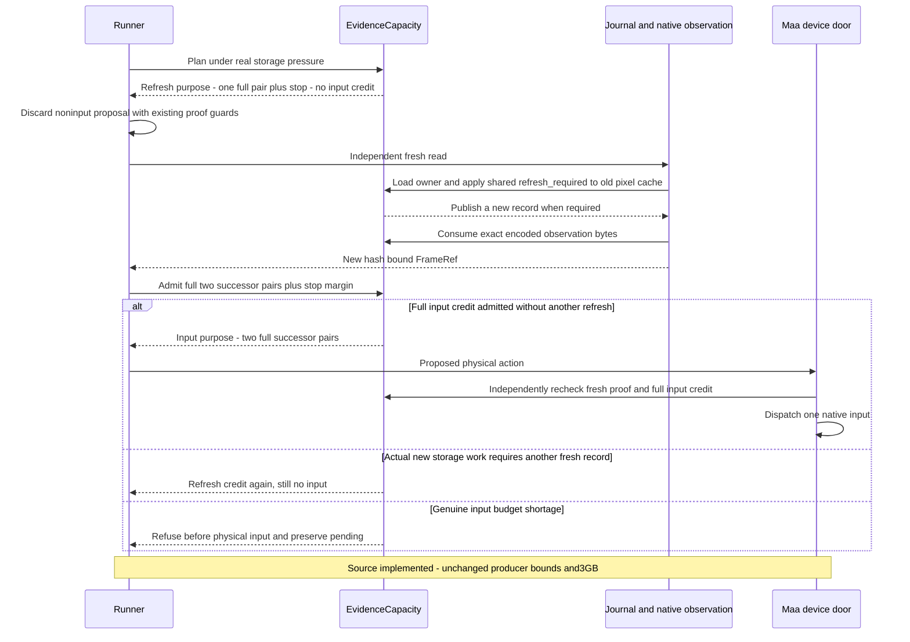

关闭控制器的维护逐字节验证既有ZIP后，仅移除116份重复的Wiki capture/after/review/finish物理副本，省16,927,610字节。全部packet.json、选定证据和最近两次return目录仍保留原始文件；唯一字节留在native-records.zip。保护引用集合/106private/33canonical/当前原始证据未变。初版辅助脚本因逐条重复扫描目录而结束，99份副本已精确恢复，再由整批预留版本配持久清单完成。目录2,962,874,554字节，未移动游戏原图、pending或人工复核队列。见build/closed-wiki-copy-interruption-recovery.json和closed-wiki-copy-retirement-fast-verification.json；重复构建输出不构成放宽游戏证据保留的理由。

> 以下带日期的同时三份预留实验已由分阶段观察预留取代；保留各自原版本与实证范围。


<a id="compression-staging-peak"></a>

### 原生IPC的TEMP不等于项目外压缩预算

安装9f2f3eb从当前PRE_BATTLE_TEAM启动，回收两个合格原图诊断后正常返回，游戏输入0。没有再触发日志自修改拒绝，但不宣称实机冷回收已提交。下一拒绝：已用2,996,944,097加5,447,788发布空间超过3GB。实际bootstrap的TEMP在build/native-agent-tmp内。真实隔离native_temp/首次tempfile使用证明，压缩暂存已占项目空间，发布时又算一遍：暂存344字节，已用70,746对压缩前70,402。build/compression-peak-before-fix-reproduction.json。这是跨层环境归属，不是游戏语义未知。

源码compact改为有界内存xz暂存，与已有cold重写一致。保留输入/24成员上限（非进程RSS）、原tar/xz逐字节格式、发布预留/余量、读回及即时引用/重复原图退役保护；不改Maa IPC TEMP，不增加外部证据仓库。116初轮及242相关/9既有跳过通过；覆盖真实native_temp默认缓存顺序、精确容量、差一字节、发布错误和旧文件暂存字节一致。下一步全量XML/冻结/实机战斗。

测量否定另一个乐观假设：352个合格原图候选/460,135,289字节，但首16MB批仅省85,696字节，PNG已压缩；不能称归档解决持续空间。关闭控制器的维护改为无损重打包全部14,304个Git对象（含不可达/reflog对象），refs/index/工作区一致并fsck，省34,689,035字节，不裁历史。目录2,960,667,884字节。当前原始图/日志、106private/33canonical不变；0048丢失/两项覆盖缺口仍开放。

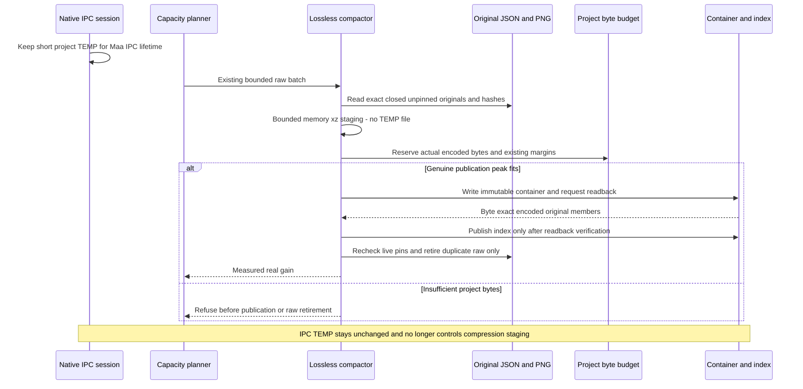

稳定源码全量4008通过/701跳过/553.97秒/pytest自身退出0；逐例XML新增4例通过、无更多状态丢失，旧0048丢失/两项覆盖缺口保留。干净970b8ed已安装核实；下一步同Team2实机续跑。

实际干净970b8ed Agent已安装并退出0；549源码/13完整编译身份/自检，106private/33canonical/当前原图不变。实际冻结archive/native_temp模块在隔离夹具执行内存暂存及字节读回，零controller/input，项目内IPC TEMP未改。源码/冻结7158引用/143归档报告一致；Launcher未改，目录2,964,332,370字节。build/compression-peak-installed-verification.json。全量4008通过/701跳过/553.97秒/自身退出0，XML新增4例/无更多状态丢失。下一步新页面及同Team2连续实测，不称整局/GUIStart/领奖/轮换/模型提升或0048恢复。

<a id="guarded-storage-progress"></a>

镜牢实机的证据准入只核验当前帧、预算及后继预留。容量不足会直接返回停止上下文，包括页面、未决商品、本步派发状态和空间缺口。历史归档和回收在没有任务持有控制器时运行，可用 `python tools/archive_native_images.py --prepare-live <已结束运行目录> --target-free <字节>` 预留下一轮空间。保留原有容量上限、原图哈希和未决引用保护。

### 内存活动与受保护日志持久化的owner不同

安装7726776已实机跨过静止奖励frame1→新frame2，选卡/确认→第三层MAP→NODE_PANEL→PRE_BATTLE_TEAM，随后冷快照拒绝。实际cold回收/Runner/Journal隔离复现证明，唯一变化是events.jsonl追加一条validated_native_archive进度，所有原字节仍在；build阶段报告不在该快照里。观察器自己的持久日志触发了正确的严格角色输入字节保护。build/cold-progress-before-fix-reproduction.json。当前/private/所选原图保留，丢失0048/两覆盖缺口另列。

方案：在既有verified_reads生命周期内分开两条交付通道——已完成工作的活动信号仅更新内存/截止，进度报告负责持久化。冷回收及作废提案witness保护范围内，持久回调延至受保护工作成功结束，真实完成的校验仍可在原截止下刷新内存监控；最多按8个stage合并，嵌套/失败不能发布伪完成。冷回收完成只在持久提交后交付。保留完整字节快照、v1意图含义、即时引用校验、3GB、90秒静默门及游戏/未决/财务/模型权威，不过滤或忽略日志行。普通原图回收仍在unlink+fsync后报告。已核对两处快照消费者：冷发布/删除与作废提案witness；普通无损压缩用独立实时引用/哈希检查。活跃时人工监控只读，阶段报告延后到终止再写，避免无必要并发保护引用变化。

验证：真实cold/Runner/Journal回调整链、原图witness、可选/嵌套回调、合并上界/失败丢弃、真正角色输入/引用/index/PNG变化反例及原截止。便宜页面/语料检查先于组合全量/JUnit XML、干净Agent及当前Team2连续实测；不宣称整局/原图恢复完成。

已接入verified_reads/deferred_progress、cold reclaim、未提交方案清理及Runner内存活动。初轮72项及311相关/27既有跳过通过；33项再次接实际recognition.Journal（不是替代日志器）通过。两个受保护消费者在退出前保留全部日志字节，嵌套回调保留原归属，队列上限8；原截止时间、真实输入变化及日志写失败仍覆盖。稳定源码全量4004通过/701跳过/553.47秒/pytest自身退出0；逐例XML新增10例通过且无更多状态丢失。干净9f2f3eb已安装/核实，下一步实机；旧原图丢失的两项覆盖缺口仍开放。当前原始四组图/日志、106私有/33配置和white42/50未变。不宣称新源码已安装或0048恢复。

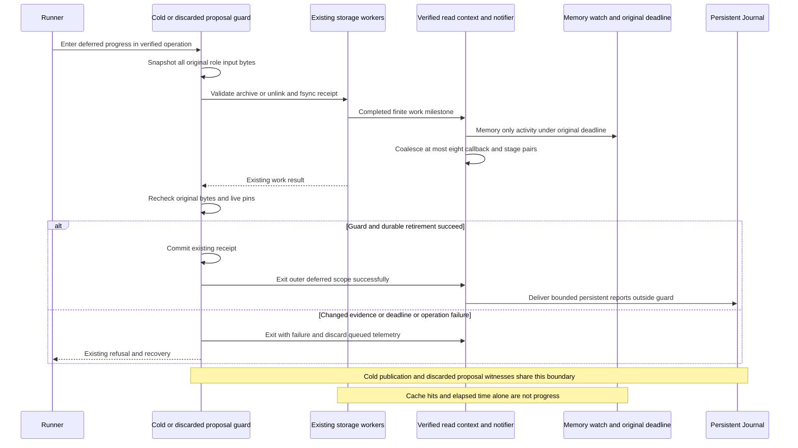

实际干净9f2f3eb Agent已安装：549源码/十一个完整编译身份/自检，106private/33canonical/当前四对原图及white42/50不变；0048仅JSON/哈希保留，PNG未恢复。源码/冻结7150引用/143归档一致，Launcher未改；2,988,287,164字节低于3GB。build/cold-progress-installed-verification.json。全量4004通过/701跳过/553.47秒/自身退出0，XML新增10例通过/无更多状态丢失。下一步同Team2正常连续续跑验证进度隔离；整局/领奖/轮换/新版GUIStart/模型提升和原图恢复仍未验收。

<a id="split-source-pins"></a>

### 静态源码路径保护两种原始字节表示

缓存源码全量3976通过/701跳过/自身退出0暴露两项新增跳过，都是白色节点原图0048的两个分辨率。实际回收收据记录了删除：扫描器只识别合并的evidence/runtime字符串，漏了ROOT / evidence / runtime / run。JSON/哈希/删除轨迹仍在；按大小筛选的项目PNG、65个原生归档及明确命名的旁边快照均未找到哈希一致副本。这是尚未恢复的原图损失，不算历史验收，不允许拿相近图代替。build/split-source-pins-outcome.json和build/reference-pin-recovery-search.json保留范围与限制。

方案：扩展既有不执行源码的AST引用生产者，支持可静态确定的斜杠链、字面量拼接、Path、joinpath；保留模块/函数别名和装饰器帧集合，只解析已知字符串后缀，不执行项目代码、不猜动态帧号。原图和冷归档仍走同一引用保护消费者。解析缓存族升为source-v3，避免同字节复用旧解析结果。验证原/冷表示压力保留、别名作用域、同大小同时间编辑及实际源码声明；不增加容量、不放宽删除规则、不新增预算权威。修复未来保护时保留失踪原图JSON/哈希与明确的两项覆盖缺口；不删除/替换/重命名跳过例制造全绿覆盖。

源码及本地fixture依赖闭包已实现。282相关通过/27历史跳过/50.61秒/自身退出0；实际根目录只读比较7116→7136引用，增加20、没有移除，106private/33canonical及所选原图不变。白色节点42/50哈希仍匹配，48仍缺失。首轮75通过/1真实fixture依赖失败后补显式关联，随后78通过及最终广矩阵通过；同名类fixture保守合并owner，未解析动态路径不宣称完整。build/split-source-pins-real-verification.json。下一步组合全量附每例JUnit XML，直接暴露跳过/覆盖变化，然后干净安装、正常续同Team2；原图/两项覆盖缺口明确保留。

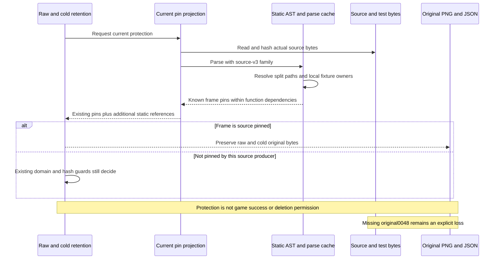

组合稳定源码全量3994通过/701跳过/557.49秒/pytest自身退出0；逐例XML比较没有更多状态丢失，新增18例通过，旧0048原图/两个跳过分辨率仍明确开放。build/split-source-pins-full-tests.xml及split-source-pins-suite-comparison.json。下一步干净Agent及当前Team2实机连续续跑；不宣称整局或原图恢复完成。

实际干净7726776 Agent已安装：549源码快照/十个完整编译身份/自检，106private/33canonical/当前所选原图及白色42/50不变；0048仅JSON/哈希保留，PNG未恢复。源码/冻结7136引用/143归档一致，Launcher未改；2,979,421,427字节低于3GB。build/cache-and-pins-installed-verification.json。组合全量3994通过/701跳过/557.49秒/自身退出0，无更多状态丢失，18新增通过；旧两项覆盖缺口明确保留。下一步新实机连续续同Team2，不宣称整局/恢复完成。

<a id="required-capture-cache"></a>

### 容量新观察与未变化像素复用是两个契约

安装deee042已实机交付26次原图回收进度并跨过战斗→REWARD_CARD。静止奖励页中，维护使frame0033计划失效；下一次MapObservation确实新截屏，但LimbusRecognition按相同像素复用缓存，仍返回原frame0033。容量门正确地在奖励输入前拒绝旧路径/JSON。build/capture-cache-live-outcome.json保留实际链/private/未决。此前假Observer集成总会发布新记录，漏了真正的共用生产者。

方案：正常仍复用未变化像素；仅在本Journal的缓存仍命名带fresh_capture_required的原容量owner帧时，绕过该缓存命中，从当前原生图照常识别并由Journal发布新记录。不全局清缓存、不改旧JSON、不捏造时间、不改消费者判据，也不把相同像素视作游戏进展。新记录可以PNG相同；产生新帧名后，即使尚未admit，后续静止读仍正常复用，因为不再是旧owner帧。容量证明缺失/变更仍拒绝。用真实缓存生产者/MaaObserver/FrameRef验证必须/正常/外来/已有新记录/像素变化/读取失败，再实际nativeOCR回放奖励原图，之后全量/冻结/连续实机。仅在稀有的必须新记录边界重识别是既有接口上的小修复；独立“复用分析但新捕获”协议需要额外溯源，不凭猜测新增。

源码已实现。229项相关检查/27历史跳过/28.93秒及31项捕获规格检查/2.45秒通过。实际native Resource→ReplayController→AgentTasker→MaaObserver→MapObservation→OCR→Journal→FrameRef→admit两例通过：旧缓存返回frame1并被拒；必须新记录时发布frame2并通过，随后正常复用；0设备输入/106private/33canonical不变。build/capture-cache-native-verification.json。首次测试漏agent导入入口、一处断言把读取事件UTC误当FrameRef.captured_at，均在长回归前改正；首轮原生案例完成但Maa日志未释放使清理失败，隔离子进程重跑通过。完整稳定源码回归/干净安装/奖励页实机通过仍待完成。

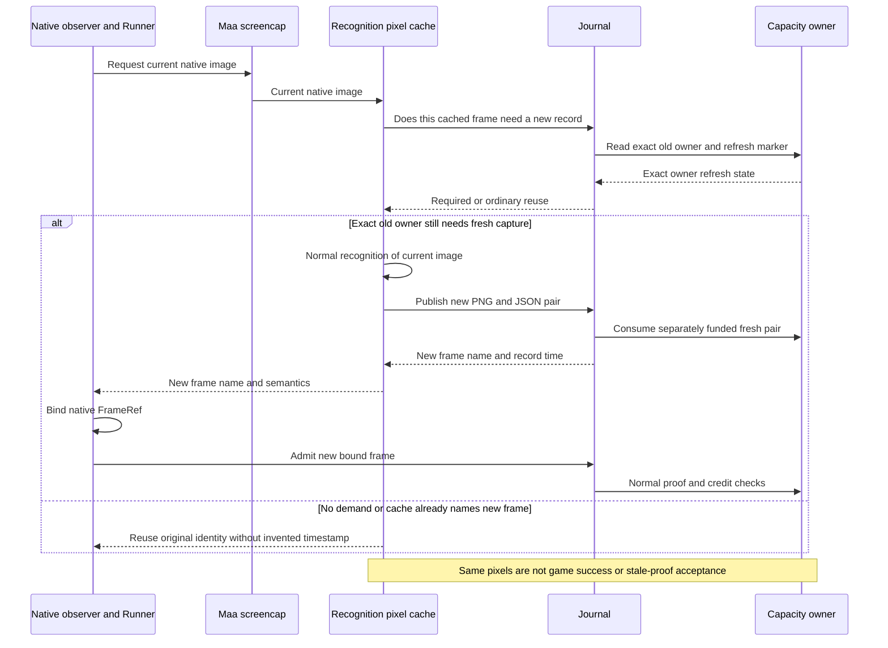

<a id="raw-retirement-progress"></a>

### 实际原图回收也要交付给已有无进展监控

安装bf774be已实机越过带额度的新观察：一次作废后独立新记录、正常SDK和攻击动画，继而第4回合。下一次停于no_progress_watchdog/94.3秒。实际执行栈是admit→reserve→apply→require_space/size；本轮合计50条完成回收收据，不能断言全部发生在这段静默。整轮verified_reads已缓存归档身份，仅“解压完成”里程碑没有覆盖实际原图回收生产者。证据见build/retirement-progress-live-outcome.json与build/capacity-reobserve-live-passage.json。当前/此前原图、private和未决状态保留。

方案：每次既有授权的原PNG删除**且**删除收据持久化完成后，经既有操作内verified_reads回调向MirrorRunner._storage_progress交付一次累计回收数，不输出路径或私有画面。计划、未变化/缓存命中、删除前检查、删除或收据失败都不产生进度。这是已完成存储工作，不是定时空心跳或游戏后继；原运行截止、90秒静默监控、3GB、实时引用/原图复核及游戏/财务/学习权威不变。第一张收据后新加入引用，下一张仍必须保留；已完成单元后的截止到期可停，但保留收据且不发输入。回收吞吐优化仍独立待证，不能靠回调宣称所有批次足够快或全局最优。

源码已实现：已完成原图回收在收据fsync之后沿既有回调交付。211项相关检查通过/9历史跳过/44.39秒/自身退出0；稳定源码全量3972通过/699跳过/562.25秒/pytest自身退出0；干净Agent与安装实机压力仍待验收。首轮55通过/1错误使用空计划apply的测试失败，现按实际无操作reserve入口修正；随后一条错误测试路径命令收集前退出4，不计通过。

验证计划：真实retention→持久收据→Runner心跳，零控制器；无操作/计划/缓存/哈希/未决/删除/收据故障反例；原截止和批中新增引用。先跑便宜的当前语料/页面/审计消费者，再串行全量、干净Agent/源码/private核验，最后实机连续续当前Team2压力场景。不能以本修复宣称整局完成。

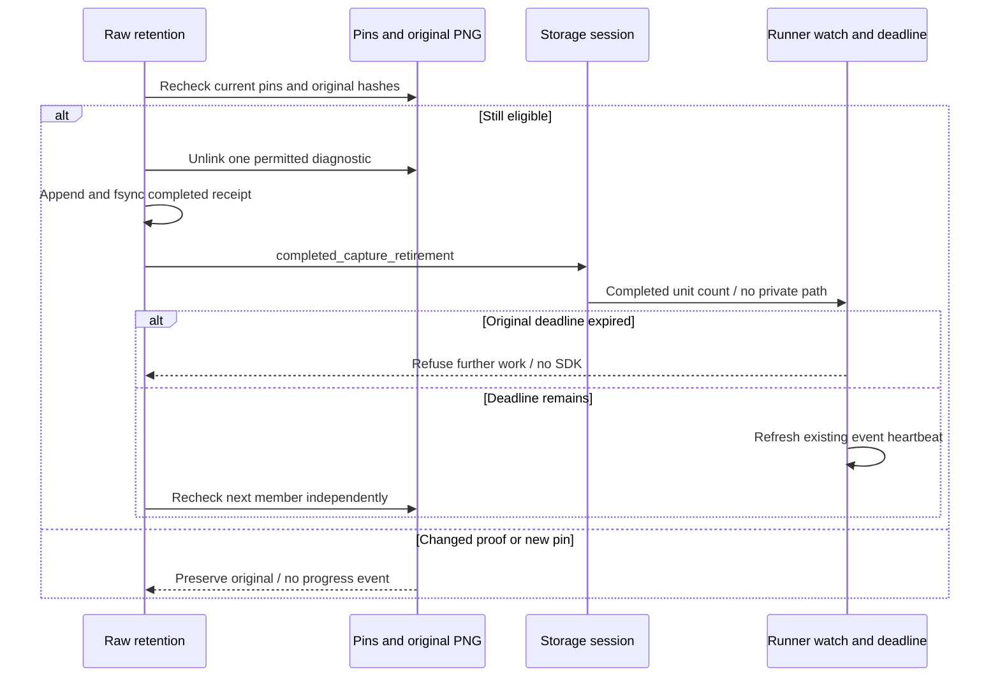

实际干净deee042 Agent已安装，549快照/十个完整编译身份/自检，106private/33canonical及当前六对原图和停机轨迹不变；源码/冻结7032引用与143归档一致。Launcher未变，2,957,106,850字节低于3GB。证据build/retirement-progress-installed-verification.json。全量3972通过/699跳过/562.25秒/自身退出0；下一步实机回收进度与正常连续续跑，整局未验收。

<a id="funded-storage-reobserve"></a>

### 新观察也有自己的字节生产者

实际安装版4d92677已跨过大蓝目标、两次商店刷新、Boss、藏品/GET与独立第三层MAP；同一invocation随后在拟发的战斗输入前，连续四次容量计划作废而停住。每次准入归还未用占位，再只补回输入后的两对证据；强制重新截图却先消耗这份保证，临近上限的下一次计划又要维护。保留的HUD控制/回合仍可用；其他读取者可以要求留下原证明。丢弃决定不能假定PNG也一定可删。11对原图、106private/33canonical及容量槽字节见`build/capacity-reobserve-live-outcome.json`；当前Team2floors[1,2]/victoryFalse/rewardFalse，不是整局完成。

P是现有完整BGR8 PNG加有界1MB JSON的一对，S仍是2MB停机预留，J仍是2MB诊断余量。正常准入仍是2P+S；只有发生真实维护或未用额度交接的计划准入，额外为新观察预留一对，成为3P+S，物理占位之外仍检查J。1920x1080的P=7,349,634字节，普通16,699,268字节，带新观察24,048,902字节；每个占位字节都计入不变的3,000,000,000字节项目上限。首次空间检查之后才发现维护时，第二次检查核完整扩大后的增长量，不是只核P；物理占位resize之前不把检查当成已经分配。

`owner.fresh_capture_required` 只表示存储就绪条件，不是业务pending。相同旧帧路径或同一份旧JSON证明不能重用它。新原生记录必须有独立哈希绑定，但允许像素相同（静止HUD）；它消耗额外一对，留下至少2P+S，普通计划/设备二次门禁不再另起维护周期。新准入成功才替换owner/就绪标记。`successor_pairs`仍为2，新增可选`reobserve_pairs=1`/`reobserve_pair_bound`只解释空间。两个固定校验槽、v1格式、生产者质量、原截止时间及最多3次连续返回均不变。额外空间不足/写槽中断保留证明；非plan的设备门禁遇到维护仍在SDK前拒绝，领域pending不清。没有消费、收据、学习批准或控制器权限。

相关294项77.25秒/自身退出0，包括真实Journal→容量池→Runner→MaaDevice模拟控制的一条管线、严格容量下全尺寸不可压缩新观察加两对后继、旧证明/外来owner/额外分配失败/中断反例及当前语料/派发门禁。这里验证源码/隔离协议，不是新实机压力通过。原字节核对确认实际private/状态/容量槽/原图离线不变；稳定源码全量3964通过/699跳过/1夹具警告，558.80秒、pytest自身退出0（build/capacity-reobserve-full-tests.log）。下一步仍是干净Agent及当前Team2实机压力续跑；历史跳过项不算实机验收。

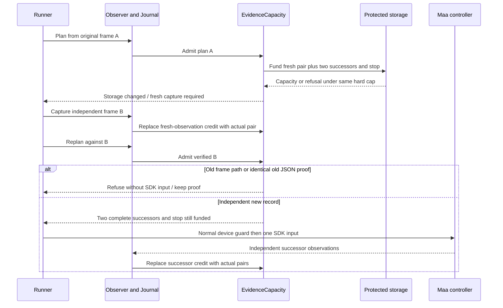

<a id="verified-storage-work"></a>

### 已完成的存储校验不等于无响应原生调用

3 GB 是项目维护目标。MXU 实机只检查真实可用空间，收尾报告项目是否超过目标。历史归档与构建按各自的离线空间约束执行。

Runner 只对明确处于加载或无待确认出手的战斗动画等待声明 `owner_diagnostic_poll`。收尾时 Journal 以同一所有者和阶段的连续只读样本为一组，保留首尾及夹在两张相同画面之间的变化帧。确认 PNG 和 JSON 哈希、且未被事务或复核引用后，释放中间 PNG，并保留 OCR、哈希及回收记录。输入预检、额外观察、失败和所有者变化都中断这组样本；普通未知页不因等待而获得释放资格。历史回收规则只读取旧格式声明。

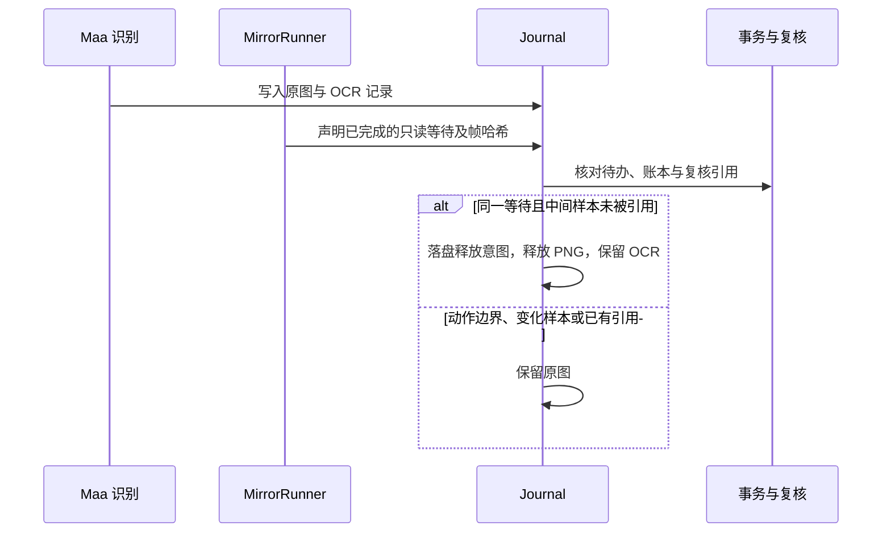

现存 raw 字节优先于冷副本；归档查找每次重新哈希当前索引及实际完整容器，即使命中本次操作的证明缓存也不信任大小/mtime。只有完整安全流和所有成员哈希均通过后，最多4096个有界成员身份才可跨越64MB编码载荷LRU淘汰而复用。`verified_sha` 保留原来只要求编码字节哈希的存储判据；`verified_png` 另要求实际解码图像/尺寸。后部归档成员损坏不能发布前部的局部缓存；操作结束丢弃缓存。两种接口都不授予删除、输入、标签或收据权限。

实际同语料只读压力比较选择完全相同的25条删除记录，33份canonical/106份private哈希及22对原始帧不变。基线先跑50.382秒/100次解压流，候选后跑40.033秒/49次；`build/compact-colour-retention-equivalence.json` 记录源码字节和执行顺序的局限，不是Agent堆栈或实机容量通过证据。另一次离线保护性维护只回收107张中间PNG、149,627,495字节，不删除关键证据或事务。

完整容器校验完成才通过当前 Runner/Journal 所有者记录 `evidence_storage_progress`，也覆盖另一个线程的识别回调。未变化的缓存读取不记里程碑。确实完成的工作可刷新无进展看门狗，但不能延长原始运行期限；证明损坏、容量耗尽、无实际工作、原生调用无响应仍按原规则结束。维护后仍丢弃未发送的旧计划，重新观察和规划后才能输入。

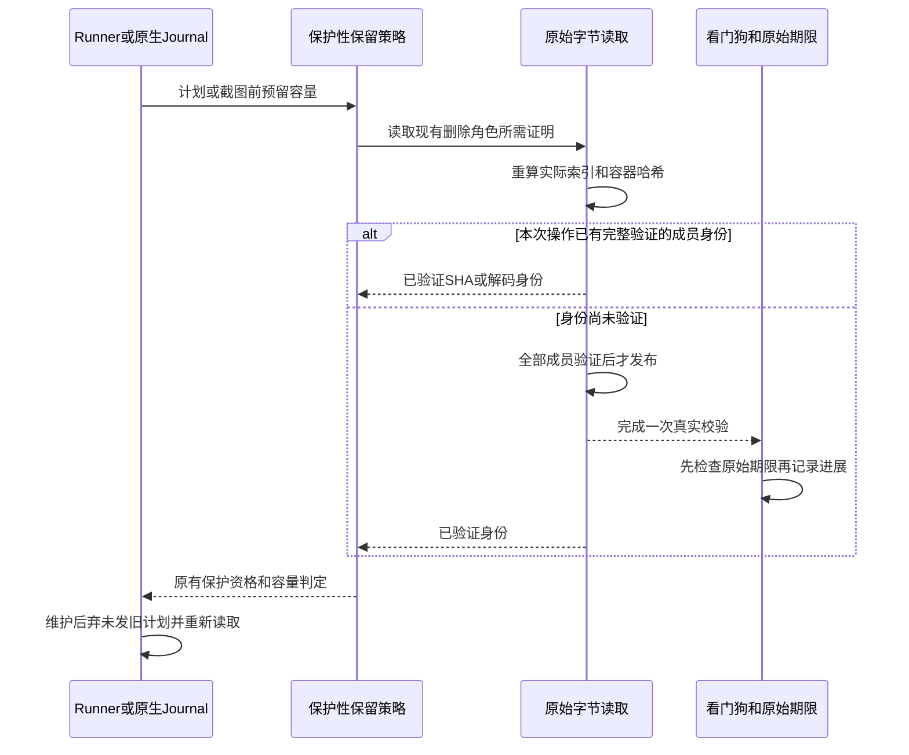


**Current storage policy / 当前容量约定（用户最新调整）**: User revised the whole-project ceiling to3,000,000,000decimal bytes (3GB). This includes source/git/build/dist/caches/models/evidence and temporary output in the folder. Older2GB runs and measurements remain historical. Capture pair/stop/journal bounds, external updater session1GB, all proof/pending guards and game resource budgets are unchanged. Actual installed Agent and launcher each embed3GB (build/service-notice-installed-verification.json); this grants no game spending.

> 本章口径：MaaLimbus 是**便携包（portable package）**形态的 Windows 应用——没有安装器、没有注册表写入、没有服务。
> 「部署」在这里等于「把一个目录放到磁盘上」，「运维」等于「启动、检查更新、升级、回滚、读证据」。
>
> 本章的每条技术断言都绑定一个可核验锚点：**源码/脚本行号**、**实测文件清单与字节数**、或**仓库内保留的验证产物路径**。
> 凡是没有被上述三类锚点支撑的说法，一律进入 6.5「未验收 / 待核实清单」，不写成结论。

## 6.1 便携包布局与部署图

### 6.1.1 顶层布局（`dist/MaaLimbus/`，实测）

> 测量时刻：2026-10-13T00:35Z 之后。便携包可被 `tools/make_local_app.py` 随时重建——本会话期间它就被重建过一次，`dist/` 里因此多出一个 `MaaLimbus.backup-*`。所以字节数与计数会随重建变化，**路径与结构不会**。

| 项 | 类型 | 规模 | 说明 |
| --- | --- | --- | --- |
| `MaaLimbus.exe` | 文件 | 31,158,272 B | MXU 客户端（Tauri 打包的 ProjectInterface V2 前端） |
| `interface.json` | 文件 | 3,732,723 B | ProjectInterface V2 项目定义，全局默认入口 |
| `LICENSE` | 文件 | 35,184 B | GPL-3.0 全文 |
| `README.md` / `README_en.md` | 文件 | 8,297 / 7,859 B | 包内欢迎页，被 `interface.json` 的 `welcome` 指向 |
| `build-info.json` | 文件 | 933 B | 本次装配的元数据与自检结果 |
| `agent/` | 目录 | `MaaLimbusAgent.exe` 5,880,171 B + `_internal/` | PyInstaller 冻结的 Python Agent |
| `launcher/` | 目录 | `MaaLimbusLauncher.exe` 2,012,660 B + `_internal/` | 包外更新启动器 |
| `maafw/` | 目录 | 19 个文件 + 2 个子目录 | MaaFramework 原生运行时 |
| `assets/` | 目录 | `resource/`、`i18n/`、`misc/` | 全部识别资源与翻译 |
| `docs/` | 目录 | 31 个扁平文件 + `agents/`、`wiki/` 子目录（递归 45 个文件） | 用户向文档 |
| `config/`、`evidence/`、`build/` | 目录 | 运行期生成 | 私有运行数据，**不由构建写入** |
| `THIRD_PARTY_NOTICES/` | 目录 | 6 份许可证 + README | 第三方许可归属 |

实测中不存在的项（不要在本页或其它页假设它们存在）：

- `runner/MaaLimbusRunner.exe` —— **只存在于发布包**。发布装配会冻结 `tools/run_native.py`（`tools/build_windows_package.py:149`），而本地开发装配不会（grep `MaaLimbusRunner` 只命中 `tools/build_windows_package.py`、`tools/make_local_app.py`、`src/maalimbus/update_install.py:70`）。当前 `dist/MaaLimbus/` 里没有 `runner/`。
- `sources/` —— 发布装配会写入源码归档、本地开发装配只有 `--mxu-proof` 才会写（`tools/make_local_app.py:163-166`）。当前包里 `Test-Path dist/MaaLimbus/sources` 为 `False`。
- `package-manifest.json` —— `Test-Path` 为 `False`。发布装配会生成它（`tools/build_windows_package.py:195-197`），本地开发装配不生成。

### 6.1.2 部署图

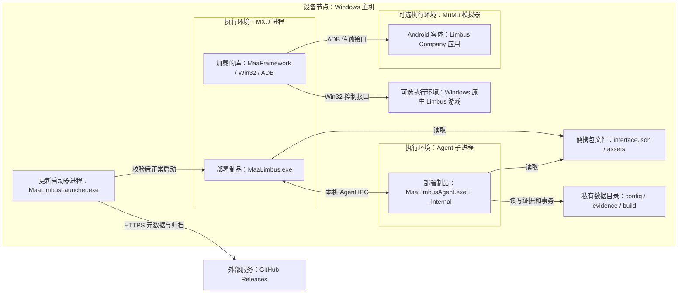

### 6.1.3 每个顶层项由谁装配

| 顶层项 | 发布包来源 | 本地开发包来源 |
| --- | --- | --- |
| `MaaLimbus.exe` | `tools/build_windows_package.py:138`（复制 MXU 归档的 `mxu.exe`） | `tools/make_local_app.py:162`（同上） |
| `maafw/` | `tools/build_windows_package.py:139`（从 `stage/maa/bin`） | `tools/make_local_app.py:167`（从构建时的 `--maafw`） |
| `agent/` | `tools/build_windows_package.py:148`（PyInstaller 冻结 `agent/main.py` → 文件基名 `MaaLimbusAgent`） | `tools/make_local_app.py:195`（同一套冻结逻辑） |
| `runner/` | `tools/build_windows_package.py:149`（冻结 `tools/run_native.py` → `MaaLimbusRunner`） | 不生成 |
| `launcher/` | `tools/build_windows_package.py:151`（冻结 `tools/launch_app.py` → `MaaLimbusLauncher`） | `tools/make_local_app.py:197`（同上） |
| `interface.json` | `tools/build_windows_package.py:152-160` 重写；重写规则见 `tools/make_local_app.py:71-82` 的 `packaged_interface()` | `tools/make_local_app.py:188-189` |
| `assets/`、`docs/`、`THIRD_PARTY_NOTICES/` | 从仓库根 copytree | `tools/make_local_app.py:184-185` |
| `README.md`、`README_en.md`、`LICENSE` | `tools/make_local_app.py:186-187` 同源复制 | 同左 |
| `config/`、`evidence/`、`build/` | **不由构建写入**，运行期生成 | 同左 |

`packaged_interface()` 做的路径重写是部署正确性的关键（`tools/make_local_app.py:71-82`）：

- `agent.child_exec` → `./agent/MaaLimbusAgent.exe`
- `license` → `./LICENSE`
- `icon` → `assets/` 下的图标
- `welcome` → `./README.md`
- `languages` → `assets/` 下的语言文件
- `resource` 的每一项路径：`./resource/xxx` → `./assets/resource/xxx`

发布装配还会写入 `sources/`（`tools/build_windows_package.py:161-167`，内含 `MXU-v2.7.1-source.zip`、`MaaFramework-v5.12.2-source.zip`、`MaaLimbus-source.zip`）以及 `package-manifest.json`（`tools/build_windows_package.py:195-197`）。

### 6.1.4 便携包之外的 `dist/` 目录族

`dist/` 不只是「一个应用目录」，它同时是**运行期工作区**。实测计数：

| 目录族 | 实测数量 | 由谁创建 |
| --- | --- | --- |
| `MaaLimbus.backup-<32hex>` | 37 | `tools/make_local_app.py:102`（`backup=out.parent/(out.name+'.backup-'+uuid.uuid4().hex)`，替换式装配时把旧包改名保留） |
| `MaaLimbus.staging-<32hex>` | 1 | `tools/make_local_app.py:159` |
| `.maalimbus-launcher-<32hex>` | 5 | `tools/launch_app.py:37`（启动器把自己的冻结目录复制到应用旁再运行） |
| `.maalimbus-startup/` | 1，内含 `launcher.lock` | `tools/launch_app.py:60-61`（`work = app.parent/'.maalimbus-startup'`；`ControllerLease(work/'launcher.lock')`） |
| `private-state-before-binding-<hex>` | 1 | `tools/bind_local_state.py:32` |
| `.maalimbus-update-<32hex>` | **0** | `src/maalimbus/update_install.py` 的安装日志目录；正常完成后被清理 |

运维含义：`dist/` 会随每次装配与每次启动单调增长。这些目录都是可重建的缓存，但 `MaaLimbus.backup-*` 是回滚的唯一凭据——不要在升级后立刻清理它们（见 6.4）。

## 6.2 MXU / MaaFramework / Agent 三方关系

当前 MXU 默认入口有两个游戏自动化宿主：GUI/Rust Maa bridge 与独立 Python Agent；更新启动器、WebView 与模拟器输入 helper 有各自生命周期。**ProjectInterface V2 是配置规范，不是一个必须额外启动的 CLI 进程。**

实现依据：已核对 pinned MXU **v2.7.1 / 9fa8cc51** 的 [maa_agent.rs](https://github.com/MaaXYZ/MXU/blob/9fa8cc51e8ff8cd89d99f3ea55fe3a7a82e6ede3/src-tauri/src/commands/maa_agent.rs#L305)：AgentClient 在 Rust 中创建，任务直接经 `tasker.post_task`（同文件 L746）提交。此处修正进程边界，不把源码阅读当作 GUI 实机验收。

### 6.2.1 运行宿主

| 进程 | 可执行文件 | 角色 |
| --- | --- | --- |
| MXU 客户端 | `MaaLimbus.exe` | 读取 PI V2 `interface.json`；Rust bridge 在同进程建立 Maa controller/resource/tasker，并调用原生 `post_task` |
| 可选 CLI | `maafw/MaaPiCli.exe` | 独立 PI V2 命令行入口；包内文件存在，不等于 MXU 默认启动它 |
| Python Agent | `agent/MaaLimbusAgent.exe` | 自定义识别与自定义动作的执行端。注册全部 `limbus_*` 节点，处理游戏特有的场景识别与业务动作 |
| 原生库 | `maafw/MaaFramework.dll` / AgentClient / AgentServer 等 | 各宿主加载的 Maa API 与 IPC 实现，不是额外的独立调度进程 |

### 6.2.2 契约：PI V2 声明与 Agent IPC

`assets/interface.json` 的关键锚点：

| 锚点 | 内容 |
| --- | --- |
| `assets/interface.json:2-5` | `interface_version: 2`、`name: MaaLimbus`、`version: v0.1.3` |
| `assets/interface.json:9-13` | `languages`: `zh_cn` / `en_us` / `ja_jp` |
| `assets/interface.json:14` | `controller` 数组，见下表 |
| `assets/interface.json:69-86` | `resource`：`en` → `./resource/base` + `./resource/en`；`jp` → `./resource/base` |
| `assets/interface.json:87-92` | `agent`：`child_exec: python`、`child_args: [../agent/main.py]`（源码形态） |
| `assets/interface.json:93-102` | `group`：`mirror`、`daily` |
| `assets/interface.json:103-170` | `task`：`open_game` / `mirror_loop` / `experience` / `thread` / `rewards` / `stamina` |
| `dist/MaaLimbus/interface.json` 的 `agent` 段（本机构建产物，公开 checkout 没有） | 打包形态：`child_exec: ./agent/MaaLimbusAgent.exe` |
| 同一文件末尾的 `icon` 字段 | `icon: assets/misc/Don-Quixote.png` |
| 同一文件末尾的 `welcome` 字段 | `welcome: ./README.md` |

四种控制器与它们的落点：

| `controller` 名 | `interface.json` 锚点 | 控制方式 | 代码路径 |
| --- | --- | --- | --- |
| `windows-window` | `:16` | Win32；窗口类正则 `^UnityWndClass$`、窗口标题正则 `^LimbusCompany$`；截图 `Background`、鼠标 `SendMessageWithCursorPos`、键盘 `PostMessage` | `src/maalimbus/windows_controller.py:9-22`（`controller_profile()` 过滤 `type == 'Win32'`，`native_methods()` 映射 `MaaWin32ScreencapMethodEnum` / `MaaWin32InputMethodEnum`） |
| `windows-background` | `:31` | Win32；鼠标 `SendMessageWithWindowPos` | 同上 |
| `windows` | `:46` | Win32；截图 `ScreenDC`、鼠标/键盘 `Seize`（独占前台） | 同上 |
| `mumu-adb` | `:61` | `type: Adb` | `src/maalimbus/adb_device.py`：`discover()` 走 `Toolkit.find_adb_devices`（`:28`）、`build()` 构造 `AdbController`（`:97-103`） |

`mumu-adb` 的输入方式有一个**已在实机验证过的陷阱**：`src/maalimbus/adb_device.py:21` 定义 `INPUT_NAMES`（`1 AdbShell` / `2 MinitouchAndAdbKey` / `4 Maatouch` / `8 EmulatorExtras`），`:22-23` 定义 `SCREENCAP_NAMES`（`64 EmulatorExtras` 等），`:5-6` 记录输入优先级 `EmulatorExtras > Maatouch > MinitouchAndAdbKey > AdbShell`。当不需要截图加速时，`input_policy()`（`:46-63`）会退回到 `adb shell input tap`，而**这条路游戏不认**——2026-10-12 的 `maafw.log` 里 `AdbShellInput::click x=125 y=527` 与 `Controller.Action.Succeeded` 同时出现，但 `DUNGEON_TEAM` 槽位纹丝不动。因此 `tools/make_local_app.py:175-199` 的 `agent_binaries()` 会**强制校验** `maatouch/universal/maatouch` 存在，缺了就报错而不是静默降级（`:183` 把它复制到包的 `maafw/MaaAgentBinary`）。

### 6.2.3 `maafw/` 里有什么（实测字节数）

| 文件 | 字节 | 用途 |
| --- | --- | --- |
| `MaaFramework.dll` | 2,536,448 | 核心库 |
| `MaaPiCli.exe` | 958,464 | ProjectInterface V2 命令行运行时 |
| `MaaWin32ControlUnit.dll` | 670,720 | Win32 控制单元实现 |
| `MaaAdbControlUnit.dll` | 787,456 | ADB 控制单元实现 |
| `MaaToolkit.dll` | 540,160 | 设备发现等工具能力（`Toolkit.find_adb_devices` 落点） |
| `MaaUtils.dll` | 632,832 | 公共工具 |
| `MaaAgentClient.dll` / `MaaAgentServer.dll` | 1,227,264 / 1,388,032 | Agent 客户端/服务端 |
| `MaaNode.node` / `MaaNodeServer.node` | 1,018,880 / 987,648 | Node 绑定 |
| `MaaCustomControlUnit.dll` | 315,392 | 自定义控制单元基座 |
| `MaaGamepadControlUnit.dll` | 350,208 | 手柄控制单元 |
| `MaaRecordControlUnit.dll` / `MaaReplayControlUnit.dll` | 341,504 / 402,432 | 录制/回放控制单元 |
| `onnxruntime_maa.dll` | 19,182,080 | 推理运行时 |
| `opencv_world4_maa.dll` | 13,774,336 | 图像处理 |
| `DirectML.dll` | 18,527,776 | GPU 推理后端 |
| `fastdeploy_ppocr_maa.dll` | 1,138,688 | OCR |
| `ViGEmClient.dll` | 130,048 | 虚拟手柄驱动客户端 |
| `plugins/MaaPluginDemo.dll` | 9,728 | 插件示例 |
| `MaaAgentBinary/` | 92 个文件 | 安卓端 agent 二进制：`maatouch/universal/maatouch`、`minicap/<abi>/`（arm64-v8a、armeabi-v7a、x86、x86_64，覆盖 android-9..31）、`minitouch/<abi>/minitouch`、`LICENSE`、`README.md` |

部署含义：`maafw/` 是**单个 60 MB 级的整体**，它的完整性靠包级校验而不是单文件校验。发布包在 `update_stage.py` 里通过 `package-manifest.json` 校验（见 6.4.2）。

### 6.2.4 启动顺序

<a id="launcher-lifetime-capacity"></a>

**2026-11-16 成品核验**：启动器现按完整 bundle SHA256 复用 `.maalimbus-launcher-<64hex>`，首次复制前预留整个项目的峰值容量；不同版本不覆盖使用中的旧 helper。`refreeze_agent.py --component launcher` 单独替换 launcher 并保留原 Agent/资源指纹，临时回滚只保留到验证结束。安装后连续两次 `--prepare-only` 复用同一目录，62 个文件的 hash/mtime 不变，第二次目录总大小保持 1,821,257,783 bytes；96 份安装私有文件、28 份源配置以及 Agent/MXU 二进制未改。证据：`build/resume-20261116-installed-launcher-reuse-verification.json`。这接受准备路径复用，不接受 GUI 重启或公开新版下载。上文旧快照的 UUID helper 数量不是当前测量。

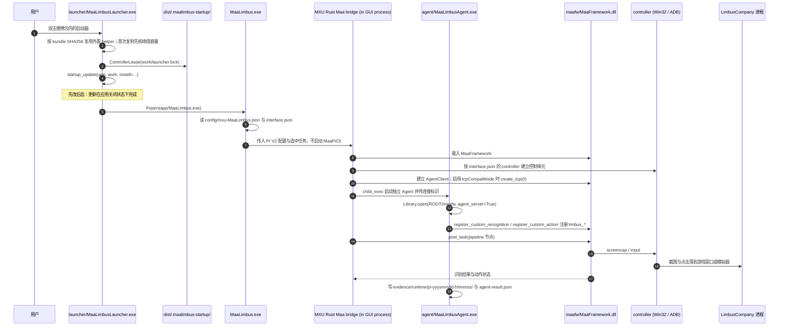

## 6.3 构建与打包

### 6.3.1 两条流水线

仓库里有**两条互不相通**的装配流水线，产物同名但内容不同：

| 流水线 | 脚本 | 产物落点 | 定位 |
| --- | --- | --- | --- |
| 发布包 | `tools/build_windows_package.py` | `build/windows-package-<32hex>/MaaLimbus-win-x64/` | 对外分发。带 `runner/`、`sources/`、`package-manifest.json`，并导出 release assets |
| 本地开发包 | `tools/make_local_app.py` | `dist/MaaLimbus/`（经 `.staging-*` + `.backup-*` 原子替换） | 本机开发与实机验证。不带 `runner/` 与 `sources/` |

判据锚点：`tools/make_local_app.py:35-36` 硬编码 `MXU_SHA256 = '1B5487AA2442062A489E20134A82F946f76F57E733A8D8D284C3C76AAF8053E5'` 与 `PREPARED = ROOT/'build/windows-package-28e4293e95e847dcb6f335d2b824cc7a/MaaLimbus-win-x64'`——说明本地开发装配**消费**发布装配的中间态，因此两者不是独立实现，而是同一条链的两段。

### 6.3.2 发布包：`tools/build_windows_package.py`

固定版本与哈希（`:21-30` 的 `ARCHIVES`）：MXU v2.7.1、MaaFramework v5.12.2。`:118` 会先断言 git 工作树干净，`:128` 建 `build/windows-package-<uuid4().hex>` 作为 stage。

装配步骤：

1. `:136` `app = stage/'MaaLimbus-win-x64'`
2. `:138` `MaaLimbus.exe` ← MXU 归档的 `mxu.exe`
3. `:139` `maafw/` ← `stage/maa/bin`
4. `:148-151` 冻结三个 Python 入口：`agent/main.py` → `MaaLimbusAgent`、`tools/run_native.py` → `MaaLimbusRunner`、`tools/launch_app.py` → `MaaLimbusLauncher`
5. `:152-160` 重写 `interface.json`
6. `:161-167` 写入 `sources/`（三个源码归档）
7. `:168-174` 跑 `agent --self-test`
8. `:178-194` 写 `build-info.json`
9. `:195-197` 写 `package-manifest.json`
10. `:199-201` `export_assets` → `build/windows-package-latest.json`（实测存在）

`build-info.json` 的实际字段（以当前 `dist/MaaLimbus/build-info.json` 为样本）：

```json
{
  "project": "MaaLimbus",
  "development_only": true,
  "packaged_app": false,
  "source_commit": "5e9dfc5528494550eca7ff01c9eea26f706aaf02",
  "source_dirty": true,
  "built_at": "2026-10-13T00:35:23.259095+00:00",
  "mxu_sha256": "1b5487aa2442062a489e20134a82f946f76f57e733a8d8d284c3c76aaf8053e5",
  "mxu_modified": false,
  "mxu_source_sha256": null,
  "pending": ["MXU UI validation", "live input postcondition", "full five-floor loop"],
  "self_test": {
    "passed": true,
    "application_root": "D:\\fgoa\\MaaLimbus\\dist\\MaaLimbus.staging-87ecfbf73a0c41b78282157772835029",
    "runner_root": "D:\\fgoa\\MaaLimbus\\dist\\MaaLimbus.staging-87ecfbf73a0c41b78282157772835029",
    "private_state_directory": "D:\\fgoa\\MaaLimbus\\dist\\MaaLimbus.staging-87ecfbf73a0c41b78282157772835029\\config",
    "device_controller": false,
    "locales": ["en", "jp"]
  }
}
```

两个必须注意的字段：

- `development_only: true` 与 `packaged_app: false` —— 当前包是**开发用包**，不是对外发布产物。
- `self_test.application_root` 指向 `MaaLimbus.staging-87ecfbf73a0c41b78282157772835029`，而这个 staging 目录**在 `dist/` 里已经不存在**（现存的是 `MaaLimbus.staging-1619589fdb01498a8ad5905319306fb0`，来自另一次装配）。也就是说 `build-info.json` 记录的是装配时刻的路径，包在原子替换后必然陈旧，而且它记下的那个 staging 目录与磁盘上现存的那个**永远不是同一个**。任何依赖 `application_root` 做判断的逻辑都必须容忍这一点。

### 6.3.3 本地开发包：`tools/make_local_app.py`

关键行为：

- `:159` 先建 `MaaLimbus.staging-<uuid4hex>`，全部装配在 staging 里做完
- `:102` 替换时把旧包改名为 `MaaLimbus.backup-<uuid4hex>`（这就是 `dist/` 里 36 个 backup 的来源）
- `:216` `replace_local_app(staged, out)` 原子替换
- `:199-215` 写 `build-info.json`（schema 与发布包一致）
- `:44-68` `agent_binaries()` 强制校验 `maatouch/universal/maatouch`；`:183` 复制到包的 `maafw/MaaAgentBinary`

### 6.3.4 MXU 客户端构建

`tools/build_mxu_client.py`（77 行）：

- `PIN = '9fa8cc51e8ff8cd89d99f3ea55fe3a7a82e6ede3'`
- `pnpm install --frozen-lockfile` → `pnpm tauri build --no-bundle`
- 产物：`build/mxu-interactive-artifact/mxu.exe`、`MXU-MaaLimbus-source.zip`、`build-proof.json`

其中 `build-proof.json` 的 `ui_verified` 为 `false` —— **构建脚本不验证 UI**。这与 `dist/MaaLimbus/build-info.json` 的 `pending` 里 `MXU UI validation` 一致，是同一件未完成事项在两处的记录。

配套：`tools/patch_mxu_client.py` 对 MXU 源码打补丁；`docs/windows-package.md`（83 行）记录固定哈希与构建命令：

```
python tools/build_windows_package.py --mxu <MXU归档.zip> --maa <Maa归档.zip> \
    --mxu-source <...> --maa-source <...>
```

固定值：MXU `825A62AF...`（v2.7.1）、Maa `55DCEE23...`（v5.12.2）、MXU source `B350877C...`（commit `9fa8cc51e8ff8cd89d99f3ea55fe3a7a82e6ede3`）、Maa source `0013BAAA...`（commit `f625a60edec...`）。

### 6.3.5 流水线图

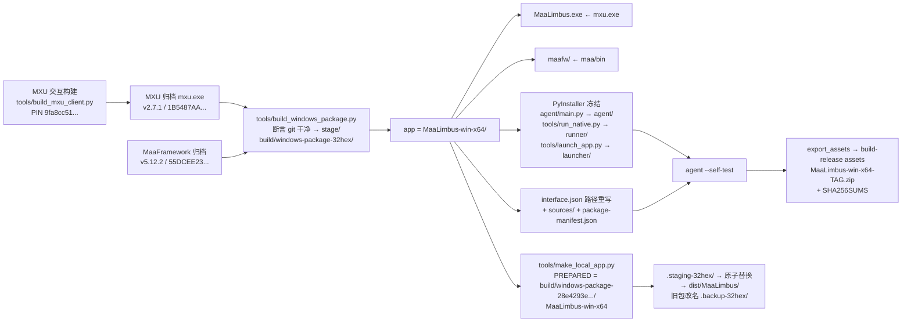

## 6.4 更新与回滚

### 6.4.1 参与的代码与文件

| 环节 | 落点 |
| --- | --- |
| UI 入口 | `desktop/mxu/SoftwareUpdatePanel.tsx`：`invoke('limbus_project_update_check')`；选项 `optionKey="software_auto_update"`（`globalScope`）；界面提示「启用自动更新后…检查不会立即替换软件」 |
| Tauri 命令 | `desktop/mxu/limbus_update.rs`：`#[tauri::command] pub async fn limbus_project_update_check() -> Result<serde_json::Value, String>`，解析 `current_exe` 的父目录为 app，调 `app/launcher/MaaLimbusLauncher.exe --app <app> --check-only`，`creation_flags 0x08000000`（CREATE_NO_WINDOW），读回 `config/user-update-check-result.json` |
| 启动器 | `tools/launch_app.py`：`:37` 自我复制到 `.maalimbus-launcher-<hex>`；`:60-61` `work = app.parent/'.maalimbus-startup'` + `ControllerLease(work/'launcher.lock')`；`:67` `startup_update(app, work, install=installer)`；`:72` `Popen(app/'MaaLimbus.exe')` |
| 更新判定 | `src/maalimbus/startup_update.py`：`:28` `check_project_update()` 写 `config/user-update-check-result.json`；`:32-44` `update_enabled()` 读 `config/mxu-MaaLimbus.json` 的 `globalOptionValues.software_auto_update`（默认 `True`）；`:47-82` `startup_update()`，`:60` 版本正则 `v?\d+\.\d+\.\d+`，`:81` 写 `build/startup-update-result.json` |
| 远端查询 | `src/maalimbus/releases.py`：GitHub `releases/latest`，2 MiB 上限，ETag `If-None-Match`，`User-Agent: MaaLimbus/0.1.0` |
| 暂存 | `src/maalimbus/update_stage.py`（204 行） |
| 安装 | `src/maalimbus/update_install.py`（176 行） |
| 路径解析 | `src/maalimbus/runtime_paths.py`：`:8-16` `application_root()`（冻结态取 `exe.parents[1]`）；`:23-40` `data_directory()` 读 `config/user-data-root.json`（拒绝符号链接/junction/链式）；`:43-51` `ledger_path()` |
| 控制权与启动器锁 | `src/maalimbus/controller_lease.py`：Windows 游戏控制权现为 session named mutex；旧 controller.lock 路径只作诊断标识；其他具名文件锁仍使用 msvcrt |
| 命令行入口 | `tools/check_update.py`（`:18` `--check`；`:26` `--stage` → `stage_release(...)` 到 `build/updates`）、`tools/install_update.py`（`:17` `install_staged(args.stage, args.install, ROOT/'build/controller.lock')`） |

### 6.4.2 状态流转

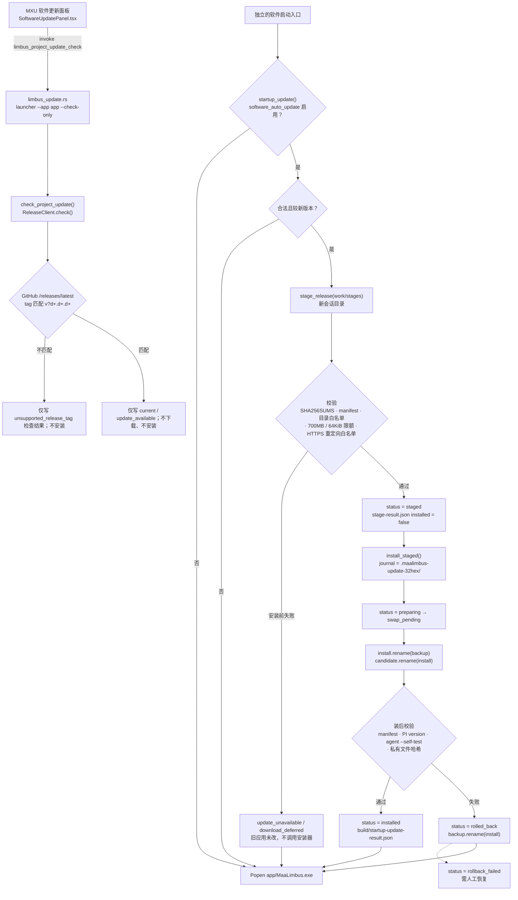

`update_stage.py` 的校验规则（`select_assets`，`:27-41`）：

- 只接受**已发布的稳定版本**，tag 必须匹配 `v?\d+\.\d+\.\d+`（`:27`）
- app 压缩包必须**恰好一个**：`MaaLimbus-win-x64.zip` 或 `MaaLimbus-win-x64-<tag>.zip`（`:32-35`）
- 校验文件必须**恰好一个**：`SHA256SUMS` 或 `<zip>.sha256`（`:37-40`）
- 限额：压缩包 ≤ 700,000,000 B、校验文件 ≤ 65,536 B（`:41`）
- HTTPS 重定向白名单：`github.com`、`release-assets.githubusercontent.com`、`objects.githubusercontent.com`（`:58-60`）

`verify_package`（`:125-134`）要求 manifest 至少含这六个键：`MaaLimbus.exe`、`interface.json`、`LICENSE`、`build-info.json`、`agent/MaaLimbusAgent.exe`、`runner/MaaLimbusRunner.exe`；并且**拒绝**首段路径为 `config` / `evidence` / `build` / `logs` 的条目（`:134`）——即包不许夹带私有运行数据。

`update_install.py` 的关键约束：

- `PRIVATE = ('config', 'evidence', 'logs', 'build')`（`:14`）——这四个目录在换包时按私有数据处理，不参与替换
- `metadata()`（`:32-42`）校验 `interface.json` 的 `name == MaaLimbus`、`interface_version == 2`、版本号正则、GitHub URL
- `closed_app()`（`:49-73`）用 PowerShell `Get-CimInstance Win32_Process` 检查 `maalimbus.exe` / `maalimbusagent.exe` / `maalimbusrunner.exe` 是否仍在运行，并排除 `external_launcher_pid`（`:64`）
- `self_test()`（`:76-85`）跑 `agent --self-test`
- `install_staged()`（`:94-176`）：journal = `install.parent/('.maalimbus-update-'+uuid4hex)`（`:124`），`candidate/` 与 `backup/`（`:126`）；拒绝降级（`:115-116`）；存在未了结的历史 journal 时拒绝启动（`:117-122`）
- 状态机：`preparing` / `swap_pending` / `installed` / `failed` / `rolled_back` / `rollback_failed`

### 6.4.3 实测证据

仓库内保留了两份**离线验证产物**，它们是本章「更新链路可用」这一断言的全部依据：

**暂存验证**（`build/update-stage-verification.json`，由 `tools/verify_update_stage.py` 产出，1005 B）：

- `scope: "retained development ZIP and derived stable release metadata; offline transport"`、`network_requested: false` —— 这是一次**离线重放**，全程没有访问网络。
- 结果块：`status: staged`、`version: v0.1.2`、`installed: false`、`executed: false`、`created_at: 2026-10-10T03:34:38.127635+00:00`
- 暂存目录：`build/update-replay/update-519b040d520d422e9497633b834d878b/`
- 包指纹：`files: 827`、`sha256: 9b968cb94eaf119a5903571f99dfd49ad7c17679a66aa72f621a3a597aaf1c11`
- 来源包提交：`source_package_commit: c12960bfb6e52d0b22903e905a8541949396cea7`
- 该次**未覆盖**的三项：`pending: ["installed process exit", "backup and rollback installation", "installed version/configuration verification"]`
- `public_release_verified: false`、`verified_clear: false`

**安装验证**（`build/update-install-verification.json`，由 `tools/verify_update_install.py` 产出，1646 B）：

- `scope: "isolated retained development package; real filesystem swap and Agent self-test"`、`network_requested: false`
- 基线：`baseline_application: D:\fgoa\MaaLimbus\dist\MaaLimbus`，`version_before: v0.1.1` → `version_after: v0.1.2`
- 正常路径：`install.status: installed`、`rolled_back: false`、`verification.agent_self_test: true`、`private_files: 1`；备份落在 `build/update-install-verification-87058ed37d204bb1b10e4091972201c9/.maalimbus-update-099b3a0b49584997b4ce0c0d13b583ae/backup`
- 故障注入路径：把故障注入到「安装后校验」，得到 `rollback.status: rolled_back`、`rolled_back: true`、`reason: installation_or_verification_failed` —— 回滚路径不是纸面设计，而是被实际执行过一次
- 两份产物共同声明：`desktop_install_changed: false`、`public_release_verified: false`、`game_input_sent: false`、`ui_verified: false`；安装侧 `pending: ["MXU UI restart/version verification"]`

**历史运行快照（2026-10-13）**：`dist/MaaLimbus/config/user-update-check-result.json` 与 `dist/MaaLimbus/build/startup-update-result.json` 当时都是
`status = unsupported_release_tag`、`current_version = v0.1.2`、`available_version = maalimbus`、`newer_available = false`、`requested = false`、`installed = false`。

该次原因：`update_stage.py:27` 要求 tag 匹配 `v?\d+\.\d+\.\d+`，而历史 release 的 `tag_name` 是字面量 `maalimbus`，因此该次检查拒绝安装。不要把这段历史快照当作当前 GitHub 状态。

该历史缓存快照记录过 `etag`、`failures: 0`、`retry_at`、GitHub release id `404282926`、`tag_name: "maalimbus"`、`published_at: 2026-10-06T03:30:13Z`、`assets: []`。当前缓存已更新，不能把这些旧值当作现在的文件内容。

一个部署陷阱：`dist/MaaLimbus/config/user-data-root.json` 是
`{"version": 1, "directory": "D:\\fgoa\\MaaLimbus\\config"}` —— 这个便携包的私有状态被**绑定到了源码树的 `config/`**，而不是包内的 `dist/MaaLimbus/config/`。所以包内那份 `config/` 与仓库根那份会分叉；`dist/MaaLimbus/config/` 下有 14 个 `user-*.json` 事务文件，其中包含 `user-launch.json`（实测内容：`{"graces":"2,4,5,7","grace_budget":100,"gift_keyword":"charge","gift_search":"refuse","update":true,"update_stage":true}`）。

### 6.4.4 诚实边界

以下事实必须写清楚，否则读者会高估更新链路的成熟度：

1. **没有一次针对真实 Release 的安装被验证过**（`public_release_verified: false`）。
2. **没有一次真实桌面 UI 的更新流程被验证过**（`ui_verified: false`，`desktop_install_changed: false`，`pending: ["MXU UI restart/version verification"]`）。
3. 历史 `maalimbus` tag 不符合版本正则；2026-11-16 的 `v0.2.0` 合法但没有上传 Windows ZIP/校验资产，仍不能据此证明公开安装完成。
4. `docs/deployment.md`（75 行）**不是**部署文档。它讲的是游戏内「出战顺序」Prepare deployment 任务；真正的打包文档是 `docs/windows-package.md`（83 行）。命名容易误导，跨页引用时请以文件名而非直觉为准。
5. `build-info.json` 的 `application_root` 是装配时刻的 staging 路径，包被替换后会陈旧。


<a id="feature-6-4-5"></a>

### 6.4.5 更新事务与失败回滚

**2026-11-16 现场更新**：实际新启动器查询到当时公开的 v0.2.0（属于更早的开发仓库，不在本仓库），没有上传的安装资产；首次 requested=True，立即复查 requested=False，两次均未下载安装。安装目录声明 v0.2.0，源码 interface 仍声明 v0.1.2；经过正常打包路径转换后，两份 PI 只有 version 字段不同。发布前须统一版本事实源。安装前 stage 验证失败现在返回 update_unavailable 并保留旧软件；安装尝试后的不明确失败仍 blocked。78 项更新/安装窄测试通过、1 跳过。实际新 frozen launcher 在隔离旧版本 metadata 与留存真实 Release metadata 上，经正常 startup 更新入口核实回退：install_attempted=False、无网络请求、未开 GUI、实际私有状态不变，见 `build/resume-20261116-frozen-startup-fallback-verification.json`。这不是公开新包安装或 GUI 重启证明。

较新离线 candidate 的 stage/install、配置保留、缓存与回滚已有隔离实证；不能替代公开 GitHub 下载或实际 GUI 重启版本证明。unsupported_release_tag 不会继续安装。历史“GUI 活跃、不替换 dist”只描述当时的文档会话；2026-11-16 已在 GUI 退出后独立替换 Agent 和 launcher，未公开发布。

**容量实现（新 launcher 已安装；完整生产更新另验）**：正常外置 launcher 已接 `UpdateSession.stage/install/recover`。项目按用户最新要求严格限 3,000,000,000 bytes；按安装目标固定一个项目外的临时会话，自身限 1,000,000,000 bytes。默认位置是项目的同级目录，不依赖 OS TEMP：实际 frozen 验证发现 TEMP 不可写时会回退到 helper 工作目录，既使备份定位不一致，也污染不可变缓存；现已消除这个依赖。下载按发布大小预留，ZIP 全部路径/类型/大小校验通过后、写第一个展开文件前预留总展开大小；包校验成功即删除下载归档。安装前预留项目净增长（含私有目录副本）以及临时目录中候选+完整旧版备份的峰值。逐文件 SHA256 核备份、fsync `replacement_pending` 后，才移除关闭的旧应用并复制新版。这是可恢复复制，**不是跨卷原子 rename**。安装后核公开文件、Agent 自检和四类私有目录哈希；失败恢复旧版。容量或准备失败只有证明本地全部旧文件未变才能继续打开旧软件。

正常成功后删除本会话 stage，保留一个 rollback；下一次新更新在确认上次已终结后清掉旧 rollback，不累积版本历史。中断后的**外置 helper 再入**先恢复，再读可能缺失的 app metadata；备份损坏则保留当前文件和备份并报告 `rollback_failed`。若应用内的启动器文件也因中断而缺失，需要从保留的外置 helper 恢复；尚未证明桌面快捷方式能自动处理这种断电情况。旧同卷 `install_staged` 工具仍用于独立验证，现也会在项目内 candidate 复制前检查峰值容量。102 项更新/启动/容量测试通过、1 项 Windows symlink 权限跳过，包含压缩膨胀、私有状态写坏、备份/替换中断、损坏备份与恢复再失败。实际安装后的 frozen helper 另恢复了模拟中断应用的全部 3 份文件，再以缓存继续启动检查（`build/resume-20261116-frozen-update-recovery-verification.json`）；helper 连续复用、真实私有配置不变，项目约 1.88 GB（`build/resume-20261116-stable-launcher-frozen-verification.json`）。这些是模拟包/隔离文件证据，不是完整生产 candidate、公开下载或 GUI 重启验收。

```mermaid
stateDiagram-v2
  [*] --> staging: 单会话有界下载与展开
  staging --> preparing: 新包已核且两处容量足够
  staging --> staging_failed: 下载或校验失败
  preparing --> backup_verified: 完整旧版逐文件 hash 一致
  preparing --> aborted_before_replace: 未动旧版
  backup_verified --> replacement_pending: durable intent
  replacement_pending --> installed: 复制、自检、私有 hash 通过
  replacement_pending --> rolled_back: 失败或外置 helper 再入
  replacement_pending --> rollback_failed: 备份或恢复未证实
  rollback_failed --> rolled_back: 同一已核备份恢复
  installed --> staging: 下次更新先退役旧备份
  rolled_back --> staging: 下次更新先退役旧备份
```

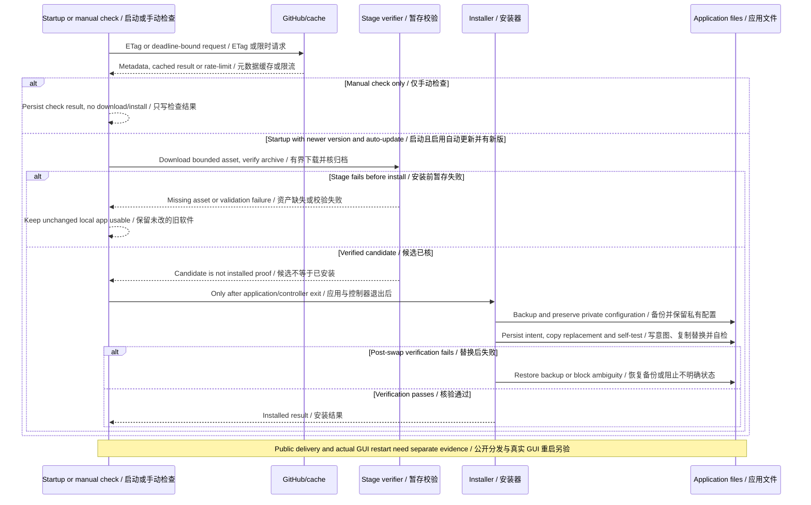

源码落点：`src/maalimbus/update_session.py` 的 `UpdateSession`；`src/maalimbus/startup_update.py`；`src/maalimbus/update_stage.py`；`src/maalimbus/update_install.py` 的共享 `validate_install`；`tools/launch_app.py`。

### 6.4.6 Bounded public reference source cache

<a id="feature-6-4-6"></a>

The pinned Lix checkout consumed234,669,642bytes including Git history. A first complete-tree snapshot preserved958 files/146,623,251 checkout bytes and verified the commit object, Git root tree and every blob;2,084 protected/private/runtime files remained byte-identical. The final **reference subset** retains516 files in12,193,367bytes: all code/config/license text, every dependency of the four importers and two candidate map models for future offline research. Unused supplier OCR/Python binaries, fonts and artwork are omitted from this cache. The full958-entry tree index and original commit object still verify pin431b432; this is explicitly not a complete runnable supplier checkout or a closed redistribution audit. No private/game evidence was moved outside the project.

`tools/pinned_lalc.py` supports the original pinned checkout and this archive. Archive/member hashes, safe paths, uniqueness, expansion limits, pinned commit/tree, explicit Windows newline normalization and each importer's required members are checked before a temporary extraction. Temporary source is removed on return/failure; no permanent external history dump. All four actual importers ran against the subset in an isolated output directory (332 gifts,95 theme names/5 glyphs,4 battle glyphs and22 editor images); generated supplier assets match current resources. One unrelated native theme-glyph source PNG is already absent in the historical corpus; its current resource hash is intact, and this cache work does not restore or certify it.

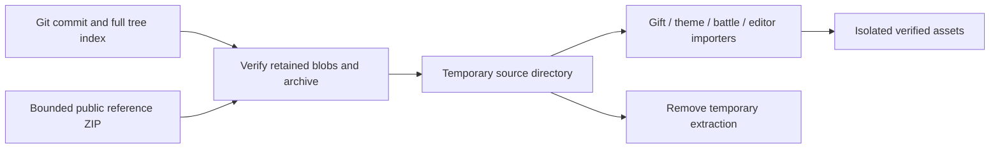

Reports: `build/resume-20261117-source-reference-subset-verification.json` and `build/resume-20261117-source-subset-importer-real-verification.json`;12 source-cache tests passed. Actual project size after the subset was1,886,505,594bytes; later captures/tests can change that number. Existing Maa/MXU corresponding-source/native-license gates are unchanged. This frees capacity; it does not prove long-run storage sufficiency, GUI Start or Mirror completion.

## 6.5 未验收 / 待核实清单

| 事项 | 现状 | 需要的动作 |
| --- | --- | --- |
| 真实 Release 的暂存 | 当前 v0.2.0 无上传安装资产；较新完整包只做过离线验收 | 统一源码与包版本，为新 semver Release 提供 Windows ZIP/校验资产，再核真实下载、安装与版本；创建 tag 本身不够 |
| MXU UI 内的更新流程 | `ui_verified: false` | 在真实桌面上点一次「检查更新」并观察重启后的版本号 |
| 便携包私有状态位置 | 绑定到源码树 `config/` | 决定这是有意（开发态）还是需要重新绑定 |
| `dist/` 工作目录膨胀 | 36 backup/5 helper 是历史快照；新容量 launcher 已装，隔离 frozen 恢复通过，项目约 1.88 GB | 验真实完整 candidate；不盲删未结证据，公开下载和 GUI 重启另验 |
| 发布包与开发包的差异 | 已由源码锚点确认 | 若对外分发，需在发布包上重跑 6.4.3 的两份验证 |
| `docs/deployment.md` 的命名 | 与本章主题不符 | 考虑改名为 `docs/battle-deployment.md` 以减少跨页误引用 |


## 6.6 公开输出隐私边界

公开源码导出在写 ZIP 前检查本机用户路径和字面玩家 ID，错误只报告文件名、行号、类别，不回显匹配值；本地学习策略 .local.json、日志和 jsonl 不进入源码归档。已脱敏当前文档中的本机用户路径。

此门禁只检查当前文本；不宣称截图、模型训练集、已有 Git 历史或旧发布包已经全部清理。私有 config/evidence/build 仍必须排除，公开包还需检查实际文件清单和截图是否包含账号信息。

<a id="feature-6-7"></a>

## 6.7 发布包证据与私有数据隔离

文本扫描不覆盖全部图片、模型训练数据或既有 Git 历史。原生五 DLL 字节、86 copyright 与 Python notice 有具体门禁，但完整传递依赖对应源码、静态链接与 artwork 分发仍开放。私有学习复核包不能随代码打包公开。

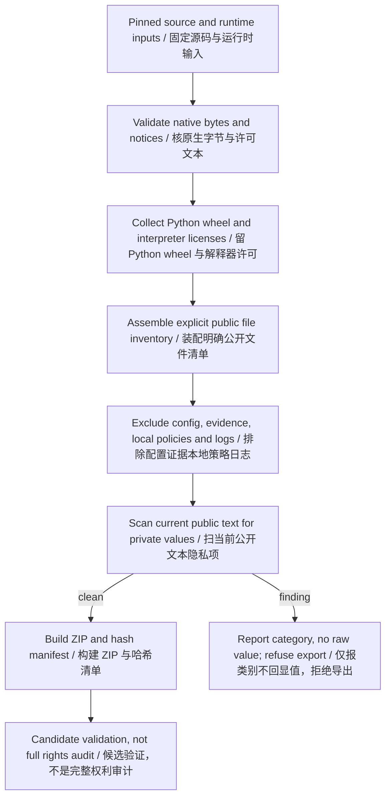

源码落点：`tools/build_windows_package.py:1`; `src/maalimbus/public_privacy.py:1`; `tools/native_dependency_notices.py:1`.

公开源码 ZIP 使用同一份已提交的 Git 快照进行扫描和打包。即使本机忽略或未跟踪的文件放在公开目录内，也不会被收入。检查覆盖常见 Windows 配置和脚本，包括带 BOM 的 UTF-16、冒号及连字符分隔的 MAC 地址，以及 GitHub 和 OpenAI 项目令牌的字面格式。其他凭据类型和 GitHub 元数据需要另外核验。

Git 的归档属性还会从自动生成的源码包排除误跟踪的私有配置、本地探针、证据和密钥文件。规则只作用于含有该配置的版本。已提交的文件仍可通过 Git 读取，旧 Release 标签也继续使用它自己的归档规则。

<a id="feature-6-8"></a>

## 6.8 证据容量、单份存储与安装边界


整个项目树上限为 **3,000,000,000 字节**，包含 .git、源码、构建、dist、缓存、模型和证据。下图为正式目标部署关系；共享内容寻址存储尚未落地；发送前容量预留的源码首段见6.8.1，未安装，不表示已有新服务。

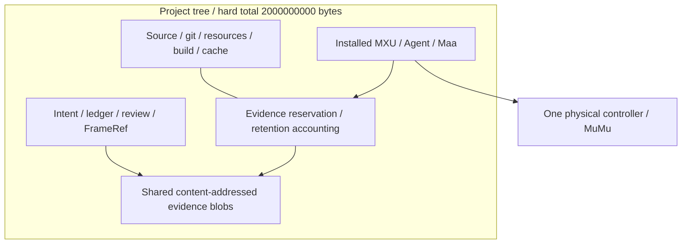

准入先为 before/after/必要结果和元数据预留空间，再持久化 intent 并尝试输入。预留失败应在输入前报告容量不足；若进程崩溃，按原 reservation 与 pending 恢复。不能点击后才发现无空间写后继。原 `capture_retention.reserve` 在帧写入时检查空间；新 EvidenceCapacity 已在镜牢 Agent 主计划与直接输入前预留后继空间，Journal 以确切帧字节消费预留。原生复合节点内部逐输入、独立任务及 CLI 尚未全接入；普通 HUD 回收不等于整个存储迁移完成。

关键保留：未决动作、消费到账、楼层、编队/轮换/再入场、已复核与模型验收证据。学习候选按 episode/对象/页面多样性有界采样，普通动画与已判定输入保留代表帧及因果尾部。回收先核引用、原字节哈希和持久清单；压缩或去重不得断开原因果链。存储回收不生成业务成功或训练标签，不迁到项目外规避上限。

源码、安装包、当前运行进程各自记版本。控制器活跃时继续离线开发，不替换其 dist；测试必须限制临时产物。仅新代码可自检不等于 GUI Start、升级重启或整局验收。现有独立 updater 会话及回滚约束仍见[6.4](6-deployment.md#feature-6-4-5)，不被本节扩大授权。


<a id="feature-6-8-1"></a>

### 6.8.1 占位容量预留与重启恢复（源码已接入）


战斗截图分级实施计划（2026-11-18）：先测原生Controller／Agent反向SetOption能力及实际图像尺寸，再接页所有者的降采样策略。当前真实1920无START文字帧在1280丢失转盘，原因是固定像素尺寸门槛。先让start_button／dial_control复用共享校准分析视图，原生OCR只转换几何、不改文字／置信度，输出一次回到捕获坐标；原始截图与原生Maa设备缩放职责不变。保留尺寸、填充、亮度、完整标题门槛，测真实正例及擦除／暗按钮／小斑块／伪文字反例。随后仅已独立识别的战斗HUD尝试1280，其他页及低图不充分时须fresh1920再读后才交领域规划；不得用旧坐标或补齐身份。全局默认与付费旧PI路径仍1920，必须核deadline／容量及实际跨Agent原生回调后才能安装和实机继续。

<a id="battle-capture-profile"></a>

#### 按已验证战斗页调整捕获尺寸

安装补记：clean2f724c8成品已通过相同跨Agent链路／正式MirrorLoop只读及两尺寸各2例正反控件实证，普通启动15actions／exit0；98安装私有／31canonical／597复核配置及模型保留。见`build/capture-profiles-installed-real-verification.json`；无新游戏输入或模型晋升。

源码已实现、原生离线已验证（2026-11-18）；安装和实机验收由当前checkpoint单独记录。`MirrorLoopAction`在原有`MaaObserver`外包装`BattleCaptureObserver`。首次1920；只有原始PNG／JSON绑定、原生HUD及回合／配卡或Start控件可读，下一读才尝试1280。小图读到非HUD或信息不足，必须在调用者原绝对期限内独立重捕一次1920，才返回领域规划器。尺寸设置被拒绝则关闭优化。显式`MAALIMBUS_TARGET_LONG_SIDE`保留固定尺寸模式；全局及旧PI默认仍1920。

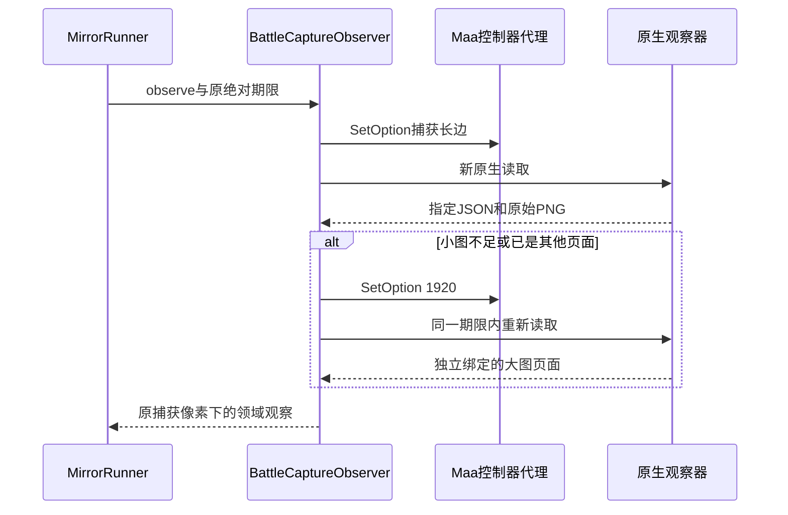

这项策略不授权操作、消费或训练。`Journal.before_input`向`EvidenceCapacity.admit`声明可能的1920×1080后继：即使before为1280，也须预留两对最坏大图容量；写大图后继不能再临时申请空间。Start／转盘形态通过共享1920分析图测量，返回原捕获坐标；原生OCR文字／分数及Maa独占的设备坐标转换不变。

实际源码Agent／代理已验证1920HUD→1280HUD→1280SHOP→新1920SHOP、反向SetOption成功及Agent正常退出。正式MirrorLoop也到达具名`observe_only`终点、零输入。未完成镜牢时该actor原生返回失败是既有语义：验收须同时证明任务已结束及精确只读结果，不能改称通关。商店只读仍解释报价／评分，但跳过事务结算和到账标签写入；实际购买继续要求scope。真实无START文字正例及擦除像素反例在两尺寸原生OCR均通过。证据：`build/capture-profiles-native-door-source-final.json`、`build/battle-capture-dial-1280-source.json`、`build/battle-capture-dial-1920-source.json`。这些是保留帧原生集成实证，不是当前游戏、GUI开始、模型质量或全局长程容量验收。

##### 回调内借用的控制器生命周期

实际05782de成品已从Android桌面原生启动Limbus，但MirrorTask首次actor观察出现access violation，零页面点击；保留`build/callback-controller-lifetime-live-failure.json`及原始首帧。原因是同一回调为device、capture和冷启动serial检查重复取controller。Maa5.12.2的[RemoteTasker实现](https://github.com/MaaXYZ/MaaFramework/blob/v5.12.2/source/MaaAgentServer/RemoteInstance/RemoteTasker.cpp#L173-L184)每次getter都会替换unique_ptr，之前的Python Controller只是借用指针，会失效；这不是OCR未知页或点击失败。

生产修复只在当前MirrorLoop回调解析一次controller，MaaDevice、BattleCaptureObserver和startup检查共享它；不跨回调缓存，不另建控制器。前台校验闭包只保留复制的设备标识，不保留旧Context或借用句柄；每次仍独立读取真实前台，原标识字典后续变化不能转向另一设备。离线验证必须包含“每次getter使旧代理失效”的负例及cold-start路径，常量FakeController和单独MirrorLoop只读成功不足以覆盖真实入口。原生／运行时错误保留有限Python调用栈，避免只剩一句内存错误。40项相关检查实际通过且无跳过；af31f4b成品已实际冻结并通过原生观察链，1736保护文件不变（`build/combined-installed-runtime-verification.json`）；连续实机复验仍未完成。旧句“成品离线通过”仍只指其历史切片。

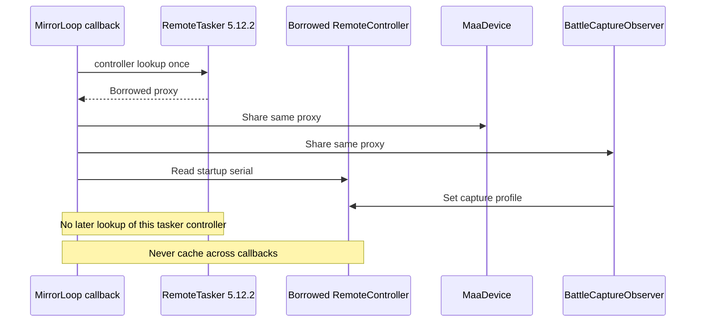

<a id="capture-neural-calibration"></a>

#### 冻结神经观察与原始捕获

**共享分析与冻结神经参与（2026-11-18；已安装，成品离线通过）**：`capture_geometry`统一校准→捕获坐标及明确标注的插值分析图；星光和战前边框读取只共享机械部分。神经域仍独立核原生Details／Battle标题、捕获尺寸一致及四边线，保留.72阈值；grid_slot仅搜索窗编号，不是罪人类别。ROI返回捕获坐标，Maa NeuralNetworkDetect接收原始捕获而非插值分析图；旧import保留兼容入口。

实际安装35b035f冻结回调在1280留存画面14例中13通过，却证实战前神经ROI／推理均0，不能凭shadow／model_trained状态当实际参与。修复后源码执行12ROI，选定留存样本在1280产生10个、1920产生11个未复核框；另一张原生1280战前截图也通过参与要求。数量不等于准确率或12名罪人验收，native_quality_passed仍False。82相关通过，含边线擦除／缺标题／类别来源不变／IPC子进程清理反例；Agent2978cfa现已实际冻结／安装，自检及544源码指纹匹配。成品1280／1920各14例通过、28会话正常退出；原生1280样本11ROI／10框，1920样本12ROI／11框。597配置／复核／模型元数据不变，隔离提案仍reviewed=False／training_eligible=False／input_authorized=False，不加入真实训练集。首轮新冻结回放5例因容量失败，关闭应用回收22.95MB可重建WebView缓存后才通过，原失败报告保留。build/neural-capture-installed-real-verification.json绑定实际产物及两份报告；234张图实际解析通过，两个新神经图已渲染。GUI开始／实机新神经回调和整局完成仍待验。

```mermaid
sequenceDiagram
  box 宿主进程
    participant H as Maa宿主
    participant N as Maa NeuralNetworkDetect
  end
  participant A as 冻结Agent
  participant Q as 隔离待复核队列
  H->>A: limbus_scene及原始捕获像素
  A->>A: 本页标题与四边线搜索几何
  A->>H: 带捕获ROI的原生识别请求
  H->>N: 原始捕获与已绑定模型
  N-->>H: 原生类别、框与置信度
  H-->>A: 识别结果
  A->>Q: 未复核提案，训练与输入禁用
  A-->>H: Journal绑定及实际推理标记
  Note over H,Q: 诊断重放没有真实游戏输入或新训练局次
```

验证器复用已安装Agent的IPC启动器，加载安装资源，仅调用scene识别回调；数据隔离、重放控制器禁止输入。每例临时证据在3GB项目内有界保存，所属子进程退出后清理。首个项目外临时目录探针在注册前PermissionError；改为项目内有界路径后TCP回调工作。显式IPC仍失败并保留报告；固定Maa5.12.2 Windows Transceiver的IPC使用C:/Temp，不改系统权限。auto通讯跟随既有MXU tcpCompatMode（当前True），不暗改偏好。冻结结果绑定exe、构建metadata、验证器／共享启动器／原生库hash、输入像素、原帧及正常退出；注册成功不能替代观察要求。

<a id="capture-star-calibration"></a>

#### 星光校准与原生裁剪

**星光捕获尺寸，2026-11-17（已安装；原生离线已核）**：旧1280观察器仍发送1920兑换金额裁剪，越过图像边界并导致原生job失败。星光卡格／目标、价格裁剪、独立Available读取及兑换勾选现沿用既有校准坐标→捕获坐标边界；边线／模板仅在明确标注的1920插值分析图测量，返回目标与新OCR ROI均为捕获坐标。置信度不降低；高置信`Availabl`片段只能触发一次新的完整`Available`原生读取，不能替代完整标题或删除相反数字。

原始同页样本提供余额74／14、四个请求项价格10／20／30／40、勾选兑换70与未勾选兑换0。1280／1920各4个完整正例及2个明确像素擦除反例经实际Agent观察器／Maa DLL通过：缺价格不形成board，缺余额维持未证。48相关通过／14历史证据跳过。`build/native-star-capture-1280-final.json`与`build/native-star-capture-1920-final.json`绑定原JSON／PNG、缩放／变更像素hash、源码快照、验证器与实际原生库；零物理输入、无真实策略／事务写入。实际冻结Agent35b035f自检／543源码指纹通过，98安装私有／31canonical文件与assets保留，零GUI／控制器／输入，见build/star-capture-installed-verification.json。不是新增星光消费、实机低分辨率入场或学习策略验收。

```mermaid
sequenceDiagram
  participant C as 原始捕获
  participant O as Maa OCR
  participant G as 星光布局读取器
  participant P as 既有事务与规划器
  C->>O: 捕获坐标中的标题与数字裁剪
  opt 整帧标题漏末字母
    O->>O: 数字读取前重新原生核完整标题
  end
  O->>P: 新鲜一致金额或未证状态
  C->>G: 仅为已支持尺寸建立插值分析图
  G->>P: 卡片与勾选框返回捕获坐标
  Note over P: 仍核原scope、预算、已选卡与不兑换规则
```

全局默认仍1920。付费领奖读取／准备仍要求1920布局；本地存活原生帧不包含可用于1280回放的有效Hard5 claim／confirm／receipt全链，不能用旧失败入场报价代替。旧独立PI星光动作仍有固定模板几何；本观察器／Runner修复不验收那些路径。完成这些验收后，才决定全产品1280默认。

#### 固定尺寸校准试行

**1280捕获试行（2026-11-17）**：常驻数据约1.983GB时，1920截图的两份最坏后继预留仍会在输入前拒绝。先用实际Agent观察器／离线Maa控制器重放8类原始绑定帧，1280与1920各8/8通过；1280读出全部12个部署顺序、Hard／稳定主题卡和真实购买1008→863。动画中的倾斜主题卡不要求产生可点击候选，稳定后的独立帧才验证卡片。相关79通过／78历史证据跳过；不是实机整局验收。默认捕获仍1920，先以`MAALIMBUS_TARGET_LONG_SIDE=1280`实机试行，再决定默认值。保留原图，不把插值图当新原生证据；不降低置信度、对账或容量边界。

可见下一房间（2026-11-17）：完整当前MAP表头、唯一火车／一步格距／饱和连线与目标都在新帧可见，且无未决或已拒绝导航时，`_normalise_view_once`返回原帧给同一节点规划器，不再为新controller额外缩放。后继仍必须独立NODE_PANEL；既往拒绝、未知或不可见时继续既有手势恢复。103项相关检查通过，含原生像素与连线擦除反例；后来实机155302已接受1280的MAP→NODE_PANEL→PRE_BATTLE_TEAM，整局及星光新尺寸实机派发仍开放。仅退休旧MXU demo中与安装目录逐字节相同的三份非配置二进制，2,964,992bytes；另三关闭日志无损归档回收2,165,546bytes，未删游戏截图／JSON。

```mermaid
flowchart LR
  N[原生1280捕获与原始JSON] --> O[Maa OCR与按实际尺寸裁剪]
  N --> G[校准几何在1920分析栅格计算]
  G --> B[候选框返回1280坐标]
  O --> P[同一规划器与后继判定]
  B --> P
  P --> M[Maa唯一负责截图到设备坐标变换]
```

`controls_by_id`的历史`verified_on.box`来自1920实测，不能用目录的1280归一化参考值代替。观察器与Runner每次从原始注册表按当前帧尺寸计算，不在已缩放坐标上重复缩放。范围外固定参与人数裁剪已修复；完整Clear Selection／To Battle双控件优先于宽泛DEPLOYMENT判页。`tools/verify_capture_scale_native.py`只用禁止输入的ReplayController，生成物在子进程退出后清理，原始hash和读取结果留在本地报告；不会连接模拟器或写实际预算。
补充实机差异（2026-11-17 20:31 UTC）：dcc7309的153100会话在第一次缩放时由Maa拒绝越界端点，实际输入0，正常停止而非超时。源码已将缩放、恢复拖动与地图进度控件统一按捕获尺寸换算；97项动作／坐标／回放检查通过。实际Maa MultiSwipe在离线触控接收器中两种尺寸均完成182条触控回调且无越界，8类观察与购买对账再次全部通过；这不是设备输入。保留失败帧／意图，不把控制器任务拒绝改写成游戏成功。四份已关闭native文本日志逐字节ZIP读回后移除原副本，回收1,373,493bytes，游戏图／JSON未删。下一步冻结并实机继续。


#### 持久容量预留与崩溃恢复

`evidence_capacity.EvidenceCapacity` 在整个项目的 `evidence/runtime/` 使用一份有实际逻辑大小的占位文件和两个固定8KiB元数据槽。普通容量检查也看得到这些字节，不能把它们当空闲。两槽以序号/哈希轮写；resize intent 先 fsync，再改变占位大小，最后写 ready。重启只在实际大小等于已记录 before/after 时调和存储；其他大小或无法核验的记录保留并拒绝输入，绝不生成业务成功。

```mermaid
sequenceDiagram
  participant P as MirrorRunner plan
  participant C as EvidenceCapacity
  participant T as Domain transaction
  participant M as MaaDevice
  participant J as Native Journal
  P->>C: admit with verified before JSON/PNG
  C-->>P: sized successor credit or no-input refusal
  P->>T: persist domain input intent
  P->>M: dispatch proposal
  M->>C: recheck before native call
  M-->>J: independent subsequent capture
  J->>C: consume exact encoded pair bytes
  J->>J: save PNG and JSON
  P->>C: terminal result writer releases own remaining credit
```

源码准入按当前几何及生产者bgr8-json1mb-v1格式上界，为两个后继帧对加2MB停止余量预留：8bit RGB PNG与每帧最多1,000,000字节的完整JSON。Journal在写入及消费credit前验证uint8 BGR三通道和元数据上限；无字段截断。保留2MB独立日志余量。不是对任意尺寸变化或任意数量补读的无限承诺；该profile尚待安装实机验证。Journal 消费占位字节后写同等大小的实际帧，停止写报告时仅释放本采集会话拥有或消费的池。原生 MirrorLoopAction 已将 Journal.before_input 传入 MaaDevice，普通主计划和未知探索先准入再写领域 intent；click/swipe/key/pinch 在原生调用前再核。旧未决游戏事务、预算授权和标签不随容量恢复修改。

验收：`tests/test_evidence_capacity.py` 16项通过，含真实保留编队重置弹窗的完整 step 在容量不足时零确认且旧事务字节不变；历史 MAP/NODE_PANEL 由真实 Journal 在隔离满额预算写入，下一输入零原生请求且保存停止报告，31真实配置不变。证据 `build/evidence-capacity-retained-verification.json`。这是离线源码验证，未替换安装、不连接MuMu、不证明整局容量或所有原生复合节点内部逐次输入已覆盖。


补充验证：容量scope现从当前loop.run_id动态读取，连续轮换不沿用首次启动scope；未知池元数据保留原字节，同时在有界余量内写出含释放错误的停止报告。容量停止提示区分“本次待执行输入未发送”和此前已发送次数。完整快照新增的双指适配兼容失败已修复；74项最终相关检查通过。只读库存发现818张PNG中8组/16个完全重复副本，单份存储理论仅节约15,587,385字节，未删除任何原图；去重本身不足以证明整局2GB出口，后续仍需按引用角色和结果保留策略迁移。


<a id="feature-6-8-2"></a>

报告备份去重（2026-11-17）：generation4的103个原始JSON成员在当前generation5全部逐字节相同，并以原ZipInfo／level9重建出了完全相同的4,171,152bytes ZIP与SHA。保留54,300bytes恢复配方，仅移除冗余旧ZIP，净回收4,116,852bytes；当前归档／全部PNG／JSON／人工复核未删。`python tools/restore_report_snapshot.py build/historical-report-generation4-recipe.json`默认仅内存校验，`--restore`才在预算内原子恢复原ZIP。5项roundtrip／篡改反例通过，实际退休前后均重新验证；未来codec变化若不再bit-exact就拒绝，不生成成功。


### 6.8.2 封存报告归档与引用不变性

封存报告增量归档计划（2026-11-18）：复用既有version1读取协议；明确选择已结束的build报告，先校验原字节和旧索引／ZIP，再制作确定性新代ZIP。发布新索引前保留所有旧文件，发布后独立核引用集合相等，再按hash逐份回收raw报告。旧容器保存可逐字节重建的recipe，只有实际重建匹配才退役旧ZIP。持久化归档操作记录支持发布前／发布后／部分回收中断恢复；输入变化、链接、重复路径、篡改和容量不足均不删除未知文件。仅为存储操作，不更改游戏事务、原始截图、复核标签或模型；验证源码后再实际迁移，并独立核安装版读取新索引。

旧完整运行报告包含重复的 OCR/步骤对象；它们是证据，不能为腾空间直接删除。`evidence_reports` 增加仅限 build 直接子级已封存 JSON 的可选归档读取层：原路径、原字节数、原 SHA256、ZIP位置/成员绑定在 version1 索引中。原报告可仍在原位；移除前须逐个核原字节与归档成员，不能迁移配置、未决事务、运行帧或人工 review。

```mermaid
flowchart LR
  Raw[Closed report original bytes] --> Zip[Hash-verified ZIP member]
  Zip --> Index[Immutable report index]
  Index --> Reader[read_report_bytes]
  Index --> Pins[Archived report reference scanner]
  Pins --> Same[Same protected native frame references]
  Missing[Missing / changed / unsafe archive] --> Refuse[Refuse reclamation / preserve evidence]
```

索引和 ZIP 都按当前字节核验；拒绝重复成员、路径逃逸、链接、加密、超额展开和成员哈希不符。最多256成员、每份16,000,000字节、总展开128,000,000字节。归档解析纳入原 `capture_retention._reference_keep`，原报告引用的 PNG/JSON 继续固定；缺失或损坏归档不能静默少保护图片。缓存同时绑定索引和 ZIP 字节摘要，不信时间戳。

读取旧路径：`python tools/read_evidence_report.py build/旧报告.json` 默认只报摘要；显式 `--text` 才读原全文。成品 `MaaLimbusAgent.exe --evidence-storage-check` 不建控制器，输出同一引用集合的计数/摘要，用于源代码与实际冻结程序迁移前后核对。当前读取层已实现，实际归档与安装验证分别记录，不能把压缩当成业务完成或模型质量提升。


增量实现入口：`tools/rollover_report_archive.py`默认仅预演，显式`--apply`才执行；沿用单controller lease并要求软件关闭，不创建游戏控制器。选择清单包含sealed声明和每份报告的原路径／字节数／SHA；封存声明来自已结束任务的核对，不由文件年龄推断。每份报告仍受原256成员／16MB单件／128MB展开上限约束。操作记录以校验和封装原／新索引、原容器恢复配方及选择摘要，只有prepared／completed两个持久phase；以下中间状态由当前索引及文件存在性推导，不是额外数据库状态。归档发布前旧字节全部保留，发布后才逐份回收且已验证能通过原路径读取。旧Team7验证工具也沿用统一报告读取，不以当前Team2账本重认证历史Team7。

```mermaid
stateDiagram-v2
  direction LR
  state "旧索引有效" as OldActive
  state "准备已落盘" as Prepared
  state "候选已落盘" as CandidateReady
  state "新索引有效" as NewActive
  state "回收旧副本" as Retiring
  state "完成" as Complete
  [*] --> OldActive
  OldActive --> Prepared: 写操作记录
  Prepared --> CandidateReady: 写ZIP及恢复配方
  CandidateReady --> NewActive: 发布索引
  NewActive --> Retiring: 核原字节及引用
  Retiring --> Complete: 回收已验证副本
  Prepared --> Prepared: 重核旧输入
  NewActive --> NewActive: 重核新归档
  Retiring --> NewActive: 中断恢复
  Complete --> Complete: 重复调用
  Complete --> [*]
```


实际增量归档（2026-11-18）：33项相关通过，包含发布前、发布后、部分raw回收和旧容器退役后四种中断恢复；重复完成操作保持文件hash不变。当前gen5实际为120成员（103是前代gen4），新gen6为143成员、5,956,061字节／SHA79d2c1c3…；23份封存报告6,875,015原字节全部按旧路径／SHA读回。3,375份配置、原生JSON／PNG、复核及模型文件未变，5,888个引用保护集合的摘要与已安装Agent实际读取一致。gen4／gen5分别实际重建4,171,152／5,295,978原字节及原SHA，通过内存校验，未创建冗余ZIP。目录从1,974,026,557降到约1,968,502,913字节（包含操作／恢复／审计开销），不是删除图片，不宣称整局容量已足够。证据build/report-rollover-generation6-real-verification.json及report-archive-generation6-installed-reader.json；本轮没有GUI、游戏输入或模型晋升。完整回归与最终文档检查另记。


本段完整回归为6失败／3353通过／709跳过，365.24秒，自身退出1；与上次六项失败相同，未新增失败（build/20261118-report-rollover-full-tests.log）。归档状态图初次虽可解析但恢复标签重叠，已改为横排及短标签，中英实际复渲染检查通过，236／236全图实际解析通过；真实本地Wiki预览也验了可读原尺寸／整体缩放／恢复切换。50项Wiki隐私检查通过；不把文档验收当游戏验收。

<a id="feature-6-8-3"></a>

### 6.8.3 精确字节准入与无输入主页保留

`documents.write_document` 只序列化一次、按 UTF-8/LF 的实际字节核净增长；`storage.write_json` 则先核完整临时文件的峰值，再 fsync/atomic replace。拒绝发生在旧文件覆写之前。CLI 控制主机也调用 `native_evidence.configure_host`，禁止失败识别节点额外生成 debug PNG，原始 Journal 与文本日志保留。

`window_capture_session_closed` 只封存本次采集输入，不等于业务成功。只有全部观测为有 hash 的 HOME、所有事件属于明确只读集合、无任何输入且已封存的会话，才可按压力回收未引用中间 PNG；首帧、末两帧、全部 JSON 和任何配置/模型/review/报告引用保留。未知事件或混合页面不取得这项资格。

```mermaid
flowchart LR
  Bytes[Encode exact UTF-8 bytes] --> Peak[Admit net output or full atomic temporary]
  Peak --> Write[Write canonical document]
  Home[Sealed input-free HOME history] --> References[Revalidate hashes and external references]
  References --> Keep[Keep representative, last two and all pinned proof]
  Keep --> Retire[Durable plan then retire unreferenced PNG only]
```

实证：34份封存报告已归档并保留原始引用集合；frozen/source 引用摘要一致。随后 CLI 的旧主页等待实际写满容量，曾达到2,004,334,741字节，原因包括控制主机未关闭的9张原生 on_error 副本，不能归咎于报告副本。7张与原始帧逐像素相同的副本被核验回收，2张未匹配图片保留。停止后的23次纯 HOME 读取经真实进程退出、原始 hash 和事件审核封存，回收14张未引用中间截图26,690,795字节，全部23份JSON/53份配置不变。报告 `build/sealed-home-retention-real-verification.json`。122项相关检查通过；本节不证明整局容量或学习质量。


<a id="feature-6-8-4"></a>

### 6.8.4 Navigation review references / 导航复核引用

Unknown-navigation proposals already contain original before/successor JSON/PNG paths and four hashes. New `Exploration.finish` bundles keep proposal/review/trace only; existing mirrors are checked for conflict. Canonical references remain protected. `review_storage` supports only the exact semantic-frame and navigation queues: unreviewed/non-training/pending/unedited entries with unchanged canonical and mirror bytes. Human approval, correction, notes, missing or changed proof refuse compaction. Review and transaction metadata are never rewritten.

```mermaid
flowchart LR
  Proposal[Immutable attempt paths and hashes] --> Canonical[Canonical before / successor proof]
  Review[Human review bytes] --> Validate[Recheck entire plan and each deletion]
  Canonical --> Validate
  Mirrors[Legacy byte-identical mirrors] --> Validate
  Validate --> Retire[Unlink mirrors only]
  Validate --> Preserve[Preserve all labels and original evidence]
```

Actual28 legacy mirror files reclaimed16,154,250bytes; all28 canonical sources and7 proposal/review pairs match the original plan hashes. `build/navigation-review-compaction-real-verification.json`. This is single-copy evidence migration, not a newly approved label, trained model or navigation success.


Archive generations3/4: closed-report members increased34→95→103. Each generation preserves original report bytes/hash/path bindings and the same protected reference set; obsolete derived ZIP containers were retired only after every old member matched the new verified generation. Historical index bytes and transfer audits remain. Reports:`build/closed-report-generation3-real-verification.json` and `build/closed-report-generation4-real-verification.json`. Separately621old diagnostic text files (6,561,520bytes) are retained in a1,353,216byte ZIP;46inactive prototype WebView cache files (5,368,674bytes) were rebuildable,857private/review files unchanged. No canonical capture or settings were removed in that operation (`build/closed-text-cache-retirement-result.json`).


<a id="feature-6-8-5"></a>

未决普通回合的读取保留：仅当原生完整HUD有可读TURN、真实Win／Rate／Damage字幕、START像素控件和框内350–750ms延迟意图绑定，且之后无其他输入／命名页边界，当前尾部仍UNKNOWN／LOADING时，`hud_evidence`可将未被引用的中间读取列为inflight_reads。必留输入前、每种不确定页首图、最近两图；原始hash／JSON／业务pending／人工复核引用保持。此角色不把未知叫作战斗动画，也不发放成功标签。后继TURN+1／VICTORY／MAP仍走独立结果门禁。144相关测试通过，含真实控件像素、错控件／短触摸／跨输入／缺首图／旧时间／人工pin及下一回合反例；源码待实机安装。本轮source-only前最后完整套件仍保留历史失败，未宣称全绿。

```mermaid
sequenceDiagram
  participant P as MainTask preflight
  participant J as Native Journal
  participant O as Map and Battle observers
  participant C as Storage admission
  participant D as Page-domain projection
  participant S as startup_evidence
  P->>J: Bound preflight frame
  O->>J: Fresh actor frame
  C->>D: diagnostic_index
  D->>S: Check original prefix hashes, scope, time and no input
  S-->>D: Verified capture records or no authority
  D->>D: Compare full deployment order or HUD counters and captions
  D-->>C: startup_previews and required actor image
  C->>C: Recheck actual input and human-review references
  opt Pressure and independently authorized diagnostics
    C->>C: Retire only old replica PNG, keep JSON and actor proof
  end
  Note over C,J: This grants storage eligibility, never game success or input authority
```


HUD启动读取（2026-11-17）：共用`startup_evidence.preview_records`只核同scope／recorder、无输入的前缀、原图hash、原生时间及≤30秒；不在公共层判断页面成功。部署域继续比较12序号与明确队伍，HUD域要求各图同一可读TURN／WAVE及真实Win／Rate／Damage字幕（禁止固定坐标回退）。HUD的preflight／MapObserve副本可降为startup_previews，最新BattleObserve才是required actor图；输入与人工复核引用优先。139项相关检查通过；本轮实际第1回合START→第2回合原图链已出现，整场胜利尚未发生。正常2GB容量结束后回收7张已回应诊断5,944,285bytes，2,595份metadata／保护文件不变，保留START前／Turn2后／首次未知图。Git只打包375个既有松散对象（11,983,874→1,601,229bytes），verify-pack／完整fsck通过，再由git prune-packed移除有打包副本的旧文件；不删历史／不改引用，目录约1.988GB，后续运行差异另记。


启动预检副本补充（2026-11-17）：`startup_order_preview`仅在同一scope／recorder、无中间输入、30秒内，两张原生绑定图都拥有Clear Selection／Battle／12of12与12个≥.9序号、保存队伍标识一致时，标记较早预检图为诊断。实际actor before图加入required；仅此明确角色可覆盖结构性最近图，所有外部引用及实际输入边界仍优先。未知、缺控制、不同顺序／队伍／scope、过期或坏hash拒绝。111项相关测试通过；随后补充队伍／episode反例12项通过。实际回收1,711,781bytes，2,574份metadata／保护文件不变；这是存储角色判断，不是身份/E.G.O/战斗胜利标签。Host工具也与Actor共用显式1280环境值，默认1920不变。

### 6.8.5 Diagnostic roles and closed map attempts / 诊断引用与已判断地图尝试

A pin census measures retention roots; it must not recursively become another root. `reference_inventory` recognizes the exact legacy read-only/count-consistent diagnostic schema (or its explicit evidence_reference_inventory kind). Extra proof/transaction fields, input sent, duplicate paths or inconsistent counts preserve normal pinning. Original report/archive bytes stay unchanged. This does not remove real state, model, human-review or acceptance references; those are still independent roots.

Closed nonfinancial MAP diagnostics may release an older input image only after an explicit accepted/rejected map_click_result matches its original target, in-box350–750ms intent and hash-verified native before/after images. Accepted must independently be NODE_PANEL; rejected must be MAP. Unjudged/superseded attempts, active producers and corrupt/missing proof do not qualify. First representatives, recent captures, final causal pair, source/acceptance references and all transaction/model/review pins remain. All canonical JSON, event logs and state remain unchanged; this storage decision never creates a game success or approves a training label.

```mermaid
flowchart LR
  Census[Read-only pin inventory] --> Measure[Measure roots without adding a root]
  Roots[Transaction / model / human review / acceptance] --> Keep[Retain original proof]
  Closed[Closed recorder] --> Judged{Explicit matching MAP verdict and native hashes?}
  Judged -->|no| Keep
  Judged -->|yes| Eligible[Diagnostic eligibility only]
  Eligible --> Pins{External pin or final causal pair?}
  Pins -->|yes| Keep
  Pins -->|no under pressure| Trail[Revalidate / durable unlink trail]
```

UNKNOWN/LOADING observations retain one uncertainty representative in a named-page visit; they cannot fabricate a new named-page boundary on every MAP/UNKNOWN animation alternation. Actual named foreground changes still retain both sides.78related checks passed, including changed successor, foreign target, unjudged, active/no-terminal and pending-reference negatives. Whole-dungeon sustainable storage is still open. Local actual reclamation is reported separately in build/typed-retention-real-verification.json.


The frozen Agent now declares a Maa-screenshots-and-images runtime profile. Both package builders remove only OpenCV's optional opencv_videoio_ffmpeg video-file plugin from a newly generated candidate. Source VideoCapture/VideoWriter use or any bundled PE static/delay import of that plugin refuses trimming. Installed components are not direct trim targets. The candidate records removed bytes/hash; actual installed self-test must still roundtrip PNG, resize, load Maa native libraries and parse EN/JP resources. Maa screenshot/input/native models stay in their original runtime.47packaging checks passed; installed/native acceptance is separate. This excludes an unused video-file capability, not evidence or a dependency required by the declared image task profile.


**Selection-count commit.** The deployment domain emits deployment_selection_committed only after its original transaction observes the exact one-card count increment. `deployment_evidence.selection_commit` independently binds before/after frame hashes, original native participant-counter ROI/threshold and the planned prefix. The payload explicitly sets completion=count_increment_only and identity_order_verified=false. It grants no spending, identity/order acceptance, learned label or battle credit. Diagnostic recording failure preserves the already-settled domain step and falls back to keeping its captures.

`_older_selection_diagnostics` consumes verified commits, retaining the latest two pairs in each continuous scope/order/count sequence. On pressure only earlier acknowledged selection images become eligible, including in the current recorder; first/last boundaries and every external transaction/model/review/source pin still win. Pending/unjudged steps produce no commit and remain protected. All JSON/event/state bytes remain. Missing previously retired pairs do not invalidate newer intact commits; changed or foreign proof cannot authorize its own images. Tests include native0→1/12 replay, wrong prefix, Boolean index, skipped count, changed PNG/hash/page/path, pending pins and actual isolated reclamation followed by another commit. This is bounded diagnostic storage, not automatic team verification.

```mermaid
sequenceDiagram
  participant R as Runner
  participant D as Deployment transaction
  participant J as Canonical journal
  participant E as Evidence retention
  R->>D: Observe independent counter successor
  D-->>R: One increment settled / pending cleared
  R->>J: Hash-bound count-only SelectionCommit
  J->>E: Consume verified commits
  E->>E: Keep latest two + all independent pins
  Note over D,E: No budget, team-identity, learning or victory credit
```


Native a0db93b resumed the same selection from3/12 to8/12 without another reset. Five actual SelectionCommit events were emitted and no diagnostic-commit error occurred. The next before-step capture hit a separate pool-consumption check: its would-be total exceeded the cap by51,904bytes after independent native/diagnostic growth. No unacknowledged card input followed; pending remainedNone. The pool consumer now attempts the same protected reclamation after consuming its placeholder and before allocating the exact frame pair. Admission diagnostic headroom is2MB. Retention first prefers eight recent diagnostic frames, then retries its already supported two-frame minimum only if eight cannot fund the allocation; all stronger pins remain.87related checks pass, including independent log growth between admission/capture, exact original JSON preservation, full-budget credit use and conditional tail reduction. The failed session and full cause are preserved; native recovery of this pressure path still needs acceptance.


**RecorderSession is not RunScope.** Native de23609 automatically reclaimed six old acknowledged selection images and resumed8→9/12, then its next input was declined for capacity. Per-recorder diagnostic tails still duplicated one business selection across restarts. `deployment_evidence.diagnostic_index` now orders intact native count commits by timestamp/scope/order/capacity; named non-selection page/reset barriers and count rollback separate batches. Only progressing groups spanning multiple recorders can supersede older recorder structural first/tail/last-selection pins, retaining the latest two native commits globally. Unacknowledged or non-selection inputs remain hard pins; the active recorder retains its actual recent captures/current causal pair. Every external state/model/human-review/source reference still wins. If one side of a verified selection pair has an external pin, both sides remain.

A hash-verified PRE_BATTLE_TEAM bootstrap preview may retire only when the first actual input is a card selection and its original before-record counter/hash matches that preview's counter before any earlier input. It is a redundant read-only preview, not a new outcome. All JSON/logs remain; missing old diagnostic images do not become fresh game evidence.91related checks passed, including cross-recorder continuation, foreign scope, native battle/reset barriers and whole-pair pending protection. This changes diagnostic structural pins for a logical selection; it does not reset a transaction or claim team identity/order correctness. Native acceptance follows separately.


**Zero-input capacity snapshots.** A failed recorder that sent no input is not a new selection epoch. Repeated PRE_BATTLE_TEAM reads may supersede older zero-input capacity diagnostics only when they match a previously verified selection checkpoint in the same explicit run_scope (legacy journal episode is a compatibility source). Require a closed evidence_capacity_unavailable_before_input ending with clicks_sent0, no input/flow/gesture/confirmation intent, no device-input admission and no explicit stop_page. Keep the two latest later native reads across recorders; scope mismatch, missing newer read, actual input, reset/battle boundary or an explicit human handoff prevents this eligibility. External pins still win. MirrorLoop start now always records run_scope independently of learning being enabled.100related checks passed, including these negative controls and original pair/pending protection. The latest native attempt remained9/12 with zero new input; this source extension still needs installation/live acceptance.


**已提交选择的诊断收敛。** 实际f027512已12/12→单次提交→原生BATTLE_HUD，完整编号与保存顺序一致；独立核验见`build/team2-correct-order-battle-real-verification.json`。后续容量回收只在同scope的完整prefix计数commit、独立满编提交前图、明确提交intent和hash绑定的原生HUD后继均通过后，退役该批较早选择诊断。提交前图/HUD输入边界、外部引用与成对保护保留。缺失/变更HUD、计数不满、外scope或中间其他输入不成立。71项相关检查通过；新增收敛仍需安装并从当前战斗实证恢复。这不证明人格全识别、E.G.O、胜利或到账。


**零输入战斗快照收敛。** 安装732f2bf恢复时仍是原战斗，但零输入容量失败的四张HUD重复快照继续占位。新规则要求同scope、同一次具名页面访问、相同可读wave/turn，并有两张更新的hash核验原生HUD读取，才允许旧零输入容量失败会话的诊断图退役；其他具名页面、turn变化、显式stop_page、任何intent/输入准入及外scope均拒绝。外部交易/人工/模型引用继续保留。79项相关检查通过；该延伸仍待安装/实际压力恢复，不推断战斗推进或新到账。


原生事件兼容补充：`map_observed`显式记录input_sentFalse，而`battle_observed`没有此字段。零输入诊断投影现同时读取这两种事件；仍由完整会话无intent/输入准入和原始HUD/hash/turn核验共同约束，不把字段缺省当作输入授权。79项相关检查包含实际缺字段反例；实机续跑待验。


生产者profile已在源码实现：bgr8-json1mb-v1限制uint8 BGR三通道与最多1,000,000字节的完整JSON；不匹配时在写入/消费credit前拒绝，不裁剪字段。预留器核原PNG为8bit RGB，按同一profile计算两份未来pair上界；FullHD共16,699,268字节，另保持2MB日志余量，池内保留2MB STOP。不可压缩FullHD随机图、格式/RGBA前图/超大元数据反例已覆盖。旧帧不改写，908份现存原生PNG均为8bit RGB，1283份记录最大JSON38,394字节。见`build/native-capture-profile-retained-verification.json`；源码仍待安装与实机容量恢复。识别/交易/预算判据不变。


**HUD窗口归属于战斗scope，而非控制器会话。** `hud_evidence.diagnostic_index`在同一scope、同一次具名页面访问中投影已回应的非消费HUD读取；每组必须有独立原图/JSON hash、原生HUD身份、时间顺序与已知350–750ms框内触控intent。不同具名页面（即使旧记录没有scope）切断访问；未知控制、缺失/变更证据和非法格式不获得回收资格。跨会话只留两组最新已回应因果对与全部外部引用；外部指向任一端时保留整对。第一次实际输入前的重复预检图可由独立本次before图替代；最新input/tail与真实未决边界继续保护。这仅结清诊断读取义务，不判断配卡、提交、胜利或学习正标签。99项相关检查通过。源码已在只读原生压力计划下回收17.5MB，实机安装/连续运行待验。


```mermaid
flowchart LR
    A["Recorder A: native before/after"] --> S["scope + battle-page visit"]
    B["Recorder B: native before/after"] --> S
    S --> W["Two latest answered diagnostic pairs"]
    R["External transaction/model/review roots"] --> P["Keep the whole referenced pair"]
    W --> C["Pressure-only PNG eligibility"]
    P --> C
```

共享字节绑定归`native_evidence.bound_frame`所有；部署保留兼容别名，HUD直接调用共同读者。各领域继续自行判断参与数、原生HUD或游戏后继，不把文件hash核验当业务成功。最终119项契约/保留检查通过；新逻辑仍需安装后实证。


纯预检读取的角色补充：同scope/同页面访问内，实际首次已知非消费输入前的额外HUD读取，可在两次更晚且当下仍有完整像素/hash的独立原生HUD证据出现后退役。实际输入前图排除在此集合之外，未知首次intent或没有后续原图不成立；不复活已退役输入像素，也不把缺图当动作成功。119项相关检查通过。诊断profile报告复用同场已保留的原始开战HUD作turn1基线与原turn2后继，避免另钉中间输入对；不改写业务receipt/ledger。


**完整回合的诊断检查点。** Start后第一张HUD仍是同回合时，只结清读取义务，继续观察而不判定提交效果。只有同scope/页面访问的独立原生HUD回合号精确n→n+1、wave不矛盾、原始JSON/PNG hash与触控顺序均成立，才用该完整pair关闭更早HUD诊断；第一张不确定画面、最新检查点pair和外部引用继续保留。下一输入的存储因果后继可采用已证实的新回合HUD，不再额外钉住已被后继覆盖的即时动画图。未知输入、不同具名页面、变更/缺失原图或逆时间不成立。新回合或两组更晚原生回应可替代旧检查点，不按recorder重复永久保留。128项相关检查通过。此规则不写业务账本、不确认胜利/资源到账、不输出正学习标签；实机安装仍待验证。

```mermaid
stateDiagram-v2
    [*] --> WatchingStart
    WatchingStart --> WatchingStart: Same-turn HUD or transient frame
    WatchingStart --> TurnCheckpoint: Native counter advances once in same visit
    WatchingStart --> NoClosure: Other input / page boundary / invalid proof
    TurnCheckpoint --> EarlierDiagnosticsClosed
    EarlierDiagnosticsClosed --> Superseded: New turn or two later native read pairs
    NoClosure --> [*]: Preserve original boundaries
```

17份旧window-run报告已按原字节/hash加入generation5归档，共120份；截图引用集合不变，869个private/review文件不变，零PNG删除/游戏输入。保留旧归档/index，峰值1,987,729,450、完成后1,968,211,922bytes；见build/closed-report-archive-generation5-real-verification.json。原报告通过evidence_reports.read_report_bytes读取。

**2026-11-17 报告引用角色迁移**：`evidence_report_roles` 以原报告 SHA 和严格的已结束战斗 census schema 解释 `pairs` 清单，原报告字节不改。首次 HUD、独立 VICTORY 与最后 MAP 端点继续强保护，其他字段和 config/model/review/source 引用不受影响。角色变化纳入普通与归档报告缓存身份；未知角色、变更字节、额外 pending/业务字段或缺端点一律恢复普通递归保护。角色声明不直接准许删除，截图所有者原有闭合规则仍须通过。89相关测试通过；实际原清单hash不变、2,618条独立业务/model/review引用完整保留，回收30张已闭合非关键诊断PNG/48,333,636bytes，原JSON和删除轨迹保留，零输入，目录1,935,378,535bytes（`build/report-role-census-real-verification.json`、`build/report-role-capture-retention-result.json`）。这是显式证据角色，不是取消2GB限制或弱化游戏收据门禁。

```mermaid
flowchart TD
  A[Original report bytes] --> B{Matching SHA and narrow census schema?}
  B -->|no| C[Ordinary recursive reference protection]
  B -->|yes| D[Keep required business endpoints]
  D --> E[Capture owner judges closed diagnostics]
  E --> F{Independent transaction, model or review pin?}
  F -->|yes| G[Preserve original image]
  F -->|no| H[Hash-checked retirement with durable trail]
```

**2026-11-17 已结束战斗诊断与整组回收（源码，待安装）**：实际第三层首战进入回合5后回到 MAP，并打开下一节点面板，随后容量前置拒绝。旧规则漏了 BATTLE_PLANNING 中间读数；还可能先删回合后继、留下因失去见证而再也不能判定的诊断孤岛。现在同局原生 Start→完整 MAP 楼层/主题或独立 VICTORY 结束诊断 visit，仅保留最近两个退出检查点；不写通层/胜利/到账或学习标签。未知输入前后边界、首个未知样本、实际最新帧与独立引用仍覆盖。已回答普通 HUD 读数可在当前 recorder 内闭合，PLANNING 仅在原始前后帧证明的读取链内回收。候选按因果连通分组，不能只取足够释放空间的一端。删除前先持久化全组 capture_reclaim_intent，崩溃后仅凭原 JSON/PNG 哈希继续同一清理；新增引用/变更原件保留。138相关测试通过，含部分删除故障注入与零游戏状态写入。实际10图/18,984,087bytes回收，退出before57/MAP66与全部JSON保留，目录1,964,756,800bytes、零输入（`build/battle-exit-atomic-retention-result.json`）。原有全量基线7失败尚未解决，不能用此窄验证宣称全绿或完整Hard5通过。

```mermaid
stateDiagram-v2
  [*] --> OrdinaryRead
  OrdinaryRead --> AnsweredRead: independently bound native HUD
  AnsweredRead --> RetirableComponent: later reads or known native battle exit
  RetirableComponent --> Prepared: all original member hashes and fresh references checked
  Prepared --> Retired: all member intents durable before unlink
  Prepared --> ResumeCleanup: interruption after partial unlink
  ResumeCleanup --> Retired: same bytes and no new independent reference
  ResumeCleanup --> Preserved: changed bytes or new reference
  Retired --> [*]
```


<a id="capture-retention-ownership"></a>
### 截图保留职责

记录器提供图像身份，业务流程声明原图用途。未决输入和结算凭证继续保留 PNG／JSON 原件，回归、模型复核及源码夹具保留各自明确依赖的原件。普通诊断截图释放后，日志和 OCR 仍可追踪其帧名与哈希。

正式运行中，加载等待结束且本步没有输入时，业务流程将这张图声明为诊断样本。记录器保留连续等待的首帧、最新帧及相同画面之间的短暂变化，释放中间 PNG 时写入哈希和回收字节数，保留 OCR 与页面履历。步骤变化、计划输入或截图归属不明确时结束这组样本；明确的仅观察会话保留截图。这条路径目前接入加载等待，其余原图继续由交易、回归和复核的保留规则管理。

正式任务按卷的实际可用空间检查写入，并仍在输入前为两张后继截图及其记录预留空间。3 GB 在任务退出时作为维护目标报告。维护、构建与更新工具仍按各自的工作区规则检查分配。任务内的取证预留不会扫描或回收已结束的历史记录。

第一步迁移：循环在已有步骤事件声明本步只是完成了一次只读等待。录制结束后，存储维护可回收同一页面连续等待序列的中间 PNG。回收核对帧名与图像哈希，保留序列首尾、被相同画面夹住的短暂像素变化和已有因果边界，并尊重交易、测试、复盘和模型的独立保留要求。JSON 和事件仍保留。缺少声明的旧记录沿用现有规则。后续逐个流程迁移永久凭证的所有权，通过兼容验证后才能减少路径扫描。

```mermaid
flowchart LR
  OCR["原生识别：帧和哈希"] --> J["步骤日志：观察与等待结果"]
  J --> S["会话关闭后维护"]
  B["交易、回归和训练：声明需要的原图"] --> S
  S --> R["保留 OCR、事件与受保护原图"]
  S --> P["回收合格的中间诊断 PNG"]
```

2026-11-20 安装版实证：原生宿主只发送一次待确认藏品输入，随后观察到货架。宿主在 Agent 预留之外写入额外的错误截图后，原子收据写入因空间不足被拒绝。未决收据和前后原帧仍保留。14 张已经结束的调试截图与独立保留的原帧像素一致，已把原编码字节移入现有本机冷归档。MXU 源码覆盖为新 MaaToolkit 配置提供 `save_on_error: false`，已有配置仍拥有自己的显式值。使用安装版 SDK 回放，开启时产生 1 张错误 PNG，关闭时产生 0 张，两次均保留文本日志、零输入。新 MXU 构建和下次实机收据验收分别进行。

验收时核对三件事：中断或发过输入的区间仍可读取原图，业务恢复仍能复核前后证据，重复运行时诊断占用能回落。先测已关闭录制的实占字节，再单独验收同一局的 MXU 续跑。

<a id="native-image-cold-storage"></a>
### 原始截图无损冷存储

`native_image_archive` 只选择封存会话的普通 MAP/HUD/UNKNOWN/LOADING 诊断图；最近五个会话，以及事务／模型／人工复核／源码／报告强引用继续保留原文件。与删除不同，旧封存会话未引用的首尾诊断图也可无损归档：原始字节、逻辑路径与 canonical JSON 全部保留。整个目录按用户最新要求上限为 3,000,000,000 字节。编码后的 PNG 原始字节进入有 SHA 的小批 tar.xz；不缩图、不重编码、不修改 canonical JSON、FrameRef 捕获时间或业务状态。压缩临时文件有界且结束即清除；不是外部永久转存。

```mermaid
sequenceDiagram
  participant M as Storage maintenance
  participant R as Original PNG and JSON
  participant A as Local tar.xz
  participant I as Atomic index
  M->>R: Read original bytes and strong references
  M->>A: Write bounded archive within root budget
  A-->>M: Exact byte and hash readback
  M->>I: Publish original logical path binding
  M->>R: Recheck references and original hashes
  M->>R: Retire duplicate raw PNG only
  Note over R,I: JSON and capture identity remain unchanged
```

`read_png` 优先读原文件，损坏原文件不能借归档掩盖；仅当原文件不存在，才核验索引、容器 SHA、成员类型／大小／唯一性与原始 PNG SHA。`bound_frame` 与 runner 自有帧读取接入这层，原路径继续绑定原捕获。尚未迁移的直接文件消费者只用于仍保留原文件的关键样本，不宣称全库读者迁移。发布前中断保留原文件，发布后中断只留下可恢复的重复副本；新引用阻止移除。`archive_native_images.py` 在现有单控制器租约内离线维护，不创建设备控制器；正式容量不足时最多尝试两批，原任务期限不延长，仍不足则保留原证据并报告实际字节数。

检查：`tests/test_native_image_archive.py`、`tests/test_startup_recovery_dispatch.py`。实际操作与安装／实机边界见第9章当前记录，离线读取正确不等于已通关。

<a id="source-fixture-pins"></a>
### 源码样本引用与旧读取者

2026-11-18完整串行基线为9失败/3480通过/709跳过，退出1。其中三项新失败不是视觉断言回归，而是旧300字符引用窗口漏掉模块路径别名及参数化函数装饰器中的帧名，致使仍由cv2/直接文件读取的真实样本只剩归档副本。旧“源码强引用均保留raw”的范围在此反例下不成立。

`capture_retention._source_references`现在在同一引用所有者内解析Python AST：模块路径别名、函数局部别名、装饰器与函数字面量共同决定保留引用。只读解析，不导入、不执行代码，也不猜动态帧号；未能解析Python时拒绝回收。仍允许保守多保留，不能因无法静态解析就认定“无引用”。文档沿用局部文字引用。候选选择、发布后退役及原回收计划复核继续调用同一`_reference_keep`，没有另建竞争pin清单。

```mermaid
flowchart LR
  Source[Source aliases and parameterized frame literals] --> Pins[Shared reference inventory]
  Domain[Pending / review / model / required proof] --> Pins
  Pins --> Gate[Recheck before raw retirement]
  Pins --> Raw[Preserve originals for legacy direct readers]
  Archive[Hash-bound original archived bytes] --> Restore[Controlled exact-byte restoration]
  Restore --> Raw
  Raw --> Consumer[Unchanged native / source fixture consumers]
```

实际维护在控制器租约内恢复7张原图，8,471,353字节，逐张验证原JSON/PNG哈希；归档及业务事务不改，1736个原保护文件哈希不变。目录观测为1,945,160,470字节，未放宽2000000000上限。76项存储相关检查及原地图两组37项通过，三个新失败原断言恢复。证据`build/source-fixture-restoration-real-verification.json`；此前六项历史语料/统计失败仍未关闭，当前完整回归须在后续源码收敛后串行重跑。源码保护改动尚未安装，不将保留帧检查等同实机通关或完整读者迁移。


<a id="original-read-session"></a>

### 容量检查的原图读取会话

2026-11-18 实际组合安装版已从 TITLE 经 HOME / DRIVE 返回同一 Team2 第3层 MAP；没有完成本层。随后输入前容量检查反复解压旧归档，90秒无进展看门狗结束 Agent；只读复现超过120秒，堆栈位于 diagnostic_index → bound_frame → read_png。pinch 尚未获得容量许可，也未进入发送路径；保留容量槽、事务及原图。`build/combined-current-orphan-host-stop.json` 保留终止依据，`build/current-map-capacity-readonly-plan.log` 保留复现。

实施边界：一次 plan / reserve 共享有上限的读取会话，结束立即释放。索引和压缩容器每次读取实际字节并验 SHA；只有相同字节的完整校验、解压结果和解码尺寸可复用。原图存在时仍优先读原图，损坏不能回退归档。缓存不得产生页判断、成功标签或改变回收资格；pending / review / 模型与源码引用优先规则保持。先做篡改/淘汰/同计划反例，再测实际容量检查耗时，再安装继续本局。原生任务硬退出后的结果报告与 host 收尾仍是独立未完成项。

```mermaid
sequenceDiagram
  participant C as Input capacity admission
  participant R as Retention plan
  participant P as Deployment HUD viewport projections
  participant B as bound_frame verifier
  participant V as Operation scoped original reader
  participant D as Original PNG index and archive bytes
  C->>R: Reserve next evidence pair
  R->>V: Open bounded read session
  R->>P: diagnostic_index
  P->>B: Bind canonical JSON and PNG identity
  B->>V: Read original image
  loop Each original read
    V->>D: Read bytes and verify actual SHA
    V->>V: Reuse bounded verified decoding when bytes match
  end
  V-->>B: Original hashes and dimensions
  B-->>P: Validated original frame
  P-->>R: Existing diagnostic roles and required proof
  R->>V: Release operation cache
  R-->>C: Existing eligible plan or refusal
```

Capacity maintenance completed under the existing controller lease, with no controller/input: the ordinary reserve path (including eight→two-frame preference and fresh apply) took51.56s, reclaimed8,219,888bytes, and left1,985,127,595bytes.924current protected/config/capacity files retained their hashes. Report: build/original-read-session-reservation-real-verification.json. Two initial diagnostic envelopes accidentally pinned their administrative candidates; they were normalized to the existing capture_retention_plan format, with their exact original bytes preserved in .original.txt sidecars. No runtime pin exception or business proof relaxation was added.

Final complete source regression:3failed/3510passed/709skipped in409.74s, own pytest exit1 (`build/original-read-session-full-tests.log`). The same two ladder-cohort audits and successor census remain red;118focused storage/original/capacity checks pass. No claim of an all-green suite, current installed parity or full Mirror completion.


<a id="archive-page-ownership"></a>

### 冷存储资格不解释游戏页面

2026-11-18 正式安装44add20在37秒内通过容量门禁，实际执行一次pinch并读取独立新MAP；下一次drag在发送前因容量不足拒绝：已用1,997,580,598／请求3,166,457／上限2,000,000,000／可永久回收0。Agent和原生host正常返回，独立Mirror失败结果已落盘。同Team2／floors[1,2]保留，不能当通关；报告`build/capacity-repair-continuous-20261118T120826Z.json`。

只读清点发现旧闭合会话中267,641,933字节原图没有独立保留引用，却主要因为属于编队／商店／事件／奖励／菜单而被冷存储白名单排除。本次只移除这种业务页解释，改以规范原生JSON/PNG的FrameRef身份校验。闭合证明、最新五会话排除、所有source/transaction/review/model/acceptance原图保护、不安全路径拒绝、索引先发布／原字节回读／删除前复查和2GB暂存余量全部保留。未知页面可以原样无损存储，无需猜效果；此决定不批准收据、胜利、标签、pending调解或永久删除资格。未闭合会话和强引用原图继续保留raw。先跑绑定／保护／闭合反例，再持租约实际归档，最后对这份实际语料完整回归，之后才安装续跑。

```mermaid
flowchart TD
  S[Old canonical capture pair] --> C{Closed session and outside newest five?}
  C -->|No| Raw[Keep raw original]
  C -->|Yes| P{Independent strong reference?}
  P -->|Yes| Raw
  P -->|No| B{Original JSON PNG identity valid?}
  B -->|No| Raw
  B -->|Yes| A[Publish hash verified lossless container and index]
  A --> V[Read back exact original bytes]
  V --> G[Recheck current references and record hash]
  G --> R[Retire duplicate raw bytes only]
```

实际维护：113项focused通过；16个有界批次无损存储新增225份逻辑原图，完整535图／52容器独立校验，3338份受保护原图／配置／模型／复核／metadata哈希不变。目录1,982,206,087→1,962,145,489字节，无控制器／输入／pending修改。证据`build/archive-page-ownership-real-verification.json`；接下来仍需对已归档语料完整回归和安装验收。

Reader migration follow-up: `_completed_battle_inputs` and `_older_hud_diagnostics` still used raw PNG existence/digest for read-only result/HUD witnesses. They must read exact originals through `native_image_archive.read_png`; actual deletion candidates continue to require a real raw file. Preserve the same scene/event/hash rules and conservative missing/tampered refusal. The first post-archive full run was explicitly stopped incomplete after this source inspection; its `.interrupted.json` records no pass claim. Validate raw/archive identical eligibility plus changed archive/event/raw negatives, then run the final complete suite.

Archive-reader closure: `_completed_battle_inputs` and `_older_hud_diagnostics` now read exact PNG originals through the shared archive reader, while unlink candidates still require raw files.123related checks pass, including raw/cold identical eligibility, corrupt archive/event/record/raw refusal and valid later-independent-HUD semantics. Actual7cold battle-result witnesses across6runs retain native bindings;47completed-input diagnostics and1answered-HUD diagnostic remain readable, private configuration hashes unchanged. The post-archive64MB reservation probe took27.40s and correctly reports insufficient/zero reclaimable; this does not establish whole-run headroom. Proof: build/archive-original-readers-real-verification.json. First post-archive full run was deliberately interrupted incomplete for this reader omission; final complete regression follows. No semantic threshold, outcome, resource or pending change.

Final complete regression against the actual archived corpus:3failed/3536passed/709skipped in416.22s, pytest exit1 (`build/archive-page-readers-final-full-tests.log`). Same three historical ladder/successor census failures, unchanged skip count. The earlier post-archive attempt is explicitly incomplete, not a pass. New storage/reader changes require frozen installation and live same-run continuation; no full-run capacity, GUIStart, payout or model-promotion acceptance.

<a id="review-original-storage-boundary"></a>
### 当前空间阻塞：证明归属与物理原文件不是同一个契约

**实测，尚未修复**：安装版620b245通过完整具名暂停问句保存同一把Team2，并独立观察LOADING→HOME；下一输入因2GB容量拒绝，Agent与宿主正常结束。没有弃局、第3层clear、领奖、GUI开始或整局验收。报告build/train-pause-continuous-20261118T141429Z.json；实际used1,997,640,319/requested7,936,286/reclaimable0。完整源码回归仍为3失败/3565通过/709跳过，原三项审计未关闭。

只读引用盘点得到427张受保护原PNG/633,762,284字节；复核队列引用其中281张/436,875,086字节。237份未改动的pending语义提案通过原图绑定；80张/115,419,541字节仅被这些文档引用。试算没有修改保护、原图、提案或批准状态，不等于可删除量。游戏未决事务、模型、源码fixture和独立报告仍是更强的归属。

**实施前诊断（历史）；当前源码闭包见下节**：逻辑原始字节引用与必须存在物理原文件的消费者是两个契约。learning_dataset.local_file要求is_file，digest直接读文件；semantic_labels/sinner_dataset直接按路径解码，导出、训练及原生评价工具也要纳入读写闭包。保留项目根、链接、PNG/JSON、尺寸、哈希和原文件损坏不降级规则；只读消费者不能隐式还原文件或批准标签。复核pending代表学习权威，不授权删除；冷存储须保留全部原PNG字节和元数据。源码、模型及游戏pending的原文件要求，在其真实消费者核验前保留。永久回收仍由独立业务证据owner裁决。

串行下一步：盘点相关读取／导出／复核消费者；收敛到同一个原始字节接口并覆盖raw/cold正例、损坏／越界反例；用真实pending样本验证提案、配置和原图哈希不变；再在同一2GB峰值约束内评估有界无损冷存储。随后完整回归、干净源码冻结，从当前HOME用正式安装任务连续恢复。不要重复未改动的容量失败当验收，不以压缩估算代替整局余量证明。这是运行时存储／消费者收敛，不增加游戏功能，也不把项目问题当上游Wiki插件缺陷。

```mermaid
flowchart LR
  P[Immutable proposal and original hashes] --> A[Review authority remains pending]
  P --> R[Original-byte reader contract]
  R --> W[Raw PNG with current validation]
  R -. proposed parity .-> C[Verified cold exact original]
  R --> U[Review and dataset consumers]
  U --> E[Explicit approval and separate training gates]
  B[Business pending and model and source raw needs] --> K[Independent storage protection]
```

This earlier diagram records the proposed boundary; the source implementation and remaining installed/live acceptance are below.

<a id="learning-original-readers"></a>
### 原始字节读取：源码接通，安装与整局待验

没有新增帧／标签序列化格式。learning_dataset.original_bytes读取原始或归档PNG的精确字节，digest对这些字节求哈希，read_image解码相同BGR像素；local_file仅通过本项目已校验索引接受缺少物理原文件的canonical PNG。越界、链接、非普通文件、缺失证据拒绝；损坏原文件优先，不能用归档掩盖。读取不隐式还原图片、不批准标签。返回Path可以是逻辑路径，消费者须用共享接口，不能再直接is_file/read_bytes/imread。JSON、模型及文本仍要求原文件。

读写闭包：Journal／native FrameRef拥有捕获时间、尺寸和哈希；semantic_labels保持提案／原生身份及未复核teacher；sinner_dataset重新验证人工复核、原始裁剪、导出精确字节及native resize像素。精确位置见learning-original-readers路由：图鉴／罪人teacher工具、预处理对比、原生检测／卡片ROI评价、训练shadow验证、gallery sanity、采集对账、地图人工复核与dataset／YOLO导出。外部训练器消费已验证的实体导出数据。shop／transition复核仍独立要求原文件，财务／学习权威不变。

只有无损存储可暂缓提案的物理原文件要求：须满足已知精确schema，reviewed／complete／training／input标志全False，默认pending复核未改动，canonical JSON／PNG哈希和旧镜像一致。其他状态、模型、源码、报告、复核引用仍优先。永久删除的普通投影没有此豁免，pending复核证明仍受保护；候选仍须是已关闭旧记录器，保留最新五次。归档发布后，每张原图移走前重读其复核owner及当前状态；新备注、批准或引用保留原文件，其他候选的临时原文件保护不能污染本图。未知／新schema继续保留原文件。

测试：194相关通过／10历史跳过，另44项最终归属检查通过。覆盖实际research导出流程的raw/cold字节与native resize像素一致、提案／FrameRef／清单不变、容器／原图／元数据篡改、上级／异项目索引、发布时人工编辑、独立引用、异常提案和活跃／最近会话排除。新增fixture最初误用展示名代替权威类别，已改为LABELS[0]，精确复核绑定断言不变；未降低生产阈值。

实际离线维护：11个获益批次无损归档56张原图，余6张候选没有无损收益；62张候选的JSON／PNG身份、捕获时间、尺寸和像素哈希全部相同，3309个保护／配置／复核／模型／元数据文件SHA不变，591张原始图片／63容器全核。目录含报告1,986,155,764→1,976,495,315字节，净释放约9.66MB，不是释放90.7MB，也不是整局余量证明。build/cold-learning-originals-real-verification.json的路径键／哈希是审计清单，不创建新证明归属；零controller／输入／批准／pending改动。随后Git在保留13536个本地对象和52个refs／reflogs／index／config哈希下再释放3.61MB；首轮只读属性中断已恢复，fsck通过后重试。见build/git-full-object-repack-final-verification.json。完整回归、冻结及真实连续完成仍待验。

```mermaid
flowchart TD
  J[Journal and native FrameRef] --> R[Exact-original bytes and BGR reader]
  W[Raw PNG] --> R
  C[Verified cold original] --> R
  R --> S[Semantic and gallery proposals]
  R --> D[Reviewed sinner manifest and crop checks]
  R --> L[Explicitly reviewed page manifest]
  R --> V[Native detector ROI shadow and preprocessing checks]
  R --> M[Map manual labels and dataset export]
  R --> Q[Capture and inventory reconciliation]
  M --> Y[Verified map YOLO image export]
  D --> E[Exact or native-resized export]
  E --> N[Separate training and native evaluation gates]
  S --> P[Explicit human review remains pending]
  P --> O[Lossless raw-need projection only]
  X[Independent state model source report review] --> K[Raw protection]
  O --> A{Closed owner and no independent raw need}
  K -->|Referenced images stay raw| W
  A -->|All guards pass with exact readback| C
  A -->|Any guard fails| W
  P --> B[Ordinary deletion keeps all pending proof]
```

实际冷存储后的完整串行回归：3失败／3592通过／709跳过433.42s，pytest自身退出1（build/cold-learning-complete-full-tests.log）；仍是历史阶梯／后继审计，跳过数不变。随后导航诊断契约修复有91项相关通过，合并源码最终完整回归随后进行。不是全绿或产品验收。


最终合并串行完整回归：3615通过／709历史跳过，pytest退出0，430.02秒。此前三项审计按运行时ANY语义及未改动journal核对，保留反例和历史校准。见build/runtime-convergence-final-full-tests.log及导航诊断章节；干净源码冻结／实机仍待验。


实际独立headless浏览器中Mermaid11解析266张Wiki图全部通过；新增中英导航／存储局部视图均实际渲染，独立原文件保护分支已看图核对。存储总览较密，既有readable模式保留矢量细节。见build/runtime-convergence-wiki-render-final.json；图示证据不代表游戏验收。


**安装版容量拒绝后的scope闭包计划：**统一用native_evidence.journal_scope，区分旧启动记录缺字段与显式null／空／非法事实。已有一致的typed semantic episode可以绑定记录器；没有事实或事实冲突均不能。MAP、viewport、HUD和deployment诊断消费者共用；不回填原JSON／journal。原生字节、时间、header、输入边界、复核／模型／状态保护及pending权威均保持。先验证非法／冲突反例与实际留存语料的只读资格；若冷原图成为普通删除候选，必须显式补齐其存储消费者后才回收。最后仍须串行完整回归、干净冻结与同Team2真实连续验收。


**冷存储删除消费者计划：**统一scope后的实际只读核对发现24张已结束诊断义务的冷原图（编码原字节28,864,524），实体原图候选为0；只认实体文件的回收方不能释放它们。提取原普通删除分组规则作为共用权威。表示层每次仅重写一个已验证tar.xz，保留存活PNG的精确原字节；原／新分组绑定先持久化，再原子发布索引，核对所有存活原图后才能移除旧容器。完整因果分组必须都在同容器，混合／跨容器分组保留。发布／移除前重核JSON、索引、当前引用及角色资格。损坏、pending／新引用或中断歧义保留原件；已发布但旧容器未移除时按绑定恢复原索引。全部JSON／journal及删除收据保留；不授权成功／标签／输入／消费。测试覆盖raw／cold资格一致、独立pending／复核、存活身份、中断发布／移除、预算与篡改反例；实际维护前先记保护文件哈希。


<a id="cold-diagnostic-lifecycle"></a>
### 共用录制scope、冷删除与未使用容量交接

安装版cb33fe2实际自行点击一次HOME→DRIVE，下一次输入前因容量结束：used1,996,041,210／requested6,816,104／reclaimable0；host和Agent正常退出。游戏最后实证为DRIVE，同Team2／floors[1,2]保留，无通关／到账。见build/original-consumers-continuous-20261118T204604Z.json。此前3615通过／709跳过属于该安装源码，不冒充下述新源码回归。

读写闭包：native_evidence.journal_scope只读typed mirror_loop_start.run_scope和semantic_frame_proposal.episode显式事实；缺失与显式null／非法／冲突分别处理。MAP、viewport、HUD、deployment诊断共用。当前typed启动写方不变，旧journal不回填；实际诊断仍须原图、时间、scope边界、header／turn／count、未结输入及独立引用。scope绑定不授权游戏动作或预算。

capture_retention.diagnostic_groups为共用普通删除权威。raw plan／apply保持原行为；冷回收只接受同容器完整因果分组，混合／部分分组保留。cold_retention.reclaim每次最多8容器（运行时请求1），核对实际角色输入字节、当前引用、索引／JSON／PNG绑定与2GB暂存峰值。先持久化带校验的operation ID、原／新分组映射、容器哈希、role和角色输入摘要，再按精确原PNG重写；原子发布索引、核对存活图片后才能移除旧容器和记committed。游戏pending、人工复核、模型权重与业务账本均不改动。

中断恢复：原容器尚在时核验其物理原字节，恢复已发布但未移除的原映射；外部修改过的JSON不回填，原哈希仍使后续核验拒绝。若移除已发生，只能在存活映射核验后补记已发生的存储完成。映射歧义／收据损坏时保留文件并停止清理。已测试进程中断注入，不声称自动修复物理撕裂／损坏JSONL。

实际源码维护：4次重写退役11张已被领域回答、无引用的冷诊断；3225保护文件及98安装私有文件哈希保持，剩余581原图／64容器全部核验，全部原JSON／journal不变。GC净释放11,257,363字节，含保存基线的阶段结束目录约1.973GB。见build/cold-retention-real-verification.json；不是删除所有历史失败，也不是整局容量证明。

输入前容量也有归属生命周期：压力下EvidenceCapacity.admit只能在派发前交回本目录owner／consumer未用占位，再预留同一个完整两组后继目标，为归档重写留暂存空间。重预留失败不改变实际图片或游戏pending，也不发送输入；其他记录器的信用不动。两固定槽处理resize中断；FullHD目标仍16,699,268字节，日志余量不变。本轮117项scope、159项归档／回收、53项交接相关检查通过（存在交集）；新源码最终完整回归、干净冻结与同Team2连续安装验收仍待进行。

```mermaid
flowchart TD
  J[Typed start scope and proposal episode] --> S{One consistent explicit scope}
  S --> D[MAP viewport HUD and selection diagnostics]
  S -->|No valid fact or conflict| H[Keep original diagnostics]
  D --> G[Shared ordinary deletion groups]
  P[Pending review model source report pins] --> G
  G --> R[Raw plan and apply]
  G --> C[Cold container exact-survivor rewrite]
  C --> I[Atomic index and original-byte checks]
  I --> U[Old container unlink and storage receipt]
  I --> N[Shared native exact-original readers]
  N --> E[FrameRef review and dataset consumers]
  O[Pressure on own unused credit] --> T[Return placeholders before dispatch]
  T --> G
  R --> A[Readmit full two-pair target]
  U --> A
  A --> B[Existing input and resource-budget gates]
```

```mermaid
stateDiagram-v2
  [*] --> Qualified: Domain roles and current pins
  Qualified --> IntentLogged: Budget and original bytes verified
  IntentLogged --> Staged: Exact survivor container
  Staged --> IndexPublished: Atomic mapping update
  IndexPublished --> OldRemoved: Fresh references and unchanged proof
  OldRemoved --> StorageCommitted: Durable storage receipt
  IntentLogged --> Restored: Failure with old bytes present
  Staged --> Restored: Failure with old bytes present
  IndexPublished --> Restored: Failure with old bytes present
  OldRemoved --> StorageCommitted: Recovery verifies existing completion only
  Restored --> [*]
  StorageCommitted --> [*]
```


<a id="storage-plan-refresh"></a>
### 空间维护后先重新观察，再允许输入

`EvidenceCapacity.admit` 返回 `storage_maintenance`、严格整数 `capacity_sequence`、原 `before_frame` 和 JSON／PNG SHA。`Journal.before_input` 将预留记为 `input_sent=False`。`MirrorRunner.step` 在任何领域输入意图之前丢弃这个未发送计划，再获取原生页面并重新规划；连续维护最多返回三次，仍受本次调用原有截止时间约束，第四次零输入结束。直接／复合输入不能沿用维护前坐标：Journal 在 SDK 提交前拒绝，尚未验收复合流程自动恢复。

丢弃的只读计划不是已提交输入边界，也不是收据。`capture_retention._discarded_capacity_plans` 要求匹配的严格预留记录、原图与 JSON 精确哈希、带时区的截图／丢弃时间，以及同一无输入区间里更早、同页、同尺寸的独立原生代表图；仅允许已知非消费导航／HUD 页面。实际输入端点、领域必需证据及 pending／review／model／source／report 独立引用优先。`prune_discarded_plan` 在替代观察前仅退役符合条件的重复原始 PNG，保留 JSON、日志、代表图和持久空间收据。全局原始图规划标记相同诊断角色；中断恢复重查当前见证，新输入会使旧退役意图失效。由此避免读图／清理／读图反复增长，不将未知页算完成，也不复用旧报价。

105项相关检查通过，覆盖新控制投影、零输入有界重试、见证变化和独立所有者。HOME 用例更新的是原生注册控件投影，单独 OCR 文字不是该控件。随后完整回归3685通过／709历史跳过，唯一失败是本次第9章状态段放在标题前破坏固定导航行；已将状态段移至导航后，规则未放宽，后续重新验证。最终完整回归、干净安装及实际连续任务仍待验收。

```mermaid
flowchart TD
  N[Native frame and current control projection] --> P[Plan without domain intent]
  P --> A[Admit unchanged full two-pair capacity]
  A -->|No maintenance| G[Existing domain gates and input]
  A -->|Storage work or owned credit handoff| D[Discard unsent plan with exact frame hashes]
  D --> Q{Three consecutive returns or fewer}
  Q -->|Yes| R[Retire eligible duplicate before rereading]
  Q -->|No| Z[Zero-input bounded ending]
  H[Earlier independent native representative] --> R
  K[Pending and actual-input proof always wins] --> R
  R --> N
  A -->|Direct input after maintenance| F[Refuse stale direct dispatch]
```


Final serial regression:3686passed/709historical skips/1duplicate-LICENSE fixture warning,480.98s,pytest exit0 (build/storage-refresh-final-full-tests.log). Wiki navigation repaired without a relaxed rule;272Mermaid diagrams parse and six local lifecycle/replan views render in an isolated browser (build/storage-lifecycle-wiki-render.json). Source/privacy review passed. Clean install and actual sameTeam2 continuous task remain next; GUIStart/full run/payout/rotation/model promotion not accepted.


2026-11-18 22:55UTC: clean source db1c8d2 actually rebuilt/installed with terminal exit0,547source files/current fingerprint/self-test;98private and31canonical hashes preserved; source/frozen storage parity6230references/3a27ba8262f2a17096ae2e7402ffe39b9d4c8e69667c4e9192cc96732fd40617. Workspace about1.975GB. Evidence build/storage-refresh-installed-verification.json. No live task started: fresh MuMu foreground is Arknights and MAA.exe is present, preserved without switching/stopping/input; availability question pending (build/storage-refresh-live-preflight.json). SameTeam2 ledger remains entered/floors[1,2], no clear/payout/rotation. Continuous installed acceptance/GUIStart/model promotion remain open; no new input or budget authority.


Final serial source regression:3689passed/709historical skips/1duplicate-LICENSE fixture warning,523.01s,pytest exit0 (build/login-three-gb-full-tests-final.log). Login direct/recovered fresh observations share one startup owner and maintenance reobserve before intent/attempt/deadline;55focused and79combined/30updater checks passed with overlap. Whole-project source budget is3,000,000,000bytes under the latest user instruction; external updater session1GB and capture/resource/approval bounds unchanged.274Mermaid blocks parse/two local startup views render. Prior installeddb1c8d2 actualTITLE run ended normally0inputs; both Agent and launcher embedded budgets were2GB. Clean dual rebuild and currentTITLE→sameTeam2 continuous task follow; no new live completion/payout/rotation/model promotion.


Actual dual rebuild/install completed: clean source3eb6a81,547source files/current Agent fingerprint/self-test; Agent and launcher embedded workspace constants each3000000000bytes, new startup-owner/reobserve methods present.98private/31canonical hashes unchanged; source/frozen storage6234references digest6992206fec8c2046532f7399ca5ae8ddd992c359c5166efb3a87baff9aea7a1c equal. Directory about1.985GB. build/login-three-gb-installed-verification.json. CurrentTeam2 still entered/floors[1,2]; no new live input yet. Next fresh clock/process/LimbusTITLE then one continuous installed task. GUIStart/fullrun/payout/rotation/model promotion unaccepted; previousTITLE0input failure belongs to olddb1c8d2.


<a id="native-gui-publisher-warning"></a>
### 实际GUI启动的Windows发布者警告

最新解决状态2026-11-19T06:25UTC：用户已亲自运行，工作区真实打开；用户点击GUI开始后任务失败，并正常关闭软件。新pi-20261119-012451证明MainTask／Team2真实派发和缓存通知0输入停机；31个规范游戏配置哈希仍等基线，证据build/service-notice-gui-start-verification.json。下方发布者警告属于已解决历史；Computer Use高权限窗口点击仍不可用。该记录不证明整局完成或服务器可用。

2026-11-19T02:06UTC，正式安装版的正常进程启动已产生同一MaaLimbus.exe PID25280；唯一可见窗口为Windows的 `Open File - Security Warning`（无法验证发布者，路径为dist/MaaLimbus/MaaLimbus.exe）。Computer Use两次启动接口超时后，实际进程／窗口核对才定位到这个前置提示。它不是MuMu离线、游戏服务器维护或已观察到的UAC；也不能据它推断后续是否还会出现UAC。尚未看到软件工作区，未点击GUI开始，无Agent／游戏控制器。保留同一进程，不重复启动、不替换安装文件、不代点安全提示或修改安全配置。

入口证据：build/native-gui-current-session.json、对应native-gui-launch日志及实际窗口可访问性。用户已收到亲自核对路径并点Run的请求，仍待答复。Run之后必须重新选择实际返回的窗口、读取任务／自动运行设置，再按正常GUI入口验收；进程存在／安全警告存在不等于GUI已启动或任务正在跑。独立的游戏维护通知及0输入拒绝见[运行时通知消费者](3-runtime.md#service-notice-owner)；当前完整通关、GUI开始、领奖、轮换和神经策略推广仍未验收。
