# 9 端到端修复与学习系统实施计划

[English](../en_us/9-execution-plan.md) · [← 索引](index.md)

<a id="post-passage-review"></a>

### 通过之后复盘，不等下一个错误才复盘

安装版实际跨过修复点后，检视观察到的游戏机制、它证明的生产者/消费者/状态交接和仍缺少的变体。活跃期间只读原生日志/证据并在内存分析，因果复盘留到自然返回或正常维护边界落盘。这是检视修复，不增加审批，也不为复盘暂停健康脚本。先检查相邻页面和间接消费者，再把局部规则推广。比较共享测量与页面专属偏移/回退方案，只在证据支持的范围保留更简单的设计，不宣称全局最优。

本次复盘：共用连线生产者确实跨过原Boss/楼层礼物/主题交接，但前一轮矩阵漏了内部缩放下的有色紧凑图标，尽管已有 `map_vision` 注释早已记录楼层换色。现在补主题×缩放×平移×消费者，而不是再写一个固定蓝色例外。缓存优化初稿还把只要求编码哈希的删除判据误改成必须可解码；5个存储回归暴露了这个变化，因此拆分接口，并实测同语料删除资格完全一致。栈记录初稿的未导入符号也在安装前被测出。保留首轮focused6失败/132通过记录；修正后互有重叠的67与132项focused通过，不当作本次全量或安装版实机通过。

局部Wiki/图示、串行最终回归与干净Agent b62fe4e安装/私有状态/编译身份已核。下一步从当前归属明确的进度面板恢复正常连续任务。通过后再次对照相邻分支检视设计。二至五层、收据/轮换、登录至整局及模型提升均未验收；罪人神经识别仍是shadow/qualityFalse/inputAuthFalse，语义提案采样不授权学习策略控制商店。

最终回归前复核又发现同一连线遗漏：红色分支仍只支持暖色/白线。扩展红/彩色/中性外观×暖色/蓝色/白色路径后，反例暴露了换色箭头被误当节点。随后“完整闭合”假设被实际奖励小标遮断外框的原帧推翻；粗略六分箱也会让开放箭头混过。先测量再定最终规则：原红框白线节点最大角缺口13.84度，保留暖色节点5.88度，合成开放箭头86.66度。红色读法现在对每种路径都测连续环绕覆盖，最多允许缺一个六边形扇区(60度)，保留旧暖色测量优先级；能容纳遮断外框，又不把箭头叫房间。这是有证据范围的几何判据，不是全游戏最优性证明。114项相关检查43.16秒/pytest自身退出0；此前未跑完的全量已明确作废，不计通过。

流程修正：先测保留的正例和反例，再确定识别约束。先写闭合/分箱规则再测原帧，造成了两轮本可避免的回归失败；保留失败反例，不放宽测试，也不等下一次实机失败才学同一机制。最终串行源码回归3920通过/699跳过/516.60秒，pytest自身退出0（build/compact-colour-full-tests-final.log/exit）；干净Agent b62fe4e安装/私有状态/编译身份已核，新实机通过仍待验证。

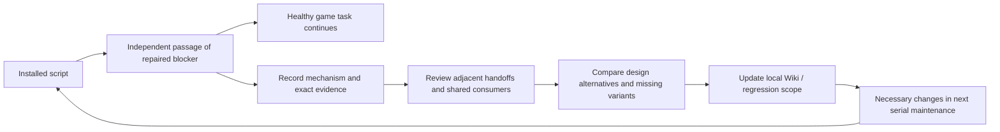


修复过程复盘：旧主题/平移/屏幕分辨率检查只用了一个保留的内部缩放，因此明知地图另有缩放，70px上限仍漏过。改成更大的常数会重复错误；独立灯距生产者和原生坐标输出同时服务归一化与派发。每次换页就刷新恢复会纵容HOME/resume循环，节点被独立接受才是更小的共用边界。首次全量还暴露本可避免的验证顺序遗漏：新实机日志改变语料审计（三次Resume→LOADING→MAP），所以每轮实机返回后先跑便宜的后继/计划/恢复语料审计，再跑长的稳定源码回归。保留3952通过/699跳过/1失败及原因，不填例外计数，也不把该套件称全绿。这是在证据范围内比较方案，不宣称全局最优。

<a id="current-checkpoint"></a>

## 当前检查点—2026-11-20

**2026-11-23：公开版安装版把 Team2 困难局从第 1 层跑到领奖对话框，中途停机十余次。** 全部由 MXU 的「开始任务」启动（MuMu ADB 控制器）。每次停机都是一个读法或核账缺口，修完重建后从原地续跑：浅色超级商店节点、高级商店刷新里的 `??` 服务项、事件结果页的 SKIP 与检定页 SKIP 同位、拒绝已有藏品后的确认问句、放大视图下 Boss 前的列距、免费刷新、带装饰大标题的主题包、结果是战斗的事件（Commence Battle）、出战页过渡帧上的误点、读丢一个字母的服务项标签。最后一段 `pi-20261123-133044` 从第 5 层商店续跑，打完关底后停在 `RUN_REWARD_DIALOG`，原因 `reward_module_budget_pending`（报价：5 模块、每周加成 0/3），没有发出任何领奖输入。各层程序运行时间 30.6 / 20.4 / 31.0 / 31.4 / 33.3 分钟。未验证：一次开始任务不间断跑完全程、领奖与返回、第二局与轮换、改版界面上的前置任务冷启动。

**2026-11-21（UTC）：第 5 层通关，停在领奖报价。** 安装版 `b112566` 由 MXU 的「开始任务」启动，MuMu ADB 控制器，续跑同一局 Team2。任务从第 5 层地图进入 Boss 节点，11 个回合后胜利，账本从哈希绑定的 100% 总结页 `frame-0267` 记下第 5 层通关和整局胜利。随后任务按设计停在领奖弹窗，原因是 `reward_module_budget_pending`，Claim 没有发送。弹窗实读为每周加成 3/3 全开、Claim 费用 18 模块。现有预算选项最高 6 模块，执行器也不改每周加成，所以这份报价要么由用户对本局明确授权，要么先在游戏里把加成调到预算之内。这次运行历时 13 分 07 秒、49 次输入，运行目录 `pi-20261120-193352` 留在本机。到账回执、独立 HOME 返回和轮换仍未验收。

这次通过后的复盘有两条。第一条是存储。3 GB 改成提醒以后，任务没有再被容量拦下，上一轮的卡点确实越过了；但这一场 Boss 战留下 269 张原图、约 389 MB，项目目录升到约 3.40 GB，已经高于提醒线。战斗帧的保留密度是下一个要量的东西。第二条是页面身份。49 次输入里有 13 次没有依据。战斗页在单位脚下显示状态计数，位置正好落在教程书的圆点带里，OCR 把几个计数连成一串数字，`carousel_dots` 把这串数字当成圆点行。于是 7 张战斗动画帧被判成 `TUTORIAL`，每张都向书脊角落发了一次点击。其中 6 次之后，「每场战斗只开一次」的倍速开关又被按了一遍，因为这个闩锁跟随的是页面连续性，不是这一场战斗。这些点击落在战斗动画的空白处，这次没有可见后果；同样的误判发生在左上角有返回键的页面上，就是一次真实的错误输入。全部 4,407 张保留帧里，旧规则一共接受 8 个记号，全是这种战斗计数，没有一个真圆点行。源码现在要求圆点行至少八成是环形字形，并补了五个实测反例。这个修正已随后面的重建进入安装版；倍速闩锁的作用域是没有改的相邻缺口。

**同日续记：18 模块报价已领取并入账。** 用户在对话里明确选择全领，也就是 18 模块、每周加成 3/3。源码先补上这份实测报价的识别与执行，见 [4.6.1](4-business-flows.md#feature-4-6-1)，安装版从干净提交 `a2546a0` 重建。MXU 这次启动停在 Windows 的安全提示上，没有出现工作区，所以领奖改用同一安装版 Agent 的无界面入口 `tools/verify_packaged_mirror_loop.py`。运行 `packaged-mirror-20261120-205012` 发出 4 次输入：Claim、Confirm、回执确认、通行证确认。回执页实读 750，通行证等级 203。随后两帧是 `LOADING`，执行器把它当成没有证明的后继而停下，这时奖励已经到账。运行 `packaged-mirror-20261120-205246` 在 HOME 上零输入审计了四份输入报告和各自的原图，写入到账与返回。账本的完成局数从 2 变成 3，没有进行中的局。轮换配置只有 `[2]`，所以仍指向 Team2，多队轮换不能由这一局验收；由一次 GUI 启动从入场跑到领奖也仍未观察到。

这一段的复盘有五条。第一，领奖路径把实测过的报价写死在三处，位置框只量过一位数的费用，所以第一次遇到两位数报价时既读不出也执行不了。第二，执行器不等最后一张回执之后的加载页。源码已经改成在本局回执确认之后把加载页当作有期限的等待，并随 `5c57e55` 的重建进入安装版，还没有在实机上走过。第三，目录超过 3 GB 时证据回收自己启动不了，因为删除清单必须先放进预算。现在按回收之后的占用准入，并据此回收了 226 张没有被引用的中间截图，被引用的帧都在。第四，Agent 启动时仍按 3 GB 硬性检查套接字临时目录，所以「3 GB 只是提醒」只在任务已经启动之后成立：工作区到 3.0027 GB 时 Agent 没能启动。第五，安装版的启动器和 MXU 在这台机器上会被 Windows 的安全提示挡住，这一步只能由用户本人处理，无界面入口是它的替代而不是它的验收。

按用户授权启用了本机冷归档。安装版 `75d4f7b` 保留原索引和配置，把 28 个封存容器迁到有 512 MB 上限的同级目录，为项目腾出 260,003,952 字节。607 张索引原图全部读回，被迁移的 228 张又由安装版编译读者核对。相关本地报告 `build/native-vault-team2-activation.json` 和 `build/native-vault-installed-readback.json`，规则见 [6. 自动容量回收](6-deployment.md#bounded-image-vault)。

同一安装版正常任务 `202015` 从 `MIRROR_ENTRY` 经 `RESUME_DIALOG` 回到第 3 层地图，实际通过上轮存储准入卡点，页面、控件和后继计划都已落入实机日志。地图点击未被接收后，脚本保存返回并再次进入同一局。第二次 Resume 的两张独立画面已明确为 `LOADING`，但 `WAIT_PAGES` 抢在加载页分流前；通用未知页预算以 `page_unreadable_after_waiting` 停止。源码把已有命名加载页时钟放到通用等待前，读清新阶段后清掉旧未知页时间，加载页的轮询继续受加载期限和总期限约束。真实第二次加载到地图还需新的安装版验证。Team2 仍完成层 1、2、未领奖，当前轮换配置仅 `[2]`，因此多队轮换不能由这局单独验收。实机报告 `build/vault-team2-continuous.json`。

第 3 层三次未接收的地图点击对应 `frame-0012/0015/0020`。队伍车头已读准；方向检测到一条向左的光线，却无法将它绑定到任何邻格，误差 129–155 像素。原 box 分支仍用它排除了另一侧已量出的邻格。源码要求箭头真正绑定邻格才允许方向筛选；保留邻格和原有排序与结果判定，不能由方向猜测入账。地图组件同时改读原生楼层与主题包各自的框，避免用楼层标题代替主题包。真实节点能否进入继续由新画面验证。

安装版 `9a64a33` 的连续任务 `193007` 读到第 3 层背景的 `MIRROR_ENTRY`。存储预留检查触发 240 秒看门狗，0 输入。终止栈显示预留进入冷压缩候选的复核证据扫描，终止事件仍只报已结束的观察且页面为空。Team2 保持已完成层 1、2，未领奖，完成计数 2、轮换位置 0。登录诊断维护已释放 8,131,794 字节，原始登录因果帧仍可核验。持续证据容量仍未通过。本地报告 `build/answered-login-team2-continuation.json`。按 [3 运行时 · 页面组件与路径记录](3-runtime.md#page-journey) 让观察、计划、准入阻塞和账本里程碑使用同一局的原帧与日志。整局、领奖、返回、轮换保持待实证。

路径记录版 `b4694c0` 已安装，106 个私有文件和 33 个配置文件保留。实际安装包编译模块回放同一原帧，确认两个入口组件、单帧提议、后继范围、楼层和 `evidence_admission`；模拟切到 HOME 时旧提议退出当前视图。该回放发出 0 次游戏输入。证据为 `build/page-journey-frozen-verification.json`。当前项目余量约 8.5 MB。两个历史容器的内存重打包实验合计只节省 81,520 字节，原截图字节和索引未改，见 `build/cold-image-repack-feasibility.json`。完整续跑需先恢复持续写入余量。

用户交回 MuMu 后，实际安装版 `f94661d` 通过正常 `OpenGameTask` → `MirrorTask` 启动，同一 Team2 仍完成前两层。首次在登录前被存储看门狗终止。经离线重复截图去重，第二次实际通过标题页输入和独立 HOME 后继，随后在镜牢导航前以容量不足停止。账本仍是同一局，完成计数 2、轮换位置 0、未领奖。持续容量是当前前置问题，第三层战斗修复、实际到账、返回、轮换、GUI 启动和模型采用均待各自实机证据。具体字节、两张原图和机制复盘见 [6 部署与运维](6-deployment.md#staged-observation-credit)。

以下为此前安装与回归记录。

实际安装de63542的160101运行发送MAX、未就绪金色表盘、WinRate；原始frame8已配卡/START亮起。只读预留丢弃未发出的提交，frame9已独立新读，却在足额输入再准入前以battle_progress_stalled结束。因此仅补观察实机成立，不能称其后完整输入链通过。build/battle-refresh-live-outcome.json保留19份原始文件、106private/33canonical，目录2,983,506,218字节。机制复盘找到battle_progress和旧内联块对同一HUD重复计数。方案：只保留一个写入者，纯存储补观察不再扣相同回合的停滞额度；普通冻结HUD仍按原上限停止，真实换回合重置，三次补观察/总截止/物理双后继足额要求不变。金色外框不等于配卡就绪，不无测量改视觉阈值。源码反例/修正→全量逐例XML→干净冻结→同Team2正常连续任务。整局/付费收据/模型提升/0048缺口仍开放。

源码已实现：移除旧重复进度块，仅用既有capacity_reobservations标记未发送计划的存储补观察，同回合不重复扣停滞额度。274相关通过/93历史跳过/36.04秒/自身退出0。新增5例包含原始已配卡帧/原生事件包→完整Runner→模拟START派发、普通单次计数/冻结停止、三次刷新上限、真实换回合重置及盲读计数保留。同5例在原04557e8源码全部失败。初版回放夹具漏了原生事件字段，之后又忽略原始帧reader会去掉frame名；均修正夹具，没有改原始记录或游戏门。最终全量XML/冻结/实机续跑仍待完成。

安装前已补相邻生命周期修正：独立命名且非战斗/非加载的页面清掉上一场进度和盲读计数；UNKNOWN、LOADING、BATTLE_TIP、BATTLE_PLANNING保留同场归属，正常配卡观察仍计一次并可停滞。314相关通过/93历史跳过/61.31秒/自身退出0。共新增11例：前5个原始事件/存储衔接，加6种页面生命周期；原HOME/MAP边界反例修前2失败/3通过。初稿因LOADING已命名而误重置，反例发现后用既有is_loading明确排除；配卡夹具改为带可读波次/回合并预期普通一次计数。此前全量为这项必要邻接修正主动中止于35percent/退出-1，未计通过。完整尝试4027通过/701跳过/1项NAV文档失败/843.31秒/自身退出1；第3章双语导航恢复到第3行后，73项Wiki/隐私检查通过82.51秒/自身退出0。运行时SHA与完整尝试完全相同，XML新增11项运行时通过/无更多运行时状态丢失；没有重跑第二次完整套件，不称完整尝试全绿。新增局部图时应先跑导航/格式检查再跑长回归，路由结构不能代替章节布局校验。实际干净f94661d Agent已安装/退出0；549源码、13完整编译身份/自检及实际冻结Runner计数/六个合成页面边界通过；保留冻结原生缓存/容量原帧回放、内存暂存读回。106private/33canonical/19当前原始证据不变。源码/冻结7210引用/143归档报告一致，Launcher未改。build/battle-refresh-installed-verification.json。封闭维护按精确ZIP移除12份重复副本/3,487,105字节，全部唯一字节/packet/当前原始证据保留，目录2,985,782,070字节。新只读检查确认127.0.0.1:16416在线，但前台为com.hypergryph.arknights；尚未启动Limbus续跑，没有创建控制器/发送输入/切换游戏，可用性问题待答。build/battle-device-foreground-readonly-block.json。实际安装f94661d计数修复尚无新实机通过。之后封闭元数据维护移除37份较旧、未选中的重复副本/10,693,655字节，既有ZIP成员逐字节一致，源码引用投影/private/原始证据未变，目录2,978,860,288字节。当前选择和最近两次交接包保留原始JSON；较旧已结束包在历史workflow CLI读取前可能需要按哈希核验native-records.zip成员并解出。见build/battle-refresh-closed-packet-retirement-verification.json及持久manifest；没有移除游戏原图/pending/复核队列或唯一字节。 不称GUIStart/整局/领奖/轮换/模型提升/0048恢复；完整尝试的NAV失败和随后73项Wiki通过仍分别记录。

<a id="public-goal"></a>

## 公开版长期目标（2026-11-23 立项）

这是一条长期目标，不是已实现事实；下面的基线是实测，完成标志是待达到的出口。它包含四条工作线：公开仓维护、结合游戏机制的阶段性架构复盘、任务分解、Wiki 与 project-wiki skill 的反哺（发现的框架问题向上游提 issue / PR）。

### 完成标志

| # | 完成标志 | 怎么量 | 2026-11-23 基线 |
| --- | --- | --- | --- |
| G1 | 最慢的一层不超过 10 分钟 | 安装版由 MXU「开始任务」启动的整局；按运行事件把程序实际运行时间记到当时所在的层（停机等待修复的时间不算） | 同一局 Team2、困难：第 1–5 层 30.6 / 20.4 / 31.0 / 31.4 / 33.3 分钟，其中战斗与加载页 16.5 / 13.0 / 23.9 / 23.3 / 23.4 分钟 |
| G2 | 用户界面体验良好 | 一次「开始任务」跑完五层并领奖，中途不需要开发者介入；连续 3 局成立。停机时用用户能懂的话说明原因和下一步 | 这一局从第 1 层到第 5 层共停机 12 次以上，每次都要改代码重建；智能体启动失败时 MXU 停在「启动中」 |
| G3 | 设置界面不冗余、分布合理 | `interface.json` 里没有无任务引用的选项；每个设置只在一处出现；出战顺序不靠 12 个下拉 | 2026-11-23：22 个够不到的选项和 47 个无引用的文案键已删除，并有测试守住（见下文 C1）；出战顺序的设置方式未定 |
| G4 | 开源后的可开发性 | 全新 clone 不带游戏素材即可安装、测试、构建；改动源码时 Wiki 能把人带到对应的章节和图；公开仓 CI 为绿 | 公开 checkout 全量测试通过（4380 通过、713 跳过并说明原因）；路由覆盖 157 个模块中的 89 个；328 张图无一声明，变更复核够不到图 |

### 工作线与任务分解

| 工作线 | 任务 | 对应标志 |
| --- | --- | --- |
| A 公开仓维护（卫生优先） | A0 公开仓卫生是每个提交的出口：`tools/check_public_tree.py` 0 项（私有路径、账号与设备标识、游戏素材、二进制、图片元数据、私有文字），发行包和 CI 产物按同一标准检查，文档与测试里只留必要的诊断信息；A1 每次推送、发布前先确认范围；A2 发布后用匿名 clone 和实际下载包复验；A3 3 GB 改为警戒线：启动与离线工具超线只提醒，证据移出而不删除；A4 主题包卡面图的本地导入（不入库、不进发行包） | G4 |
| B 阶段性架构复盘 | B1 战斗耗时拆解（等待轮询、动画期间的 UNKNOWN、截图与证据写入）并给出压到 10 分钟内的方案；B2 节点状态读法去掉固定色带，改用形状与相对亮度；B3 页面未稳定时不出手（出战页 0/12 过渡帧的教训）；B4 按钮词表统一（Continue / Proceed / Commence Battle 这类同位按钮）；B5 每跑完一局做一次通过后复盘并回写 | G1 G2 |
| C 设置与界面 | C1 清点全部选项，删除或接回无引用选项；C2 出战顺序改为「从游戏读取并保存」，一行输入作兜底；C3 停机提示改成用户语言；C4 智能体启动失败时不让界面停在「启动中」 | G2 G3 |
| D Wiki 与 skill 反哺 | D1 把架构图按现状重画并在路由里声明；D2 新模块必须有路由归属；D3 把变更复核接进 CI 作为提示；D4 发现的框架问题去标识化后向上游提 issue / PR | G4 |
| E 24 小时托管 | E1 一个「日常」入口按当天日程把该做的做完：经验本和纺锤本各自每天几次、周几打镜牢及每次几局、领取奖励、体力兑换，用户逐项开关；E2 每项按服务器日/周记账，已做完的不重做，中断后接着做；E3 配合 MXU 的定时与前置任务，启动即托管，无人值守跑满一天；E4 每一项失败不拖垮其余项，停机原因用用户语言写明 | G2 G3 |
| F 程序自己回收 | F1 运行结束时由程序按保留规则处理证据：被账本或交易引用的帧保留，其余中间帧移出到归档并留清单，不靠人工；F2 重建与更新不再复制证据（已用硬链接解决）；F3 超过警戒线只提醒并自动腾挪，不拒绝启动 | G2 G4 |
| G 运行数据 | G1 每次运行写一份结构化指标：各层各页耗时、每类停机原因与次数、识别置信度分布、每场战斗回合数、购买与刷新；G2 一个只读汇总工具把多次运行合成趋势，直接回答「时间花在哪、最常停在哪」；G3 关键节点加检测点（页面未稳定、读数缺失、预算与空间），触发时记入指标而不是只写日志；G4 指标不含账号、设备和本机路径 | G1 G2 G4 |

每条任务开始前先在本节登记负责人和出口证据，完成后把实测结果写回上表的基线列；未验证的不算完成。

**素材来源。** 同步到公开仓的任何资源都不带标识（账号、设备、本机路径、带账号信息的截图一律不进）。游戏图片优先直接取自公开 wiki（limbuscompany.wiki.gg），由导入工具在用户本机下载并记录来源与哈希；在确认可再分发之前，游戏美术本身仍只放本地忽略路径，不进公开 Git、发行包和 CI 产物。

**E 的现状与分期（2026-11-23 核对）。** 六个任务里，打开游戏完整；自动镜牢已实现但一次跑完整局尚未验收；经验本和纺锤本只实现了走到 Luxcavation 页面的导航，选关、战斗、结算和次数选项都没有；体力兑换只观察一帧就返回未实现；领取奖励只领镜牢通关奖励，邮件和每日任务不领。账本原先只有累计局数，没有按日按周的记账；镜牢有未结的一局时经验本和纺锤本会被拒绝。分期：（1）日程账本 `daily_ledger`（已做）；（1b）镜牢任务按日程问账本（2026-11-23 已做、安装版未验收）：镜牢任务自己的选项里选「每天／周一到周五／周六日／一三五／二四六」和「每天几局」，不在选中的日子或当天局数已记满时，点开始会在看游戏之前直接结束并说明原因；每局只在五层通关、领奖并回到大厅后记账。设计上不再另做一个「日常」总入口去重复六个任务的设置，而是让每个任务自己问账本，定时器只管按时点开始。由单独的领奖任务领完的那一局同样记账，没选日程时完成的局也记账，所以中途打开日程不会多打；（2）补全经验本和纺锤本并加次数选项；（3）「日常」入口按账本逐项执行、跳过已完成项、单项失败只记录；（4）体力兑换、邮件与每日任务；（5）配合 MXU 定时做 24 小时无人值守验收：安装版客户端里已确认带有「定时执行」策略（`schedulePolicies`）和「启动后自动运行」（`autoRunOnLaunch`）两项，所以托管不需要本项目另写调度器，只需每个任务能回答「今天还欠不欠」；这两项本项目尚未实际用过。服务器日界（默认韩国时间 06:00、周四起算）是通行说法，本项目尚未实测，以游戏通知页为准。

**F 的现状（2026-11-23）。** 程序在空间吃紧时本来就会按保留规则自动回收旧的诊断截图，但做法是删除 PNG（JSON 记录和带哈希的回收记录保留）。现在这唯一的删除点 `capture_retention.retire_capture` 改为把截图移到项目旁的 `<项目目录>-evidence-archive/`，路径与项目内相同，回收记录里写明去向；同卷是改名，跨卷先复制并核对哈希再移走；归档里已有不同内容的同名文件时拒绝回收。所以自动回收不再销毁证据。

**F1 任务结束时自动回收（2026-11-23）。** 核对发现安装版运行期间只检查磁盘剩余空间、从不回收，所以托管着跑的安装目录一个任务接一个任务地涨过提醒线（两天的运行后实测 3.41 GB）。现在每个任务写完结果、还持有控制器租约时，由 `capture_retention.settle` 按原有保留规则把可回收的中间帧移到归档，目标是提醒线以下再留 0.4 GB 余量；够不到目标也照样移走能移的，并在 `storage-settle.json` 和界面日志里说明；回收失败只打印一行，不改变任务结果；运行目录不在本安装内的任务（测试、诊断）一律不动。归档由程序只增不减，超过 8 GB 时提示用户它的大小和位置。在真实安装目录上实测一次：计划 31 秒，移出 545 张（0.81 GB），项目从 3.41 GB 降到 2.60 GB，共 248 秒。这 248 秒里绝大部分花在「每移一张就全量重读一遍引用」上（约 0.4 秒一次），所以任务结束的回收改为每 15 秒重读一次引用，并给移动阶段设 180 秒上限，没移完的保留已写下的意图，由下一个任务结束时接着移；因为回收已经是移动而不是删除，间隔内新增引用的帧只是换了位置，仍可按原路径在归档里读到。离线工具的路径不变，仍是逐张重读。改后的耗时尚未实测，会随下一次安装版任务写进运行历史。尚未做：从写入端减量（普通用户不需要每一帧的 PNG）。

**G1/G2 运行历史（2026-11-23）。** 每个任务结束时由 `run_history` 往数据目录的 `user-run-history.jsonl` 追加一行（约 2 kB）：各层各页用时、各类事件计数、检查点计数（等待、重读、拒绝、读数缺失、输入、观察、战斗回合、购买、超过每层 10 分钟目标的层）、停机原因、这次回收移出了多少。一行里没有账号、设备和本机路径：任务用运行目录名标识，一局游戏只留编号的前 8 位。`python tools/run_report.py --history` 把这些行合成趋势；同一局跨多个任务打的一层按局求和，所以「最慢一层」是整局口径。它和读日志的 `run_report` 的区别是：日志和截图回收之后它还在，是长期数据。任务内某层超过 10 分钟时，界面日志会直接说明。尚未做：识别置信度分布、G3 里「页面未稳定」检测点的专门计数。读数缺失已有计数，并且第一次用就看出一处耦合：2026-11-23 的一个任务共 261 步，其中只有 1 步在地图页，`map_party_unread` 却出现 260 次——地图上的队伍标记在商店、战斗、剧情等每一种页面上都被读了一遍，自然读不到。单次读取约 1 毫秒，不是耗时来源；但它连同配套的两条事件占了这份日志约五分之一的行，并且让「读数缺失」这个数失真。应改为只在地图页读，尚未改（改动在运行循环里，需要安装版验收）。

**B2 改道：地图下一步读游戏自己画的「>>」箭头（2026-11-23 深夜，用户指出六边形读法不可靠）。** 新一局在第 4 层地图停下：六边形读法把列车自己那一块当成了候选，漏掉了箭头指着的唯一节点，离场重进后仍然读不到（`map_resume_did_not_restore_navigation`）。游戏在队伍能走的每条路中点都画一个双箭头，各主题形状相同；所以下一个节点 = 列车位置 + 2 ×（箭头位置 − 列车位置），不需要读节点本身。箭头的找法也不指定颜色：各主题的底色和路线都带色（红、紫、青、棕），箭头是不带色的灰且比所在底色亮，掩膜相对列车周围的底色来取。列车位置和列间距仍来自列车图样的灯距。用安装版保存的运行核对：46 次被游戏接受的地图点击里，43 次读到了箭头，其中 42 次算出的位置就是当时点中的节点（90 像素内），36 次排在第一位；那张停机截图上算出的正是右边那个节点。箭头读到的节点排在候选最前；别的读法量到同一个节点时用它更精确的框，其余结果跟在后面作后备；读不到箭头的画面仍由原读法回答。原计划的「节点状态去掉固定色带」因此不再是必经之路。尚未在安装版验收。

### 首批实测（2026-11-23）

**安装版实测补充（2026-11-23 晚）。** 任务结束回收改为按间隔复查后的第一次真实触发：一个 33 分钟的镜牢任务结束时移出 645 张截图（0.84 GB），项目回到 2.60 GB 的目标以下，用时 36.1 秒（旧的逐张复查方式是 545 张 248 秒）。同一任务也是新一局的第 1 层第一次不停机打完：程序时间 24.2 分钟，仍远高于每层 10 分钟的目标；这个任务里等待 246 次、重读 32 次、输入 139 次、观察 636 次。之前每层用时里出现的「第 6 层」是记账错误：五层打完之后的领奖时间被记到了一个不存在的层上，现在不再归到任何一层。

**G4 实况：对人类开发者是否可开发（2026-11-23 独立评审）。** 请一位没有本仓库上下文的评审只读看了一遍，并抽查了它的关键数字。结论：外围可以由人放心修改，核心循环目前实际上只有带着完整上下文的 AI 改得动。做得好的：README 如实写明有什么没有什么；CI 在干净的 Windows 检出上跑；提交说明写清未验证的部分；观察器与设备是注入的、`window.py` 的计划是纯函数、`STEP_ROWS` 与 `pages.py` 登记表有漂移测试；近期的小模块（`mirror_schedule`、`run_history`、`global_settings`）可读。阻碍：`MirrorRunner.step` 一个函数 3,339 行（457 个 if、98 个 return），`window._plan_step` 812 行，`vision.classify` 469 行，`recognition.analyze` 433 行；1,694 个函数只有 46 个带类型标注，循环状态是一个 131 个键的无类型字典；没有 linter、formatter、类型检查；约三分之一模块是一行多语句的紧凑写法，而几十个测试直接断言源码文本，整体格式化会打断它们；源码注释里有 496 处 `D编号` 引用，其中 134 个编号在 `docs/` 里找不到定义，另有 513 处带日期的运行编号；Wiki 单页最大 350 KB，引用核对工具报告 1,899 条引用里可判定的 217 条中有 142 条已漂移；路由覆盖约六成模块，「商店买错了去哪看」「新增一个页面要改哪些文件」这类常见问题路由答不准；没有贡献者指南、议题与合并请求模板；全量测试约 10 分钟、七百多个跳过，并且会和正在运行的安装版抢同一把控制器锁。评审给出的改进顺序：（1）贡献者指南和一页架构图（已先写了 `CONTRIBUTING.md`）；（2）把断言源码文本的测试换成行为或 AST 检查；（3）引入 ruff 的检查与格式化并接进 CI；（4）把 `step` 按页面拆成处理函数；（5）给状态、观察记录和计划加类型；（6）注释只写不变式，经过搬到决策记录；（7）测试分层并把锁路径做成可注入；（8）Wiki 瘦身、引用改为符号；（9）`interface.json` 由模板生成并在 CI 里核对；（10）`tools/` 分出受支持的入口与一次性探针。按 G4「开源后可开发性有保证」的标志衡量，这一条现在**没有达到**。

**B1 时间花在哪。** 取 2026-11-21 至 23 的 GUI 实跑（23 段，共 100.1 分钟程序时间），按每一步的耗时加步间等待归到页面：

| 页面 | 步数 | 合计（分钟） | 每步（秒） | 说明 |
| --- | --- | --- | --- | --- |
| 战斗动画等待（UNKNOWN） | 394 | 39.6 | 6.0 | 其中 10.6 分钟是步间空等 |
| 战斗指令页（BATTLE_HUD） | 165 | 20.2 | 7.3 | 每回合两步：自动配卡、开始 |
| 出战页 | 40 | 5.5 | 8.4 | 截图识别单次 2.7 秒，是各页最慢 |
| 地图 | 34 | 5.5 | 9.7 | |
| 其余非战斗页 | 约 270 | 约 17 | 5–7 | 结算、商店、藏品、事件、加载 |

24 场战斗里最长的 6.6 分钟。循环的动作间隔是「距上次输入至少 4 秒」（`runner` 的 `interval`），所以任何一步都不会短于 5 秒。可压缩项按预期收益排序：（1）把固定间隔换成「页面稳定即可出手」，同时解决 B3 的过渡帧问题；（2）战斗每回合的配卡与开始合成一步；（3）出战页识别 2.7 秒的来源；（4）动画期间的轮询节奏。每一项都要在实机上对照前后时间再定，本表只是基线。

**一步之内。** 战斗指令页有输入的一步平均 6.55 秒（122 步）：点击后的稳定读取到下一次战斗读取之间平均 2.4 秒（约一半的步里出现，每次约 4.8 秒），点击前后的战斗读取合计约 2.2 秒，原生点击任务约 0.5 秒；动作间隔在战斗页已经是 1.5 秒（`BATTLE_INTERVAL`），所以瓶颈是步内的重复读取而不是步间停顿。地图页一步平均 7.29 秒（18 步）：点击后的再读 1.8 秒、候选计算 1.5 秒、点击前的读取 0.9 秒。结论：先减少步内的重复观测，再谈缩短间隔；两者都要在实机上对照。

**C1 选项清点。** `assets/interface.json` 定义 714 个选项，6 个任务；从任务、全局选项、控制器和前置任务出发够不到的有 22 个：`deployment_position_1..12`、`deployment_preset`、`pack_name`、`pack_weight`、`run_team`、`team_build_name`、`team_build_slot`、`team_keywords`、`team_keywords_extra`、`team_name`、`team_slot`。

**C1 已清理（2026-11-23）。** 上面 22 个选项已从 `assets/interface.json` 删除（714 → 692，纯删除，其余文本未动），它们的管线节点从 6 个任务的入口都走不到，所以运行行为不变；`tools/expand_team_slots.py` 不再处理其中三个，重跑不会长回来；`tools/prepare_resources.py` 写的是早期五任务雏形，现在默认拒绝覆盖维护中的界面定义。`tests/test_interface_reachability.py` 保证以后没有「定义了但够不到」的选项。三种语言文件里没有任何界面引用的 47 个文案键（其中 31 个只被这些选项用过，另 16 个更早就没人用）也已删除（各 175 → 128，逐行删除），同一个测试文件现在还保证每个文案键都有界面在用、界面用到的每个键三种语言都有。尚未处理：出战顺序的设置方式。

**C1 续：界面不承诺做不到的事（2026-11-23 深夜，用户指出「有入口没写真实功能」）。** 请独立排查逐项对照了界面文字和代码实际行为，结论抽查属实。已从界面拿掉五项，代码保留：（1）「GitHub 自动更新」开关——更新器只在启动器程序里运行，而 README 让用户直接打开 `MaaLimbus.exe`，并且它只认正式版、目前只有预发布，所以对公开包用户从不运行；未修改的 MXU 自带的更新检查也因为没有配置源且版本低于 1.0 而不工作；（2）「技能替换核验」——打开技能选择、点一下、取消，从不购买；（3）「体力兑换」任务——截一张图就返回未实现；（4）「藏品搜索」选项——两个选项结果相同，都是不搜索；（5）商店规则的「学习」模式——没有模型也没有运行时样本，行为与手动相同。保留但改了名字：经验本和纺锤本标「开发中」；「领取奖励」改为「领取镜牢奖励」（邮件和每日不领）；三个 Windows 控制器去掉「推荐」并标「未验收」；日语资源标 experimental（识别文字 90 条里只有 25 条）；各处「跟随已有启动设置」改为「默认」（界面没有任何途径去保存那份设置）；战斗配卡的「仅观察」标明是调试用。`tests/test_interface_reachability.py` 新增一条守卫，防止这些入口在没有功能的情况下回到界面。选项总数现为 252，任务 5 个。定制客户端里的更新面板、轮换面板、资源诊断面板对公开用户同样不可见，仍是待处理项。

**C2 队伍设置重做（2026-11-23，用户反馈「下拉菜单很不人性化」）。** 核对发现每支队伍占 15 个选项：一个编辑开关、一个没有任何代码读取的名字、体系，以及 12 个各自列出全部 12 名罪人的出战位置下拉；40 支队伍共 600 个选项、6400 个下拉项。这些下拉默认是编号顺序而不是已保存的顺序，界面也不会把已保存的队伍读回来显示，还允许同一名罪人选两次（保存时才报错）。现在每支队伍只有两项，各自默认「不变」：体系（下拉），和出战顺序（一行文字）。出战顺序写 `keep` 表示不变；写 `game` 表示忘掉已保存的顺序、跟随游戏里这支队伍自己的出战顺序（运行时本来就支持：没有保存顺序时程序不改动选人）；或者按先后写罪人的编号或名字，例如 `6 8 7 3 5`，没写到的按编号顺序排在后面。同一名罪人写两次、写了不认识的词，都会指名拒绝。选项总数 695 → 175，界面定义 3.5 MB → 1.2 MB。顺带修掉三处旧问题：第 21–40 个轮换位置默认都指向队伍 20；经验本和纺锤本的队伍选项默认值指向一个不存在的选项；删除了只为旧形状服务、已无引用的播种工具和两个核对工具。尚未做、也尚未在安装版验收：藏品与主题包偏好、星光方案仍在镜牢任务里编辑且只覆盖队伍 1–20；体系与战斗配卡方式、商店规则这些按游戏理解应属于队伍的设置，仍是全局一份；定制客户端里的 12 格点选编辑器（`desktop/mxu/TeamBuildEditor.tsx`）还在按旧选项写值，需要一起退役或改写。

**C2 第二版（2026-11-23 当晚，用户反馈）。** 用户指出三点：把体系定死成「Charge+Tremor」这样的组合很奇怪，应该能自由多选，全选或一个都不选（让程序自由买）都行；队伍不只为镜牢服务，这里应叫「镜牢队伍设置」；出战顺序除了「不变」应有比打字更直观的方式。现在每支队伍仍是两项：藏品体系＝「不变」或「重新勾选」（12 个体系的多选框，不勾＝不限定体系）；出战顺序＝「不变」「跟随游戏里排好的顺序」「勾选先上场的罪人」（勾上的排前面，其余按编号）「手动写出完整顺序」。多选框每个勾选项只往同一个节点的 `attach` 里写自己的一个键；实测 MaaFramework 对 `attach` 是按顶层键合并（嵌套对象整体替换），所以多个勾选能同时生效。勾选体系时同时写入 `formation_keywords`，否则导入时留下的值会在选初始藏品时盖过界面上的选择。设置分组改名为「镜牢队伍 N」。选项总数现为 295，界面定义 1.4 MB。已知：一个体系都不勾时，初始藏品仍回落到启动默认值；这一版尚未在安装版验收。

**C2 第三处修正（同晚，用户反馈）。** 「勾选先上场的罪人」表达不了顺序，用户当场指出，已删除。用户提了两个替代：下拉里选过的罪人从其余下拉里消失，或者给编队顺序留截图记录。前者在未修改的 MXU 里做不到（选项定义是静态的，不能互相过滤，除非换成自编译客户端）；后者采纳了：队伍没有保存顺序时，程序本来就照游戏里排好的顺序出战，现在会在编队页读出 12 张卡上的编号，把顺序连同那一帧截图记进 `user-team-order-records.json`，并在界面日志里写出读到的顺序。记录只是「读到了什么」的证据，不改变任何行为；被记录引用的那一帧不会被自动回收移走。出战顺序现在是三种：不变、跟随游戏（推荐）、手动写出完整顺序。选项总数 255。尚未在安装版验收。

**Wiki 行号引用会悄悄过期（2026-11-23 发现）。** 这次两个定义文件变短，检查工具只报出了超出文件末尾的 22 处行号；仍在文件范围内但已经指错行的引用它看不出来——例如第 1 章里任务声明的行号在此之前就已经因为新增前置任务而整体偏移。已把指向这两个文件的引用按「旧行所属的键 + 行文本必须相同」重新定位，但对数据文件的行号引用本身就不稳，应改为引用键名，或让检查工具核对被引用行的内容；这一条也值得反馈给上游 skill。

**通关后是否自动领奖是镜牢任务自己的设置（2026-11-23，用户要求）。** 之前一局通关后总是停在奖励页，直到有人把「这一局允许花几个模块」手工写进设置文件。现在镜牢任务里有「通关后领取奖励」，只有两个选择：领取（默认），或不领、停在奖励页。第一版曾让用户选模块上限（5／6／18），用户指出一次镜牢的奖励除每周加成外就是 5 个模块，要问的只有领不领，当天改成现在这样。「领取」在内部保存为常设上限 `auto_claim_modules`，取已实测报价里最大的那个（18），所以游戏里开没开每周加成都照领；那个开关是玩家自己的，程序不动。读不清报价就停在奖励页、什么都不点。针对某一局单独给过的答复（包括拒绝）优先于常设上限；已经预留或发出的领奖事务不受中途改设置影响。程序不改每周加成的开关，不点「放弃奖励」。同一天还补了一个页面变体：游戏在奖励页被关掉后，从镜牢列表重新进入时奖励页中间的按钮是「To List」而不是「To Window」，层数的识别分也更低（0.65），原先的页面校验不认，导致已授权的领奖停下（没有发出点击）；现在两种写法都认。安装版验收见下文记录。

**领奖有两条路线（2026-11-23 实机）。** 通关后在局内直接领：领取 → 确认 → 「Rewards Acquired」回执 → 通行证升级 → 回到大厅。游戏在奖励页被关掉、从镜牢列表重新进入后领：领取 → 确认 → 通行证升级，直接落在镜牢入口页，没有回执页，也不回大厅。第二条路线上程序原先在通行证升级处拒绝继续（「Pass receipt absent or repeated」），奖励其实已经到账而账本没记。现在这条路线用余额作回执：领取前那一帧上的星光与每周投影上限、对话框报出的两项数额，和通行证弹窗那一帧上的两项余额，两项都必须恰好增加报价的数额（实测 3220→3285、50→100，报价 65 与 50）；任何一个数读不到、有歧义或差额不等于报价，都不算到账。通行证弹窗确认后，游戏并不停在入口页，而是接着问「Will you enter Mirror of …?」——最初那次点进入的流程还在继续（同日实机）。所以返回页认镜牢入口页或它上面的这个询问，但只对「本局、已确认、已凭余额回执确认过通行证弹窗、尚未记完账」的事务成立，其余时候镜牢入口仍是开新局的地方。已知未覆盖：这条路线上通行证没有升级（不弹窗）时，程序会停下而不是继续。

**界面日志逐步写出认出的画面（2026-11-23，用户反馈）。** 以前界面日志只在某个新画面上发出点击时写一行，而且多数画面只显示内部代号，看的人感觉不到程序在认每一个画面。现在每一步结束时，如果认出的画面变了、发了操作、或者任务在此停下，就写一行「第 N 步 · 画面：商店（SHOP）· 已操作」；同一画面连续等待时每 10 步写一次并带上连续步数；领奖流程内部的每个画面和每次操作也各写一行。63 个登记的画面全部有玩家看得懂的名字，并由测试保证以后新加的画面也有。

**商店合成饰品（2026-11-24，用户指出「还没用过商店的合成」）。** 先在实机上手动把合成面板走了一遍、取了每一步的画面，再写识别和操作；细节和不变量在 [4.3.8b](4-business-flows.md#shop-gift-fusion)。结论三条。（1）游戏自己在「Fusion Available」里列出材料已齐的配方，点一下就自动填好材料、预测显示 100%，所以配方合成不需要程序逐件认出拥有的饰品；程序只在预测恰好 100%、许愿框看见是空的时按 Fuse。（2）真正让程序错过配方的是买：Charge+Tremor 队带着 1,706 金币离开第 4 层商店，货架上的 Charge 配方材料没买——图鉴没有这个名字、标题折成两行只读到第一行、长标题错一个字就对不上。三处都已修，配方材料进了想买清单。（3）配方表从 Wiki 严格导入（62 条，带修订号和许可声明）；第一次手工解析分错了 3 组，所以导入器对「分组覆盖几行」不做任何猜测。**没做的**：随机合成只有带测试的决策函数，没有页面读取器。**验收状态**：先手动走通一次（UPS System + Miniature Telepole → Insulator）；随后安装版自己在第 5 层商店买了 Wobbling Keg、合出 Epicenter 并正常离店（`pi-20261123-225704`，7 次输入、40 秒）。只有这一次、这一个配方的实机样本。中间有一段等待：安装版进程是提权启动的，本会话关不掉，项目自己的安装器因此拒绝替换文件；没有绕过这道检查，等用户退出后才重建。对人工的教训：一个功能「从没用过」在日志里是看不出来的，只有对照游戏本身的入口清单才看得出；商店页的三个按钮里 Enhance Gifts、Sell Gifts 仍然没有用。

<a id="run-review-20261124"></a>

### 阶段复盘：一局打到第 5 层首领后输掉的完整镜牢（2026-11-24）

用户在这一局结束后要求回头看整局。对象是 2026-11-23 晚到 24 日的一局（账本 `ea52b509…`，队伍 2，体系 Charge + Tremor，困难）：前四层通关，第 5 层首领战程序打了 22 回合没打下来，用户手动接手后仍以总进度 95% 结束。数据全部来自这一局八段任务的事件日志和 `user-run-history.jsonl`，没有另跑实验。

**这一局的数字。**

| 项 | 数值 |
|---|---|
| 程序时间 | 140.1 分钟，分 8 段任务（7 次停机） |
| 各层用时（分钟） | 24.2／24.1／25.6／36.7／28.8，目标是每层 10 |
| 其中战斗（分钟） | 16.1／16.0／20.3／29.9／22.7，合计 105.0，占 75% |
| 战斗回合 | 94 回合，平均一回合约 67 秒 |
| 观测 | 2,831 次，其中 1,645 次（58%）是没认出来的画面，绝大多数是战斗动画 |
| 金币 | 五次进店时 906／1363／1834／2538／2597，离店时 506／764／1384／1706／1872 |
| 花在饰品上 | 18 件共 2,781（其中 5 件是「离店结余上限」凑数买的别的体系的饰品），刷新 225 |
| 没花掉 | 打首领时手里还有 1,872，约占全局收入的 38% |
| 合成 | 2 次，都是今天才有的（一次手动，一次程序） |
| 最高饰品阶数 | III 阶；没有 IV 阶，没有强化过的 |

**结论一：程序会「过页面」，但几乎不做决定。** 每个页面怎么安全地点过去，程序做得很细；该选什么，它基本是固定规则或者第一个。

- 主题包：五层全部是 `neutral_default`，也就是选第一张卡。第 5 层的首领是这样随便选出来的。
- 地图：选最近的亮点。事件里节点种类只有 `lit_icon`、`path_node`、`lit_ring`、`gold_badge_node` 这些外观名，程序不知道哪个是战斗、事件、商店。
- 楼层藏品：按「试炼惩罚最小」选，体系只有 −40 分。Charge 队两次遇到 Curriculum Vitae（Charge，也是 T-5 配方的材料），两次都没拿：一次因为它的试炼分高，一次因为它的试炼文字没读懂，拿的都是别的体系的饰品。
- 商店：只买图鉴里属于队伍体系的名字，普通刷新固定两次；从不用关键词刷新、强化、出售，合成到今天才有。结果是钱越攒越多。
- 战斗：每回合点胜率配卡再开战，不用 E.G.O，不选目标。
- 星光：每局按保存的规则花 60 以内（这一局买了 3 个增益），账号里有 3,285。这是用户保存的设置，这里只记录事实。

**结论二：变强和变快是同一件事。** 75% 的时间在战斗里，一回合一分多钟；队伍弱，回合就多，首领就打不过。所以「每层 10 分钟」这个目标主要不是靠省等待时间，而是靠第 3 层以后有成型的饰品。用户的判断（钱没花在强力饰品上、到第 5 层没有 IV 阶）与数字一致。

**结论三：钱有地方花，只是程序不会。** 按 Wiki 的合成点数（未自测），三件 III 阶，或者两件 III 阶加一件 II 阶，合成结果就是 IV 阶，三件时有 90% 是指定体系。这一局买了 18 件、楼层藏品拿了 12 件，其中有 5 件是凑数买的别的体系的饰品——它们正好是随机合成的材料。货架上两次出现 280 金币的饰品（Fragment of Desire、Crushed Memory）没有买。关键词刷新（120 金币）一次没用过。强化从来没用过，连它的页面都没见过。

**结论四：输掉的局停在奖励页。** 总进度不到 100% 时，程序把结算页认成「输掉的局」，打开奖励框后因为账本里没有五层通关而停住（`completed_mirror_run_required`）。奖励框上只有三个按钮：放弃奖励（用户规定永远不点）、回到窗口、领取（5 模块）。输掉的局要不要花 5 模块领残局奖励，是用户的决定，程序现在没有这个问题的答案，所以无人值守时一局输掉就会卡住后面所有的局。代码里那一行的原因名还叫「打开奖励只为了放弃」，与「永远不点放弃」的规定相反；放弃按钮本身在禁止名单里，所以没有点过，但名字和注释是错的，要改。

**结论五：七次停机里，五次是读画面或对账的边角，两次是人按了停止。** 依次是：出战页画面不动、商店通知上的名字对不上（已修）、免费藏品页的效果文字被当成价格（已修）、地图恢复导航失败（促成了「>>」读法）、刷新对账（已修）；最后两次，一次是为了看合成面板在商店按的停止，一次是用户在首领战里按停止接手。这两次日志都写成 `the_page_read_did_not_come_back_inside_its_window`（读画面没回来），界面上紧跟着才是「停止任务」——人按的停止被记成了一次故障，运行历史里也就多了两次假的失败。

**从游戏本身的结构看，哪些东西是重复的。** 现在每个页面各有一套坐标和规则；游戏其实是用几样东西反复拼出来的。

- **饰品格子**：左上角阶数、右下角体系图标、下面名字。商店货架、合成面板、楼层藏品、奖励卡、获得通知、配方表里都是同一个格子。程序现在只读名字，不读阶数和体系图标，所以它不知道自己有什么、有多强，图鉴里没有的新饰品也认不出体系。读一次格子，六个地方都能用。
- **两个按钮的提问框**：离店、购买、合成关键词、合成确认都是「左 Cancel、右 Confirm」，位置几乎一样。现在每个框各写一套区域常数。
- **「E.G.O Gift GET!」通知**：已经是一个页面，购买、合成、事件共用。这是做对了的例子。
- **金币和价格牌**：商店金币、按钮下面的价格（刷新 45、关键词刷新 120、治疗 100）、购买框里的前后余额。
- **底部的十二个罪人头像**：商店、事件、战斗里都在，带血量数字。程序只在有人阵亡时才看。
- **同一种操作**：「在格子里选 → 确认 → 通知 → 回来」（购买、合成、强化、出售、选藏品）；「几张卡里选一张」（主题包、奖励卡、初始藏品）；「付钱 → 用余额变化验收」（购买、刷新、治疗、星光增益）。商店交易已经是第三种的完整实现，其余各写各的。

要让程序灵活，缺的是中间一层「这一局现在是什么状态」：有哪些饰品（名字、阶数、体系）、多少钱、第几层、队伍血量、选了什么主题包。有了它，上面那些决定才有依据；没有它，每个页面只能守着自己的规则。

**建模的材料。** 「学习」模式现在是空的（没有模型，样本 14 条）。这一局留下的可用记录：53 次货架读数（名字、价格、金币、做了什么）、35 次购买排序、20 次楼层藏品排序、5 次主题包选择、35 次地图选点、94 个战斗回合；配置目录里还有 9 局的商店账本和 24 行运行历史。缺的是结果：完整打完的只有 4 局，加上这一局输的。用 5 个结果训练不出「买这个值不值」。所以顺序应当是：先把游戏知识写成规则（阶数、配方、合成点数、花钱的目标），让每个决定连同当时的状态和选项记成一行；等有了几十局带结果的记录，再谈用模型替换规则里的权重。眼下模型能做而规则做不好的，是认图：饰品格子的阶数和体系图标、地图节点的种类。

**拆出来的任务，按顺序。**

1. **输掉的局怎么办**：先问用户领不领；按答案把奖励页走完，账本记成失败局、不计入完成数。同时改掉那个错的原因名。
2. **饰品格子读取器**：阶数加体系图标加名字，先接合成面板（一屏 15 格），得到「这一局有什么」。
3. **花钱的规则**：到第 3 层以后手里的钱超过某个数就要变成阶数。按次序：凑齐的配方 → 随机合成（别的体系的饰品三件换一件本体系的）→ 关键词刷新 → 买高阶。这要用到第 2 项。
4. **楼层藏品**：体系和配方材料的分量要压过试炼惩罚，至少在前两层。
5. **强化**：先手动走一遍页面取证，同合成的做法。
6. **地图节点种类**和**主题包选择**：先读出来，再决定。
7. **人按的停止要记成人按的停止**：现在它和真的读画面超时共用一个原因名。
8. **决定记录**：每个决定一行（状态、选项、选了什么、后来怎样），给以后的模型用。
9. **提问框和格子的公共读取**：随第 2、5 项一起收，不单独立项。

战斗本身（E.G.O、选目标）没有排进来：它的收益要等队伍成型之后才量得出。


**复盘任务 1 已做：输掉的局领不领，是一个选项（2026-11-24，用户决定）。** 用户先回答「领」，随后指出这应该是个可以选的选项。现在镜牢任务的「通关后领取奖励」选「领取」时，下面多一项「没打完就结束的局（输了）」：也领取（默认）／不领（停在奖励页）。做法：（1）账本多认一种结局。结算页的总进度不到 100%，或者奖励框上印着没打完的层（`Floor 5 [HARD] 3/4`），就记一条 `run_lost`，带着那一帧作证据；一局要么赢要么输，不会两样都记。（2）领奖链路原来在四处要求「五层通关且胜利」，现在统一问 `run_wiring.payout_state`：赢、输、或者都不是。输掉的局只有在用户选了「也领取」时才放行。（3）输掉的局不花每周加成：报价里带加成就拒绝。（4）奖励框和账本必须说同一件事：账本说输了而框上是打完的第 5 层，或者反过来，都拒绝——那是别的局的框。（5）领完记账时，这一局归到「没打完的局」里，备注写明领过残局奖励；完成局数不加，队伍不轮换，输的那支队伍下次再打。（6）奖励框的页面判定原来要求「层数打满」（N/N），所以输掉的局的框根本不被当成奖励页，报价也读不出来；现在两种都认，由层数说明是哪一种。（7）那一行「打开奖励只为了放弃」的名字改成了「打开奖励框」；放弃按钮一直在禁止名单里，新加了一条测试钉住它。**实机（同一局，两段任务）。** 第一段（`pi-20261123-235849`）从奖励框认出输局，点了领取和「Claim the rewards?」的确认，然后停在「通行证回执缺失」：输掉的局没有「Rewards Acquired」页，确认之后直接是盖在结算页上的通行证升级弹窗。这一停是设计内的——模块只扣了一次，什么都没记。于是把这个弹窗认作回执：弹窗下面仍是进度不到 100% 的结算页，结算页印的星光数等于奖励框报的数（两帧都是 40）。第二段（`pi-20261124-000448`）点掉弹窗 → 加载 → 大厅，记账为 `lost_run_payout_and_home_verified`；账本里这一局进了「没打完的局」，完成数仍是 4，队伍没轮换，随后任务按设置的局数开了新的一局。只有这一个样本：输掉的局如果不触发通行证升级，领取之后是什么页面还没见过。**没处理的**：输掉的局不计入日程的「今天几局」，所以同一支队伍可能一天里反复输、反复花 5 模块，只受任务的总时限约束（每局 3 小时，最多 12 小时）。

**复盘之后的下一局通关了（2026-11-24，同一支队伍）。** 输掉的那局领完残局奖励后，任务按设置自己开了下一局（账本 `660251ee…`，仍是队伍 2）。它通关了，完成局数 4 → 5。程序时间 114.9 分钟（上一局 140.1），各层 18.8／17.0／26.5／22.5／29.5 分钟，战斗 77.0 分钟占 67%，76 个回合；买了 21 件共 3,894 金币，前四层没有一件是凑数买的（上一局 18 件里 5 件是）。中间停了五次，每次都是程序读画面或点位置的问题，没有一次是打不过：（1）合成关键词页的按钮被读成「✓Confirm」；（2）单件免费藏品的效果文字里有「Max HP」，被当成试炼；（3）到账通知的名字折成两行，只读到第一行；（4）第 5 层首领战第 19 回合，按颜色找「开始」转盘时把旁边发亮的技能格一起框了进去，点偏之后程序去重按「胜率」，而胜率是开关，再按一次是取消，于是一个回合里开、关、开、关空转四轮；（5）通关后的奖励和输掉的局一样，没有「Rewards Acquired」页，直接是结算页上的通行证弹窗。五处都已修并在安装版上续跑通过；第（4）处修好后第一次按下去回合就走了，首领当场被打败。**对昨天复盘的修正。** 结论二说「变强和变快是同一件事」，方向没错，但这一局说明还有一层：同一支队伍、同样的战斗打法，只是买的东西都对上了体系、停机被修掉，就过了昨天过不去的第 5 层。昨天那场首领战程序打了 16 个回合时被接手，其中 6 个回合也有重复点击，但回合是在走的，所以那一场不能归到这次的转盘问题上；它输在哪里仍然不知道。仍然成立的是：每层 17 到 30 分钟，离 10 分钟还远，合成这一局一次都没用上（没有凑齐过配方），第 5 层为了压结余凑数买了 6 件——钱换不成高阶饰品的问题还在。**程序读「胜率」开关状态的方法**：按钮亮着时大约一半像素是红的，灭着时不到 1%（同一块板上相隔一秒测得 0.496 和 0.001）。现在亮着就不再按它，改按转盘；读不出来时沿用原来的顺序。**再下一局暴露的是时限。** 通关后任务自己开的第三局（`pi-20261124-023156`）连续跑了 90 分钟、过了三层、一次停机都没有，然后被任务自己的总时限截停在第 4 层：时限是整次任务 90 分钟，与要跑几局无关，而一局实测要 115 到 140 分钟，所以「再跑 3 局」的设置连一局都跑不完。现在时限按局数给：每局 3 小时，最多 12 小时；显式给的时限照旧。

**第三局在同一个首领面前三次全灭（2026-11-24）。** 时限改掉之后第三局（账本 `9c46ad1f…`）续跑：第 4 层通关；第 5 层商店买了 8 件，并且**一次访问里合成了两个配方**——Coupled Oscillation（三件材料的 Tremor 配方）和 Epicenter——这是「一次访问两个配方」的第一个实机样本，两次都是清单条目 → 100% → Fuse → 确认 → 通知，第二个配方不用重选关键词。然后是首领战：23 回合全灭、重试、21 回合全灭、重试、22 回合全灭，三场共 70 分钟，没有一次是转盘或开关的问题（空转次数为 0）。程序按设定重试两次后停在失败页（`defeat_retries_exhausted`），页面上三个选项一个都没点。**这把上一段的话说回来一半。** 三局的第 5 层主题包都是「The Wedge in the Wake of Dawnbreak」，因为程序每次都选第一张卡，而它每次都排在第一张。同一支队伍对同一个首领：第一局没打下来（被接手后以 95% 结束），第二局第 19 回合打赢，第三局带着两件配方饰品三次全灭。所以第二局的通关不能读成「修掉停机就够了」：这个首领在这支队伍能力的边缘，赢是五次尝试里的一次。每次有别的主题包可选（Unrelenting Might；Yield My Flesh to Claim Their Bones、Spring Cultivation；LCB Regular Check-up、Excessive Gluttony），它们是不是更容易并不知道，程序也从没试过。**由此排到前面的任务**：主题包选择（原任务 6）不再是「以后再说」——至少要能避开一个已经输过的包；以及失败页上重试用完之后怎么办，现在是停住等人，这是用户的决定，还没有问。

**全灭且重试用完之后怎么办，也是一个选项（2026-11-24，用户决定「结束并领奖」）。** 镜牢任务新增一项「全灭且重试用完之后」：结束这一局（默认）／停住等我。失败页上三个选项是回到关卡选择、重试、接受结果并回到关卡选择，下面一个 Confirm 提交选中的那一行。程序先重试（最多两次，原有规则）；用完后选了「结束这一局」就点「Accept results」那一行，再点 Confirm。「接受」这条路原来只在命令行参数 `--defeat-accept` 下才走，而且只写了一半：点完那一行之后没有任何后续，下一步又去点同一行，Confirm 从来不会被点到；从留下的记录看它也从没在实机上走过。现在补上了「行已高亮 → 点 Confirm」这一步（`defeat_accept_sent`）。接受之后这一局结束，结算页的总进度不到 100%，于是接上「输掉的局」那条路：按「没打完就结束的局」的设置领或不领。 **没验证的**：接受并确认之后游戏实际出现什么页面还没有在实机上看到；写这一段时模拟器是关着的。

**第 4 局停在第 4 层：拒绝已有饰品之后，地图的层数读不到（2026-11-25）。** 第 3 局在模拟器重启后重打过了 5 层首领，奖励已领并核对；任务自动开了第 4 局，1～3 层通过，第 4 层打完第三场后给的唯一一件免费饰品是已有的 Golden Urn，程序按规则拒绝并确认，随后以 `floor_gift_refusal_successor_not_proven` 停住（`pi-20261124-215839` frame-2173）。拒绝其实已经成功，页面就是地图。停住的原因是「拒绝之后必须看到地图且读到层数」这条证明：地图左上角的「Exploring Floor 4」被滚到它下面的节点图标盖住，读成了「ExploringFlapr」，层数为空。这不是淡入——三分钟后的截图里标题仍然读不出；这个任务 41 次地图读取中有 4 次层数为空，平时走地图不依赖它，只有这条证明依赖。我先写了「再读几次」的修法，看到截图后撤掉了。现在的做法：层数读不到时，用标题下面那一行主题包名去对本局的选包记录——这一局为且仅为某一层选过、并且已经由地图证实过的包，就说明现在是那一层（`ThemeTransaction.held_floor`）；对不上就和原来一样停。另外，这种已经点了确认、但后继没记上的拒绝会跨重启留在记录里，同一局下一张饰品页会因此停在 `floor_gift_previous_transaction_unresolved`；现在同一局里出现了另一张不同的饰品页，就据此把那次拒绝记为完成（`reconcile_outlived_refusal`），不重放任何点击。**没验证的**：这两处还没有在实机上走过；游戏目前停在第 4 层地图上，记录里留着那条待定的拒绝。

**伤害词条之间的关系，和 debuff 定价的第一处纠正（2026-11-25）。** 用户指出「5 层一般不至于拼不过」，问程序是否理解拼点、伤害、威力这些词条。此前没有系统建过模，这次按 wiki 核对（Damage Formula rev 204334、Offense Level & Defense Level rev 204162、Battles rev 204340）：最终伤害 = 硬币点数 ×（1 + 静态加成之和）×（1 + 动态加成之和）；硬币点数就是该硬币时的最终威力。**基础威力、最终威力**同时进拼点和每枚硬币的伤害；**拼点威力**只进拼点，不进伤害；**攻击等级**每比对方高 3 级拼点 +1（向下取整），并按（攻 − 防）/（|攻 − 防| + 25）进伤害；**防御等级**只进这个伤害式子；**伤害增加 %**、抗性、暴击（+20%）、拼点次数（每次 3%）只进伤害；正面概率 = 50 + 理智（−45～45）。三局里敌方攻击等级累计：输的两局各 +6，通关的一局 +2。+6 无论起点差多少都恰好是敌方拼点 +2；+2 则要看原来的等级差落在哪，是 +0 或 +1（先前对用户说的「+2 等于 +0」不准确，在此更正）。三局样本只说明方向，不是证明。选包 debuff 的数量是游戏强制的（多数页面四选二），程序能决定的只有拿哪几条。定价表里有两处与公式相反或缺失：其一，基础威力（180）比拼点威力（240）便宜，而前者的作用严格包含后者——第 4 局 04:23 那一页因此在「基础威力 +1」与「拼点威力 +1」之间拿了前者；其二，「Final Power +N」不在文法里，带它的卡永远不选，四选二变成三选二。现在基础威力与最终威力同价（250），高于拼点威力（240）；多出的 10 取自表里攻击等级已有的伤害份额（3 级 = 1 点拼点各 80，余下 10）。「Defense Skill Final Power」「Plus Coin Power / Minus Coin Power」仍不定价。其余权重（防御 10、伤害增加 20、减伤 3）是策略数，没有证据就没有动。**还没做的**：层间选饰品仍不看饰品本身的强弱——目录里没有等级和效果，这需要先从 wiki 导入饰品的等级与体系（只收事实字段，不收效果原文），再把效果文字解析成上面这些词条；换技能没有实现，原入口已在 `55d986b` 移除。

**层间选饰品开始看饰品本身（2026-11-25）。** 用户读三局的结论是「饰品拿弱了」。原因之一是结构性的：排序只看 debuff、体系和是否已有，目录里没有阶级。现在从 Wiki 的数据模块导入了 538 件镜牢饰品的事实（阶级、价格、体系、可强化次数，以及描述提到的词条类别；不含描述原文和图片），排序里多了一项「饰品本身的价值」。规则、权重表和边界见 [4.3.4b](4-business-flows.md#floor-gift-ranking)。导入器是严格的：它第一次运行就停在 Wiki 的两处不规整上（一个条目把 desc 写了两遍；六个名字同时有故事关卡版和镜牢版，两版的体系还不一样），两处都按 Wiki 自己的显示规则处理并记在文件里。**没验证的**：只有测试，没有实机；商店购买还没用阶级；词条类别还没进打分。

**续跑第 4 局：一处修复在实机上生效，又找到一个 18 分钟的商店循环和一个过期的计时（2026-11-25）。** 安装版重建到 `c94ae4b` 后从第 4 层地图续跑（`pi-20261125-150822`）。**生效的**：到下一张饰品页时，遗留的那条「已确认但没记完」的拒绝被记为完成（`floor_gift_pending_refusal_outlived`），第 4 层通过；「层数读不到时用主题包名」这条路这次没碰上。**新发现一，商店循环。** 第 5 层商店里计划要买 Nightvision Goggles（184）。购买确认框把名字读成「lightvision」「Coggles」，旁边的余额标记是「2018 > 1834」，价格完全对得上；但名字只容一个错字，于是点 Cancel、撤销预留、回到货架、再点同一张卡——20:35 到 20:53 一共 89 次，直到某一帧读对了首字母。一层的目标是 10 分钟，这一处就用了 18 分钟。改了两点：价格和金币都对得上时名字多容一个错字（按整串字符计，行序任意；原有的按词比较在容错为 2 时会把两个完全不同的词放过去，所以不用它）；同一张卡在一次进店里被取消满两次就搁置，继续处理货架上别的（`ShopTransaction.held_back`）。**新发现二，过期的计时。** 提交战斗后页面读不出来时有一个 180 秒的计时，它只在「后来又出现一张读不出、且没有待定事务的页面」时才清零。中间几场战斗的页面都读得出来，计时一直没清；到 20:56 第 5 层那场战斗加载完、第一帧读不出（WAVE 1 横幅）时，它用的还是 20:09 那场战斗的起点，算成已等 2834.7 秒，任务以 `the_submitted_turn_never_showed_a_page` 结束。现在任何读得出来的页面都会结束这个计时，加载页不算。**没验证的**：这三处修改只有测试；游戏停在第 5 层那场战斗里。

**第 4 局通关；领奖后回大厅的第一帧读不出来（2026-11-25）。** 第 5 层首领那场战斗打了 22 分钟、21 个回合（21:10–21:32 UTC，`pi-20261125-161038`），结算页总进度 100%。领奖走完了全部四步（Claim、确认、Rewards Acquired、通行证升级），这一次报价是 **18 个模块、每周加成 ×3**：游戏的每周重置在 21:00 UTC，三次加成都回来了，程序按设置的上限（18）照单领取，没有改那个开关。随后加载页结束，下一帧是大厅正在滑入的画面（底部的页签还在屏幕外，frame-0506），读不出页面名，领奖任务以「Reward page or successor not proven」停住；奖励其实已经到账。再启动一次时程序在大厅上把这一局记为完成（完成局数 6 → 7，没有任何点击）。改动：本局的回执都确认过之后，读不出来的页面和加载页一样先等再读，最多连续 6 帧，不发任何输入；一直读不出来仍然停。**这一局的用时**：第 4 层约 44 分钟（两段合计，含一次买了七件的商店），第 5 层约 46 分钟（其中 18 分钟是上面那个商店循环，22 分钟是首领战）——离「一层 10 分钟」还很远，最大的两块是首领战本身和已修掉的循环。**没验证的**：这一处等待只有测试。

**第 5 局开了两分钟就被例行维护踢下线（2026-11-26 01:00 UTC）。** 安装版重建到 `33ee1bb` 后开了第 5 局（`pi-20261125-195746`）：00:58 登录、进镜牢、买了三张星光增益、选了初始饰品，走到饰品搜索页。01:00:22 游戏弹出「Server is under Scheduled Maintenance. You will be able to login after 12:00 (KST)」，程序按既有设计点了它自己的 Close（一次调用只点一次已知公告的 Close）；随后游戏弹出「Cannot operate the game. Shutting down now.」。这个弹窗程序不认识，于是把它后面的饰品搜索页当成当前页面，又点了两次 Refuse Gift（点在弹窗底下，没有效果），最后以 `unexpected_successor` 停住——原因说的是「存档状态不对」，其实是服务器维护。开这一局之前我读过时钟，知道周四这个时间接近例行维护，仍然选择开始；结果是白开了一局的开头（星光已花）。按 AGENTS.md「游戏时间与内容窗口」，这种时候应该先等维护结束。改动：这个弹窗现在是已知的服务公告（`service_notice.session_shutdown`），出现时不发任何输入，以 `the_game_says_it_cannot_be_operated_and_is_shutting_down` 结束，局的记录原样保留；它的 Close 会关掉客户端，程序不把它当成出路。**没验证的**：只有测试；维护结束后这一局是否还在、从哪一页继续，还没看到。局内遇到维护公告时该不该点那一次 Close，这次没有改。

**游戏更新后 Drive 页认不出来：镜牢卡片换了美术（2026-11-26）。** 维护结束后登录先遇到「Game client is not up to date」，程序以 `game_client_update_required` 停下、没有输入；用户更新游戏后再启动（`pi-20261126-023925`），程序从大厅点 Drive，到了 Drive 页却认不出来，来回五次后以 `the_same_plan_repeated` 停住。原因：Drive 页靠「Inferno」标题加菜单带里的「Mirror Dungeons」字样来认，更新后那张卡片的标题变成了压在横幅图上的发光字，整页识别和原有的菜单带补读（原尺寸）都读不到；菜单里还多了一张 Schemacraft。离线用程序自己的识别模型试过：整页放大、整条菜单带放大都只读出碎片，把菜单带切成约一张卡片高的重叠小段、各自放大 4 倍再读，两帧、覆盖卡片的两个小段都读出「Dungeons」0.999。改动（`drive_menu_native.magnified`）：原尺寸两种读法都没读到时，才做这一步；读到的框按整数倍率除回并加上小段的位置，落不进菜单带的丢弃；点击仍然用读到的标题自己的框，不用固定坐标。用真实模型在三张更新后的截图上跑完整段修复：都从认不出变成 Drive，多 0.5～0.7 秒；大厅帧不触发，更新前的 Drive 帧只读一次、结果不变。一条旧的契约测试假设「读图函数对任何图片都返回同一个框」，放大读法下这个假设不成立，测试里已改成只对原图作答并写明原因。**没验证的**：还没有在实机上点进去；更新后其它页面（入口、选队、楼层内）有没有类似变化还不知道。

**第 5 局接上了；第 1 层商店里金币数读到 0.898 就停了（2026-11-26）。** 安装版重建到 `9af6e5a` 后（`pi-20261126-030355`）：放大读法在实机上生效，08:04 UTC 认出更新后的 Drive 页并点进镜牢；被维护打断的那一局还在，游戏问是否继续，程序选了继续；之后拒绝饰品搜索、选主题包、打完第 1 层的战斗和一个事件，进了商店。商店里按计划买了 Venomous Skin（147）和 Bio-venom Vial（259），第二件的到账提示确认之后，货架回来时金币数印的是「455」——数值正确（714 − 259），但识别置信度是 0.898，门槛是 0.9；这是一张静止的页面，重读还是 0.898。程序以「Unique high-confidence shop currency not proven」停住，而那张卡片上已经有「Purchased」标记。改动：金币数在 0.85～0.9 之间时，只有当它印的正是商店记录本来就预期的数才认可（有预留时是预留时的金币数或付完价之后的数；没有预留时是本次进店上一步证实过的数，`ShopTransaction.held_coins`、`shop_transaction.faint_counter`）。没有预期、数值不在预期之内、同一位置有两个低置信度读数时，一律和原来一样停。用停住那一刻的真实记录和截图在副本上回放：这次购买对上了账（依据是卡片自己的 Purchased 标记加金币差），随后的商店决策拿到 455 并继续选下一件。**没验证的**：只有测试和这次回放，没有实机；游戏停在第 1 层商店，记录里留着那条待对账的购买。按饰品阶级排序这一局还没遇到饰品页，仍未在实机上看到。

**第 5 局通关，中途没有再停；通关后游戏要求重启下载更新（2026-11-26）。** 这一段用的是不经过图形界面的入口（`tools/verify_packaged_mirror_loop.py`，同一个安装版任务和同一个冻结的 Agent），因为用户要睡觉、无法再退出安装版让我重建；16 项选择取自界面保存的配置（`packaged-mirror-20261126-042150`，构建 `a6f0f44`）。从第 1 层商店接上，09:21 到 11:08 UTC 一口气打到通关并领奖（5 个模块，无每周加成），完成局数 7 → 8。**这一局在实机上验证到的**：金币数略低于门槛时按账面认可（对账、再次进入、后续决策都通过，随后开合成面板、离店）；按饰品阶级排序的分数第一次出现在实机的排序里——10:05 的免费页上 First-aid Kit −40、Charred Disk 0、Respite 0，10:31 的免费页上 Lightning Rod −80（体系 −40、阶级 −40）、Disk Fragment −40、Endorphin Kit 0；体系不是本队的饰品（Charred Disk、The Book of Vengeance）阶级分记 0。**但这一局它没有改变最终拿到的饰品**：这两页都是三选二，按旧规则（同分看字母顺序）选出的两件与新规则相同，只是先后不同。所以「排序带上了阶级」已在实机看到，「因此拿到了更好的饰品」还没有看到。商店没有再出现取消循环；提交战斗后的等待计时没有再误判；领奖后直接读到大厅，没有用到「等大厅画完」那条路。**用时**（层间以进入下一层地图为界）：第 1 层约 17 分钟（两段合计），第 2 层 15 分钟，第 3 层 25 分钟，第 4 层 27 分钟，第 5 层 36 分钟，全程约 2 小时；比前两局通关（114.9 分钟、以及第 4 局两层就用了 90 分钟）没有本质变快，离一层 10 分钟仍然很远。**通关后**：程序在大厅点 Drive 准备开下一局，游戏弹出「A new download has been added. The game will be closed; please restart the game to download the update.」；程序不认识它，把后面的大厅当成当前页面，又在弹窗底下点了一次 Drive，以 `unexpected_successor` 停住。现在它是已知的服务公告（`service_notice.restart_for_download`），出现时不发输入，以 `the_game_asks_to_be_restarted_to_download_an_update` 结束；它的 Confirm 会关掉游戏并在下次启动时下载，关游戏和下载都留给玩家决定，程序不点。**没验证的**：这个公告的处理只有测试和对两张真实截图的识别；游戏停在大厅的这个弹窗上，剩下的两局没有跑。**另记一处没修的**：不经界面的入口本该自己读界面保存的选择（`gui_preferences.read`），但它读不懂现在的配置结构，全部返回空，于是会退回打包默认值（例如商店留 500 金币、局数 0）；这次是把界面保存的 16 项选择按 `interface.json` 的同一套规则整理成它能重放的形式喂进去的。

**不经界面的入口现在读得懂界面保存的选择，并完整重放（2026-11-26）。** 上一段记下的那处没修的问题：`gui_preferences.read` 取的是任务列表的第一项，而自从列表开头加了「启动模拟器」和「打开游戏」，镜牢任务排在第三，于是每个字段都读成空。现在按任务名找（旧配置没有任务名时，仍取第一个带镜牢字段的条目）。另外原来即使读到了也只重放队伍和初始体系两项，商店保留金币、领奖、全灭后怎么办等都落回打包默认值；新增 `gui_preferences.task_override`，按 `interface.json` 自己的规则（任务的每个选项取所选情形的管线覆盖，所选情形下嵌套的选项同样处理）把保存的选择整套算出来，`tools/verify_packaged_mirror_loop.py` 在没有给 `--gui-log` 时使用它。不能整套重放的情况按名字拒绝而不是丢掉：选项不是单选、所选情形不存在、两个选择改同一个节点；这时工具报告原因并退回原来的两项。在用户真实的配置上，新代码算出的 16 个节点与上一段手工整理的那份逐项相同。**没验证的**：还没有用它真正启动一次运行（游戏停在要求重启下载的弹窗上）。

**记住模拟器、关闭游戏、关闭模拟器（2026-11-26，用户提出）。** 用户要求把「在模拟器里启动游戏」这一组功能补齐：一个检测模拟器并记住的任务，之后启动模拟器时能直接选它；再加关闭游戏、关闭模拟器、电脑操作、关闭本程序这些收尾任务；以及启动前统一游戏分辨率、帧率等设置的选项。逐项问清后的结论：电脑操作和关闭本程序沿用 MXU 自带的特殊任务，不重复做；新增三个任务「检测模拟器并记住」「关闭游戏」「关闭模拟器」，「启动模拟器」里新增「使用已记住的模拟器／手动填写」的选择。做法、边界和没验证的部分写在 [docs/native-control.md](../../native-control.md#unattended-start)。「启动前统一设置」这次只做到**只读地报告**：检测任务读出模拟器的分辨率、DPI、帧率，与程序验证时的值（1280×720、240、60）不同就提醒。MuMu 的管理程序确实能改这些值，但用户自己也说动别人的模拟器设置不太合适，所以没有做修改；游戏内的画面设置页还没看过。另外这一天的第 6 局在第 1 层被打断：用户把同一台模拟器切去跑别的游戏，程序读不出页面后以 `page_unreadable_after_waiting` 停下，期间没有向前台的另一个游戏发送输入。**没验证的**：三个新任务和「已记住」的启动只有合成测试，外加开发机上的一次只读检测。

**新任务实机跑通；「启动模拟器」补上等安卓开机完成（2026-11-26）。** 用户挂完别的游戏后让我试启动模拟器。安装版里四个任务各跑通一次（检测并记住、打开游戏、关闭游戏、关闭模拟器），用记住的记录启动了两次。与此同时用户自己在桌面窗口点了一次开始：预任务 8 秒返回，MXU 立刻连设备，4 秒内三次都没连上，任务列表没有开始。原因是预任务只等 ADB 端口能连上，而当天实测端口通了之后还要 4～14 秒安卓才开机完成——这条边界文档里一直写着，这次真的挡住了用户。现在端口通了以后继续问安卓是否开机完成（只读的 `adb connect` 与一次 `getprop`），用记住的 adb 或程序旁边的 `adb.exe`；没有 adb 时行为不变。用源码在真实模拟器上跑了一次：18 秒返回，返回时已开机完成。另外观察到一次 MXU 崩溃（列表以关闭模拟器结尾、随后模拟器被从外面重启、MXU 自动重连后停止 Agent 时），单独重跑没有重现，原因未查明。细节在 [docs/native-control.md](../../native-control.md#unattended-start)。**没验证的**：打包后的安装版还没带上等待开机的改动；桌面窗口里完整的「预任务 → 连接 → 任务列表」还没有成功走完一次。

<a id="stage-closeout-20261126"></a>**阶段性收尾（2026-11-26，用户判断「镜牢基本没什么大问题了」，进入回顾与优化）。** **现在是什么状态**：完成局数 8；这一阶段在公开版上观察了六局，其中三局通关（第 2、4、5 局），一局输、一局全灭后重打通关，第 6 局进行中。从第一次通关到现在修掉的停点都来自实机：商店标题折行与确认框错字、金币数读数略低、同一件饰品反复取消、提交后的等待计时、领奖后回大厅、拒绝已有饰品后的地图证明、游戏更新后的 Drive 页、维护与重启下载两类公告。第 5 局是第一局从接上到领奖中途没有停的。**对照四个完成标志**：① 最慢一层 ≤10 分钟——没有达到，也没有接近：第 5 局各层 15～36 分钟，全程约 2 小时，战斗约占七成，第 5 层首领一场 21 个回合 22 分钟；② 界面体验——任务列表新增了检测/关闭三个任务，但每个任务结束后有约 50 秒的证据整理，一秒钟的任务要等近一分钟才显示完成；③ 设置不冗余且分布合理——镜牢任务现有 16 项选择，这一阶段只增不减，还没有回头清点；④ 开源后可开发性——守卫测试多次拦下了我的改动（原因词计数、事务方法归类、内联页面判断、未归类失败名、只读流程），CI 每次推送后为绿，但有一次我只跑了部分测试就推送，线上红了一个提交。**只有测试、还没在实机上走到的**：地图层数读不到时用主题包名证明；全灭后「结束这一局」；领奖后大厅读不出时的等待；会话被踢与重启下载两个公告的识别（后者认过两张真实截图）；不经界面的入口自己读界面设置；按阶级排序真正改变拿到的饰品。**没做的**：换技能；饰品效果词条进入打分；商店按阶级购买；启动前统一显示设置（只做了只读报告，游戏内设置页没看）；避开输过的主题包；局内遇到维护公告时是否还点 Close。**没查明的**：一次 MXU 崩溃（见上一段）；一次整套测试里 `test_update_install` 的单次失败。**下一阶段的优化清单（按预期收益排）**：1. 用时——先量清一个战斗回合的时间花在哪（提交后等动画、读页、配卡各多少），再决定从哪里省，目标仍是一层 10 分钟；2. 存储——运行记录 7 GB（提醒线 3 GB）已经在拖慢每个任务的收尾，回滚目录 40 份约 21 GB、归档约 18 GB，需要一个保留策略，移走而不是删除，由用户定；3. 饰品与 debuff——把词条用起来、商店用阶级，并给那几个策略权重找证据；4. 前台守卫——局内发现前台不是 Limbus 时带名字停，而不是「页面读不出」；5. 设置清点——逐项看 16 个选项哪些可以合并或下沉；6. 把上面「只有测试」的各项在实机上走到。**流程上记下的三条**：推送前跑完整套件；回放验证时把所有调用点列全再逐个验；开实机任务前先读时钟，临近每周维护不开新局。

**第 6 局接上两分钟后停在地图：标题里的空格被读成了句点或逗号（2026-11-26）。** 用户报告「失败了」。记录（`pi-20261126-181001`）：接上后在第 1 层地图点了两个节点，随后页面读成 UNKNOWN，以 `page_unreadable_after_waiting` 停住；列表接着执行了「关闭游戏」和「关闭模拟器」，两者都成功——这是它们第一次作为列表末尾真正用到。停住时页面就是地图，有节点滚到标题下面，标题读成了「Exploring Floor.1」和「Exploring Floor,1」（置信度 0.97）。标题解析原本就把几种点号当空格处理，但不包括句点和逗号。现在加上这两个；用停住的三帧回放，都读出第 1 层和主题包名。这和之前「层数读不到」是同一类现象的又一个变体：节点滚到标题下面时标题会读坏，目前是逐个变体在补。**没验证的**：只有测试和回放。

**完成标志调整：不再强制「一层 10 分钟」（2026-11-27，用户决定）。** 第 5 局（107 分钟）的用时第一次拆开来看：按读到的页面归因，62% 的时间在读不出名字的画面上，基本就是战斗动画；战斗操作界面 10%；地图、饰品、商店、结算等其余页面合计约 28%。全局 96 次提交回合，相邻两次提交间隔的中位数 56 秒，最慢一成超过 2 分钟；2188 次页面读取合计 45.7 分钟（与动画等待有重叠），单次中位数 1.2 秒。结论是六成以上的时间在等游戏自己播动画，程序省不出来。用户看到后决定：「时间继续寻找可提升空间但是不强制要求 10 分钟」。因此上表第一条不再是完成标志，用时改为持续寻找改进的方向；其余三条不变。这只是一局的数据，拆分还粗；一个回合内部（提交后等动画、读页、配卡）还没有拆。

**桌面窗口一次点击走通了启动全程；第 6 局停在「队伍站在没打完的节点上」（2026-11-27）。** 用户在桌面窗口、模拟器关着的情况下点了开始（`pi-20261126-213041`）：预任务 19 秒返回，MXU 第一次就连上设备，任务列表的四项全部开始，打开游戏、登录、接上第 6 局——「预任务 → 连接 → 任务列表」这条路第一次在桌面窗口里完整走通。地图标题的句点/逗号修复也在这次生效，页面读成了地图。随后程序三次都没找到可去的节点，以 `no_candidate_node_observed` 停住，列表接着关了游戏和模拟器。原因：这一局上次是在第 1 层的战斗中被切走的，那场战斗还欠着，队伍就站在那个节点上；游戏要求点这个节点本身重新进入，而地图读取只往队伍前方找。同样的情况 2026-11-24 在第 5 层首领节点出现过，当时是我手动点的，没有修。现在加了有界的兜底（`run_wiring.own_node_offer`）：地图连续两次没有给出任何去处时，把队伍自己所在的节点作为唯一去处给一次；地图重新给出去处就清掉这段记忆；点了没反应则和原来一样停。**没验证的**：只有测试，还没有在实机上点过。

**兜底的第一版没有触发，第二版补上另一种形状（2026-11-27）。** 重建后再接第 6 局（`pi-20261126-231526`）：这次地图给出了前方的一个节点，程序点了三次都没有反应，又试了进度面板，最后以 `map_resume_did_not_restore_navigation` 停住。第一版只管「地图什么去处都没给」，而这次是「给了去处、但游戏因为身后那场战斗还欠着而不理会」，拒绝记忆最后把唯一的候选也拒掉了。第二版：当前方所有去处都被点过且没有反应时，立刻把队伍自己所在的节点给一次，而不是再给那个候选；带着自己节点走的那一步不清记忆，所以不会反复点；游戏接受了别的去处之后才清。**没验证的**：只有测试；「这场战斗欠着」是我从两次现象推出来的解释，实机上还没有看到点自己节点后重新进入战斗。 **实机结果（同日，`pi-20261126-233844`）**：前方节点被拒后记下 `map_own_node_offered`，点了队伍所在的节点，五秒后游戏弹出节点面板，程序点进入、过编队、打完这场战斗，随后领奖励卡、进商店、回到地图继续走。「这场战斗欠着、要点自己的节点重进」这个解释由此得到一次实机支持；第一版的形状（地图什么都不给）仍然只有测试。

**饰品归属对所有队伍生效，商店按阶级买（2026-11-27）。** 用户问「除了充能/震颤，别的队的饰品买得了吗，有没有识别角标」。答案是没有识别角标，归属只靠名字查内置目录，而目录比 Wiki 的表少 145 件，十个关键词都有缺。现在事实表升到第 2 版：去掉误收的 61 件旧赛季饰品（538→477），描述里用到的 136 个状态名全部归类且表是封闭的（新状态会让导入停下），每件饰品落在七类归属之一；商店的想买清单补上目录缺的本队饰品，同优先级内阶级高的先买；楼层饰品排序也认这张表。规则、清单长度变化和边界见 [4.3.4c](4-business-flows.md#gift-relation)。**没验证的**：只有测试；词条不记条件和数值，仍不参与记分；角标识别没做；别的队没有实机记录。

**设置界面四处改动：步数上限、关键词词典、编队里的星光、读取编队顺序（2026-11-27）。** 用户对着安装版提的。（1）「本次运行步数上限」这个选项去掉了：玩家数的是局数，循环步数对玩家没有意义；而且它的默认值是 400 步，不到一局（一局约 600–800 步），没指定局数时会把一局拦腰截断。步数现在只是程序内部的保险（至少 4000，指定了局数时每局 1500），停下来靠的是局数、停滞监视和各页面自己的有界重试。（2）关键词选项改成游戏自己的词典和顺序（`src/maalimbus/game_vocabulary.py`）：商店「关键词刷新」对话框的十个关键词——七个体系在前、三种伤害类型在后；人格筛选面板给出的是描述人格的那一套（技能攻击类型、技能罪孽属性、七个体系关键词、稀有度、同期等级）。两处在体系和伤害类型上相交。原来按字母排、还多一个「Vestige」（残骸是素材，不是关键词），现在去掉；「无关键词」保留在最后，它是本程序的开关，不是游戏的词。（3）星光增益放进了总设置的每支队伍里（和藏品体系、出战顺序并列）：勾选十张卡里的哪些、每轮最多花多少。镜牢任务里只剩「星光规则来源」，默认改为「跟随当前编队」；没设过方案的队伍沿用已保存的旧规则（`mirror_starlight.resolve` 返回 None），不会因此停下。任务里原先那套「编队星光方案 → 编辑并保存 → 选队伍」的嵌套入口删掉了。（4）新任务「读取编队顺序」（`src/maalimbus/team_order_task.py`）：玩家在游戏里打开能看到十二张卡和出战编号的编队界面，运行任务，程序读一帧、不点击，读出 TEAMS #几和十二个编号，保存为该队伍的出战顺序并写进日志。编号不全或有重复时不保存并说明缺什么。镜牢里的战前编队页不显示 TEAMS #几（在 `pi-20261126-233844` 的八帧上回放：十二个编号都读到了，队伍号没有），这时按账本里正在进行的那一局所用的队伍保存；既没有队伍号也没有进行中的局，就不保存。读法与镜牢开局时「跟随游戏」用的是同一个（`runner.team_state`）。**没验证的**：新任务只有测试和上面那次对已有截图的回放，没有作为任务在安装版里跑过；卡片位置用的是战前编队页量出来的坐标，镜牢外的编队页（左侧有 TEAMS 列表的那一页）是否同一布局、队伍号能否读出，没有核对过；队伍里的星光选项没有在 MXU 界面上看过实际显示；十张星光卡仍然只有编号、没有名字。

**「一键读取」也放进了「出战顺序」下拉（同日）。** 上面的任务做完后用户去那个下拉里找，没找到（「这里面东西没加啊」）：他要的入口在这里。设置界面不能截图，选项也不能当按钮立即执行，所以下拉里的「一键读取」是这样实现的：选了它，下一次镜牢用到这支队伍、走到编队界面时，把读到的顺序保存为这支队伍的顺序（`team_order_record.arm` 做标记，`save_if_armed` 在读到时保存并用掉标记），日志里写一行。它与「跟随游戏」的区别只在于会保存；选项停在「一键读取」时，每次镜牢开始都会重新读一次。想不等镜牢马上读，仍用「读取编队顺序」任务。**没验证的**：只有测试；没有在实机上看到「已按一键读取保存」这一行。

## 带日期的可行性历史

以下均为历史快照；其中“当前”“最新”“下一步”只描述该快照自己的时间，不覆盖上方当前检查点。局部图和契约继续从任务索引进入。

Actual clean2e4bb27 Agent rebuilt/installed terminalexit0;549source snapshot/self-test/PYZ verify shared supported_path in all3outline readers and connected_node in both candidate/normalization consumers. Prior counter/shared-row/bounded-resume repairs retained.106private/33canonical hashes preserved;33rdfile is the real scoped shop receipt created during prior live run, and all canonical hashes remained unchanged during offline maintenance. Source/frozen storage6770references/775a43ffbc48d6a91f5afaa6d8f88e06a5f26f09fb4d6a52bb62dec96d09e14c match; directory2,815,926,893bytes, Agent/unchanged launcher each3,000,000,000bytes. Proof build/independent-path-installed-verification.json.181affected checks passed, final stable-source full regression still outstanding. Next actual currentTeam2 red/white boss entry and normal continuous run; no physical boss/fullrun/payout/model promotion claim from installation.

Independent path source now also shares connected_node between actual candidates_of and _normalise_view_once, closing the consumer mismatch that could zoom an already visible red goal.181affected checks passed32.30s/ownexit0 (build/independent-path-focused-final.log), including outline x path matrix, original red/white scale/pan/reach, actual normalization with no gestures and whole fake Runner with normalization enabled. Existing threshold/shape/distance/priority stay unchanged; no fixed coordinate, no physical boss success claimed.290Mermaid blocks parse and the local producer/consumer flow was rendered and visually reviewed. Next clean Agent and actual normal continuation; final complete stable-source regression remains outstanding.

Actual installed36f2295 sameTeam2 run packaged-mirror-20261119-071105 resumed HOME/entry/Resume toMAP, selected the previously missing white shop through independent NODE_PANEL/SHOP, refreshed15and30, purchased WristGuards161 with named GET/returning-shelf receipt, and left SHOP. It then stopped naturally no_candidate_node_observed/stop_confirmedTrue before red boss joined by bright neutral path. Active1ff scope retained, no floor/run/payout or model promotion.19original pairs and actual scoped shop state preserved in build/white-endpoint-live-outcome.json; folder2,813,600,139bytes under3GB. Repair review: shared map columns/row calibration removed internal-zoom/ornament assumptions for this shop; next case shows outline colour and path colour are independent, not one combined room class. New plan: one shared path support helper evaluates existing warm/saturated and bright-neutral masks independently at unchanged70percent threshold, used by all outline families while retaining each shape/scale/one-step/uniqueness check. Test appearance combinations and original red/white case plus grey/chevron/missing/ambiguity negatives before installed resume. No fixed boss coordinate or widened fallback. Final stable-source full regression still outstanding; prior full3857pass/1corrected-hook failure is not current full green.

Actual clean36f2295 Agent rebuilt/installed terminalexit0;549source snapshot/self-test/PYZ verify shared map measurements/train-calibrated rows and bound-progress ownership/recovery limit, retaining typed counter fix.106private/32canonical hashes preserved. Source/frozen storage6690references/366a99910338e3df7ebb1c31be8d8365eeadd8649f892799fcd01f4fd80ff33c match; directory2,762,482,981bytes. Agent and unchanged launcher both embed3,000,000,000bytes. Proof build/white-endpoint-installed-verification.json.203affected checks pass; first full3857pass/699skip/1hook failure was corrected but final stable-source full regression remains outstanding. Actual sameTeam2 white-shop entry/continuous run is next; installation is not physical navigation, full-run, payout or model-promotion acceptance.

Source white-endpoint/one-resume repair:128geometry/ownership/cohort checks passed. First full3857passed/699skipped/1architecture-hook failure503.62s/ownexit1; replaced new reason-text dispatch with shared map_dispatch.is_progress_action, also used by existing node ownership.203affected plan/runtime/page/map/recovery checks then passed46.91s (build/white-endpoint-ownership-focused.log). Original163 full-candidate source measurement proposes1124,607 from192px measured columns, train-calibrated rows and original ring/path;0device input/106private unchanged, build/white-endpoint-retained-verification.json. Final complete regression on stable source remains outstanding; do not call current full suite green. Next clean Agent freeze and actual white-shop entry through normal continuous pipeline. Preserve currentTeam2 and3GB; no whole-run/payout/model-promotion claim.

Actual installed9d06636 continuous packaged-mirror-20261119-060820 resumed8to12 without Clear, submitted, completed3battles and reused full saved order by submit-only on encounters2/3. It then omitted the connected white shop, tried invalid alternatives, repeatedly paused/saved toHOME and resumed, ending naturally page_unreadable_after_waiting/stop_confirmedTrue; activeTeam2scope1ff1f6450eb14f27a62db11415e8d9cd remains entered, victoryFalse/rewardFalse. Pause Exploration is save-and-return, not abandonment.12original pairs and current private/state hashes retained by build/deployment-provenance-live-outcome.json. Folder2,759,143,928bytes under3GB. Counter repair review: correct shared producer/consumer fix, unchanged original binding, partial selection and inherited order proven live; avoidable extra full regression came from omitted bootstrap/cohort impact checks. New map plan: reuse existing map_clicks measured badge columns/rows instead of assuming bright-ornament scan sees all internal zoom levels; calibrate repeated row centres against independent train, propose next-column intersections, require original neutral ring/dark centre/bright one-edge path and unique endpoint. No room identity or success follows from a proposal. Bound speculative pause/resume to one attempt until a genuine node transition; returning throughHOME/resume alone cannot renew it. Source then relevant shape/mode/zoom/pan/missing/ambiguity and whole-Runner recovery checks precede final regression/build/live. Not implemented or whole-run accepted yet.

Actual clean9d06636 Agent rebuilt/installed terminalexit0;549source snapshot/self-test/PYZ verify plain fallback provenance, strict new Journal metadata and legacy team_state guard.106private/32canonical hashes preserved, including committed8of12 currentTeam2 transaction. Source/frozen storage6584references/f113907ad5a1e8a32ffc8b2506bc400e09b285384468bdb17813546c2c335de4 match; directory2,441,281,764bytes. Agent and unchanged launcher each embed3,000,000,000bytes. Proof build/deployment-provenance-installed-verification.json.3831full passed/699skipped/539.94s/ownexit0; actual continuous resume is next, not yet battle/clear/payout/model promotion acceptance.

Final serial regression3831passed/699skipped/1duplicate-LICENSE fixture warning539.94s,pytest ownexit0 (build/deployment-provenance-full-tests-final.log and exit receipt).49targeted regressions pass after explicitly fixing diagnostic bootstrap and current-cohort wait declaration. Actual Maa normal/forced fallback8/12 producer→Journal→FrameRef→team_state passed0input/106private/32canonical/original bytes preserved.286Mermaid blocks parse; local dataflow rendered and visually reviewed. Source is ready for clean Agent freeze then normal installed continuous Team2 resume from8/12; no Clear/replay, battle/clear/payout/model promotion credit is inferred.3GB unchanged.

Counter provenance source/native replay passed normal and forced primary-gap cases: actual native8/12 through Journal/FrameRef/team_state,0device input,106private/32canonical and original crash bytes unchanged. First full regression3828passed/699skipped/3failed549.93s (ownexit1): tool bootstrap style and two current-cohort ladder audit contradictions. Fixed tool import convention and explicitly recalibrated PRE_BATTLE_TEAM wait1of3 to rarely, keeping historical3of3, thresholds and runtime ordering unchanged. Current8selected transaction stays preserved; final serial regression and installed continuation remain required.286Mermaid blocks parse, local producer/consumer flow rendered and visually reviewed.

Current actual70f71fc run packaged-mirror-20261119-051846 independently entered the384px white neighbor and pre-battle deployment. SameTeam2scope1ff1f6450eb14f27a62db11415e8d9cd selected/committed first8 of saved order[3,4,9,1,7,2,12,5,8,10,11,6],pendingNone,not submitted. It then crashed team_state AttributeError str.get. Actual frame0026 local_ocr contains13dict records plus3stringified native _Read objects from enlarged participant-counter fallback; producer put attribute objects into provenance and JSON default=str hid the type error. Plan: fallback writes a purpose-named plain-data proof (crop/scale/results) and keeps normalized Text records separate; Journal.frame validates new local_ocr list-of-records/JSON data before writing; team_state ignores incompatible legacy entries without inventing unavailable-card proof or rewriting old evidence. Verify forced fallback producer→Journal→native FrameRef→team_state, malformed/new-write negatives and immutable oldframe/current8selection; serial full regression/freeze then resume remaining cards without reset. Native sinner model inference actually executed in shadow (10–11boxes),qualityFalse/productionFalse/inputAuthFalse; not promoted control. No battle/clear/payout. Preserve rawpairs and current deployment via build/white-map-live-outcome.json;3GB unchanged.

Actual clean70f71fc Agent installed terminalexit0;549source snapshot/self-test/PYZ verify measured white neighbor plus prior glyph/Drive ownership repairs.106private/32canonical baseline hashes preserved; source/frozen storage6498references/0dca6ab975025f48fb50301d2faf0c425f3e6b55c08588e2f3e6d3e12445211c match; directory2,373,304,218bytes. Agent and unchanged launcher both embed3,000,000,000bytes. Proof build/white-map-installed-verification.json.3813full passed/699skipped/499.96s/ownexit0. Actual currentTeam2scope1ff1f6450eb14f27a62db11415e8d9cd continuous resume is next; completed purchases/event are not replayed. No whole-run/login/payout/rotation/model promotion acceptance is inferred.

Current white-neighbor source repair: existing connected-ring owner now measures independent ornament columns, unique train, local dark neutral ring and bright outgoing corridor before returning one native inner target and measured step. General192px fallback and colored lane unchanged; bright_share remains distinct from warm_share.56focused passed, including native-pixel scale/pan and missing-part/grey/two-step/ambiguity negatives. Complete serial3813passed/699historical skips/1duplicate-LICENSE fixture warning,499.96s/pytest ownexit0 (build/white-map-full-tests.log).284Mermaid blocks parse and local measured-neighbor flow rendered/visually reviewed. Actual prior92a3f68 resumed sameTeam2scope1ff1f6450eb14f27a62db11415e8d9cd, entered one real glyph node and completed its event, then stopped before384px white neighbor; no battle/clear/payout/rotation. Raw failure pairs/current pending preserved by build/drive-map-live-outcome.json. Clean new Agent freeze then actual continuous resume remain next; neither whole-run acceptance nor model promotion is inferred.3GB unchanged.

Actual clean92a3f68 Agent installed terminalexit0;549source snapshot/self-test/PYZ verify compact neutral glyphs, frame-report provenance and exact owned-Drive hit reset.106private/32canonical baseline hashes preserved; source/frozen storage6426references/aebe6fc62ec44e101911ead24ab714051a2a0d3fe8b4854bea7378cbfa93a23f match; directory2,308,545,501bytes. Agent and unchanged launcher both embed3,000,000,000bytes. build/drive-map-installed-verification.json.3792full passed/699historical skips/459.92s/ownexit0; before/after same-Context native proof retained. Actual continuous currentTeam2scope1ff1f6450eb14f27a62db11415e8d9cd resume is next. Prior entry/gifts/graces are completed and not replayed; fullrun/login/payout/rotation/model promotion and automatic glyph review-UI ingestion are not established.

Current source repair passed: compact neutral MAP glyph proposals reuse existing lit_icon ranking, with measured boxes/fill/source in journal and frame-bound step reports; exact Runner-owned one-action MirrorDrive resets only its native per-invocation hit.30focused passed/1retired historical skip. Actual same-Context Maa production replay proves one click then skipped dispatch before repair, two distinct successful clicks after repair;9caption/negative cases also pass,0device inputs,106private/32canonical/original bytes unchanged (build/drive-reentry-before-fix-native.json, build/drive-map-after-fix-native.json). Complete serial3792passed/699historical skips/1duplicate-LICENSE fixture warning,459.92s,pytest ownexit0 (build/drive-map-full-tests.log).282Mermaid blocks parse;3local ownership/flow views rendered and visually reviewed. Actual prior6f763e3 task reached Hard floor1 but no battle/clear; activeTeam2scope1ff1f6450eb14f27a62db11415e8d9cd and its purchases remain preserved. New Agent freeze and actual continuous resume are next. Frame labels remain provisional; neither automatic ingestion of new glyph fields into review UI nor model promotion is established.3GB unchanged.

> Earlier checkpoints below retain their original scope.

Actual clean6f763e3 Agent rebuild/install terminalexit0;549source snapshot and actual PYZ verify detector.9/native boxes/shared Drive band.106private/31canonical baseline hashes preserved; source/frozen storage6298references/af3ab9df4596e96ce94eb45360514bbb819d69644f1e58235ca7dbd211650bf5 match. Directory2,195,668,376bytes, both Agent and unchanged launcher embed3,000,000,000bytes. Proof build/drive-event-installed-verification.json.3772full passed/699historical skips/446.18s/ownexit0. Actual current-page normal continuous task is next; not script-login/fullrun/payout/rotation/model promotion proof. Saved ProjectWiki task index was actually delivered by this host SessionStart on resume; that delivery does not check source currentness or establish business completion.


Current Drive event-layout repair: same-image native detector.9 over the existing classifier/MirrorDrive band replaces fixed mirror-row OCR, retains actual native boxes and locale guards. Passive Lux probe covers measured old/new rows but grants no input.36focused passed/43historical skips; actual Maa9cases and old/new production one-memory-click handoffs passed,106private/31canonical/original bytes unchanged/0device input. Serial complete3772passed/699historical skips/1duplicate-LICENSE fixture warning,446.18s/pytest ownexit0, build/drive-event-full-tests.log.280Mermaid blocks parse and the local ownership view is visually reviewed. Clean Agent install then actual continuous task follow. Actual prior5e2ba53 run started atHOME, reachedDrive and stopped beforeMirror; not script login/fullrun/payout/rotation/model-promotion proof.3GB cap remains.

实际干净5e2ba53的Agent真实重建／安装退出0，549源码指纹、自检与实际PYZ确认登录后继等待、客户端更新前景和共用计划器。106私有／31规范配置当前基线哈希保持；Agent与未改启动器均为3000000000字节。源码／冻结存储6290引用、ab1d0930f36a7df1d2c27e31ae4fe4a5112a9d53c2e276899d72fefdc1454965一致；目录2,156,385,438字节。build/login-response-installed-verification.json。完整3756通过／699历史跳过／517.35秒／自身退出码0。游戏已更新1.119.1/code494，接下来从实际当前页连续实机；不当整局／领奖／轮换／模型推广验收。

本轮改动：精确客户端更新前景阻止背景TITLE，不授权Close／Go to Store；确认发送一次Start后，用独立观察消耗原有180秒绝对窗口，不重复Start，不结算业务pending。旧55登录运行及迟到提示绑定build/login-response-live-observation.json，实际提示到达时间未知。用户已更新游戏至1.119.1/code494。新源码已安装，实机验收仍待进行，完整通关／领奖／轮换／模型推广仍未验收。

**实际安装已核验；接下来连续实机**：干净55c4872的Agent真实重建／安装退出0，549源码指纹、自检及实际PYZ中的统一计划器／ACK／冷存储读取／维护后继均通过。106私有／31规范配置哈希不变，Agent与启动器均为3000000000字节上限；源码／冻结存储6282引用、ebb0f07205c8f88e20d34cc8e56aab4937fe0f34f453a5d44b4ebaa544ec176a一致，目录2,128,721,201字节。build/service-dismiss-installed-verification.json。完整源码3742通过／699历史跳过／522.76秒／自身退出码0；下一步安装版从实际当前页连续运行，不设中途停页，不操作MAA；不把安装或GUI派发当整局／领奖／轮换／模型推广验收。

**维护旧弹窗的有界恢复修订计划（GUI实证2026-11-19T06:24Z）**：实际GUI开始已到安装版MainTask／Team2，因未关闭的旧维护弹窗0输入停止；这证明GUI派发，不证明当前服务器仍在维护。将这个死路改成每次原生任务最多一次、由当前完整标题和唯一Close拥有的关闭，然后独立重观。保持Maa框内随机350–750ms输入、完整容量准入／维护后重新规划和原总期限；不按无日期的时间文案推断服务可用。

普通未知控件和维护关闭共用 `unknown_exploration.Exploration` 导航尝试／复核所有者。服务通道使用独立固定私有文件与设备scope，但通道中任何pending（包括索引0）都拒绝新reserve。只有Maa实际成功返回才持久化原生派发确认；无确认时，仅独立的正向后继证据可协调，未变化／含糊后继保持pending原字节。完整／部分维护证据、同弹窗仅背景变化、传输／写入失败、pending0和证据变更均需反例。不能为关闭而清掉旧pending、财务状态或人工复核权威。关闭只算展示层迁移，不是收据、旧局归档、过期、通关或模型推广；原图／JSON／前后引用与标签继续进入待复核提案。同次任务关闭一次后又出现维护提示，明确结束，不循环入场或领奖。

退出顺序：真实GUI链与状态保护→共享协议／保留帧检查及实际Maa内存单次关闭回放→串行完整回归→干净Agent冻结与私有哈希保护→从实际页面一次连续成品任务。用户已关闭软件，MuMu未动。GUI标题v0.2.0与独立资源版本v0.1.2分开记录；安装源码指纹5793bc6已核对，不据标题猜测发生了更新。

**Current installed/live checkpoint / 当前实际安装与实机检查点**: 当前实际安装版5793bc6：549源码指纹／自检及冻结字节码中的维护前景、Runner共享消费者、旧局归档否决、单节点派发均核实。98私有／31规范配置哈希保留，Agent与启动器都为3,000,000,000字节；源码／成品容量6254引用与哈希一致。正常安装版OpenGameTask→MirrorTask实测UNKNOWN_DIALOG，旧局归档被否决，server_scheduled_maintenance正常结束，0输入、非超时、stop_confirmedTrue，98／31及账本／pending原字节保持。完整回归3715通过／709历史跳过／590.26秒／自身退出码0；目录约2.045GB。证据build/service-notice-installed-verification.json和service-notice-live-verification.json。通知只写12:00(KST)，无日期；不关闭／重启／重放，也不推断过期、领奖或轮换。Team2／floors[1,2]是保留账本历史，不证明当前服务端仍可恢复旧局。购物学习日志5样本／5自动就绪／神经策略未应用，不证明新增5样本、复训或推广。整局／GUI开始／领奖／轮换／模型推广及实际主机hook送达仍开放。

> Earlier checkpoints are historical feasibility evidence. / 下文旧检查点仅保留原可行性证据。

**Current source checkpoint / 当前源码检查点**: 当前维护前景／单动作交接修复的最终串行完整回归：3715通过／709历史跳过，590.26秒，pytest自身退出码0；唯一警告是重复LICENSE反例夹具。124项相关检查和实际Maa六个字幕案例、一次生产内存点击交接、维护零输入回调均通过。278幅图语法及4幅局部渲染通过并查看。共享通知否决覆盖规范场景、Runner首次／已知重读以及MainTask独立旧局归档消费者。接下来干净安装并验证实际维护拒绝；整局／GUI开始／领奖／轮换／模型推广未验收。目录上限按用户最新授权3,000,000,000字节。

> Older checkpoints below are historical; current source/runtime evidence takes precedence. / 以下检查点为历史切片，当前源码与实机证据优先。

**Current source/native checkpoint / 当前源码与原生检查点**: 当前安装版8ca1b3a已实际通过Drive→镜牢入口，但旧next链越过Runner规划继续入场／确认，遇维护后子任务失败；后续点击被控制器守卫拒绝，正常停止而非超时。98私有／31规范配置不变。新源码已收敛为一次Runner拥有的MirrorDrive动作，并补齐前景通知分类、Runner零输入通知消费者及启动旧局归档的独立否决。124相关通过／43历史跳过。实际Maa生产识别／Click只做一次内存点击后返回；维护图原生回调得到UNKNOWN_DIALOG／完整12:00(KST)说明／零输入（build/service-notice-one-action-native-current.json）。278图语法／4幅局部渲染通过并查看。接下来完整回归、干净安装及实机维护拒绝；恢复时间无日期，不自动重放或推断旧局过期／领奖／完成。维护结束后的当前局核对、整局／GUI开始／轮换／模型推广仍开放。

**Current maintenance/one-action repair plan / 当前维护分流与单动作修复计划**: 安装版8ca1b3a已实际通过Drive→镜牢入口，但Runner发起的MirrorDrive沿旧next链又点击了Enter／确认，遇到服务器维护；任务正常失败，后续点击被已释放控制器守卫拒绝。98安装私有／31规范配置哈希保持。实际通知写明12:00(KST)后可登录。实施切片：仅把Runner拥有的MirrorDrive执行限制为本节点一次识别点击（运行时next/on_error覆写，独立旧流程图不变）；精确中央维护标题优先于背景页面，由共享只读通知消费者在镜牢事务协调与输入前结束。标题不完整的其它字段不授予后台点击；不猜通知日期、不新开局、不归档旧局、不支付、不清pending。先保留帧与反例／失败任务守卫／实际Maa单节点交接，再串行完整回归、干净冻结；服务恢复后才继续实机。

**Current actual installed checkpoint / 当前实际安装检查点**: 实际干净8ca1b3a Agent重建安装退出码0，548份源码指纹／安装自检通过；冻结PYZ包含新菜单helper及观察者调用。98私有文件／31规范配置哈希保留，Agent与未改动的启动器都内嵌3,000,000,000字节上限。源码／成品容量读取6250引用及哈希一致，目录约2.023GB。证据build/drive-menu-installed-verification.json。完整回归3703通过／709历史跳过；下一步读取时钟、进程和实际页面，正常安装版连续续跑同Team2，尚无新实机推进或整局、GUI开始、领奖、轮换、模型推广完成声明。

**Current complete regression / 当前完整回归**: 模式字幕修复的最终串行回归：3703通过／709项历史跳过，575.97秒，pytest退出码0；唯一警告来自重复LICENSE反例夹具。实际Maa生产helper再次通过4张绑定原图和2张遮挡反例，98私有／31规范配置及原始JSON、PNG哈希保留。276幅局部图语法通过，新增两幅已渲染并人工查看。证据：build/drive-menu-combined-full-tests-final.log、对应exit.json及build/drive-menu-native-verification-bootstrap-final.json。接下来干净安装Agent并连续续跑当前Team2；启动器已为3GB。GUI开始、整局、领奖、轮换及模型推广仍未验收。

**Native mode-caption replay completed**: Actual Maa5.12.2 production-helper replay passed four bound retained mode images and two masked-caption negatives, input-forbidden memory controller/zero device attempts. Broken coarseFrame0019 now yields native Inferno.998857 and Dungeons.995119 at the real card target[634,483,90,18]; missing heading/card gives no target.98private/31canonical and original metadata/pixels unchanged. build/drive-menu-native-verification-bootstrap-final.json. This proves actual ROI helper/production card-box geometry, not a frozen callback or live progress; full regression/new Agent freeze/continuous task remain next.

**Current concrete runtime repair**: installed3eb6a81 passed actual login→HOME/DRIVE with folder above old2GB, then normal same-plan guard stop. Split decorative heading skipped local menu OCR, causing falseHOME on shared navigation. Close [same-image mode-caption producer/consumer seam](3-runtime.md#drive-mode-caption-owner), native replay → full regression → clean freeze → sameTeam2 continuation. No new game feature or pending reset.

**Current installed checkpoint**: Actual dual rebuild/install completed: clean source3eb6a81,547source files/current Agent fingerprint/self-test; Agent and launcher embedded workspace constants each3000000000bytes, new startup-owner/reobserve methods present.98private/31canonical hashes unchanged; source/frozen storage6234references digest6992206fec8c2046532f7399ca5ae8ddd992c359c5166efb3a87baff9aea7a1c equal. Directory about1.985GB. build/login-three-gb-installed-verification.json. CurrentTeam2 still entered/floors[1,2]; no new live input yet. Next fresh clock/process/LimbusTITLE then one continuous installed task. GUIStart/fullrun/payout/rotation/model promotion unaccepted; previousTITLE0input failure belongs to olddb1c8d2.

**Latest serial source checkpoint**: Final serial source regression:3689passed/709historical skips/1duplicate-LICENSE fixture warning,523.01s,pytest exit0 (build/login-three-gb-full-tests-final.log). Login direct/recovered fresh observations share one startup owner and maintenance reobserve before intent/attempt/deadline;55focused and79combined/30updater checks passed with overlap. Whole-project source budget is3,000,000,000bytes under the latest user instruction; external updater session1GB and capture/resource/approval bounds unchanged.274Mermaid blocks parse/two local startup views render. Prior installeddb1c8d2 actualTITLE run ended normally0inputs; both Agent and launcher embedded budgets were2GB. Clean dual rebuild and currentTITLE→sameTeam2 continuous task follow; no new live completion/payout/rotation/model promotion.

**Current storage policy / 当前容量约定（用户最新调整）**: User revised the whole-project ceiling to3,000,000,000decimal bytes (3GB). This includes source/git/build/dist/caches/models/evidence and temporary output in the folder. Older2GB runs and measurements remain historical. Capture pair/stop/journal bounds, external updater session1GB, all proof/pending guards and game resource budgets are unchanged. Source Agent/launcher both require clean rebuild before installed3GB acceptance; no game spending is granted.

**Latest actual failure and repair plan**: device released and freshLimbusTITLE observed; installeddb1c8d2 normal0input stop exposed rereadTITLE bypassing startup owner. Reuse startup handoff after the recovered fresh read, share maintenance reobserve before login intent, verify retained/native negative cases → serial full regression → clean freeze → sameTeam2 continuous task. No manual game input/abandon/payout. [Local contract](3-runtime.md#fresh-startup-owner).

**Current installed/device checkpoint**: 2026-11-18 22:55UTC: clean source db1c8d2 actually rebuilt/installed with terminal exit0,547source files/current fingerprint/self-test;98private and31canonical hashes preserved; source/frozen storage parity6230references/3a27ba8262f2a17096ae2e7402ffe39b9d4c8e69667c4e9192cc96732fd40617. Workspace about1.975GB. Evidence build/storage-refresh-installed-verification.json. No live task started: fresh MuMu foreground is Arknights and MAA.exe is present, preserved without switching/stopping/input; availability question pending (build/storage-refresh-live-preflight.json). SameTeam2 ledger remains entered/floors[1,2], no clear/payout/rotation. Continuous installed acceptance/GUIStart/model promotion remain open; no new input or budget authority.

**Latest final source checkpoint**: Final serial regression:3686passed/709historical skips/1duplicate-LICENSE fixture warning,480.98s,pytest exit0 (build/storage-refresh-final-full-tests.log). Wiki navigation repaired without a relaxed rule;272Mermaid diagrams parse and six local lifecycle/replan views render in an isolated browser (build/storage-lifecycle-wiki-render.json). Source/privacy review passed. Clean install and actual sameTeam2 continuous task remain next; GUIStart/full run/payout/rotation/model promotion not accepted.

**Current serial checkpoint**: 105focused pass; first combined suite3685passed/709skipped with one chapter-navigation failure, repaired without weakening the rule; final validation follows. Storage maintenance now discards unsent plans and rereads before input, with bounded retries and exact duplicate ownership. SameTeam2 last provenDRIVE; no complete-run acceptance. Combined full regression → clean install → continuous installed task, in that order. [Contract](6-deployment.md#storage-plan-refresh).

<a id="historical-checkpoint-20261118"></a>

新源码scope／冷回收／占位交接闭包：117／159／53项相关检查通过（有交集）。实际退役11张冷诊断，3225保护哈希／98私有文件保持，581原图／64容器全核，目录约1.973GB。安装版仍cb33fe2、实际一次输入后因容量正常停在DRIVE，同Team2／floors[1,2]；接下来对维护后的真实语料做最终完整回归，再干净冻结和连续原生任务。不加游戏功能、不降低截图边界、不清pending。

2026-11-18最终串行完整回归：3615通过／709项历史跳过／1条重复LICENSE测试fixture警告，430.02秒，pytest退出0（build/runtime-convergence-final-full-tests.log）。混合ANY审计共用运行时successor_ok，旧计数／校准单独保留，真正有限契约缺口与视图矛盾反例仍有效；79份journal哈希不变。实际运行expect／阶梯／输入规则没有放宽。无损归档仍保留591原图／63容器及3309受保护文件哈希，目录约1.973GB。下一步干净源码冻结，安装版从当前HOME连续恢复同Team2；GUI开始／整局／到账／轮换／模型推广均尚未验收。

学习存储最近完整回归3失败／3592通过／709跳过433.42s，历史审计仍保留。导航诊断已消费原动作expect的共享裁决，活跃记录器内较早已回答MAP输入可退休，保留最近两次／当前／外部证明；91相关通过。干净冻结／实机前，先跑合并最终完整套件。


**当前源码checkpoint**：原始字节消费者闭包已接通，194相关／44最终归属检查通过；真实无损归档56张，62候选身份及3309保护文件哈希不变，591原图／63容器全核。Git13536对象全保留，目录约1.973GB。下一步在实际冷存储语料上串行完整回归、干净冻结，从同Team2当前HOME连续跑；安装源码仍620b245。[消费者／存储边界](6-deployment.md#learning-original-readers)。以下带日期checkpoint属历史。


**最新实际checkpoint**：安装620b245已证明暂停保存→HOME，随后下一输入前容量拒绝；同Team2/floors[1,2]保留，未完成整局。Hook正常信任／本地已选任务送达和旧Wiki快照原字节保存已核验；主机真实送达仍未观察。下一修复是[原始字节消费者闭包](6-deployment.md#review-original-storage-boundary)，先证raw/cold读取一致，再启动下一轮安装版。以下带日期源码／安装说明属历史。


**2026-11-18 14:09 UTC 源码checkpoint**：唯一车体位置已接到native map_player和导航；暂停确认须绑定完整保存并返回问句及既有意图。115相关通过/2历史跳过；完整3失败/3565通过/709跳过419.25s，仍是原三项历史审计。冻结前桌面仍874709a；它上一轮在暂停确认前因容量正常退出，同Team2/floors[1,2]保留。核验Git重复对象及缓存维护后约1.975GB，尚非整局余量证明。下一步冻结安装并由脚本连续续跑；[局部归属](4-business-flows.md#train-anchor-projection)。以下带日期checkpoint均属历史。


**最新安装（2026-11-18 13:08 UTC）**：clean874709a Agent实际重建／安装退出0，自检和546源码指纹匹配；98安装私有／31canonical保留，源码与冻结存储诊断的6196保护引用及digest一致，目录约1.963GB。证据`build/archive-page-readers-installed-verification.json`。完整3失败／3536通过／709跳过仍保留；接下来同Team2正式入口连续续跑，不能当整局／GUI开始／长期容量已验收。

Final complete regression against the actual archived corpus:3failed/3536passed/709skipped in416.22s, pytest exit1 (`build/archive-page-readers-final-full-tests.log`). Same three historical ladder/successor census failures, unchanged skip count. The earlier post-archive attempt is explicitly incomplete, not a pass. New storage/reader changes require frozen installation and live same-run continuation; no full-run capacity, GUIStart, payout or model-promotion acceptance.


**最新存储检查点（2026-11-18 12:31 UTC）**：正式安装44add20实际pinch并读到新MAP，随后下一drag因容量不足在发送前拒绝；Agent和host均正常结束，同Team2／floors[1,2]不变。源码现将与页面无关的无损归档和领域授权的永久诊断回收分开。113项focused通过；实际16批次使535份逻辑原图／52容器全部可验，3338份保护原图／配置／模型／复核／metadata哈希不变，目录1,962,145,489字节。接下来对已归档原件完整回归、冻结源码、连续续跑本局；GUI开始／整局／领奖／模型晋升仍未验收。[冷存储资格](6-deployment.md#archive-page-ownership)和[词典](1-overview.md#glossary)定义语义；以下较早检查点均为历史。

**当前检查点（2026-11-18 12:05 UTC）**：正式安装 Agent 来源 af31f4b（callback 生命周期／当前帧 NODE_PREVIEW 修复），已实际从 TITLE 经 HOME／DRIVE 回到同 Team2 第3层 MAP；scope13e46c794c8445d199a634de6d815c05，账本floors[1,2]／未clear／未领奖。随后容量检查反复解压旧图，90秒看门狗结束 Agent，pinch 尚未获许可或发送；已证明 Agent 退出并仅关闭其孤立 host，未重启游戏／清 pending。OpenGame 的旧成功结果不能当 Mirror 成功；硬退出后的报告／host 收尾仍开放。

**当前源码修复与下一步**：一次容量 plan／reserve 共享有界原字节读取会话，实际索引／容器每次仍验 SHA，原图损坏不回退，回收资格不改。118focused通过；完整3失败／3510通过／709跳过409.74秒，原两个ladder语料审计与successor统计未关闭。实际只读计划22.83秒；完整原规则预留／回收51.56秒，924受保护文件哈希不变，目录1,985,127,595字节。还需冻结新源码并连续续跑本局，不将局部检查当GUI开始、整局容量、领奖或模型晋升验收；未来真实付费仍需当前scope预算与fresh成本。局部时序与实证边界见[原图读取会话](6-deployment.md#original-read-session)。

以下是早期可行性切片的历史记录；其中“当前”只指记录当时，不覆盖上面的检查点。

**当前FrameRef切片（2026-11-18，源码／原生离线）**：已复现并修复事件战斗帧混入更新商店OCR／哈希；公共不可变FrameRef由自身原始JSON／PNG验证创建，MaaObserver与捕获策略共用，不改变领域UNKNOWN／消费／标签授权。68focused、111related／77跳过及真实原帧／原生SDK引用字段验证通过；全量6失败／3420通过／709跳过363.44秒，原六项。后续冷启动串联harness与Wiki等92项通过，成品启动仍待实测。240图解析、新时序／FrameRef数据字段中英渲染，62路由；完整Observation／像素访问／executor仍开放。597私有配置／复核／模型文件未改。用户已交还MuMu，Android已上线，ADB仅重连16416；当前实际为Android桌面、Limbus已安装。随后冻结新Agent，再经现有OpenGameTask→MirrorTask连续实测；不重放旧Team2操作。

**当前安装验收（2026-11-18 02:05 UTC）**：clean源码2f724c8实际冻结／安装、自检与545源码指纹匹配。成品原生代理完整验证战斗1920→1280及跨页独立1920，正式MirrorLoop只读零输入；普通IPC仍15actions／正常退出。1280和1920各2例真实转盘正例／擦除反例通过。98安装私有、31canonical、597配置／复核／模型文件及模型权重不变；目录约1.973GB。全量6失败／3385通过／709跳过（367.95秒，原六项）仍未全绿。238图实际解析，中英预览标题和缩放真实验证；词典／运行时／部署／迁移计划与60路由同步。MuMu01:55仍Android未启动，未启动／切换游戏，当前无游戏控制器；同Team2第三层第2回合只是最后历史实证。无GUI开始／新通层／领奖／轮换／模型晋升／整局容量验收。见`build/capture-profiles-installed-real-verification.json`与[局部尺寸时序](6-deployment.md#battle-capture-profile)。

**当前捕获切片（2026-11-18 01:59 UTC，源码已验证／待安装）**：合格战斗HUD可1280，跨页或小图不足同期限独立1920；两次读取复用统一入口，输入前预留两对最坏大图容量。原生跨Agent与正式MirrorLoop只读通过、零游戏输入；商店只读跳过交易／标签写入，实际购买仍需scope。最终全量6失败／3385通过／709跳过，367.95秒，自身退出1，原六项；最初新增四项已修复。238图实际解析，中英新增时序实际渲染；词典及运行时／部署／迁移计划与60路由同步。597配置／复核／模型文件不变。当前安装仍2978cfa，随后仅在无活跃控制器时冻结验收；MuMu01:55仍Android未启动，未启动或切换游戏。不是实机续跑、模型晋升或整局容量验收。见[捕获尺寸与容量](6-deployment.md#battle-capture-profile)。

**当前增量（2026-11-18 00:39 UTC）**：封存报告gen6已实际启用，23份报告原字节／SHA按旧路径读回，143成员；3,375份原始配置／截图／复核／模型文件未改，5,888个保护引用与已安装Agent读取一致。gen4／gen5旧ZIP均已精确重建校验，软件组件未替换。33相关测试通过，完整6失败／3353通过／709跳过（365.24秒，原六项），目录约1.969GB；不是长期容量或实机进展。MuMu实例仍未启动Android，无新游戏输入；同Team2最后实证第三层第2回合保留。下一步最终文档验收与已计划实机续跑，不能重放旧操作。

**当前续作（2026-11-18 00:16 UTC）**：Agent2978cfa实际冻结／安装退出0，自检与544源码指纹匹配、来源clean；98安装私有／31canonical文件及assets保留。安装回调经原生TCP（沿用MXU已有设置）在1280／1920各14例全部通过，含缺价格／缺余额反例及真实推理参与要求，每个子进程正常退出。原生1280战前样本11个边线验证ROI／10个未复核框；1920样本12ROI／11框，原始捕获交Maa检测，质量仍False，未晋升／训练。597份配置／复核／模型元数据与权重不变。第一次新冻结验证9通过／5因容量拒绝；软件关闭时仅回收22,949,109字节可重建WebView缓存，再验收通过，目录约1.973GB，未删除原帧／标签／事务。82相关与50Wiki隐私通过；完整6失败／3339通过／709跳过，362.30秒，自身退出1，原6项历史缺口未消除。实际Mermaid解析先发现14张坏图，修保留ID和分隔标点后234／234通过；新增神经时序中英均实际渲染，不代表业务E2E。当前MuMu实例RPC返回is_android_started=False／is_process_started=False，ADB列表空且已知端口关闭；MAA进程仍在，没有启动或切换游戏／控制器。Limbus最后实证仍同Team2第三层第2回合／floors[1,2]，无clear／领奖／轮换。GUI开始／完整镜牢／低分辨率付费路径与长程容量均待验。见6.8.1／capture-neural-calibration。

**神经购买排序复核（2026-11-16，已实现并安装；真实质量仍待验收）**：已完成原计划的 hash 绑定、runtime 留出重算、篡改反例和隔离训练导出闭环，新增逐报价分数与参与状态日志。安装版实际执行留存模型的假设输入预测，与源码一致，无设备输入或真实配置变更。当前候选仍为 shadow，原始购买语料缺失，不能宣称正式策略已应用。实现、局部图与证据边界见 9.4.1。历史下一格标注与后期一步规则的冲突已用原始像素及箭头擦除反例核实，见4.15。地图修复现已安装并取得局部进房实证，不能据此验收整局或模型质量。

**更新容量阶段（2026-11-16）**：按 6.4.5 的计划接通并安装单会话更新/回滚；实际 frozen 验证又暴露 TEMP 回退到 helper 的差异，已改为项目同级固定目录，1 GB 临时上限与 2 GB 项目上限分别核算。102 项相关测试通过、1 跳过；成品 helper 跨进程恢复隔离中断样例全部 3 份文件，真实配置未变。完整生产 candidate、公开交付、GUI/桌面快捷方式断电恢复仍开放。最近完整套件 7 failed / 2656 passed / 710 skipped，259.21s，先于最后的 TEMP 定位修复；不能用窄测试宣称全绿。实证与路由见 `update-capacity-recovery`，本阶段没有游戏输入或领奖进展。

**2026-11-16 补记**：保留以下历史规格与证据；本轮事实和待验证工作分别见 9.1、9.3、9.3.1、9.4、9.7。历史日期、旧实机进度和旧绿灯不能代替本轮验收。

这是 **2026-10-14 的执行规格**，不是功能完成报告。执行者 DSH；Codex 负责架构、接口、完成判据与复核。事实源仍是 `PROJECT.md`、`docs/design.md`、`docs/acceptance.md`。每张看板卡必须带本文阶段编号、依赖、变更文件、验证命令和实际证据；“开始做”“单测绿”“截图变了”不能关闭阶段。

这是可裁剪的技术计划，不增加代码锁、审批或强制全站阅读。按当前问题从[短索引](../agent-index.md)进入相关阶段，独立工作可以并行；执行者报告读过的路由与实际差异即可。

**当前实施段**：冻结观察器与神经尺寸修复已安装并回放验收；待MuMu Android实际可用后先重新读取当前页，再续同一Team2。最后页是第三层HUD而非MAP；不重放部署、START、礼物或GET，不以旧scope预算支付本轮领奖。

## 9.1 当前基线与工作分工

实际渲染检查234张图发现14张语法错误，主要为保留actor名Loop及消息中未转义的分号。仅修正局部标识符／消息标点，保持交互语义，再重做全图解析和新增神经时序图渲染；解析不等于实现或实机验收。

**本段结果**：计划已执行，两个成品尺寸各14例通过、28个诊断会话正常退出；神经质量／正式输入仍不授权。实际解析234／234、两个新神经图已渲染。原生实机尚不可用；不得将诊断重放当新训练局次或整局通关。证据：build/neural-capture-installed-real-verification.json、frozen-observer-1280-capacity-recheck.json、frozen-observer-1920-final.json、neural-capture-wiki-mermaid-final.json。

**本段原实施计划：冻结观察器IPC（2026-11-17；结果见上）**。复用`tools/verify_packaged_agent_ipc.py`，在实际安装子进程连接期间执行有界只读探针；扩展既有截图尺寸验证器，不再造观察器。加载安装资源，仅以期望scene调用`limbus_scene`，使用禁止输入的重放控制器与隔离临时配置／证据。绑定实际exe、原生库、构建metadata、原始／缩放像素与新Journal结果，并要求正常断开退出。重用缺价／缺余额反例，记录原生神经参与及待复核标签状态。临时副本有界且在所拥有原生进程结束后清理；原始证据和真实配置不变。只验收冻结回调／IPC／资源集成，不冒充GUI开始、通关、策略晋升或新的训练局次。

首次实际冻结1280运行14例中13通过，战前神经要求失败：虽然shadow／model_trained存在，实际verified ROI为0、未执行原生推理。修复尺寸这一机械依赖：与星光读取共享校准分析机制，战前页仍独立核原生标题及四边线；ROI回到捕获坐标后，将原始捕获交Maa NeuralNetworkDetect，不把网格位置当身份、不降阈值、不晋升质量。两种尺寸都重做源码及冻结探针。TCP已成功，IPC拒绝及临时路径写失败保留实证；跟随安装MXU通讯设置，临时证据在项目内有界保存，不更改系统权限。

<a id="feature-9-1"></a>

**最新只读现场核对（2026-11-16 19:34 UTC）**：ADB device 在线，Limbus 为 Android resumed activity；随后 Maa Null-input 观察为 STAR_GRACES，设备输入 0，见 `build/resume-20261116-followup-readonly.log`。Map 专用探针因当前不是 MAP 返回 1，不能翻译为“ADB 未上线”。历史截图 HOME 与本次 STAR 是不同时刻；不把旧现场描述沿用到新报告。

**本轮状态（2026-11-16）**：最新完整套件为 **7 failed / 2631 passed / 710 skipped，退出码 1，252.35 s**，见 `build/resume-20261116-post-map-fix-full-tests.log`。此前完整套件分别有 47 和 25 项失败；历史证据缺失、归档统计及真实下一节点推算偏差仍开放，不能称全绿。该完整运行早于后续 startup stage 失败回退修复，后者更新/安装窄测试为 78 passed / 1 skipped。最新 Agent 与 launcher 独立安装均保留 **98 份安装私有文件、28 份 canonical 配置**；组件安装不证明 GUI 链路、正确选队或通关。

**现场与入口边界**：ADB 已通过 `127.0.0.1:16416` 正常连接；source/Maa in-process 限 10 步运行 `evidence/runtime/packaged-mirror-20261116-132550` 记录 23 帧 HOME → DRIVE → STAR_GRACES，以预设 `stop_page_reached` 停止，星光/模块输入 0。这不是成品 GUI 通过。入口默认曾错用 Team1；一次 `recover_unspent_entry` 原生箭头回到 MIRROR_ENTRY，四份 canonical hash 不变、无星光/模块输入，只能形成“返回菜单”的 human-review 候选。后续 source MainTask resume 又回 STAR_GRACES，说明尚未证明取消/到达队伍编辑器，**Team2 重配未完成**。`pi-20261116-135906` 还暴露 host 目录不同使 driver 报 missing；env binding 已修，不等于 GUI 验收。canonical old scope 与中间 team/entry proof 仍须核对。

整个文件夹（含临时构建）的硬上限是 **2,000,000,000 bytes**。本轮约 2.25 GB → 1.74 GB → 安装后 1.896 GB → 清理后 1.884 GB，最新约 **1.919 GB**；dist 实际 runtime 保留。`Journal.frame` 无损 PNG level 6 压缩并写前核 cap；semantic/exploration 额外副本写前 reservation。安装器只保留一个有界 OS temp rollback 到验证/cleanup，不在 project 堆第二 Agent。cap 内不主动删帧，pending、模型与 review 引用的证据受保护。以下表格保留历史基线，不当作当前页面。

| 事项 | 已核对事实 | 尚不能声称 |
| --- | --- | --- |
| 星光余额 | 原失败帧75在 only_rec 模式低于.85；两框检测后识别与隔离恢复已有证据，见 `src/maalimbus/grace_balance_native.py:1`、`src/maalimbus/grace_transaction.py:120` | 每种界面变体都可靠，或历史购买都已到账 |
| 原生导航 | `agent/recognition.py:1410` 的 AgentTasker 通过 Context 执行子节点；源码252c0d2修复了 Device 未携带适配器的问题 | 源码修复即等于所有安装实例已经更新 |
| DSH新进展 | `build/grace-stop-page-star-graces.json` 记录成品入口3输入到星光页；运行报告明确 dungeon_complete=false。随后私有事务已有四卡选中记录，必须与该局原生帧逐笔对账 | 三次输入等于镜牢跑完；只读事务记录等于完整实机验收 |
| 设置与评分 | 定制MXU已构建安装；GitHub按钮已实际显示；评分输出在 `src/maalimbus/decision_log.py:1` | 头像/星光配置保存重开均已验收，或影子分数决定了购买 |
| 模型与占用 | `src/maalimbus/neural_shadow.py:1`、`src/maalimbus/shop_value_shadow.py:1` 区分识别、影子预测和控制策略；`src/maalimbus/resource_diagnostics.py:1` 已有采样器原型及只读CLI，GUI仍待实现验收 | 有模型文件就已经用于策略；整卡占用就是脚本占用；后端采样等于面板完成 |

同一时刻只有一个设备控制器。DSH可以并行做纯离线数据/文档/监控实现；实机输入必须串行。Codex更新本章与接口，DSH更新实际验收记录；不覆盖对方未提交修改。每次开始先重读 git、安装清单、当前运行状态与最新截图，不把上述快照当当前游戏画面。

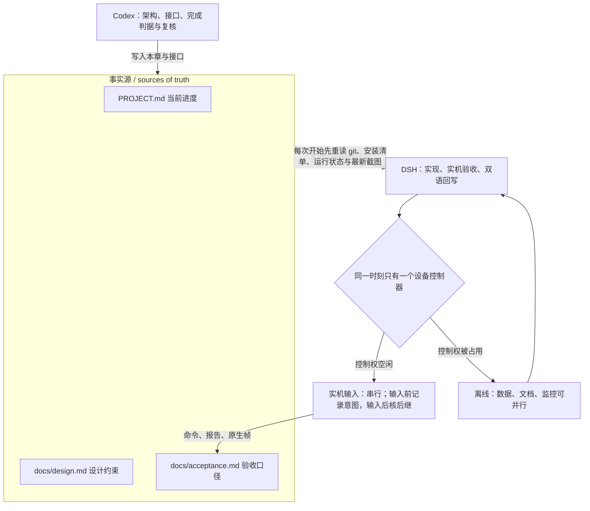

## 9.2 依赖、看板与阶段出口

<a id="feature-9-2"></a>

| 卡号 | 依赖 | 具体实施与产物 | 关闭该卡需要的证据 |
| --- | --- | --- | --- |
| P0 现场对账 | 无 | 核对活动局、历史星光意图、实际页面和安装版本；为未结意图选择“核账成功 / 已取消并保留历史 / 仍待证明”分支 | 同scope的前后PNG/JSON/hash、可见余额与成本、无重复购买；现场结论写回验收 |
| P1 实际启动管线 | P0 | 安装正确适配器；从GUI Start经过MainTask、MirrorLoop和原生子节点；把GUI模式/目标队伍/ledger/游戏选中标题关联 | GUI启动日志、正确Agent和资源版本、真实页面推进；不能用另一个CLI入口替代GUI点击 |
| P2 镜牢核心循环 | P1 | 地图→事件/战斗→奖励→商店→换层；部署顺序正确则复用；逐个修复后继失败并恢复 | 至少一局Hard五层实际clear；每层、每笔购买/刷新/GET与后继可追溯；脚本自己操作，人工点过不算 |
| P3 设置与可解释日志 | P1；发布依赖P2 | 四十队槽、头像点序、星光基础卡、单队/轮换、独立运行次数与步数/时间上限；候选权重和最终分 | 保存→正常关闭→重开→原生参数→真实队伍标题一致；反复启动不重复应用；实际日志含分项、决胜规则、拒绝理由 |
| P4 本地资源占用 | P1后可与P2并行 | 按9.6契约实现CPU/RAM/GPU/VRAM采样与GUI；采样独立于控制器 | 与独立只读工具同时间窗对照；缺供应商/超时/进程退出/开关关闭测试；关闭采样后无后台忙等 |
| P5 学习闭环 | P2的真实轨迹；可先离线收集 | 按9.4/9.5形成证据包、标签、复核、分集、训练、Maa原生评估、影子对照和可回滚晋级 | 独立episode隔离；模型、数据集、教师、评估hash；真正使用模型的节点日志；未晋级只能明确标为shadow |
| P6 整体验收与交付 | P2、P3、P4、P5 | 合并后的最新代码完整测试、成品自检、GUI启动及连续运行验收；核wiki/图/实现差异 | 9.7逐项勾选的证据目录、最新安装版本、无遗留未解释失败；公开发布另过许可/隐私/更新门禁 |

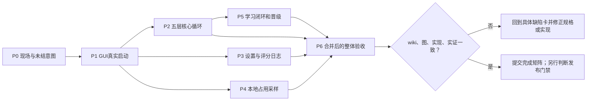

P0/P1已有局部证据，仍需本轮最终核验；P2–P6不能批量标完成。遇到新缺陷就在对应卡追加“触发→原始证据→假设→修改→正反例→重新运行”，不要另开无关联测试然后宣称旧失败已解决。

## 9.3 失败后的自动恢复与运行次数

<a id="feature-9-3"></a>

**同局恢复修复（2026-11-16，源码/留存回放层）**：游戏 scope 与 recorder 目录不是同一个身份。`FloorGiftTransaction.retire_stale_run` / `retire_stale_commit` 不能因换录制目录、重启观察进程或 OCR 漂移而退休同局未结事务。另一张卡的 trial OCR 改变，只要已发送选择的目标、原始证据与计数仍可核对，就恢复该选择而不重发；这不自动成为 gift 收据或楼层完成。安装后真实后继验证仍待继续。

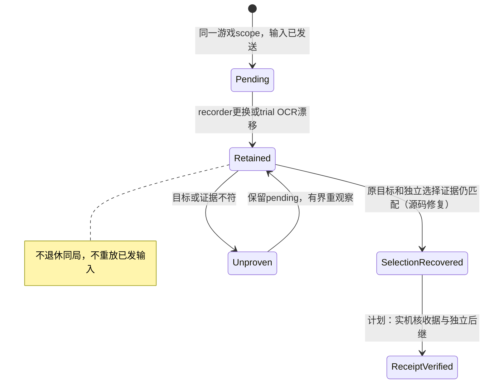

未知不等于立即结束整条任务。先辨别：等待动画、识别缺失、可逆遮罩、已发送的交易、未知游戏效果、需要新资源预算。允许的已知动作通过Maa执行；未知效果可以在既有有界探索和玩家预算内选择，并把不确定性记入评分。**读不清购买结果时重读核账，而不是重复购买。**

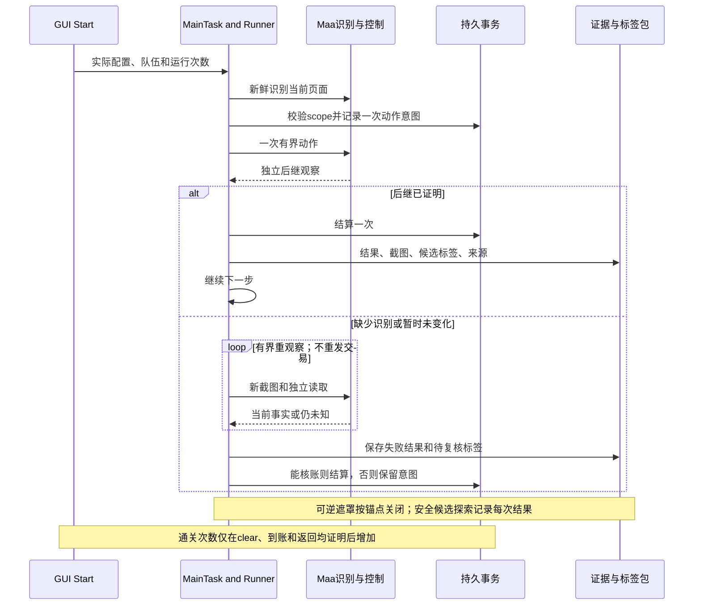

每种动作明确次数/时间/无进展预算；星光购买已有最多3次只读重观察，其他动作不能照搬该数值当无限重试。候选尝试必须记录动作区域、前后画面、是否改变目标页面。达到该动作的上限才暂停该分支；能独立进行的采样、离线训练或缺陷修复继续。弹窗关闭不能变成未经确认的付款。

运行次数是玩家设定的完整局数，必须与“单次运行步数上限”和时间上限分离。“沿用保存值”只读取保存配置，不能从部署人数、队伍数量或循环步数推导局数。重复N局需要逐scope消费预算；预算不够时保留已clear待领奖状态，不能冒用历史6模块授权。

**已落地（2026-10-14）**：玩家可保存的完整局数是 `Settings.run_count`（`src/maalimbus/runner.py:158`）与 PI 选项 `mirror_run_count`（`assets/interface.json:22254`），由管线节点 `MirrorRunCount`（`assets/resource/base/pipeline/mirror.json:2659`）承载并在 `src/maalimbus/mirror_task_options.py:9` 读取。达标判定只认账本增量：`MirrorRunner._run_count_reached`（`src/maalimbus/runner.py:1393`）用 `RunLedger.completed_runs` 减去本次启动基线，而该计数只在 `entry_returned` 后 +1（`src/maalimbus/storage.py:287`），账本对缺少五层、胜利或已领奖的返回一律拒绝。达到玩家N局时窗口以 `run_count_reached` 停止（`src/maalimbus/runner.py:2807`），步骤记录与 `summary()` 带上 `verified_runs={target,completed}`（`src/maalimbus/runner.py:3196`），日志打印 `verified runs: x of y this launch (z in the ledger)`（`src/maalimbus/event_log.py:149`）。**尚未实测**：本窗口还没打完一局（实测时仍在楼层1），该停止路径目前只有单测覆盖。

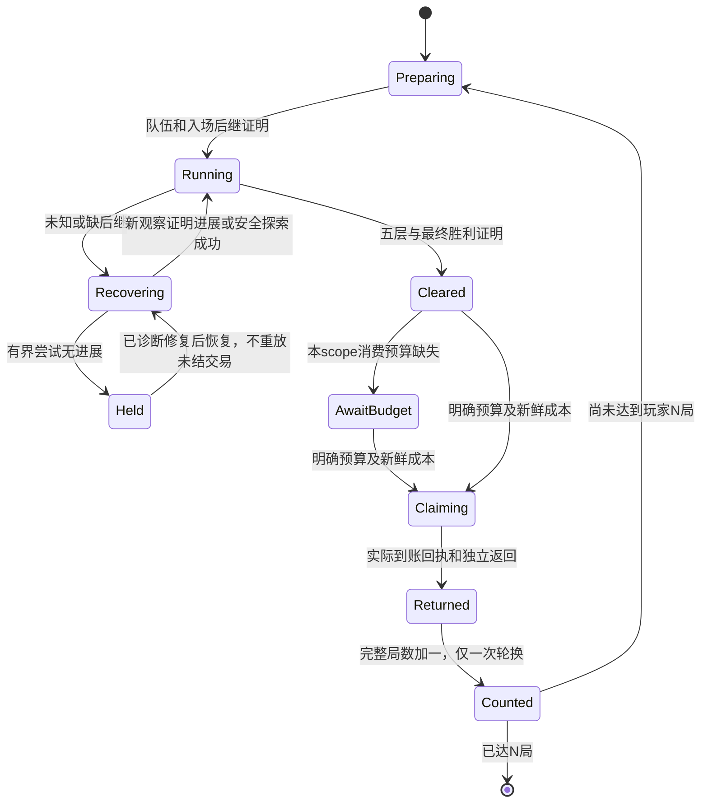

### 9.3.1 GUI Start到原生子节点的实际适配链

<a id="feature-9-3-1"></a>

**Agent 启动的两层 IPC 根因与下一层控制权（2026-11-16）**：系统 TEMP 的 `xrpg*` CreateDirectory 返回 AccessDenied，libzmq `make_fdpair` 内部 AF_UNIX 因而 connect 空地址，继而 bad FD/epoll；外层 `C:/Temp` AF_UNIX 另有 89 次 WSA10013 / NTSTATUS 0xc0000022（`build/owned-agent-outer-ipc-summary.json`）。owned-child 短可写 TEMP/TMP 加 `AgentClient.create_tcp(0)` 原子 loopback TCP 才是配对修复：`build/owned-agent-temp-paired.json` 注册 15 actions/exit 0。早先 TCP 或 socket 初始化单独失败不等于该组合失败；不是 DLL 坏或 UAC 要求，没有改系统 ACL/TEMP/Firewall。`native_agent.native_temp` 上下文与 AgentMain 已安装，MXU 仅把已有 `settings.tcpCompatMode` 置 True，其他 user JSON 值和游戏预算保留；`build/resume-20261116-native-temp-tcp-accepted.log` 再证 15 actions/exit 0。随后成品 MirrorTask 暴露 AppData controller.lock 不可读而误报 another_controller_owns_game；source 可独立拿锁、CIM 无 controller。`ControllerLease` 现将既有 controller 互斥迁到 Win32 Session named mutex，其他非 controller 文件锁不变；跨进程/线程和旧 installer 检查 43 passed / 1 skipped。成品重建已完成：原生 mutex 自检通过，source 持同名 mutex 时 frozen Agent 独立拒绝获取；随后成品 MirrorTask 经 TCP 注册 15 actions，实际观察 STAR_GRACES 并按预设 stop page 结束，0 input（`build/resume-20261116-packaged-main-task-native-fixed.json`）。这只证明成品 dispatch/观察，不是 GUI 点击、Team2 正确入场或通关。最新组件安装保留 96 份私有文件与 28 份 canonical 配置。路由：`agent-ipc-startup`。

**原生中间页交还（源码/管线检查）**：MirrorEnter/MirrorEntryConfirm 经只读节点停在 DUNGEON_TEAM，DungeonTeamConfirm 停在 LEVEL_WARNING；15 新测试与指定组 56 passed / 18 skipped 支持这些 handoff，不支持“所有入口完成”。遗留 MirrorHard 独立路由仍开放；必须用实际中间页证明队伍和入场，不能把一次菜单返回或后续回 STAR 当成 Team2 重配成功。

**坐标层调查（2026-11-16，原生 callback 已证实并修复）**：`tools/verify_controller_coordinates.py` 调用了 installed Maa **5.12.2** 实际 DLL（SHA256 `b22e9ac36f9fe6ffadd13afa405d6cc6759f1fdd7ed763e0a88e2e5c8f8d4e06`）与内存 custom controller。raw 1280×720、recognition 1920×1080 时，旧 runner 手动 `wm size` 缩放再经过原生 `ControllerAgent` 的 frame→raw 转换，点击收到 (427,240) 而不是 (640,360)；`build/controller-coordinates-native-before.json` 基线退出 1。去掉手动缩放后 direct/pipeline 两类 click/swipe 共四条路径全部 exact-match，`build/controller-coordinates-native-after.json` 退出 0，**设备输入 0**。原生实现参考 [MaaFramework v5.12.2 ControllerAgent](https://raw.githubusercontent.com/MaaXYZ/MaaFramework/v5.12.2/source/MaaFramework/Controller/ControllerAgent.cpp#L967)。ADB 随后已连接，source/Maa 限步运行已推进到 STAR_GRACES；这只证明该入口推进，不证明成品 IPC/GUI 或完整游戏落点链。下一步核 canonical old scope 和 native 中间 team/entry proof，继续核重建后的 controller mutex、队伍和实际后继；IPC 配对启动修复不代表整条链路完成。

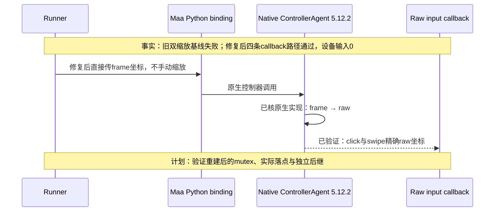

源码已有的链路是 `MainTaskAction.run → MirrorLoopAction.run → MaaDevice → MirrorRunner → run_node → AgentTasker.post_task → Context.run_task`。用 `python tools/wiki_route.py startup --limit 1` 获取这些符号的当前行号，不依赖图内静态行号。`MirrorLoopAction.run` 必须把 `AgentTasker(context)` 交给Device；Runner从Device取得tasker，NODE计划才能执行原生Pipeline。缺少适配器正是历史报错 `a node plan needs a Maa tasker` 的原因。

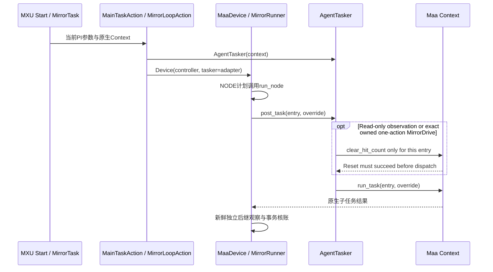

CustomAction已经占用框架worker，不能在里面改回 `context.tasker.post_task` 并等待自身队列；`AgentTasker` 的源码说明了这一点。此图解释已有实现，**本身不等于GUI实机启动或Hard五层通过**；验证仍要绑定实际安装版本、GUI选择和后继帧。只读观察按次重置hit count；精确Runner单动作MirrorDrive另有按调用计数例外，其他输入图及交易记录不清空。

**已落地（2026-10-14）**：用 `8ca1ac1` 重装的版本（其父提交 `d574a26` 是节点面板身份修复）以真实GUI启动（`dist/MaaLimbus/MaaLimbus.exe`，进程34940），并在本地07:22用真实指针输入按下它自己的开始按钮。该局 `dist/MaaLimbus/evidence/runtime/pi-20261014-072228` 的首帧场景是 `NODE_PANEL`——正是打包CLI局在 `d574a26` 之前无法识别而停窗的状态——随后走通 `CUTSCENE -> EVENT_CHOICE -> EVENT_RESULT -> GIFT_GET -> PRE_BATTLE_TEAM -> BATTLE_HUD -> MAP -> NODE_PANEL -> GIFT_GET`，因此上面这条链路现在是实机观察到的，而不再只是接线。仍未由此证明：完整五层一周目，以及保存局数的停止路径。

**实机走到并被修（2026-10-14）**：同一局继续跑到254帧/71次输入——`BATTLE_HUD` 20（胜率分配与开始）、`MAP` 8次节点点击、`SHOP` 7含4次 `SHOP_PURCHASE`、`GIFT_GET` 6、`NODE_PANEL` 5（全部走 `panel_enter_is_the_only_forward_input`，即身份修复在实机被使用）、`GIFT_PICK` 4、`REWARD_CARD` 2——随后停在 `floor_gift_commit_receipt_not_proven`：它按下的 `Select 2/2` 得到的是印着 `Dark Vestige` 的提示窗，这个名字既不在选礼页的四个候选里，也不在本局点击勾选的两张卡里（`frame-0252`），而原来的收据规则要求提示窗必须报出被选名字。现在规则把两件事分开：提示窗页面加上它自己的名牌即可证明这次按键，收据同时保留两个名字——它回应的那张卡与设备实际印出的名字（`src/maalimbus/floor_gift_transaction.py` 的 `FloorGiftTransaction.notice_matches_a_pick` 与 `receipt_intent(..., on_notice_page=True)`，`src/maalimbus/runner.py` 的门控与带标记的说明，`tests/test_gift_receipt_settling.py` 用保留帧 `evidence/runtime/gui-20261014-072228/frame-0254.json` 固定）。选不出处的名字在非提示窗页面仍然拒收，因为中段读数是宽松读取。随后重跑的实机局（`pi-20261014-080122`，本地08:01）又遇到同一页面形态，但这次印出的名字与勾选一致：该局自己的 `floor_gift_ranking` 选中 `Today's Expression`（`selection_source: single_free_select_button`），`Select` 后提示窗出现，交易记下了收据的标题与后继帧（`config/user-floor-gift-transaction.json` 的 `receipts[0]`：`frame-0059.json` -> `frame-0060.json`），链路越过了上次停车的位置。只有“提示窗名字与任何勾选都对不上”的那条分支仍仅有单元测试。

**货架与状态（2026-10-14）**：装好折叠后的下一次启动只走了3次输入，就停在同一条拒绝上，差别只有一个空格——这一局自己的预定帧 `frame-0002` 把144币货位读成 `Crownof Roses`，回来的 `frame-0008` 印的是 `Crown of Roses`，于是 `_fold` 现在在易混字形与 `rn` 连字之外再折掉空格（仍不能缩短标题：字母与数字仍须逐个对上）。它下面还压着一个会让本阶段彻底结束的状态缺陷：再下一次启动在第一次输入之前就抛 `Configuration/state exceeds 2 MiB`，因为决策上下文把 `owned_bought` 记成了整条购买记录，而每条记录又带着自己的上下文，`config/user-shop-<scope>.json` 因此涨到2,464,332字节。现在 runner 只记名字，`shop_transaction._context` 在存储边界强制这一形状，`tools/prune_shop_state.py` 把线上文件改写回46,950字节且不动其他字段。两者都有单测（含修剪工具），被修正的货架也已用真实帧回放（不再列出任何“未持有”的报价）；真正要在实机证明的，是重装后的下一次运行。

**同一处读取差距，落在货架上（2026-10-14）**：同一局复测继续走到第3层，在结算刚买下的 `Rusted Cutting Knife`（244枚，1530 → 1286）时以 `Shop successor shows an offer the shelf never held` 停下（68步 / 67次输入，`passed: false`）。存档保留了 `pending.stage: overlay_intent`，返回后的货架仍是同样的六个槽位、被买下的卡带自己的 `Purchased` 徽标——但本次造访自己的预订帧把160枚那个槽位读成 `Thomy Path`，返回货架读成 `Thorny Path`（图鉴名，`assets/resource/base/gift-catalog.json` 的 `gifts[280]`），于是严格的标题比较把货架一直持有的卡当成“从未持有”的报盘。商店的折叠现在把印刷体连字 `rn` 一并折成 `m`（`src/maalimbus/shop_transaction.py`），由 `tests/test_shop_transaction.py::test_a_condensed_ligature_reads_as_the_same_slot` 及其反例钉住；用返回帧重放停止的存档即可结算（`reconcile_purchase: True`、`bought[-1] = Rusted Cutting Knife`、`pending` 清空）。要再次尝试五层通关，安装版必须带上这处折叠。

**等货架重画完再判（2026-10-14）**：重装后的应用再次由自己的按钮启动（`pi-20261014-193945`，本地19:39），只走了1次输入就停下——货架上没有计划想要的藏品，于是它付了15币刷新（`[1478,168,86,28]`，金币1127），而后继帧 `frame-0004` 只读到六个槽位中的两个、计数仍是刷新前的数，既证不出差额也证不出完整的变更货架。交易规则拒收这样一帧是对的（`ShopTransaction.reconcile_refresh`，`src/maalimbus/shop_transaction.py`），所以 runner 改为等待而不是停车：同一次造访里最多三帧未证成的后继帧会记为 `shop_refresh_settling` 并重新观察，意图在等待期间始终未被认领，第四帧仍然停车（`src/maalimbus/runner.py`，由 `tests/test_runner.py::test_a_refresh_successor_read_mid_change_waits_before_it_stops` 钉住）。实机证明要等下一次在同一商店启动。

### 9.3.2 新版镜牢界面的适配计划（2026-10-15）

<a id="feature-9-3-2"></a>

游戏在 2026-10 整体换掉了镜牢界面：入口改名 `Mirror of Sisyphus`（`DUNGEON 08`），右侧改为 `Exploring / Weekly Bonuses / Parallel Superposition Mode / INFINITY MIRROR`，星光页与买星确认框全部重绘。识别层不比对美术，只读 OCR 文本与归一化框（`src/maalimbus/vision.py:19` 的 `find`、`src/maalimbus/vision.py:63` 的 `classify`），所以这次改版只在**文本形态**和**绘制细节**上打穿它；适配按“先只读、后真输入、只修实机证明坏了的那一处”推进。

只读证法：`python tools/verify_packaged_mirror_loop.py --app dist/MaaLimbus --address 127.0.0.1:16416 --adb "<MuMu>/adb.exe" --observe-only --stop-page MIRROR_ENTRY` 以 `input_enabled=False` 构造控制器（`tools/verify_packaged_mirror_loop.py:117`），不点任何东西；要放真输入则加 `--authorize <nonce>`，门控在 `src/maalimbus/runner.py` 的 `AUTHORIZATION` 与 `authorized(nonce)`。

| 页面 | 改版打穿的方式 | 实机证据 | 状态 |
| --- | --- | --- | --- |
| MIRROR_ENTRY / ENTRY_CONFIRM / DUNGEON_TEAM / LEVEL_WARNING | 未受影响 | `evidence/runtime/packaged-mirror-20261015-071912/frame-0001..0009` | 已实机连续走通 |
| STAR_GRACES | 页面整体重画：OCR 把 `Select All Graces` 读成 `Select Al Graoes`，卡框几何与角标偏移也变了 | 同上 `frame-0010`，判定脚本 `build/probe_star_page.py`、`build/probe_grace_grid.py` | 已修 `45adac7` |
| STAR_CONFIRM | 勾选框重绘：旧图 1.00 → 勾选 0.83 / 空白 0.15，0.92 的严格门判成未知 | 同上 `frame-0011`，两态对照 `evidence/runtime/star-confirm-20261015/{checked,unchecked}.png` | 已修 `c6df293` |
| INITIAL_GIFTS / GIFT_GET / GIFT_SEARCH / GIFT_SEARCH_FORGO / THEME_PACKS / MAP / NODE_PANEL / CUTSCENE / EVENT_CHOICE / EVENT_RESULT_READY / EVENT_CHECK / EVENT_CHECK_RESULT | 未受影响 | 同上 `frame-0012..0036` 的 `map_observed.scene` 序列 | 已实机连续走通 |
| 过渡帧 `UNKNOWN` | 页面切换中的中间帧无身份 | 同上，出现 2 帧后自行重读继续 | 允许等待，不输入 |

`45adac7` 的修法是把“逐字对齐”放宽为**有界容错**（`src/maalimbus/vision.py` 的 `close_to` / `find_read`，编辑距离上限 2，且仍要求一段文本只命中一个候选），同时让星光页先按已证几何判、失败再按实测边界（±24px、密度下限 0.04）定位卡框，读不到十张带框卡片就返回失败而不是猜。`c6df293` 的修法是把勾选状态改成**两道独立证据**：保留模板与框内亮笔画（勾选 0.17、空白 0.00），两者不一致时仍返回未知并拒绝（`src/maalimbus/grace_vision.py:206` 的 `conversion_state`）。

仍待实机证明的部分（本计划未完成项）：完整五层一周目与到账页；按保存局数停止的路径（本次钉的是 `mirror_run_count=3`、`mirror_run_bounds=2000`、单队第 2 队）尚无实机证据；GUI Start 自己按下后走满五层。另外，本机没有 Rust 工具链，`desktop/mxu` 的叠加层改动让 `tools/make_local_app.py` 以 `Modified MXU artifact is stale` 拒绝重装（`src/maalimbus/mxu_distribution.py:10`），因此这一阶段的验证走 `build/refreeze_agent.py` 重冻 agent（保留 agent 备份与自检），MXU 面板本身仍属未验收。

本节的回写纪律：改版适配只按实机帧重标锚点，不按猜测定坐标；每一处修改都必须再用真实脚本启动一次验证，才可写入“已实机走通”。

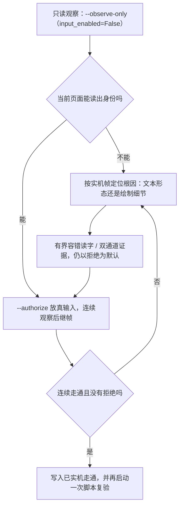

### 9.3.3 GUI Start 遇到旧局仍在跑的入口判定（2026-10-15）

<a id="feature-9-3-3"></a>

实机根因（本节写作时的现场）：GUI Start 在 09:55 真的按下了开始，但镜牢入口停在“启动前核对旧局与队伍设置”后以 `mirror_settings_rejected` 结束，`dist/MaaLimbus/evidence/runtime/pi-20261015-095517` 里 0 帧 0 点击。日志两条错误分别是观察节点没读出页面（`the observation node recorded no page for this frame`，`src/maalimbus/runner.py:648`、`:659`）和本机参与者 OCR 无证据（`Maa local participant OCR returned no evidence`，`agent/recognition.py:284`）。

为什么现场是这个状态：只读与放行两类验证脚本（`evidence/runtime/packaged-mirror-20261015-070250`、`-071416`、`-071912`）已经进入一个真实的 Hard 周目，并把游戏留在 `PRE_BATTLE_TEAM`；账本里那条 `active`（id `616264a2…`，team 1，phase `entered`）仍在 app 自己的数据根 `D:\fgoa\MaaLimbus\config`（`dist/MaaLimbus/config/user-data-root.json` 指过去）。**进行中的周目不是空闲入口**：`reconcile_idle_entry`（`src/maalimbus/run_wiring.py:255`）只允许在刚拍到的帧明确证明是空闲 `MIRROR_ENTRY` 或 `DUNGEON_TEAM` 选人页时退休旧局；当时观察连一帧都没产出，于是整条入口被拒。

本节计划：入口预检必须把两种情况分开——「账本有局，且这帧证明游戏已不持有它」照旧退休；「账本有局，但这帧读不出任何页面身份」保留该局，并把读页交给循环自己去做，绝不在读不出的帧上输入。容忍分支只记 `mirror_entry_preparation`（`retired=False` 与观察错误原文），随后与没有旧局时一样继续走 `GlobalSettingsAction.apply` 与 `MirrorLoopAction`；读不出页的帧仍然按未知页面处理，不点、只等。

| 现场 | 期望行为 | 证据要求 |
| --- | --- | --- |
| 账本 `active` 为 null | 直接按设置进镜牢 | app 日志出现 `mirror_loop_start` |
| 账本 `active` 非空，帧证明空闲入口/选人页 | 退休旧局后按设置进镜牢 | `mirror_entry_preparation` 的 `retired=True` 与 disposition |
| 账本 `active` 非空，帧读不出身份（本节的实机现场） | **保留该局**，继续进循环，由循环重读页面 | `mirror_entry_preparation` 的 `retired=False` 与观察错误原文，且不再出现 `mirror_settings_rejected` |

同样必须记住的第二个事实：app 的真实数据根是 `D:\fgoa\MaaLimbus\config`，不是 `dist/MaaLimbus/config`。写进 `dist` 的设置只会被 GUI 显示，agent 读的是前者；要钉“单队第 2 队 / 本次 3 次 / 步数 2000”这类运行设置，必须写 app 自己的数据根。

验收口径：在游戏停在进行中的镜牢页面时按下 GUI Start，必须真的进到循环（app 自己的日志可读），且不得再因为“没有证据”停在 `mirror_settings_rejected`；首帧读不出时循环仍按未知页面诚实停止。

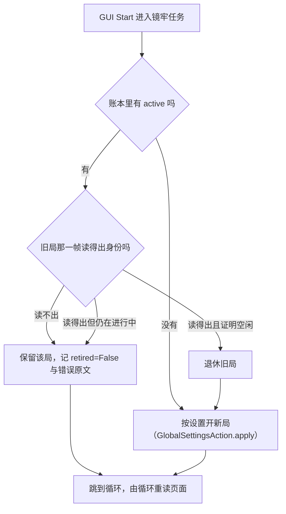

### 9.3.4 参与者计数读不出时的入口与部署（2026-10-15）

<a id="feature-9-3-4"></a>

实机根因（13:01–13:08 现场）：入口观察在 `PRE_BATTLE_TEAM` 页上以 `Maa local participant OCR returned no evidence` 抛出，异常发生在**观察节点内部**（`agent/recognition.py` 的 `PRE_BATTLE_TEAM` 分支），所以 9.3.3 那层“入口容忍”根本没有机会生效：Maa 任务先一步失败，app 显示「任务失败: 自动镜牢」（`dist/MaaLimbus/evidence/runtime/pi-20261015-130827`，0 帧）。

测量：新版选人页把计数器画成 `2/12`，在实机帧里被整帧 OCR 读成 `2/12`、框 `[1610,745,250,80]`、分数 `0.997`（`evidence/runtime/packaged-mirror-20261015-131001/frame-0001.json`）。`team_vision.participants`（`src/maalimbus/team_vision.py:46-62`，模式 `:9`，ROI `:10` = `(0.86,0.66,0.97,0.78)`）在该帧上离线复算得到 `(2,12)`；曾经失效的是旧裁切 `(1680,738,180,92)` 切掉了分子，新裁切 `(1610,745,250,80)` 两侧留了余量。

本节计划：计数器读到与否都不是“页面是否成立”的条件——计数未落定的那一帧仍然是帧，不是页面。节点只记录缺读并放行，由循环自己的有界重读（`src/maalimbus/runner.py:1696-1702`）决定是继续还是诚实停止；节点不再因为缺读而让整个启动失败。

| 现场 | 期望行为 | 证据要求 |
| --- | --- | --- |
| 计数器读得到 | 照常进入选人与部署判定 | 帧里出现 `2/12` 一类计数，`deployment_participants` 有结果 |
| 计数器读不到（滚动/未落定帧） | 节点记录缺读并继续，循环做有界重读 | 帧里无计数但页面身份成立，且不再出现节点级异常 |
| 重读用尽仍读不到 | 诚实停在部署一步，不发输入 | 停止原因为 `deployment_transaction_or_counter_missing`，`clicks_sent` 不增加 |

验收口径：在停顿的 `PRE_BATTLE_TEAM` 页上再按一次 GUI Start，必须走到 `mirror_loop_start` 并进入部署判定，而不是让观察节点把整个任务判失败。

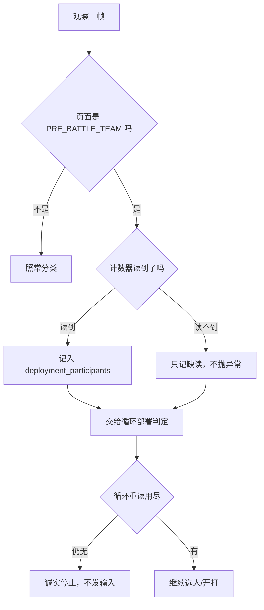

### 9.3.5 新版购买确认框：粘在一起的货币徽章（2026-10-15）

<a id="feature-9-3-5"></a>

现场：17:31 那次 GUI 启动一路打到第三个商店，在购买确认框上停住，理由是 `the_shop_asked_about_a_purchase_and_its_confirm_was_not_read`（`src/maalimbus/window.py:614`），停在 `SHOP_PURCHASE` 两帧（`dist/MaaLimbus/evidence/runtime/pi-20261015-173132/frame-0250/0251.png`）。

根因（已离线复现）：新版确认框标题是 `Purchase E.G.O Gifts`、按钮是 `Purchase`，`native_purchase_dialog` 三个锚点都读到了；但货币转变徽章 `1102 ▶ 895` 被识别成一个粘连 token `'1102895'`，于是 `purchase_balances` 找不到「前一个数字」而返回 None，`matching_purchase_question`（它是花钱的授权入口）随之返回 None，页面只能拒绝。

修法：`src/maalimbus/shop_vision.py` 的 `purchase_balances` 先按老版式读分开的两个数字；读不到时，用旁边的 after 数字去**切开粘连 token**（`^\d{1,4}` + 那个 after 数字 + `$`），切不出来就返回 None。真正的授权仍然要求 `before - after == price` 且 `before == 意向里记的 coins`，所以切错也买不成。

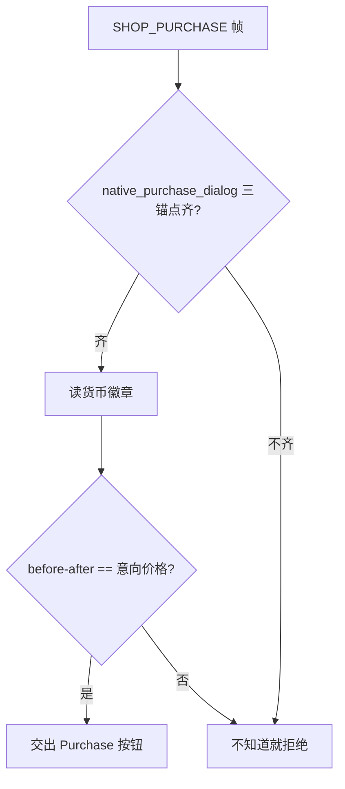

| 锚点 | 新版读数 | 判据 |
| --- | --- | --- |
| 标题 | `Purchase E.G.O Gifts` [674,236,292,34] .999 | `^Purchase E\.G\.O Gifts$` 在 (.32,.20,.55,.27) |
| 确认 | `Purchase` [1092,706,128,34] 1.000 | `^Purchase$` 在 (.50,.58,.70,.80) |
| 取消 | `X Cancel` [710,702,156,42] .912 | `^[X×]?\s*Cancel$` 在 (.31,.58,.50,.80) |
| 徽章 | `1102895` + `895` | after 数字切出 before，且 before-after=207=价格 |

验收：同一帧上 `purchase_balances` 返回 (1102,895)、`matching_purchase_question(records,'Awe',207,coins=1102)` 返回 `Purchase` 的框；价格改成 208 必须返回 None。测试在 `tests/test_shop_vision.py`（含无留帧时 skip 的实机帧用例）。

### 9.3.6 按完成镜牢计数，以及把藏品搜索开放出来（2026-10-15）

<a id="feature-9-3-6"></a>

用户口径（m01434）：别再用步数上限当目标，**按完成镜牢算**；步数当安全网就行。藏品搜索要**开放**，让它自己学购买策略；但金币不能攒太多、也不能一点不留。

已经有效的部分：停止条件是循环自己的完成局计数（`src/maalimbus/runner.py:2846` `_run_count_reached`，目标写在 `runner.py:3237` 的 `verified_runs`），不是步数；步数窗口来自 `MirrorRunBounds`（`src/maalimbus/mirror_task_options.py:27-30`，1..2000）。因此入口在**点名了次数**时把窗口抬成至少 4000（`agent/recognition.py` 的 `loop.run(steps=...)` 调用处），让五层镜牢不会被一个“你想跑三次”的数字中途截断。金币平衡规则本来就在：`CARRY_CAP_COINS = 1500`（`src/maalimbus/shop_settings.py`）与保留默认 500（同文件 `:74`）——留一部分、把溢出的花掉，正是“不能攒太多、不能一点不留”。

尚未实现的部分（不得写成已实现）：藏品搜索页现在只有两条路——`refuse` 或“用 Select 离场、不花星光”（`src/maalimbus/window.py:763-785`），而任务设置只接受 `saved`/`refuse`（`src/maalimbus/mirror_task_options.py:22-26`）。要真正“开放”，必须新增：按评分从池子里挑不超过三件、付出星光、支出用带回执的持久事务证明，并且没有回执就不算买过。

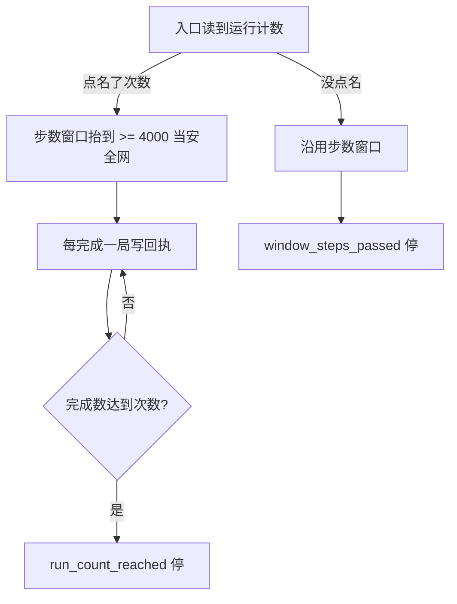

| 现场 | 期望行为 | 证据要求 |
| --- | --- | --- |
| 点名了完成次数 | 计数到次数才停；步数只做安全网 | 本次调用的 `run_count_reached`、匹配的 `verified_runs` 和 Agent 成功结束记录 |
| 没有点名次数 | 保持原来的步数窗口行为 | 停止原因为 `window_steps_passed` |
| 藏品搜索（开放后） | 按评分挑件并付星光 | 星光支出回执 + 页面后继帧 |
| 藏品搜索（当前） | 只拒绝或离场，不花钱 | 事件里 `gift_search` 走的是 refuse/select 分支 |

验收口径：把次数点成 3 后，一次启动能连跑到第三次完成回执；藏品搜索开放前不得在任何日志或文档里声称它已经在买。

安装版验收工具在任务结束后读取正常 Agent 结果和日志。`window_steps_passed` 可描述一次有界运行，`verified_clear` 记录本窗口观察到的通关。工具判定 `dungeon_complete` 要求 `verified_runs.target` 为正数、`ledger_total − counted_at_launch` 恰好等于目标、当前调用有匹配的 `run_count_reached`、且 Agent 正常成功结束。`RunStore.record` 只在五层、胜利、领奖并验证返回后增加账本计数。已通关后恢复领取也可以完成本局，此时不一定有新的通关观察。显式设置正数 `--run-count` 时，工具在未达目标时返回失败并保留有界进展。两种结算边界均有用例，GUI 开始、实际到账和轮换仍需各自的实证。

### 9.3.7 奖励页的两处误停：目录名错字与“价”的判据（2026-10-15）

<a id="feature-9-3-7"></a>

两次实机停止都发生在奖励页，都不是“游戏变了”而是我们自己的判据错了。

**一、`floor_gift_identity_unknown`。** `dist/MaaLimbus/evidence/runtime/pi-20261015-180214` 跑了 345 帧后停在奖励页。页面确实印着标题，但镜像目录 `assets/resource/base/gift-catalog.json` 把这条藏品的名字写成了 `Arrested Hymm`，客户端印的是 `Arrested Hymn`（`build/learning-review` 的留存语料里 20 次全是 Hymn）。两者归一化后只差一个字母，而 12 字符时 `difflib` 比率只有 0.9167，低于 `src/maalimbus/gift_vision.py` `text_identity` 的 0.93 门槛，于是返回 None、整局停止。处置有两层：目录条目名改成 `Arrested Hymn`（**不改** `icons[].path` 与 `sha256`，图标哈希校验因此不受影响），并在 `text_identity` 加一条兜底——只有“唯一一个、长度 ≥ 8、编辑距离 ≤ 1”的目录名才算命中，短名或两名并列仍然拒绝，所以模糊歧义的原有防线没有放松。

**二、`three_free_gift_trial_or_cost_present`。** `pi-20261015-172214` 在三选一奖励页停了，因为否决条件把 `Defense Level`、`Max HP`、`Cost` 等词当成“这是试炼/付费页”。新版把**每张卡片自己的效果文本**印在卡片里，`Defense Level Down until` `[844,534,244,25]` 就是第一张卡的效果句，页面上按钮却明明是 `Refuse Gift` 与 `Select`。否决改为判“带价的说法”：出现 `Modules`/`Purchase`/`Shop`/`Lunacy`/`Mounting`/`Trials` 这类名词，或 `Enemy Level`/`Defense Level`/`Damage Taken`/`Max HP`/`Cost` 后紧跟数字时才否决；纯效果措辞不再误伤。

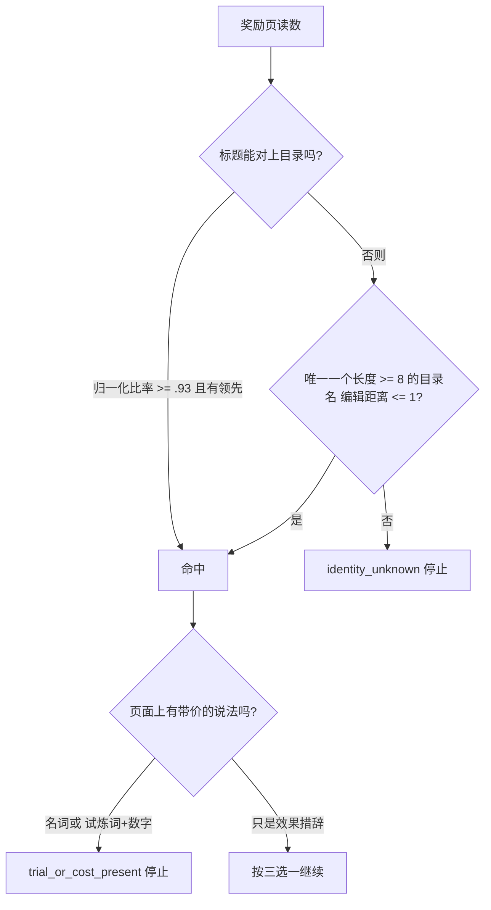

| 现场 | 期望行为 | 证据要求 |
| --- | --- | --- |
| 目录名有一个字母错字，客户端印刷正确 | 仍解析成该藏品 | `tests/test_gift_vision.py` 用 `Arrested Hymm` 断言得到 `Arrested Hymn` |
| 卡片里的纯效果句 | 不否决三选一布局 | `tests/test_three_free_gifts.py` 用 `Defense Level Down until` 断言仍返回三个候选 |
| 真试炼/真付费措辞 | 仍否决 | 同文件用 `Enemy Level +2` 与 `Mounting Trials` 断言抛出 |
| 图标路径与哈希 | 改名不触碰它们 | `gift-catalog.json` 的 `icons[].path`/`sha256` 未变，目录加载校验通过 |

验收口径：同一次启动能走过三选一奖励页与购买确认框继续往下跑；`three_free_gift_trial_or_cost_present` 只在真的是付费/试炼页时出现，而目录外的藏品现在退回页面自己印的标题（见 9.3.9），不再结束整局。

### 9.3.8 页面读不动与识别卡死：视角恢复阶梯与停滞看门狗（2026-10-15）

<a id="feature-9-3-8"></a>

用户口径：一天之内连着四次停在不同页面，用户要求先停下来总结规律，而不是再逐个打补丁——「不要遇到问题改一个遇到问题改一个」，并明确「只要在这种界面失败了一律尝试缩小地图」（m02370、m02456–m02457）。四次停止（购买确认框的货币徽章、被拉近到只剩一格的地图、还没淡入的技能检定条、迟迟没等到计划里那件商品的商店）确实共享同一个形状：**都是"这个视图现在读不出东西"，而视图是可以被手势移动的**。所以处置不是再加四条特判，而是两条通解。

**通解一：任何一步没落地，先花一档视角手势，而不是直接结束整局。** `RECOVERY_LADDER`（`src/maalimbus/runner.py:301-306`）四档依次是 `pinch_out`（缩小地图）、`drag_down`、`drag_up`、`wait`。缩小地图这一档直接复用实机标定过的双指手势：`pinch_out`（`runner.py:315`）配 `MAP_ZOOM_OUT = {'centre': (960, 540), 'radius': 320, 'factor': 0.55, 'seconds': 0.9}`（`runner.py:290`，与 `tools/map_zoom.py` 标定值一致），两指从 ±320 走拢到 ±176，共 12 步；控制器不支持双指时抛 `NotImplementedError`，**不会退化成在地图上乱点**。`_recover`（`runner.py:3321`）以 `页面|停止原因` 作为签名，同一个停止一次只花一档（`state['recovery_rung']`），花完整个梯子才允许整局结束，事件分别是 `window_recovery` 与 `window_recovery_exhausted`，另计 `artifacts['recoveries']`。关键安全性质写在注释里也写在测试里：**四档全部只移动视角、不按任何游戏控件**，所以在布局还没学过的页面上也可以放心试。想关掉这套行为就把 `recovery_tries` 设为 0。

**地图上先花掉第一档，再去试下一个候选节点。** 地图上一次点击之后页面完全没动，说明计划瞄的那个节点根本不在屏幕上：实机 `pi-20261015-200848` 在 90 秒里点了五个候选节点，`Exploring Floor 3` 一直没变，看起来就像卡死，用户于是手动停掉了它。所以 `_map_zoom_once`（`runner.py:3304`）在第一次"点了没动"时就直接花掉缩小地图这一档，并按第 0 档记账（写 `state['recovery_for']` 且 `recovery_rung = 1`），使梯子不会把同一档花两遍；只有**再下一次**仍然没动才退回换候选节点（`window_map_retry`）。事件是带 `gesture=pinch_out`、`before_another_candidate=true` 的 `window_recovery`；一旦真的落地成功，`map_zoom_for` 与其它恢复状态一起清零。

**通解二：识别调用卡死时，任何手势都救不回来，于是从循环外把进程结束掉。** `dist/MaaLimbus/evidence/runtime` 里 `pi-20261015-191205` 在 19:16:07 卡在一次 OCR 调用上，此后 12 分钟没有新帧、没有事件、没有结果，GUI 侧表现为「停了，甚至没法打开」（用户 m02283）——进程还在，线程全在等，是挂死不是循环。`stall_watchdog`（`runner.py:342`）用帧心跳判定：`_observe` 每次拿到帧就刷新 `artifacts['heartbeat']`（`runner.py:1582`），守护线程在超过 `stall_seconds`（默认 300 秒，`STALL_SECONDS` 见 `runner.py:3358`）没有心跳时先 `_record_stall`（`runner.py:3382`）把停止记录写进本次运行目录，再 `os._exit(4)`，让 GUI 如实报「任务失败」而不是静默挂着。

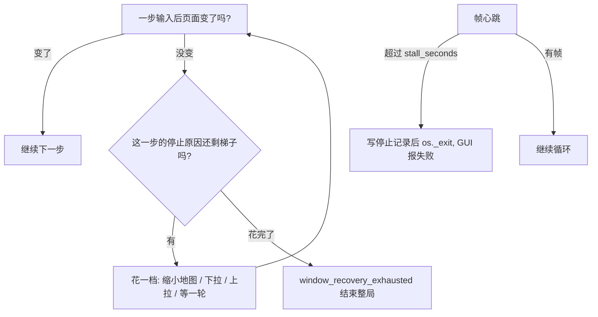

| 现场 | 期望行为 | 证据要求 |
| --- | --- | --- |
| 地图被拉近、节点在屏幕外 | 先双指缩小地图再重读该页 | `window_recovery` 事件 `gesture=pinch_out`，`artifacts['recoveries']` 递增 |
| 地图点击后画面完全没动 | **先**缩小地图，再考虑换下一个节点；同一次停滞只缩一次 | `window_recovery` 带 `before_another_candidate=true`；`tests/test_recovery_ladder.py::test_the_map_view_moves_before_another_candidate_is_tried` |
| 同一页同一原因连续失败 | 一次只花一档，四档花完才结束 | `tests/test_recovery_ladder.py::test_the_ladder_is_spent_once_per_stop_and_then_the_run_ends` |
| 识别调用永不返回 | 超时后写记录并结束进程，GUI 报失败 | `stall_watchdog` 用例传入 `rounds` 后有界返回；实机帧心跳见 `artifacts['heartbeat']` |
| 控制器不支持双指 | 抛错而不是退化成点击 | `test_a_controller_that_cannot_simulate_two_fingers_refuses_instead_of_clicking` |
| 想恢复旧行为 | `recovery_tries = 0` 时一步不落地就立即结束 | 老用例显式传该设置后仍断言原停止原因 |

验收口径：实机在拉近的地图上失败时，停止原因应先是 `the_view_is_pinched_out_so_the_page_shows_all_of_itself` 并伴随 `window_recovery` 事件，而不是直接结束；识别卡死时应在 `stall_seconds` 内以失败结束而非静默挂着。这套阶梯只解决「视图读不动」，不解决「判据本身错」（那属于 9.3.5 与 9.3.7）。

### 9.3.9 读不出来的模态不结束整局：对话框自己的 Cancel 与目录外的藏品（2026-10-15）

<a id="feature-9-3-9"></a>

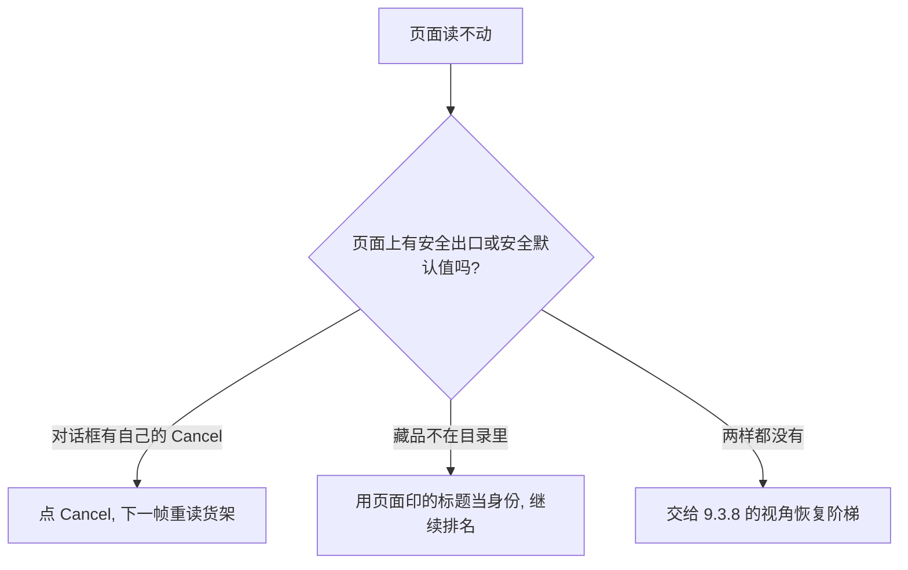

用户口径（m08238）：「你能不能做事情结构化一点，框架化一点，这种东西明明有容错更高的上游实现方法」，并直接问「不会所有没有录入的藏品都会给我停了吧」。两处停止共享同一个上游事实：**页面上本来就有安全出口或安全默认值，是判据把它们当成了不可继续。**

**买确认框：它自己的 Cancel 就是答案。** 实机 `dist/MaaLimbus/evidence/runtime/pi-20261015-202635` 停在新版购买框（`Purchase E.G.O Gifts` + `Purchase` / `✗ Cancel`），原因是 `the_shop_asked_about_a_purchase_and_its_confirm_was_not_read`。判据链 `matching_purchase_question`（`src/maalimbus/shop_vision.py:354`）要求礼物名、`before - after == price`、`balances[0] == coins` 三者严格相等；同一局商店刚读到 `1808`，对话框徽章读成 `1809`，一个 token 的漂移就否掉了这次购买。新的 `purchase_dialog_answer`（`shop_vision.py:408`）把这个模态当成有安全出口的问答：只有名字相邻（`close_to(..., 1)`）**且**正好花掉预留价格才回 `('purchase', box)`，其余一律回 `('cancel', box)`，货币容差 `COIN_DRIFT = 2`。`window.py:610` 在 `shop['cancel']` 存在时点它自己的 Cancel、下一帧重读货架，不再结束整局；只有 Cancel 也读不到时才保留原来的拒绝。

**目录外的藏品：用页面自己印的名字当身份。** `floor_gifts.observe`（`src/maalimbus/floor_gifts.py`）以前在 `catalog.text_identity` 返回 `None` 时抛 `floor_gift_identity_unknown`，于是任何没进 `assets/resource/base/gift-catalog.json` 的藏品都会结束整局。现在 `identity_of` 在查不到目录条目时退回**页面自己印的标题**当身份：不发明字符串，藏品照样进排名与回执，只是关键字为空（`keywords_of`），而 `rank` 本来就把"没有关键字"当作没有队伍收益，学习也按它看到的这个名字记样本。

| 现场 | 期望行为 | 证据要求 |
| --- | --- | --- |
| 购买框读不出预留的那件商品 | 点它自己的 Cancel，下一帧重读货架 | `tests/test_shop_vision.py::test_the_dialogs_own_cancel_answers_a_question_it_cannot_authorize` |
| 商店货币与对话框徽章差一两个 token | 仍按预留购买确认 | `COIN_DRIFT = 2`；`test_a_drifted_coin_counter_is_the_reader_not_another_purchase` |
| 奖励页出现目录外的藏品 | 用页面印的标题当身份，继续参与排名 | `identity_of` / `keywords_of`；`tests/test_floor_gifts.py` 全绿 |

验收口径：读不动的模态与目录外的藏品都不得单独结束整局；能结束整局的仍然只有「整条恢复阶梯花完」（9.3.8）。

### 9.3.10 场景读数不是授权：购买页上的按钮，与退役的预留（2026-10-15）

<a id="feature-9-3-10"></a>

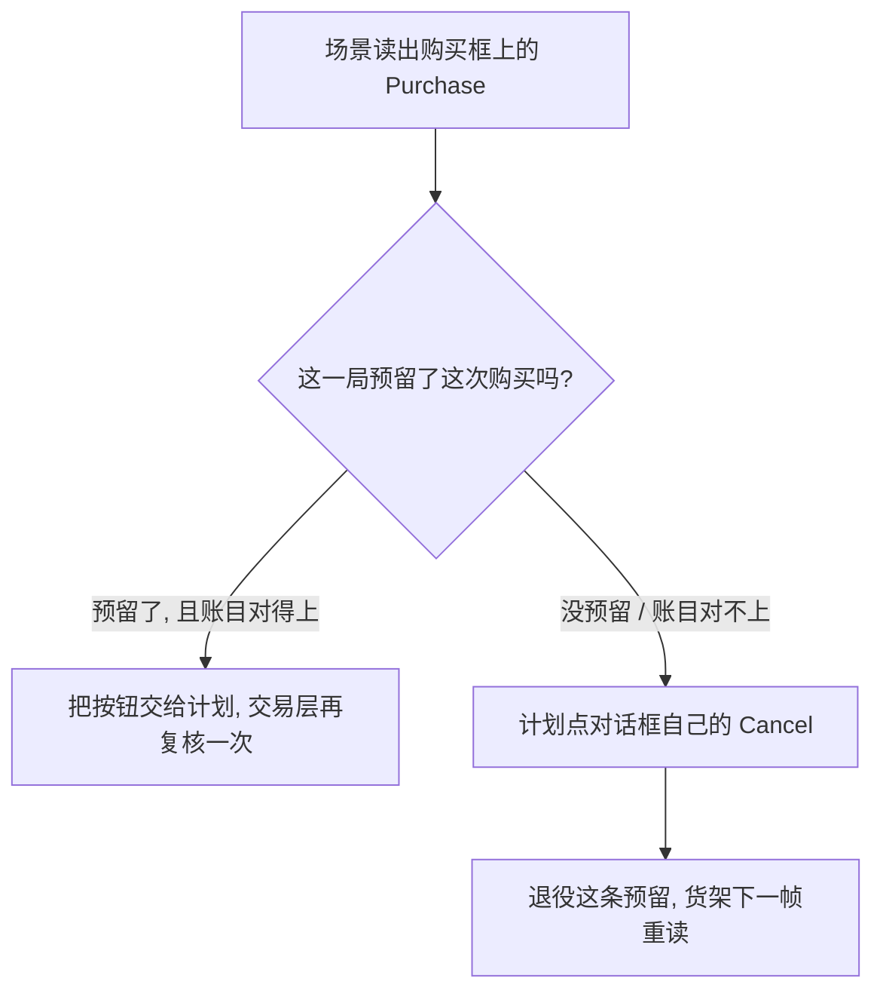

用户口径（m08238）：「这怎么也会失败的？？？」，要的是**更上游的容错**。9.3.9 修的是"读不出来"，这一条修的是另一半：**读数被当成了授权**。实机 `dist/MaaLimbus/evidence/runtime/pi-20261015-212438` 在 21:24:38 启动、2 秒后停，理由是 `mirror_loop_failed; Full matching purchase title/price/question not proven`（`src/maalimbus/shop_transaction.py:384`）：上一局留下的 159 币预留，遇上一个自己徽章写着 390 的对话框，场景读到的按钮照样进了计划，交易层拒绝授权，整局就结束了。

三处结构性改动：

- **场景读数不再冒充授权。** `shop_state`（`src/maalimbus/runner.py:1111`）在 `SHOP_PURCHASE` 页面上不再交出 `confirm`：对话框的 `Purchase` 只当场景锚点，读到的结果（`readable`）只用来写 trace 理由。购买页唯一的授权来自 `_observe` 的 `SHOP_PURCHASE` 分支（`runner.py:2074`），它按预留意向的名字、价格与金币算出 `purchase_dialog_answer`；账目对不上就退成 `shop['cancel']`。
- **没有预留的问答也有出口。** 页面上压根没有本局预留时（操作者自己点的购买框，或上一局死在框上），`native_purchase_dialog` 读到的 `Cancel` 就是唯一输入（理由 `a_purchase_question_this_run_never_reserved`）。
- **预留必须跟着 Cancel 一起退役。** `ShopTransaction.retire_pending`（`shop_transaction.py:390`）在点 Cancel 前清掉 `pending`，并把原因记进本次访问（`visits[...]['retired']`）。不清掉的话，货架下一帧会因为"已有预留"拒绝任何新购买，整局就卡在同一个对话框上。
- **换行的礼物名按词读，不按行的先后读。** 购买框把自己的礼物名折成两三行叠着印，识别器按框落点排序，读出来的顺序不是印刷顺序：实机 `pi-20261015-213416/frame-0001.json` 把 `Clear Mirror, Calm Water` 读成了 `Mirror, Calm`、`Clear`、`Water` 三个框，于是名字核对永远不成立，每一帧都拿对话框自己的 Cancel 作答，货架下一帧又挑同一个礼物 —— 21:34 那一局就这样在同一张卡上打了 5 次，最后停在 `the observation node recorded no page for this frame`。`names_match`（`src/maalimbus/shop_vision.py`）改成**词的多重集合**比较：行的先后不参与证明，客户端的单字滑落仍然宽容。同一条实机的 390 币预留，第一帧就被确认。

| 现场 | 期望行为 | 证据要求 |
| --- | --- | --- |
| 场景读到购买框上的 `Purchase` | 不交给计划，只有账目证明才交 | `tests/test_shop_vision.py::test_the_purchase_pages_own_button_is_never_an_authorization` |
| 页面上有本局没预留的购买框 | 点它自己的 Cancel，不买也不结束整局 | `runner.py:2074` 的 `SHOP_PURCHASE` 分支 |
| Cancel 之后 | 预留退役、货架可再次购买 | `tests/test_shop_transaction.py::test_a_reservation_the_modal_never_asked_about_is_retired` |
| 礼物名折成多行、识别框顺序被打乱 | 仍按词认定为同一个礼物并确认购买 | `tests/test_shop_vision.py::test_a_wrapped_gift_name_is_read_in_whatever_order_its_lines_came` |

验收口径：一次启动里，购买框无论是"读不出来"还是"没预留过"，都只走 Cancel 并继续跑；交易层拒绝不可授权的按钮时不再结束整局。**授权这一步也要认得新版对话框**：它不再要求那句 `Would you like to purchase …?`（新版根本不印），而是用与计划完全相同的证据 —— 礼物名按词、徽章正好花掉预留下价格、金币落在预留意向里（`ShopTransaction.reserve_confirm` 先问 `purchase_dialog_answer`，读不出来时才回落到旧版问句）。实机 `pi-20261015-214921`（21:49:21 启动，11 秒后停，inputs=1）就是死在旧问句上：计划已经授权了这一个购买框，交易层却找不到那句问句，于是整局结束。

### 9.3.11 购买标签来自这一局自己后来的观测：价值模型的门控式参与（2026-10-15）

<a id="feature-9-3-11"></a>

**症状**：商店样本一直在记录（`dist/MaaLimbus/evidence/runtime/pi-*/agent-result.json` 里 `shop_purchase_learning_samples.neural_policy_applied=false`，日志写"购买学习样本已记录：7；价值神经模型尚未应用"），但运行目录 `assets/resource/base/model/shop-value` 根本不存在，因此 `shop_value_shadow.rank_preview` 每次都走 `purchase_value_model_missing_rule_fallback`。样本被记下，却没有任何东西给它们打标签；"人的复核"是一个没人执行的门。

**规则**：一次购买的收益**不由人写**，就是这一局在它之后自己观测到的东西 —— `shop_value_training.label_from_outcomes()` 重新推导：过层按层数（一层 0.2）、通关 1.0、只拿到奖励或原路退出 0.1；标签摘要只覆盖被哈希绑定的那些位（`outcomes_digest`），所以证据到达的顺序不会改变标签。`review_sample()` 只在存在**被运行账本绑定过的后续观测**时才写 `review.json`/`outcome.json`（`approved_by=observed_run_return_in_scope`，`training_eligible=true`，`human_approved` 仍为 false）；没有后续观测的目录保持 pending 并计数（`delayed_outcome_evidence_missing`），不编造收益。加载侧（`load_reviewed_episodes`）不信任盘上的标签：它会重新推导，标称收益与证据不一致的样本以 `objective_label_mismatch` 排除，再次检查 `action_executed`、`training_eligible`、内容地址与账本绑定。

**参与是门控的**：训练器用 `split_by_scope` 按整局留出，只有在留出对比里自己证明了排序能力（对数 ≥ 4 且准确率 ≥ 0.6）才把 `participation` 写成 `ranked`；否则写 `shadow`。`rank_preview` 每次加载都重验哈希链（`weights_sha256`、`dataset_sha256` 三处一致、`evidence_verified`、`reviewed_episodes` 与 `verified_episodes` 相等、权重有限且界内），再按参与方式返回：`ranked` 在**计划已经批准的候选内部**按分数排序，`shadow` 只报分数、顺序不动。两者都不会覆盖"计划指定的那个礼物"（`the_gift_plan_asked_for_this_offer`）——模型只在计划自己划出的集合里决定先买哪个。

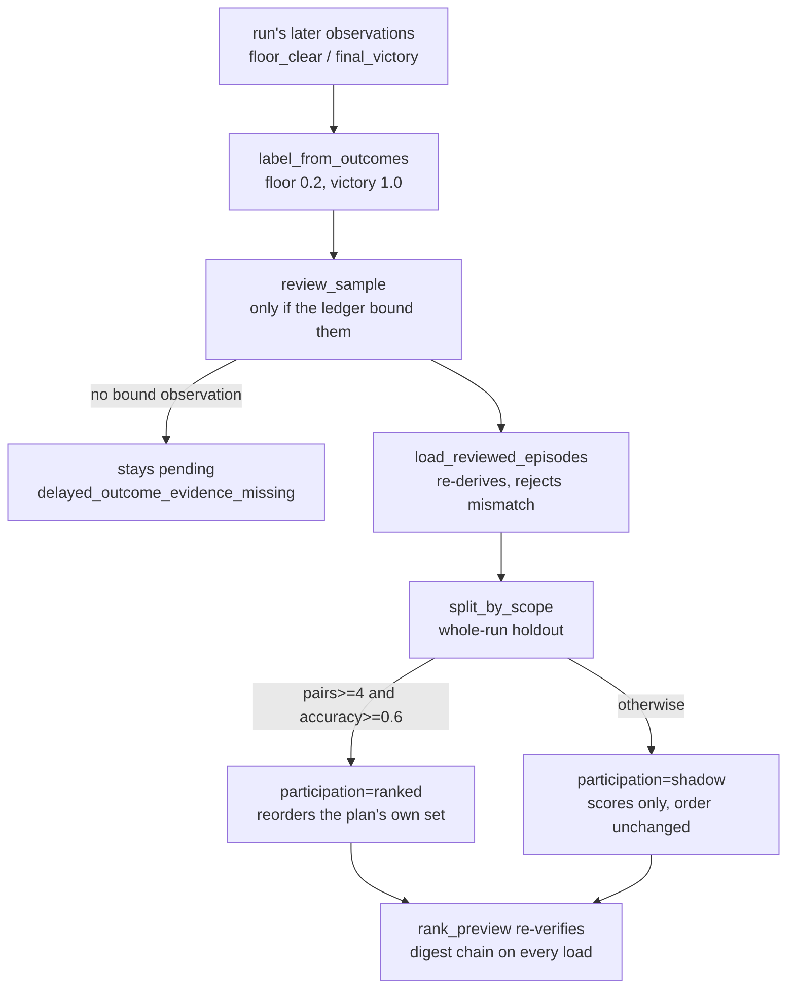

| 现场 | 期望行为 | 证据要求 |
| --- | --- | --- |
| 购买后这一局过了一层 | 标签按层数推导，写入复核文件 | `tests/test_shop_value_review.py::test_the_label_is_the_runs_own_later_observation` |
| 证据缺哈希绑定 | 不算标签 | `tests/test_shop_value_review.py::test_a_later_observation_without_a_bound_digest_is_not_a_label` |
| 购买后没有被绑定的观测 | 保持 pending，不编造 | `tests/test_shop_value_review.py::test_a_purchase_the_run_never_followed_up_stays_pending` |
| 候选证明不了留出排序 | 只做影子，顺序不变 | `tests/test_shop_value_review.py::test_a_promoted_candidate_reorders_the_offers_and_a_shadow_one_does_not` |
| 盘上标签与证据不一致 | 加载时重新推导并排除 | `tests/test_shop_value_review.py::test_a_candidate_with_a_dataset_digest_that_does_not_re_derive_is_ignored` |

验收口径：`python tools/shop_value_review.py --install` 会复核目录、训练、并把 `weights.json` 与 `modelcard.json` 装进 `assets/resource/base/model/shop-value`。2026-10-15 的实测状态：10 个目录中 7 个已按观测标注、3 个仍待核（缺后续观测）；已核样本 1 局 / 6 行，留出 0 对、准确率未知，因此参与方式为 **shadow**（分数已可见，顺序不变）。**这不是"神经网络已上线"**：要开始参与，需要第二个被核验的局形成留出对比；缺的就是能跑完的实机局数，而不是人的复核。

**续（2026-10-16）：账本的 `abandoned` 也是账本；而标签只有一个值时，门控拒绝得对。** 上一段把缺口记成"缺的是能跑完的实机局数"。核对之后它分成两件不同的事。

1. **当时被核样本不可能有两局，这是结构问题。** `_scope_evidence`（`src/maalimbus/shop_value_training.py:389`）只在 `active` 与 `receipts` 里找这一局的证据绑定，而 `run_wiring.expire()` 把到期或重开的旧局归入 `abandoned`——`f855ac82c2b1429aae9c747a122213b8` 就在那里（备注：画出选人页时镜牢里没有进行中的局）。它自己的 4 条 `floor_clear` 正是给那次商店购买打标签的后续观测，却因为不在前两个列表里被判 `delayed_outcome_scope_not_in_run_ledger` 排除。只读前两个列表意味着一次购买只在**自己那一局还是 active 的时候**才能被标注：语料永远只有一局，留出比较永远没有对可比，`ranked` 于是不是"还没到"，而是结构上到不了。`_ledger_runs()`（`:374`）现在把 `active`/`receipts`/`abandoned` 一起读，重复登记仍按 `run_ledger_scope_ambiguous` 拒绝；实机语料从 1 局 6 行变成 2 局 7 行、留出 6 行。

2. **两局之后标签仍然只有一个值，而这一次门控拒绝得对。** `label_from_outcomes` 取的是**这一局**在购买之后观测到的最大收益，所以一次运行里每一行拿到的基本是同一个数：这局后来到过哪一层，就是这局所有购买的标签。实机 7 行的 `label_values` 是 `[0.6]`，`len(targets) > 1` 这道门因此照旧把它写成 shadow。这不是缺陷：只有单一取值的语料没有任何"谁更好"的对比可学，强行晋级只会得到一个把常数写在脸上的排序器。训练报告与 modelcard 现在直接写出 `label_values` 与原因（`candidate_shadow_blocked_because_every_row_in_the_corpus_carries_the_same_outcome_value_0.6`），不再只留一个 `shadow` 结论。

   要让它真的开始参与，缺的不是更多次同样的购买，而是**结果有差别**的局：同一种礼物有时买、有时不买，且两局的后续不同。这里还有一个必须承认的混淆：因为标签是"这局后来到得多远"，跨局样本教出来的可能是"**哪些礼物出现在强队里**"，而不是"哪些礼物值得买"。在把 `ranked` 交给它之前，这条混淆要有对照（例如同一队伍下的购买对比），否则 `ranked` 只是把一条相关性写进顺序。

### 9.3.12 重置弹窗与未确认输入的恢复

计划：将兜底所有权判断放回party_vision.plan；重置恢复使用明确的reserve_clear_reopen intent API，沿用confirm_clear/observe读者；原pending保留，最多2次重开。135相关检查/1历史帧skip通过，含完整Runner保留帧、page分支ratchet和事务API分类。中间全量11 failed/2834 passed/710 skipped316.65s，其中4个新增集成失败（UNKNOWN检查增长、重开API未分类）已由上述改动及对应检查修复；原7个历史失败仍开放，没有声称新全量全绿。实施/局部状态图/实机出口见[4.16](4-business-flows.md#feature-4-16)。接下来安装并连续推进当前局；不再设置中间页面停点，仍保留消费授权与真实停滞/容量边界。

<a id="feature-9-3-13"></a>

### 9.3.13 Native failure cause and continuous execution

Source plan: inject the actual guarded-callback latch into MaaObserver, check it around each native observation and preserve error type/message/node in the result. `ObservationCallbackFailed` has its own cause; an exhausted evidence budget must not become empty-page timeout retries.74 related callback/read tests passed; the later combined map/capture/cache group passed109. Existing transient read failures retain their bounded retry behavior. Current installed d6f61a7 has not yet received this source change.

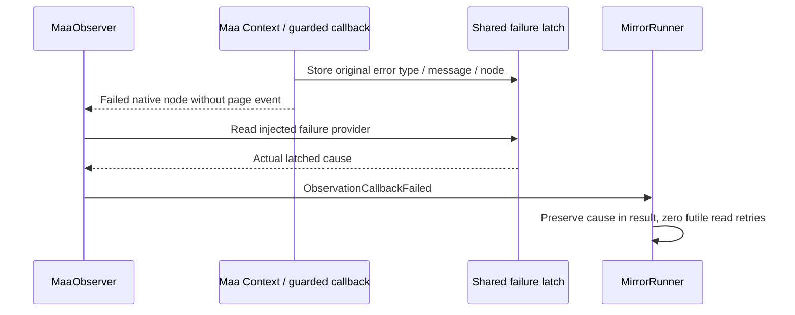


Continuous execution uses no stop_page; an actual stall, backend failure or unapproved cost remains a real ending. The controller is left running while independent source/Wiki work proceeds. Source changes are installed only after that controller has ended. The last continuous session ended on a real map-state defect, not a deliberate intermediate checkpoint; repair and state diagram are in[4.17](4-business-flows.md#feature-4-17).

## 9.4 学习与策略的架构边界

<a id="feature-9-4"></a>

**启动器容量修复（已安装并核准备路径）**：`launcher_cache.stage_launcher` 按完整 bundle 内容哈希复用外置 helper，避免每次启动复制一整份。不同版本不覆盖使用中的旧 helper；首次复制前核项目峰值容量，损坏 cache 拒绝替换，失败时清理临时 stage。新 launcher 已独立安装；19 项 installer/cache/prepare/diagnostics 测试通过。实际成品连续两次 `--prepare-only` 的目录、62 个文件 hash/mtime 和总大小一致；私有状态及 Agent/MXU 不变。下一步仍需 GUI 正常启动/关闭与公开更新验收，准备路径证据不替代它们。部署局部图与证据见[6.2.4](6-deployment.md#launcher-lifetime-capacity)。

**学习证据去重（2026-11-16）**：`persist_frame_proposals` 的 proposal 已包含原始 PNG/JSON 相对路径和两个 SHA256，`workspace.protected_evidence` 保护原件；新队列只保存 metadata/review，不再为同一观察复制图片。`review_storage.compaction_plan` / `compact` 只对 untouched pending、原件存在且哈希一致的旧 `frame.png/frame.json` 镜像做逐文件去重。已审核、有修改、缺原件或哈希不符的记录不处理；整份计划执行前和逐文件删除前重核，保留原件与标签字节。实测移除 164 个完全相同副本，释放 173,772,748 bytes，目录由约 1.96 GB 降为 1,788,261,000 bytes。56 项语义队列/容量相关测试通过，不是训练质量或游戏通关验收。入口 Back 的旧候选误称“到达编队配置”，原候选不改字节，另加 hash-bound correction 指明实际只到 MIRROR_ENTRY，尚未批准为训练标签。

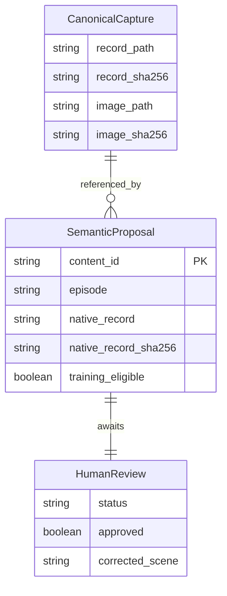

**可复现性缺口（2026-11-16）**：训练 ONNX 与部分权重仍在，不能笼统说所有权重丢失。根目录 `yolo11n.pt` 的 SHA256 `0ebbc80d…` 匹配初始化权重；`runs/detect/build/sinner-training-real-20261012-v2/train/weights/` 的 `best.pt`、`last.pt` 属于旧 **40 epoch**，不匹配当前 **120 epoch** model card 的 checkpoint `683b02a4…`。当前 **130 样本 manifest/annotation/120 epoch checkpoint 证据链仍未恢复**。原生 NN research 与 shop shadow 不等于闭环可复现或正式 policy。保留尚存模型/权重、模型卡与 review 引用；恢复原始材料或重采按 episode 隔离的数据后，重做原生留出评估与影子比较，不把旧训练报告写成当前已复现。

下图中“晋级后的推理/策略”是**设计目标**，不能读成当前生产已启用。已有基础分别在 `src/maalimbus/unknown_exploration.py:1`、`src/maalimbus/semantic_labels.py:1`、`src/maalimbus/learning_dataset.py:1`、`src/maalimbus/neural_shadow.py:1`、`src/maalimbus/shop_learning.py:1`、`src/maalimbus/shop_value_shadow.py:1`。MaaFramework提供识别/控制/Pipeline；训练、标签复核和策略晋级是本项目扩展，不称作Maa自带训练器。

已核对 pinned [MaaFramework v5.12.2 Pipeline 协议](https://github.com/MaaXYZ/MaaFramework/blob/v5.12.2/docs/en_us/3.1-PipelineProtocol.md)：NeuralNetworkDetect 在这一层加载检测模型并返回识别结果；本项目仍需独立实现训练与购买策略评估。购买 MLP 评分属于自定义策略扩展，不是 Maa 自带训练器或原生图像检测器。原先只凭 `ranked` 标记改变顺序的缺口已按下节修复并安装；留存候选仍未获得正式排序资格。


#### 成品运行证据保护

计划：同时解析仓库 `evidence/runtime` 与成品 `dist/MaaLimbus/evidence/runtime` 的证据引用。无法区分的应用相对路径保守保护两处对应文件。事务、账本、模型和复核记录引用的 JSON/PNG 成对保留；成品证据树存在受保护文件时不得整树回收。先验证两种根目录、相对路径与容量压力反例，再安装。本修复只改变保留规则，不授权游戏输入或模型晋升，也不执行实际清理。


源码已实现：53项存储/语义测试、16项安装/指纹测试通过。实际只读前后枚举新增保护716条路径，成品证据树由可回收变为排除。未执行实际清理；安装与最新完整套件仍需分别验收。


39b3aaf已安装，实际组件自检与私有文件保留通过。剩余容量工作：6次输入的星光路径除原始证据外又产生约32.7MB原生debug；优先在控制器宿主设置有界Maa SaveDraw/SaveOnError及学习代表帧采样，不能删除被引用原证据，也不能把AgentServer当作控制器宿主设置全局选项。未执行debug清理。


### 宿主调试副本与原始证据

计划：在真正的控制器宿主里，Toolkit默认配置加载后、任务创建设备前设置Maa全局图像输出选项。保留原生文本日志及Journal PNG/JSON/hash；原生接口必须确认设置成功，失败则在游戏输入前报告。AgentServer不能假装配置了另一个MXU进程。`native_evidence.configure_host`现接成品MirrorTask验证器及当前页只读观察器，尚未改造MXU宿主。

```mermaid
flowchart LR
  Host[控制器宿主] -->|SaveDraw / SaveOnError / DebugMode false| Maa[Maa原生运行时]
  Host -->|自身资源与冻结Agent| Task[MirrorTask]
  Task --> Journal[原始PNG + JSON + SHA256]
  Journal --> Queue[学习与事务证据引用]
  Maa --> Text[原生文本日志保留]
```

11项宿主策略/成品判定/Journal检查通过。实际Null输入当前页观察器确认原生设置成功并捕获INITIAL_GIFTS；不等于游戏操作、GUI宿主接线或整局容量保证。未删除旧debug图或原始证据。下一步对重复学习候选采样、对无引用截图做有界保留，保护pending事务、有效标签与楼层/到账证明。


### 有界入队与压力触发的截图保留（实现）

目标：整条镜牢在用户最新授权的3,000,000,000字节内继续，保护pending/已审核复核材料和游戏事务证据。运行时语义入队按episode/locale分别限制两类候选：有对象/图鉴帧最多32份，无对象帧最多32份且同场景只留1份（最多64份新候选）；显式离线采集不采样。旧无对象记录不再挤占真实罪人检测框的配额。已有proposal/review不改写，采样拒绝不授权输入也不停止游戏；未知成功转移走独立证据链。

Journal先为下一对文件预留容量。只有容量不足时，先生成只读保留计划，再选无引用中间PNG；保留JSON/hash历史、近期帧、首尾帧、页面变化、输入前后帧，以及状态/模型/复核/报告/源码测试引用。来源损坏或不完整即不具备回收资格。逐文件删除前先持久化清单，再核hash与引用；不回收其他活跃捕获流，不整目录删除。有效/受保护证据本身耗尽预算时明确报告，不能偷偷丢弃。

出口证据：采样/幂等/人工复核不变、容量压力/证据变化/安装根路径的协议测试；真实只读计划及仅对合格文件的审计回收；成品从当前HUD继续而不重放提交。存储测试不证明模型晋升、通关或到账。

`semantic_labels._frame_admission`已实现运行时配额，`capture_retention.plan/apply/reserve`接入Journal预留与审计回收。CLI `tools/capture_retention.py`默认只读，应用时需提供原计划并独立重核；复用现有controller lease排斥并发实机任务，不创建设备。包括嵌套报告引用在内，相关86例测试与43例Wiki检查通过。安装与实机续跑证据按实际完成情况另记。

```mermaid
flowchart TD
  Frame[原生截图与OCR] --> Reserve{下一对PNG / JSON能否容纳于3GB?}
  Reserve -->|能| Journal[写入canonical文件对与hash]
  Reserve -->|不能| Plan[选择无引用中间PNG]
  Plan --> Protect[保留事务 / 复核 / 模型 / 输入边界证据]
  Protect --> Intent[持久化回收意图并重核hash与引用]
  Intent --> Journal
  Journal --> Admission{运行时提案是否入队?}
  Admission -->|是| Queue[不可变待复核提案]
  Admission -->|否| Sample[记录采样原因并继续]
  Queue --> Review[人工或独立教师复核]
```

真实离线审计：仅回收46张无引用中间PNG，释放73,979,164字节；原JSON/hash记录及1,327份私有/复核/原生/引用文件保持不变。工作区1,903,771,882字节，设备输入0。报告`build/resume-20261117-capture-capacity-audit.json`；全量回归7 failed /2779 passed /710 skipped，290.42s，pytest原退出码1，同七项历史失败；后续installed5d84501实际从首战推进至VICTORY与MAP，incoming停页缺陷修复见4.14；长局容量、整层通关和领奖均未认证。

<a id="feature-9-4-1"></a>

**2026-11-17 观察时限与引用解析缓存（源码）**：真实引用扫描冷读约10秒，Journal容量压力下的重复扫描可能挤占单次30秒观察期限。`workspace.cached_references`每次重读文件并核SHA256，仅复用最多4096份文件的词法引用解析结果；每轮重新解析当前路径/链接，共用父目录只解析一次。新文件、同长度且mtime不变的内容修改仍立即生效；不缓存容量、回收许可或游戏事务。逐文件删除前的原JSON/PNG hash、引用重查和durable manifest保留。对象/无对象独立配额的回归保留所有旧proposal/review字节。68项相关测试已通过；当前源码尚未安装，真实压力回收时长、安装续跑及完整套件结果另记。

Full regression:7 failed /2821 passed /710 skipped in344.46s, pytest exit1; same seven historical archive/count/next-node discrepancies (`build/resume-20261117-reference-admission-full-tests.log`). Later invalid-path and Windows newline guards are included in the final68 related passes. Actual old/new reference sets match exactly (5,242 paths);11.222s original versus4.239s cold /2.278s warm. Offline pressure reclamation retained1,439 protected/private/metadata hashes and removed only12 eligible intermediate PNGs (20,637,356bytes); all original JSON remains, workspace1,935,578,642bytes with64MB reserved for deployment. The12-file audit took34.614s outside a native observation; this is not a promise that arbitrary pressure work fits30seconds. Report `build/resume-20261117-correct-deployment-capacity-verification.json`.

```mermaid
sequenceDiagram
  participant J as Journal
  participant R as Reference scanner
  participant C as Bounded parse cache
  participant F as Current files
  J->>R: Capacity pressure / revalidate before unlink
  R->>F: Enumerate and read current bytes
  R->>C: SHA256 + root/path/family
  alt same bytes
    C-->>R: Immutable lexical references
  else new or changed bytes
    R->>R: Parse and replace bounded entry
  end
  R->>F: Resolve current parents and links
  R-->>J: Current protected paths
  J->>J: Recheck PNG/JSON hashes before reclaim
```

### 9.4.1 购买排序的可复核参与凭据

`verification_summary` 现在将 observation、target、实际 review 字节哈希并入 dataset digest，权重文件另绑定 train/holdout scope 划分。`shop_value_promotion.evaluate` 从这些绑定记录重编码、执行与 runtime 相同的 MLP forward，重新核 scope 不交叉、样本不重复、划分与训练协议一致、标签非恒定、≥4 个可比较留出对且准确率 ≥0.6。modelcard 的 `participation` 只是请求；手填留出成绩不会进入最终日志。旧候选缺少新凭据仍可影子预测，不能只改一个字段就晋级，也不会因此停止镜牢。

`rank_preview` 只重排传入的计划候选，不添加报价或改变价格。日志按名称和价格绑定预测值，显示“影子预测值”或“神经排序值”，以及手动权重、规则队列分、实际重算留出指标和拒绝原因。`buy_learning_applied` 表示排序参与，`purchase_input_authorized=False` 表示评分没有消费授权；Maa 输入仍由原有交易、页面与玩家预算负责。新模型导出和复制前也检查 2 GB 项目容量。

```mermaid
flowchart TD
  ROW["已核购买与延迟结果<br/>observation / target / review SHA"] --> DATA["dataset digest"]
  DATA --> WEIGHT["weights：dataset digest + scope split"]
  DATA --> R["Runtime：重编码、相同 forward、重算留出"]
  WEIGHT --> R
  CARD["modelcard：请求 ranked 或 shadow"] --> R
  R --> Q{"独立 scope、非恒定标签<br/>pairs >= 4 / accuracy >= 0.6"}
  Q -->|通过且请求 ranked| ORDER["仅重排计划候选"]
  Q -->|不足或不一致| SHADOW["保留规则顺序；记录影子分与原因"]
  ORDER --> TX["既有页面 / 交易 / 玩家预算"]
  SHADOW --> TX
  TX --> MAA["MaaFramework 输入与后继取证"]
```

本轮相关检查 **335 passed / 208 skipped**；随后评分诊断补充检查 **82 passed / 1 skipped**。前者初次 Wiki 导航行检查失败，修正导航位置后重跑通过，未隐藏失败退出码。新 Agent 已真实安装，自检在打包进程内运行当前模型，假设报价输入预测约 0.5441，与源码一致；98 份安装私有文件与 28 份项目配置不变，项目约 1.88 GB。证据：`build/resume-20261116-installed-shop-participation-verification.json`，其中 `packaged_prediction_verified=True`、`installed_matches_source=True`，没有 controller 或游戏输入；该数值不是实时商店报价，也不是礼物强度评分。

留存模型卡记录 2 局 / 7 行，标签全为 0.6、可比较留出对为 0。当前 `build/learning-review/shop-purchases` 已缺失，读取结果为 0 条可复训样本；不能从留存模型卡反推原始证据仍存在。保留模型与影子功能，待重新取得真实差异结果与 episode 隔离数据再复训。隔离训练导出闭环和篡改反例证明代码协议，不证明真实购买策略质量。地图旧车头断言与后期一步规则冲突，原后继图缺失，仍保留该失败等待实机证明。

<a id="feature-9-4-2"></a>

### 9.4.2 自动事实标签与人工决定的优先关系

2026-11-16 的隔离复现发现两条覆写路径：`review_sample` 会把人工拒绝/修改改回自动批准，`shop_outcomes.sync` 会重置已有的结果批准字段。修复计划包含三条交付：保护人工输入；让未修改的自动记录随同局新证据更新；把标注接回普通收集链且不影响游戏事务。三条源码交付、隔离闭环与 Agent 安装已完成：c997729、526 文件源码指纹、自检通过、98 安装私有文件与 28 项目配置哈希保留。`build/resume-20261116-auto-label-installed-verification.json` 另核评分源码/成品一致，未产生新实机标签。完整回归为 7 failed / 2707 passed / 710 skipped，258.75s；保留原七项失败。

收集器先按现有交易规则核购买及延迟截图/账本，再合并新观察，保留人工批准与旧标签来源；没有当前 ledger 观察不等于旧结果为假，不会清掉旧结果。已归档 abandoned scope 也由共同的账本读者解析。新证据、标签、临时副本在写入前预留项目容量，证据用临时文件核 hash 后发布，途中出现的不同文件保留。

`shop_review_state.review_problem` 区分未动的 pending、带内容指纹的自动记录、人工批准/拒绝和未知修改。内容指纹只识别正常自动写入及后续编辑，**不是权限凭证或人的身份认证**。人工记录不被自动改写。自动标签必须重新验证购买差额、原始 JSON/PNG、时序与同 scope 账本；未知结果只留待核，不猜一个低收益分。两个文件分别原子写入，整体不是原子事务；若中断，下一次从同一已核结果补全，遇到人工编辑则保留编辑。

人工工具显式记录非自动教师的 `reviewed_by`，清理旧自动声明。训练器接受明确的人工 benefit，仍重验全部原始证据；人工批准不能使坏图或错误 scope 变真。旧人工工具遗留的自动 label_source 不会压过明确人工 reviewer。未明确接管的自动分数被改动后保留，但不能冒充已核的客观标签进入训练。

```mermaid
sequenceDiagram
  participant C as MirrorRunner / collector
  participant F as Sample folder
  participant A as Automatic fact teacher
  participant H as Manual review tool
  participant L as Training loader
  C->>F: 核购买与延迟证据，合并观察而不重置人工决定
  C->>A: 当前 scope 与账本
  alt 人工决定或未知修改
    A-->>C: 保留原文件；返回原因
  else 未修改自动记录或初始 pending
    A->>A: 重验差额、截图 hash、时序、scope
    A->>F: 已证事实标签；单文件原子写，来源标为自动
  end
  H->>F: 显式人工分数或拒绝；不改截图
  L->>F: 重读 review、原始证据与账本
  L->>L: 拒绝样本/坏证据排除；人工标签与自动事实分开
  Note over C,L: 标签异常不否定已核游戏动作；训练、晋级另验
```

普通 SHOP 收集调用会触发事实标注，不再依赖外部手动复核 CLI。Runner 日志显示自动事实标签就绪数与人工保留数；不把“已标注”说成“模型已训练/参与排序”。此前相关检查 323 passed / 208 skipped；没有当前账户的新标签或实机购买质量证明。

**延迟结果派发计划与实现（2026-11-16）**：最后一次购物后可能不再遇到商店，故不能只在 SHOP 收集。`record_ledger_event` 在真实账本写入完成后，把同 scope 的楼层/胜利结果交给 `shop_outcomes.refresh_scope`；`reward_task.finish` 在收据/HOME归档及交易完成写入之后归集，保留轮换前 scope。普通 Mirror 启动仅补一次遗漏标签；observe-only 不归集。若标签写入失败，保留已经成功的账本/领奖，下一次 Mirror 或已完成领奖的启动只补标签，不再次操作设备、领奖或轮换。没有同局购买事务时零写入；外来 scope 和路径穿越拒绝。收集器仍重验购买及延迟截图，人工优先关系不变。

```mermaid
flowchart LR
  G["Maa观察/操作与后继核验"] --> B["账本先记真实楼层/胜利"]
  P["独立收据与HOME核验"] --> A["领奖归档与完成交易"]
  B --> C["同scope refresh_scope"]
  A --> C
  R["明确启动时补收；observe-only除外"] --> C
  C --> V["购买与延迟证据重新核验"]
  V --> L["事实标签或保留人工决定"]
  V --> F["失败留pending；不撤销账本、不重发输入"]
```

新增隔离检查覆盖最后购物→胜利、领奖归档→标签、写入失败后仅补标签以及只读启动不写标签；相关集合 **174 passed / 75 skipped**，退出码0。收据审计在新增合成派发测试中显式隔离，真实审计由原测试负责，不能称为新实机收据。此变更已从 b62dbab 重建安装，实际自检与评分源码一致性通过，98 安装私有文件与28项目配置哈希保留，资源/模型未改；完整回归7 failed / 2720 passed / 710 skipped，保留原七项失败。详见PROJECT/acceptance和 `build/resume-20261116-delayed-dispatch-installed-verification.json`。安装不证明新实机标签或GUI派发。自动复训、私有模型发布仍需后续工作，不能把本节写成完整自学习闭环完成。

```mermaid
flowchart TB
  PI["MXU与ProjectInterface配置"] --> RUN["MainTask / MirrorRunner"]
  RUN --> MAA["MaaFramework Resource与Pipeline"]
  MAA --> PER["OCR / Template / 原生神经识别"]
  PER --> FACT["本帧事实与置信度"]
  FACT --> RANK["规则、手动权重、晋级策略；分别标来源"]
  RANK --> TX["预算、意图、后继、事务核账"]
  TX --> INPUT["单Controller输入"]
  FACT --> BUNDLE["episode证据与候选标签"]
  TX --> BUNDLE
  BUNDLE --> REVIEW["独立教师与人类复核"]
  REVIEW --> TRAIN["离线分集和训练"]
  TRAIN --> EVAL["模型卡、Maa原生留出评估、影子对照"]
  EVAL --> GATE{"晋级条件通过？"}
  GATE -->|否| SHADOW["保留shadow或规则回退"]
  GATE -->|是，设计目标| PER
  GATE -->|是，设计目标| RANK
```

首先列清当前哪些节点真正调用模型、哪些只写proposal、哪些为shadow/off，附模型hash和实际日志。识别和购买价值分别验收：买成功只证明交易，不证明藏品强度；重绘或赢一场不证明选择最优。商店手动优先级、保留金币、刷新上限、允许/禁止名单始终有效；模型不能扩大预算。

感知模型至少按episode隔离训练/验证/测试；同一局连续帧不能同时充当训练与独立验收。模型晋级前固定类别、阈值、误识别指标和回退条件，并在新episode跑原生Maa评估。购买策略先做历史回放和影子排序，按实际效果指标与规则基线比较；证据不足就保持影子，不得把“模型加载了”写成“学习控制已应用”。

## 9.5 标签、评分与证据的数据模型

<a id="feature-9-5"></a>

这是**逻辑模型**，不是声称所有实体已是一张数据库表。已有JSON/JSONL产物要做字段映射；缺字段先在规格写明，再实现。原图、OCR事实、动作结果、推断标签、人工裁决分开保存；标签更正保留版本。运行日志只展示真实参与决策的权重、各项加扣分、最终分、决胜规则、候选被排除的原因以及模型是否参与。

```mermaid
erDiagram
  EPISODE ||--o{ OBSERVATION : contains
  OBSERVATION ||--o{ DECISION : supports
  DECISION ||--o{ SCORE_COMPONENT : explains
  DECISION ||--o| INPUT_INTENT : may_send
  INPUT_INTENT ||--o{ OUTCOME : observed_as
  OBSERVATION ||--o{ LABEL_PROPOSAL : proposes
  OUTCOME ||--o{ LABEL_PROPOSAL : constrains
  LABEL_PROPOSAL ||--o{ REVIEW : versioned_review
  DATASET_VERSION ||--o{ SAMPLE_REFERENCE : pins
  SAMPLE_REFERENCE }o--|| EPISODE : grouped_by
  MODEL_VERSION }o--|| DATASET_VERSION : trained_from
  MODEL_VERSION ||--o{ EVALUATION : measured_by
  EPISODE {
    string scope
    string build_hash
    string policy_version
  }
  OBSERVATION {
    string png_hash
    string record_hash
    string scene
  }
  SCORE_COMPONENT {
    string source
    float value
    string direction
  }
  LABEL_PROPOSAL {
    string status
    string teacher_hash
    string uncertainty
  }
```

复核包至少含manifest、前后截图/OCR、动作意图与结果、评分轨迹、标签proposal与review状态；引用采用hash而非只靠可被覆盖的文件名。失败样本也收集，但“未知”不是负例，“无进展”不一定是按钮错误。模型训练资格由证据和复核状态决定；不能让自己的模型预测循环充当独立教师。

## 9.6 资源监控部署与接口

<a id="feature-9-6"></a>

监控不创建控制器，不抢截图，不阻塞输入。采样关闭时停止后台任务；建议低频起步，具体间隔写入设置并测开销。读取总GPU、VRAM、脚本进程CPU/RAM；若提供进程GPU，必须写明供应商与归属算法。缺值用null和reason，不能显示为0。

当前源码边界：`resource_diagnostics.sample` 已提供进程CPU/RAM和整卡GPU/VRAM采样，`NvidiaSmiProvider` 有固定参数和超时；`tools/resource_diagnostics.py` 是只读CLI。CPU以单核忙碌为100%，多核可超过100%。进程GPU只有可注入接口，默认 `unsupported / no_per_process_gpu_provider`，不是已实现归属。GUI异步调用、开关与实机同窗对照仍待验收。查询 `gpu` 路由查看当前符号和窄测试；结构检查通过不能证明这些行为已交付。

```mermaid
flowchart LR
  subgraph Desktop["Windows本地部署"]
    UI["MXU / Tauri GUI"] -->|只读命令，集成计划| COL["已有同步采样后端；GUI异步集成待实现"]
    COL --> OS["操作系统进程指标"]
    COL --> GPU["供应商GPU适配器，有超时"]
    UI --> IPC["Maa Agent IPC"]
    IPC --> AGENT["Python Agent"]
    AGENT --> FW["MaaFramework 原生识别和控制"]
    RES["Resource图片、字典、ONNX及模型卡"] --> FW
    FW --> MUMU["MuMu / Limbus"]
    AGENT --> PRIVATE["私有状态、日志、证据、复核包"]
  end
  GPU --> TOTAL["整卡负载，与MuMu/DSH共享"]
  GPU --> ATTR["可用时的进程归属指标"]
  COL --> SNAP["带时间戳与来源的结构化快照"]
  SNAP --> UI
```

接口沿用[诊断契约](../../plan-20261014-recovery-diagnostics.md)：version、sampled_at、interval_ms，进程role/pid/cpu_percent/rss_bytes/status，GPU provider/device_name/util_percent/vram_used_bytes/vram_total_bytes/status；整体和进程指标分开。明确CPU百分比是否按逻辑核归一化。不得采集或公开GPU UUID、用户名、机器ID或原始命令输出；不改系统权限。

P4验收包括同窗对照、非NVIDIA/无工具、超时、Agent退出、多GPU、开关开闭和游戏运行时采样。若运行中推理有GPU负载而面板无法归属，应显示“整卡可见、进程不可用”，不能伪造脚本占用。工具适配器具体实现由DSH选定并记入本节，架构边界不得改变。

## 9.7 验收矩阵与回写纪律

<a id="feature-9-7"></a>

**本轮出口（2026-11-16）**：P0–P6、四任务、NN quality、真实 GUI Start 与原范围全部开放。原生坐标 callback 已通过；Agent TEMP+TCP 启动修复已安装并实测注册 15 actions/exit 0。下一层 controller 文件访问误判已在源码迁为既有控制权的 session mutex，成品重建中、尚未实机通过。两处只读 handoff 已让 team/entry 中间页可见，但遗留 MirrorHard 路由仍开放；Team2 重配没有成功证据。接着核 canonical old scope、队伍与入场后继，再按实际时钟/页面/账本继续，最终证明 **Hard 五层 → 实际 receipt → 独立 HOME → 一次 rotation → reentry**。完整套件仍为 47 failed / 2513 passed / 709 skipped，后续窄测试不替代全量；历史归档审计差异也仍保留，不能因缺帧调低门槛。

- [ ] P0：原卡4意图有原生证据支持的明确归宿，成功/取消分别记录，没有重买或凭空到账。
- [ ] P1：当前成品GUI点一次开始能进入正确管线，原生导航节点通过；证据绑定安装版本。
- [ ] P2：脚本实际完成Hard五层；部署核对正确时不清空重编；每层奖励、商店购买/刷新均结算可追溯。
- [ ] P3：Team1、Team2和Team22的指定体系/顺序/EGO配置逐项核对；离屏队伍滚动按新鲜行与选中标题验证；单队与轮换模式不串用。未实现的EGO装备不得勾选通过。
- [ ] P3：头像/星光卡保存重开和参数应用一致；运行N局与步数/时间上限分开；日志展示候选、权重/分项、最终分、来源和理由。
- [ ] P4：资源采样真实可对照、缺失正确显示、开关有效，运行不抢控制器。
- [ ] P5：未知尝试、成功/失败标签包、人类复核、episode分集、原生模型评估、实际推理和策略晋级各有独立证据。
- [ ] P6：最新合并代码完整测试无未解释失败；真实GUI→五层→到账→返回→一次轮换/再次入场，并核明确预算。
- [ ] P6：双语wiki和局部图与实现/证据一致；新增计划组件已重新标注真实状态；隐私与发布门禁分别核验。

每卡结束按“计划要求→实际代码/配置→验证命令→实际产物→差异→处置”回写，不只增加一段进度描述。未达到条件则保持部分完成，带下一步。打断/超时/用户操作造成的运行结束与程序异常分别归因；禁止把旧局截图当新局实证。最新状态放验收与PROJECT，本文保留稳定完成标准。

```mermaid
flowchart LR
    W["阶段实施：卡号、依赖、变更文件"] --> E["证据：验证命令与实际产物"]
    E --> R["回写：docs/acceptance.md、PROJECT.md、wiki"]
    R --> V{"复核：关闭该卡的判据是否满足"}
    V -->|满足| Done["阶段完成"]
    V -->|不满足| H["保持部分完成：写下差异与下一步"]
    H --> W
    Done --> M{"P6：整套检查是否全绿"}
    M -->|有未解释失败| H
    M -->|无| Ship["提交并推送"]
    B["打断、超时、用户操作"] --> X["与程序异常分别归因"]
    X --> H
```

## 未验收 / 待核实

本章新增的是可执行计划及设计视图，**不代表P0–P6已交付**。GPU面板、模型晋级、显式连续局数、Team22体系EGO和整轮闭环仍按各卡实际产物判断。DSH正在运行的任务只观察其结果；不得为补计划重启控制器或替换活跃应用。


## 9.3.12 点击判定必须说明它看的是哪一帧，队伍位置必须能被读出

`map_click_result` 的 `frame` 曾经恒为 `None`：代码写的是 `getattr(self,'frames',None)`，
而 `frames` 只在 journal 上存在，`Runner` 上没有这个属性。现在点击派发时把帧名存进
`state['map_click_frame']`，三条判定（拒绝 / 接受 / 页面未变）统一读取；并且补了"页面既没变也
没移动时仍记一条"，避免意图被静默丢弃。真机验收：`packaged-mirror-20261022-075450` 388 事件、
13 条判定、13/13 带帧名、0 条 `None`、0 条静默丢弃。

`player_marker` 在直播帧上返回 `None`，循环无法只点相邻节点。新增 `map_vision.party_point()`
用队伍自己的火把（两枚上下相邻的暖色高亮斑）定位，该局 14 个地图帧全部读出，相邻帧位移
`(829,440)→(826,561)` 与一格步幅一致。

被数据否掉的假设同样记在这里：徽章点并不在节点上方空白（`(1020,327)` 落在 `?` 六边格内，
"下移 106"落在格子下方空地）；`GOLD_MARK_DROP` 全局改成 106 会让两条既有测试失败，说明偏移随
页面变、全局常量在结构上就是错的；用面积阈值取橙色边取到的是徽章图标而非连线。检测器在
`frame-0034` 上输出的中心与 `gold_marks` 重合，因为标签来自规则——这一项要改的是标注对象。


## 9.3.13 推断格不再直接当节点；连续被拒要说出"探索未恢复"

`lattice_step` 候选原先把格子推算点直接当节点中心。`packaged-mirror-20261022-080630` 的
`frame-0057` 显示同一批点里有的落在节点内、有的落在空地，而循环无从分辨。现在每个格子点先吸附到
120 px 内最近的徽章中心（徽章中心才是游戏提供的节点，见 `badge_mark` 一节），吸附不到就丢弃——
宁可少点一次，不点空地。

地图点击被拒有两种原因，帧上无法区分：候选错了，或探索尚未恢复。对照实验（同一设备、同一批候选）
给出判据：恢复前九次点击只产生 300–2000 px 动画，恢复后第一次点击即弹出节点面板（107 860 px）。
因此 `map_refusal_streak()` 在连续第三次被拒时记一条
`map_clicks_refused_while_the_exploration_may_be_unresumed`，`accepted` 时清零。它只**命名**，
不自动执行恢复——恢复导航仍未实现，这是已知的缺口。


## 9.3.14 连续被拒的地图不再点节点，而是先恢复探索

`map_refused_streak` 到达 3 时，runner 把地图页的进度控件放进 `plan_controls['map.progress_button']`
（`MAP_PROGRESS_CONTROL`，`src/maalimbus/runner.py`），`window.plan_map` 见到它就先返回
`the_exploration_must_be_resumed_before_a_node_click` 的计划，而不再点候选节点。未触发时行为不变。

依据是 9.3.13 记下的对照实验：恢复前九次点击只产生 300–2000 px 动画，恢复后第一次点击即弹出节点面板
（107 860 px）。所以"再点一个候选"在这种状态下是浪费，真正缺的是恢复。

已知限制：`MAP_PROGRESS_CONTROL` 来自单帧目测，只在一个分辨率上验证过；`plan_map` 目前只发起
"打开进度控件"这一步，`Dungeon Progress` 里的 `Resume` 仍由后续帧的常规计划处理。


## 9.3.15 恢复链的最后一环：进度面板上的 Continue 要有锚点

`window.plan_step` 对 `DUNGEON_PROGRESS` 早有分支，只按 `dungeon_progress.continue_button`
并且"没有锚点就不猜"。但真机 `packaged-mirror-20261022-084358` 显示：恢复计划打开了面板，
随后立刻 `continue_button_not_anchored`——分支在，**没人绑定**。

现在 runner 在该页从本帧 OCR 里绑定文本为 `continue` 的那一行，`Forfeit` 一律不绑。
面板上五个按钮里只有它继续当前探索，`Forfeit` 会结束这一局，`Config` 会中途改设置。

这次修复本身也留下一条教训：新增页面前先检索是否已有分支。本轮为此多写了一个重复分支并回滚。


## 9.3.16 只有一步之内的节点才能移动队伍

`map_clicks` 的候选此前只排序、不做可达约束，于是循环反复点隔两格以上的节点，判定全为
`rejected` 而队伍原地不动（`packaged-mirror-20261022-085428`：队伍在 `(1052,562)`，目标从
`(576,361)` 起）。手测证明相距 219–395 px 的邻居可点、会开面板。

现在 `map_vision.adjacent_to(party, boxes)` 只保留中心距队伍 150–430 px 的候选，并在
`runner.candidates_of` 里接上。读不到队伍时不过滤，避免"读不到就不试"。

先试格点精确匹配（`(384,0)/(192,110)/(0,220)`）会把真实邻居滤掉——实测偏移与任何单一格点
向量都不吻合，所以改用距离带。


## 9.3.17 读不到队伍就不许点节点

`party_point` 的搜索带到 `0.79 × 宽` 为止，而队伍走到地图东侧时在 `x≈1628`（`packaged-mirror-20261022-090550`
的 frame-0006/0010/0014 全部返回 `None`）。兜底是"读不到就不过滤"，于是相邻约束一次也没生效，
循环把 6 次点击花在两格外的节点上，队伍不动。

现在：带宽改到 `0.95 × 宽`（三帧均读到 `(1628,558)`），且**读不到队伍时 `candidates_of` 返回空候选**，
让循环走具名停因/恢复，而不是猜测。


**2026-11-17 capture retention refinement (source)**: HUD/UNKNOWN/LOADING oscillation is one storage segment, retaining each scene's first example, recent frames and input/unknown-exploration boundaries. This does not merge gameplay states. Only older successfully closed controller sessions may compact ordinary intermediate input boundaries, retaining their last causal pair; failed/uncertain sessions remain conservative. Confirmed Null-input read-only probes may compact repeated non-map captures only with complete task-stop/no-input proof. JSON/hash history and explicit business/model/review/report/source references remain protected.64 related tests passed. An actual read-only plan still found only about13MB eligible because legacy pending review records pin many captures; these policies do not magically reclaim that protected evidence. No new capture deletion was applied by this refinement.


<a id="feature-9-4-3"></a>
### 9.4.3 Supplier map classifier compatibility plan (not runtime integration)

```mermaid
flowchart LR
  Source["Pinned supplier ONNX + preprocessing"] --> Adapter["Fixed batch + ImageNet graph adapter"]
  Source --> Reference["CPU ORT reference"]
  Adapter --> Native["Maa native top class and score"]
  Adapter --> ORT["ORT full logits"]
  Reference --> Compare["Numerical comparison / no quality claim"]
  Native --> Compare
  ORT --> Compare
```


Pinned source inspection found two external classifiers, not detectors: mirror_legend has RGB NCHW dynamic-batch3x110x130→8 logits; mirror_path has3x224x224→9 connection logits. Supplier preprocessing applies ImageNet mean/std; path outputs need independent sigmoid, whereas MaaFramework.NeuralNetworkClassify retains raw logits internally and applies softmax; the current public result exposes only top class/rounded score. Maa's pinned native implementation resizes with INTER_AREA, converts BGR→RGB and divides255, then uses the model's input shape directly. A dynamic batch and missing mean/std cannot be ignored.

Plan: (1) bind supplier ONNX/classes/preprocessor hashes to the verified Git source cache; (2) create an explicit fixed-batch ONNX adapter with mean/std in graph and unchanged weights/logits; (3) compare actual CPU inference to Maa-native inference on retained real crops using the same resize and report differences; (4) keep all new outputs external-model shadow proposals, with input_authorized=False and no claim of local training or heldout quality. Crop/scale quality and later independent transition labels need their own tests before runtime participation. Temporary candidate output is bounded and removed; current game controller is not replaced. No detector or shop-policy quality is inferred from classifier numerical parity.


Actual offline compatibility probe now passes6samples (two models×three real regions): fixed-batch/ImageNet graph adapters preserve full logits in CPU ORT, and Maa-native top class/score agree. Source model/label/preprocessor hashes are bound to the pinned Git snapshot. Native full logits are unavailable; no detector, local training, heldout quality or runtime control is accepted. Temporary models are removed after the probe.

<a id="feature-9-4-4"></a>
### 9.4.4 Measure a connected node instead of using a click-box ruler

Actual continuous run bought two gifts/refreshed twice, then stopped naturally on MAP. The next red node is about384px from the train, while190px click-box width was treated as pitch; a badge/chevron won instead. The train flame also changes shape with animation: a fixed65px flame-to-node lift selected a body fragment.

Plan: detect the train body by paired warm lamps, central clock body and independent flame; derive its node centre from lamp spacing. Admit a compact red node outline only when the visible outgoing line connects it to that anchor. Bind one-step reach to that measured segment, keep its full measurement in logs, and leave other frames on the existing reader. Negative tests remove each independent part/line, add ambiguity and cover scaled real frames. A fresh native NODE_PANEL successor is required for live acceptance; no manual node click or unconditional distance relaxation. Pending actions remain subject to the existing causal successor/rejection rules.

```mermaid
flowchart LR
 Body["Paired lamps + clock + flame"] --> Anchor["Measured train node centre"]
 Ring["Compact red outline"] --> Line["Visible connecting segment"]
 Anchor --> Line
 Line --> Reach["Measured pitch and candidate"]
 Reach --> Native["Maa touch then fresh successor"]
```

Storage: preserve native frames/config/review state; retire only verified inactive downloadable WebView component cache. This does not accept long-run storage capacity or neural control.


<a id="feature-9-4-5"></a>
### 9.4.5 Outcome-owned evidence retention under pressure

MAP裁决日志的`frame`是原输入，不是新捕获；存储游标现在只把它当裁决元数据。普通no-op只有在匹配目标／框内350–750ms输入、原始PNG绑定、新鲜完整同层MAP和显式rejected裁决一致时才可退役非关键诊断；当前最后输入对、closed最终MAP、未判断／其它输入打断和所有外部业务／学习引用继续保留。已回应视口手势遇到两份更晚、不同捕获的完整同层MAP后，可用最新读数替换旧诊断端点；未回应意图与跨模块required始终覆盖。134项相关检查通过，实际退役6份诊断图／6,775,901bytes，836份私有／复核文件、11组关键图、全部JSON不变；封存日志另无损压缩885,529bytes。

视口诊断也由独立领域投影负责：`viewport_evidence.diagnostic_index`只接受显式zoom／drag意图后、同scope同floor／pack的原生MAP新读数；UNKNOWN、其它输入、缺失／变更图片、时间倒置或混合scope都不提供回收依据。保留最近两组读数及所有未回应意图。零输入`map_view_probe`不会把已证明冗余的帧变成永久输入边界。各投影的required取并集，视口诊断不能覆盖战斗退出证明；业务／model／review外部引用仍优先。它不证明手势已发送／移动成功／导航成功，不写游戏状态或学习批准。102项相关检查通过。

规范复核存储已同时覆盖购买结果（`shop-purchases`）与普通刷新收益（`shop`）。显式且区分样本类型的sidecar绑定原始native JSON/PNG哈希；可移植数据集仍保留副本。创建前预留输出空间，重复归集保留人工决定与样本地址。实际四份刷新样本重验通过，删除16份逐字节相同的副本，回收7,619,730bytes；14份原始证据及823份私有／复核记录不变。封存native文本日志另行无损归档，回收9,054,375bytes。108项相关检查通过。这接受重复增长修复，不代表长循环容量已验收。最新控制器正常停在第三层第二场战斗HUD，不重放入场／部署；同Team2账本floors[1,2]，没有第三层完成／领奖／轮换。

```mermaid
flowchart TD
  Sample["购买结果／刷新收益复核"] --> Sidecar["显式类型与原生哈希引用"]
  Sidecar --> Keep
  Classify["Evidence ownership"] --> Critical{"Critical business/model/review reference?"}
  Critical -->|yes| Keep["Keep proof"]
  Critical -->|no| View{"Answered ordinary viewport diagnostic?"}
  View -->|yes| Candidates
  View -->|no| Result{"Completed battle with matching native proof?"}
  Result -->|yes| Candidates["Older ordinary intermediates"]
  Result -->|no| HUD{"Allowlisted HUD diagnostic + verified later HUD?"}
  HUD -->|no| Keep
  HUD -->|yes| Candidates
  Candidates --> Pins["Keep last two HUD pairs / scene boundaries / recent frames"]
  Pins --> Audit["Durable intent + revalidate + reclaim under pressure"]
```


The continuous run reached floor2 while captures approached the2GB cap. Retaining every ordinary battle tap in a closed failed controller session forever wastes space even when that battle has an independently captured result. Plan: compact only older battle-input boundaries whose later BATTLE_RESULT JSON/PNG hashes remain valid; retain the last battle input pair, every scene boundary, unknown exploration, all business/model/review references and recent frames. Current/unfinished battles and missing/changed result proof remain conservative. Consider closed sessions even among the newest five; preserve each session's recent window rather than blanket-protecting whole directories. Metadata and durable reclamation history remain byte-exact. No game-state mutation or change to live input logic. Validate isolated missing/changed proof and reference controls, then inspect an actual read-only plan before any reclamation.


<a id="feature-9-4-6"></a>
<a id="runtime-migration"></a>

### 9.4.6 正式架构迁移交付表

2026-11-18重新基线：此前源码、安装、自检、截图回放和实机成绩全部保留为可行性材料，不能累加为这次收敛的完成证明。FrameRef/TransitionVerdict只有部分正式消费者，通用Observation、统一执行/裁决及完整容量读取链仍未完成。当前安装版本与新源码分开记录；本节以下旧“下一步”和运行数字均为历史切片，当前顺序以下表为准。

| 顺序 | 当前产物与明确边界 | 退出证据 |
| --- | --- | --- |
| 0：Wiki接入 | project-wiki为唯一通用入口；项目路由独立，SessionStart保存索引桥接；用户已正常审核信任，主机触发尚待观察 | 新旧CLI/导入兼容、实际安装读取器送达、未知文件/超限/版本/越界反例；不冒称运行时完成 |
| 1：契约核实 | 在第1–7章核实唯一生产者/消费者、单位、前景、scope、恢复与学习边界；所有提议类型标未实现 | 关键故障可从词典/路由定位到唯一判据，原未决事务不丢 |
| 2：运行时收敛 | 统一新观察、前景分流、动作尝试和后继裁决；登录/覆盖层先处理自身控件，不能借背景MAP点击；退役被替代的旧分支 | 同一失败帧及擦除/错scope/旧帧/未发送反例通过统一正式入口；UNKNOWN可有界探索但不伪成功 |
| 3：容量与串行回归 | 关键证据按同一读取接口保留，整目录3000000000字节（用户最新授权3GB）；维护、测试、构建、实机串行，测试期间不改源码 | 原引用逐字节读回、容量不足先拒绝输入、pytest自身退出码与所有失败原因；不以局部绿灯代替整套 |
| 4：正式成品连续验收 | 核安装指纹与私有状态，从实际登录恢复当前Team2同一局；单个MainTask连续推进，不按观察超时重启 | 登录→HOME→同局→剩余楼层→授权范围内实际领奖→独立HOME完整链；若需新预算仅在fresh offer处明确处理 |
| 5：独立学习质量 | 本轮不加功能、不自动推广shadow模型；已有教师/自标签/人工修订链先核来源 | 推理成功、策略参与、独立质量、收益分别有证据；无证据保持未验收 |

hook上下文使用与任务回收见[8.7–8.8](8-agent-rules.md#project-wiki-hooks)。六类图按各段问题服务：第2章职责架构、第3章交互时序、第4章局部业务流与状态、第5章数据关系、第6章实际部署/容量、第7章验收；不能用一张总图代替局部生产者和消费者。计划变更写回对应正式段落，真正属于通用Skill而非项目接入的缺口才向上游提未合并PR。

历史切片记录：

下一切片：原生观察帧绑定（2026-11-18，实施计划）。保留原始帧重放已证明，事件指定战斗frame0011时，旧runner.observe仍能补入更新商店frame0055的OCR／哈希。把FrameRef实现为公共不可变身份（会话内原文件位置、frame_id、原捕获时间或显式未知、JSON／PNG哈希、实际尺寸）；原生MaaObserver及捕获策略共用原始字节校验和事件补全。命名文件缺失／变更／冲突不得借最新文件；具名UNKNOWN仍由领域有界探索。旧无名回放适配明确保留legacy，不能伪造FrameRef；同像素复用不等于新业务完成。先验证错帧／擦除／冲突／元数据反例和真实原帧，再验证源码及冻结原生入口；不改游戏事务、消费或模型授权，也不宣称整个Observation/kernel迁移完成。

当前恢复／空间修复（2026-11-18实施）：恢复记录和执行共用规范拒绝类别，非MAP不执行地图缩放／拖动；具名控件探索保留。仅实际成功冷启动在同Agent／同设备建立一次最多180秒读取窗口，原总期限优先，不循环重置。容量拒绝保留原始错误和used／required／reclaimable／limit；不改2GB。先无损打包Git松散对象，原对象集合／refs／fsck不变；关键不确定恢复pair另有强引用，任何截图回收都遵循现有引用／原哈希／未决事务保护。已启动无损PNG归档的只读压缩可行性测量；未迁移／删除任何原图，只有实际收益和透明读取验证成立才集成。修复与验收后仅一控制器连续同局，不按观察超时重启。

```mermaid
flowchart LR
  A["A: contracts + failure replay corpus"] --> B["B: one map-to-next-floor chain"]
  B --> C["C: full Mirror + interrupted recovery"]
  C --> D["D: shared task capabilities + validated learning"]
```


架构已接受，正式契约在第1–7章；[2.4](2.4-runtime-redesign.md)仅提供导航。以下记录真实交付状态，不将规范接受等同实现或安装。

阶段B捕获切片（2026-11-18）：先验证Maa5.12.2反向SetOption，再复用统一读取入口实现战斗1280／独立1920回退及大图后继容量预留。源码／原生跨Agent已验证，安装／实机状态以顶部checkpoint为准。原生正式MirrorLoop只读也经实际入口验证，商店只读副作用已隔离。完整镜牢与模型独立质量仍开放；不能把尺寸优化当阶段B退出证据。见[6.8.1局部时序](6-deployment.md#battle-capture-profile)。

| 阶段 | 交付 | 当前事实 | 退出证据 |
| --- | --- | --- | --- |
| A | 规范词典/核心契约与旧字段适配 | 正式规范已合入；统一类型/适配未完成 | 旧未决状态不变；反例回放与字段来源 |
| B | 唯一地图闭环与容量预留 | 页名裁决已实现/安装；Mirror Agent容量首段源码已接，几何归并/全覆盖待做 | 成品连续地图→战斗→商店→下一层，3GB内 |
| C | 镜牢全能力迁移 | 未完成；保留现有领域事务 | 固定队/轮换/实际到账/再入场与中断恢复 |
| D | 跨任务与学习推广 | 未完成；NN仍shadow/独立结果不足 | 新任务复用接口；独立局质量和策略收益 |

最新运行：0af685f 成品原生入口连续运行，在第二层商店后进入战斗，08:12 UTC 因受保护证据占满2GB而结束；未重启或清 pending。容量修复属于 B 的退出条件，不得靠多开控制器或删除关键证据通过。


Historical first-slice implementation record (2026-11-17): use a small immutable MapTransition with accepted/rejected/unjudged outcomes, deriving allowed named successors from the existing planner rather than duplicating its table. Preserve UNKNOWN/loading/covered outcomes and the original pending; only an independently named allowed successor can promote it. Log before/after frame identities for later supervision. Replace the old `not MAP => accepted` path instead of adding another competing verdict. Also retire completed battle input boundaries by their actual BATTLE_RESULT evidence, even while the overall controller session continues: unfinished current battles remain protected. This removes the process-ended assumption that still forced capacity stops between battles. Validate missing/changed proof, active unfinished segments and deferred-then-late-success recovery before installation.


Capacity follow-up: the next native session again hit the2GB cap mid-battle. Protect critical business/model/review evidence, but older ordinary HUD assignment/start/speed diagnostics need only their representative state and last two causal pairs once independent subsequent HUD reads exist. They are not receipts or proof of strategic benefit. Plan a narrow allowlist for those nonfinancial controls; unknown exploration, paid/EGO/other actions and unanswered latest input remain conservative. This stores fewer historical pixels without claiming the old action succeeded. Regression children must disable disposable bytecode, which otherwise grew the project beyond its cap during a full run; actual caches were removed with configuration hashes unchanged.


First implemented slice (not completion of stage A): immutable `map_dispatch.MapTransition` derives named successors from the existing planner. UNKNOWN/loading/covered/unexpected pages remain unjudged; original pending survives, known successor retires only its matching target/commitment, and before/after frame identity is logged. Removed the competing step-tail `page != MAP => accepted` path and tightened the MAP dispatch ceiling30→29. Geometry-based displacement judgement remains a separate legacy path for stage B; this does not claim all map inference is unified.272 related tests pass. A verified retained MAP→NODE_PANEL pair and four explicitly synthetic uncertainty controls pass with31actual private files unchanged and zero input.

Latest complete regression before the final outcome-owner consolidation:7 failed/2921 passed/709 skipped in333.00s, own pytest exit1; the original seven historical archive/count/next-target issues remain. The preceding10-failure run also exposed a new probe's nested replay import and two stale tests: the old normalization spelling and an assumption that a real sample queue must always contain pending items. These were repaired with behavior/evidence checks, preserving the10-independent-scope training minimum. Actual shop readiness is2verified rows from1scope, so training_ready=False/production_enabled=False.

Retention now separates critical business proof from ordinary HUD diagnostics: earlier nonfinancial assignment/start/speed inputs with a fresh verified HUD read can compact while retaining the last two causal pairs, scene representatives/recent frames and all external references. Completed battles can compact inside a continuing controller session; unfinished or unverified business actions remain protected. Real offline reclamation27,980,768bytes preserved793referenced files,29top-level private JSON files and986native JSON files. During the earlier full regression Python regenerated11.3MB disposable bytecode and briefly exceeded the folder cap; that cache was removed, and the test runner now disables bytecode for its children. This overshoot is recorded as a defect, not long-run capacity acceptance.


2026-11-17 offline contract migration: runtime_contracts.TransitionVerdict now owns the three canonical verdict values and validates immutable successor contracts/reasons. MapTransition is a compatibility alias and the production map judge uses this record; no second verdict owner or broader successor table added.50 related tests passed. This source is not installed/live verified. MuMu is reserved by the user for another game: no device connection, controller or native input during migration; retained-frame validation only.


Contract-migration verification:65 Wiki/contract checks passed in37.72s; the broader related map/retention selection passed50 checks in5.61s. Retained native MAP→NODE_PANEL JSON/PNG hashes verified, four synthetic obscuration controls preserved original pending,31actual private configuration files unchanged,zero controller/input.48routes resolve current symbols. These are offline source/document checks, not new live/GUI/full-run acceptance; full-suite failures remain separately recorded.


2026-11-17 阶段B容量迁移（源码）：EvidenceCapacity 占位空间、双槽resize恢复、Journal精确消费与停止报告释放已接入镜牢 Agent。16容量测试、84相关检查通过（另66历史fixture跳过）；历史帧真实Journal隔离满额写入/下一输入拒绝/31私有文件不变已核。完整套件快照为7 failed/2950 passed/709 skipped，349.34s；随后的动态scope/停止报告完善通过74项相关检查，未宣称当前源码全套通过。未安装；MuMu由用户挂其他游戏，本轮不连接控制器。剩余：原生复合节点内部逐输入、独立任务/CLI、任意补读/尺寸变化/超额元数据、整局压力与统一单份证据存储。


2026-11-17 实机恢复前的容量阻塞：成品38823aa已安装、自检通过，98安装私有文件/31配置保留；MuMu已在线但前台为Android桌面，未点击。只读预演23MB准入仅有1.3MB可回收，故先迁移封存build报告的字节保持归档和引用扫描；不删除原始帧/收据或误放行资金预算。读取层源代码已接，归档需先验证新冻结程序能读取同一保护引用。


2026-11-17 stage B startup/capacity implementation: immutable archive activation is installed and source/frozen pins match. Fresh HOME was incorrectly held at the title wait, yielding23 reads and zero input before failure. Declarative navigation checkpoints, exact-byte writers, CLI native debug suppression and sealed input-free HOME retention are now implemented and passed122 related checks. Installation/live continuous Mirror acceptance follow separately; no pending transaction, payout budget, victory or rotation changed. Seven earlier full-suite failures remain open.


2026-11-17 live migration correction: installed1bd533a,98installed/31canonical files preserved; actual fresh HOME checkpoint completed with one observation/zero input. Installed MirrorTask then navigated HOME→DRIVE→MAP floor2/The Unconfronting in the existing Team2 scope. Reverse two-finger calls used an empty controller ID and blocked; the existing watchdog recorded the ending and Agent exited. Its orphan verifier host was closed only after actual producer absence and terminal evidence, not a timeout restart. Native MultiSwipe/task-context routing plus actual-producer-aware host cleanup now pass78 input/host checks; extended reference-review group95passed/11historical skips. Real Maa Resource accepted the new node with zero controller/input. Navigation review mirrors were retired by original hashes; original evidence and labels retained. New gesture installation/live acceptance follow separately.


Native continuation4fab9e5 actually zoomed/panned on floor2, then declined a node input for evidence capacity (three recorded ordinary/exploration inputs; normalization gestures are additional). It ended normally, not a timeout. Audit found the normalizer still bypassed the new pinch owner; caller migration and59focused checks/9historical skips now cover this. A closed-session retention plan can reduce diagnostic tail8→2 while retaining all action/scene boundaries, private/model/review/report pins and JSON; apply only with original hash/reference checks and actual producer absence. This does not resolve game pending or approve a learning label.


2026-11-17 target-role slice: installed448af15 used the shared device pinch and capacity gate, but progress-panel recovery was still tested against node reach and ended normally on map_target_outside_current_step. The planner now supplies an explicit node/page-control role and bound control ID; the dispatcher and node bookkeeping share map_dispatch.is_node_action. Zero-candidate progress recovery remains possible; unbound/legacy nodes retain reach checks. Whole-Runner retained-MAP plus synthetic-progress replay and negative role controls pass; actual opening remains to install/live verify. No abandonment, new resource grant or bookkeeping credit.


2026-11-17 ownership slice: actual progress opening is verified, resume is not. Named-panel background probing and animation-induced MAP misclassification were separately exposed, then corrected in the shared foreground predicate/detector. Same-current-scope entered run may restore the resume goal, never completion or spend.103related checks pass/43historical skips; install/native acceptance follow. Closed-report archive now retains103reports with identical original bytes and reference pins; redundant derived containers retire only after member equality.621old diagnostic text files are losslessly archived;46inactive prototype WebView cache files rebuilt on demand were retired,857private/review files unchanged, no native frame deletion in that cache operation. These bounded migrations do not establish long-run capacity or trained-policy quality.


2026-11-17 callback transport follow-up: actual named-panel recovery returned the same Team2 floor2 without blind-map probes; independent21pair audit:`build/native-existing-team2-navigation-real-verification.json`. Reverse swipe still inherited an empty Controller ID after the composite pinch; callback input now declares Context ownership for click/swipe/pinch instead of inferring route health from ID.85related checks pass; installation/live gesture/room progress remain next. This is not new clear, payout, GUI Start or neural quality.


2026-11-17 occupied-room/viewport slice: native Context gestures work, but installed e11d082's pre-planning normalizer hid the current room before its new probe could dispatch. The repair moves complete sprite evidence ahead of legacy badge guesses, lets an admitted own-room control keep its viewport, and corrects the shared gesture direction/zero-motion contract.114related passes/11historical skips; full-run and current native room entry are still open. This applies accepted Observation→Capability→bounded action→independent successor semantics locally; it does not claim common LaunchSpec/ActionProposal/EvidenceStore migration is finished. The extra probe is one current-room inspection after three pans, not an unlimited retry or a model-approved training label.


2026-11-17 native room acceptance: ca292fd independently opened the current room and reached PRE_BATTLE_TEAM. A read-only hash/geometry/native node-panel audit is build/current-room-native-real-verification.json. The real proposal remains human-review pending/training-ineligible; no model promotion, new floor clear or paid receipt is claimed. The continuous task then ended naturally for evidence capacity before deployment input. EvidenceStore migration now distinguishes pin inventories, unknown/loading observations and explicitly judged closed MAP diagnostics;78related checks pass. Global2GB pressure remains a runtime acceptance concern rather than permission to discard business or review proof.


Image runtime profile b714aac is actually installed: optional video backend omitted, actual PNG/resize/native-library/EN-JP-resource self-test passed,98installed private and31canonical files preserved. Team2 remains a partial selection; count-commit producer→retention wiring is the next source slice, with native continuation still required. The slice implements domain-owned count acknowledgment consumed by shared evidence storage; it does not infer a correct team or self-approve labels.


2026-11-17 logical-scope storage slice: de23609 proved actual automatic reclamation and8→9/12 continuation. Remaining capacity pressure exposed recorder-local tails. The next source slice projects verified selection commits across recorder restarts, with native page/reset/count barriers and preserved unknown/non-selection/external pins.91related checks pass. This is the accepted game-scope/recorder separation applied to EvidenceStore; native full deployment and battle remain unaccepted.


旧40epoch训练产物保留形式更新：`runs/detect/build/sinner-training-real-20261012-v2/train/`的24份原始文件现保存在同级`sinner-training-real-20261012-v2-closed.zip`，每份原字节/路径/hash均核对后才移除松散副本。包括不同hash的best.pt与last.pt，未合并模型。当前运行ONNX/config/review不变。见`build/closed-research-training-archive-verification.json`；缺失120epoch链仍未恢复。


最新训练保留容器：旧40epoch的24份原文件现为同级`sinner-training-real-20261012-v2-closed.tar.xz`（solid tar+xz）；前述ZIP是已退役的派生容器。24份原始payload/hash均再读核对，两个不同checkpoint未合并，运行ONNX/config/review未改。缺失120epoch链仍未恢复。

2026-11-17 实际安装7263634后，第三层首次编队12/12徽标完整匹配保存顺序；只提交To Battle一次674ms，没有ClearSelection或逐张选择，并到达HUD。`build/team2-floor3-inherited-deployment-real-verification.json`保留原始before/HUD双哈希。此为槽位出战顺序证明，不是完整人格/EGO证明；独立caption教师仅6/12，真实原生神经推理11候选框仍shadow、qualityFalse、inputAuthorizedFalse。该场战斗运行中，尚无第三层通关/最终领奖/轮换。


实际独立headless浏览器中Mermaid11解析266张Wiki图全部通过；新增中英导航／存储局部视图均实际渲染，独立原文件保护分支已看图核对。存储总览较密，既有readable模式保留矢量细节。见build/runtime-convergence-wiki-render-final.json；图示证据不代表游戏验收。
